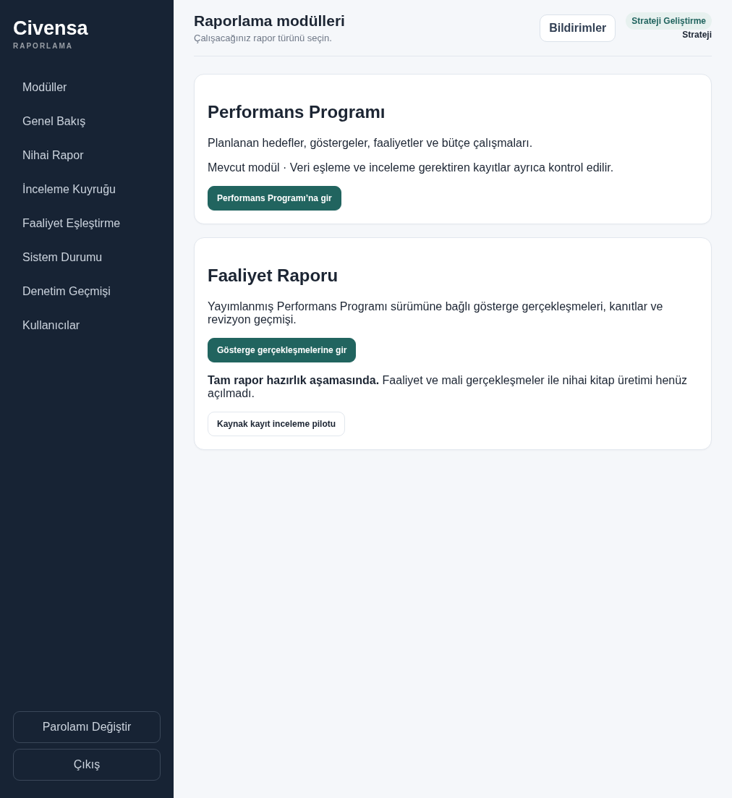
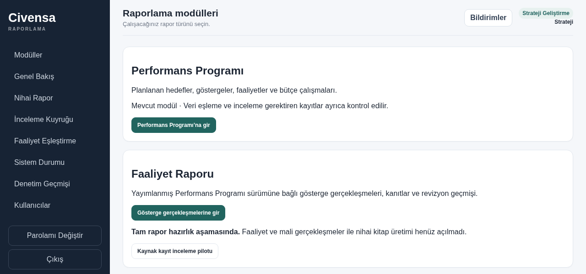
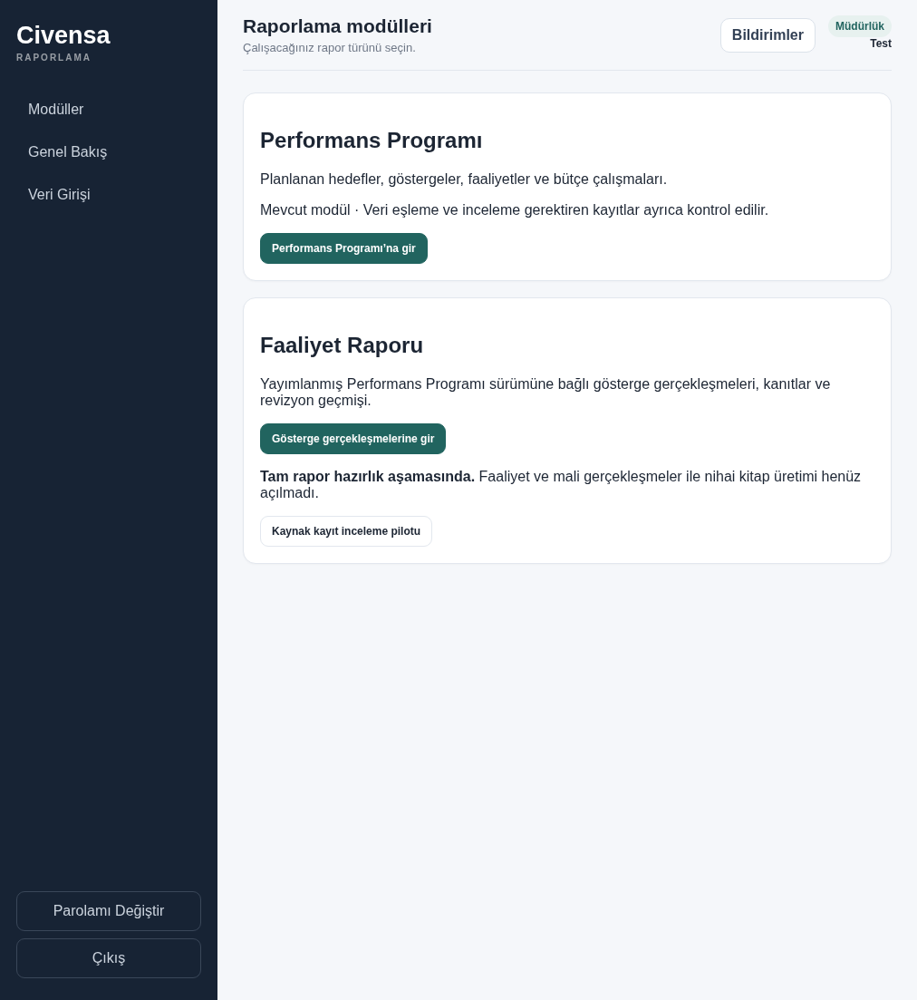
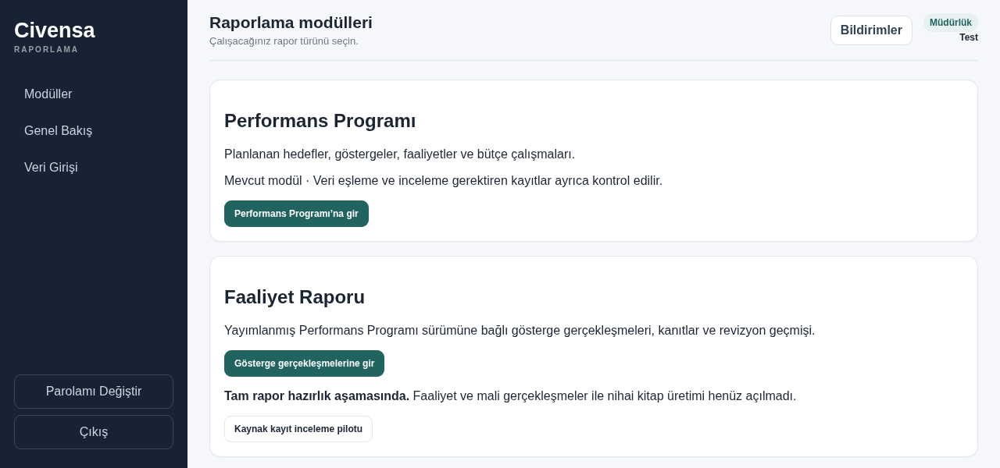

# CIV-009 sidebar browser evidence

Headless Chromium 151, authenticated local `/modules` page with disposable test
users. The browser receives the real application templates, CSS and JavaScript
through FastAPI TestClient request routing. TestClient holds the signed session;
login, authorization, CSRF logout and session invalidation use the real handlers.
No live database or deployed service was used.

Both Strategy (`strategy`) and Directorate (`department`) passed at 1012×1103,
1366×768, 1280×600, 800×900 and an additional 800×320 scroll stress case. The test
checks ordered, nonoverlapping bounding boxes, visible unclipped text, browser
clickability, opening/cancelling the password dialog, and independent logout
followed by refusal of authenticated access. At short heights the sidebar scrolls;
the account controls remain together and reachable. The narrow sidebar is 180px
wide to retain the unchanged Turkish account labels.

The four screenshots below were captured by the test after bringing the account
controls into view and visually inspected. Fixtures contain synthetic data.

| Role | Desktop 1012×1103 | Short 1280×600 |
| --- | --- | --- |
| Strategy |  |  |
| Directorate |  |  |

CI installs Playwright Chromium and runs these tests in the full suite without
skipping. Local reproduction with a system Chromium:

```sh
CIVENSA_CHROMIUM_PATH=/usr/bin/chromium CIVENSA_UI_SCREENSHOTS=docs/civ-009 \
  python -m pytest -q tests/test_sidebar_ui.py
```

Without `CIVENSA_CHROMIUM_PATH`, Playwright uses its installed Chromium. Missing
browser installation fails the test, so CI cannot silently omit this regression.
