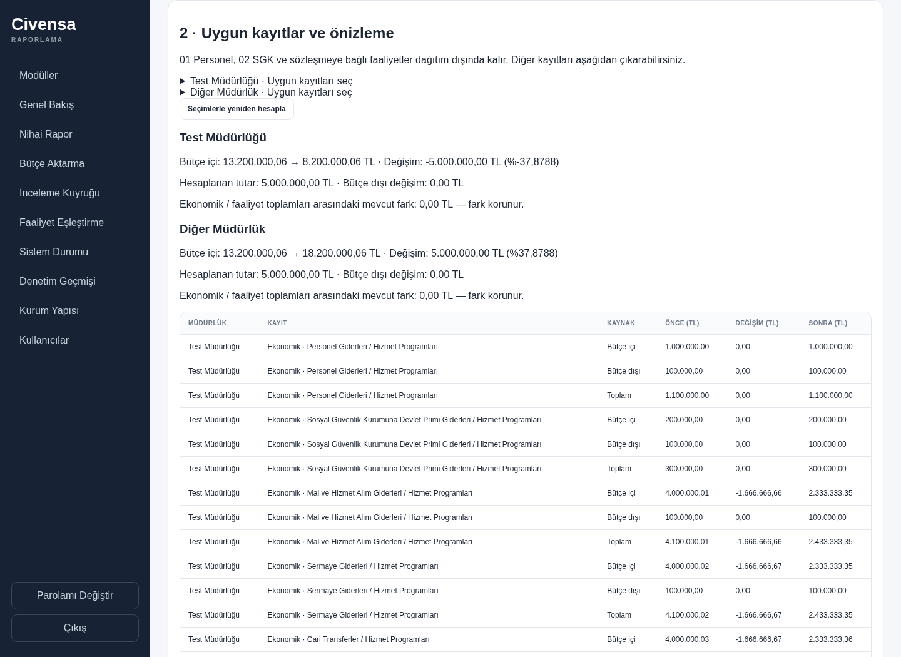
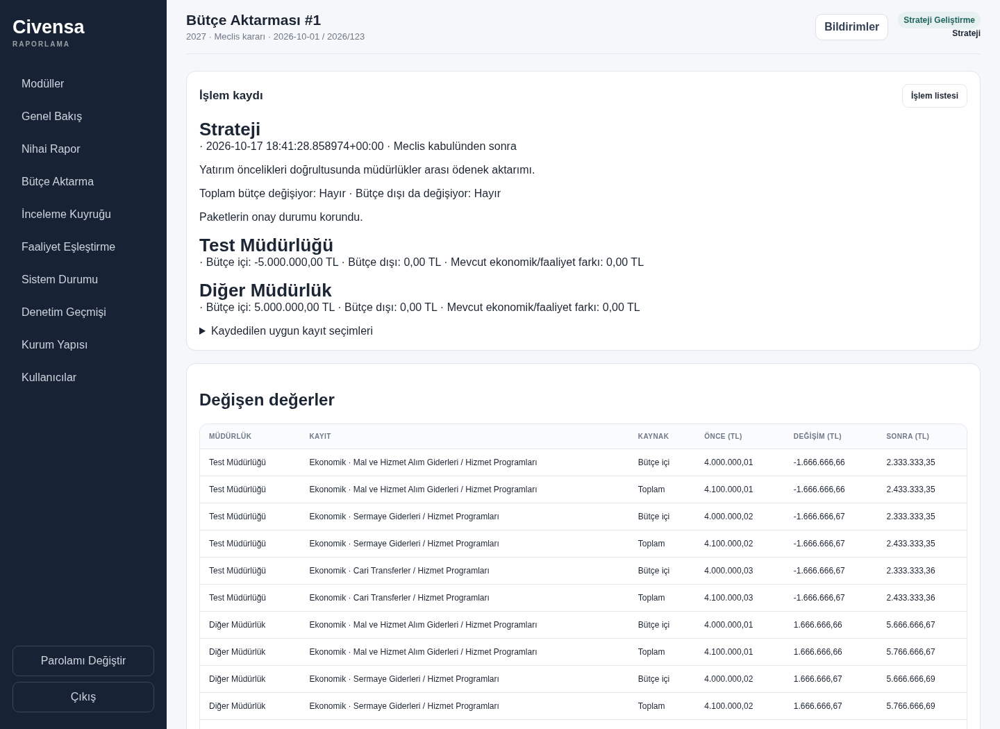

# CIV-031 — Bütçe Aktarma

This is the documented D-34 exception for approved PP data. A Strategy director,
or the holder of a current `approved_data_correction` delegation from that
Strategy director, can apply a referenced budget instruction without returning
the affected submissions. Approval states remain unchanged. Each affected
submission receives a `budget_reallocation` history event and a new revision
counter; existing PP package projections receive an administrative history event.
Immutable historical package snapshots and AR write restrictions remain intact.

## Data and interpretation

- `ReportingPeriod` has `year`, `status` and `template_status`; it has no council
  adoption field. `active` is a reporting-period state, not evidence of council
  adoption. Strategy explicitly selects before/after adoption for each operation.
- Before adoption, the required reference is **Başkanlık talimatı**. After
  adoption, multiple directorates require **Meclis kararı**. For one directorate,
  Strategy declares second-level functional-class transfer (**Encümen kararı**)
  or other transfer (**Başkan onayı**). There is no functional-class identifier
  on these budget rows; `program_group` is not treated as a functional class.
  Date, number and reason are mandatory, including for compensating operations.
- `AuthorityDelegation` previously had no authority kind. The additive column
  defaults existing grants to `director_approval`; new correction grants use
  `approved_data_correction`. Approval eligibility and migrated database guards
  exclude correction-only grants. Existing director/editor membership, time,
  account activity, grantor position and revocation checks still apply. The
  existing one-overlapping-grant-per-department reservation remains in force.
- Percentage input uses the directorate's **whole economic inside total** as its
  denominator, including protected lines. Conversion rounds half up to cents
  and is displayed before application. Distribution uses only eligible amounts.
- Personnel/SGK are stored as `personnel`/`sgk`; numeric `01`/`02` category prefixes
  are also protected. Contract-bound activities are protected independently.
  Further exclusions are recorded separately for each leg. Multiple legs for
  the same directorate require disjoint eligible cells/activities.
- Outside funding is off by default. When enabled, the directorate's effective
  internal percentage is applied to its selected economic outside total. That
  exact external TL delta is distributed separately across eligible economic
  and activity outside values. This preserves an existing cross-table difference
  even when eligible bases differ. The wizard explains this calculation and
  displays internal and external changes separately.
- Every distribution uses Decimal largest remainders with stable value-ID ties.
  Existing total rows are recomputed from inside + outside. Missing values are
  never assumed to be zero; inconsistent stored splits must be verified first.
- CIV-011 source amounts and source text are retained. An audited cumulative
  `budget_reallocation_delta` in source-resolution metadata separates the
  authorized adjustment from the original source comparison. Existing unresolved
  source differences retain their amount and remain visible; subsequent ordinary
  edits still require the existing explicit source-resolution process.

## Transaction and history

Preview and eligibility endpoints write nothing. A signed, actor-bound preview
expires after 30 minutes and binds the request, exclusions and complete relevant
scope hash. Application reads the whole HTTP body before acquiring any lock,
locks the organization/departments and relevant rows in deterministic order,
rechecks authority and compares the snapshot. All values, operation/line records,
package history and directorate notifications commit together.

`BudgetOperation` and `BudgetOperationLine` are append-only in the ORM and in
PostgreSQL/SQLite triggers. Reversal records a new operation with inverse legs
and `reverses_id`; every affected amount and provenance field must still match
the original result. A subsequent operation touching a value also blocks reversal,
even if that value was later restored. Reversal restores exact prior metadata as
well as cents. It has its own mandatory reference and reason.

The contract-bound flag has a separate own-directorate/Strategy endpoint and
before/after actor audit. It does not change a submission's approval status.
Only the synchronous, authorized budget/flag services bypass the ordinary
approved-data edit hook; ordinary edit and approval separation remain enforced.

The single migration is `c031b1a2c3d4`, based on `b0262027a001`, the base head at
implementation time. Downgrade retains all values, new columns, history and
immutability guards; re-upgrade is idempotent. Rebase the new migration onto the
single new base head after the AR stack and CIV-027 land.

## Screenshots

Synthetic data, local PostgreSQL and real Chromium/login/CSRF:

## Local verification

The new HTTP, concurrency, migration and browser tests are
`tests/test_budget_reallocation*.py`. Migrated acceptance runs separately from
metadata-created schemas, so application behavior is exercised with the real
PostgreSQL guards. Migration coverage includes populated SQLite/PostgreSQL
upgrade, immutable SQL history, lossless downgrade/re-upgrade and a single head.

Run with `CIVENSA_TEST_POSTGRES_URL` pointing to a **disposable local PostgreSQL
16+ database**, `CIVENSA_CHROMIUM_PATH` pointing to Chromium when needed, and
`python -m pytest -q --require-postgres`. Set `CIVENSA_UI_SCREENSHOTS` to this
folder to regenerate the two screenshots. `test_migration.py` seeds the public
schema and requires a fresh disposable database for each repeated run.

The PR description records the actual focused and required regression results.
No live database, deployment or source bundle is involved. CI is intentionally
not polled, as requested for this task.

Verified in this task: **29 new tests** and **304 required/related regression
cases**, with the five historical-schema fixture failures corrected and rerun.
The final focused run (new tests, programme/source-conflict tests and the old
foundation upgrade scenario) passed **71 tests**; the fresh-database historical
migration rerun passed **6 tests**. `alembic heads` reports only `c031b1a2c3d4`;
`git diff --check` is clean. The only test warning is the existing Starlette
TestClient/httpx deprecation.
