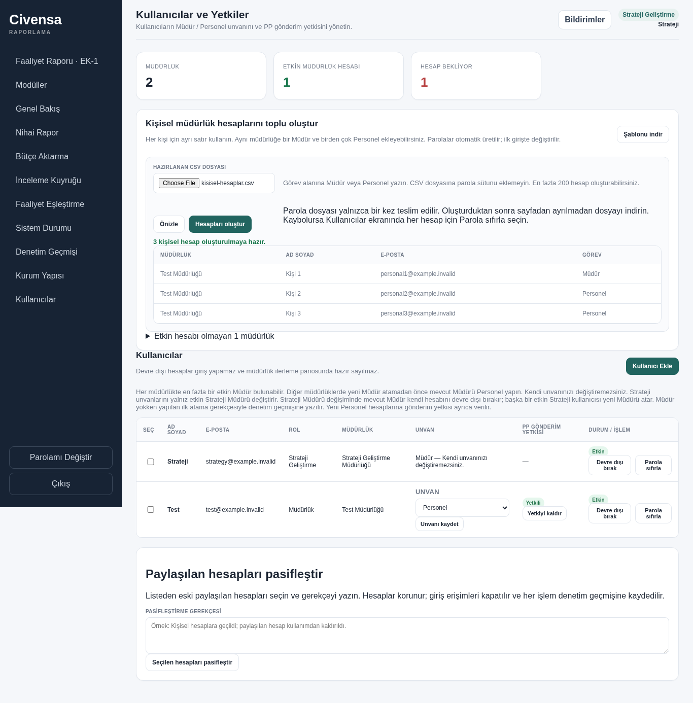
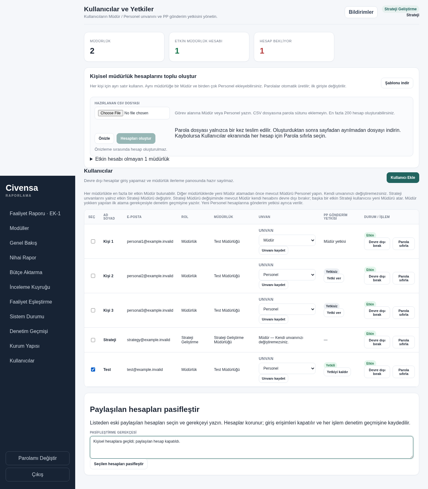
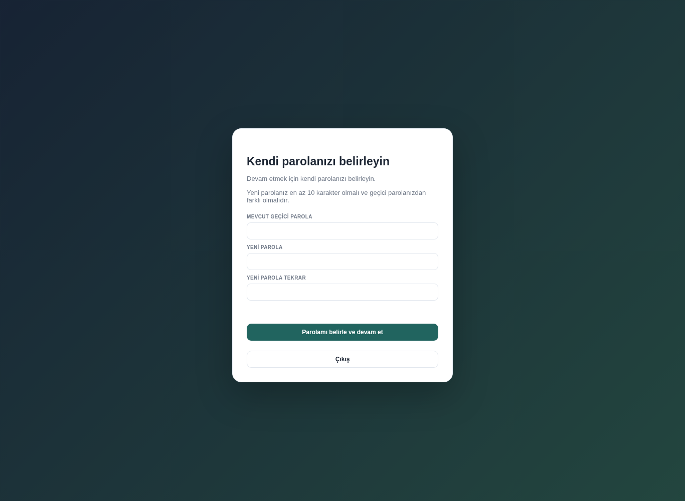

# CIV-044 — Kişisel müdürlük hesapları

D-72 uyarınca her Müdür ve Personel için ayrı hesap oluşturulur. Aynı müdürlükte
birden fazla Personel ve en fazla bir etkin Müdür bulunabilir.

## Strateji için altı adım

1. **Şablonu indir:** Kullanıcılar ekranında **Şablonu indir** düğmesine basın.
   UTF-8 BOM içeren dosya bütün etkin müdürlükleri kapsar; mevcut hesabı olan
   müdürlüğe de yeni kişisel hesaplar ekleyebilirsiniz.
2. **Doldur:** `Müdürlük ID`, `Müdürlük`, `Ad Soyad`, `E-posta`, `Görev`
   sütunlarını kullanın. Her kişi için ayrı satır açın; müdürlük kimliğini ve
   adını şablondan kopyalayın. Göreve yalnız **Müdür** veya **Personel** yazın.
   Parola sütunu eklemeyin. Bir dosyada en fazla 200 hesap satırı kullanın.
   Doldurulmayan şablon satırları hesap oluşturmaz.
3. **Önizle:** CSV dosyasını seçip **Önizle** düğmesine basın. Kişileri ve
   görevlerini kontrol edin. Hatalar satır, alan ve çözümle gösterilir.
   Müdür zaten varsa mesaj mevcut kişinin adını ve e-posta adresini belirtir;
   yeni Müdür oluşturmadan önce mevcut atamayı düzeltin veya hesabı pasifleştirin.
4. **Oluştur:** **Hesapları oluştur** düğmesine basıp onaylayın. Bütün satırlar
   yeniden doğrulanır; hata varsa hiçbir hesap oluşturulmaz. Personelin gönderim
   yetkisi varsayılan olarak kapalıdır; gerekiyorsa mevcut yetki ekranını kullanın.
5. **Parola dosyasını indir:** Sayfadan ayrılmadan **Parola dosyasını indir**
   düğmesine basın. Dosya `Müdürlük, Ad Soyad, E-posta, Görev, Geçici Parola`
   sütunlarını içerir ve yalnızca bir kez teslim edilir. Her kişiye yalnız kendi
   hesap bilgisini iletin. Sayfa kapanırsa, indirme kaybolursa veya işlem sonucu
   belirsizse Kullanıcılar listesini kontrol edip ilgili hesapta **Parola sıfırla**
   seçin. Kullanıcı ilk girişte en az 10 karakterlik, geçici parolasından farklı
   kendi parolasını belirlemeden diğer ekranlara devam edemez.
6. **Paylaşılan hesapları pasifleştir:** Kullanıcı listesinden eski paylaşılan
   hesapları seçin. **Pasifleştirme gerekçesi** alanını doldurup **Seçilen
   hesapları pasifleştir** düğmesine basın. Hesaplar silinmez; girişleri kapatılır
   ve her değişiklik gerekçesiyle denetim geçmişine kaydedilir. Strateji Müdürü
   hesabı için mevcut atama ve yetki kontrolleri uygulanır.





## Uygulama ve migration

- `c044a1b2c3d4`, `c031b1a2c3d4` üzerine gelir. Tek Alembic head vardır.
  `users.must_change_password` NOT NULL boolean alanının sunucu varsayılanı
  false'tur; mevcut kullanıcıların parolaları ve giriş davranışı korunur.
  Downgrade alanı ve değerlerini korur; tekrar upgrade verileri sıfırlamaz.
- Tekli ve toplu oluşturma `prepare_user_creation` üzerinden aynı
  `released_permissions.validate_position`, `lock_user_administration`,
  `require_strategy_user_management`, `check_director_available` ve etkin
  müdürlük kontrollerini kullanır. `uq_active_department_director` değişmez.
  Toplu atama gerekçesi `Toplu hesap oluşturma, CSV <batch>` biçimindedir.
- Geçici parolalar `secrets` ile 18 karakter ve dört karakter sınıfıyla üretilir;
  `0`, `1`, `I`, `l`, `O`, `o` gibi karışabilen karakterleri içermez.
  Veritabanında yalnızca tuzlanmış PBKDF2 özeti bulunur. Ham parolalar denetim
  ayrıntılarına veya uygulama loglarına yazılmaz.
- `POST /api/users/bulk-import` yanıtının gövdesi tek seferlik CSV'dir;
  `X-Account-Batch` ve `X-Accounts-Created` başlıkları işlem bilgisini taşır.
  Yanıt `Cache-Control: no-store, private` kullanır. Sunucuda parola dosyası,
  yeniden indirme belirteci veya oturum içinde parola listesi saklanmaz.
  Kullanıcı dosyayı indirene kadar tarayıcı yalnızca sayfanın belleğinde Blob
  tutar; indirmeden sonra referans ve geçici bağlantı kaldırılır.
  `GET /api/users/batches/<batch>/credentials.csv` her zaman Türkçe bir
  **410** ve **Parola sıfırla** yönlendirmesi döndürür. Aynı CSV'yi tekrar
  oluşturma isteği e-posta tekilliği nedeniyle reddedilir.
- Toplu ve tekli oluşturma ile Strateji parola sıfırlaması zorunlu değişim
  bayrağını açar. Başarılı kişisel parola değişimi özeti ve bayrağı atomik olarak
  günceller; mevcut oturum iptali ve eşzamanlı sıfırlamaya karşı karşılaştırmalı
  güncelleme korunur. Çıkış ve statik dosyalar erişilebilir kalır.
- `POST /api/users/bulk-deactivate`, `user_ids` ve zorunlu `reason` alır.
  Önce bütün seçimlerin yetkisi doğrulanır, sonra tek transaction içinde
  pasifleştirilir. Toplu oluşturma geri alma adresi korunur; kullanılmamış
  hesapları silmek yerine gerekçeyle pasifleştirir ve oluşturma geçmişini korur.
  Kullanılmış hesap içeren grup tamamen reddedilir. Pasif hesapların e-posta
  adresleri ayrılmış kalır; mevcut hesabı yeniden etkinleştirme/sıfırlama kullanılır.
- Sistem hazırlık kontrolü çoklu Personeli kabul eder; yalnız mükerrer etkin
  Müdürü hata sayar. Eksik hesabı olan müdürlük sayısı kişi sayısından çıkarılmaz.
- Onay/gönderim iş kuralları değiştirilmez. Canlı veritabanı, e-posta gönderimi,
  dağıtım veya bundle üretimi kullanılmaz.

## Yerel doğrulama

Yeni testler: `tests/test_users_personal_accounts.py`, `tests/test_users_ui.py`,
`tests/test_users_migration.py`. Bunlar gerçek oturum/CSRF ile çoklu hesap,
Müdür çatışmaları, parola sütunu reddi, tek seferlik parola dosyası, tüm
veritabanı tabloları ve loglarda ham parola bulunmaması, zorunlu değişim,
sıfırlama, gerekçeli pasifleştirme, geri alma, veritabanı tekillik kısıtı ve
PostgreSQL/SQLite migration döngüsünü doğrular.

Chromium testi loopback HTTP üzerinden gerçek 303 yönlendirmelerini ve bütün
altı adımı çalıştırır. Görseller sentetik yerel verilerdir; parola içermez.
Tarihsel şema dosyaları `rg -l 'populated|upgrade' tests` ile envantere alınır;
mevcut migration ve yetkilendirme testleriyle birlikte çalıştırılır.

Çalıştırılan dosyaların tam listesi:

```text
tests/test_a1p11_preactivation_recovery.py
tests/test_a1p1_workflow_activation.py
tests/test_activity_financial_migration.py
tests/test_activity_references.py
tests/test_activity_references_sqlite.py
tests/test_activity_sections_migration.py
tests/test_assurance_migration.py
tests/test_authorization_foundation.py
tests/test_budget_reallocation_migration.py
tests/test_contract_migration.py
tests/test_correction_reapproval.py
tests/test_current_release_recorrection.py
tests/test_db_roles.py
tests/test_json_fetch.py
tests/test_live_pilot_hardening.py
tests/test_login_throttling.py
tests/test_master_data.py
tests/test_materialized_successor.py
tests/test_migration.py
tests/test_package_workflow.py
tests/test_pp_import_submit_ready.py
tests/test_release_readiness_migration_head.py
tests/test_released_permissions.py
tests/test_released_permissions_migration.py
tests/test_report_workflow.py
tests/test_returned_attempt_rework.py
tests/test_revision_workflow.py
tests/test_sidebar_ui.py
tests/test_source_conflicts.py
tests/test_sqlite_package_decision_guards.py
tests/test_structure_changes.py
tests/test_submission_workflow.py
tests/test_successor_publication.py
tests/test_users_migration.py
tests/test_users_personal_accounts.py
tests/test_users_ui.py
```

Sonuç: **36 dosyada 1.201 ayrı test geçti**; disposable PostgreSQL **18.6** ve
Chromium kullanıldı. Tarihsel şema / migration / yetkilendirme grupları sırasıyla
**175**, **415** ve **458** test geçti (toplam **1.048**). Bunlara ek olarak
hesap / oturum / JSON fetch / sidebar / uçtan uca tarayıcı kapsamındaki **153**
ayrı test geçti. Etkilenen kullanıcı ve hazırlık kontrollerinin son çalışması
**36 geçti**, son Chromium yürüyüşü **1 geçti**; DEBUG loglarını da yakalayan
parola gizliliği kontrolü **1 geçti**. Bu son kontroller toplamın içindedir.

Python derlemesi, iki JavaScript dosyasının sözdizimi, staged whitespace ve
tek migration head kontrolleri geçti. İstenen PR tabanıyla yerel birleşim
kontrolü temizdir; #41'in güncel başlığı başlangıç commit'i olarak korunur.
Yalnız mevcut Starlette TestClient/httpx kullanımına ilişkin deprecation uyarısı
vardır. CI kullanıcı talebi doğrultusunda beklenmedi veya sorgulanmadı.
