# Müdürlük giriş kılavuzu — 2026 Faaliyet Raporu

## Başlamadan önce

Bu kılavuzu müdürlüğünüzdeki Personel ve Müdür hesapları için kullanın.
Kişisel hesabınızı ve ilk geçici parolanızı Strateji Geliştirme Müdürlüğünden alın.
Hesabınızı başkasıyla paylaşmayın. Veri girişinin son gününü Stratejinin duyurusundan öğrenin.

2026 kayıtlarınızı, gerçekleşmeleri destekleyen belgeleri ve belge sürümü veya kayıt numaralarını hazırlayın.
Aşağıdaki ekranlar **SENTETİK** deneme verisi içerir. Örnek değerleri kendi raporunuza kopyalamayın.

## Giriş ve parola

1. Size bildirilen uygulama adresini açın. `Çalışma alanına giriş` ekranında `E-posta` ve `Parola` alanlarını doldurun. `Giriş yap` düğmesine basın.

   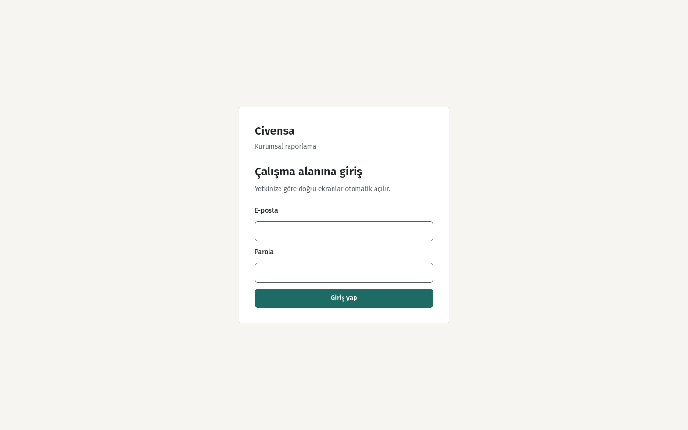

   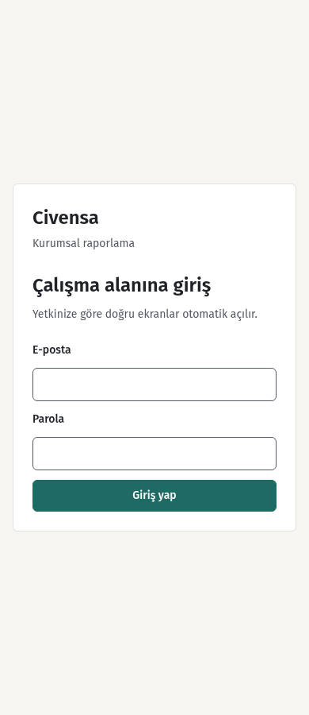

2. İlk girişte `Kendi parolanızı belirleyin` ekranı açılır. `Mevcut geçici parola`, `Yeni parola` ve `Yeni parola tekrar` alanlarını doldurun. En az 12 karakter kullanın. Geçici parolanızdan farklı bir parola belirleyin. `Parolamı belirle ve devam et` düğmesine basın.

   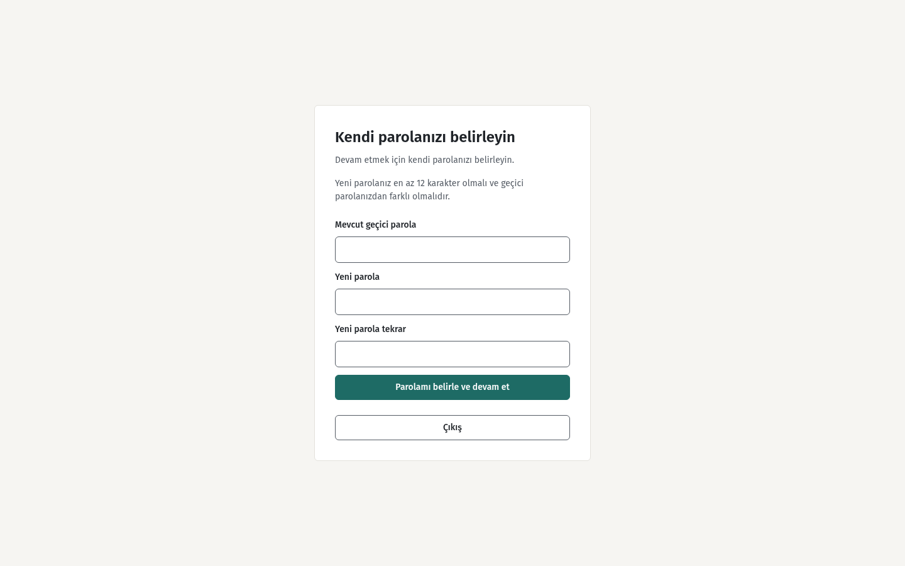

   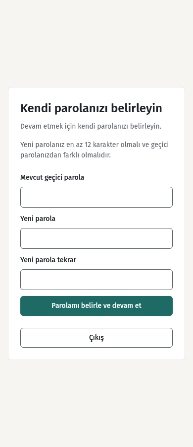

Parolanızı unuttuysanız Stratejiden sıfırlamasını isteyin. E-postayla kendi kendinize parola sıfırlama yoktur. Sıfırlama sonrası verilen geçici parolayla girip yeni parolanızı belirleyin.

## Personel ve Müdür

Personel, müdürlüğünün gösterge gerçekleşmelerini, kanıtlarını ve bölüm içeriklerini kaydeder.
Müdür de içerikleri düzenleyebilir. Raporu inceleyip Stratejiye göndermeyi Müdür yapar.
Her müdürlükte yalnız bir aktif Müdür hesabı bulunur. Hesabınızın müdürlüğü veya görevi yanlışsa Stratejiye bildirin.

Girişten sonra `Gösterge gerçekleşmelerine gir` bağlantısıyla göstergelere;
`2026 birim raporunu tamamla · EK-1 ve EK-2` bağlantısıyla bölüm ve beyan girişine geçin.

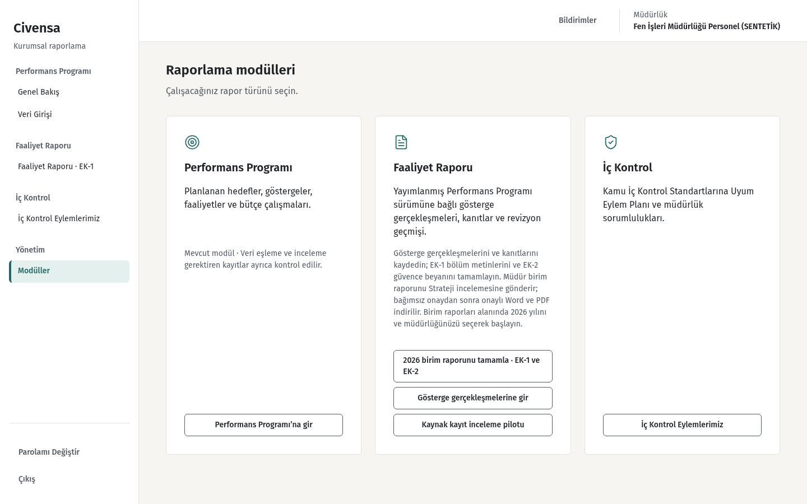

## Gösterge gerçekleşmesi ve kanıt

1. `Gösterge gerçekleşmelerine gir` bağlantısını açın. `Faaliyet raporları` ekranında 2026 yılına ait rapor bağlantısını seçin. Rapor görünmüyorsa Stratejiye bildirin.

   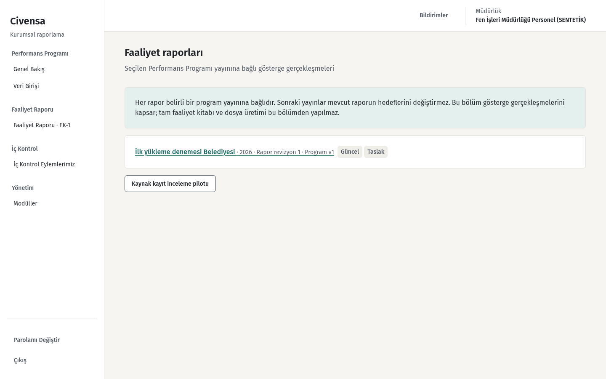

2. Açılan raporda müdürlüğünüzün göstergesini bulun. Hedefi ve gerçekleşmeyi karıştırmayın. Üstteki sayaçlardan kayıt durumlarını izleyin.

   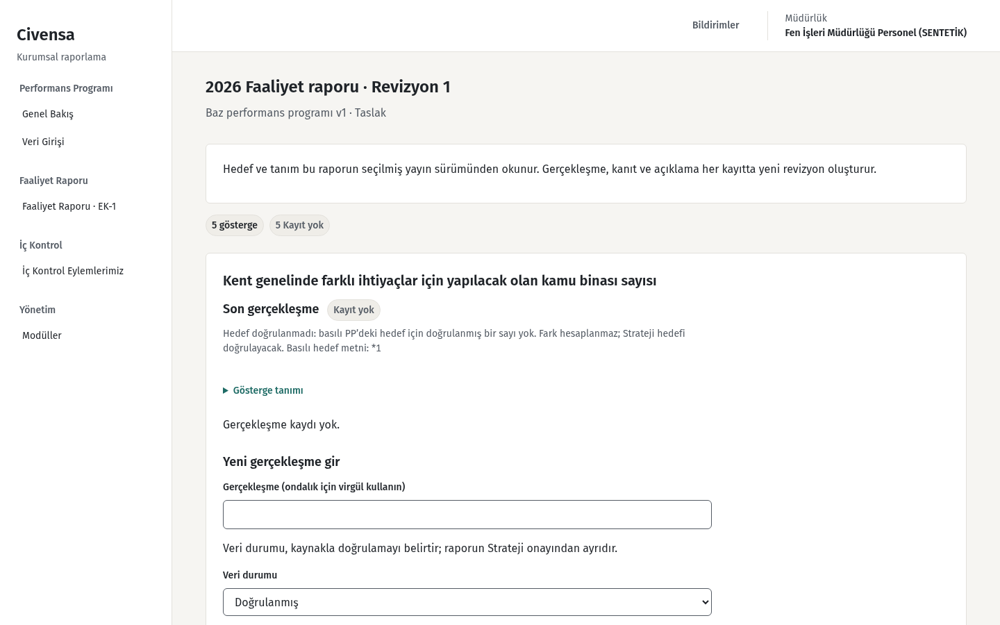

3. Göstergenin `Yeni gerçekleşme gir` alanına ilerleyin. `Gerçekleşme (ondalık için virgül kullanın)` alanına sonucu yazın. Ondalık sayı için virgül kullanın: 12,5. Değeri bilmiyorsanız sıfır yazmayın; alanı boş bırakıp `Eksik` seçin.

   `Veri durumu` seçin:

   - `Doğrulanmış`: değeri kaynağıyla doğruladınız. Bu seçim Strateji onayı değildir.
   - `İncelenmeli`: kayıt gözden geçirilmelidir. Kaynağı kontrol edin.
   - `Eksik`: veri henüz tamamlanmamıştır. Eksik bilgiyi temin edin.
   - `açıklama bekliyor`: hedef farkı için açıklama eksiktir. Bu bir veri durumu seçeneği değil, özet uyarısıdır.

   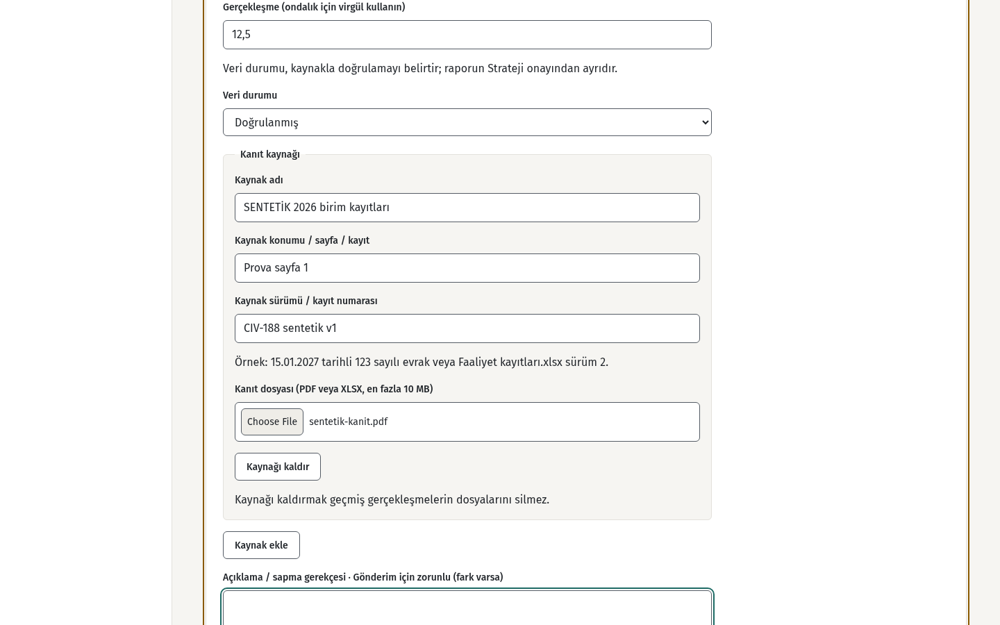

4. `Kanıt kaynağı` alanında `Kaynak adı`, `Kaynak konumu / sayfa / kayıt` ve `Kaynak sürümü / kayıt numarası` bilgilerini yazın. Son alana örneğin evrak tarihi ve sayısını veya dosyanın sürümünü girin. Kanıt dosyası ekleyecekseniz `Kanıt dosyası (PDF veya XLSX, en fazla 10 MB)` alanından seçin. Başka bir kaynak için `Kaynak ekle` düğmesine basın.

   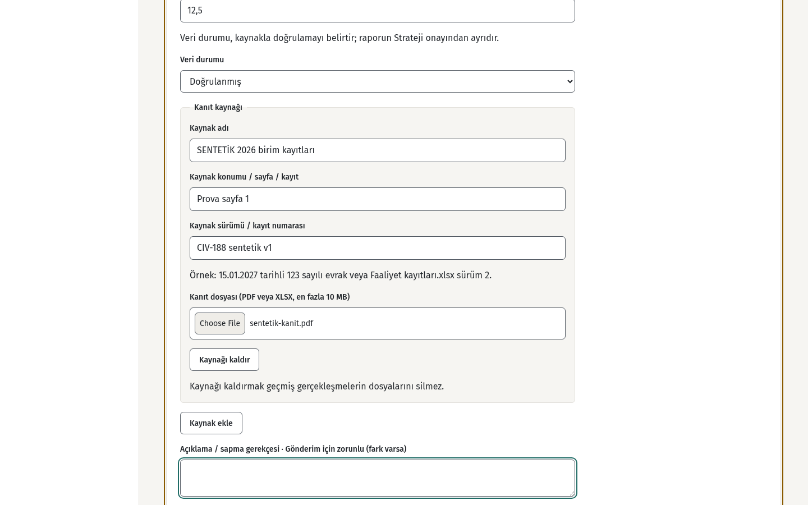

5. Hedef ile gerçekleşme arasında fark varsa `Açıklama / sapma gerekçesi · Gönderim için zorunlu (fark varsa)` alanına nedenini yazın. Hangi işin, hangi nedenle farklı sonuçlandığını belirtin. Varsa `Düzeltici işlem (isteğe bağlı)` alanını da doldurun. `Yeni gerçekleşme revizyonu kaydet` düğmesine basın. Kaydetmek raporu göndermez. Boş sapma açıklamasıyla kayıt saklansa da rapor gönderilemez.

   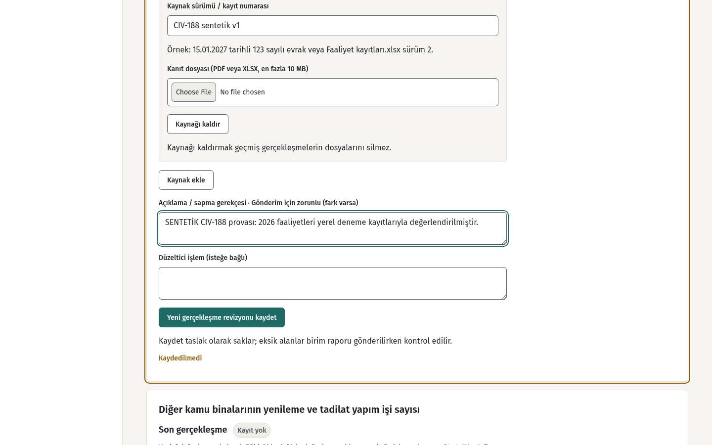

## EK-1 bölümleri ve EK-2

1. `Faaliyet Raporu · EK-1` ekranına geçin. `Tamamlanma görünümü` altında `Yıl` alanından 2026'yı seçip `Filtrele` düğmesine basın. Müdürlüğünüzün bölüm bağlantısını açın. `Sahibi` ve `Eksikler` sütunlarını inceleyin.

   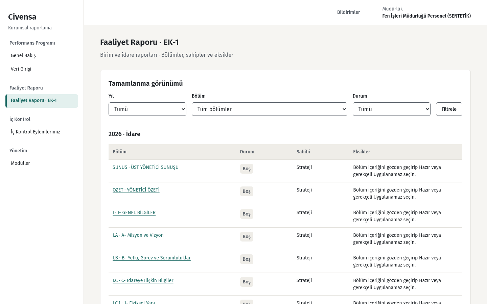

2. Müdürlüğünüzün sorumlu olduğu bölümde `Bölüm içeriği` alanını doldurun. Tamamlanan içerik için `Durum` alanından `Hazır` seçin. `Bölümü kaydet` düğmesine basın. Diğer bölümler için aynı işlemi yapın.

   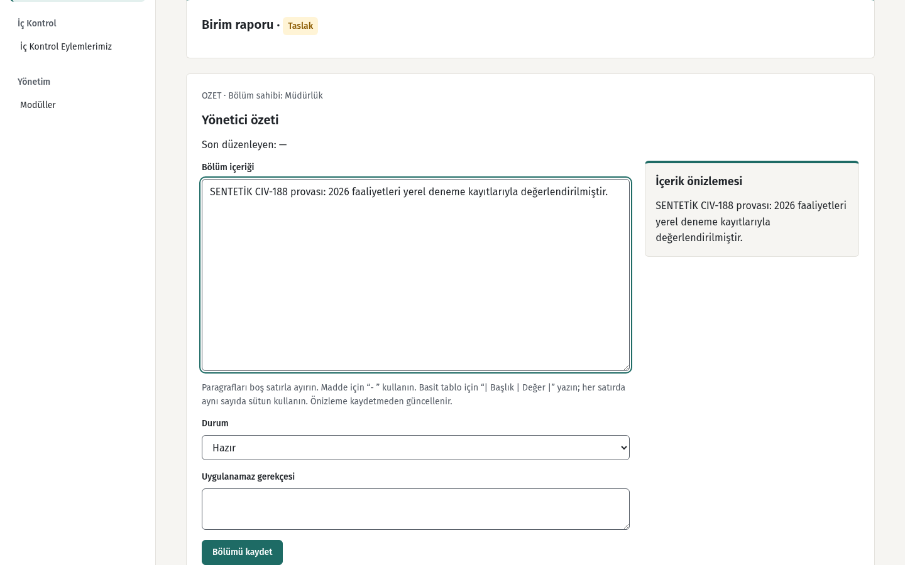

3. Bölüm müdürlüğünüz için uygulanmıyorsa `Uygulanamaz` seçin ve `Uygulanamaz gerekçesi` alanını doldurun. Gerekçesiz bırakmayın. `Bölümü kaydet` düğmesine basın.

   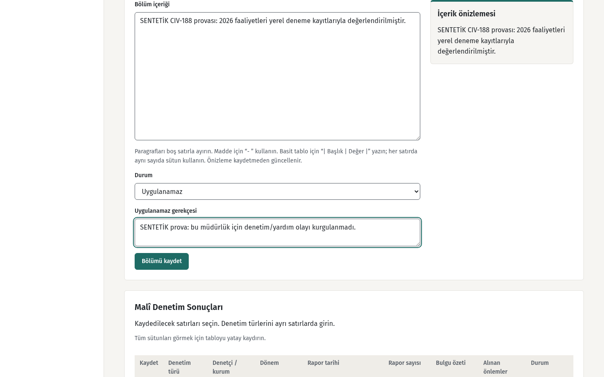

4. Ekler bölümünden EK-2 güvence beyanını açın. `Yer`, `Tarih` ve rapor yılındaki tüm görev dönemlerini doldurun. Aynı kişi için aynı `Kişi kodu` bilgisini kullanın. `Ad-Soyad`, `Ünvan`, `Başlangıç` ve `Bitiş` alanlarını kontrol edin. Çekinceniz varsa gerekçesiyle yazın. `Beyan alanlarını kaydet` düğmesine basın. Beyan metni kilitlidir; imza işlemini rapor dışında tamamlayın.

   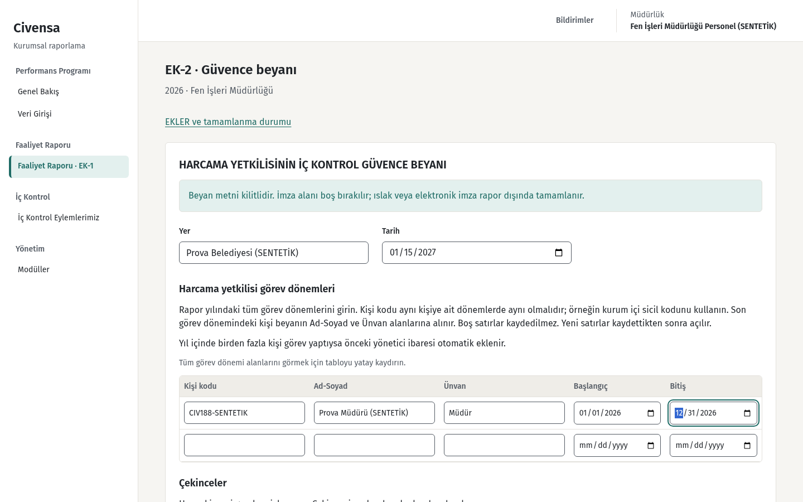

Mali Hizmetlerin sorumlu olduğu malî bölümleri Mali Hizmetler doldurur. Bu bölümlerin uyarıları müdürlük raporunun gönderimini durdurmaz. Uyarıları Stratejiye ve Mali Hizmetlere bildirin; müdürlüğünüzün eksikleriyle karıştırmayın.

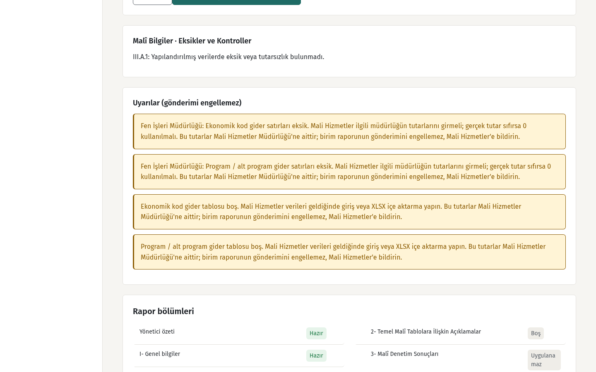

## Gönderme (Müdür)

1. Müdürlüğünüzün 2026 birim raporunu açın. Bölümleri, EK-2'yi, gerçekleşmeleri, kanıtları ve sapma açıklamalarını kontrol edin. `Strateji’ye gönder` düğmesine basın.

   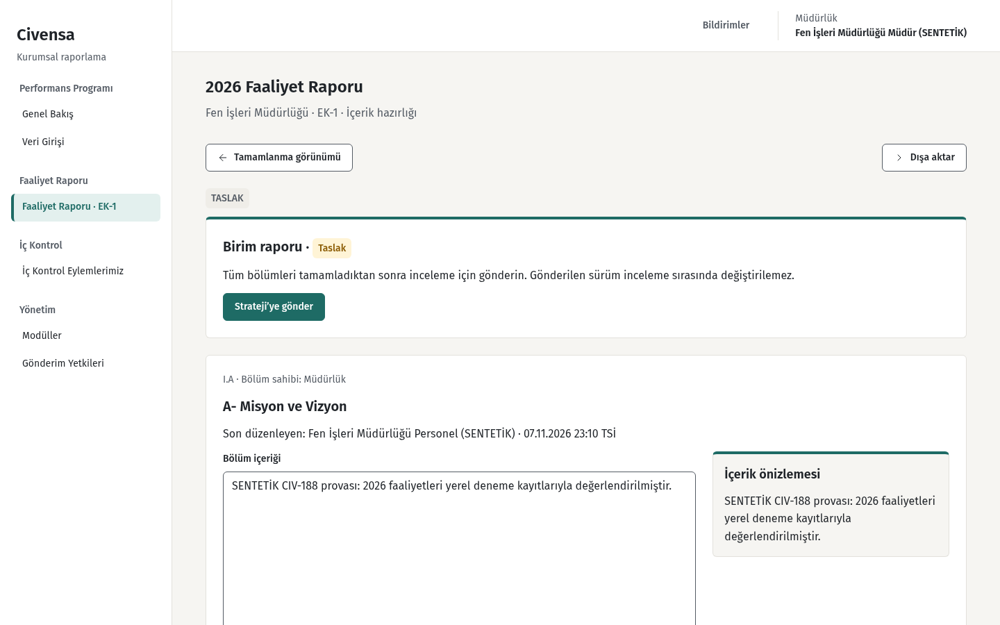

2. Hata çıkarsa mesajda belirtilen kaydı düzeltin. Tamamlanmamış bölüm, gerekçesiz uygulanamaz seçimi, eksik beyan, eksik gerçekleşme veya kanıt ve açıklanmamış hedef farkı gönderimi engelleyebilir. Kayıt başka biri tarafından değiştirilmişse sayfayı yenileyip son kaydı kontrol edin. Aşağıdaki örnekte sapma açıklaması eksik olduğu için gönderim durur.

   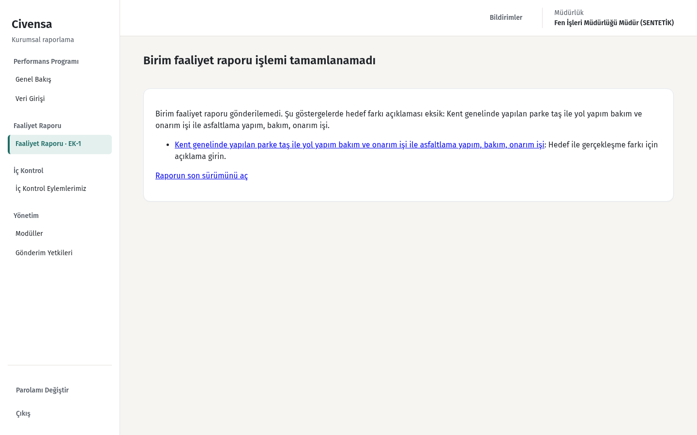

3. Düzeltmeleri kaydedip yeniden gönderin. `Gönderildi` durumunu kontrol edin. Gönderilen sürüm inceleme sırasında değiştirilemez. Mali Hizmetler uyarıları varsa ilgili birimlere bildirin.

   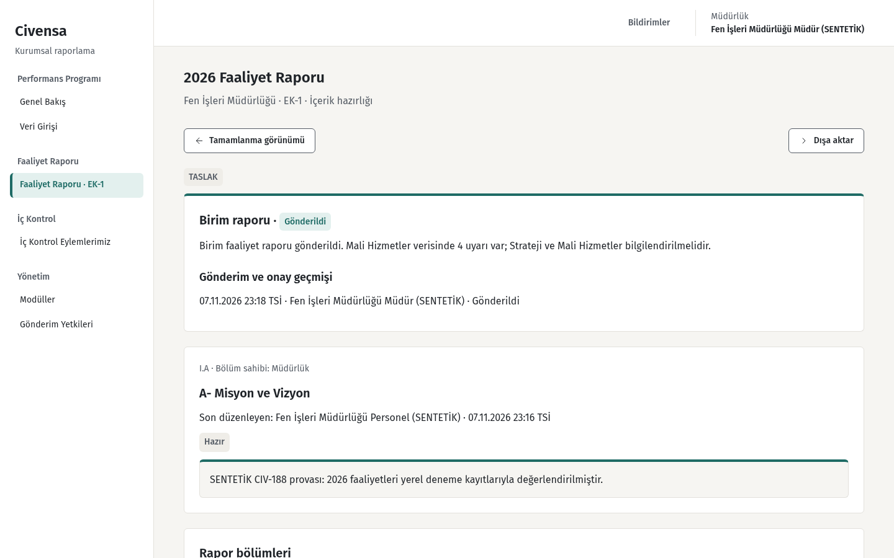

## İade ve düzeltme

1. Strateji raporu iade ederse birim raporunda `İade edildi` durumu görünür. `Gerekçe:` satırını okuyun. İade, içeriği sizin düzeltmeniz için yapılır.

   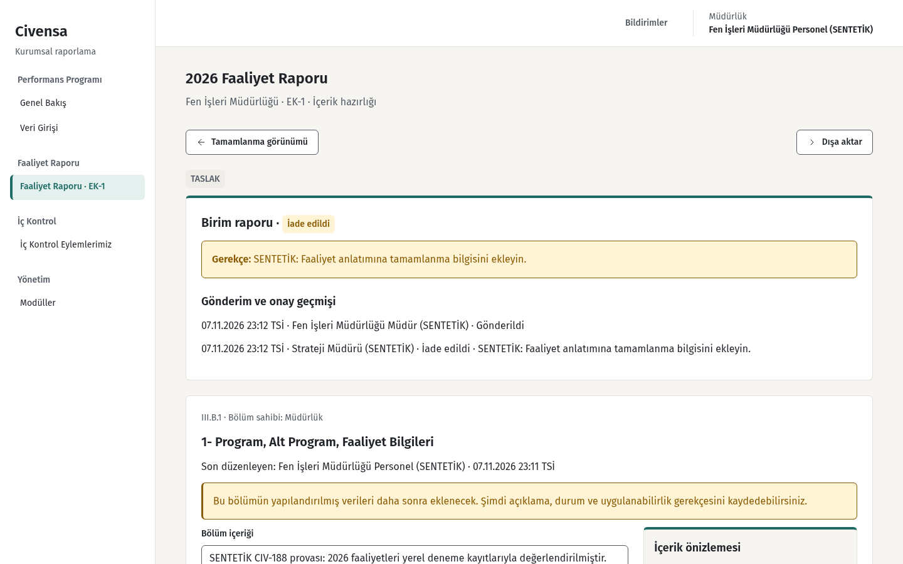

2. İstenen bölümü düzeltin. `Bölümü kaydet` düğmesine basın. Gerçekleşme veya kanıt düzeltmesi istenmişse ilgili göstergeyi de kaydedin.

   

3. Müdür olarak raporu kontrol edin. `Yeniden gönder` düğmesine basın. Durumun tekrar `Gönderildi` olduğunu kontrol edin.

   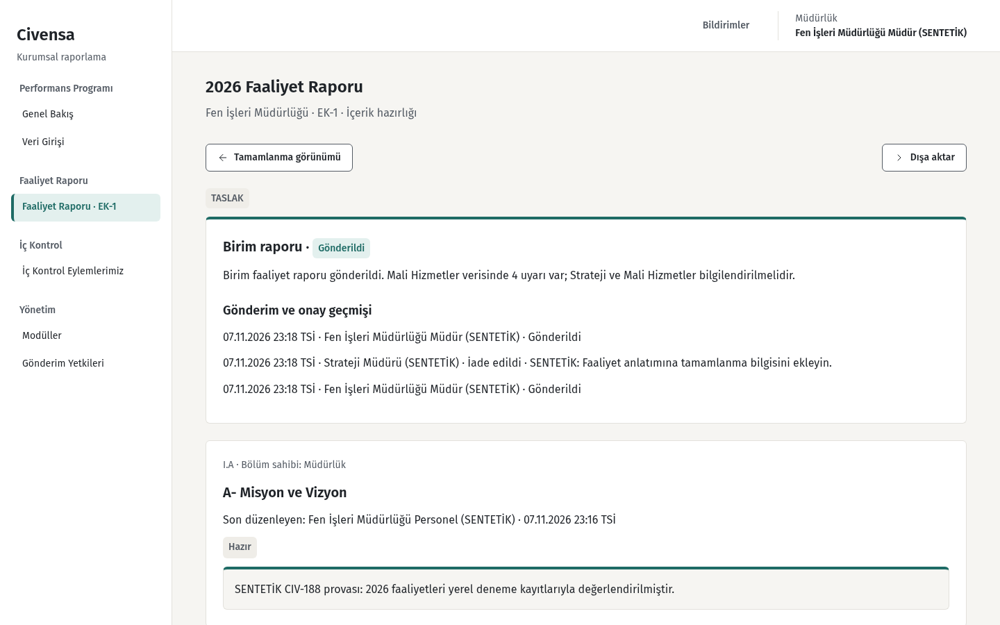

## Onay sonrası

Birim raporunda `Onaylandı` durumunu kontrol edin. `Dışa aktar` menüsünü açın.
`Word olarak indir` veya `PDF olarak indir` bağlantısını seçin.
İndirme bağlantılarının görünmesi tek başına onay anlamına gelmez; önce raporun durumuna bakın.

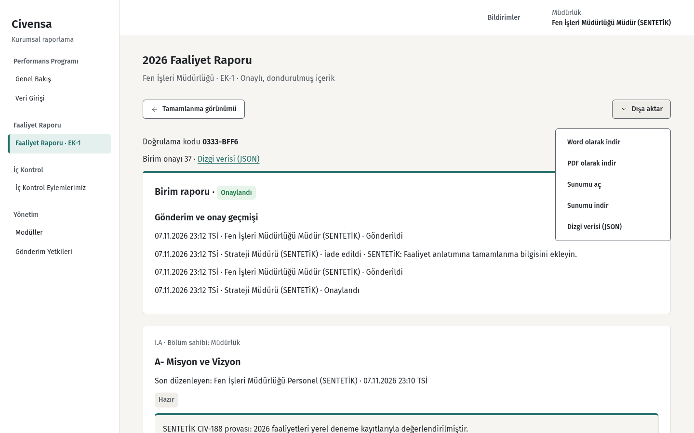

## Faaliyet sonuçları

Her faaliyet için ayrı bir sonuç girilmez.
Gösterge gerçekleşmelerini ve kanıtlarını yukarıda anlatıldığı gibi girin.
2026 faaliyetlerinden biri için kısa bir açıklama gerekiyorsa ilgili EK-1 bölümünün `Bölüm içeriği` alanına yazın.

## Yardım

Sorularınız ve sorunlarınız için Strateji Geliştirme Müdürlüğü'ne ulaşın.

## Daha sonra eklenecek bölümler

Müdürlükler gösterge gerçekleşmelerini bugün olduğu gibi kendi Excel satırlarını doldurarak Stratejiye gönderir.
Strateji, ana çalışma kitabını gösterge gerçekleşmeleri ekranındaki `Excel'den içe aktar` alanından yükler, eşleşmeleri ve yıllık değerleri önizlemede onaylayarak içe aktarır.
Müdürlükler aktarım sonrasında kendi gerçekleşmelerini ekranda kontrol eder ve gerektiğinde yeni gerçekleşme revizyonuyla düzeltir.
Kanıtları müdürlük kullanıcıları ekrandan ekler; eksik veya aktarılmayan satırlar ilgili gerekçeye göre tamamlanır.
