# Strateji Geliştirme kılavuzu — 2026 Faaliyet Raporu

## Başlamadan önce

Bu kılavuzu 2026 Faaliyet Raporu yıllık döngüsünü yöneten Strateji Geliştirme Müdürlüğü kullanıcıları için kullanın.
Döngüyü başlatmadan önce şu bilgileri hazırlayın:

- Her müdürlük için `Müdür` ve `Personel` görevlerini içeren güncel kullanıcı listesi (`Ad Soyad`, `E-posta`, `Görev`).
- 2026 onaylı Performans Programı kitabının meclis karar bilgisi (`Onay dayanağı`).
- Müdürlüklere duyuracağınız veri girişi son günü (son günü Strateji Geliştirme Müdürlüğü kendisi belirler ve duyurur).

Aşağıdaki ekranlar **SENTETİK** deneme verisi içerir. Örnek değerleri canlı kayıtlara kopyalamayın.

## Hesaplar

1. Uygulama adresini açın. `Çalışma alanına giriş` ekranında `E-posta` ve `Parola` alanlarını doldurun. `Giriş yap` düğmesine basın.

   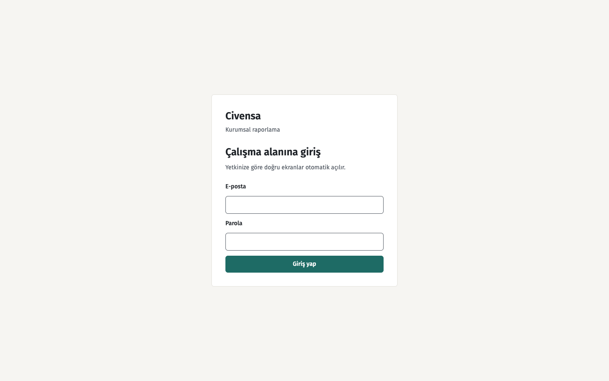

2. Girişten sonra `Raporlama modülleri` ekranı açılır. Üst menüden `Kullanıcılar` bağlantısını seçerek `Kullanıcılar ve yetkiler` ekranına geçin.

   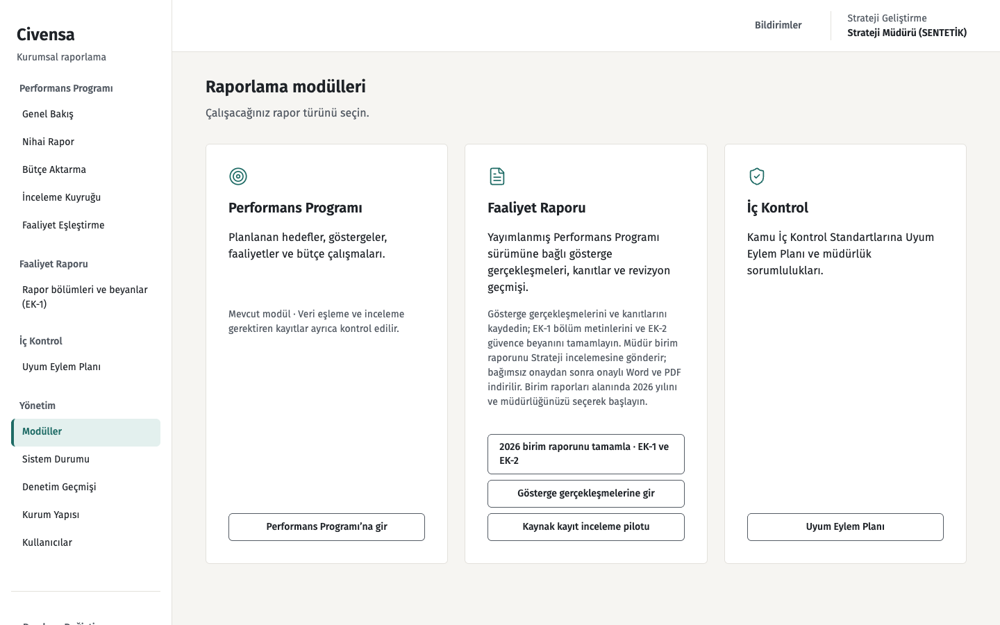

3. Tek hesap açmak için `Kullanıcı ekle` düğmesine basın. `Ad soyad`, `E-posta`, `Rol` (`Müdürlük` veya `Strateji Geliştirme`), `Müdürlük`, `Unvan` (`Personel` veya `Müdür`) ve `Geçici parola` alanlarını doldurun. `Kaydet` düğmesine basın. Her müdürlükte en fazla bir etkin `Müdür` hesabı bulunabilir; yeni `Müdür` atamadan önce mevcut `Müdür` hesabını `Personel` yapın veya gerekçeyle pasifleştirin.

   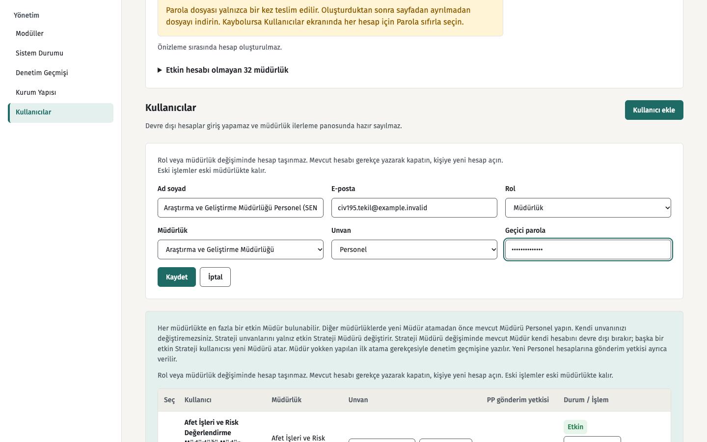

4. Toplu hesap açmak için `Kişisel müdürlük hesaplarını toplu oluştur` bölümünde `Şablonu indir` bağlantısıyla CSV şablonunu indirin. İndirilen şablondaki Müdürlük ID ve `Müdürlük` sütunlarını değiştirmeden koruyun; her kişi için `Ad Soyad`, `E-posta` ve `Görev` (`Müdür` veya `Personel`) sütunlarını doldurun. CSV dosyasına parola sütunu eklemeyin. `Hazırlanan CSV dosyası` alanından dosyayı seçip `Önizle` düğmesine basın. Hatalı satır veya aynı müdürlükte ikinci bir etkin `Müdür` varsa `Dosya uygulanamaz.` uyarısı görünür ve hiçbir hesap oluşturulmaz.

   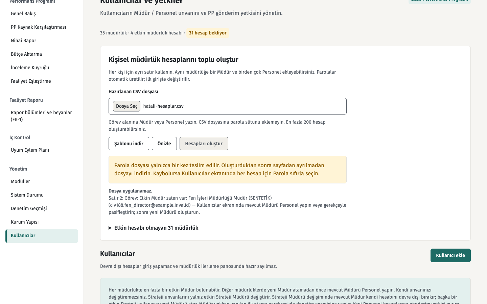

5. CSV dosyasındaki hataları düzeltip yeniden `Önizle` düğmesine basın. `kişisel hesap oluşturulmaya hazır.` mesajını ve önizleme tablosundaki `Müdürlük`, `Ad Soyad`, `E-posta` ve `Görev` sütunlarını kontrol edin.

   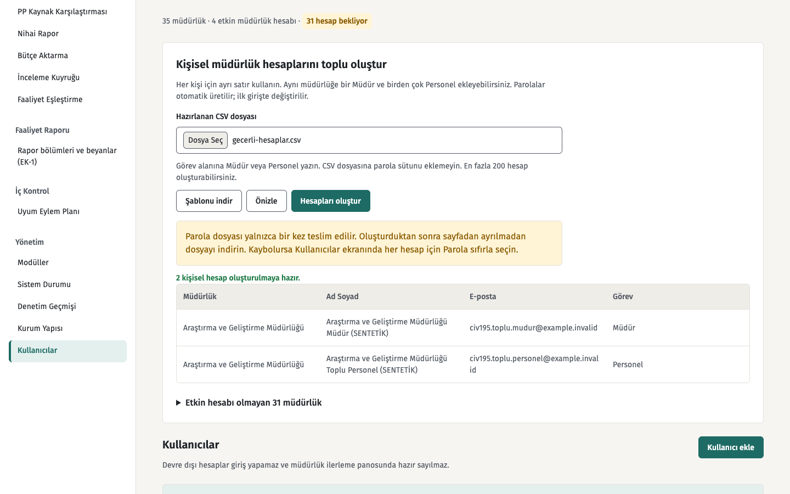

6. Önizleme temiz olduğunda `Hesapları oluştur` düğmesine basın. İşlem tamamlandığında sayfadan ayrılmadan `Parola dosyasını indir` düğmesine basarak tek seferlik geçici parola dosyasını indirin. İlk geçici parolaları kullanıcılara elden veya telefonla iletin; e-posta veya yazışma uygulamalarıyla asla göndermeyin.

   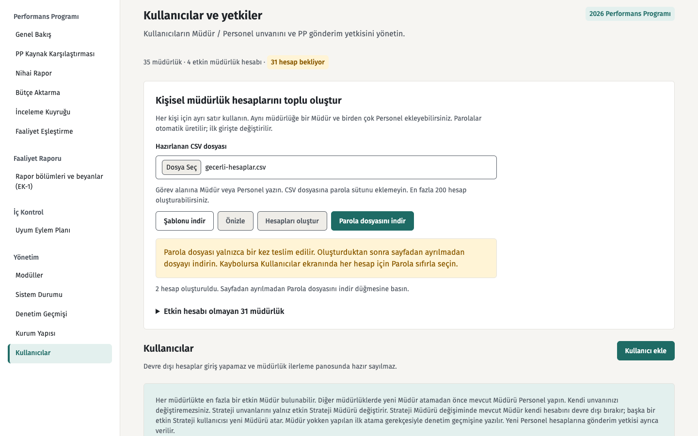

7. Yanlış açılan bir hesap grubunu veya kullanımdan kaldırılan hesapları geri alıp kapatmak için `Kullanıcılar` tablosundaki `Seç` kutularını işaretleyin. `Paylaşılan hesapları pasifleştir` bölümünde `Pasifleştirme gerekçesi` alanını doldurun ve `Seçilen hesapları pasifleştir` düğmesine basın. Tek bir hesabı kapatmak için satırındaki `Devre dışı bırak` düğmesini de kullanabilirsiniz.

   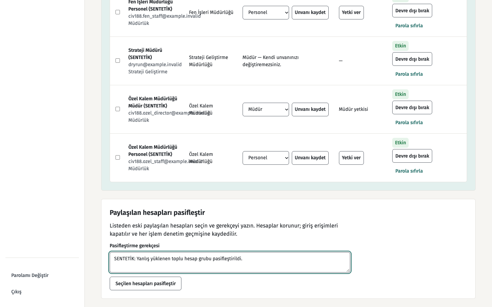

8. E-postayla kendi kendine parola sıfırlama yoktur; parolayı yalnız Strateji sıfırlar. Parolasını unutan veya parola dosyası kaybolan kullanıcının satırında `Parola sıfırla` düğmesine basın. `Yeni geçici parola` alanına en az 8 karakterlik geçici parola yazıp `Kaydet` düğmesine basın. Yeni geçici parolayı kişiye elden veya telefonla bildirin.

   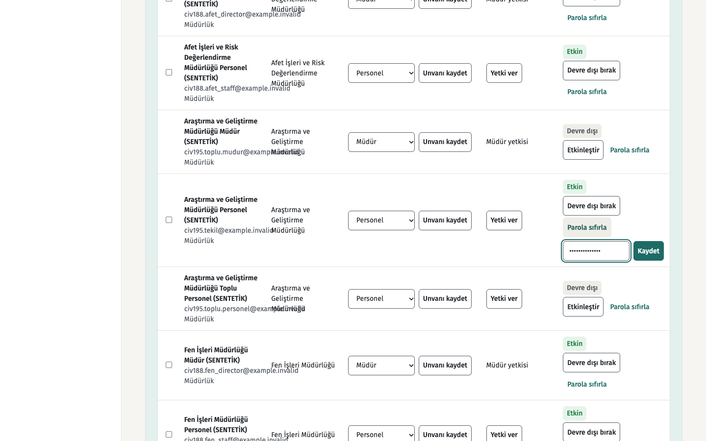

## 2026 yayını

1. Üst menüden 2026 dönemini seçip `Faaliyet Eşleştirme` bağlantısını açın. `Faaliyet Eşleştirme Kuyruğu` ekranında `Kuyruğu CSV indir` düğmesiyle bekleyen faaliyet listesini indirin. Dosyada önce düşük güvenli veya önerisi olmayan satırları kontrol edin; eşleştirilecek faaliyetler için Seçilecek Program / Alt Program sütununa uygun `Program / Alt Program` değerini yazın.

   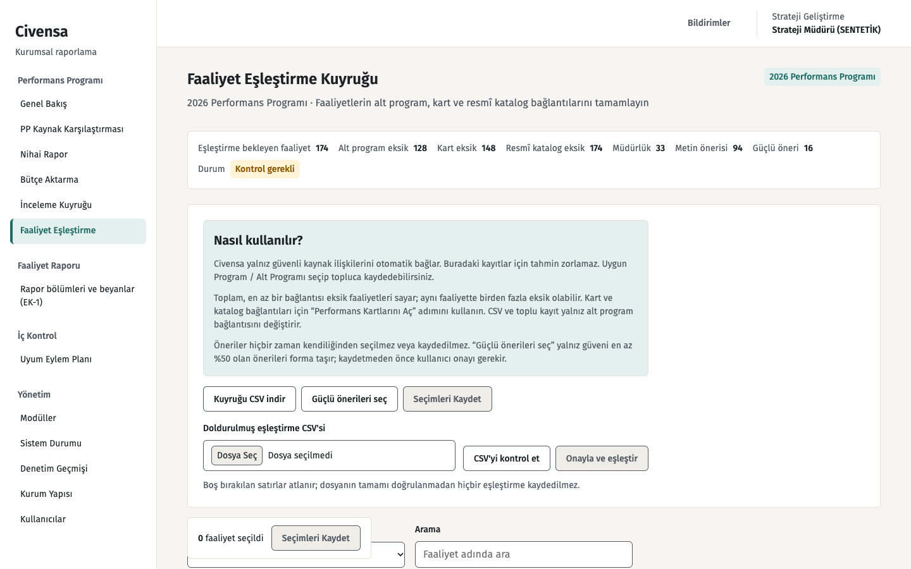

2. `Doldurulmuş eşleştirme CSV'si` alanından hazırladığınız dosyayı seçin ve `CSV'yi kontrol et` düğmesine basın. `faaliyet eşleştirilmeye hazır.` mesajını gördükten sonra `Onayla ve eşleştir` düğmesine basın.

   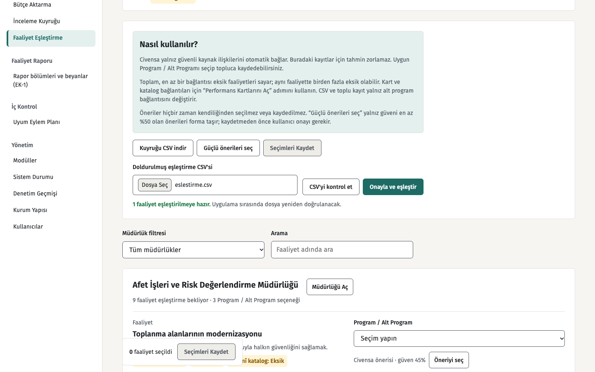

3. Uygulanan CSV işlemi `Son CSV işlemleri` listesine eklenir. Hatalı bir eşleştirme grubunu geri almak için ilgili satırdaki `Geri al` düğmesine basın.

   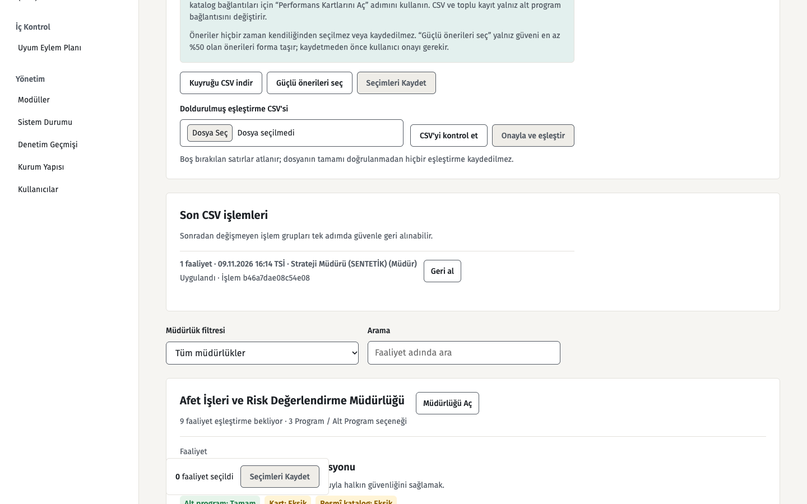

4. Üst menüden `Nihai Rapor` ekranını açın. `Onaylı kitaptan yayınla` bölümündeki `Onay dayanağı` alanına meclis karar bilgisini yazın ve `Onaylı kitaptan yayınla` düğmesine basın.

   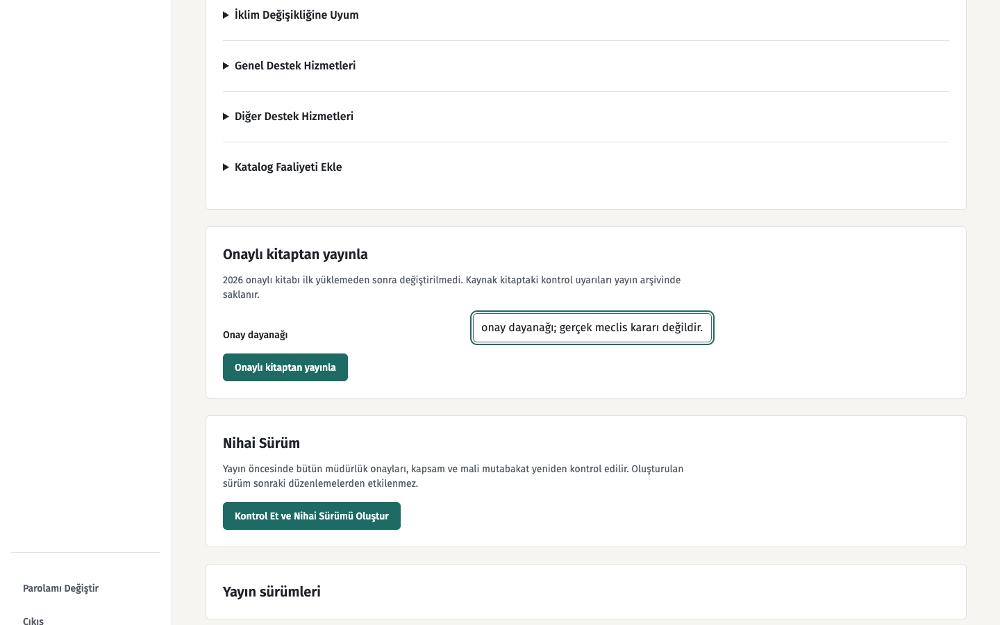

5. Yayın tamamlandığında aynı ekranın altındaki `Yayın sürümleri` bölümünde `Güncel sürüm` etiketini ve kaydedilen `Onay dayanağı` bilgisini kontrol edin.

   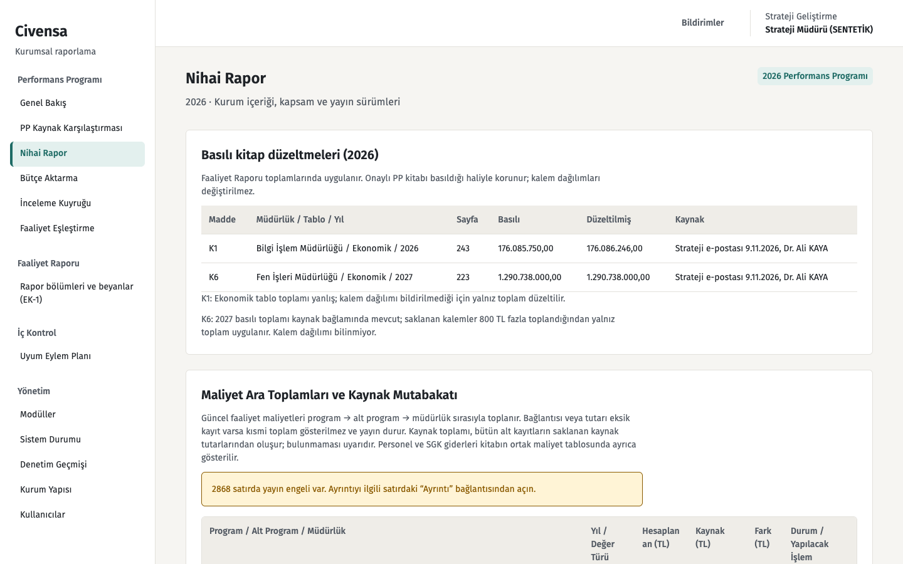

## Rapor dönemini açma

1. `Gösterge gerçekleşmelerine gir` bağlantısıyla `Gösterge gerçekleşmeleri` ekranını açın. `Yeni rapor oluştur` bölümünde `Kurum` ve `Baz program yayını` alanlarından 2026 yayın sürümünü seçin. `Seçilen yayınla rapor oluştur` düğmesine basın.

   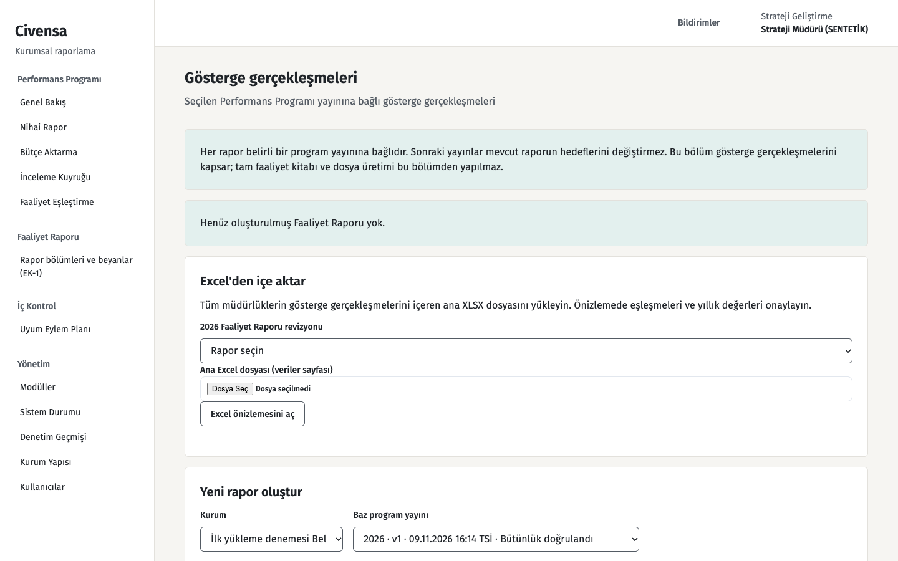

2. Açılan 2026 gösterge raporunda özet sayaçları ve gösterge listesini kontrol edin. Müdürlükler gerçekleşme ve kanıt girişlerini bu revizyon üzerinde yapar.

   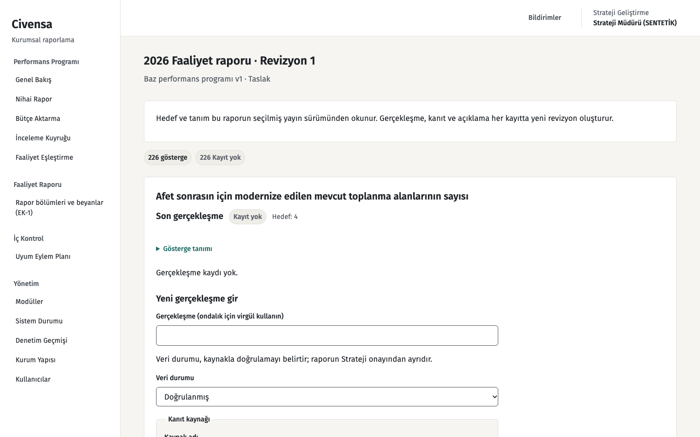

3. Sayfanın altındaki `Rapor revizyonu` bölümünü kontrol edin. Aynı yıl için yeni bir baz yayın veya düzeltme revizyonu açmak gerektiğinde `Yeni revizyon için baz yayın` ve `Revizyon / düzeltme gerekçesi` alanlarını doldurup `Yeni rapor revizyonu oluştur` düğmesine basın. Tüm gösterge gerçekleşmeleri ve kanıtları tamamlandığında `Gösterge gerçekleşmelerini onayla ve dondur` düğmesini kullanın.

   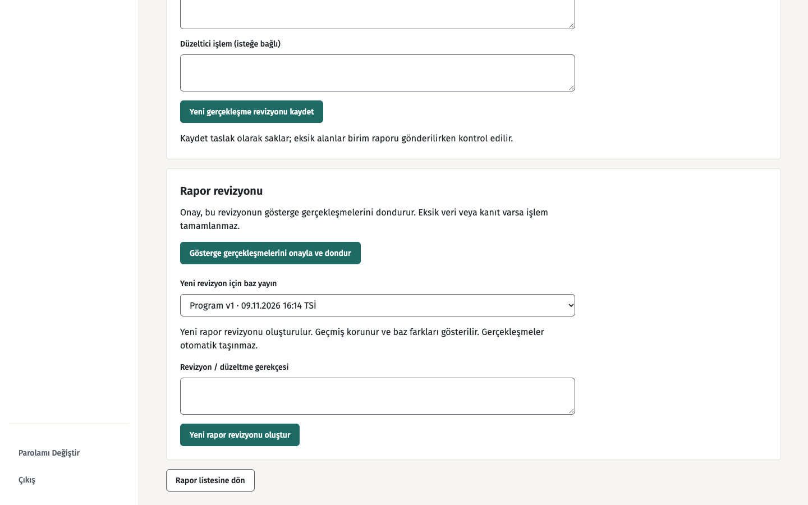

4. `Rapor bölümleri ve beyanlar (EK-1)` ekranını açın. `Yıl raporlarını oluştur` bölümünde `Kurum` ve `Raporlama yılı` alanlarından 2026'yı seçip `Raporları oluştur` düğmesine basın. Bu işlem kapsamdaki müdürlükler için birim raporlarını ve kurum için İdare raporunu açar.

   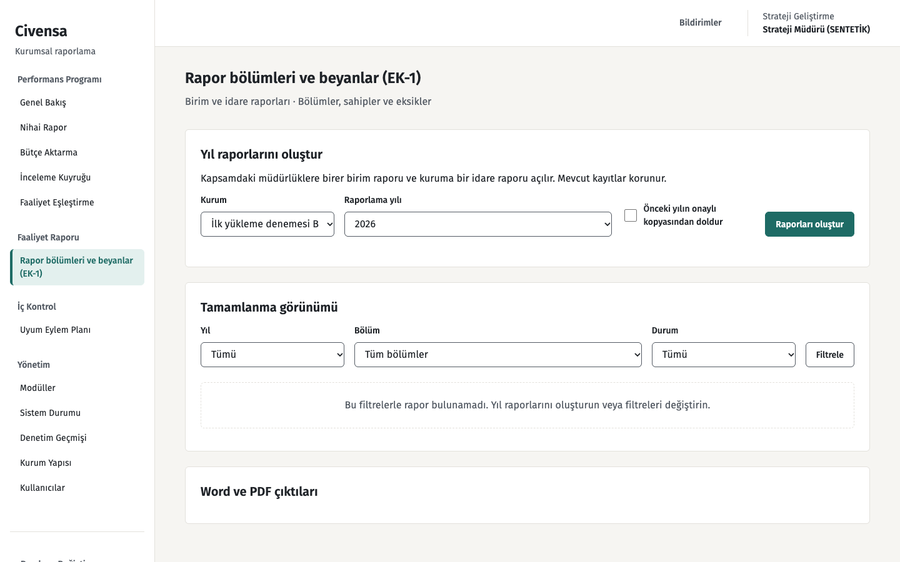

## İzleme

`Rapor bölümleri ve beyanlar (EK-1)` ekranındaki `Tamamlanma görünümü` bölümünde `Yıl` alanından 2026'yı seçin. Gerekirse `Bölüm` ve `Durum` filtrelerini de seçip `Filtrele` düğmesine basın.

Her müdürlük başlığının yanındaki iş akışı durumunu (`Taslak`, `Gönderildi`, `İade edildi`, `Onaylandı`) ve tablodaki `Bölüm`, `Durum`, `Sahibi` ve `Eksikler` sütunlarını inceleyin. Hangi müdürlüğün geciktiğini veya hangi bölümde eksik kaldığını `Durum` ve `Eksikler` sütunlarından takip edin.

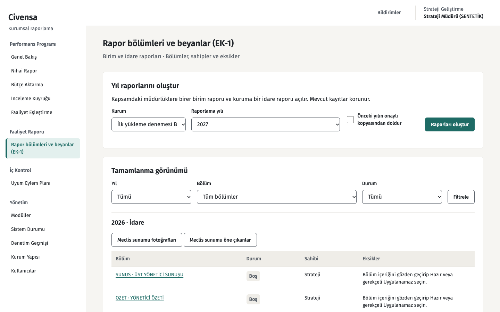

## İnceleme, iade, onay

1. `Tamamlanma görünümü` listesinden durumu `Gönderildi` olan müdürlük raporunu açın. `Birim raporu ·` başlığı altında gönderilen içeriği, bölümleri ve kanıtları inceleyin. Strateji müdürlük içeriğini doğrudan düzenlemez; düzeltme gerekiyorsa raporu gerekçesiyle müdürlüğe iade eder.

   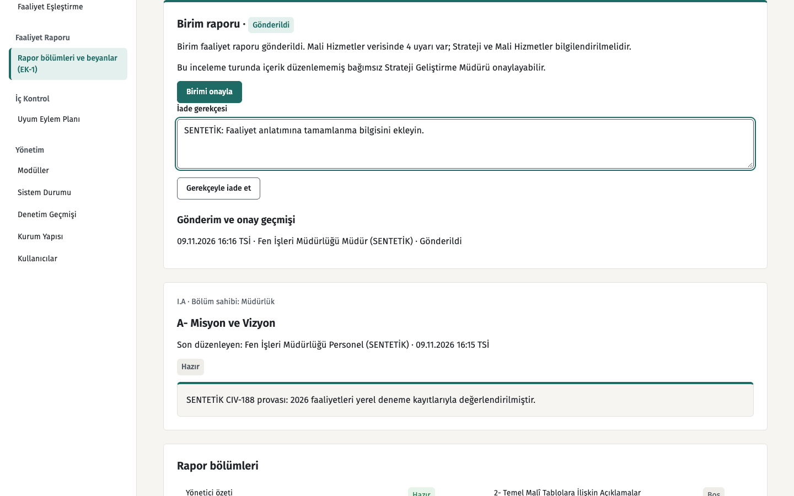

2. Düzeltme gerekiyorsa `İade gerekçesi` alanına eksikliği veya düzeltilecek bölümü açıkça yazın. `Gerekçeyle iade et` düğmesine basın. Birim raporunun durumu `İade edildi` olur.

   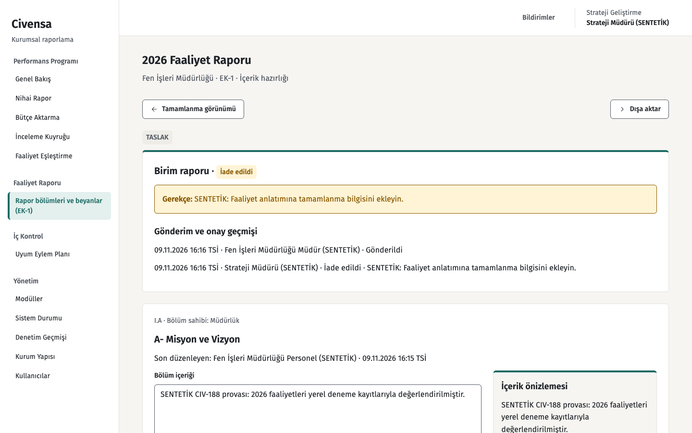

3. Müdürlük eksikleri tamamlayıp raporu yeniden gönderdiğinde birim raporunu tekrar açın. Durumun yeniden `Gönderildi` olduğunu ve `Gönderim ve onay geçmişi` bölümündeki kayıtları kontrol edin.

   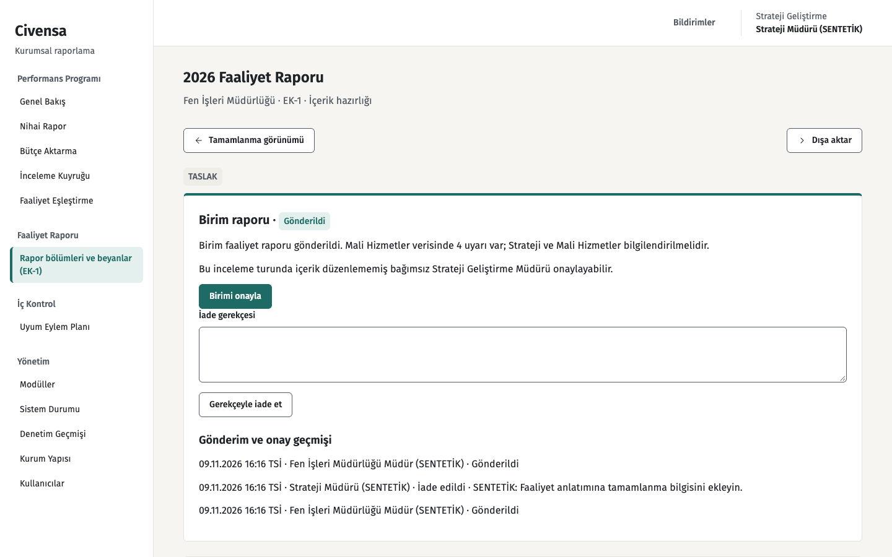

4. İnceleme turunda birim içeriğini düzenlememiş bağımsız Strateji Geliştirme Müdürü olarak `Birimi onayla` düğmesine basın. Birim raporunun durumu `Onaylandı` olur. Sistemdeki onay zinciri Strateji onayıyla tamamlanır; Başkan Yardımcısı ve Üst Yönetici onayları kağıt üzerinde ıslak imzayla alınır.

   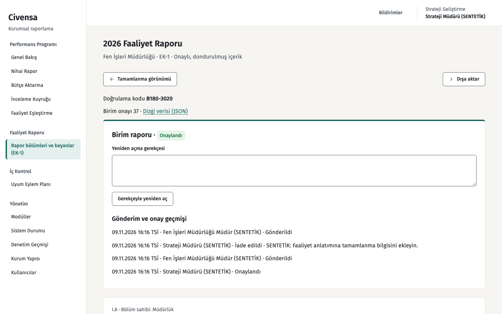

## Dışa aktarma

Birim raporunda `Onaylandı` durumunu kontrol edin. Üstteki `Dışa aktar` menüsünü açın veya `Rapor bölümleri ve beyanlar (EK-1)` ekranının altındaki `Word ve PDF çıktıları` bölümüne gelin. `Word olarak indir` veya `PDF olarak indir` bağlantısını seçerek onaylı raporu indirin. Onay öncesinde bu bağlantılar `Taslak — Word (onaysız)` ve `Taslak — PDF (onaysız)` olarak görünür ve TASLAK damgalı çıktı üretir; onaylı rapor yerine kullanmayın.

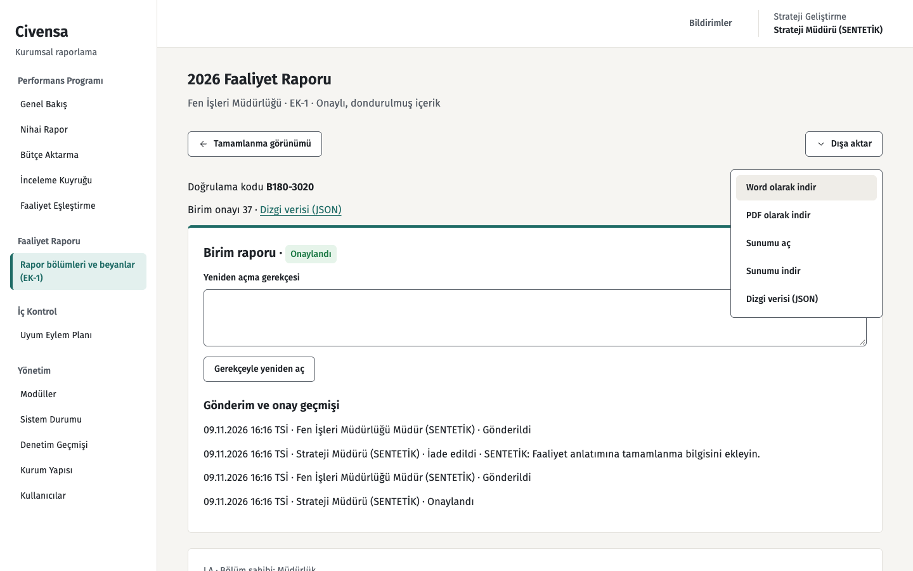

## Daha sonra eklenecek bölümler

[EKLENECEK — gösterge Excel ile toplu içe aktarma (Strateji)]

## Yardım

Teknik sorunları sistem yöneticisine iletin.
