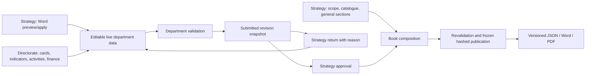

# CIV-008 — Performance Programme completion audit

Audit date: **13 October 2026 (Europe/Istanbul)**. Target: finished and in real use by **1 January 2027**; plan to close the completion gaps by **30 November 2026**, leaving December for a controlled real-use rehearsal.

Audited release line: `feature/authorization-workflow-phase5`, **`960d62cfa4e6e7e81bd7da1fac03fbda1c5a1487`**. Audit branch: `task/civ-008-pp-audit`. This commit includes `main` and A1-P0 hardening. `APP_VERSION` is still `5.0.0`; that version string does **not** establish parity with the older live pilot. The live pilot was not contacted.

**Verdict: the module has a working core, but cannot yet be called finished.** Authenticated synthetic 2027 entry, return/correction/approval, frozen publication, and Word/PDF output worked. Source conflicts can still be silently resolved, Word imports have known expected-failure regressions, manual initial setup is incomplete, and deployment gates remain open.

## Evidence conventions and method

- **READ** means inspected source, routes, templates, tests or issue text. A test merely read is not evidence of execution.
- **EXECUTED E…** means an actual HTTP scenario described in the execution ledger below, using the application's unmodified routes and genuine login/session/CSRF handling, on disposable local **PostgreSQL 17.11**, Python 3.12. No dependency overrides were used in this audit harness.
- **EXECUTED B…** means headless Chromium with Playwright, using normal login and rendered screens; selected actions use that browser context's authenticated HTTP API. The ledger distinguishes UI clicks from API calls.
- **EXECUTED X…** means additional authenticated HTTP scenarios on the same disposable application database.
- **EXECUTED T…** means an existing repository test run. Its own fixtures and authentication substitutions still apply. Most unmarked tests use SQLite, even with `--require-postgres`; tests marked `postgres` use disposable PostgreSQL schemas. The independent E/B/X runs establish PostgreSQL coverage of the main product flows.

The local server was bound to loopback. Startup applied the committed Alembic chain to a fresh disposable database, through head `f2b7c4d91e08`. Synthetic Word documents contained known target/cost values, a deliberately incorrect source general total, unsupported economic tables, and separate contradictory-value examples. Only the institution, initial Strategy account, and one empty second department for access checks were bootstrapped directly in SQLAlchemy. Periods, imported department/program/subprogram data, additional users, cards, indicators, activities, costs, scopes, catalogue, book sections and approvals were created through HTTP. PostgreSQL reads checked resulting state; direct SQL publication UPDATE/DELETE attempts were confined to this database.

The execution harnesses, credentials and generated Word/PDF downloads were temporary files outside the repository. This report contains the inputs, observed outcomes and code/test references needed to turn findings into regression tasks. Only this report and synthetic screenshots are committed. No application, migration or test source was changed; no live database, merge or deployment was used.

## Definition-of-done verdicts

| Line | Verdict | Evidence and implication |
| --- | --- | --- |
| **D1 — 2027 setup/import/manual entry** | **Partial** | **EXECUTED E02–E05, E11, X04:** 2027 period, import and manual card/indicator/activity entry worked once a program hierarchy existed. Import left economic tables, official catalogue, scopes and general sections empty; copied periods also omit these adjuncts. An unrecognised document was marked applicable. **READ:** no manual department/program/subprogram administration routes; existing Word defect tests. PP-01–PP-08, PP-15, PP-26. |
| **D2 — Directorate entry/correction, blank/zero, Turkish numbers** | **Partial** | **EXECUTED E04, E05, E07:** own-department boundary, blank distinct from zero, `12.500,23` display and correction after return passed. **EXECUTED B13:** saving another indicator discarded an unsaved sibling edit. **READ:** inconsistent period navigation. PP-12, PP-13; source-conflict fixes PP-09–PP-11 also protect data entry. |
| **D3 — Strategy review/return/reapproval** | **Works for the defined return-before-approval flow** | **EXECUTED E07:** submit → reason-required return → correction → resubmit → approve, immutable event snapshots and locked data. **EXECUTED E06:** inconsistent finance blocked submission. **READ/EXECUTED E07:** the live legacy approval is terminal; a later approved-data correction has no reopening flow. Imported returned legacy packages can lose review context (PP-06/PP-07). PP-14 is a separate real-use recovery gap, not a claim that the demonstrated D3 path failed. |
| **D4 — immutable hashed publication** | **Works locally; production assurance blocked** | **EXECUTED E08:** SHA-256 matched served JSON, subsequent section edit did not change frozen bytes, direct SQL UPDATE and DELETE were blocked. **READ:** ORM immutability, migration triggers, per-period publication lock and version uniqueness. Actual restricted runtime-role guarantees remain open in #4 (PP-19); no live grants were inspected. |
| **D5 — source comparison/conflicts/totals** | **Partial; completion blocked by data integrity gaps** | **EXECUTED E06:** a one-kuruş mismatch blocked submission. **EXECUTED E12/E13:** duplicate source personnel amounts silently retained the last amount; saving an unchanged financing split replaced a conflicting source total. **EXECUTED E03/X05; READ:** source general totals and some source tables are discarded, no complete side-by-side source comparison, and program-cost output has activity rows without program/subprogram subtotal reconciliation. PP-09–PP-11, PP-16. |
| **D6 — every error explains what/where/action in Turkish** | **Not met** | **EXECUTED E04/E14/E15:** `Forbidden`, `Unauthorized` and English path validation. **EXECUTED B05:** native finance form navigated to `{"detail":"Sayı biçimi doğrulanmalı: abc"}`, without record/year/fund, corrective example or application layout. **READ:** JSON-fetch helpers improve some AJAX cases, but no universal HTTP/form error contract. PP-17/PP-18. |
| **D7 — official-book-usable output** | **Partial** | **EXECUTED E09/E10:** frozen full Word/PDF and approved department Word downloaded and parsed, retaining Turkish numbers and manual card content. Sample PDF rendered legibly. **READ:** fixed landscape layout, no official document/template fidelity contract, TOC or institutional cover/header system; summaries lack program subtotals. PP-16, PP-24. Official-source and full-size typesetting acceptance remains unverified. |
| **D8 — non-technical Strategy administration** | **Partial** | **EXECUTED B06–B09, E02, X01–X03:** create user through UI; enable/disable/reset through browser-context API; period actions; activity mapping through HTTP. **READ:** roles are selected at creation but existing user role/department reassignment has no screen/route; no hierarchy administration; mapping completes the subprogram but leaves a missing card. First-period dashboard gives 409 with no setup UI. PP-01, PP-08, PP-15, PP-23. |
| **D9 — release gates** | **Blocked** | **READ:** #4 and #5 remain open; login route has no throttling. **EXECUTED E17:** 12 failed attempts all returned 400, no 429. **EXECUTED B02/B14:** sidebar overlap prevents distinct password hit area. Existing session/CSRF hardening is present and exercised (E04/B15 and T03). `/api/release/readiness` can say `ready` while these gates remain open (B12). PP-19–PP-22. |

## 1. Feature inventory

Statuses describe the audited scope, not a promise of production readiness. S = Strategy (`User.role='strategy'`); D = Directorate (`department`, constrained to its own department). The newer editor/director/delegation/final-authority backend is deliberately disabled, has no operational HTTP UI, and is **not** required to demonstrate the requested legacy D3 flow.

| Feature | Route / screen | Roles | Status | Evidence |
| --- | --- | --- | --- | --- |
| Login, module selection, logout, password change | `/login`, `/modules`, POST `/logout`, `/api/me/change-password` | S, D | **partial** | **EXECUTED E04/E17/B14/B15**; **READ** `app/main.py::login`, `require_user`, `change_password`, `app/config.py`, `app/templates/base.html`: real sessions and CSRF, password control overlap and missing throttle. |
| Period list/create/select/verify/activate | `/dashboard`, POST `/api/periods`, `/period/select/{id}`, `/api/periods/{id}/verify-template`, `/activate` | S; D sees active period | **partial** | **EXECUTED E01/E02/E11**; **READ** `app/main.py::create_period`, `session_period`, `app/templates/dashboard.html`: copied hierarchy but incomplete adjuncts; verification is an unconstrained manual flag. |
| Department/program/subprogram master data | Selectors on `/program/{department}` and `/department/{department}` | Import by S; selections by D | **missing** manual administration | **READ** complete route registration in `app/main.py`, `app/program_routes.py`; `app/models.py::{Department,Program,SubProgram}`; import creates hierarchy, periods copy it. Official catalogue labels do not create these master records. |
| Ministry template field scan | POST `/api/periods/{id}/template-upload`, GET `/api/template-snapshots/{id}` | S | **partial** | **READ** `app/template_parser.py::analyze_template` scans expected text labels in DOCX/XLSX; `app/main.py::verify_period_template` does not bind verification to scan results. **EXECUTED E02:** verified without an uploaded template. Not a content/totals validator. |
| Word data preview/apply/revert | Dashboard; `/api/periods/{id}/data-import-preview`, `/api/import-batches/{id}`, `/apply`, `/revert` | S | **partial** | **EXECUTED E03/E12/X04**, **EXECUTED T02**; **READ** `app/data_importer.py`, `app/import_service.py`, `tests/test_word_import.py`: supported simple tables work; incomplete coverage, conflict loss and known regressions. |
| Directorate overview and progress | `/dashboard`, `/api/progress` | D own; S all | **works** core overview | **EXECUTED E16/B01/B03**; **READ** `app/main.py::department_progress_overview`, `tests/test_progress_readiness.py`: readiness uses full department validation. Excluded department/account handling and raw status wording still need acceptance clarification. |
| Indicators: create, metadata, annual values | `/program/{d}/indicator`, `/api/indicators/{id}/save`, `/department/{d}` | D own; S read | **partial** | **EXECUTED E04/E05/E07/B13**; **READ** `app/main.py::save_indicator`, `app/static/app.js::saveIndicatorCard`, `tests/test_indicator_update.py`: Decimal values and permissions work; sibling drafts lost on reload. No indicator removal UI. |
| Report cards and assignment | `/program/{d}`, POST `/cards`, `/assign` | D own; S read | **partial** | **EXECUTED E05/B04**; **READ** `app/program_routes.py::save_card`, `assign`, `app/templates/program.html`: creation/edit/order/assignment work with existing subprograms; no card/indicator removal route for mistaken additions. |
| Local activities and funding splits | `/api/activities`, PUT/DELETE `/api/activities/{id}`, `/program/{d}/finance/{id}` | D own; S read | **partial** | **EXECUTED E05/E13/B05**; **READ** `app/program_service.py::save_activity_costs`: exact split, derived total, null handling, validation; source-total overwrite and native-form error recovery gaps. |
| Personnel/SGK and economic grids | `/api/departments/{d}/personnel-costs`, `/program/{d}/economic`, `/economic-grid` | D own; S read | **works** entry/checking, **partial** source coverage | **EXECUTED E06**; **READ/EXECUTED T01** `tests/test_economic_form.py`, `test_program.py`, `app/program_service.py`: required future-year economic cells, category/funding reconciliation and atomic bad-cell failure. No source economic import. |
| Source-cell verification | `/program/{d}/verify-value/{id}`, `/verify-money/{kind}/{id}` | D own; S read | **partial** | **READ** `app/program_routes.py::{verify_value,verify_money}`, `app/templates/program.html`; **EXECUTED T01** `test_explicit_money_review_preserves_original`: raw questionable cells can be corrected explicitly, but no complete source locator/diff/conflict workflow. |
| Activity → subprogram mapping | `/activity-mapping`, bulk mapping and CSV export/preview/apply/revert | S | **partial** | **EXECUTED X01–X03**, **READ** `app/main.py::save_activity_mappings`, `app/templates/activity_mapping.html`: one pending activity mapped with `remaining=0`, but card stayed null and catalogue link still required. CSV helpers covered by T03; no browser CSV round-trip in this audit. |
| Department scope and official catalogue | `/report-builder`, POST `/scope`, `/catalogue`; `/program/{d}/catalogue-link` | S scope/catalogue; D links | **works** manually, **partial** import/copy | **EXECUTED E03/E05–E08**; **READ** `app/program_routes.py`: required/zero/excluded with reasons, official activity/responsibility creation and explicit local links. Not automatically imported/copied. |
| Submission, review, return and approval | `/department/{d}`, `/review`, `/api/departments/{d}/submit`, `/api/submissions/{id}/decision` | D submit/correct; S decide | **works** D3 core | **EXECUTED E06/E07**, **EXECUTED T01** `tests/test_submission_workflow.py`, `test_publication_gates.py`, `test_review_errors.py`: return reason, revisions, revalidation and locked writes. Approved package cannot be reopened in this live flow. |
| Notifications and audit history | `/api/notifications`, `/read`; `/audit`, `/api/audit/export.csv` | S/D own notices; S audit | **works** observed core; **partial** legacy attribution | **EXECUTED E07/B03**, **READ** `app/main.py`, `app/templates/review.html`, `department.html`: events/notices recorded. Legacy review renders timestamps without Turkey conversion or actor name; disabled field-history services do not provide current PP UI field-level comparisons. |
| Book composition, preview, frozen publication | `/report-builder`, `/section`, `/preview.docx`, `/preview.pdf`, `/publish`, `/publications/{id}.{json,docx,pdf}` | S | **works** freeze/export core; **partial** official-book quality | **EXECUTED E08/E09/B01**, **READ** `app/program_routes.py::publish`, `app/book_export.py`, `app/activity_contract_service.py::freeze_program_payload`: validated approved source, ordered sections, immutable hash and indicator contract bindings. |
| Approved department exports | `/export/department/{d}.{json,docx}` | S | **works** current approved section | **EXECUTED E10**, **READ** `app/main.py::export_department_docx`: approved current live snapshot; full frozen publication exports use the immutable publication. Department export is not a version-pinned publication section. |
| Account creation, active state, password reset and bulk CSV | `/users`, `/api/users`, `/active`, `/reset-password`, bulk preview/import/revert, missing-account CSV | S | **partial** | **EXECUTED B06–B09**, **READ** `app/main.py`, `app/templates/users.html`; existing role/department reassignment and fine-grained roles absent from live UI. Disabled foundation must not be mistaken for released administration. |
| Operations, backup and release readiness | `/operations`, `/api/operations/status`, `/api/operations/backup.json`, `/api/release/readiness`, `/health` | S; health public | **partial** | **EXECUTED E16/B12**, **READ** `app/main.py::release_readiness`: DB/migration/records checks, but no enforcement of #4/#5/throttling and no complete D1–D9 readiness verdict. Backup download is not proof of a restore rehearsal. |

### Data flow and access boundary

**READ** `app/main.py`, `app/program_routes.py`, `app/program_service.py`, `app/activity_contract_service.py`:

Directorate editing is allowed only for its own draft/returned submission; submitted/approved data is locked. Strategy reviews department content and edits institution-wide composition, but cannot use Directorate write routes. The legacy `SubmissionEvent` freezes submit/decision content. Publication freezes the full book and binds indicator definitions for later Activity Reports. Subsequent composition changes do not mutate that publication. New authorization/package/candidate/revision services exist only as a disabled backend, not an alternative usable screen flow (`app/authorization_models.py::AuthorizationConfiguration`, `app/authorization_service.py::can`; `ACTIVITY_REFERENCE_SUCCESSORS=False` remains unchanged).

## Execution ledger

These observations are **EXECUTED**, not inferred. E/B/X identifiers in the tables refer here; each entry names the proving route and implementation/test.

| ID | Actual input/action and result | Proof / implementation |
| --- | --- | --- |
| **E01–E02** | Bootstrap-only Strategy account logged in normally. With no period, GET dashboard returned 409 `Raporlama dönemi bulunamadı.`. POST period created 2027. Activation returned 409 before verification. Verify returned 200 **without any template upload**, then activate 200/select 303. | `app/main.py::{dashboard,create_period,verify_period_template,activate_period}`; `/api/periods` and period routes. |
| **E03** | Synthetic Word: 1 department, 1 card, 1 indicator (`1,75` target), 1 activity (`123,45` inside + `10,05` outside = `133,50`), `20,00` personnel for 2027–2029; source `Genel Toplam=999,99` and an economic table. Preview `can_apply=true`; apply 200. Economic values, official activities, scopes and sections each **0**. Validation then reported missing catalogue link/economic tables; preview gave no source-total discrepancy warning. | POST `/api/periods/{id}/data-import-preview`, `/api/import-batches/{id}/apply`; `app/data_importer.py::{parse_performance_docx,_parse_activity_table}`, `app/import_service.py::apply_import_batch`. |
| **E04** | Directorate account created by POST `/api/users`, then logged in normally. Other department GET 403 `Forbidden`; missing CSRF write 403. Blank 2027 target removed the row; explicit zero stored `0.000000`; `12.500,23` input appeared with Turkish separators in rendered department HTML. | `/program/{other}`, `/api/indicators/{id}/save`, `/department/{d}`; `app/main.py::save_indicator`, `app/numbers.py`. |
| **E05** | Through real routes: second card, indicator with explicit zero and explanation/method/source, second activity, card assignment, three years of zero financing; Strategy created official catalogue, both local links, required/excluded scopes and general text section. Directorate completed 54 future-year economic cells (9 categories × 3 years × 2 funds) for the service group. | `/program/{d}/cards`, `/indicator`, `/assign`, `/finance/{a}`, `/catalogue-link`, `/economic-grid`; `/api/activities`; `/report-builder/{catalogue,scope,section}`. |
| **E06** | Changed 2027 goods/services inside from `123,45` to `123,46`: submit 422 with separate common/economic and inside-fund mismatch messages; corrected back to `123,45` and submission succeeded. | `/program/{d}/economic`, `/api/departments/{d}/submit`; `app/program_service.py::_validate_department_records`. |
| **E07** | Submit revision 1; write while submitted 409; empty return reason 422; Strategy returned with `2027 hedefini kaynakla düzeltin.`; Directorate changed target to `2,50`; submitted revision 2; Strategy approved 200. Stored events `(submitted,1),(return,1),(submitted,2),(approve,2)`. Approved edit 409; attempted later return 409. | `/api/departments/{d}/submit`, `/api/submissions/{id}/decision`; `app/main.py::{submit_department,submission_decision}`; matching `tests/test_submission_workflow.py::test_return_correct_resubmit_approve`. |
| **E08** | Publish 303; SHA-256 of served JSON equalled stored hash. Added a later book text section through HTTP; old JSON bytes unchanged. Direct SQL UPDATE and DELETE of publication each failed under the migrated PostgreSQL triggers; failed transactions rolled back. | `/report-builder/publish`, `/section`, `/publications/{id}.json`; `app/models.py::_immutable_revision`, `migrations/versions/f6b1c2d3e4f5_activity_report_contract.py`. |
| **E09–E10** | Frozen publication Word: 200, 8 tables, landscape, target `2,5`, cost `133,50`, manual card text. PDF: 200, 7 pages, same target/cost/manual card. Approved department Word: 200, 5 tables. Parsed using python-docx/pypdf; PDF page 2 rasterized and visually inspected. | `/publications/{id}.docx`, `.pdf`, `/export/department/{d}.docx`; `app/book_export.py::{blocks,_docx,_pdf}`. |
| **E11** | Copied 2027 → 2028: 1 program, 1 subprogram, 2 cards, 2 indicators, 2 activities; **0** scopes, catalogue, general sections and economic values. Annual values intentionally not copied. | POST `/api/periods`; `app/main.py::create_period`, `tests/test_program.py::test_new_period_has_no_fake_zero`. |
| **E12** | Separate 2031 source: duplicate personnel `20,00` then `30,00` for each year, activity source total `140,00` against `123,45+10,05`. Preview warnings **empty**; apply kept personnel `30.00` only. Department validation correctly flagged the activity total mismatch before editing. | Preview/apply routes; `app/import_service.py::_merge_unique_costs`, `consolidate_source_departments`; `app/program_service.py::_validate_department_records`. |
| **E13** | PUT activity with changed explanation and the same financing split (`123,45`/`10,05`, as the UI sends) replaced 2031 total **140.00 → 133.50**, state verified, while raw text stayed `140,00`; no conflict response. | `/api/activities/{id}`; `app/main.py::update_activity`, `app/static/app.js::saveActivity`, `app/program_service.py::save_activity_costs`. |
| **E14–E17** | Anonymous dashboard 401 `Unauthorized`; invalid department path 422 with English FastAPI validation. Strategy dashboard/report-builder/review/users/mapping/operations GET each 200. Twelve consecutive wrong-login attempts each 400, no 429. | `app/main.py::{require_user,login}`, `app/program_routes.py::workbench`; actual HTTP GET/POST routes. |
| **X01–X03** | Imported 2032 document with two subprogram cards and one ambiguous activity. Preview estimated 1 unlinked activity. Mapping screen 200; Strategy bulk mapping returned `updated=1, remaining=0`; SQL read confirmed subprogram assigned, **card_id still null**. | `/activity-mapping`, `/api/activity-mappings/bulk`; `app/main.py::save_activity_mappings`. |
| **X04–X05** | DOCX containing only an unrecognised paragraph: preview 200, 0 recognized tables/departments/indicators, no year, no warnings, **can_apply=true**. After earlier blank/recreate/correction operations, an indicator value was `2.500000`, raw text `0`, state verified; original imported spelling remains only in the separate batch payload, not a current comparison screen. | Preview route; `app/main.py::data_import_preview`, `app/models.py::ImportBatch`, `app/main.py::save_indicator`. |
| **B01–B04** | Chromium rendered Strategy dashboard, report-builder, review and users (200); Directorate approved screen had no save buttons and showed `2,5`. Explicit draft-2028 workbench showed enabled card save forms. Both roles at **1012×1103, 800×600, 390×844**: password and logout rectangles were identical; overlap true in all six checks. | `app/templates/{base,dashboard,program,department,review,users,report_builder}.html`, `app/static/app.css`; screenshots below. |
| **B05** | In draft finance form, opened details, typed `abc` in 2028 inside-budget field, clicked its native save button: HTTP 422 navigated to raw JSON, no app header or preserved form. | `/program/{d}/finance/{a}`; `app/program_routes.py::finance`, `app/program_service.py::save_activity_costs`; `finance-error.png`. |
| **B06–B11** | Created user through `/users` UI; user appeared in list. Browser-context API disabled/enabled/reset that disposable account, each 200. Readiness rejected duplicate active accounts. No JavaScript page exceptions occurred on visited application screens. | `/api/users`, `/{id}/active`, `/{id}/reset-password`, `/api/release/readiness`; `app/main.py`, `app/static/app.js`. |
| **B12–B15** | Disabled the extra test account: readiness now **ready**, despite unresolved gates and a missing-account warning. Activated copied 2028 locally; edited one indicator's unsaved name, saved another by its normal button: reload restored the first name, losing the unsaved edit. Password center hit-test selected **Çıkış**. Clicking logout landed on login. Restored the original 2027 active period through API. | `app/main.py::release_readiness`, `app/static/app.js::saveIndicatorCard`, `app/templates/base.html`; `directorate-editable-data.png`. |

### Existing tests run

The command below requires a PostgreSQL URL to be configured; no connection strings or credentials are included in this report.

| Run | Command / selection | Actual result |
| --- | --- | --- |
| **T01** | `python -m pytest -q --require-postgres tests/test_program.py tests/test_submission_workflow.py tests/test_publication_gates.py tests/test_progress_readiness.py tests/test_review_errors.py tests/test_indicator_update.py tests/test_economic_form.py` | **81 passed**, 1 existing Starlette/httpx deprecation warning. These fixture-based module tests primarily use SQLite; E02–E10 supplied independent migrated-PostgreSQL, real-login HTTP coverage. |
| **T02–T03** | `python -m pytest -q -rx --require-postgres tests/test_word_import.py tests/test_live_pilot_hardening.py` | **64 passed, 12 xfailed**, 1 existing deprecation warning; 27.78 seconds. All 12 strict expected failures reproduced the seven existing Word defect families. Word scenarios use PostgreSQL; hardening tests exercise mixed SQLite/PostgreSQL backends. |
| **T04** | `python -m pytest -q --require-postgres` on a separate fresh disposable database | **In progress** at initial PR creation; final result will be recorded after the run completes. |

Word test expected failures are product defects, not passes. The detailed gap rows below identify each family and distinguish HTTP tests from parser/service-only tests. Source bundle integrity (`python check_bundle.py`, 80 files), JavaScript syntax (`node --check app/static/app.js`) and documentation whitespace (`git diff --check`) checks passed.

The documented repeat-run public-schema migration collision was avoided by using a fresh test database (`docs/issues/postgres-migration-test-repeat.md`); it was not repaired.

## 2. Gap list

Severity: **Blocker** prevents safe rollout or violates the explicit conflict-preservation requirement; **High** prevents a completion criterion or a common safe real-use path; **Medium** causes recoverable workflow/administration friction or requires acceptance evidence; **Low** affects clarity. Sizes: **S ≤ half day; M ≤ 2 days; L > 2 days**. Estimates are engineering estimates, not elapsed audit time. Dependencies point to existing tasks or gap IDs. “None” means the task can start independently. Every row includes evidence, user impact and a one-sentence suggested fix; no fix is included in this PR.

| ID | D line | Description and evidence | User impact | Severity | Suggested fix | Size | Dependencies |
| --- | --- | --- | --- | --- | --- | --- | --- |
| **PP-01** | D1, D8 | **READ** route inventory `app/main.py`/`app/program_routes.py`, `app/templates/{dashboard,program,users}.html`: no create/edit/manual administration of department, program or subprogram master data; catalogue labels are separate records. | New 2027 hierarchy or reorganized department requires Word import or a technical operator; fully manual setup is impossible. | **High** | Add Strategy forms for these three master-data types with period-aware references and safe rename/create validation, split into three bounded screen tasks. | **L** | Agreed 2027 department/program catalogue. |
| **PP-02** | D1, D5 | **EXECUTED E03/E11; READ** `parse_performance_docx`, `apply_import_batch`, `create_period`: source economic/catalogue/general tables and sections are not imported; scope/catalogue/sections are not copied to a new period. | A successful import/copied period is far from submission/publication ready and requires repeated manual work that is not summarized as a completion checklist. | **High** | Add an import/copy coverage manifest and explicit completion checklist, then separate tasks for supported official economic/catalogue/section tables and deliberate carry-forward of non-value metadata. | **L** | PP-01; CIV-005; official 2027 table examples. |
| **PP-03** | D1, D5 | **EXECUTED T02; READ** `tests/test_word_import.py::test_d1_wrapped_visible_value_is_preserved`, `test_d2_supported_table_variants_are_recognised`, `test_d3_two_row_header_retains_value_kinds`; parser top-level/minimum-row/singular-header assumptions. Tracked changes/content controls lose visible values; plural, short/nested tables and two-row headers are unsupported. | Values or complete tables can disappear or acquire the wrong year/value type. | **High** | Complete CIV-005 parsing support for these six variant cases with preserved raw values, correct column kinds and strict coverage warnings. | **L** | CIV-005; CIV-003 regressions already present. |
| **PP-04** | D1, D5 | **EXECUTED X04/T02; READ** `app/main.py::{data_import_preview,import_batch_detail}`: `can_apply` depends only on mapping/year mismatch, so zero recognized data or absent year can be applicable. | Strategy sees an apparently safe import that loaded nothing or did not establish the correct year. | **High** | Reject applicability until recognized required tables and a verified source year/coverage manifest are present, and name missing parts in Turkish. | **M** | CIV-005; PP-03. |
| **PP-05** | D1, D5 | **EXECUTED T02** `test_d5_concurrent_apply_creates_department_once` executes two PostgreSQL service transactions and remains expected-failing; **READ** `apply_import_batch` reads batch state without a lock and departments lack canonical-name uniqueness. | Double apply or simultaneous operators can create duplicate department records and split responsibility/data. | **High** | Serialize application of each batch and enforce a consistent department identity check inside the same transaction. | **M** | CIV-005; canonical department identity decision. |
| **PP-06** | D3 | **EXECUTED T02** `test_d6_return_note_survives_import`; **READ** `apply_import_batch` resets matched legacy submission to draft and clears its return note/timestamps. Existing new cards/economics prevent overwrite, but a returned pre-card legacy package is still affected. | The Directorate loses the correction instruction while its review event remains elsewhere. | **High** | Preserve returned-package status and correction context when applying an allowed import, or reject with a reason until the return is handled explicitly. | **M** | CIV-005; PP-05. |
| **PP-07** | D1, D3, D6 | **EXECUTED T02** `test_d7_safe_rollback_preserves_submission_history` exercises HTTP revert and expects failure because a retained `SubmissionEvent` references the deleted submission; **READ** `revert_import_batch`. | An import advertised as reversible can fail with HTTP 500 on packages with review history. | **High** | Restore the existing submission in place and preserve immutable events in the rollback transaction. | **M** | CIV-005; PP-06. |
| **PP-08** | D1, D8 | **EXECUTED X02/X03; READ** `save_activity_mappings`, `app/templates/activity_mapping.html`: subprogram queue reports `remaining=0` while card is null and official catalogue link is separate. | Strategy sees a clean queue but the Directorate still cannot submit the mapped activity. | **Medium** | Expose card/catalogue completion state beside subprogram mapping and provide explicit next actions without guessing among multiple cards. | **M** | PP-02; existing Directorate card/link routes. |
| **PP-09** | D5 | **EXECUTED E12; READ** `app/import_service.py::_merge_unique_costs`: personnel source `20,00` followed by `30,00` produces only `30,00`, with no preview warning. | A source disagreement is erased before the user can choose or explain it. | **Blocker** | Retain every distinct duplicate value with source locations and block apply until an explicit, reasoned conflict decision is recorded. | **M** | CIV-005; source-location representation. |
| **PP-10** | D2, D5 | **EXECUTED E13; READ** `save_activity_costs`, `app/static/app.js::saveActivity`: saving unchanged inside/outside values replaces source total `140,00` by `133,50` and verifies it, silently. | A normal explanation/save action resolves a financial disagreement without review. | **Blocker** | Require an explicit source-total conflict decision before replacing a differing imported total, preserving both values and the decision reason. | **M** | PP-09; shared source conflict policy. |
| **PP-11** | D5 | **EXECUTED E03/X05; READ** `_parse_activity_table` skips total/general-budget rows, importer keeps parsed payload rather than original document/hash/locators, and current verification UI shows only selected questionable cells. | Users cannot systematically compare all source totals/values to current data or distinguish a source number from a changed verified number. | **High** | Preserve source total rows and document/table/cell references and provide a Turkish comparison view with explicit unmatched/conflicting items. | **L** | PP-03/PP-09/PP-10; authorized official source. |
| **PP-12** | D2 | **EXECUTED B13; READ** `app/static/app.js::saveIndicatorCard` calls page reload after saving one card; PP shares the same loss pattern described for Activity Reports in `docs/uat-contract-fixes.md`. | Saving indicator B silently discards unsaved indicator A edits. | **High** | Keep sibling drafts across a save/reload or warn and let the user preserve them before navigation. | **M** | None; shared UI draft policy. |
| **PP-13** | D1, D2, D8 | **READ** `workbench` accepts explicit `period_id`, but `add_indicator` redirects to `/department/{d}` and `department_page`/new-activity/personnel/submit use the active period for D. **EXECUTED B04** confirms a non-active draft workbench is editable. | Working in a future draft can redirect staff to another year; different entry screens operate on different period contexts. | **Medium** | Carry an explicit permitted period through navigation and write requests, with a visible year and consistent active/draft editing policy. | **M** | PP-01; period permission policy. |
| **PP-14** | D2, D3, D4 | **EXECUTED E07; READ** `submission_decision` accepts only submitted packages; no live approved-package reopening route or UI. Disabled revision services do not supply that recovery path. | A discovered error after Strategy approval cannot be corrected through the released PP flow while retaining approval/publication history. | **High** | Add a reasoned, audited correction/reapproval path for approved PP data that creates a later publication without altering any existing frozen version. | **L** | Owner-approved correction policy; PP-19; do not enable the whole disabled authorization workflow as a shortcut. |
| **PP-15** | D1, D8 | **EXECUTED E01; READ** `app/main.py::dashboard`, `app/templates/dashboard.html`: dashboard requires an existing period, and new-period UI only appears there. | Initial Strategy setup needs an API/technical bootstrap even after its account and institution exist. | **Medium** | Provide a first-period action in the no-period empty state with the same validated period creation flow. | **S** | PP-01 for the hierarchy after period creation. |
| **PP-16** | D5, D7 | **READ** `app/program_service.py::book_snapshot` groups program costs by program/subprogram/**activity ID**; `app/book_export.py::blocks` outputs activity rows but no program/subprogram subtotal or official aggregate reconciliation. | Department-level checks may pass without proving the program/cost tables match the official source aggregates; reviewers must sum rows externally. | **High** | Add exact Decimal program/subprogram and department rollups, completeness flags and explicit reconciliation against preserved official totals. | **M** | PP-11; PP-02. |
| **PP-17** | D6 | **EXECUTED E04/E14/E15; READ** bare `HTTPException(401/403/404)` and default validation responses in `app/main.py`/`app/program_routes.py`; JS `errorMessage` does not translate arbitrary server English. | Expired sessions, permissions and malformed routes show English or fail to identify a field and recovery action. | **High** | Apply one Turkish error contract to HTTP/auth/validation responses with affected context and specific recovery guidance. | **M** | None; reuse existing JSON-fetch handling. |
| **PP-18** | D6 | **EXECUTED B05; READ** native card/finance/catalogue/section/publish forms use default JSON HTTP errors; finance parser error omits record/year/funding context and example. | Errors replace the work screen and leave a non-technical user without corrective context or preserved form values. | **High** | Re-render each affected form with attempted values and persistent field-specific Turkish guidance, including an actionable publication blocker list. | **L** | PP-17; split finance/card, catalogue/section, publication into bounded form tasks. |
| **PP-19** | D4, D9 | **READ** [issue #4](https://github.com/dursuncavus/civensa/issues/4), `app/db.py`, `app/main.py::lifespan`, `migrations/env.py`: runtime and startup migrations use the same configured DB connection; actual production ownership/grants remain unaudited. | Table ownership/admin privileges can undermine immutable-record protection despite local UPDATE/DELETE triggers. | **Blocker** deployment gate | Complete #4 using separate migration and restricted runtime roles, verifying immutable history and forbidden administrative operations on a disposable database before separately authorized rollout. | **L** | Issue #4; reviewed infrastructure/credential rollout task. |
| **PP-20** | D8, D9 | **EXECUTED B02/B14; READ** [issue #5](https://github.com/dursuncavus/civensa/issues/5), `base.html`, CSS `.logout`: both controls have exactly the same rectangle at all three viewports for both roles; password center selects logout. | Staff cannot reliably reach password change independently of logout. | **Blocker** deployment gate (functional issue Medium) | Complete #5 with distinct visible labels/hit areas and browser verification of independent password-change and logout flows at desktop, short and narrow sizes. | **S** | Issue #5; existing session hardening remains in force. |
| **PP-21** | D9 | **EXECUTED E17; READ** `app/main.py::login`: 12 wrong-login attempts returned 400 without throttling. | Password guessing and repeated expensive password verification remain unbounded. | **High** release gate | Complete CIV-006 and verify limits, retry guidance and recovery through real HTTP with the production-compatible store/configuration. | **M** | CIV-006 in progress; integration into audited release line. |
| **PP-22** | D9 | **EXECUTED B12; READ** `release_readiness`: `ready` means selected DB/schema/record checks only, while #4/#5/throttling and the audit's completion checks are absent. | An operator could mistake the green readiness response for authorization/readiness to release a finished programme. | **Medium** | Name the endpoint's limited scope and add a release checklist that records all mandatory gates and evidence rather than deriving full readiness from record counts. | **M** | PP-19/PP-20/PP-21; D1–D9 acceptance checklist. |
| **PP-23** | D8 | **READ** `app/main.py::create_user`, `/active`, `/reset-password`, `users.html`: roles and department are set at creation, with no existing-user role/department reassignment route/screen; new fine-grained assignments are disabled. | Transfers or role changes require technical work or replacement accounts and can fragment audit attribution. | **Medium** | Add auditable Strategy role/department reassignment for the released two-role model with validation and session invalidation, keeping disabled workflow permissions disabled. | **M** | Role transfer policy; existing A1 session invalidation semantics. |
| **PP-24** | D7 | **EXECUTED E09/E10 and PDF page screenshot; READ** `book_export.py`: synthetic exports work, but fixed landscape pages and generated content do not establish official-book fidelity; no institutional template, TOC or full-scale pagination acceptance. | The downloadable document may require substantial manual typesetting before it can become the official book. | **Medium** | Agree a reference official-book layout and run a large synthetic/sanitized export acceptance pass, recording and bounding each required layout change. | **M** initial acceptance task | Official reference/template; PP-02/PP-16; follow-up layout changes separately sized. |
| **PP-25** | D3, D6 | **READ** `app/templates/{review,department,report_builder,dashboard}.html`: legacy status values such as `approved`/`draft` are displayed, and review/publication times are raw UTC/naive without consistent Turkey time labeling or actor names. **EXECUTED B01/B03** screenshots show raw status words. | Staff see English workflow states and ambiguous event times/attribution, unlike the newer Activity Report contract UI. | **Low** | Localize legacy PP status labels and show actor plus Turkey-local labeled timestamps consistently in review/history/publication screens. | **S** | Existing `app/time_display.py` and current user-name resolution pattern. |
| **PP-26** | D1, D2 | **READ** complete registered route inventory in `app/main.py` and `app/program_routes.py`, `app/templates/program.html`: activities have DELETE, but indicators and cards have no removal or retirement action. | A mistaken extra indicator/card can remain an unavoidable completeness blocker or appear in the book. | **Medium** | Add safe removal or retirement of accidental draft records with explicit linked-record handling and immutable published identity/history preservation. | **M** | PP-14 correction policy for approved records; frozen identity constraints. |

### Known open work reconciled with this audit

**READ** issues #4/#5 were fetched on the audit date and both were **open**. CIV-006 and CIV-005 are treated as ongoing dependencies supplied in the task; this audit does not assume they have shipped onto `960d62c`. CIV-003's expected-failure tests describe import defects that remain present at this head.

**READ** `docs/uat-contract-fixes.md::Remaining issues`: the sidebar is PP-20 and DB privileges PP-19. The per-indicator reload issue also exists in PP and was independently reproduced (PP-12). Collapsed/latest actual-history display, current/historical Activity Report list badges, and newer-publication comparison warnings are Activity Report UI gaps; they are **not** counted as missing PP features under D1–D9. They should remain with the Activity Report backlog rather than be silently dropped.

**READ/EXECUTED T03** session/CSRF status: signed eight-hour HttpOnly/SameSite=Lax cookies; production requires a strong secret and secure cookie; successful login clears old session context; password fingerprint invalidates sessions after reset/change; inactive accounts fail authorization; writes require session CSRF; logout is POST with CSRF; security headers and CSP are present. Those existing safeguards are not claimed to be missing. Actual pilot cookie/secret/proxy settings and restricted runtime grants were not inspected. Login throttling and sidebar accessibility remain separate gates.

## 3. Top 10 gaps in recommended order

This is a dependency-aware order, not permission to deploy. Treat each L row as the explicitly described set of smaller tasks. Parallelize independent implementation tasks as the team permits; retain **30 November 2026** as the closure date and use December for real-use rehearsal. All other High rows in the gap list still require scheduling; the top ten are a starting sequence, not a claim that ten changes alone satisfy every D line.

| Order | Gap | Recommended timing | Concrete exit criterion |
| --- | --- | --- | --- |
| 1 | **PP-09 — duplicate source conflicts** | By 23 October | Distinct duplicate amounts survive preview; apply cannot erase disagreement without a recorded decision. |
| 2 | **PP-10 — source total overwritten on save** | By 23 October | Normal edit/save of an unchanged split leaves a differing source total unresolved and visible. |
| 3 | **PP-19 — runtime database privileges (#4)** | Start immediately; close by 6 November | Restricted-role test evidence plus a separate reviewed migration execution path; live changes remain separately authorized. |
| 4 | **PP-20 — password/logout overlap (#5)** | By 23 October | Distinct visible labels and hit areas; independent password change and logout pass all three viewports for both roles. |
| 5 | **PP-21 — login throttling (CIV-006)** | By 30 October | Limits, retry guidance and recovery proven through HTTP on the release line. |
| 6 | **PP-03 — Word table/value variants (CIV-005)** | By 30 October | Existing strict expected-failure variant tests become passes, with coverage checks; schedule PP-04–PP-07 in the same import workstream. |
| 7 | **PP-01 — manual master-data administration** | By 6 November | Strategy can create/update the 2027 hierarchy without SQL or mandatory Word import; PP-15 covers initial entry and PP-26 accidental-record recovery. |
| 8 | **PP-11 — source comparison and preserved totals** | By 13 November | Source locations, official totals and current values are comparable; PP-16 adds checked program/subprogram rollups. |
| 9 | **PP-02 — import/copy completion coverage** | By 13 November | Every official table type is loaded or explicitly listed as manual work, with scopes/catalogue/cards visibly incomplete until resolved (PP-08). |
| 10 | **PP-18 — recoverable native form errors** | By 20 November | Bad entry/publication stays on the affected screen with attempted data, Turkish field/record/action details; PP-17 supplies the common error contract. |

Schedule **PP-12** sibling draft preservation and **PP-13** period-context consistency by 13 November. Also schedule by 20–30 November: **PP-14** approved-data correction policy/path, **PP-23** role transfer administration, **PP-22** accurate release checklist, **PP-26** accidental-record recovery and **PP-24** official output acceptance. **PP-25** is a small clarity task. The task sizes and deadline windows are planning estimates; the audit has not reserved team capacity or verified the official 2027 document's availability. Final acceptance requires a repeat of E02–E10 using representative official-source coverage and ordinary Strategy/Directorate users, after all dependent changes are integrated.

## 4. What could not be verified and why

| Item | Reason and effect on the conclusion |
| --- | --- |
| Live pilot data, runtime role ownership/grants, deployed cookies/CSRF/secret settings, real accounts and actual usage | Live database/deployment were forbidden. No live service was contacted. Local proof cannot close #4 or prove real use by January; rollout/usage verification requires its own authorized task. |
| Exact official 2027 Word document and Ministry book layout | No official document was supplied. Synthetic documents exercise known table forms and conflicts but cannot establish coverage of the actual document, source totals or typography. This is a D1/D5/D7 acceptance limit, captured in PP-02/PP-11/PP-24. |
| Full official-sized Word pagination in Microsoft Word/LibreOffice | Neither editor was used. DOCX was parsed structurally; PDF was parsed and page 2 visually rendered. No claim of precise Word line/page wrapping, TOC, institutional artwork or print approval is made. |
| Representative non-technical staff usability | Browser execution used the auditor and synthetic names/data. Screens rendering and specific actions passing do not prove learnability with municipal staff or high-volume data; a staff rehearsal is still needed. |
| Disabled authorization workflow as a released screen flow | It is deliberately disabled by configuration/schema and has no runtime UI. Existing backend tests do not mean editor/director/final-authority/delegation workflows can be used by staff. No flag or successor setting was changed. |
| Newer CIV-005/CIV-006 changes outside the audited head | Audit is pinned to `960d62c`; concurrent work is a dependency, not credited as implemented. Repeat the affected acceptance scenarios after integration. |
| Every route/error/CSV/import permutation and adversarial concurrency through a browser | Main flows and explicit failures were exercised; existing tests cover additional variants. The import concurrent-apply test is service-level PostgreSQL, not a two-browser run. Mapping CSV and account bulk UI were read/test-covered rather than clicked end to end. |
| Reused populated-database migration-test behavior | Full test execution used a fresh disposable DB; the known repeat-run public-schema collision was not re-exercised or repaired. This does not invalidate fresh-schema HTTP execution. |

### Screenshot evidence attached to this PR

All images show synthetic local data. Browser screenshots use a 1012×1103 desktop viewport; the same sidebar overlap was measured at 800×600 and 390×844. The PDF image is a rasterization of the generated synthetic publication.

| Screenshot | What was visually checked |
| --- | --- |
| [Strategy dashboard](civ-008/strategy-dashboard.png) | 2027 period controls, progress, sidebar. |
| [Book builder](civ-008/report-builder.png) | Scope, general sections, catalogue and publication composition screen. |
| [Review](civ-008/review.png) | Approved package and export actions; legacy status/timestamps. |
| [Users](civ-008/users.png) | User/department administration screen and missing-account section. |
| [Approved Directorate data](civ-008/directorate-approved-data.png) | Rendered target and read-only approved state. |
| [Draft workbench](civ-008/directorate-draft-workbench.png) | Card, source-control and finance preparation in a copied draft period. |
| [Editable Directorate data](civ-008/directorate-editable-data.png) | Normal editing screen after sibling-save lost an unsaved edit. |
| [Strategy overlap](civ-008/strategy-sidebar-overlap.png) / [Directorate overlap](civ-008/directorate-sidebar-overlap.png) | Password/logout overlap and shared hit area, #5. |
| [Finance error](civ-008/finance-error.png) | Native form 422 navigates away to raw JSON. |
| [Publication PDF page 2](civ-008/publication-pdf-page2.png) | Turkish characters/numbers, card content, blank and explicit zero rendered distinctly. |
