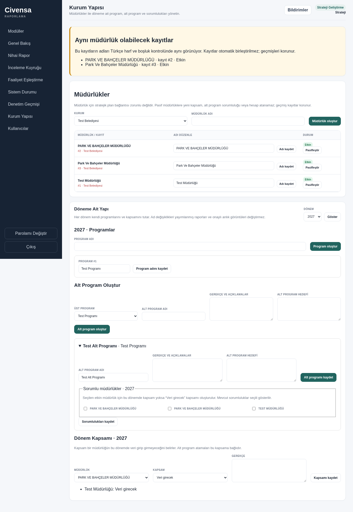
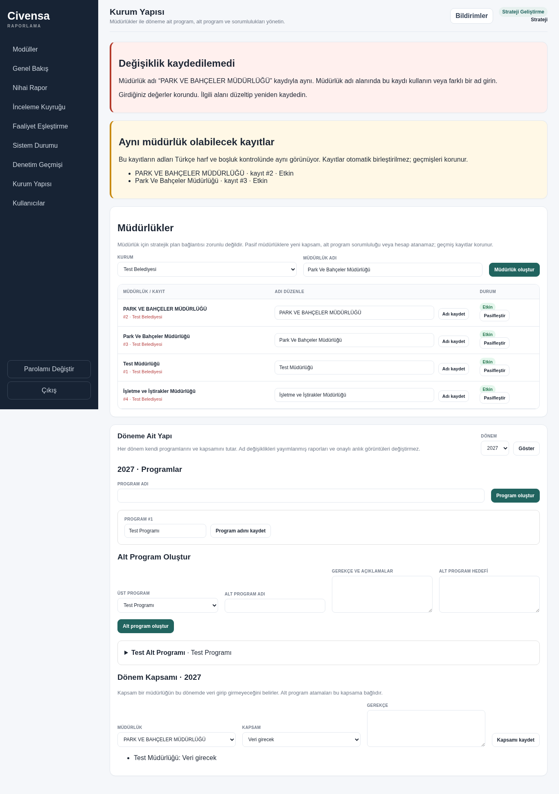
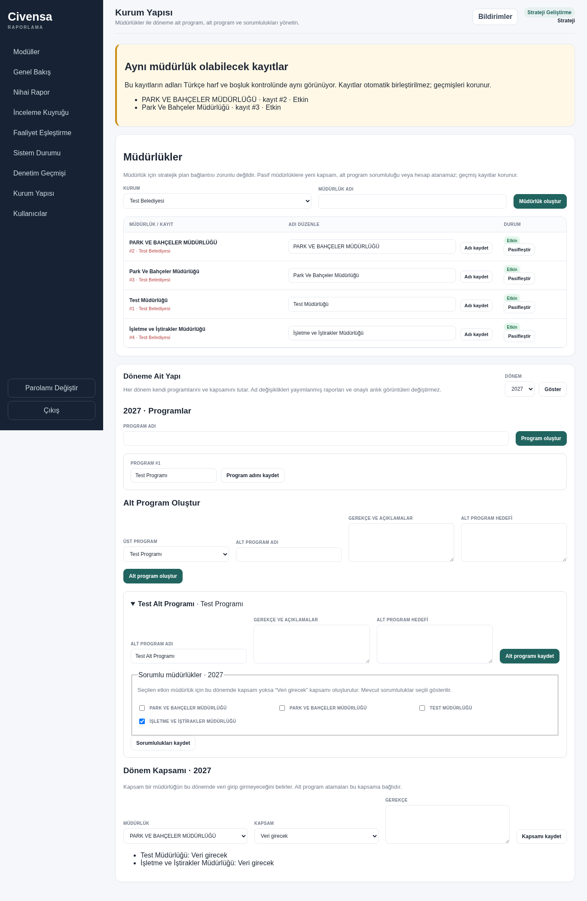
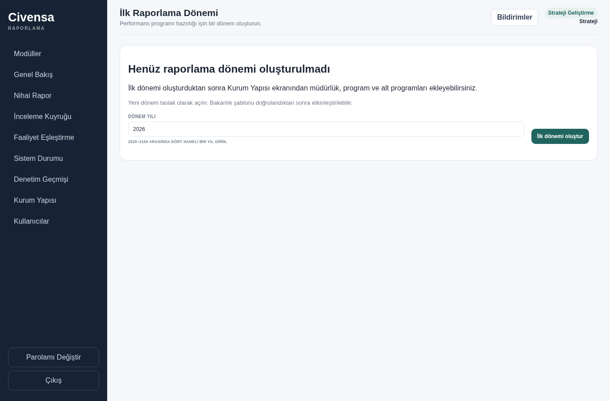

# CIV-018 — Strategy master data and first-period setup

Strategy can maintain departments, period programmes/subprogrammes, rationale/goal and responsible departments from **Kurum Yapısı** in the Strategy sidebar. A dashboard with no reporting periods renders an **İlk dönemi oluştur** form, using the same validated creation function as `/api/periods`.

## Decisions and data preservation

- Department names are compared within their institution after Unicode NFC, Turkish `İ/i` and `I/ı` case conversion, and whitespace collapse. Institution row locks serialize application create/rename requests. Existing matching records are named in Turkish validation errors.
- Existing duplicate departments appear under **Aynı müdürlük olabilecek kayıtlar**. They are neither merged nor rewritten.
- Departments can exist with no strategic-plan link or period scope. Disabling a department preserves accounts, scopes, report data and history. New accounts (single/CSV), reactivated accounts, new scopes and new subprogramme responsibilities require an active department. Existing inactive scope/responsibility history remains available. New-period copying skips inactive departments; previews and publication gates include their existing period history but do not demand a forbidden new scope in future periods. Historical inactive departments do not trigger new-account warnings.
- **D-151 (Claude, 21 October 2026):** an existing account’s role or department is not reassigned. Close the current account with an audited reason and create a new personal account, so past actions remain tied to their original department. The users screen explains this policy beside the user table and inside the new-user form. Existing Müdür/Personel title and submission-authority controls remain governed by their existing rules. Evidence: merged PR #45 (`18bbc285a8129b3c9e8770303c675c8b568ffd50`), `tests/test_users_personal_accounts.py::test_bulk_retirement_reason_audit_and_permission_atomicity`; UI regression: `tests/test_users_ui.py::test_account_change_policy_visible_by_table_and_in_new_user_form` (CIV-068).
- `SubProgramScope` connects a subprogramme to the existing `DepartmentScope`; no second department/period scope model was introduced. Responsibility assignment creates missing required scopes atomically, and zero/excluded scopes require an explicit change before assignment. Removing a responsibility preserves the department scope and records old/new assignment IDs in the audit log.
- The existing report-builder scope route shares the same period lock and also records old/new values atomically. Each new master-data mutation commits its audit entry, actor, stored timestamp and old/new JSON values in the same transaction. Renames never rewrite publication JSON or approved submission snapshots; HTTP regression tests compare their exact frozen contents.

## Migration

`b018a1c2d3e4` follows `a6c006e9b241`, leaving exactly one Alembic head. It adds `departments.is_active` with an active default and the `subprogram_scopes` association table. Department name uniqueness is enforced in the application; no database unique name constraint was added.

A migrated PostgreSQL test seeds the exact old schema with both `PARK VE BAHÇELER MÜDÜRLÜĞÜ` and `Park Ve Bahçeler Müdürlüğü`, upgrades, logs in and verifies both names in the warning panel. Downgrade to the previous head retains the additive schema, inactive state and responsibility data. Re-upgrade is idempotent.

Model-based historical migration fixtures add the lifecycle column solely to accommodate the current ORM; the CIV-018 migration test deliberately bypasses that fixture adapter and seeds raw old-schema rows.

## Screens

Synthetic, disposable PostgreSQL data; actual application templates, Chromium, login and CSRF.

## Local validation

Initial implementation checks below used `--require-postgres` and a disposable PostgreSQL **16.2** server. The full suite is left to PR CI, as requested.

- Focused master-data, Word-import, programme, login-throttling, migration-head/readiness and publication-gate tests: **141 passed, 4 xfailed**. The xfails are existing Word-import regressions.
- Final focused master-data HTTP/CSRF/lifecycle/migration, programme, progress and publication regression tests: **105 passed**. An additional final inactive-history/progress check: **1 passed**.
- Final Chromium form/error retention, responsibility persistence and first-period flow tests: **2 passed**.
- Historical authorization and login-throttling migration compatibility checks: **2 passed**.
- `python -m compileall -q app`, `node --check app/static/app.js`, `git diff --check`: passed.

The browser tests can generate the screenshots again with `CIVENSA_UI_SCREENSHOTS` set to an output directory. Locally they use installed Chromium through `CIVENSA_CHROMIUM_PATH=/usr/bin/chromium`; CI uses its normal Playwright browser installation.

## Real 2027 source preview compatibility

After rebasing onto the base containing CIV-010, the real source at `tests/fixtures/pp2027_source_no_media.docx` is legitimately applicable. A separate checkout of `feature/authorization-workflow-phase5` at `c29a13c` was checked with the same sample data, real login and CSRF: preview returned **200**, **`can_apply=True`** and three name-normalization warnings (Park Ve Bahçeler, AFET İŞLERİ VE RİSK YÖNETİMİ, DESTEK HİZMETLERİ).

`test_real_2027_preview_matches_base_and_preserves_master_data` now compares that exact preview outcome and never applies the import. It verifies unchanged counts and all stored column values for Department, Program, SubProgram, Indicator, Activity, DepartmentScope and SubProgramScope, including a standalone inactive department, rationale/goal and an existing responsibility assignment. Word import code is unchanged.

Validation after this correction: `python -m pytest -q --require-postgres tests/test_master_data.py tests/test_word_import_real_source.py tests/test_live_pilot_hardening.py` on disposable PostgreSQL **16.15**: **123 passed, 1 dependency deprecation warning** (55.67s). No full local suite or CI polling.

No live database, deployment, rollout flag, indicator/activity JavaScript save function or generated bundle was changed. Assumption: the installation already has its institution and Strategy account, as in the audited bootstrap scenario.
