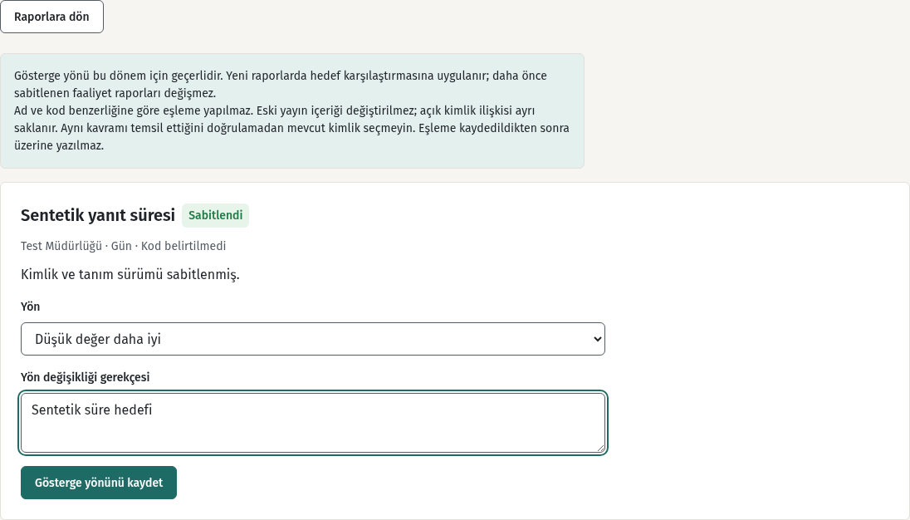
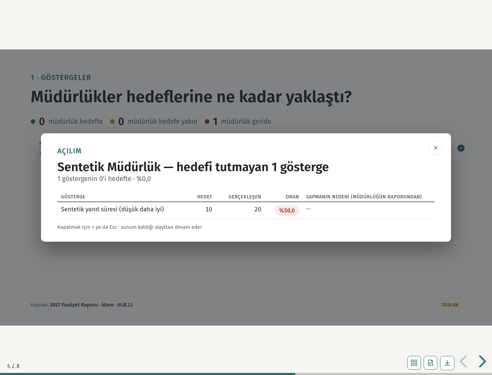

# CIV-197 — Gösterge yönü

Strateji, **Gösterge gerçekleşmeleri → Gösterge kimlikleri ve yönleri → ilgili yayın** ekranında göstergenin **Yön** alanını seçer, gerekçeyi yazar ve **Gösterge yönünü kaydet** düğmesine basar. Eski yayında kimlik eşlemesi eksikse önce eşleme tamamlanır. Yeni menü yoktur. Her kayıt dönem ve kalıcı gösterge kimliğiyle, kullanıcı ve gerekçeyle eklenir; geçmiş kayıtlar değiştirilemez. Değişiklik aynı işlem içinde denetim günlüğüne yazılır. Diğer roller 403 alır.

Yüksek değer daha iyiyse gerçekleşen ≥ hedef başarıdır; oran gerçekleşen / hedef × 100'dür (hedef > 0). Düşük değer daha iyiyse gerçekleşen ≤ hedef başarıdır; oran hedef / gerçekleşen × 100'dür. Gerçekleşen sıfırsa başarı sayılır, oran **—** gösterilir; ortalamaya tanımsız oran eklenmez. Karne, müdürlük tablosu ve idare özeti ortak karşılaştırmayı kullanır; düşük yönü görünür işaretlenir. Eşikler değişmez.

`core_summary` yönü FR olgularına ekler. Onaylı rapor sonradan yapılan yön değişikliğinden etkilenmez; eski sabit içerikte yön yoksa `higher` kabul edilir. Tanım revizyonu, yayın özeti, imzalı fark (`delta`) ve `achievement_percent` değiştirilmez. Ad/birimden otomatik seçim ve gerçek gösterge tohumu yoktur. Dört gerçek göstergeyi sürüm çıktıktan sonra Strateji bu ekrandan işaretler.

**Migrasyon:** son baz `6ba3289`; tek yeni migrasyon `c197a1b2c3d4`, CIV-192 başlığı `c192a1b2c3d4` üzerine zincirlendi. Çalışma başlangıcında #438 birleşmemişti; çalışma sırasında birleşince dal yeni baza taşındı ve geçici `c185a1b2c3d4` zinciri güncellendi. Lead için yeniden zincirleme işi kalmadı. Veri varken downgrade reddedilir; geçmiş silinmez.

**Doğrulama:** yerel, tek kullanımlık PostgreSQL **18.6** üzerinde `python -m pytest -q --require-postgres` ile 20 yeni kabul testi geçti. Mevcut tüm `test_sunum*` modülleri ile gösterge sözleşmesi, faaliyet bölümleri ve denetim görünümü regresyonlarında 178 farklı test geçti (toplam 198). Browser testlerinde sistem Chromium'u ve deponun `CIVENSA_SUNUM_HTTP_FIXTURE=1` seçeneği kullanıldı. Mevcut sunum testleri değiştirilmedi. CIV-192 migrasyon testi kendi revizyonuna sabitlendi; tek başlık kontrolü sonraki migrasyonlarla da çalışır. `alembic heads`: yalnız `c197a1b2c3d4`; boş upgrade/downgrade/upgrade, dolu downgrade koruması ve SQL geçmiş korumaları geçti. `compileall` ve `git diff --check` temiz. CI sonucu PR kontrollerinden izlenir.

Son bazda CIV-192 içe aktarma testleri yeniden geçti. Yeni başlığa bağlı eski migrasyon kontrollerinden 17 test, rapor sayfasının bağlantı/form/yerleşim sözleşmesinden 21 test ve metin sütunu envanterinden 1 test ayrıca geçti. Eski başlık beklentileri yeni başlığa güncellendi; işletim amaçlı ilk yükleme şema pini korunur. Yalnız yön ayarının bulunduğu mevcut bölümün başlık metni için tasarım beklentisi güncellendi; bağlantı ve form sözleşmeleri korunur.

Tarihsel ilk yükleme test yardımcısı, bugünkü model envanteriyle çalışabilmek için boş yön tablosunu diğer yardımcı tablolarla birlikte sağlar; işletim şema pini ve üretim korumaları değişmez. Gösterge eşleme ekranının donmuş sözleşme testi yalnız yeni yön formu, açıklaması ve başlığını ayırarak eski eşleme alanlarını aynen karşılaştırır; gerçek tarayıcı akışı eşleme sonrasında yön formunun kullanılabildiğini doğrular.

Ekran görüntülerindeki bütün kayıtlar sentetiktir.

