# CIV-219 — Birim faaliyet raporu tabloları

Müdürlük, birim raporundaki bağlantılardan Tablo 1, 2, 7 ve 8'i açar. Tablo 1 Fiziksel Yapı, Tablo 2 Yönetim Yapısı, Tablo 7–8 Faaliyet ve Proje Bilgileri bölümüne bağlıdır. Her tablo ayrı kaydedilir; boş değer sıfır sayılmaz. TOPLAM ve Toplam Maliyet hesaplanır. Türkçe tutar girişi, sabit personel türleri, kitaptan gelen değiştirilemez faaliyetler, gerekçeli Uygulanmadı ve açık Bu yıl proje yok seçimi kullanılır.

Personel kendi müdürlüğünün taslak/iade raporunu düzenler. Kadın + Erkek tutarsızlığı taslakta uyarılır; eksik hücreler gönderimde tabloya göre gruplanıp ilgili alana bağlanır. Strateji salt okunur inceler, gerekçeyle iade eder veya bağımsız müdür hesabıyla onaylar. Gönderilen/onaylanan tablo ve fotoğraf verileri mevcut sabit rapor kopyasında korunur; konsolidasyon onaylı birimlerden alınır.

Gösterge açıklaması mutlak sapma **en az %10** ise zorunludur; %9,9'da isteğe bağlıdır. Hedef 0 iken sıfırdan farklı gerçekleşme açıklama gerektirir. Alanın yanında sapma yüzdesi gösterilir. JPG/PNG fotoğraflar mevcut kanıt dosyaları gibi veritabanında ve aynı 10 MB yükleme sınırıyla tutulur; rapor sırasıyla numaralanır.

Aşağıdaki görüntüler gerçek uygulama rotalarında, yalnız sentetik 2026 verileriyle Chromium'da üretildi. Tablo 7'nin kapsamı, gösterge raporuna bağlı kitabın müdürlük faaliyet satırlarıdır; Program / Alt Program seçenekleri de bu kitabın müdürlüğe ait sorumluluk ve program satırlarıyla sınırlıdır. Tablo 1 için hiç bina/tesis yoksa boş satır listesi açıkça kaydedilir.

| Görünüm | 1440 px | 390 px |
| --- | --- | --- |
| Tablo 1 | 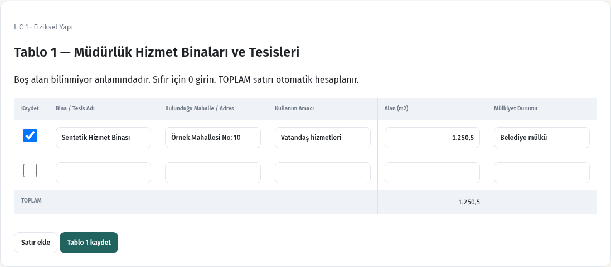 | 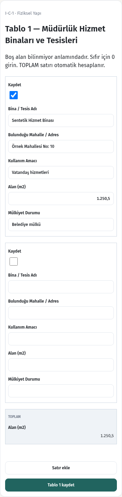 |
| Tablo 2 | 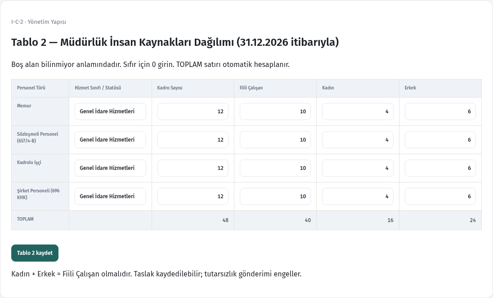 | 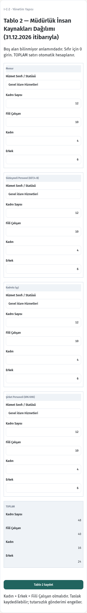 |
| Tablo 7 | 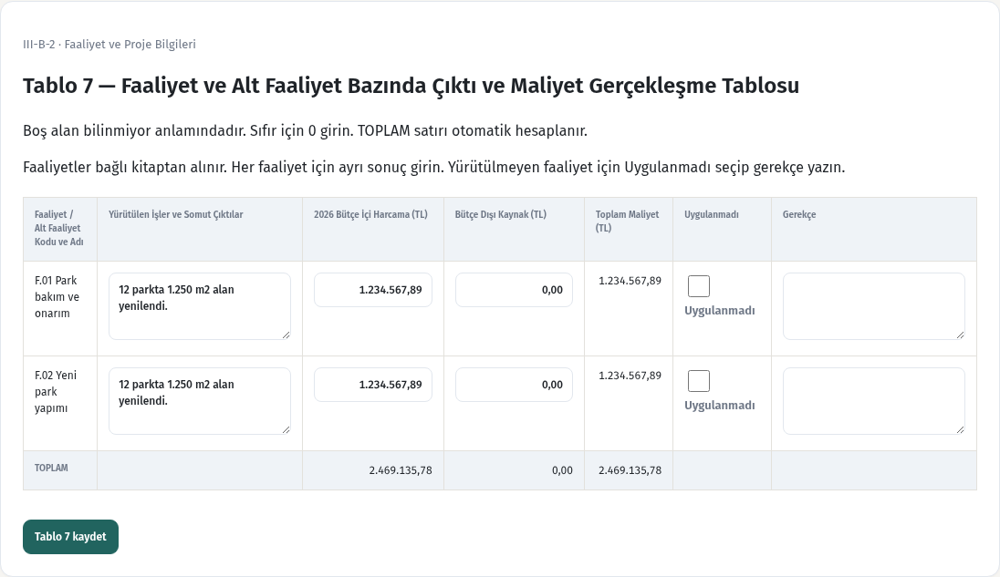 | 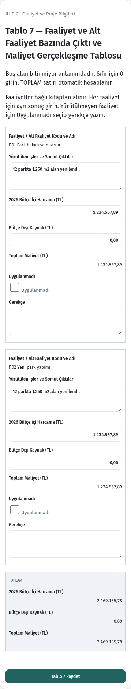 |
| Tablo 8 | 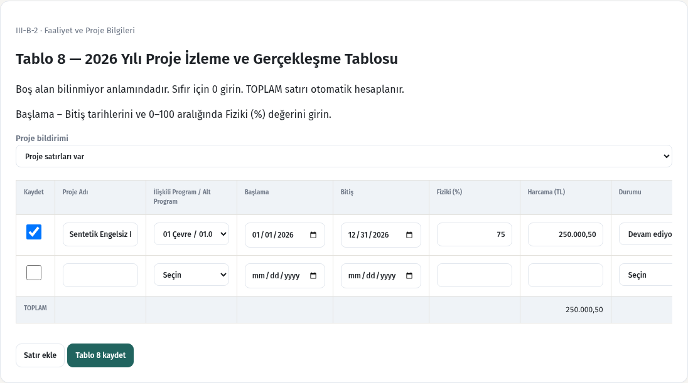 | 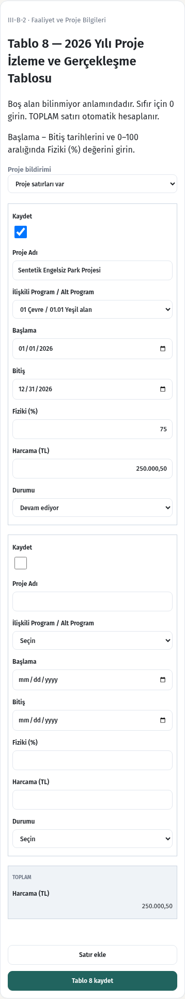 |
| Fotoğraflar | 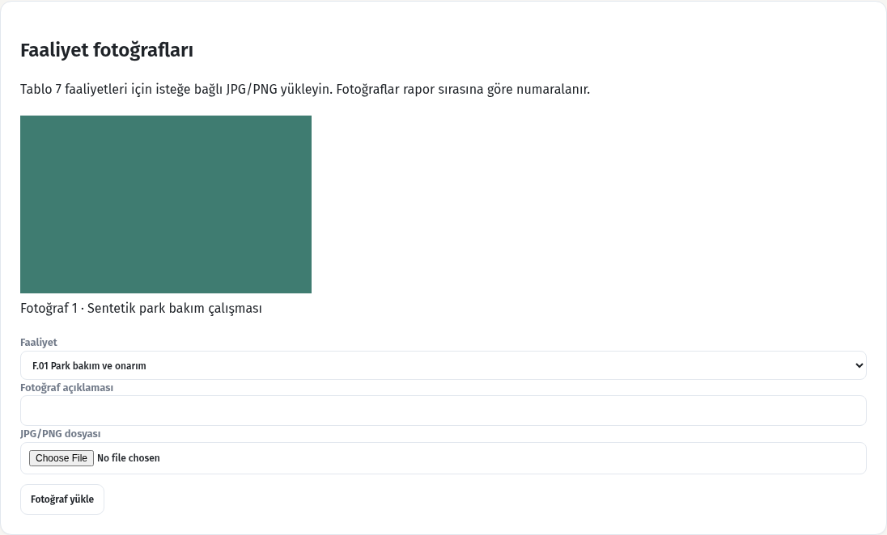 | 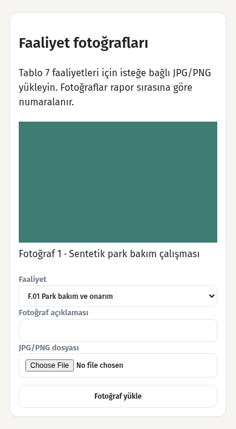 |
| Gönderim hatası | 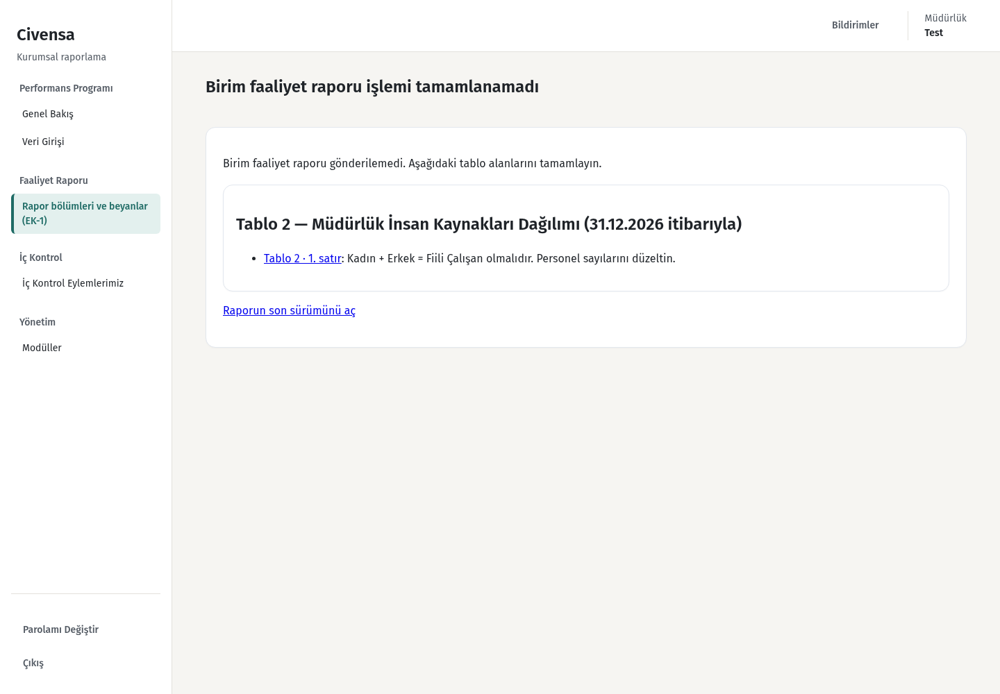 | 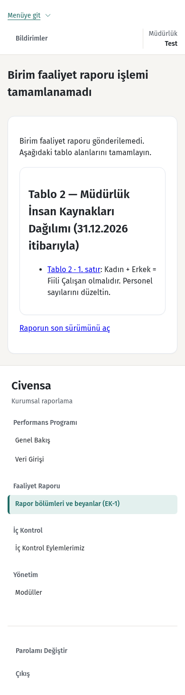 |
| Strateji incelemesi | 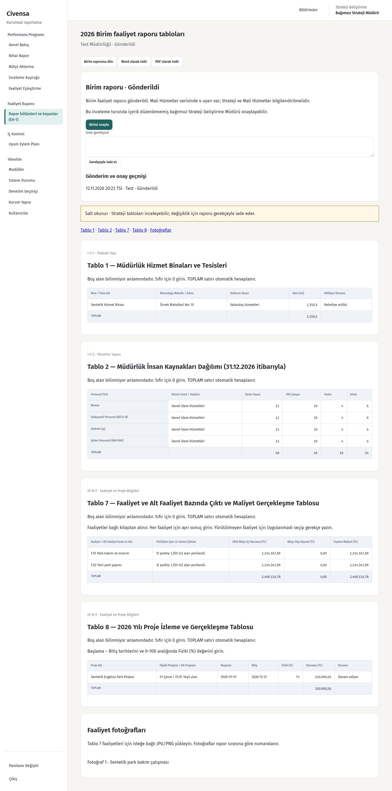 | 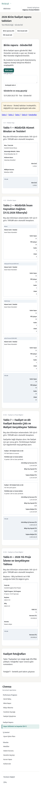 |

Onaylı sentetik çıktı: [Word](export-synthetic.docx) · [PDF](export-synthetic.pdf). Dört tablo, hesaplanan toplamlar ve fotoğraf listesi/görselleri mevcut rapor yazı tipleri ve stilleriyle dışa aktarılır.

Doğrulama: PostgreSQL 17 üzerinde son odaklı çalıştırmada 102 kabul/regresyon testi geçti; 1440/390 tarayıcı kontrolleri ve gerçek form gönderimleri geçti. Migrasyon ileri/geri/ileri çalıştırıldı; veri varken geri alma ve incelemedeki/onaylı verinin SQL ile değiştirilmesi engellendi. Tam paket ve PR CI sonucu PR açıklamasında güncellenir. Canlı veritabanına bağlanılmadı; dağıtım veya birleştirme yapılmadı.
