# CIV-093 · Arayüz ekran haritası

Bu harita mevcut arayüzü belgeler. Bütün kurum, hesap, gösterge, tutar, kanıt ve plan kayıtları sentetiktir; canlı veritabanı ve kitap dosyası kullanılmaz. Strateji hesabı `strategy/director`, müdürlük hesabı `department/director` rolündedir. Personel ve kurulum hesapları tarayıcı açmaz. Rastgele parolalar kaydedilmez.

## Tek komutla yeniden üretim

Önkoşullar: Python 3.12, PostgreSQL 16+ üzerinde CREATE DATABASE yetkili yerel test rolü; `CIVENSA_TEST_POSTGRES_URL` bu sunucuyu göstermelidir. Uygulamanın DATABASE_URL / MIGRATION_DATABASE_URL ayarları yok sayılır. Temiz checkout içinde depo kökünden:

```sh
python -m pip install -r requirements-dev.txt && python -m playwright install --with-deps chromium && python scripts/guide_screenshots.py --ui-map --out docs/screenshots/ui-map-v1
```

Sistem Chromium kurulumu varsa `CIVENSA_CHROMIUM_PATH` ile seçilebilir. Geçici veritabanı gerçek Alembic geçişleriyle kurulur, bitişte veya hatada silinir. Betik CIV-054 ile aynı PostgreSQL/HTTP/Playwright yakalama akışını kullanır; `--ui-map` verilmezse eski kılavuz modu çalışır.

1440 px genişlik, tam sayfa PNG, deviceScaleFactor 1, açık tema, tr-TR, Europe/Istanbul; her PNG <1.500.000 bayt. Uzun ekranlarda boyut sınırını sağlamak için 256 renkli PNG kodlaması kullanılabilir; genişlik ve içerik korunur. Ayrıntı kutuları açık çekilir. Sekme ve pencereler ayrıca çekilir. DOM tablosu aşağı kaydırılarak ulaşılabilen öğeleri de kapsar; kapalı sekme/pencerelerin gizli öğeleri o durumun ayrı çekiminde bulunur. Yatay taşan tabloların tüm sütunları DOM dökümünde yer alır.

Tarayıcı yalnız loopback GET ve iki salt okunur bütçe hesaplama POST rotasını kullanır (`choices`, `preview`); diğer yazmalar engellenir. Doğrulama örneği, tarayıcıdan önce gerçek oturum/CSRF ile yapılan başarısız POST yanıtının aynısıdır; ekran sahte hata metniyle değiştirilmez. Her yakalama aşamasından önce/sonra bütün model tablolarının özeti karşılaştırılır. İkinci aşamada sentetik PP paketleri onaylı fixture durumuna alınır, İç Kontrol paketi gerçek gönderim/onay servislerinden geçer ve gerçek bütçe aktarma servisi çalışır. Sabit PP yayını gerçek yayın serileştiricisiyle kurulur; resmî yayın önkoşullarının tamamlandığı iddia edilmez.

Chromium: 151.0.7922.173. Rota envanteri: 78 kayıtlı GET; HTML ekran türü: 35; üretilen çekim: 97/97.

Her E numarası DOM sırasındaki tek öğedir. Formlar ve düğmeleri ayrı satırlardadır; yinelenen etiketlerde bağlam hangi satır/karta ait olduğunu belirtir. URL ve eylemler DOM href/action değerlerinden, JavaScript düğmelerinin anlamları mevcut statik betiklerden alınır. **Pasif** düğme hedefi belgeler ama bu durumda çalıştırılamaz. Parola/CSRF/oturum içerikleri döküme alınmaz.

[Modüllere göre gezinme diyagramı](navigation.md) · [Makinece okunabilir DOM ve rota envanteri](screens.json)

## Ekran dizini

| No | Ekran | Rol | Durum | Görsel |
| --- | --- | --- | --- | --- |
| 001 | [Faaliyet Eşleştirme](#ekran-001) | strategy | Dolu / taslak | [001-activity-mapping-strategy.png](001-activity-mapping-strategy.png) |
| 002 | [Faaliyet Raporu hazırlık alanı](#ekran-002) | strategy | Dolu / taslak | [002-activity-report-strategy.png](002-activity-report-strategy.png) |
| 003 | [Faaliyet Raporu hazırlık alanı](#ekran-003) | department | Dolu / taslak | [003-activity-report-department.png](003-activity-report-department.png) |
| 004 | [Yayına bağlı Faaliyet Raporları](#ekran-004) | strategy | Dolu / taslak | [004-activity-reports-strategy.png](004-activity-reports-strategy.png) |
| 005 | [Yayına bağlı Faaliyet Raporları](#ekran-005) | department | Dolu / taslak | [005-activity-reports-department.png](005-activity-reports-department.png) |
| 006 | [Gösterge kimlik eşlemesi](#ekran-006) | strategy | Dolu / taslak | [006-activity-reports-strategy.png](006-activity-reports-strategy.png) |
| 007 | [Gerçekleşme revizyonu](#ekran-007) | strategy | Dolu / taslak | [007-activity-reports-strategy.png](007-activity-reports-strategy.png) |
| 008 | [Gerçekleşme revizyonu](#ekran-008) | department | Dolu / taslak | [008-activity-reports-department.png](008-activity-reports-department.png) |
| 009 | [Faaliyet Raporu · EK-1](#ekran-009) | strategy | Dolu / taslak | [009-activity-sections-strategy.png](009-activity-sections-strategy.png) |
| 010 | [Faaliyet Raporu · EK-1](#ekran-010) | department | Dolu / taslak | [010-activity-sections-department.png](010-activity-sections-department.png) |
| 011 | [EK-1 bölüm editörü](#ekran-011) | strategy | Dolu / taslak | [011-activity-sections-strategy.png](011-activity-sections-strategy.png) |
| 012 | [EK-1 bölüm editörü](#ekran-012) | department | Dolu / taslak | [012-activity-sections-department.png](012-activity-sections-department.png) |
| 013 | [Güvence beyanı](#ekran-013) | strategy | Dolu / taslak | [013-activity-sections-strategy.png](013-activity-sections-strategy.png) |
| 014 | [Güvence beyanı](#ekran-014) | department | Dolu / taslak | [014-activity-sections-department.png](014-activity-sections-department.png) |
| 015 | [Malî içe aktarma önizlemesi](#ekran-015) | strategy | Dolu / taslak | [015-activity-sections-strategy.png](015-activity-sections-strategy.png) |
| 016 | [Denetim Geçmişi](#ekran-016) | strategy | Dolu / taslak | [016-audit-strategy.png](016-audit-strategy.png) |
| 017 | [Bütçe Aktarma](#ekran-017) | strategy | Boş liste | [017-budget-reallocations-strategy.png](017-budget-reallocations-strategy.png) |
| 018 | [Yeni Bütçe Aktarması](#ekran-018) | strategy | Dolu / taslak | [018-budget-reallocations-strategy.png](018-budget-reallocations-strategy.png) |
| 019 | [Parola değiştir](#ekran-019) | strategy | Dolu / taslak | [019-change-password-strategy.png](019-change-password-strategy.png) |
| 020 | [Parola değiştir](#ekran-020) | department | Dolu / taslak | [020-change-password-department.png](020-change-password-department.png) |
| 021 | [Genel Bakış](#ekran-021) | strategy | Dolu / taslak | [021-dashboard-strategy.png](021-dashboard-strategy.png) |
| 022 | [Genel Bakış](#ekran-022) | department | Dolu / taslak | [022-dashboard-department.png](022-dashboard-department.png) |
| 023 | [Müdürlük veri girişi](#ekran-023) | strategy | Dolu / taslak | [023-department-strategy.png](023-department-strategy.png) |
| 024 | [Müdürlük veri girişi](#ekran-024) | department | Dolu / taslak | [024-department-department.png](024-department-department.png) |
| 025 | [İç Kontrol planları](#ekran-025) | strategy | Dolu / taslak | [025-internal-control-strategy.png](025-internal-control-strategy.png) |
| 026 | [İç Kontrol yükleme kontrolü](#ekran-026) | strategy | Dolu / taslak | [026-internal-control-strategy.png](026-internal-control-strategy.png) |
| 027 | [İç Kontrol izleme](#ekran-027) | strategy | Dolu / taslak | [027-internal-control-strategy.png](027-internal-control-strategy.png) |
| 028 | [İç Kontrol izleme paketi](#ekran-028) | strategy | Dolu / taslak | [028-internal-control-strategy.png](028-internal-control-strategy.png) |
| 029 | [İç Kontrol izleme paketi](#ekran-029) | department | Dolu / taslak | [029-internal-control-department.png](029-internal-control-department.png) |
| 030 | [İç Kontrol Eylemlerimiz](#ekran-030) | department | Dolu / taslak | [030-internal-control-department.png](030-internal-control-department.png) |
| 031 | [İç Kontrol plan kataloğu](#ekran-031) | strategy | Dolu / taslak | [031-internal-control-strategy.png](031-internal-control-strategy.png) |
| 032 | [Giriş](#ekran-032) | anonymous | Oturum kapalı | [032-login-anonymous.png](032-login-anonymous.png) |
| 033 | [Modüller](#ekran-033) | strategy | Dolu / taslak | [033-modules-strategy.png](033-modules-strategy.png) |
| 034 | [Modüller](#ekran-034) | department | Dolu / taslak | [034-modules-department.png](034-modules-department.png) |
| 035 | [Sistem Durumu](#ekran-035) | strategy | Dolu / taslak | [035-operations-strategy.png](035-operations-strategy.png) |
| 036 | [Rapor Hazırlığı](#ekran-036) | strategy | Dolu / taslak | [036-program-strategy.png](036-program-strategy.png) |
| 037 | [Rapor Hazırlığı](#ekran-037) | department | Dolu / taslak | [037-program-department.png](037-program-department.png) |
| 038 | [Ekonomik dağılım](#ekran-038) | strategy | Dolu / taslak | [038-program-strategy.png](038-program-strategy.png) |
| 039 | [Nihai Rapor](#ekran-039) | strategy | Dolu / taslak | [039-report-builder-strategy.png](039-report-builder-strategy.png) |
| 040 | [Genel bölüm içe aktarma](#ekran-040) | strategy | Dolu / taslak | [040-report-builder-strategy.png](040-report-builder-strategy.png) |
| 041 | [Tamamlanma listesi](#ekran-041) | strategy | Dolu / taslak | [041-report-builder-strategy.png](041-report-builder-strategy.png) |
| 042 | [İnceleme Kuyruğu](#ekran-042) | strategy | Dolu / taslak | [042-review-strategy.png](042-review-strategy.png) |
| 043 | [PP Kaynak Karşılaştırması](#ekran-043) | strategy | Dolu / taslak | [043-source-comparison-strategy.png](043-source-comparison-strategy.png) |
| 044 | [PP Kaynak Karşılaştırması](#ekran-044) | department | Dolu / taslak | [044-source-comparison-department.png](044-source-comparison-department.png) |
| 045 | [Kurum Yapısı](#ekran-045) | strategy | Dolu / taslak | [045-structure-strategy.png](045-structure-strategy.png) |
| 046 | [Gönderim Yetkileri](#ekran-046) | department | Dolu / taslak | [046-submit-authorizations-department.png](046-submit-authorizations-department.png) |
| 047 | [Kullanıcılar](#ekran-047) | strategy | Dolu / taslak | [047-users-strategy.png](047-users-strategy.png) |
| 048 | [EK-1 bölüm editörü](#ekran-048) | strategy | Bölüm SUNUS | [048-activity-sections-strategy.png](048-activity-sections-strategy.png) |
| 049 | [EK-1 bölüm editörü](#ekran-049) | strategy | Bölüm I.C.1 | [049-activity-sections-strategy.png](049-activity-sections-strategy.png) |
| 050 | [EK-1 bölüm editörü](#ekran-050) | strategy | Bölüm I.C.2 | [050-activity-sections-strategy.png](050-activity-sections-strategy.png) |
| 051 | [EK-1 bölüm editörü](#ekran-051) | strategy | Bölüm I.C.3 | [051-activity-sections-strategy.png](051-activity-sections-strategy.png) |
| 052 | [EK-1 bölüm editörü](#ekran-052) | strategy | Bölüm I.C.4 | [052-activity-sections-strategy.png](052-activity-sections-strategy.png) |
| 053 | [EK-1 bölüm editörü](#ekran-053) | strategy | Bölüm III.A.1 | [053-activity-sections-strategy.png](053-activity-sections-strategy.png) |
| 054 | [EK-1 bölüm editörü](#ekran-054) | strategy | Bölüm III.A.2 | [054-activity-sections-strategy.png](054-activity-sections-strategy.png) |
| 055 | [EK-1 bölüm editörü](#ekran-055) | strategy | Bölüm III.A.3 | [055-activity-sections-strategy.png](055-activity-sections-strategy.png) |
| 056 | [EK-1 bölüm editörü](#ekran-056) | strategy | Bölüm III.B.2.i | [056-activity-sections-strategy.png](056-activity-sections-strategy.png) |
| 057 | [EK-1 bölüm editörü](#ekran-057) | strategy | Bölüm EKLER | [057-activity-sections-strategy.png](057-activity-sections-strategy.png) |
| 058 | [Müdürlük veri girişi](#ekran-058) | strategy | Faaliyet Maliyetleri sekmesi | [058-department-strategy.png](058-department-strategy.png) |
| 059 | [EK-1 bölüm editörü](#ekran-059) | department | Bölüm I.C.1 | [059-activity-sections-department.png](059-activity-sections-department.png) |
| 060 | [EK-1 bölüm editörü](#ekran-060) | department | Bölüm I.C.2 | [060-activity-sections-department.png](060-activity-sections-department.png) |
| 061 | [EK-1 bölüm editörü](#ekran-061) | department | Bölüm I.C.3 | [061-activity-sections-department.png](061-activity-sections-department.png) |
| 062 | [EK-1 bölüm editörü](#ekran-062) | department | Bölüm I.C.4 | [062-activity-sections-department.png](062-activity-sections-department.png) |
| 063 | [EK-1 bölüm editörü](#ekran-063) | department | Bölüm III.A.1 | [063-activity-sections-department.png](063-activity-sections-department.png) |
| 064 | [EK-1 bölüm editörü](#ekran-064) | department | Bölüm III.A.2 | [064-activity-sections-department.png](064-activity-sections-department.png) |
| 065 | [EK-1 bölüm editörü](#ekran-065) | department | Bölüm III.A.3 | [065-activity-sections-department.png](065-activity-sections-department.png) |
| 066 | [EK-1 bölüm editörü](#ekran-066) | department | Bölüm III.B.2.i | [066-activity-sections-department.png](066-activity-sections-department.png) |
| 067 | [EK-1 bölüm editörü](#ekran-067) | department | Bölüm EKLER | [067-activity-sections-department.png](067-activity-sections-department.png) |
| 068 | [Müdürlük veri girişi](#ekran-068) | department | Faaliyet Maliyetleri sekmesi | [068-department-department.png](068-department-department.png) |
| 069 | [Genel Bakış](#ekran-069) | strategy | Yeni dönem formu | [069-dashboard-strategy.png](069-dashboard-strategy.png) |
| 070 | [Kurum Yapısı](#ekran-070) | strategy | Yapı sihirbazı · adım 2/6 | [070-structure-strategy.png](070-structure-strategy.png) |
| 071 | [Kurum Yapısı](#ekran-071) | strategy | Yapı sihirbazı · adım 3/6 | [071-structure-strategy.png](071-structure-strategy.png) |
| 072 | [Kurum Yapısı](#ekran-072) | strategy | Yapı sihirbazı · adım 4/6 | [072-structure-strategy.png](072-structure-strategy.png) |
| 073 | [Kurum Yapısı](#ekran-073) | strategy | Yapı sihirbazı · adım 5/6 | [073-structure-strategy.png](073-structure-strategy.png) |
| 074 | [Kurum Yapısı](#ekran-074) | strategy | Yapı sihirbazı · adım 6/6 | [074-structure-strategy.png](074-structure-strategy.png) |
| 075 | [Müdürlük veri girişi](#ekran-075) | department | Faaliyet satırı · edit | [075-department-department.png](075-department-department.png) |
| 076 | [Müdürlük veri girişi](#ekran-076) | department | Faaliyet satırı · new | [076-department-department.png](076-department-department.png) |
| 077 | [Kullanıcılar](#ekran-077) | strategy | Geçici parola yenileme alanı | [077-users-strategy.png](077-users-strategy.png) |
| 078 | [Kullanıcılar](#ekran-078) | strategy | Yeni kullanıcı formu | [078-users-strategy.png](078-users-strategy.png) |
| 079 | [İnceleme Kuyruğu](#ekran-079) | strategy | İade gerekçesi penceresi | [079-review-strategy.png](079-review-strategy.png) |
| 080 | [Modüller](#ekran-080) | department | Parola penceresi | [080-modules-department.png](080-modules-department.png) |
| 081 | [Modüller](#ekran-081) | strategy | Bildirim paneli | [081-modules-strategy.png](081-modules-strategy.png) |
| 082 | [Faaliyet Raporu hazırlık alanı](#ekran-082) | department | Boş yıl listesi | [082-activity-report-department.png](082-activity-report-department.png) |
| 083 | [EK-1 bölüm editörü](#ekran-083) | strategy | Hata sayfası (404) | [083-activity-sections-strategy.png](083-activity-sections-strategy.png) |
| 084 | [Nihai Rapor](#ekran-084) | strategy | Başlığı boş form · doğrulama hatası | [084-report-builder-strategy.png](084-report-builder-strategy.png) |
| 085 | [Müdürlük veri girişi](#ekran-085) | strategy | Onaylı · salt okunur | [085-department-strategy.png](085-department-strategy.png) |
| 086 | [Müdürlük veri girişi](#ekran-086) | department | Onaylı · salt okunur | [086-department-department.png](086-department-department.png) |
| 087 | [Rapor Hazırlığı](#ekran-087) | strategy | Onaylı · salt okunur | [087-program-strategy.png](087-program-strategy.png) |
| 088 | [Rapor Hazırlığı](#ekran-088) | department | Onaylı · salt okunur | [088-program-department.png](088-program-department.png) |
| 089 | [İç Kontrol izleme paketi](#ekran-089) | strategy | Onaylı · salt okunur | [089-internal-control-strategy.png](089-internal-control-strategy.png) |
| 090 | [İç Kontrol izleme paketi](#ekran-090) | department | Onaylı · salt okunur | [090-internal-control-department.png](090-internal-control-department.png) |
| 091 | [İç Kontrol Eylemlerimiz](#ekran-091) | department | Onaylı · salt okunur | [091-internal-control-department.png](091-internal-control-department.png) |
| 092 | [Yeni Bütçe Aktarması](#ekran-092) | strategy | Aktarma sihirbazı · preview | [092-budget-reallocations-strategy.png](092-budget-reallocations-strategy.png) |
| 093 | [Yeni Bütçe Aktarması](#ekran-093) | strategy | Aktarma sihirbazı · reference | [093-budget-reallocations-strategy.png](093-budget-reallocations-strategy.png) |
| 094 | [Bütçe Aktarma](#ekran-094) | strategy | Onay sonrası / dolu | [094-budget-reallocations-strategy.png](094-budget-reallocations-strategy.png) |
| 095 | [Bütçe aktarma ayrıntısı](#ekran-095) | strategy | Onay sonrası / dolu | [095-budget-reallocations-strategy.png](095-budget-reallocations-strategy.png) |
| 096 | [İnceleme Kuyruğu](#ekran-096) | strategy | Onay sonrası / dolu | [096-review-strategy.png](096-review-strategy.png) |
| 097 | [İç Kontrol izleme](#ekran-097) | strategy | Onay sonrası / dolu | [097-internal-control-strategy.png](097-internal-control-strategy.png) |

## GET rota kapsamı ve yakalanamayanlar

Bu tablo uygulamanın kayıtlı GET rotalarından üretilir; HTML dışı rotalar da dışlama gerekçeleriyle yer alır. 403 ve yönlendirmeler yetki kapsamını gösterir. İki rolün erişebildiği normal HTML ekranları için açıklamasız rota bırakılmaz.

| URL kalıbı | Yakalama / gerekçe |
| --- | --- |
| `/` | Oturum yoksa /login; normal oturumda /modules; geçici parola gerekiyorsa /change-password yönlendirmesi (303), ayrı HTML ekranı yok. |
| `/activity-mapping` | strategy: [001-activity-mapping-strategy.png](001-activity-mapping-strategy.png); department: HTTP 403; bu rolün bu ekrana erişimi yok. |
| `/activity-report` | strategy: [002-activity-report-strategy.png](002-activity-report-strategy.png); department: [003-activity-report-department.png](003-activity-report-department.png) |
| `/activity-reports` | strategy: [004-activity-reports-strategy.png](004-activity-reports-strategy.png); department: [005-activity-reports-department.png](005-activity-reports-department.png) |
| `/activity-reports/publications/{publication_id}/bindings` | strategy: [006-activity-reports-strategy.png](006-activity-reports-strategy.png); department: HTTP 403; bu rolün bu ekrana erişimi yok. |
| `/activity-reports/revisions/{revision_id}` | strategy: [007-activity-reports-strategy.png](007-activity-reports-strategy.png); department: [008-activity-reports-department.png](008-activity-reports-department.png) |
| `/activity-sections` | strategy: [009-activity-sections-strategy.png](009-activity-sections-strategy.png); department: [010-activity-sections-department.png](010-activity-sections-department.png) |
| `/activity-sections/reports/{document_id}` | strategy: [011-activity-sections-strategy.png](011-activity-sections-strategy.png); department: [012-activity-sections-department.png](012-activity-sections-department.png) |
| `/activity-sections/reports/{document_id}/approvals/{approval_id}.json` | Dosya indirme / dışa aktarma; HTML ekranı değil. |
| `/activity-sections/reports/{document_id}/assurances/{code}` | strategy: [013-activity-sections-strategy.png](013-activity-sections-strategy.png); department: [014-activity-sections-department.png](014-activity-sections-department.png) |
| `/activity-sections/reports/{document_id}/export.docx` | Dosya indirme / dışa aktarma; HTML ekranı değil. |
| `/activity-sections/reports/{document_id}/export.json` | Dosya indirme / dışa aktarma; HTML ekranı değil. |
| `/activity-sections/reports/{document_id}/export.pdf` | Dosya indirme / dışa aktarma; HTML ekranı değil. |
| `/activity-sections/reports/{document_id}/financial/imports/{import_id}` | strategy: [015-activity-sections-strategy.png](015-activity-sections-strategy.png); department: HTTP 403; bu rolün bu ekrana erişimi yok. |
| `/activity-sections/reports/{document_id}/typeset.json` | Dosya indirme / dışa aktarma; HTML ekranı değil. |
| `/api/activity-mappings/export.csv` | API / JSON yanıtı; HTML ekranı değil. |
| `/api/activity-reports/indicators/{report_indicator_id}/evidence/{source_id}/{version}` | API / JSON yanıtı; HTML ekranı değil. |
| `/api/activity-reports/revisions/{revision_id}` | API / JSON yanıtı; HTML ekranı değil. |
| `/api/activity-sections/reports/{document_id}` | API / JSON yanıtı; HTML ekranı değil. |
| `/api/activity-sections/reports/{document_id}/financial` | API / JSON yanıtı; HTML ekranı değil. |
| `/api/activity-sections/reports/{document_id}/financial/imports/{import_id}` | API / JSON yanıtı; HTML ekranı değil. |
| `/api/activity-sections/reports/{document_id}/financial/statements/{statement_id}/file` | API / JSON yanıtı; HTML ekranı değil. |
| `/api/activity-sections/reports/{document_id}/financial/template/{kind}` | API / JSON yanıtı; HTML ekranı değil. |
| `/api/activity-sections/reports/{document_id}/typeset-keys` | API / JSON yanıtı; HTML ekranı değil. |
| `/api/audit/export.csv` | API / JSON yanıtı; HTML ekranı değil. |
| `/api/import-batches/{batch_id}` | API / JSON yanıtı; HTML ekranı değil. |
| `/api/notifications` | API / JSON yanıtı; HTML ekranı değil. |
| `/api/operations/backup.json` | API / JSON yanıtı; HTML ekranı değil. |
| `/api/operations/status` | API / JSON yanıtı; HTML ekranı değil. |
| `/api/progress` | API / JSON yanıtı; HTML ekranı değil. |
| `/api/release/readiness` | API / JSON yanıtı; HTML ekranı değil. |
| `/api/template-snapshots/{snapshot_id}` | API / JSON yanıtı; HTML ekranı değil. |
| `/api/users/batches/{batch_id}/credentials.csv` | API / JSON yanıtı; HTML ekranı değil. |
| `/api/users/missing-departments.csv` | API / JSON yanıtı; HTML ekranı değil. |
| `/api/users/template.csv` | API / JSON yanıtı; HTML ekranı değil. |
| `/audit` | strategy: [016-audit-strategy.png](016-audit-strategy.png); department: HTTP 403; bu rolün bu ekrana erişimi yok. |
| `/budget-reallocations` | strategy: [017-budget-reallocations-strategy.png](017-budget-reallocations-strategy.png); department: HTTP 403; bu rolün bu ekrana erişimi yok. |
| `/budget-reallocations/new` | strategy: [018-budget-reallocations-strategy.png](018-budget-reallocations-strategy.png); department: HTTP 403; bu rolün bu ekrana erişimi yok. |
| `/budget-reallocations/{operation_id}` | strategy: [095-budget-reallocations-strategy.png](095-budget-reallocations-strategy.png); department: HTTP 403; bütçe aktarma yetkisi yok. |
| `/change-password` | strategy: [019-change-password-strategy.png](019-change-password-strategy.png); department: [020-change-password-department.png](020-change-password-department.png) |
| `/dashboard` | strategy: [021-dashboard-strategy.png](021-dashboard-strategy.png); department: [022-dashboard-department.png](022-dashboard-department.png) |
| `/department/{department_id}` | strategy: [023-department-strategy.png](023-department-strategy.png); department: [024-department-department.png](024-department-department.png) |
| `/docs` | FastAPI otomatik API belgesi / OAuth yardımcı sayfası; ürün iş ekranı değil. |
| `/docs/oauth2-redirect` | FastAPI otomatik API belgesi / OAuth yardımcı sayfası; ürün iş ekranı değil. |
| `/export/department/{department_id}.docx` | Dosya indirme / dışa aktarma; HTML ekranı değil. |
| `/export/department/{department_id}.json` | Dosya indirme / dışa aktarma; HTML ekranı değil. |
| `/health` | API / JSON yanıtı; HTML ekranı değil. |
| `/internal-control` | strategy: [025-internal-control-strategy.png](025-internal-control-strategy.png); department: HTTP 303 → /internal-control/our-actions; ayrı ekran yok. |
| `/internal-control/imports/{batch_id}` | strategy: [026-internal-control-strategy.png](026-internal-control-strategy.png); department: HTTP 403; bu rolün bu ekrana erişimi yok. |
| `/internal-control/imports/{batch_id}/validation.xlsx` | Dosya indirme / dışa aktarma; HTML ekranı değil. |
| `/internal-control/monitoring` | strategy: [027-internal-control-strategy.png](027-internal-control-strategy.png); department: HTTP 403; bu rolün bu ekrana erişimi yok. |
| `/internal-control/monitoring/batches/{batch_id}` | strategy: [028-internal-control-strategy.png](028-internal-control-strategy.png); department: [029-internal-control-department.png](029-internal-control-department.png) |
| `/internal-control/monitoring/periods/{period_id}/official-report.{format}` | Dosya indirme / dışa aktarma; HTML ekranı değil. |
| `/internal-control/monitoring/periods/{period_id}/report.{format}` | Dosya indirme / dışa aktarma; HTML ekranı değil. |
| `/internal-control/monitoring/plans/{plan_id}/annual.xlsx` | Dosya indirme / dışa aktarma; HTML ekranı değil. |
| `/internal-control/our-actions` | strategy: HTTP 303 → /internal-control/monitoring; ayrı ekran yok.; department: [030-internal-control-department.png](030-internal-control-department.png) |
| `/internal-control/plans/{plan_id}` | strategy: [031-internal-control-strategy.png](031-internal-control-strategy.png); department: HTTP 403; bu rolün bu ekrana erişimi yok. |
| `/internal-control/template.xlsx` | Dosya indirme / dışa aktarma; HTML ekranı değil. |
| `/login` | anonymous: [032-login-anonymous.png](032-login-anonymous.png) |
| `/modules` | strategy: [033-modules-strategy.png](033-modules-strategy.png); department: [034-modules-department.png](034-modules-department.png) |
| `/openapi.json` | OpenAPI JSON şeması; HTML ekranı değil. |
| `/operations` | strategy: [035-operations-strategy.png](035-operations-strategy.png); department: HTTP 403; bu rolün bu ekrana erişimi yok. |
| `/program/{department_id}` | strategy: [036-program-strategy.png](036-program-strategy.png); department: [037-program-department.png](037-program-department.png) |
| `/program/{department_id}/economic-split` | strategy: [038-program-strategy.png](038-program-strategy.png); department: HTTP 403; bu rolün bu ekrana erişimi yok. |
| `/publications/{publication_id}.{format}` | Dosya indirme / dışa aktarma; HTML ekranı değil. |
| `/redoc` | FastAPI otomatik API belgesi / OAuth yardımcı sayfası; ürün iş ekranı değil. |
| `/report-builder` | strategy: [039-report-builder-strategy.png](039-report-builder-strategy.png); department: HTTP 403; bu rolün bu ekrana erişimi yok. |
| `/report-builder/import/{batch_id}` | strategy: [040-report-builder-strategy.png](040-report-builder-strategy.png); department: HTTP 403; bu rolün bu ekrana erişimi yok. |
| `/report-builder/manifest` | strategy: [041-report-builder-strategy.png](041-report-builder-strategy.png); department: HTTP 403; bu rolün bu ekrana erişimi yok. |
| `/report-builder/manifest.json` | Dosya indirme / dışa aktarma; HTML ekranı değil. |
| `/report-builder/preview.{format}` | Dosya indirme / dışa aktarma; HTML ekranı değil. |
| `/report-builder/sections.js` | JavaScript kaynağı; HTML ekranı değil. |
| `/review` | strategy: [042-review-strategy.png](042-review-strategy.png); department: HTTP 403; bu rolün bu ekrana erişimi yok. |
| `/source-comparison` | strategy: [043-source-comparison-strategy.png](043-source-comparison-strategy.png); department: [044-source-comparison-department.png](044-source-comparison-department.png) |
| `/source-comparison.csv` | Dosya indirme / dışa aktarma; HTML ekranı değil. |
| `/structure` | strategy: [045-structure-strategy.png](045-structure-strategy.png); department: HTTP 403; bu rolün bu ekrana erişimi yok. |
| `/submit-authorizations` | strategy: HTTP 403; bu rolün bu ekrana erişimi yok.; department: [046-submit-authorizations-department.png](046-submit-authorizations-department.png) |
| `/users` | strategy: [047-users-strategy.png](047-users-strategy.png); department: HTTP 403; bu rolün bu ekrana erişimi yok. |

HTML rotası için beklenmeyen durumlar: Yok.

Yakalama hataları: Yok.

## Ekran ayrıntıları

<a id="ekran-001"></a>

### 001 · Faaliyet Eşleştirme · Dolu / taslak

URL kalıbı: `/activity-mapping` · Çekilen URL: `/activity-mapping?period_id=1` · Rol: **strategy** · HTTP 200.

Yerel faaliyetleri resmî faaliyet kataloğuna bağlar.

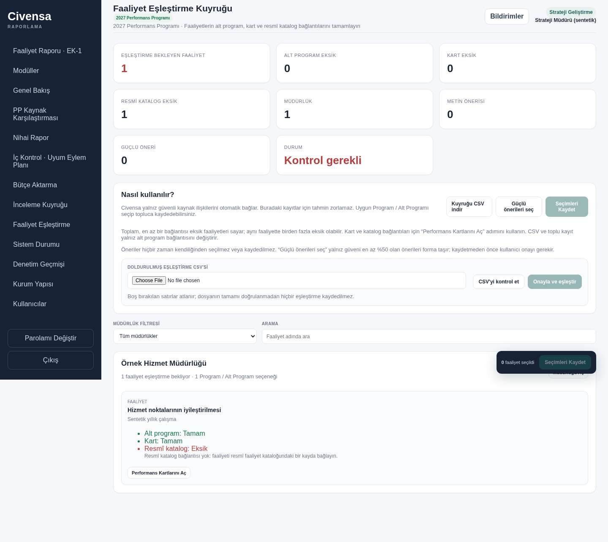

**Görünen metinler ve tablolar:**

- `div`: Civensa RAPORLAMA
- `h1`: Faaliyet Eşleştirme Kuyruğu
- `span`: 2027 Performans Programı
- `p`: 2027 Performans Programı · Faaliyetlerin alt program, kart ve resmî katalog bağlantılarını tamamlayın
- `div`: Strateji Geliştirme Strateji Müdürü (sentetik)
- `h2`: Nasıl kullanılır?
- `p`: Civensa yalnız güvenli kaynak ilişkilerini otomatik bağlar. Buradaki kayıtlar için tahmin zorlamaz. Uygun Program / Alt Programı seçip topluca kaydedebilirsiniz.
- `p`: Toplam, en az bir bağlantısı eksik faaliyetleri sayar; aynı faaliyette birden fazla eksik olabilir. Kart ve katalog bağlantıları için “Performans Kartlarını Aç” adımını kullanın. CSV ve toplu kayıt yalnız alt program bağlantısını değiştirir.
- `p`: Öneriler hiçbir zaman kendiliğinden seçilmez veya kaydedilmez. “Güçlü önerileri seç” yalnız güveni en az %50 olan önerileri forma taşır; kaydetmeden önce kullanıcı onayı gerekir.
- `h2`: Örnek Hizmet Müdürlüğü
- `p`: 1 faaliyet eşleştirme bekliyor · 1 Program / Alt Program seçeneği
- `h3`: Hizmet noktalarının iyileştirilmesi
- `p`: Sentetik yıllık çalışma
- `p`: Resmî katalog bağlantısı yok: faaliyeti resmî faaliyet kataloğundaki bir kayda bağlayın.
- `span`: Eşleştirme bekleyen faaliyet
- `b`: 1
- `span`: Alt program eksik
- `b`: 0
- `span`: Kart eksik
- `b`: 0
- `span`: Resmî katalog eksik
- `b`: 1
- `span`: Müdürlük
- `b`: 1
- `span`: Metin önerisi
- `b`: 0
- `span`: Güçlü öneri
- `b`: 0
- `span`: Durum
- `b`: Kontrol gerekli
- `div`: Boş bırakılan satırlar atlanır; dosyanın tamamı doğrulanmadan hiçbir eşleştirme kaydedilmez.
- `span`: Faaliyet
- `li`: Alt program: Tamam
- `li`: Kart: Tamam
- `li`: Resmî katalog: Eksik
- `b`: 0
- `span`: faaliyet seçildi

**Bağlantı, düğme, form ve alanlar:**

| Öğe | Tür / etiket / bağlam | Hedef URL veya eylem | Ne yapar / mevcut değer |
| --- | --- | --- | --- |
| E001 | a · Faaliyet Raporu · EK-1 | `/activity-sections` | Bağlantıdaki ekranı veya dosyayı açar: Faaliyet Raporu · EK-1. |
| E002 | a · Modüller | `/modules` | Bağlantıdaki ekranı veya dosyayı açar: Modüller. |
| E003 | a · Genel Bakış | `/dashboard?period_id=1` | Bağlantıdaki ekranı veya dosyayı açar: Genel Bakış. |
| E004 | a · PP Kaynak Karşılaştırması | `/source-comparison?period_id=1` | Bağlantıdaki ekranı veya dosyayı açar: PP Kaynak Karşılaştırması. |
| E005 | a · Nihai Rapor | `/report-builder?period_id=1` | Bağlantıdaki ekranı veya dosyayı açar: Nihai Rapor. |
| E006 | a · İç Kontrol · Uyum Eylem Planı | `/internal-control` | Bağlantıdaki ekranı veya dosyayı açar: İç Kontrol · Uyum Eylem Planı. |
| E007 | a · Bütçe Aktarma | `/budget-reallocations` | Bağlantıdaki ekranı veya dosyayı açar: Bütçe Aktarma. |
| E008 | a · İnceleme Kuyruğu | `/review?period_id=1` | Bağlantıdaki ekranı veya dosyayı açar: İnceleme Kuyruğu. |
| E009 | a · Faaliyet Eşleştirme | `/activity-mapping?period_id=1` | Bağlantıdaki ekranı veya dosyayı açar: Faaliyet Eşleştirme. |
| E010 | a · Sistem Durumu | `/operations?period_id=1` | Bağlantıdaki ekranı veya dosyayı açar: Sistem Durumu. |
| E011 | a · Denetim Geçmişi | `/audit?period_id=1` | Bağlantıdaki ekranı veya dosyayı açar: Denetim Geçmişi. |
| E012 | a · Kurum Yapısı | `/structure?period_id=1` | Bağlantıdaki ekranı veya dosyayı açar: Kurum Yapısı. |
| E013 | a · Kullanıcılar | `/users?period_id=1` | Bağlantıdaki ekranı veya dosyayı açar: Kullanıcılar. |
| E014 | button · Parolamı Değiştir (#changePasswordButton) | `#passwordModal` | Parola değiştirme penceresini açar. |
| E015 | form · Çıkış | `POST /logout` | Oturumu kapatıp giriş ekranına döner. |
| E016 | button · Çıkış | `POST /logout` | Oturumu kapatıp giriş ekranına döner. |
| E017 | button · Bildirimler (#notificationButton) | `GET /api/notifications → #notificationPanel` | Bildirim listesini açar. |
| E018 | a · Kuyruğu CSV indir · Nasıl kullanılır? | `/api/activity-mappings/export.csv?period_id=1` | Bağlantıdaki ekranı veya dosyayı açar: Kuyruğu CSV indir. |
| E019 | button · Güçlü önerileri seç (#selectStrongSuggestions) · Nasıl kullanılır? | `Eşleştirme tablosu` | Güçlü faaliyet eşleştirme önerilerini seçer. |
| E020 | button · Seçimleri Kaydet (#saveAllMappings) · Nasıl kullanılır? | `POST /api/activity-mappings/bulk` | Seçilen alt program bağlantılarını kaydeder. **Pasif.** |
| E021 | input · DOLDURULMUŞ EŞLEŞTİRME CSV'Sİ (#mappingCsvFile) · Nasıl kullanılır? | `POST /api/activity-mappings/import-preview → /api/activity-mappings/import-apply` | Dosya seçer; ilgili işlemle yüklenir. |
| E022 | button · CSV'yi kontrol et (#previewMappingCsv) · Nasıl kullanılır? | `POST /api/activity-mappings/import-preview` | CSV eşleştirme dosyasını kontrol eder. |
| E023 | button · Onayla ve eşleştir (#applyMappingCsv) · Nasıl kullanılır? | `POST /api/activity-mappings/import-apply` | Doğrulanmış CSV eşleştirmelerini uygular. **Pasif.** |
| E024 | select · MÜDÜRLÜK FİLTRESİ Tüm müdürlükler Örnek Hizmet Müdürlüğü (#mappingDepartmentFilter) | `Aynı sayfadaki faaliyet tablosunu müdürlüğe göre filtrele` | Listeden seçim yapar. Seçenekler: Tüm müdürlükler; Örnek Hizmet Müdürlüğü. |
| E025 | input · ARAMA (#mappingSearch) | `Aynı sayfadaki faaliyet tablosunda ada göre ara` | İşlem için ARAMA değerini girer. |
| E026 | a · Müdürlüğü Aç · Örnek Hizmet Müdürlüğü | `/department/1?period_id=1` | Bağlantıdaki ekranı veya dosyayı açar: Müdürlüğü Aç. |
| E027 | a · Performans Kartlarını Aç · Hizmet noktalarının iyileştirilmesi | `/program/1?period_id=1` | Bağlantıdaki ekranı veya dosyayı açar: Performans Kartlarını Aç. |
| E028 | button · Seçimleri Kaydet (#saveMappingsBottom) | `POST /api/activity-mappings/bulk` | Seçilen faaliyetlerin alt program bağlantılarını kaydeder. **Pasif.** |

<a id="ekran-002"></a>

### 002 · Faaliyet Raporu hazırlık alanı · Dolu / taslak

URL kalıbı: `/activity-report` · Çekilen URL: `/activity-report?year=2027` · Rol: **strategy** · HTTP 200.

Seçilen yıldaki hedef ve gerçekleşme kayıtlarını gösterir.

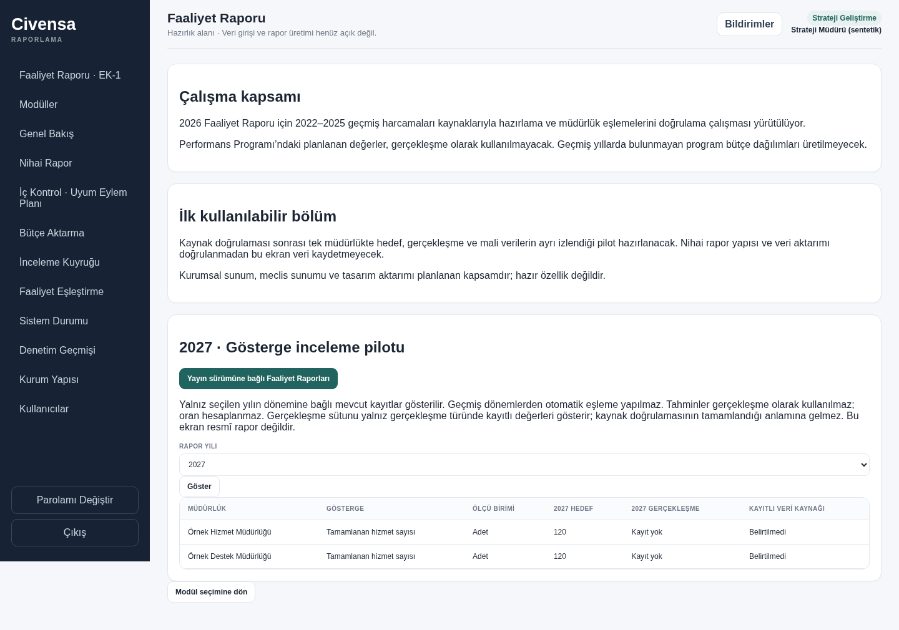

**Görünen metinler ve tablolar:**

- `div`: Civensa RAPORLAMA
- `h1`: Faaliyet Raporu
- `p`: Hazırlık alanı · Veri girişi ve rapor üretimi henüz açık değil.
- `div`: Strateji Geliştirme Strateji Müdürü (sentetik)
- `h2`: Çalışma kapsamı
- `p`: 2026 Faaliyet Raporu için 2022–2025 geçmiş harcamaları kaynaklarıyla hazırlama ve müdürlük eşlemelerini doğrulama çalışması yürütülüyor.
- `p`: Performans Programı’ndaki planlanan değerler, gerçekleşme olarak kullanılmayacak. Geçmiş yıllarda bulunmayan program bütçe dağılımları üretilmeyecek.
- `h2`: İlk kullanılabilir bölüm
- `p`: Kaynak doğrulaması sonrası tek müdürlükte hedef, gerçekleşme ve mali verilerin ayrı izlendiği pilot hazırlanacak. Nihai rapor yapısı ve veri aktarımı doğrulanmadan bu ekran veri kaydetmeyecek.
- `p`: Kurumsal sunum, meclis sunumu ve tasarım aktarımı planlanan kapsamdır; hazır özellik değildir.
- `h2`: 2027 · Gösterge inceleme pilotu
- `p`: Yayın sürümüne bağlı Faaliyet Raporları
- `p`: Yalnız seçilen yılın dönemine bağlı mevcut kayıtlar gösterilir. Geçmiş dönemlerden otomatik eşleme yapılmaz. Tahminler gerçekleşme olarak kullanılmaz; oran hesaplanmaz. Gerçekleşme sütunu yalnız gerçekleşme türünde kayıtlı değerleri gösterir; kaynak doğrulamasının tamamlandığı anlamına gelmez. Bu ekran resmî rapor değildir.
- `table`: MÜDÜRLÜK GÖSTERGE ÖLÇÜ BİRİMİ 2027 HEDEF 2027 GERÇEKLEŞME KAYITLI VERİ KAYNAĞI Örnek Hizmet Müdürlüğü Tamamlanan hizmet sayısı Adet 120 Kayıt yok Belirtilmedi Örnek Destek Müdürlüğü Tamamlanan hizmet sayısı Adet 120 Kayıt yok Belirtilmedi

**Bağlantı, düğme, form ve alanlar:**

| Öğe | Tür / etiket / bağlam | Hedef URL veya eylem | Ne yapar / mevcut değer |
| --- | --- | --- | --- |
| E001 | a · Faaliyet Raporu · EK-1 | `/activity-sections` | Bağlantıdaki ekranı veya dosyayı açar: Faaliyet Raporu · EK-1. |
| E002 | a · Modüller | `/modules` | Bağlantıdaki ekranı veya dosyayı açar: Modüller. |
| E003 | a · Genel Bakış | `/dashboard` | Bağlantıdaki ekranı veya dosyayı açar: Genel Bakış. |
| E004 | a · Nihai Rapor | `/report-builder` | Bağlantıdaki ekranı veya dosyayı açar: Nihai Rapor. |
| E005 | a · İç Kontrol · Uyum Eylem Planı | `/internal-control` | Bağlantıdaki ekranı veya dosyayı açar: İç Kontrol · Uyum Eylem Planı. |
| E006 | a · Bütçe Aktarma | `/budget-reallocations` | Bağlantıdaki ekranı veya dosyayı açar: Bütçe Aktarma. |
| E007 | a · İnceleme Kuyruğu | `/review` | Bağlantıdaki ekranı veya dosyayı açar: İnceleme Kuyruğu. |
| E008 | a · Faaliyet Eşleştirme | `/activity-mapping` | Bağlantıdaki ekranı veya dosyayı açar: Faaliyet Eşleştirme. |
| E009 | a · Sistem Durumu | `/operations` | Bağlantıdaki ekranı veya dosyayı açar: Sistem Durumu. |
| E010 | a · Denetim Geçmişi | `/audit` | Bağlantıdaki ekranı veya dosyayı açar: Denetim Geçmişi. |
| E011 | a · Kurum Yapısı | `/structure` | Bağlantıdaki ekranı veya dosyayı açar: Kurum Yapısı. |
| E012 | a · Kullanıcılar | `/users` | Bağlantıdaki ekranı veya dosyayı açar: Kullanıcılar. |
| E013 | button · Parolamı Değiştir (#changePasswordButton) | `#passwordModal` | Parola değiştirme penceresini açar. |
| E014 | form · Çıkış | `POST /logout` | Oturumu kapatıp giriş ekranına döner. |
| E015 | button · Çıkış | `POST /logout` | Oturumu kapatıp giriş ekranına döner. |
| E016 | button · Bildirimler (#notificationButton) | `GET /api/notifications → #notificationPanel` | Bildirim listesini açar. |
| E017 | a · Yayın sürümüne bağlı Faaliyet Raporları · 2027 · Gösterge inceleme pilotu | `/activity-reports` | Bağlantıdaki ekranı veya dosyayı açar: Yayın sürümüne bağlı Faaliyet Raporları. |
| E018 | form · Göster · 2027 · Gösterge inceleme pilotu | `GET /activity-report` | Alanlarla listeyi veya rapor görünümünü filtreler. |
| E019 | select · RAPOR YILI 2027 · 2027 · Gösterge inceleme pilotu | `GET /activity-report` | Listeden seçim yapar. Değer: 2027. Seçenekler: 2027. |
| E020 | button · Göster · 2027 · Gösterge inceleme pilotu | `GET /activity-report` | Alanlarla listeyi veya rapor görünümünü filtreler. |
| E021 | a · Modül seçimine dön | `/modules` | Bağlantıdaki ekranı veya dosyayı açar: Modül seçimine dön. |

<a id="ekran-003"></a>

### 003 · Faaliyet Raporu hazırlık alanı · Dolu / taslak

URL kalıbı: `/activity-report` · Çekilen URL: `/activity-report?year=2027` · Rol: **department** · HTTP 200.

Seçilen yıldaki hedef ve gerçekleşme kayıtlarını gösterir.

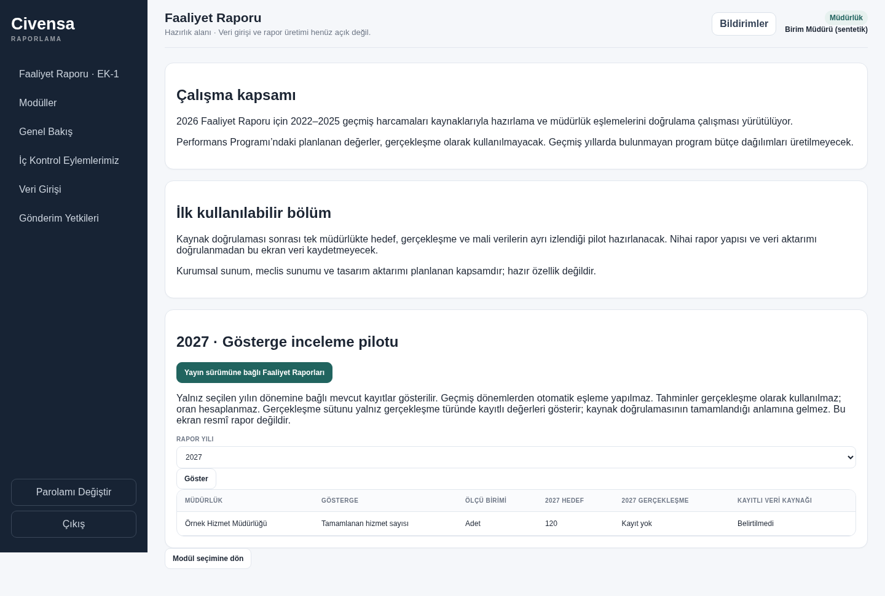

**Görünen metinler ve tablolar:**

- `div`: Civensa RAPORLAMA
- `h1`: Faaliyet Raporu
- `p`: Hazırlık alanı · Veri girişi ve rapor üretimi henüz açık değil.
- `div`: Müdürlük Birim Müdürü (sentetik)
- `h2`: Çalışma kapsamı
- `p`: 2026 Faaliyet Raporu için 2022–2025 geçmiş harcamaları kaynaklarıyla hazırlama ve müdürlük eşlemelerini doğrulama çalışması yürütülüyor.
- `p`: Performans Programı’ndaki planlanan değerler, gerçekleşme olarak kullanılmayacak. Geçmiş yıllarda bulunmayan program bütçe dağılımları üretilmeyecek.
- `h2`: İlk kullanılabilir bölüm
- `p`: Kaynak doğrulaması sonrası tek müdürlükte hedef, gerçekleşme ve mali verilerin ayrı izlendiği pilot hazırlanacak. Nihai rapor yapısı ve veri aktarımı doğrulanmadan bu ekran veri kaydetmeyecek.
- `p`: Kurumsal sunum, meclis sunumu ve tasarım aktarımı planlanan kapsamdır; hazır özellik değildir.
- `h2`: 2027 · Gösterge inceleme pilotu
- `p`: Yayın sürümüne bağlı Faaliyet Raporları
- `p`: Yalnız seçilen yılın dönemine bağlı mevcut kayıtlar gösterilir. Geçmiş dönemlerden otomatik eşleme yapılmaz. Tahminler gerçekleşme olarak kullanılmaz; oran hesaplanmaz. Gerçekleşme sütunu yalnız gerçekleşme türünde kayıtlı değerleri gösterir; kaynak doğrulamasının tamamlandığı anlamına gelmez. Bu ekran resmî rapor değildir.
- `table`: MÜDÜRLÜK GÖSTERGE ÖLÇÜ BİRİMİ 2027 HEDEF 2027 GERÇEKLEŞME KAYITLI VERİ KAYNAĞI Örnek Hizmet Müdürlüğü Tamamlanan hizmet sayısı Adet 120 Kayıt yok Belirtilmedi

**Bağlantı, düğme, form ve alanlar:**

| Öğe | Tür / etiket / bağlam | Hedef URL veya eylem | Ne yapar / mevcut değer |
| --- | --- | --- | --- |
| E001 | a · Faaliyet Raporu · EK-1 | `/activity-sections` | Bağlantıdaki ekranı veya dosyayı açar: Faaliyet Raporu · EK-1. |
| E002 | a · Modüller | `/modules` | Bağlantıdaki ekranı veya dosyayı açar: Modüller. |
| E003 | a · Genel Bakış | `/dashboard` | Bağlantıdaki ekranı veya dosyayı açar: Genel Bakış. |
| E004 | a · İç Kontrol Eylemlerimiz | `/internal-control/our-actions` | Bağlantıdaki ekranı veya dosyayı açar: İç Kontrol Eylemlerimiz. |
| E005 | a · Veri Girişi | `/department/1` | Bağlantıdaki ekranı veya dosyayı açar: Veri Girişi. |
| E006 | a · Gönderim Yetkileri | `/submit-authorizations` | Bağlantıdaki ekranı veya dosyayı açar: Gönderim Yetkileri. |
| E007 | button · Parolamı Değiştir (#changePasswordButton) | `#passwordModal` | Parola değiştirme penceresini açar. |
| E008 | form · Çıkış | `POST /logout` | Oturumu kapatıp giriş ekranına döner. |
| E009 | button · Çıkış | `POST /logout` | Oturumu kapatıp giriş ekranına döner. |
| E010 | button · Bildirimler (#notificationButton) | `GET /api/notifications → #notificationPanel` | Bildirim listesini açar. |
| E011 | a · Yayın sürümüne bağlı Faaliyet Raporları · 2027 · Gösterge inceleme pilotu | `/activity-reports` | Bağlantıdaki ekranı veya dosyayı açar: Yayın sürümüne bağlı Faaliyet Raporları. |
| E012 | form · Göster · 2027 · Gösterge inceleme pilotu | `GET /activity-report` | Alanlarla listeyi veya rapor görünümünü filtreler. |
| E013 | select · RAPOR YILI 2027 · 2027 · Gösterge inceleme pilotu | `GET /activity-report` | Listeden seçim yapar. Değer: 2027. Seçenekler: 2027. |
| E014 | button · Göster · 2027 · Gösterge inceleme pilotu | `GET /activity-report` | Alanlarla listeyi veya rapor görünümünü filtreler. |
| E015 | a · Modül seçimine dön | `/modules` | Bağlantıdaki ekranı veya dosyayı açar: Modül seçimine dön. |

<a id="ekran-004"></a>

### 004 · Yayına bağlı Faaliyet Raporları · Dolu / taslak

URL kalıbı: `/activity-reports` · Çekilen URL: `/activity-reports` · Rol: **strategy** · HTTP 200.

PP yayınından oluşturulan faaliyet raporu revizyonlarını listeler.

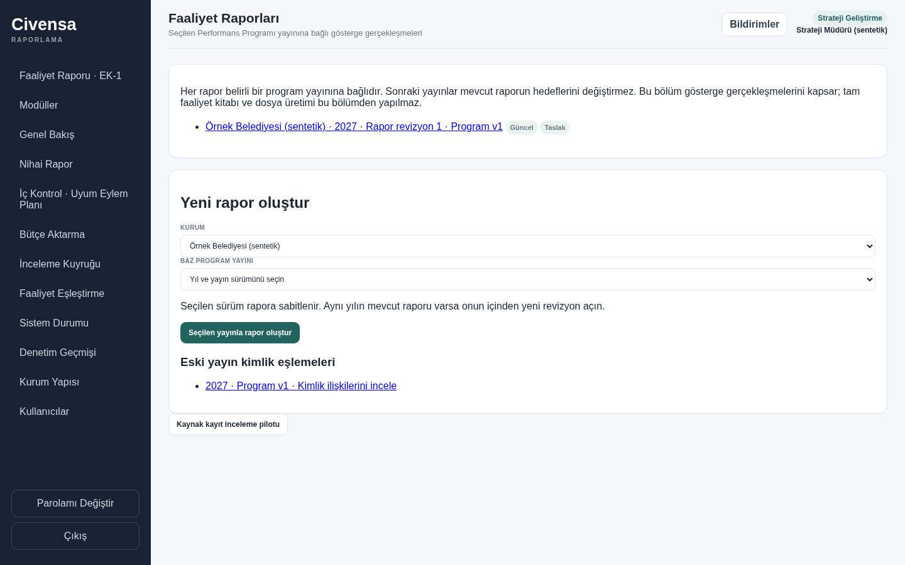

**Görünen metinler ve tablolar:**

- `div`: Civensa RAPORLAMA
- `h1`: Faaliyet Raporları
- `p`: Seçilen Performans Programı yayınına bağlı gösterge gerçekleşmeleri
- `div`: Strateji Geliştirme Strateji Müdürü (sentetik)
- `p`: Her rapor belirli bir program yayınına bağlıdır. Sonraki yayınlar mevcut raporun hedeflerini değiştirmez. Bu bölüm gösterge gerçekleşmelerini kapsar; tam faaliyet kitabı ve dosya üretimi bu bölümden yapılmaz.
- `span`: Güncel
- `span`: Taslak
- `h2`: Yeni rapor oluştur
- `p`: Seçilen sürüm rapora sabitlenir. Aynı yılın mevcut raporu varsa onun içinden yeni revizyon açın.
- `h3`: Eski yayın kimlik eşlemeleri

**Bağlantı, düğme, form ve alanlar:**

| Öğe | Tür / etiket / bağlam | Hedef URL veya eylem | Ne yapar / mevcut değer |
| --- | --- | --- | --- |
| E001 | a · Faaliyet Raporu · EK-1 | `/activity-sections` | Bağlantıdaki ekranı veya dosyayı açar: Faaliyet Raporu · EK-1. |
| E002 | a · Modüller | `/modules` | Bağlantıdaki ekranı veya dosyayı açar: Modüller. |
| E003 | a · Genel Bakış | `/dashboard` | Bağlantıdaki ekranı veya dosyayı açar: Genel Bakış. |
| E004 | a · Nihai Rapor | `/report-builder` | Bağlantıdaki ekranı veya dosyayı açar: Nihai Rapor. |
| E005 | a · İç Kontrol · Uyum Eylem Planı | `/internal-control` | Bağlantıdaki ekranı veya dosyayı açar: İç Kontrol · Uyum Eylem Planı. |
| E006 | a · Bütçe Aktarma | `/budget-reallocations` | Bağlantıdaki ekranı veya dosyayı açar: Bütçe Aktarma. |
| E007 | a · İnceleme Kuyruğu | `/review` | Bağlantıdaki ekranı veya dosyayı açar: İnceleme Kuyruğu. |
| E008 | a · Faaliyet Eşleştirme | `/activity-mapping` | Bağlantıdaki ekranı veya dosyayı açar: Faaliyet Eşleştirme. |
| E009 | a · Sistem Durumu | `/operations` | Bağlantıdaki ekranı veya dosyayı açar: Sistem Durumu. |
| E010 | a · Denetim Geçmişi | `/audit` | Bağlantıdaki ekranı veya dosyayı açar: Denetim Geçmişi. |
| E011 | a · Kurum Yapısı | `/structure` | Bağlantıdaki ekranı veya dosyayı açar: Kurum Yapısı. |
| E012 | a · Kullanıcılar | `/users` | Bağlantıdaki ekranı veya dosyayı açar: Kullanıcılar. |
| E013 | button · Parolamı Değiştir (#changePasswordButton) | `#passwordModal` | Parola değiştirme penceresini açar. |
| E014 | form · Çıkış | `POST /logout` | Oturumu kapatıp giriş ekranına döner. |
| E015 | button · Çıkış | `POST /logout` | Oturumu kapatıp giriş ekranına döner. |
| E016 | button · Bildirimler (#notificationButton) | `GET /api/notifications → #notificationPanel` | Bildirim listesini açar. |
| E017 | a · Örnek Belediyesi (sentetik) · 2027 · Rapor revizyon 1 · Program v1 | `/activity-reports/revisions/1` | Bağlantıdaki ekranı veya dosyayı açar: Örnek Belediyesi (sentetik) · 2027 · Rapor revizyon 1 · Program v1. |
| E018 | form · Seçilen yayınla rapor oluştur · Yeni rapor oluştur | `POST /activity-reports/revisions` | Seçilen yayınla rapor oluştur işlemini form alanlarıyla gönderir; doğrulama sonrası kaydeder veya hata gösterir. |
| E019 | select · KURUM Örnek Belediyesi (sentetik) · Yeni rapor oluştur | `POST /activity-reports/revisions` | Listeden seçim yapar. Zorunlu. Değer: 1. Seçenekler: Örnek Belediyesi (sentetik). |
| E020 | select · BAZ PROGRAM YAYINI Yıl ve yayın sürümünü seçin 2027 · v1 · 25.10.2026 00:35 TSİ · Bütünlük doğrulandı · Yeni rapor oluştur | `POST /activity-reports/revisions` | Listeden seçim yapar. Zorunlu. Seçenekler: Yıl ve yayın sürümünü seçin; 2027 · v1 · 25.10.2026 00:35 TSİ · Bütünlük doğrulandı. |
| E021 | button · Seçilen yayınla rapor oluştur · Yeni rapor oluştur | `POST /activity-reports/revisions` | Seçilen yayınla rapor oluştur işlemini form alanlarıyla gönderir; doğrulama sonrası kaydeder veya hata gösterir. |
| E022 | a · 2027 · Program v1 · Kimlik ilişkilerini incele · Yeni rapor oluştur | `/activity-reports/publications/1/bindings` | Bağlantıdaki ekranı veya dosyayı açar: 2027 · Program v1 · Kimlik ilişkilerini incele. |
| E023 | a · Kaynak kayıt inceleme pilotu | `/activity-report` | Bağlantıdaki ekranı veya dosyayı açar: Kaynak kayıt inceleme pilotu. |

<a id="ekran-005"></a>

### 005 · Yayına bağlı Faaliyet Raporları · Dolu / taslak

URL kalıbı: `/activity-reports` · Çekilen URL: `/activity-reports` · Rol: **department** · HTTP 200.

PP yayınından oluşturulan faaliyet raporu revizyonlarını listeler.

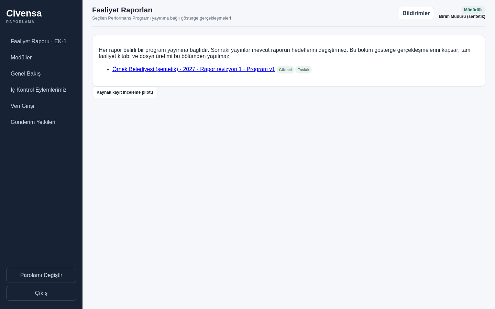

**Görünen metinler ve tablolar:**

- `div`: Civensa RAPORLAMA
- `h1`: Faaliyet Raporları
- `p`: Seçilen Performans Programı yayınına bağlı gösterge gerçekleşmeleri
- `div`: Müdürlük Birim Müdürü (sentetik)
- `p`: Her rapor belirli bir program yayınına bağlıdır. Sonraki yayınlar mevcut raporun hedeflerini değiştirmez. Bu bölüm gösterge gerçekleşmelerini kapsar; tam faaliyet kitabı ve dosya üretimi bu bölümden yapılmaz.
- `span`: Güncel
- `span`: Taslak

**Bağlantı, düğme, form ve alanlar:**

| Öğe | Tür / etiket / bağlam | Hedef URL veya eylem | Ne yapar / mevcut değer |
| --- | --- | --- | --- |
| E001 | a · Faaliyet Raporu · EK-1 | `/activity-sections` | Bağlantıdaki ekranı veya dosyayı açar: Faaliyet Raporu · EK-1. |
| E002 | a · Modüller | `/modules` | Bağlantıdaki ekranı veya dosyayı açar: Modüller. |
| E003 | a · Genel Bakış | `/dashboard` | Bağlantıdaki ekranı veya dosyayı açar: Genel Bakış. |
| E004 | a · İç Kontrol Eylemlerimiz | `/internal-control/our-actions` | Bağlantıdaki ekranı veya dosyayı açar: İç Kontrol Eylemlerimiz. |
| E005 | a · Veri Girişi | `/department/1` | Bağlantıdaki ekranı veya dosyayı açar: Veri Girişi. |
| E006 | a · Gönderim Yetkileri | `/submit-authorizations` | Bağlantıdaki ekranı veya dosyayı açar: Gönderim Yetkileri. |
| E007 | button · Parolamı Değiştir (#changePasswordButton) | `#passwordModal` | Parola değiştirme penceresini açar. |
| E008 | form · Çıkış | `POST /logout` | Oturumu kapatıp giriş ekranına döner. |
| E009 | button · Çıkış | `POST /logout` | Oturumu kapatıp giriş ekranına döner. |
| E010 | button · Bildirimler (#notificationButton) | `GET /api/notifications → #notificationPanel` | Bildirim listesini açar. |
| E011 | a · Örnek Belediyesi (sentetik) · 2027 · Rapor revizyon 1 · Program v1 | `/activity-reports/revisions/1` | Bağlantıdaki ekranı veya dosyayı açar: Örnek Belediyesi (sentetik) · 2027 · Rapor revizyon 1 · Program v1. |
| E012 | a · Kaynak kayıt inceleme pilotu | `/activity-report` | Bağlantıdaki ekranı veya dosyayı açar: Kaynak kayıt inceleme pilotu. |

<a id="ekran-006"></a>

### 006 · Gösterge kimlik eşlemesi · Dolu / taslak

URL kalıbı: `/activity-reports/publications/{publication_id}/bindings` · Çekilen URL: `/activity-reports/publications/1/bindings` · Rol: **strategy** · HTTP 200.

Yayın göstergelerinin kalıcı kimlik bağlantılarını gösterir.

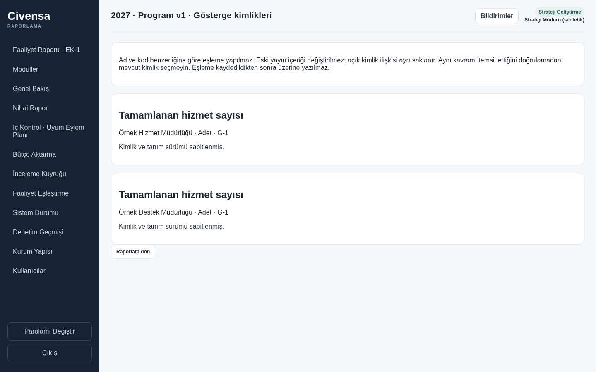

**Görünen metinler ve tablolar:**

- `div`: Civensa RAPORLAMA
- `h1`: 2027 · Program v1 · Gösterge kimlikleri
- `div`: Strateji Geliştirme Strateji Müdürü (sentetik)
- `p`: Ad ve kod benzerliğine göre eşleme yapılmaz. Eski yayın içeriği değiştirilmez; açık kimlik ilişkisi ayrı saklanır. Aynı kavramı temsil ettiğini doğrulamadan mevcut kimlik seçmeyin. Eşleme kaydedildikten sonra üzerine yazılmaz.
- `h2`: Tamamlanan hizmet sayısı
- `p`: Örnek Hizmet Müdürlüğü · Adet · G-1
- `p`: Kimlik ve tanım sürümü sabitlenmiş.
- `h2`: Tamamlanan hizmet sayısı
- `p`: Örnek Destek Müdürlüğü · Adet · G-1
- `p`: Kimlik ve tanım sürümü sabitlenmiş.

**Bağlantı, düğme, form ve alanlar:**

| Öğe | Tür / etiket / bağlam | Hedef URL veya eylem | Ne yapar / mevcut değer |
| --- | --- | --- | --- |
| E001 | a · Faaliyet Raporu · EK-1 | `/activity-sections` | Bağlantıdaki ekranı veya dosyayı açar: Faaliyet Raporu · EK-1. |
| E002 | a · Modüller | `/modules` | Bağlantıdaki ekranı veya dosyayı açar: Modüller. |
| E003 | a · Genel Bakış | `/dashboard` | Bağlantıdaki ekranı veya dosyayı açar: Genel Bakış. |
| E004 | a · Nihai Rapor | `/report-builder` | Bağlantıdaki ekranı veya dosyayı açar: Nihai Rapor. |
| E005 | a · İç Kontrol · Uyum Eylem Planı | `/internal-control` | Bağlantıdaki ekranı veya dosyayı açar: İç Kontrol · Uyum Eylem Planı. |
| E006 | a · Bütçe Aktarma | `/budget-reallocations` | Bağlantıdaki ekranı veya dosyayı açar: Bütçe Aktarma. |
| E007 | a · İnceleme Kuyruğu | `/review` | Bağlantıdaki ekranı veya dosyayı açar: İnceleme Kuyruğu. |
| E008 | a · Faaliyet Eşleştirme | `/activity-mapping` | Bağlantıdaki ekranı veya dosyayı açar: Faaliyet Eşleştirme. |
| E009 | a · Sistem Durumu | `/operations` | Bağlantıdaki ekranı veya dosyayı açar: Sistem Durumu. |
| E010 | a · Denetim Geçmişi | `/audit` | Bağlantıdaki ekranı veya dosyayı açar: Denetim Geçmişi. |
| E011 | a · Kurum Yapısı | `/structure` | Bağlantıdaki ekranı veya dosyayı açar: Kurum Yapısı. |
| E012 | a · Kullanıcılar | `/users` | Bağlantıdaki ekranı veya dosyayı açar: Kullanıcılar. |
| E013 | button · Parolamı Değiştir (#changePasswordButton) | `#passwordModal` | Parola değiştirme penceresini açar. |
| E014 | form · Çıkış | `POST /logout` | Oturumu kapatıp giriş ekranına döner. |
| E015 | button · Çıkış | `POST /logout` | Oturumu kapatıp giriş ekranına döner. |
| E016 | button · Bildirimler (#notificationButton) | `GET /api/notifications → #notificationPanel` | Bildirim listesini açar. |
| E017 | a · Raporlara dön | `/activity-reports` | Bağlantıdaki ekranı veya dosyayı açar: Raporlara dön. |

<a id="ekran-007"></a>

### 007 · Gerçekleşme revizyonu · Dolu / taslak

URL kalıbı: `/activity-reports/revisions/{revision_id}` · Çekilen URL: `/activity-reports/revisions/1` · Rol: **strategy** · HTTP 200.

Sabitlenmiş PP hedefleri için gerçekleşme ve kanıt girişini gösterir.

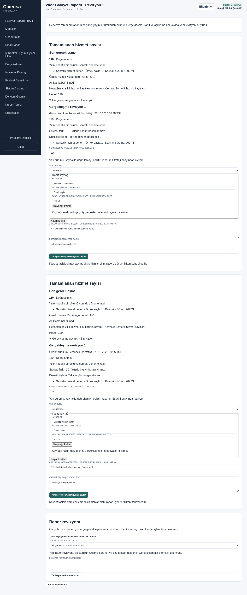

**Görünen metinler ve tablolar:**

- `div`: Civensa RAPORLAMA
- `h1`: 2027 Faaliyet Raporu · Revizyon 1
- `p`: Baz Performans Programı v1 · Taslak
- `div`: Strateji Geliştirme Strateji Müdürü (sentetik)
- `p`: Hedef ve tanım bu raporun seçilmiş yayın sürümünden okunur. Gerçekleşme, kanıt ve açıklama her kayıtta yeni revizyon oluşturur.
- `h2`: Tamamlanan hizmet sayısı
- `h3`: Son gerçekleşme
- `p`: 110 · Doğrulanmış
- `p`: Yıllık hedefin bir bölümü sonraki döneme kaldı.
- `p`: Örnek Hizmet Müdürlüğü · Adet · G-1
- `p`: Açıklama belirtilmedi
- `p`: Hesaplama: Yıllık hizmet kayıtlarının sayımı · Kaynak: Sentetik hizmet kayıtları
- `p`: Hedef: 120
- `h3`: Gerçekleşme revizyon 1
- `p`: Giren: Kurulum Personeli (sentetik) · 25.10.2026 00:35 TSİ
- `p`: 110 · Doğrulanmış
- `p`: Yıllık hedefin bir bölümü sonraki döneme kaldı.
- `p`: Sayısal fark: -10 · Yüzde başarı hesaplanmaz.
- `p`: Düzeltici işlem: Takvim gözden geçirilecek.
- `p`: Veri durumu, kaynakla doğrulamayı belirtir; raporun Strateji onayından ayrıdır.
- `p`: Kaynağı kaldırmak geçmiş gerçekleşmelerin dosyalarını silmez.
- `p`: Kaydet taslak olarak saklar; eksik alanlar birim raporu gönderilirken kontrol edilir.
- `h2`: Tamamlanan hizmet sayısı
- `h3`: Son gerçekleşme
- `p`: 110 · Doğrulanmış
- `p`: Yıllık hedefin bir bölümü sonraki döneme kaldı.
- `p`: Örnek Destek Müdürlüğü · Adet · G-1
- `p`: Açıklama belirtilmedi
- `p`: Hesaplama: Yıllık hizmet kayıtlarının sayımı · Kaynak: Sentetik hizmet kayıtları
- `p`: Hedef: 120
- `h3`: Gerçekleşme revizyon 1
- `p`: Giren: Kurulum Personeli (sentetik) · 25.10.2026 00:35 TSİ
- `p`: 110 · Doğrulanmış
- `p`: Yıllık hedefin bir bölümü sonraki döneme kaldı.
- `p`: Sayısal fark: -10 · Yüzde başarı hesaplanmaz.
- `p`: Düzeltici işlem: Takvim gözden geçirilecek.
- `p`: Veri durumu, kaynakla doğrulamayı belirtir; raporun Strateji onayından ayrıdır.
- `p`: Kaynağı kaldırmak geçmiş gerçekleşmelerin dosyalarını silmez.
- `p`: Kaydet taslak olarak saklar; eksik alanlar birim raporu gönderilirken kontrol edilir.
- `h2`: Rapor revizyonu
- `p`: Onay, bu revizyonun gösterge gerçekleşmelerini dondurur. Eksik veri veya kanıt varsa işlem tamamlanmaz.
- `p`: Yeni rapor revizyonu oluşturulur. Geçmiş korunur ve baz farkları gösterilir. Gerçekleşmeler otomatik taşınmaz.
- `li`: Sentetik hizmet defteri · Örnek sayfa 1 · Kaynak sürümü: 2027/1
- `li`: Sentetik hizmet defteri · Örnek sayfa 1 · Kaynak sürümü: 2027/1
- `legend`: Kanıt kaynağı
- `li`: Sentetik hizmet defteri · Örnek sayfa 1 · Kaynak sürümü: 2027/1
- `li`: Sentetik hizmet defteri · Örnek sayfa 1 · Kaynak sürümü: 2027/1
- `legend`: Kanıt kaynağı

**Bağlantı, düğme, form ve alanlar:**

| Öğe | Tür / etiket / bağlam | Hedef URL veya eylem | Ne yapar / mevcut değer |
| --- | --- | --- | --- |
| E001 | a · Faaliyet Raporu · EK-1 | `/activity-sections` | Bağlantıdaki ekranı veya dosyayı açar: Faaliyet Raporu · EK-1. |
| E002 | a · Modüller | `/modules` | Bağlantıdaki ekranı veya dosyayı açar: Modüller. |
| E003 | a · Genel Bakış | `/dashboard` | Bağlantıdaki ekranı veya dosyayı açar: Genel Bakış. |
| E004 | a · Nihai Rapor | `/report-builder` | Bağlantıdaki ekranı veya dosyayı açar: Nihai Rapor. |
| E005 | a · İç Kontrol · Uyum Eylem Planı | `/internal-control` | Bağlantıdaki ekranı veya dosyayı açar: İç Kontrol · Uyum Eylem Planı. |
| E006 | a · Bütçe Aktarma | `/budget-reallocations` | Bağlantıdaki ekranı veya dosyayı açar: Bütçe Aktarma. |
| E007 | a · İnceleme Kuyruğu | `/review` | Bağlantıdaki ekranı veya dosyayı açar: İnceleme Kuyruğu. |
| E008 | a · Faaliyet Eşleştirme | `/activity-mapping` | Bağlantıdaki ekranı veya dosyayı açar: Faaliyet Eşleştirme. |
| E009 | a · Sistem Durumu | `/operations` | Bağlantıdaki ekranı veya dosyayı açar: Sistem Durumu. |
| E010 | a · Denetim Geçmişi | `/audit` | Bağlantıdaki ekranı veya dosyayı açar: Denetim Geçmişi. |
| E011 | a · Kurum Yapısı | `/structure` | Bağlantıdaki ekranı veya dosyayı açar: Kurum Yapısı. |
| E012 | a · Kullanıcılar | `/users` | Bağlantıdaki ekranı veya dosyayı açar: Kullanıcılar. |
| E013 | button · Parolamı Değiştir (#changePasswordButton) | `#passwordModal` | Parola değiştirme penceresini açar. |
| E014 | form · Çıkış | `POST /logout` | Oturumu kapatıp giriş ekranına döner. |
| E015 | button · Çıkış | `POST /logout` | Oturumu kapatıp giriş ekranına döner. |
| E016 | button · Bildirimler (#notificationButton) | `GET /api/notifications → #notificationPanel` | Bildirim listesini açar. |
| E017 | summary · Gerçekleşme geçmişi · 1 revizyon · Gerçekleşme geçmişi · 1 revizyon | `Aynı sayfadaki ayrıntı bölümü` | İçerik ve form ayrıntılarını açar veya daraltır. |
| E018 | form · Kaynağı kaldır / Kaynak ekle / Yeni gerçekleşme revizyonu kaydet · Tamamlanan hizmet sayısı | `POST /activity-reports/indicators/1/actuals` | Kaynağı kaldır / Kaynak ekle / Yeni gerçekleşme revizyonu kaydet işlemini form alanlarıyla gönderir; doğrulama sonrası kaydeder veya hata gösterir. |
| E019 | input · GERÇEKLEŞME (ONDALIK İÇİN VİRGÜL KULLANIN) · Tamamlanan hizmet sayısı | `POST /activity-reports/indicators/1/actuals` | İşlem için GERÇEKLEŞME (ONDALIK İÇİN VİRGÜL KULLANIN) değerini girer. Değer: 110. |
| E020 | select · VERİ DURUMU Doğrulanmış İncelenmeli Eksik · Tamamlanan hizmet sayısı | `POST /activity-reports/indicators/1/actuals` | Listeden seçim yapar. Değer: verified. Seçenekler: Doğrulanmış; İncelenmeli; Eksik. |
| E021 | input · KAYNAK ADI · Tamamlanan hizmet sayısı | `POST /activity-reports/indicators/1/actuals` | İşlem için KAYNAK ADI değerini girer. Değer: Sentetik hizmet defteri. |
| E022 | input · KAYNAK KONUMU / SAYFA / KAYIT · Tamamlanan hizmet sayısı | `POST /activity-reports/indicators/1/actuals` | İşlem için KAYNAK KONUMU / SAYFA / KAYIT değerini girer. Değer: Örnek sayfa 1. |
| E023 | input · SABİT KAYNAK SÜRÜMÜ / TARİHLİ KAYIT NUMARASI / DOSYA ÖZETİ · Tamamlanan hizmet sayısı | `POST /activity-reports/indicators/1/actuals` | İşlem için SABİT KAYNAK SÜRÜMÜ / TARİHLİ KAYIT NUMARASI / DOSYA ÖZETİ değerini girer. Değer: 2027/1. |
| E024 | button · Kaynağı kaldır · Tamamlanan hizmet sayısı | `Aynı gerçekleşme formu` | Kanıt satırını formdan kaldırır; kayıt gönderildiğinde uygulanır. |
| E025 | button · Kaynak ekle · Tamamlanan hizmet sayısı | `Aynı gerçekleşme formu` | Yeni kanıt kaynak satırı ekler. |
| E026 | textarea · AÇIKLAMA / SAPMA GEREKÇESİ · GÖNDERİM İÇİN ZORUNLU (FARK VARSA) · Tamamlanan hizmet sayısı | `POST /activity-reports/indicators/1/actuals` | İşlem için AÇIKLAMA / SAPMA GEREKÇESİ · GÖNDERİM İÇİN ZORUNLU (FARK VARSA) değerini girer. Değer: Yıllık hedefin bir bölümü sonraki döneme kaldı.. |
| E027 | textarea · DÜZELTİCİ İŞLEM (İSTEĞE BAĞLI) · Tamamlanan hizmet sayısı | `POST /activity-reports/indicators/1/actuals` | İşlem için DÜZELTİCİ İŞLEM (İSTEĞE BAĞLI) değerini girer. Değer: Takvim gözden geçirilecek.. |
| E028 | button · Yeni gerçekleşme revizyonu kaydet · Tamamlanan hizmet sayısı | `POST /activity-reports/indicators/1/actuals` | Yeni gerçekleşme revizyonu kaydet işlemini form alanlarıyla gönderir; doğrulama sonrası kaydeder veya hata gösterir. |
| E029 | summary · Gerçekleşme geçmişi · 1 revizyon · Gerçekleşme geçmişi · 1 revizyon | `Aynı sayfadaki ayrıntı bölümü` | İçerik ve form ayrıntılarını açar veya daraltır. |
| E030 | form · Kaynağı kaldır / Kaynak ekle / Yeni gerçekleşme revizyonu kaydet · Tamamlanan hizmet sayısı | `POST /activity-reports/indicators/2/actuals` | Kaynağı kaldır / Kaynak ekle / Yeni gerçekleşme revizyonu kaydet işlemini form alanlarıyla gönderir; doğrulama sonrası kaydeder veya hata gösterir. |
| E031 | input · GERÇEKLEŞME (ONDALIK İÇİN VİRGÜL KULLANIN) · Tamamlanan hizmet sayısı | `POST /activity-reports/indicators/2/actuals` | İşlem için GERÇEKLEŞME (ONDALIK İÇİN VİRGÜL KULLANIN) değerini girer. Değer: 110. |
| E032 | select · VERİ DURUMU Doğrulanmış İncelenmeli Eksik · Tamamlanan hizmet sayısı | `POST /activity-reports/indicators/2/actuals` | Listeden seçim yapar. Değer: verified. Seçenekler: Doğrulanmış; İncelenmeli; Eksik. |
| E033 | input · KAYNAK ADI · Tamamlanan hizmet sayısı | `POST /activity-reports/indicators/2/actuals` | İşlem için KAYNAK ADI değerini girer. Değer: Sentetik hizmet defteri. |
| E034 | input · KAYNAK KONUMU / SAYFA / KAYIT · Tamamlanan hizmet sayısı | `POST /activity-reports/indicators/2/actuals` | İşlem için KAYNAK KONUMU / SAYFA / KAYIT değerini girer. Değer: Örnek sayfa 1. |
| E035 | input · SABİT KAYNAK SÜRÜMÜ / TARİHLİ KAYIT NUMARASI / DOSYA ÖZETİ · Tamamlanan hizmet sayısı | `POST /activity-reports/indicators/2/actuals` | İşlem için SABİT KAYNAK SÜRÜMÜ / TARİHLİ KAYIT NUMARASI / DOSYA ÖZETİ değerini girer. Değer: 2027/1. |
| E036 | button · Kaynağı kaldır · Tamamlanan hizmet sayısı | `Aynı gerçekleşme formu` | Kanıt satırını formdan kaldırır; kayıt gönderildiğinde uygulanır. |
| E037 | button · Kaynak ekle · Tamamlanan hizmet sayısı | `Aynı gerçekleşme formu` | Yeni kanıt kaynak satırı ekler. |
| E038 | textarea · AÇIKLAMA / SAPMA GEREKÇESİ · GÖNDERİM İÇİN ZORUNLU (FARK VARSA) · Tamamlanan hizmet sayısı | `POST /activity-reports/indicators/2/actuals` | İşlem için AÇIKLAMA / SAPMA GEREKÇESİ · GÖNDERİM İÇİN ZORUNLU (FARK VARSA) değerini girer. Değer: Yıllık hedefin bir bölümü sonraki döneme kaldı.. |
| E039 | textarea · DÜZELTİCİ İŞLEM (İSTEĞE BAĞLI) · Tamamlanan hizmet sayısı | `POST /activity-reports/indicators/2/actuals` | İşlem için DÜZELTİCİ İŞLEM (İSTEĞE BAĞLI) değerini girer. Değer: Takvim gözden geçirilecek.. |
| E040 | button · Yeni gerçekleşme revizyonu kaydet · Tamamlanan hizmet sayısı | `POST /activity-reports/indicators/2/actuals` | Yeni gerçekleşme revizyonu kaydet işlemini form alanlarıyla gönderir; doğrulama sonrası kaydeder veya hata gösterir. |
| E041 | form · Gösterge gerçekleşmelerini onayla ve dondur · Rapor revizyonu | `POST /activity-reports/revisions/1/approve` | Gösterge gerçekleşmelerini onayla ve dondur işlemini form alanlarıyla gönderir; doğrulama sonrası kaydeder veya hata gösterir. |
| E042 | button · Gösterge gerçekleşmelerini onayla ve dondur · Rapor revizyonu | `POST /activity-reports/revisions/1/approve` | Gösterge gerçekleşmelerini onayla ve dondur işlemini form alanlarıyla gönderir; doğrulama sonrası kaydeder veya hata gösterir. |
| E043 | form · Yeni rapor revizyonu oluştur · Rapor revizyonu | `POST /activity-reports/revisions` | Yeni rapor revizyonu oluştur işlemini form alanlarıyla gönderir; doğrulama sonrası kaydeder veya hata gösterir. |
| E044 | select · YENİ REVİZYON İÇİN BAZ YAYIN Program v1 · 25.10.2026 00:35 TSİ · Rapor revizyonu | `POST /activity-reports/revisions` | Listeden seçim yapar. Değer: 1. Seçenekler: Program v1 · 25.10.2026 00:35 TSİ. |
| E045 | textarea · REVİZYON / DÜZELTME GEREKÇESİ · Rapor revizyonu | `POST /activity-reports/revisions` | İşlem için REVİZYON / DÜZELTME GEREKÇESİ değerini girer. |
| E046 | button · Yeni rapor revizyonu oluştur · Rapor revizyonu | `POST /activity-reports/revisions` | Yeni rapor revizyonu oluştur işlemini form alanlarıyla gönderir; doğrulama sonrası kaydeder veya hata gösterir. |
| E047 | a · Rapor listesine dön | `/activity-reports` | Bağlantıdaki ekranı veya dosyayı açar: Rapor listesine dön. |

<a id="ekran-008"></a>

### 008 · Gerçekleşme revizyonu · Dolu / taslak

URL kalıbı: `/activity-reports/revisions/{revision_id}` · Çekilen URL: `/activity-reports/revisions/1` · Rol: **department** · HTTP 200.

Sabitlenmiş PP hedefleri için gerçekleşme ve kanıt girişini gösterir.

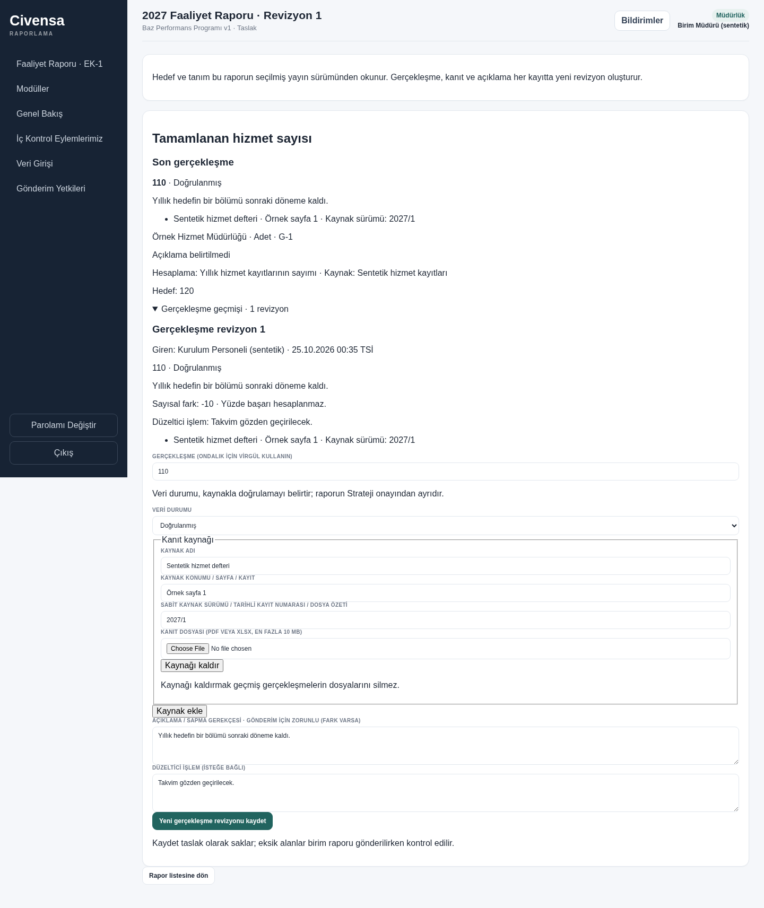

**Görünen metinler ve tablolar:**

- `div`: Civensa RAPORLAMA
- `h1`: 2027 Faaliyet Raporu · Revizyon 1
- `p`: Baz Performans Programı v1 · Taslak
- `div`: Müdürlük Birim Müdürü (sentetik)
- `p`: Hedef ve tanım bu raporun seçilmiş yayın sürümünden okunur. Gerçekleşme, kanıt ve açıklama her kayıtta yeni revizyon oluşturur.
- `h2`: Tamamlanan hizmet sayısı
- `h3`: Son gerçekleşme
- `p`: 110 · Doğrulanmış
- `p`: Yıllık hedefin bir bölümü sonraki döneme kaldı.
- `p`: Örnek Hizmet Müdürlüğü · Adet · G-1
- `p`: Açıklama belirtilmedi
- `p`: Hesaplama: Yıllık hizmet kayıtlarının sayımı · Kaynak: Sentetik hizmet kayıtları
- `p`: Hedef: 120
- `h3`: Gerçekleşme revizyon 1
- `p`: Giren: Kurulum Personeli (sentetik) · 25.10.2026 00:35 TSİ
- `p`: 110 · Doğrulanmış
- `p`: Yıllık hedefin bir bölümü sonraki döneme kaldı.
- `p`: Sayısal fark: -10 · Yüzde başarı hesaplanmaz.
- `p`: Düzeltici işlem: Takvim gözden geçirilecek.
- `p`: Veri durumu, kaynakla doğrulamayı belirtir; raporun Strateji onayından ayrıdır.
- `p`: Kaynağı kaldırmak geçmiş gerçekleşmelerin dosyalarını silmez.
- `p`: Kaydet taslak olarak saklar; eksik alanlar birim raporu gönderilirken kontrol edilir.
- `li`: Sentetik hizmet defteri · Örnek sayfa 1 · Kaynak sürümü: 2027/1
- `li`: Sentetik hizmet defteri · Örnek sayfa 1 · Kaynak sürümü: 2027/1
- `legend`: Kanıt kaynağı

**Bağlantı, düğme, form ve alanlar:**

| Öğe | Tür / etiket / bağlam | Hedef URL veya eylem | Ne yapar / mevcut değer |
| --- | --- | --- | --- |
| E001 | a · Faaliyet Raporu · EK-1 | `/activity-sections` | Bağlantıdaki ekranı veya dosyayı açar: Faaliyet Raporu · EK-1. |
| E002 | a · Modüller | `/modules` | Bağlantıdaki ekranı veya dosyayı açar: Modüller. |
| E003 | a · Genel Bakış | `/dashboard` | Bağlantıdaki ekranı veya dosyayı açar: Genel Bakış. |
| E004 | a · İç Kontrol Eylemlerimiz | `/internal-control/our-actions` | Bağlantıdaki ekranı veya dosyayı açar: İç Kontrol Eylemlerimiz. |
| E005 | a · Veri Girişi | `/department/1` | Bağlantıdaki ekranı veya dosyayı açar: Veri Girişi. |
| E006 | a · Gönderim Yetkileri | `/submit-authorizations` | Bağlantıdaki ekranı veya dosyayı açar: Gönderim Yetkileri. |
| E007 | button · Parolamı Değiştir (#changePasswordButton) | `#passwordModal` | Parola değiştirme penceresini açar. |
| E008 | form · Çıkış | `POST /logout` | Oturumu kapatıp giriş ekranına döner. |
| E009 | button · Çıkış | `POST /logout` | Oturumu kapatıp giriş ekranına döner. |
| E010 | button · Bildirimler (#notificationButton) | `GET /api/notifications → #notificationPanel` | Bildirim listesini açar. |
| E011 | summary · Gerçekleşme geçmişi · 1 revizyon · Gerçekleşme geçmişi · 1 revizyon | `Aynı sayfadaki ayrıntı bölümü` | İçerik ve form ayrıntılarını açar veya daraltır. |
| E012 | form · Kaynağı kaldır / Kaynak ekle / Yeni gerçekleşme revizyonu kaydet · Tamamlanan hizmet sayısı | `POST /activity-reports/indicators/1/actuals` | Kaynağı kaldır / Kaynak ekle / Yeni gerçekleşme revizyonu kaydet işlemini form alanlarıyla gönderir; doğrulama sonrası kaydeder veya hata gösterir. |
| E013 | input · GERÇEKLEŞME (ONDALIK İÇİN VİRGÜL KULLANIN) · Tamamlanan hizmet sayısı | `POST /activity-reports/indicators/1/actuals` | İşlem için GERÇEKLEŞME (ONDALIK İÇİN VİRGÜL KULLANIN) değerini girer. Değer: 110. |
| E014 | select · VERİ DURUMU Doğrulanmış İncelenmeli Eksik · Tamamlanan hizmet sayısı | `POST /activity-reports/indicators/1/actuals` | Listeden seçim yapar. Değer: verified. Seçenekler: Doğrulanmış; İncelenmeli; Eksik. |
| E015 | input · KAYNAK ADI · Tamamlanan hizmet sayısı | `POST /activity-reports/indicators/1/actuals` | İşlem için KAYNAK ADI değerini girer. Değer: Sentetik hizmet defteri. |
| E016 | input · KAYNAK KONUMU / SAYFA / KAYIT · Tamamlanan hizmet sayısı | `POST /activity-reports/indicators/1/actuals` | İşlem için KAYNAK KONUMU / SAYFA / KAYIT değerini girer. Değer: Örnek sayfa 1. |
| E017 | input · SABİT KAYNAK SÜRÜMÜ / TARİHLİ KAYIT NUMARASI / DOSYA ÖZETİ · Tamamlanan hizmet sayısı | `POST /activity-reports/indicators/1/actuals` | İşlem için SABİT KAYNAK SÜRÜMÜ / TARİHLİ KAYIT NUMARASI / DOSYA ÖZETİ değerini girer. Değer: 2027/1. |
| E018 | input · KANIT DOSYASI (PDF VEYA XLSX, EN FAZLA 10 MB) · Tamamlanan hizmet sayısı | `POST /activity-reports/indicators/1/actuals` | Dosya seçer; ilgili işlemle yüklenir. |
| E019 | button · Kaynağı kaldır · Tamamlanan hizmet sayısı | `Aynı gerçekleşme formu` | Kanıt satırını formdan kaldırır; kayıt gönderildiğinde uygulanır. |
| E020 | button · Kaynak ekle · Tamamlanan hizmet sayısı | `Aynı gerçekleşme formu` | Yeni kanıt kaynak satırı ekler. |
| E021 | textarea · AÇIKLAMA / SAPMA GEREKÇESİ · GÖNDERİM İÇİN ZORUNLU (FARK VARSA) · Tamamlanan hizmet sayısı | `POST /activity-reports/indicators/1/actuals` | İşlem için AÇIKLAMA / SAPMA GEREKÇESİ · GÖNDERİM İÇİN ZORUNLU (FARK VARSA) değerini girer. Değer: Yıllık hedefin bir bölümü sonraki döneme kaldı.. |
| E022 | textarea · DÜZELTİCİ İŞLEM (İSTEĞE BAĞLI) · Tamamlanan hizmet sayısı | `POST /activity-reports/indicators/1/actuals` | İşlem için DÜZELTİCİ İŞLEM (İSTEĞE BAĞLI) değerini girer. Değer: Takvim gözden geçirilecek.. |
| E023 | button · Yeni gerçekleşme revizyonu kaydet · Tamamlanan hizmet sayısı | `POST /activity-reports/indicators/1/actuals` | Yeni gerçekleşme revizyonu kaydet işlemini form alanlarıyla gönderir; doğrulama sonrası kaydeder veya hata gösterir. |
| E024 | a · Rapor listesine dön | `/activity-reports` | Bağlantıdaki ekranı veya dosyayı açar: Rapor listesine dön. |

<a id="ekran-009"></a>

### 009 · Faaliyet Raporu · EK-1 · Dolu / taslak

URL kalıbı: `/activity-sections` · Çekilen URL: `/activity-sections` · Rol: **strategy** · HTTP 200.

İdare ve birim raporlarının bölüm ve onay durumlarını listeler.

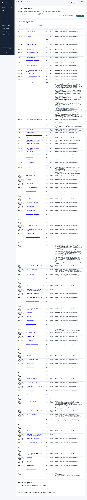

**Görünen metinler ve tablolar:**

- `div`: Civensa RAPORLAMA
- `h1`: Faaliyet Raporu · EK-1
- `p`: Birim ve idare raporları · Bölümler, sahipler ve eksikler
- `div`: Strateji Geliştirme Strateji Müdürü (sentetik)
- `h2`: Yıl raporlarını oluştur
- `p`: Kapsamdaki müdürlüklere birer birim raporu ve kuruma bir idare raporu açılır. Mevcut kayıtlar korunur.
- `h2`: Tamamlanma görünümü
- `table`: YIL / RAPOR BÖLÜM DURUM SAHİBİ EKSİKLER 2027 · İdare SUNUS · ÜST YÖNETİCİ SUNUŞU Boş Strateji Bölüm içeriğini gözden geçirip Hazır veya gerekçeli Uygulanamaz seçin. 2027 · İdare OZET · YÖNETİCİ ÖZETİ Boş Strateji Bölüm içeriğini gözden geçirip Hazır veya gerekçeli Uygulanamaz seçin. 2027 · İdare I · I- GENEL BİLGİLER Boş Strateji Bölüm içeriğini gözden geçirip Hazır veya gerekçeli Uygulanamaz seçin. 2027 · İdare I.A · A- Misyon ve Vizyon Taslak Strateji Bölüm içeriğini gözden geçirip Hazır veya gerekçeli Uygulanamaz seçin. 2027 · İdare I.B · B- Yetki, Görev ve Sorumluluklar Boş Strateji Bölüm içeriğini gözden geçirip Hazır veya gerekçeli Uygulanamaz seçin. 2027 · İdare I.C · C- İdareye İlişkin Bilgiler Boş Strateji Bölüm içeriğini gözden geçirip Hazır veya gerekçeli Uygulanamaz seçin. 2027 · İdare I.C.1 · 1- Fiziksel Yapı Boş Strateji Bölüm içeriğini gözden geçirip Hazır veya gerekçeli Uygulanamaz seçin. 2027 · İdare I.C.2 · 2- Teşkilat Yapısı Boş Strateji Bölüm içeriğini gözden geçirip Hazır veya gerekçeli Uygulanamaz seçin. 2027 · İdare I.C.3 · 3- Teknoloji ve Bilişim Altyapısı Boş Strateji Bölüm içeriğini gözden geçirip Hazır veya gerekçeli Uygulanamaz seçin. 2027 · İdare I.C.4 · 4- İnsan Kaynakları Boş Strateji Bölüm içeriğini gözden geçirip Hazır veya gerekçeli Uygulanamaz seçin. 2027 · İdare I.C.5 · 5- Sunulan Hizmetler Boş Strateji Bölüm içeriğini gözden geçirip Hazır veya gerekçeli Uygulanamaz seçin. 2027 · İdare I.C.6 · 6- Yönetim ve İç Kontrol Sistemi Boş Strateji Bölüm içeriğini gözden geçirip Hazır veya gerekçeli Uygulanamaz seçin. 2027 · İdare I.D · D- Diğer Hususlar Boş Strateji Bölüm içeriğini gözden geçirip Hazır veya gerekçeli Uygulanamaz seçin. 2027 · İdare II · II- AMAÇLAR ve HEDEFLER Boş Strateji Bölüm içeriğini gözden geçirip Hazır veya gerekçeli Uygulanamaz seçin. 2027 · İdare II.A · A- Temel Politika ve Öncelikler Boş Strateji Bölüm içeriğini gözden geçirip Hazır veya gerekçeli Uygulanamaz seçin. 2027 · İdare II.B · B- İdarenin Stratejik Planında Yer Alan Amaç ve Hedefler Boş Strateji Bölüm içeriğini gözden geçirip Hazır veya gerekçeli Uygulanamaz seçin. 2027 · İdare II.C · C- Diğer Hususlar Boş Strateji Bölüm içeriğini gözden geçirip Hazır veya gerekçeli Uygulanamaz seçin. 2027 · İdare III · III- FAALİYETLERE İLİŞKİN BİLGİ VE DEĞERLENDİRMELER Boş Strateji Bölüm içeriğini gözden geçirip Hazır veya gerekçeli Uygulanamaz seçin. 2027 · İdare III.A · A- Malî Bilgiler Boş Mali Hizmetler Bölüm içeriğini gözden geçirip Hazır veya gerekçeli Uygulanamaz seçin. 2027 · İdare III.A.1 · 1- Bütçe Uygulama Sonuçları Taslak Mali Hizmetler Bölüm içeriğini gözden geçirip Hazır veya gerekçeli Uygulanamaz seçin. Örnek Destek Müdürlüğü: Ekonomik kod gider satırları eksik. Mali Hizmetler ilgili müdürlüğün tutarlarını girmeli; gerçek tutar sıfırsa 0 kullanılmalı. Örnek Hizmet Müdürlüğü: Program / alt program gider satırları eksik. Mali Hizmetler ilgili müdürlüğün tutarlarını girmeli; gerçek tutar sıfırsa 0 kullanılmalı. Örnek Destek Müdürlüğü: Program / alt program gider satırları eksik. Mali Hizmetler ilgili müdürlüğün tutarlarını girmeli; gerçek tutar sıfırsa 0 kullanılmalı. Program / alt program gider tablosu boş. Mali Hizmetler verileri geldiğinde giriş veya XLSX içe aktarma yapın. Gelir tablosu boş. Gelir ekonomik kodlarına göre tahmin ve tahsilatı girin. Örnek Hizmet Müdürlüğü, Başlangıç Ödeneği: ekonomik kod toplamı 12.500,23, program toplamı —. Boş değerler nedeniyle karşılaştırma tamamlanamadı; eksik tutarları girin. Örnek Hizmet Müdürlüğü, Eklenen Ödenek: ekonomik kod toplamı 100, program toplamı —. Boş değerler nedeniyle karşılaştırma tamamlanamadı; eksik tutarları girin. Örnek Hizmet Müdürlüğü, Düşülen Ödenek: ekonomik kod toplamı 50, program toplamı —. Boş değerler nedeniyle karşılaştırma tamamlanamadı; eksik tutarları girin. Örnek Hizmet Müdürlüğü, Harcama (Gerçekleşme): ekonomik kod toplamı 10.000, program toplamı —. Boş değerler nedeniyle karşılaştırma tamamlanamadı; eksik tutarları girin. Örnek Hizmet Müdürlüğü, İptal Edilen Ödenek: ekonomik kod toplamı 0, program toplamı —. Boş değerler nedeniyle karşılaştırma tamamlanamadı; eksik tutarları girin. Örnek Hizmet Müdürlüğü, Ertesi Yıla Devreden Ödenek: ekonomik kod toplamı 0, program toplamı —. Boş değerler nedeniyle karşılaştırma tamamlanamadı; eksik tutarları girin. Örnek Hizmet Müdürlüğü, Yıl Sonu Ödeneği: ekonomik kod toplamı 12.550,23, program toplamı —. Boş değerler nedeniyle karşılaştırma tamamlanamadı; eksik tutarları girin. İdare, Başlangıç Ödeneği: ekonomik kod toplamı 12.500,23, program toplamı —. Boş değerler nedeniyle karşılaştırma tamamlanamadı; eksik tutarları girin. İdare, Eklenen Ödenek: ekonomik kod toplamı 100, program toplamı —. Boş değerler nedeniyle karşılaştırma tamamlanamadı; eksik tutarları girin. İdare, Düşülen Ödenek: ekonomik kod toplamı 50, program toplamı —. Boş değerler nedeniyle karşılaştırma tamamlanamadı; eksik tutarları girin. İdare, Harcama (Gerçekleşme): ekonomik kod toplamı 10.000, program toplamı —. Boş değerler nedeniyle karşılaştırma tamamlanamadı; eksik tutarları girin. İdare, İptal Edilen Ödenek: ekonomik kod toplamı 0, program toplamı —. Boş değerler nedeniyle karşılaştırma tamamlanamadı; eksik tutarları girin. İdare, Ertesi Yıla Devreden Ödenek: ekonomik kod toplamı 0, program toplamı —. Boş değerler nedeniyle karşılaştırma tamamlanamadı; eksik tutarları girin. İdare, Yıl Sonu Ödeneği: ekonomik kod toplamı 12.550,23, program toplamı —. Boş değerler nedeniyle karşılaştırma tamamlanamadı; eksik tutarları girin. 2027 · İdare III.A.2 · 2- Temel Malî Tablolara İlişkin Açıklamalar Boş Mali Hizmetler Bölüm içeriğini gözden geçirip Hazır veya gerekçeli Uygulanamaz seçin. Bilanço: dosya, Açıklamalar, dönem / tarih eksik. Tablo kaydını tamamlayın. Faaliyet Sonuçları Tablosu: dosya, Açıklamalar, dönem / tarih eksik. Tablo kaydını tamamlayın. Varlık ve yükümlülük özetini girin veya bölümde gerekçeli Uygulanamaz seçin. 2027 · İdare III.A.3 · 3- Malî Denetim Sonuçları Boş Mali Hizmetler Bölüm içeriğini gözden geçirip Hazır veya gerekçeli Uygulanamaz seçin. iç denetim: Denetim kaydı girin veya bölümün uygulanamaz gerekçesini yazın. dış denetim (Sayıştay): Denetim kaydı girin veya bölümün uygulanamaz gerekçesini yazın. 2027 · İdare III.A.4 · 4- Diğer Hususlar Boş Mali Hizmetler Bölüm içeriğini gözden geçirip Hazır veya gerekçeli Uygulanamaz seçin. Yardım yapılan kuruluşları girin; yardım yoksa Uygulanamaz seçip gerekçe yazın. 2027 · İdare III.B · B- Performans Bilgileri Boş Strateji Bölüm içeriğini gözden geçirip Hazır veya gerekçeli Uygulanamaz seçin. 2027 · İdare III.B.1 · 1- Program, Alt Program, Faaliyet Bilgileri Boş Strateji Bölüm içeriğini gözden geçirip Hazır veya gerekçeli Uygulanamaz seçin. 2027 · İdare III.B.2 · 2- Performans Sonuçlarının Değerlendirilmesi Boş Strateji Bölüm içeriğini gözden geçirip Hazır veya gerekçeli Uygulanamaz seçin. 2027 · İdare III.B.2.i · i. Alt program hedef ve göstergeleriyle ilgili gerçekleşme sonuçları ve değerlendirmeler Boş Strateji Gösterge sonuçları onaylı birim sürümlerinden alınır. Eksik birimlerin onayını tamamlayın. 2027 · İdare III.B.2.ii · ii. Performans denetim sonuçları Boş Strateji Bölüm içeriğini gözden geçirip Hazır veya gerekçeli Uygulanamaz seçin. 2027 · İdare III.B.3 · 3- Stratejik Plan Değerlendirme Tabloları Boş Strateji Bölüm içeriğini gözden geçirip Hazır veya gerekçeli Uygulanamaz seçin. 2027 · İdare III.B.4 · 4- Performans Bilgi Sisteminin Değerlendirilmesi Boş Strateji Bölüm içeriğini gözden geçirip Hazır veya gerekçeli Uygulanamaz seçin. 2027 · İdare III.B.5 · 5- Diğer Hususlar Boş Strateji Bölüm içeriğini gözden geçirip Hazır veya gerekçeli Uygulanamaz seçin. 2027 · İdare IV · IV- KURUMSAL KABİLİYET VE KAPASİTENİN DEĞERLENDİRİLMESİ Boş Strateji Bölüm içeriğini gözden geçirip Hazır veya gerekçeli Uygulanamaz seçin. 2027 · İdare IV.A · A- Üstünlükler Boş Strateji Bölüm içeriğini gözden geçirip Hazır veya gerekçeli Uygulanamaz seçin. 2027 · İdare IV.B · B- Zayıflıklar Boş Strateji Bölüm içeriğini gözden geçirip Hazır veya gerekçeli Uygulanamaz seçin. 2027 · İdare IV.C · C- Değerlendirme Boş Strateji Bölüm içeriğini gözden geçirip Hazır veya gerekçeli Uygulanamaz seçin. 2027 · İdare V · V- ÖNERİ VE TEDBİRLER Boş Strateji Bölüm içeriğini gözden geçirip Hazır veya gerekçeli Uygulanamaz seçin. 2027 · İdare EKLER · EKLER Boş Strateji EK-1: Beyan henüz yerleştirilmedi. Yetkili birim beyan alanlarını kaydetmelidir. EK-1: Yer alanını doldurun. EK-1: Beyan tarihini doldurun. EK-1: İmzalayanın Ad-Soyad, Ünvan ve rapor yılındaki görev dönemlerini girin. EK-3: Beyan henüz yerleştirilmedi. Yetkili birim beyan alanlarını kaydetmelidir. EK-3: Yer alanını doldurun. EK-3: Beyan tarihini doldurun. EK-3: İmzalayanın Ad-Soyad, Ünvan ve rapor yılındaki görev dönemlerini girin. 2027 · Örnek Hizmet Müdürlüğü Taslak OZET · YÖNETİCİ ÖZETİ Boş Müdürlük Bölüm içeriğini gözden geçirip Hazır veya gerekçeli Uygulanamaz seçin. 2027 · Örnek Hizmet Müdürlüğü Taslak I · I- GENEL BİLGİLER Boş Müdürlük Bölüm içeriğini gözden geçirip Hazır veya gerekçeli Uygulanamaz seçin. 2027 · Örnek Hizmet Müdürlüğü Taslak I.A · A- Misyon ve Vizyon Taslak Müdürlük Bölüm içeriğini gözden geçirip Hazır veya gerekçeli Uygulanamaz seçin. 2027 · Örnek Hizmet Müdürlüğü Taslak I.B · B- Yetki, Görev ve Sorumluluklar Boş Müdürlük Bölüm içeriğini gözden geçirip Hazır veya gerekçeli Uygulanamaz seçin. 2027 · Örnek Hizmet Müdürlüğü Taslak I.C · C- İdareye İlişkin Bilgiler Boş Müdürlük Bölüm içeriğini gözden geçirip Hazır veya gerekçeli Uygulanamaz seçin. 2027 · Örnek Hizmet Müdürlüğü Taslak I.C.1 · 1- Fiziksel Yapı Taslak Müdürlük Bölüm içeriğini gözden geçirip Hazır veya gerekçeli Uygulanamaz seçin. 2027 · Örnek Hizmet Müdürlüğü Taslak I.C.2 · 2- Teşkilat Yapısı Boş Müdürlük Bölüm içeriğini gözden geçirip Hazır veya gerekçeli Uygulanamaz seçin. 2027 · Örnek Hizmet Müdürlüğü Taslak I.C.3 · 3- Teknoloji ve Bilişim Altyapısı Boş Müdürlük Bölüm içeriğini gözden geçirip Hazır veya gerekçeli Uygulanamaz seçin. 2027 · Örnek Hizmet Müdürlüğü Taslak I.C.4 · 4- İnsan Kaynakları Boş Müdürlük Bölüm içeriğini gözden geçirip Hazır veya gerekçeli Uygulanamaz seçin. 2027 · Örnek Hizmet Müdürlüğü Taslak I.C.5 · 5- Sunulan Hizmetler Boş Müdürlük Bölüm içeriğini gözden geçirip Hazır veya gerekçeli Uygulanamaz seçin. 2027 · Örnek Hizmet Müdürlüğü Taslak I.C.6 · 6- Yönetim ve İç Kontrol Sistemi Boş Müdürlük Bölüm içeriğini gözden geçirip Hazır veya gerekçeli Uygulanamaz seçin. 2027 · Örnek Hizmet Müdürlüğü Taslak I.D · D- Diğer Hususlar Boş Müdürlük Bölüm içeriğini gözden geçirip Hazır veya gerekçeli Uygulanamaz seçin. 2027 · Örnek Hizmet Müdürlüğü Taslak II · II- AMAÇLAR ve HEDEFLER Boş Müdürlük Bölüm içeriğini gözden geçirip Hazır veya gerekçeli Uygulanamaz seçin. 2027 · Örnek Hizmet Müdürlüğü Taslak II.A · A- Temel Politika ve Öncelikler Boş Müdürlük Bölüm içeriğini gözden geçirip Hazır veya gerekçeli Uygulanamaz seçin. 2027 · Örnek Hizmet Müdürlüğü Taslak II.B · B- İdarenin Stratejik Planında Yer Alan Amaç ve Hedefler Boş Müdürlük Bölüm içeriğini gözden geçirip Hazır veya gerekçeli Uygulanamaz seçin. 2027 · Örnek Hizmet Müdürlüğü Taslak II.C · C- Diğer Hususlar Boş Müdürlük Bölüm içeriğini gözden geçirip Hazır veya gerekçeli Uygulanamaz seçin. 2027 · Örnek Hizmet Müdürlüğü Taslak III · III- FAALİYETLERE İLİŞKİN BİLGİ VE DEĞERLENDİRMELER Boş Müdürlük Bölüm içeriğini gözden geçirip Hazır veya gerekçeli Uygulanamaz seçin. 2027 · Örnek Hizmet Müdürlüğü Taslak III.A · A- Malî Bilgiler Boş Mali Hizmetler Bölüm içeriğini gözden geçirip Hazır veya gerekçeli Uygulanamaz seçin. 2027 · Örnek Hizmet Müdürlüğü Taslak III.A.1 · 1- Bütçe Uygulama Sonuçları Boş Mali Hizmetler Bölüm içeriğini gözden geçirip Hazır veya gerekçeli Uygulanamaz seçin. Örnek Hizmet Müdürlüğü: Program / alt program gider satırları eksik. Mali Hizmetler ilgili müdürlüğün tutarlarını girmeli; gerçek tutar sıfırsa 0 kullanılmalı. Program / alt program gider tablosu boş. Mali Hizmetler verileri geldiğinde giriş veya XLSX içe aktarma yapın. Örnek Hizmet Müdürlüğü, Başlangıç Ödeneği: ekonomik kod toplamı 12.500,23, program toplamı —. Boş değerler nedeniyle karşılaştırma tamamlanamadı; eksik tutarları girin. Örnek Hizmet Müdürlüğü, Eklenen Ödenek: ekonomik kod toplamı 100, program toplamı —. Boş değerler nedeniyle karşılaştırma tamamlanamadı; eksik tutarları girin. Örnek Hizmet Müdürlüğü, Düşülen Ödenek: ekonomik kod toplamı 50, program toplamı —. Boş değerler nedeniyle karşılaştırma tamamlanamadı; eksik tutarları girin. Örnek Hizmet Müdürlüğü, Harcama (Gerçekleşme): ekonomik kod toplamı 10.000, program toplamı —. Boş değerler nedeniyle karşılaştırma tamamlanamadı; eksik tutarları girin. Örnek Hizmet Müdürlüğü, İptal Edilen Ödenek: ekonomik kod toplamı 0, program toplamı —. Boş değerler nedeniyle karşılaştırma tamamlanamadı; eksik tutarları girin. Örnek Hizmet Müdürlüğü, Ertesi Yıla Devreden Ödenek: ekonomik kod toplamı 0, program toplamı —. Boş değerler nedeniyle karşılaştırma tamamlanamadı; eksik tutarları girin. Örnek Hizmet Müdürlüğü, Yıl Sonu Ödeneği: ekonomik kod toplamı 12.550,23, program toplamı —. Boş değerler nedeniyle karşılaştırma tamamlanamadı; eksik tutarları girin. 2027 · Örnek Hizmet Müdürlüğü Taslak III.A.2 · 2- Temel Malî Tablolara İlişkin Açıklamalar Boş Mali Hizmetler Bölüm içeriğini gözden geçirip Hazır veya gerekçeli Uygulanamaz seçin. 2027 · Örnek Hizmet Müdürlüğü Taslak III.A.3 · 3- Malî Denetim Sonuçları Boş Müdürlük Bölüm içeriğini gözden geçirip Hazır veya gerekçeli Uygulanamaz seçin. iç denetim: Denetim kaydı girin veya bölümün uygulanamaz gerekçesini yazın. dış denetim (Sayıştay): Denetim kaydı girin veya bölümün uygulanamaz gerekçesini yazın. 2027 · Örnek Hizmet Müdürlüğü Taslak III.A.4 · 4- Diğer Hususlar Boş Müdürlük Bölüm içeriğini gözden geçirip Hazır veya gerekçeli Uygulanamaz seçin. Yardım yapılan kuruluşları girin; yardım yoksa Uygulanamaz seçip gerekçe yazın. 2027 · Örnek Hizmet Müdürlüğü Taslak III.B · B- Performans Bilgileri Boş Müdürlük Bölüm içeriğini gözden geçirip Hazır veya gerekçeli Uygulanamaz seçin. 2027 · Örnek Hizmet Müdürlüğü Taslak III.B.1 · 1- Program, Alt Program, Faaliyet Bilgileri Boş Müdürlük Bölüm içeriğini gözden geçirip Hazır veya gerekçeli Uygulanamaz seçin. 2027 · Örnek Hizmet Müdürlüğü Taslak III.B.2 · 2- Performans Sonuçlarının Değerlendirilmesi Boş Müdürlük Bölüm içeriğini gözden geçirip Hazır veya gerekçeli Uygulanamaz seçin. 2027 · Örnek Hizmet Müdürlüğü Taslak III.B.2.i · i. Alt program hedef ve göstergeleriyle ilgili gerçekleşme sonuçları ve değerlendirmeler Hazır Müdürlük — 2027 · Örnek Hizmet Müdürlüğü Taslak III.B.2.ii · ii. Performans denetim sonuçları Boş Müdürlük Bölüm içeriğini gözden geçirip Hazır veya gerekçeli Uygulanamaz seçin. 2027 · Örnek Hizmet Müdürlüğü Taslak III.B.3 · 3- Stratejik Plan Değerlendirme Tabloları Boş Müdürlük Bölüm içeriğini gözden geçirip Hazır veya gerekçeli Uygulanamaz seçin. 2027 · Örnek Hizmet Müdürlüğü Taslak III.B.4 · 4- Performans Bilgi Sisteminin Değerlendirilmesi Boş Müdürlük Bölüm içeriğini gözden geçirip Hazır veya gerekçeli Uygulanamaz seçin. 2027 · Örnek Hizmet Müdürlüğü Taslak III.B.5 · 5- Diğer Hususlar Boş Müdürlük Bölüm içeriğini gözden geçirip Hazır veya gerekçeli Uygulanamaz seçin. 2027 · Örnek Hizmet Müdürlüğü Taslak IV · IV- KURUMSAL KABİLİYET VE KAPASİTENİN DEĞERLENDİRİLMESİ Boş Müdürlük Bölüm içeriğini gözden geçirip Hazır veya gerekçeli Uygulanamaz seçin. 2027 · Örnek Hizmet Müdürlüğü Taslak IV.A · A- Üstünlükler Boş Müdürlük Bölüm içeriğini gözden geçirip Hazır veya gerekçeli Uygulanamaz seçin. 2027 · Örnek Hizmet Müdürlüğü Taslak IV.B · B- Zayıflıklar Boş Müdürlük Bölüm içeriğini gözden geçirip Hazır veya gerekçeli Uygulanamaz seçin. 2027 · Örnek Hizmet Müdürlüğü Taslak IV.C · C- Değerlendirme Boş Müdürlük Bölüm içeriğini gözden geçirip Hazır veya gerekçeli Uygulanamaz seçin. 2027 · Örnek Hizmet Müdürlüğü Taslak V · V- ÖNERİ VE TEDBİRLER Boş Müdürlük Bölüm içeriğini gözden geçirip Hazır veya gerekçeli Uygulanamaz seçin. 2027 · Örnek Hizmet Müdürlüğü Taslak EKLER · EKLER Boş Müdürlük EK-2: Beyan henüz yerleştirilmedi. Yetkili birim beyan alanlarını kaydetmelidir. EK-2: Yer alanını doldurun. EK-2: Beyan tarihini doldurun. EK-2: İmzalayanın Ad-Soyad, Ünvan ve rapor yılındaki görev dönemlerini girin. 2027 · Örnek Destek Müdürlüğü Taslak OZET · YÖNETİCİ ÖZETİ Boş Müdürlük Bölüm içeriğini gözden geçirip Hazır veya gerekçeli Uygulanamaz seçin. 2027 · Örnek Destek Müdürlüğü Taslak I · I- GENEL BİLGİLER Boş Müdürlük Bölüm içeriğini gözden geçirip Hazır veya gerekçeli Uygulanamaz seçin. 2027 · Örnek Destek Müdürlüğü Taslak I.A · A- Misyon ve Vizyon Boş Müdürlük Bölüm içeriğini gözden geçirip Hazır veya gerekçeli Uygulanamaz seçin. 2027 · Örnek Destek Müdürlüğü Taslak I.B · B- Yetki, Görev ve Sorumluluklar Boş Müdürlük Bölüm içeriğini gözden geçirip Hazır veya gerekçeli Uygulanamaz seçin. 2027 · Örnek Destek Müdürlüğü Taslak I.C · C- İdareye İlişkin Bilgiler Boş Müdürlük Bölüm içeriğini gözden geçirip Hazır veya gerekçeli Uygulanamaz seçin. 2027 · Örnek Destek Müdürlüğü Taslak I.C.1 · 1- Fiziksel Yapı Boş Müdürlük Bölüm içeriğini gözden geçirip Hazır veya gerekçeli Uygulanamaz seçin. 2027 · Örnek Destek Müdürlüğü Taslak I.C.2 · 2- Teşkilat Yapısı Boş Müdürlük Bölüm içeriğini gözden geçirip Hazır veya gerekçeli Uygulanamaz seçin. 2027 · Örnek Destek Müdürlüğü Taslak I.C.3 · 3- Teknoloji ve Bilişim Altyapısı Boş Müdürlük Bölüm içeriğini gözden geçirip Hazır veya gerekçeli Uygulanamaz seçin. 2027 · Örnek Destek Müdürlüğü Taslak I.C.4 · 4- İnsan Kaynakları Boş Müdürlük Bölüm içeriğini gözden geçirip Hazır veya gerekçeli Uygulanamaz seçin. 2027 · Örnek Destek Müdürlüğü Taslak I.C.5 · 5- Sunulan Hizmetler Boş Müdürlük Bölüm içeriğini gözden geçirip Hazır veya gerekçeli Uygulanamaz seçin. 2027 · Örnek Destek Müdürlüğü Taslak I.C.6 · 6- Yönetim ve İç Kontrol Sistemi Boş Müdürlük Bölüm içeriğini gözden geçirip Hazır veya gerekçeli Uygulanamaz seçin. 2027 · Örnek Destek Müdürlüğü Taslak I.D · D- Diğer Hususlar Boş Müdürlük Bölüm içeriğini gözden geçirip Hazır veya gerekçeli Uygulanamaz seçin. 2027 · Örnek Destek Müdürlüğü Taslak II · II- AMAÇLAR ve HEDEFLER Boş Müdürlük Bölüm içeriğini gözden geçirip Hazır veya gerekçeli Uygulanamaz seçin. 2027 · Örnek Destek Müdürlüğü Taslak II.A · A- Temel Politika ve Öncelikler Boş Müdürlük Bölüm içeriğini gözden geçirip Hazır veya gerekçeli Uygulanamaz seçin. 2027 · Örnek Destek Müdürlüğü Taslak II.B · B- İdarenin Stratejik Planında Yer Alan Amaç ve Hedefler Boş Müdürlük Bölüm içeriğini gözden geçirip Hazır veya gerekçeli Uygulanamaz seçin. 2027 · Örnek Destek Müdürlüğü Taslak II.C · C- Diğer Hususlar Boş Müdürlük Bölüm içeriğini gözden geçirip Hazır veya gerekçeli Uygulanamaz seçin. 2027 · Örnek Destek Müdürlüğü Taslak III · III- FAALİYETLERE İLİŞKİN BİLGİ VE DEĞERLENDİRMELER Boş Müdürlük Bölüm içeriğini gözden geçirip Hazır veya gerekçeli Uygulanamaz seçin. 2027 · Örnek Destek Müdürlüğü Taslak III.A · A- Malî Bilgiler Boş Mali Hizmetler Bölüm içeriğini gözden geçirip Hazır veya gerekçeli Uygulanamaz seçin. 2027 · Örnek Destek Müdürlüğü Taslak III.A.1 · 1- Bütçe Uygulama Sonuçları Boş Mali Hizmetler Bölüm içeriğini gözden geçirip Hazır veya gerekçeli Uygulanamaz seçin. Örnek Destek Müdürlüğü: Ekonomik kod gider satırları eksik. Mali Hizmetler ilgili müdürlüğün tutarlarını girmeli; gerçek tutar sıfırsa 0 kullanılmalı. Örnek Destek Müdürlüğü: Program / alt program gider satırları eksik. Mali Hizmetler ilgili müdürlüğün tutarlarını girmeli; gerçek tutar sıfırsa 0 kullanılmalı. Ekonomik kod gider tablosu boş. Mali Hizmetler verileri geldiğinde giriş veya XLSX içe aktarma yapın. Program / alt program gider tablosu boş. Mali Hizmetler verileri geldiğinde giriş veya XLSX içe aktarma yapın. 2027 · Örnek Destek Müdürlüğü Taslak III.A.2 · 2- Temel Malî Tablolara İlişkin Açıklamalar Boş Mali Hizmetler Bölüm içeriğini gözden geçirip Hazır veya gerekçeli Uygulanamaz seçin. 2027 · Örnek Destek Müdürlüğü Taslak III.A.3 · 3- Malî Denetim Sonuçları Boş Müdürlük Bölüm içeriğini gözden geçirip Hazır veya gerekçeli Uygulanamaz seçin. iç denetim: Denetim kaydı girin veya bölümün uygulanamaz gerekçesini yazın. dış denetim (Sayıştay): Denetim kaydı girin veya bölümün uygulanamaz gerekçesini yazın. 2027 · Örnek Destek Müdürlüğü Taslak III.A.4 · 4- Diğer Hususlar Boş Müdürlük Bölüm içeriğini gözden geçirip Hazır veya gerekçeli Uygulanamaz seçin. Yardım yapılan kuruluşları girin; yardım yoksa Uygulanamaz seçip gerekçe yazın. 2027 · Örnek Destek Müdürlüğü Taslak III.B · B- Performans Bilgileri Boş Müdürlük Bölüm içeriğini gözden geçirip Hazır veya gerekçeli Uygulanamaz seçin. 2027 · Örnek Destek Müdürlüğü Taslak III.B.1 · 1- Program, Alt Program, Faaliyet Bilgileri Boş Müdürlük Bölüm içeriğini gözden geçirip Hazır veya gerekçeli Uygulanamaz seçin. 2027 · Örnek Destek Müdürlüğü Taslak III.B.2 · 2- Performans Sonuçlarının Değerlendirilmesi Boş Müdürlük Bölüm içeriğini gözden geçirip Hazır veya gerekçeli Uygulanamaz seçin. 2027 · Örnek Destek Müdürlüğü Taslak III.B.2.i · i. Alt program hedef ve göstergeleriyle ilgili gerçekleşme sonuçları ve değerlendirmeler Hazır Müdürlük — 2027 · Örnek Destek Müdürlüğü Taslak III.B.2.ii · ii. Performans denetim sonuçları Boş Müdürlük Bölüm içeriğini gözden geçirip Hazır veya gerekçeli Uygulanamaz seçin. 2027 · Örnek Destek Müdürlüğü Taslak III.B.3 · 3- Stratejik Plan Değerlendirme Tabloları Boş Müdürlük Bölüm içeriğini gözden geçirip Hazır veya gerekçeli Uygulanamaz seçin. 2027 · Örnek Destek Müdürlüğü Taslak III.B.4 · 4- Performans Bilgi Sisteminin Değerlendirilmesi Boş Müdürlük Bölüm içeriğini gözden geçirip Hazır veya gerekçeli Uygulanamaz seçin. 2027 · Örnek Destek Müdürlüğü Taslak III.B.5 · 5- Diğer Hususlar Boş Müdürlük Bölüm içeriğini gözden geçirip Hazır veya gerekçeli Uygulanamaz seçin. 2027 · Örnek Destek Müdürlüğü Taslak IV · IV- KURUMSAL KABİLİYET VE KAPASİTENİN DEĞERLENDİRİLMESİ Boş Müdürlük Bölüm içeriğini gözden geçirip Hazır veya gerekçeli Uygulanamaz seçin. 2027 · Örnek Destek Müdürlüğü Taslak IV.A · A- Üstünlükler Boş Müdürlük Bölüm içeriğini gözden geçirip Hazır veya gerekçeli Uygulanamaz seçin. 2027 · Örnek Destek Müdürlüğü Taslak IV.B · B- Zayıflıklar Boş Müdürlük Bölüm içeriğini gözden geçirip Hazır veya gerekçeli Uygulanamaz seçin. 2027 · Örnek Destek Müdürlüğü Taslak IV.C · C- Değerlendirme Boş Müdürlük Bölüm içeriğini gözden geçirip Hazır veya gerekçeli Uygulanamaz seçin. 2027 · Örnek Destek Müdürlüğü Taslak V · V- ÖNERİ VE TEDBİRLER Boş Müdürlük Bölüm içeriğini gözden geçirip Hazır veya gerekçeli Uygulanamaz seçin. 2027 · Örnek Destek Müdürlüğü Taslak EKLER · EKLER Boş Müdürlük EK-2: Beyan henüz yerleştirilmedi. Yetkili birim beyan alanlarını kaydetmelidir. EK-2: Yer alanını doldurun. EK-2: Beyan tarihini doldurun. EK-2: İmzalayanın Ad-Soyad, Ünvan ve rapor yılındaki görev dönemlerini girin.
- `h2`: Word ve PDF çıktıları
- `p`: 2027 · İdare · Word olarak indir PDF olarak indir Dizgi verisi (JSON)
- `p`: 2027 · Örnek Hizmet Müdürlüğü · Word olarak indir PDF olarak indir Dizgi verisi (JSON)
- `p`: 2027 · Örnek Destek Müdürlüğü · Word olarak indir PDF olarak indir Dizgi verisi (JSON)

**Bağlantı, düğme, form ve alanlar:**

| Öğe | Tür / etiket / bağlam | Hedef URL veya eylem | Ne yapar / mevcut değer |
| --- | --- | --- | --- |
| E001 | a · Faaliyet Raporu · EK-1 | `/activity-sections` | Bağlantıdaki ekranı veya dosyayı açar: Faaliyet Raporu · EK-1. |
| E002 | a · Modüller | `/modules` | Bağlantıdaki ekranı veya dosyayı açar: Modüller. |
| E003 | a · Genel Bakış | `/dashboard` | Bağlantıdaki ekranı veya dosyayı açar: Genel Bakış. |
| E004 | a · Nihai Rapor | `/report-builder` | Bağlantıdaki ekranı veya dosyayı açar: Nihai Rapor. |
| E005 | a · İç Kontrol · Uyum Eylem Planı | `/internal-control` | Bağlantıdaki ekranı veya dosyayı açar: İç Kontrol · Uyum Eylem Planı. |
| E006 | a · Bütçe Aktarma | `/budget-reallocations` | Bağlantıdaki ekranı veya dosyayı açar: Bütçe Aktarma. |
| E007 | a · İnceleme Kuyruğu | `/review` | Bağlantıdaki ekranı veya dosyayı açar: İnceleme Kuyruğu. |
| E008 | a · Faaliyet Eşleştirme | `/activity-mapping` | Bağlantıdaki ekranı veya dosyayı açar: Faaliyet Eşleştirme. |
| E009 | a · Sistem Durumu | `/operations` | Bağlantıdaki ekranı veya dosyayı açar: Sistem Durumu. |
| E010 | a · Denetim Geçmişi | `/audit` | Bağlantıdaki ekranı veya dosyayı açar: Denetim Geçmişi. |
| E011 | a · Kurum Yapısı | `/structure` | Bağlantıdaki ekranı veya dosyayı açar: Kurum Yapısı. |
| E012 | a · Kullanıcılar | `/users` | Bağlantıdaki ekranı veya dosyayı açar: Kullanıcılar. |
| E013 | button · Parolamı Değiştir (#changePasswordButton) | `#passwordModal` | Parola değiştirme penceresini açar. |
| E014 | form · Çıkış | `POST /logout` | Oturumu kapatıp giriş ekranına döner. |
| E015 | button · Çıkış | `POST /logout` | Oturumu kapatıp giriş ekranına döner. |
| E016 | button · Bildirimler (#notificationButton) | `GET /api/notifications → #notificationPanel` | Bildirim listesini açar. |
| E017 | form · Raporları oluştur · Yıl raporlarını oluştur | `POST /activity-sections/years` | Raporları oluştur işlemini form alanlarıyla gönderir; doğrulama sonrası kaydeder veya hata gösterir. |
| E018 | select · KURUM Örnek Belediyesi (sentetik) · Yıl raporlarını oluştur | `POST /activity-sections/years` | Listeden seçim yapar. Değer: 1. Seçenekler: Örnek Belediyesi (sentetik). |
| E019 | select · RAPORLAMA YILI 2027 · Yıl raporlarını oluştur | `POST /activity-sections/years` | Listeden seçim yapar. Değer: 1. Seçenekler: 2027. |
| E020 | input · ÖNCEKİ YILIN ONAYLI KOPYASINDAN DOLDUR · Yıl raporlarını oluştur | `POST /activity-sections/years` | Seçeneği işaretler veya kaldırır. Değer: İşaretli değil. |
| E021 | button · Raporları oluştur · Yıl raporlarını oluştur | `POST /activity-sections/years` | Raporları oluştur işlemini form alanlarıyla gönderir; doğrulama sonrası kaydeder veya hata gösterir. |
| E022 | form · Filtrele · Tamamlanma görünümü | `GET /activity-sections` | Alanlarla listeyi veya rapor görünümünü filtreler. |
| E023 | select · YIL Tümü 2027 · Tamamlanma görünümü | `GET /activity-sections` | Listeden seçim yapar. Seçenekler: Tümü; 2027. |
| E024 | select · BÖLÜM Tüm bölümler SUNUS · ÜST YÖNETİCİ SUNUŞU OZET · YÖNETİCİ ÖZETİ I · I- GENEL BİLGİLER I.A · A- Misyon ve Vizyon I.B · B- Yetki, Görev ve Sorumluluklar I.C · C- İdareye İlişkin Bilgiler I.C.1 · 1- Fiziksel Yapı I.C.2 · 2- Teşkilat Yapısı I.C.3 · 3- Teknoloji ve Bilişim Altyapısı I.C.4 · 4- İnsan Kaynakları I.C.5 · 5- Sunulan Hizmetler I.C.6 · 6- Yönetim ve İç Kontrol Sistemi I.D · D- Diğer Hususlar II · II- AMAÇLAR ve HEDEFLER II.A · A- Temel Politika ve Öncelikler II.B · B- İdarenin Stratejik Planında Yer Alan Amaç ve Hedefler II.C · C- Diğer Hususlar III · III- FAALİYETLERE İLİŞKİN BİLGİ VE DEĞERLENDİRMELER III.A · A- Malî Bilgiler III.A.1 · 1- Bütçe Uygulama Sonuçları III.A.2 · 2- Temel Malî Tablolara İlişkin Açıklamalar III.A.3 · 3- Malî Denetim Sonuçları III.A.4 · 4- Diğer Hususlar III.B · B- Performans Bilgileri III.B.1 · 1- Program, Alt Program, Faaliyet Bilgileri III.B.2 · 2- Performans Sonuçlarının Değerlendirilmesi III.B.2.i · i. Alt program hedef ve göstergeleriyle ilgili gerçekleşme sonuçları ve değerlendirmeler III.B.2.ii · ii. Performans denetim sonuçları III.B.3 · 3- Stratejik Plan Değerlendirme Tabloları III.B.4 · 4- Performans Bilgi Sisteminin Değerlendirilmesi III.B.5 · 5- Diğer Hususlar IV · IV- KURUMSAL KABİLİYET VE KAPASİTENİN DEĞERLENDİRİLMESİ IV.A · A- Üstünlükler IV.B · B- Zayıflıklar IV.C · C- Değerlendirme V · V- ÖNERİ VE TEDBİRLER EKLER · EKLER · Tamamlanma görünümü | `GET /activity-sections` | Listeden seçim yapar. Seçenekler: Tüm bölümler; SUNUS · ÜST YÖNETİCİ SUNUŞU; OZET · YÖNETİCİ ÖZETİ; I · I- GENEL BİLGİLER; I.A · A- Misyon ve Vizyon; I.B · B- Yetki, Görev ve Sorumluluklar; I.C · C- İdareye İlişkin Bilgiler; I.C.1 · 1- Fiziksel Yapı; I.C.2 · 2- Teşkilat Yapısı; I.C.3 · 3- Teknoloji ve Bilişim Altyapısı; I.C.4 · 4- İnsan Kaynakları; I.C.5 · 5- Sunulan Hizmetler; I.C.6 · 6- Yönetim ve İç Kontrol Sistemi; I.D · D- Diğer Hususlar; II · II- AMAÇLAR ve HEDEFLER; II.A · A- Temel Politika ve Öncelikler; II.B · B- İdarenin Stratejik Planında Yer Alan Amaç ve Hedefler; II.C · C- Diğer Hususlar; III · III- FAALİYETLERE İLİŞKİN BİLGİ VE DEĞERLENDİRMELER; III.A · A- Malî Bilgiler; III.A.1 · 1- Bütçe Uygulama Sonuçları; III.A.2 · 2- Temel Malî Tablolara İlişkin Açıklamalar; III.A.3 · 3- Malî Denetim Sonuçları; III.A.4 · 4- Diğer Hususlar; III.B · B- Performans Bilgileri; III.B.1 · 1- Program, Alt Program, Faaliyet Bilgileri; III.B.2 · 2- Performans Sonuçlarının Değerlendirilmesi; III.B.2.i · i. Alt program hedef ve göstergeleriyle ilgili gerçekleşme sonuçları ve değerlendirmeler; III.B.2.ii · ii. Performans denetim sonuçları; III.B.3 · 3- Stratejik Plan Değerlendirme Tabloları; III.B.4 · 4- Performans Bilgi Sisteminin Değerlendirilmesi; III.B.5 · 5- Diğer Hususlar; IV · IV- KURUMSAL KABİLİYET VE KAPASİTENİN DEĞERLENDİRİLMESİ; IV.A · A- Üstünlükler; IV.B · B- Zayıflıklar; IV.C · C- Değerlendirme; V · V- ÖNERİ VE TEDBİRLER; EKLER · EKLER. |
| E025 | select · DURUM Tümü Boş Taslak Hazır Uygulanamaz · Tamamlanma görünümü | `GET /activity-sections` | Listeden seçim yapar. Seçenekler: Tümü; Boş; Taslak; Hazır; Uygulanamaz. |
| E026 | button · Filtrele · Tamamlanma görünümü | `GET /activity-sections` | Alanlarla listeyi veya rapor görünümünü filtreler. |
| E027 | a · SUNUS · ÜST YÖNETİCİ SUNUŞU · 2027 · İdare | `/activity-sections/reports/1?code=SUNUS` | Bağlantıdaki ekranı veya dosyayı açar: SUNUS · ÜST YÖNETİCİ SUNUŞU. |
| E028 | a · OZET · YÖNETİCİ ÖZETİ · 2027 · İdare | `/activity-sections/reports/1?code=OZET` | Bağlantıdaki ekranı veya dosyayı açar: OZET · YÖNETİCİ ÖZETİ. |
| E029 | a · I · I- GENEL BİLGİLER · 2027 · İdare | `/activity-sections/reports/1?code=I` | Bağlantıdaki ekranı veya dosyayı açar: I · I- GENEL BİLGİLER. |
| E030 | a · I.A · A- Misyon ve Vizyon · 2027 · İdare | `/activity-sections/reports/1?code=I.A` | Bağlantıdaki ekranı veya dosyayı açar: I.A · A- Misyon ve Vizyon. |
| E031 | a · I.B · B- Yetki, Görev ve Sorumluluklar · 2027 · İdare | `/activity-sections/reports/1?code=I.B` | Bağlantıdaki ekranı veya dosyayı açar: I.B · B- Yetki, Görev ve Sorumluluklar. |
| E032 | a · I.C · C- İdareye İlişkin Bilgiler · 2027 · İdare | `/activity-sections/reports/1?code=I.C` | Bağlantıdaki ekranı veya dosyayı açar: I.C · C- İdareye İlişkin Bilgiler. |
| E033 | a · I.C.1 · 1- Fiziksel Yapı · 2027 · İdare | `/activity-sections/reports/1?code=I.C.1` | Bağlantıdaki ekranı veya dosyayı açar: I.C.1 · 1- Fiziksel Yapı. |
| E034 | a · I.C.2 · 2- Teşkilat Yapısı · 2027 · İdare | `/activity-sections/reports/1?code=I.C.2` | Bağlantıdaki ekranı veya dosyayı açar: I.C.2 · 2- Teşkilat Yapısı. |
| E035 | a · I.C.3 · 3- Teknoloji ve Bilişim Altyapısı · 2027 · İdare | `/activity-sections/reports/1?code=I.C.3` | Bağlantıdaki ekranı veya dosyayı açar: I.C.3 · 3- Teknoloji ve Bilişim Altyapısı. |
| E036 | a · I.C.4 · 4- İnsan Kaynakları · 2027 · İdare | `/activity-sections/reports/1?code=I.C.4` | Bağlantıdaki ekranı veya dosyayı açar: I.C.4 · 4- İnsan Kaynakları. |
| E037 | a · I.C.5 · 5- Sunulan Hizmetler · 2027 · İdare | `/activity-sections/reports/1?code=I.C.5` | Bağlantıdaki ekranı veya dosyayı açar: I.C.5 · 5- Sunulan Hizmetler. |
| E038 | a · I.C.6 · 6- Yönetim ve İç Kontrol Sistemi · 2027 · İdare | `/activity-sections/reports/1?code=I.C.6` | Bağlantıdaki ekranı veya dosyayı açar: I.C.6 · 6- Yönetim ve İç Kontrol Sistemi. |
| E039 | a · I.D · D- Diğer Hususlar · 2027 · İdare | `/activity-sections/reports/1?code=I.D` | Bağlantıdaki ekranı veya dosyayı açar: I.D · D- Diğer Hususlar. |
| E040 | a · II · II- AMAÇLAR ve HEDEFLER · 2027 · İdare | `/activity-sections/reports/1?code=II` | Bağlantıdaki ekranı veya dosyayı açar: II · II- AMAÇLAR ve HEDEFLER. |
| E041 | a · II.A · A- Temel Politika ve Öncelikler · 2027 · İdare | `/activity-sections/reports/1?code=II.A` | Bağlantıdaki ekranı veya dosyayı açar: II.A · A- Temel Politika ve Öncelikler. |
| E042 | a · II.B · B- İdarenin Stratejik Planında Yer Alan Amaç ve Hedefler · 2027 · İdare | `/activity-sections/reports/1?code=II.B` | Bağlantıdaki ekranı veya dosyayı açar: II.B · B- İdarenin Stratejik Planında Yer Alan Amaç ve Hedefler. |
| E043 | a · II.C · C- Diğer Hususlar · 2027 · İdare | `/activity-sections/reports/1?code=II.C` | Bağlantıdaki ekranı veya dosyayı açar: II.C · C- Diğer Hususlar. |
| E044 | a · III · III- FAALİYETLERE İLİŞKİN BİLGİ VE DEĞERLENDİRMELER · 2027 · İdare | `/activity-sections/reports/1?code=III` | Bağlantıdaki ekranı veya dosyayı açar: III · III- FAALİYETLERE İLİŞKİN BİLGİ VE DEĞERLENDİRMELER. |
| E045 | a · III.A · A- Malî Bilgiler · 2027 · İdare | `/activity-sections/reports/1?code=III.A` | Bağlantıdaki ekranı veya dosyayı açar: III.A · A- Malî Bilgiler. |
| E046 | a · III.A.1 · 1- Bütçe Uygulama Sonuçları · 2027 · İdare | `/activity-sections/reports/1?code=III.A.1` | Bağlantıdaki ekranı veya dosyayı açar: III.A.1 · 1- Bütçe Uygulama Sonuçları. |
| E047 | a · III.A.2 · 2- Temel Malî Tablolara İlişkin Açıklamalar · 2027 · İdare | `/activity-sections/reports/1?code=III.A.2` | Bağlantıdaki ekranı veya dosyayı açar: III.A.2 · 2- Temel Malî Tablolara İlişkin Açıklamalar. |
| E048 | a · III.A.3 · 3- Malî Denetim Sonuçları · 2027 · İdare | `/activity-sections/reports/1?code=III.A.3` | Bağlantıdaki ekranı veya dosyayı açar: III.A.3 · 3- Malî Denetim Sonuçları. |
| E049 | a · III.A.4 · 4- Diğer Hususlar · 2027 · İdare | `/activity-sections/reports/1?code=III.A.4` | Bağlantıdaki ekranı veya dosyayı açar: III.A.4 · 4- Diğer Hususlar. |
| E050 | a · III.B · B- Performans Bilgileri · 2027 · İdare | `/activity-sections/reports/1?code=III.B` | Bağlantıdaki ekranı veya dosyayı açar: III.B · B- Performans Bilgileri. |
| E051 | a · III.B.1 · 1- Program, Alt Program, Faaliyet Bilgileri · 2027 · İdare | `/activity-sections/reports/1?code=III.B.1` | Bağlantıdaki ekranı veya dosyayı açar: III.B.1 · 1- Program, Alt Program, Faaliyet Bilgileri. |
| E052 | a · III.B.2 · 2- Performans Sonuçlarının Değerlendirilmesi · 2027 · İdare | `/activity-sections/reports/1?code=III.B.2` | Bağlantıdaki ekranı veya dosyayı açar: III.B.2 · 2- Performans Sonuçlarının Değerlendirilmesi. |
| E053 | a · III.B.2.i · i. Alt program hedef ve göstergeleriyle ilgili gerçekleşme sonuçları ve değerlendirmeler · 2027 · İdare | `/activity-sections/reports/1?code=III.B.2.i` | Bağlantıdaki ekranı veya dosyayı açar: III.B.2.i · i. Alt program hedef ve göstergeleriyle ilgili gerçekleşme sonuçları ve değerlendirmeler. |
| E054 | a · III.B.2.ii · ii. Performans denetim sonuçları · 2027 · İdare | `/activity-sections/reports/1?code=III.B.2.ii` | Bağlantıdaki ekranı veya dosyayı açar: III.B.2.ii · ii. Performans denetim sonuçları. |
| E055 | a · III.B.3 · 3- Stratejik Plan Değerlendirme Tabloları · 2027 · İdare | `/activity-sections/reports/1?code=III.B.3` | Bağlantıdaki ekranı veya dosyayı açar: III.B.3 · 3- Stratejik Plan Değerlendirme Tabloları. |
| E056 | a · III.B.4 · 4- Performans Bilgi Sisteminin Değerlendirilmesi · 2027 · İdare | `/activity-sections/reports/1?code=III.B.4` | Bağlantıdaki ekranı veya dosyayı açar: III.B.4 · 4- Performans Bilgi Sisteminin Değerlendirilmesi. |
| E057 | a · III.B.5 · 5- Diğer Hususlar · 2027 · İdare | `/activity-sections/reports/1?code=III.B.5` | Bağlantıdaki ekranı veya dosyayı açar: III.B.5 · 5- Diğer Hususlar. |
| E058 | a · IV · IV- KURUMSAL KABİLİYET VE KAPASİTENİN DEĞERLENDİRİLMESİ · 2027 · İdare | `/activity-sections/reports/1?code=IV` | Bağlantıdaki ekranı veya dosyayı açar: IV · IV- KURUMSAL KABİLİYET VE KAPASİTENİN DEĞERLENDİRİLMESİ. |
| E059 | a · IV.A · A- Üstünlükler · 2027 · İdare | `/activity-sections/reports/1?code=IV.A` | Bağlantıdaki ekranı veya dosyayı açar: IV.A · A- Üstünlükler. |
| E060 | a · IV.B · B- Zayıflıklar · 2027 · İdare | `/activity-sections/reports/1?code=IV.B` | Bağlantıdaki ekranı veya dosyayı açar: IV.B · B- Zayıflıklar. |
| E061 | a · IV.C · C- Değerlendirme · 2027 · İdare | `/activity-sections/reports/1?code=IV.C` | Bağlantıdaki ekranı veya dosyayı açar: IV.C · C- Değerlendirme. |
| E062 | a · V · V- ÖNERİ VE TEDBİRLER · 2027 · İdare | `/activity-sections/reports/1?code=V` | Bağlantıdaki ekranı veya dosyayı açar: V · V- ÖNERİ VE TEDBİRLER. |
| E063 | a · EKLER · EKLER · 2027 · İdare | `/activity-sections/reports/1?code=EKLER` | Bağlantıdaki ekranı veya dosyayı açar: EKLER · EKLER. |
| E064 | a · OZET · YÖNETİCİ ÖZETİ · 2027 · Örnek Hizmet Müdürlüğü Taslak | `/activity-sections/reports/2?code=OZET` | Bağlantıdaki ekranı veya dosyayı açar: OZET · YÖNETİCİ ÖZETİ. |
| E065 | a · I · I- GENEL BİLGİLER · 2027 · Örnek Hizmet Müdürlüğü Taslak | `/activity-sections/reports/2?code=I` | Bağlantıdaki ekranı veya dosyayı açar: I · I- GENEL BİLGİLER. |
| E066 | a · I.A · A- Misyon ve Vizyon · 2027 · Örnek Hizmet Müdürlüğü Taslak | `/activity-sections/reports/2?code=I.A` | Bağlantıdaki ekranı veya dosyayı açar: I.A · A- Misyon ve Vizyon. |
| E067 | a · I.B · B- Yetki, Görev ve Sorumluluklar · 2027 · Örnek Hizmet Müdürlüğü Taslak | `/activity-sections/reports/2?code=I.B` | Bağlantıdaki ekranı veya dosyayı açar: I.B · B- Yetki, Görev ve Sorumluluklar. |
| E068 | a · I.C · C- İdareye İlişkin Bilgiler · 2027 · Örnek Hizmet Müdürlüğü Taslak | `/activity-sections/reports/2?code=I.C` | Bağlantıdaki ekranı veya dosyayı açar: I.C · C- İdareye İlişkin Bilgiler. |
| E069 | a · I.C.1 · 1- Fiziksel Yapı · 2027 · Örnek Hizmet Müdürlüğü Taslak | `/activity-sections/reports/2?code=I.C.1` | Bağlantıdaki ekranı veya dosyayı açar: I.C.1 · 1- Fiziksel Yapı. |
| E070 | a · I.C.2 · 2- Teşkilat Yapısı · 2027 · Örnek Hizmet Müdürlüğü Taslak | `/activity-sections/reports/2?code=I.C.2` | Bağlantıdaki ekranı veya dosyayı açar: I.C.2 · 2- Teşkilat Yapısı. |
| E071 | a · I.C.3 · 3- Teknoloji ve Bilişim Altyapısı · 2027 · Örnek Hizmet Müdürlüğü Taslak | `/activity-sections/reports/2?code=I.C.3` | Bağlantıdaki ekranı veya dosyayı açar: I.C.3 · 3- Teknoloji ve Bilişim Altyapısı. |
| E072 | a · I.C.4 · 4- İnsan Kaynakları · 2027 · Örnek Hizmet Müdürlüğü Taslak | `/activity-sections/reports/2?code=I.C.4` | Bağlantıdaki ekranı veya dosyayı açar: I.C.4 · 4- İnsan Kaynakları. |
| E073 | a · I.C.5 · 5- Sunulan Hizmetler · 2027 · Örnek Hizmet Müdürlüğü Taslak | `/activity-sections/reports/2?code=I.C.5` | Bağlantıdaki ekranı veya dosyayı açar: I.C.5 · 5- Sunulan Hizmetler. |
| E074 | a · I.C.6 · 6- Yönetim ve İç Kontrol Sistemi · 2027 · Örnek Hizmet Müdürlüğü Taslak | `/activity-sections/reports/2?code=I.C.6` | Bağlantıdaki ekranı veya dosyayı açar: I.C.6 · 6- Yönetim ve İç Kontrol Sistemi. |
| E075 | a · I.D · D- Diğer Hususlar · 2027 · Örnek Hizmet Müdürlüğü Taslak | `/activity-sections/reports/2?code=I.D` | Bağlantıdaki ekranı veya dosyayı açar: I.D · D- Diğer Hususlar. |
| E076 | a · II · II- AMAÇLAR ve HEDEFLER · 2027 · Örnek Hizmet Müdürlüğü Taslak | `/activity-sections/reports/2?code=II` | Bağlantıdaki ekranı veya dosyayı açar: II · II- AMAÇLAR ve HEDEFLER. |
| E077 | a · II.A · A- Temel Politika ve Öncelikler · 2027 · Örnek Hizmet Müdürlüğü Taslak | `/activity-sections/reports/2?code=II.A` | Bağlantıdaki ekranı veya dosyayı açar: II.A · A- Temel Politika ve Öncelikler. |
| E078 | a · II.B · B- İdarenin Stratejik Planında Yer Alan Amaç ve Hedefler · 2027 · Örnek Hizmet Müdürlüğü Taslak | `/activity-sections/reports/2?code=II.B` | Bağlantıdaki ekranı veya dosyayı açar: II.B · B- İdarenin Stratejik Planında Yer Alan Amaç ve Hedefler. |
| E079 | a · II.C · C- Diğer Hususlar · 2027 · Örnek Hizmet Müdürlüğü Taslak | `/activity-sections/reports/2?code=II.C` | Bağlantıdaki ekranı veya dosyayı açar: II.C · C- Diğer Hususlar. |
| E080 | a · III · III- FAALİYETLERE İLİŞKİN BİLGİ VE DEĞERLENDİRMELER · 2027 · Örnek Hizmet Müdürlüğü Taslak | `/activity-sections/reports/2?code=III` | Bağlantıdaki ekranı veya dosyayı açar: III · III- FAALİYETLERE İLİŞKİN BİLGİ VE DEĞERLENDİRMELER. |
| E081 | a · III.A · A- Malî Bilgiler · 2027 · Örnek Hizmet Müdürlüğü Taslak | `/activity-sections/reports/2?code=III.A` | Bağlantıdaki ekranı veya dosyayı açar: III.A · A- Malî Bilgiler. |
| E082 | a · III.A.1 · 1- Bütçe Uygulama Sonuçları · 2027 · Örnek Hizmet Müdürlüğü Taslak | `/activity-sections/reports/2?code=III.A.1` | Bağlantıdaki ekranı veya dosyayı açar: III.A.1 · 1- Bütçe Uygulama Sonuçları. |
| E083 | a · III.A.2 · 2- Temel Malî Tablolara İlişkin Açıklamalar · 2027 · Örnek Hizmet Müdürlüğü Taslak | `/activity-sections/reports/2?code=III.A.2` | Bağlantıdaki ekranı veya dosyayı açar: III.A.2 · 2- Temel Malî Tablolara İlişkin Açıklamalar. |
| E084 | a · III.A.3 · 3- Malî Denetim Sonuçları · 2027 · Örnek Hizmet Müdürlüğü Taslak | `/activity-sections/reports/2?code=III.A.3` | Bağlantıdaki ekranı veya dosyayı açar: III.A.3 · 3- Malî Denetim Sonuçları. |
| E085 | a · III.A.4 · 4- Diğer Hususlar · 2027 · Örnek Hizmet Müdürlüğü Taslak | `/activity-sections/reports/2?code=III.A.4` | Bağlantıdaki ekranı veya dosyayı açar: III.A.4 · 4- Diğer Hususlar. |
| E086 | a · III.B · B- Performans Bilgileri · 2027 · Örnek Hizmet Müdürlüğü Taslak | `/activity-sections/reports/2?code=III.B` | Bağlantıdaki ekranı veya dosyayı açar: III.B · B- Performans Bilgileri. |
| E087 | a · III.B.1 · 1- Program, Alt Program, Faaliyet Bilgileri · 2027 · Örnek Hizmet Müdürlüğü Taslak | `/activity-sections/reports/2?code=III.B.1` | Bağlantıdaki ekranı veya dosyayı açar: III.B.1 · 1- Program, Alt Program, Faaliyet Bilgileri. |
| E088 | a · III.B.2 · 2- Performans Sonuçlarının Değerlendirilmesi · 2027 · Örnek Hizmet Müdürlüğü Taslak | `/activity-sections/reports/2?code=III.B.2` | Bağlantıdaki ekranı veya dosyayı açar: III.B.2 · 2- Performans Sonuçlarının Değerlendirilmesi. |
| E089 | a · III.B.2.i · i. Alt program hedef ve göstergeleriyle ilgili gerçekleşme sonuçları ve değerlendirmeler · 2027 · Örnek Hizmet Müdürlüğü Taslak | `/activity-sections/reports/2?code=III.B.2.i` | Bağlantıdaki ekranı veya dosyayı açar: III.B.2.i · i. Alt program hedef ve göstergeleriyle ilgili gerçekleşme sonuçları ve değerlendirmeler. |
| E090 | a · III.B.2.ii · ii. Performans denetim sonuçları · 2027 · Örnek Hizmet Müdürlüğü Taslak | `/activity-sections/reports/2?code=III.B.2.ii` | Bağlantıdaki ekranı veya dosyayı açar: III.B.2.ii · ii. Performans denetim sonuçları. |
| E091 | a · III.B.3 · 3- Stratejik Plan Değerlendirme Tabloları · 2027 · Örnek Hizmet Müdürlüğü Taslak | `/activity-sections/reports/2?code=III.B.3` | Bağlantıdaki ekranı veya dosyayı açar: III.B.3 · 3- Stratejik Plan Değerlendirme Tabloları. |
| E092 | a · III.B.4 · 4- Performans Bilgi Sisteminin Değerlendirilmesi · 2027 · Örnek Hizmet Müdürlüğü Taslak | `/activity-sections/reports/2?code=III.B.4` | Bağlantıdaki ekranı veya dosyayı açar: III.B.4 · 4- Performans Bilgi Sisteminin Değerlendirilmesi. |
| E093 | a · III.B.5 · 5- Diğer Hususlar · 2027 · Örnek Hizmet Müdürlüğü Taslak | `/activity-sections/reports/2?code=III.B.5` | Bağlantıdaki ekranı veya dosyayı açar: III.B.5 · 5- Diğer Hususlar. |
| E094 | a · IV · IV- KURUMSAL KABİLİYET VE KAPASİTENİN DEĞERLENDİRİLMESİ · 2027 · Örnek Hizmet Müdürlüğü Taslak | `/activity-sections/reports/2?code=IV` | Bağlantıdaki ekranı veya dosyayı açar: IV · IV- KURUMSAL KABİLİYET VE KAPASİTENİN DEĞERLENDİRİLMESİ. |
| E095 | a · IV.A · A- Üstünlükler · 2027 · Örnek Hizmet Müdürlüğü Taslak | `/activity-sections/reports/2?code=IV.A` | Bağlantıdaki ekranı veya dosyayı açar: IV.A · A- Üstünlükler. |
| E096 | a · IV.B · B- Zayıflıklar · 2027 · Örnek Hizmet Müdürlüğü Taslak | `/activity-sections/reports/2?code=IV.B` | Bağlantıdaki ekranı veya dosyayı açar: IV.B · B- Zayıflıklar. |
| E097 | a · IV.C · C- Değerlendirme · 2027 · Örnek Hizmet Müdürlüğü Taslak | `/activity-sections/reports/2?code=IV.C` | Bağlantıdaki ekranı veya dosyayı açar: IV.C · C- Değerlendirme. |
| E098 | a · V · V- ÖNERİ VE TEDBİRLER · 2027 · Örnek Hizmet Müdürlüğü Taslak | `/activity-sections/reports/2?code=V` | Bağlantıdaki ekranı veya dosyayı açar: V · V- ÖNERİ VE TEDBİRLER. |
| E099 | a · EKLER · EKLER · 2027 · Örnek Hizmet Müdürlüğü Taslak | `/activity-sections/reports/2?code=EKLER` | Bağlantıdaki ekranı veya dosyayı açar: EKLER · EKLER. |
| E100 | a · OZET · YÖNETİCİ ÖZETİ · 2027 · Örnek Destek Müdürlüğü Taslak | `/activity-sections/reports/3?code=OZET` | Bağlantıdaki ekranı veya dosyayı açar: OZET · YÖNETİCİ ÖZETİ. |
| E101 | a · I · I- GENEL BİLGİLER · 2027 · Örnek Destek Müdürlüğü Taslak | `/activity-sections/reports/3?code=I` | Bağlantıdaki ekranı veya dosyayı açar: I · I- GENEL BİLGİLER. |
| E102 | a · I.A · A- Misyon ve Vizyon · 2027 · Örnek Destek Müdürlüğü Taslak | `/activity-sections/reports/3?code=I.A` | Bağlantıdaki ekranı veya dosyayı açar: I.A · A- Misyon ve Vizyon. |
| E103 | a · I.B · B- Yetki, Görev ve Sorumluluklar · 2027 · Örnek Destek Müdürlüğü Taslak | `/activity-sections/reports/3?code=I.B` | Bağlantıdaki ekranı veya dosyayı açar: I.B · B- Yetki, Görev ve Sorumluluklar. |
| E104 | a · I.C · C- İdareye İlişkin Bilgiler · 2027 · Örnek Destek Müdürlüğü Taslak | `/activity-sections/reports/3?code=I.C` | Bağlantıdaki ekranı veya dosyayı açar: I.C · C- İdareye İlişkin Bilgiler. |
| E105 | a · I.C.1 · 1- Fiziksel Yapı · 2027 · Örnek Destek Müdürlüğü Taslak | `/activity-sections/reports/3?code=I.C.1` | Bağlantıdaki ekranı veya dosyayı açar: I.C.1 · 1- Fiziksel Yapı. |
| E106 | a · I.C.2 · 2- Teşkilat Yapısı · 2027 · Örnek Destek Müdürlüğü Taslak | `/activity-sections/reports/3?code=I.C.2` | Bağlantıdaki ekranı veya dosyayı açar: I.C.2 · 2- Teşkilat Yapısı. |
| E107 | a · I.C.3 · 3- Teknoloji ve Bilişim Altyapısı · 2027 · Örnek Destek Müdürlüğü Taslak | `/activity-sections/reports/3?code=I.C.3` | Bağlantıdaki ekranı veya dosyayı açar: I.C.3 · 3- Teknoloji ve Bilişim Altyapısı. |
| E108 | a · I.C.4 · 4- İnsan Kaynakları · 2027 · Örnek Destek Müdürlüğü Taslak | `/activity-sections/reports/3?code=I.C.4` | Bağlantıdaki ekranı veya dosyayı açar: I.C.4 · 4- İnsan Kaynakları. |
| E109 | a · I.C.5 · 5- Sunulan Hizmetler · 2027 · Örnek Destek Müdürlüğü Taslak | `/activity-sections/reports/3?code=I.C.5` | Bağlantıdaki ekranı veya dosyayı açar: I.C.5 · 5- Sunulan Hizmetler. |
| E110 | a · I.C.6 · 6- Yönetim ve İç Kontrol Sistemi · 2027 · Örnek Destek Müdürlüğü Taslak | `/activity-sections/reports/3?code=I.C.6` | Bağlantıdaki ekranı veya dosyayı açar: I.C.6 · 6- Yönetim ve İç Kontrol Sistemi. |
| E111 | a · I.D · D- Diğer Hususlar · 2027 · Örnek Destek Müdürlüğü Taslak | `/activity-sections/reports/3?code=I.D` | Bağlantıdaki ekranı veya dosyayı açar: I.D · D- Diğer Hususlar. |
| E112 | a · II · II- AMAÇLAR ve HEDEFLER · 2027 · Örnek Destek Müdürlüğü Taslak | `/activity-sections/reports/3?code=II` | Bağlantıdaki ekranı veya dosyayı açar: II · II- AMAÇLAR ve HEDEFLER. |
| E113 | a · II.A · A- Temel Politika ve Öncelikler · 2027 · Örnek Destek Müdürlüğü Taslak | `/activity-sections/reports/3?code=II.A` | Bağlantıdaki ekranı veya dosyayı açar: II.A · A- Temel Politika ve Öncelikler. |
| E114 | a · II.B · B- İdarenin Stratejik Planında Yer Alan Amaç ve Hedefler · 2027 · Örnek Destek Müdürlüğü Taslak | `/activity-sections/reports/3?code=II.B` | Bağlantıdaki ekranı veya dosyayı açar: II.B · B- İdarenin Stratejik Planında Yer Alan Amaç ve Hedefler. |
| E115 | a · II.C · C- Diğer Hususlar · 2027 · Örnek Destek Müdürlüğü Taslak | `/activity-sections/reports/3?code=II.C` | Bağlantıdaki ekranı veya dosyayı açar: II.C · C- Diğer Hususlar. |
| E116 | a · III · III- FAALİYETLERE İLİŞKİN BİLGİ VE DEĞERLENDİRMELER · 2027 · Örnek Destek Müdürlüğü Taslak | `/activity-sections/reports/3?code=III` | Bağlantıdaki ekranı veya dosyayı açar: III · III- FAALİYETLERE İLİŞKİN BİLGİ VE DEĞERLENDİRMELER. |
| E117 | a · III.A · A- Malî Bilgiler · 2027 · Örnek Destek Müdürlüğü Taslak | `/activity-sections/reports/3?code=III.A` | Bağlantıdaki ekranı veya dosyayı açar: III.A · A- Malî Bilgiler. |
| E118 | a · III.A.1 · 1- Bütçe Uygulama Sonuçları · 2027 · Örnek Destek Müdürlüğü Taslak | `/activity-sections/reports/3?code=III.A.1` | Bağlantıdaki ekranı veya dosyayı açar: III.A.1 · 1- Bütçe Uygulama Sonuçları. |
| E119 | a · III.A.2 · 2- Temel Malî Tablolara İlişkin Açıklamalar · 2027 · Örnek Destek Müdürlüğü Taslak | `/activity-sections/reports/3?code=III.A.2` | Bağlantıdaki ekranı veya dosyayı açar: III.A.2 · 2- Temel Malî Tablolara İlişkin Açıklamalar. |
| E120 | a · III.A.3 · 3- Malî Denetim Sonuçları · 2027 · Örnek Destek Müdürlüğü Taslak | `/activity-sections/reports/3?code=III.A.3` | Bağlantıdaki ekranı veya dosyayı açar: III.A.3 · 3- Malî Denetim Sonuçları. |
| E121 | a · III.A.4 · 4- Diğer Hususlar · 2027 · Örnek Destek Müdürlüğü Taslak | `/activity-sections/reports/3?code=III.A.4` | Bağlantıdaki ekranı veya dosyayı açar: III.A.4 · 4- Diğer Hususlar. |
| E122 | a · III.B · B- Performans Bilgileri · 2027 · Örnek Destek Müdürlüğü Taslak | `/activity-sections/reports/3?code=III.B` | Bağlantıdaki ekranı veya dosyayı açar: III.B · B- Performans Bilgileri. |
| E123 | a · III.B.1 · 1- Program, Alt Program, Faaliyet Bilgileri · 2027 · Örnek Destek Müdürlüğü Taslak | `/activity-sections/reports/3?code=III.B.1` | Bağlantıdaki ekranı veya dosyayı açar: III.B.1 · 1- Program, Alt Program, Faaliyet Bilgileri. |
| E124 | a · III.B.2 · 2- Performans Sonuçlarının Değerlendirilmesi · 2027 · Örnek Destek Müdürlüğü Taslak | `/activity-sections/reports/3?code=III.B.2` | Bağlantıdaki ekranı veya dosyayı açar: III.B.2 · 2- Performans Sonuçlarının Değerlendirilmesi. |
| E125 | a · III.B.2.i · i. Alt program hedef ve göstergeleriyle ilgili gerçekleşme sonuçları ve değerlendirmeler · 2027 · Örnek Destek Müdürlüğü Taslak | `/activity-sections/reports/3?code=III.B.2.i` | Bağlantıdaki ekranı veya dosyayı açar: III.B.2.i · i. Alt program hedef ve göstergeleriyle ilgili gerçekleşme sonuçları ve değerlendirmeler. |
| E126 | a · III.B.2.ii · ii. Performans denetim sonuçları · 2027 · Örnek Destek Müdürlüğü Taslak | `/activity-sections/reports/3?code=III.B.2.ii` | Bağlantıdaki ekranı veya dosyayı açar: III.B.2.ii · ii. Performans denetim sonuçları. |
| E127 | a · III.B.3 · 3- Stratejik Plan Değerlendirme Tabloları · 2027 · Örnek Destek Müdürlüğü Taslak | `/activity-sections/reports/3?code=III.B.3` | Bağlantıdaki ekranı veya dosyayı açar: III.B.3 · 3- Stratejik Plan Değerlendirme Tabloları. |
| E128 | a · III.B.4 · 4- Performans Bilgi Sisteminin Değerlendirilmesi · 2027 · Örnek Destek Müdürlüğü Taslak | `/activity-sections/reports/3?code=III.B.4` | Bağlantıdaki ekranı veya dosyayı açar: III.B.4 · 4- Performans Bilgi Sisteminin Değerlendirilmesi. |
| E129 | a · III.B.5 · 5- Diğer Hususlar · 2027 · Örnek Destek Müdürlüğü Taslak | `/activity-sections/reports/3?code=III.B.5` | Bağlantıdaki ekranı veya dosyayı açar: III.B.5 · 5- Diğer Hususlar. |
| E130 | a · IV · IV- KURUMSAL KABİLİYET VE KAPASİTENİN DEĞERLENDİRİLMESİ · 2027 · Örnek Destek Müdürlüğü Taslak | `/activity-sections/reports/3?code=IV` | Bağlantıdaki ekranı veya dosyayı açar: IV · IV- KURUMSAL KABİLİYET VE KAPASİTENİN DEĞERLENDİRİLMESİ. |
| E131 | a · IV.A · A- Üstünlükler · 2027 · Örnek Destek Müdürlüğü Taslak | `/activity-sections/reports/3?code=IV.A` | Bağlantıdaki ekranı veya dosyayı açar: IV.A · A- Üstünlükler. |
| E132 | a · IV.B · B- Zayıflıklar · 2027 · Örnek Destek Müdürlüğü Taslak | `/activity-sections/reports/3?code=IV.B` | Bağlantıdaki ekranı veya dosyayı açar: IV.B · B- Zayıflıklar. |
| E133 | a · IV.C · C- Değerlendirme · 2027 · Örnek Destek Müdürlüğü Taslak | `/activity-sections/reports/3?code=IV.C` | Bağlantıdaki ekranı veya dosyayı açar: IV.C · C- Değerlendirme. |
| E134 | a · V · V- ÖNERİ VE TEDBİRLER · 2027 · Örnek Destek Müdürlüğü Taslak | `/activity-sections/reports/3?code=V` | Bağlantıdaki ekranı veya dosyayı açar: V · V- ÖNERİ VE TEDBİRLER. |
| E135 | a · EKLER · EKLER · 2027 · Örnek Destek Müdürlüğü Taslak | `/activity-sections/reports/3?code=EKLER` | Bağlantıdaki ekranı veya dosyayı açar: EKLER · EKLER. |
| E136 | a · Word olarak indir · Word ve PDF çıktıları | `/activity-sections/reports/1/export.docx` | Bağlantıdaki ekranı veya dosyayı açar: Word olarak indir. |
| E137 | a · PDF olarak indir · Word ve PDF çıktıları | `/activity-sections/reports/1/export.pdf` | Bağlantıdaki ekranı veya dosyayı açar: PDF olarak indir. |
| E138 | a · Dizgi verisi (JSON) · Word ve PDF çıktıları | `/activity-sections/reports/1/typeset.json` | Bağlantıdaki ekranı veya dosyayı açar: Dizgi verisi (JSON). |
| E139 | a · Word olarak indir · Word ve PDF çıktıları | `/activity-sections/reports/2/export.docx` | Bağlantıdaki ekranı veya dosyayı açar: Word olarak indir. |
| E140 | a · PDF olarak indir · Word ve PDF çıktıları | `/activity-sections/reports/2/export.pdf` | Bağlantıdaki ekranı veya dosyayı açar: PDF olarak indir. |
| E141 | a · Dizgi verisi (JSON) · Word ve PDF çıktıları | `/activity-sections/reports/2/typeset.json` | Bağlantıdaki ekranı veya dosyayı açar: Dizgi verisi (JSON). |
| E142 | a · Word olarak indir · Word ve PDF çıktıları | `/activity-sections/reports/3/export.docx` | Bağlantıdaki ekranı veya dosyayı açar: Word olarak indir. |
| E143 | a · PDF olarak indir · Word ve PDF çıktıları | `/activity-sections/reports/3/export.pdf` | Bağlantıdaki ekranı veya dosyayı açar: PDF olarak indir. |
| E144 | a · Dizgi verisi (JSON) · Word ve PDF çıktıları | `/activity-sections/reports/3/typeset.json` | Bağlantıdaki ekranı veya dosyayı açar: Dizgi verisi (JSON). |

<a id="ekran-010"></a>

### 010 · Faaliyet Raporu · EK-1 · Dolu / taslak

URL kalıbı: `/activity-sections` · Çekilen URL: `/activity-sections` · Rol: **department** · HTTP 200.

İdare ve birim raporlarının bölüm ve onay durumlarını listeler.

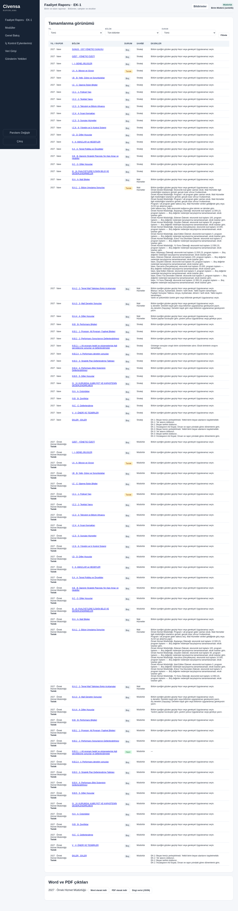

**Görünen metinler ve tablolar:**

- `div`: Civensa RAPORLAMA
- `h1`: Faaliyet Raporu · EK-1
- `p`: Birim ve idare raporları · Bölümler, sahipler ve eksikler
- `div`: Müdürlük Birim Müdürü (sentetik)
- `h2`: Tamamlanma görünümü
- `table`: YIL / RAPOR BÖLÜM DURUM SAHİBİ EKSİKLER 2027 · İdare SUNUS · ÜST YÖNETİCİ SUNUŞU Boş Strateji Bölüm içeriğini gözden geçirip Hazır veya gerekçeli Uygulanamaz seçin. 2027 · İdare OZET · YÖNETİCİ ÖZETİ Boş Strateji Bölüm içeriğini gözden geçirip Hazır veya gerekçeli Uygulanamaz seçin. 2027 · İdare I · I- GENEL BİLGİLER Boş Strateji Bölüm içeriğini gözden geçirip Hazır veya gerekçeli Uygulanamaz seçin. 2027 · İdare I.A · A- Misyon ve Vizyon Taslak Strateji Bölüm içeriğini gözden geçirip Hazır veya gerekçeli Uygulanamaz seçin. 2027 · İdare I.B · B- Yetki, Görev ve Sorumluluklar Boş Strateji Bölüm içeriğini gözden geçirip Hazır veya gerekçeli Uygulanamaz seçin. 2027 · İdare I.C · C- İdareye İlişkin Bilgiler Boş Strateji Bölüm içeriğini gözden geçirip Hazır veya gerekçeli Uygulanamaz seçin. 2027 · İdare I.C.1 · 1- Fiziksel Yapı Boş Strateji Bölüm içeriğini gözden geçirip Hazır veya gerekçeli Uygulanamaz seçin. 2027 · İdare I.C.2 · 2- Teşkilat Yapısı Boş Strateji Bölüm içeriğini gözden geçirip Hazır veya gerekçeli Uygulanamaz seçin. 2027 · İdare I.C.3 · 3- Teknoloji ve Bilişim Altyapısı Boş Strateji Bölüm içeriğini gözden geçirip Hazır veya gerekçeli Uygulanamaz seçin. 2027 · İdare I.C.4 · 4- İnsan Kaynakları Boş Strateji Bölüm içeriğini gözden geçirip Hazır veya gerekçeli Uygulanamaz seçin. 2027 · İdare I.C.5 · 5- Sunulan Hizmetler Boş Strateji Bölüm içeriğini gözden geçirip Hazır veya gerekçeli Uygulanamaz seçin. 2027 · İdare I.C.6 · 6- Yönetim ve İç Kontrol Sistemi Boş Strateji Bölüm içeriğini gözden geçirip Hazır veya gerekçeli Uygulanamaz seçin. 2027 · İdare I.D · D- Diğer Hususlar Boş Strateji Bölüm içeriğini gözden geçirip Hazır veya gerekçeli Uygulanamaz seçin. 2027 · İdare II · II- AMAÇLAR ve HEDEFLER Boş Strateji Bölüm içeriğini gözden geçirip Hazır veya gerekçeli Uygulanamaz seçin. 2027 · İdare II.A · A- Temel Politika ve Öncelikler Boş Strateji Bölüm içeriğini gözden geçirip Hazır veya gerekçeli Uygulanamaz seçin. 2027 · İdare II.B · B- İdarenin Stratejik Planında Yer Alan Amaç ve Hedefler Boş Strateji Bölüm içeriğini gözden geçirip Hazır veya gerekçeli Uygulanamaz seçin. 2027 · İdare II.C · C- Diğer Hususlar Boş Strateji Bölüm içeriğini gözden geçirip Hazır veya gerekçeli Uygulanamaz seçin. 2027 · İdare III · III- FAALİYETLERE İLİŞKİN BİLGİ VE DEĞERLENDİRMELER Boş Strateji Bölüm içeriğini gözden geçirip Hazır veya gerekçeli Uygulanamaz seçin. 2027 · İdare III.A · A- Malî Bilgiler Boş Mali Hizmetler Bölüm içeriğini gözden geçirip Hazır veya gerekçeli Uygulanamaz seçin. 2027 · İdare III.A.1 · 1- Bütçe Uygulama Sonuçları Taslak Mali Hizmetler Bölüm içeriğini gözden geçirip Hazır veya gerekçeli Uygulanamaz seçin. Örnek Destek Müdürlüğü: Ekonomik kod gider satırları eksik. Mali Hizmetler ilgili müdürlüğün tutarlarını girmeli; gerçek tutar sıfırsa 0 kullanılmalı. Örnek Hizmet Müdürlüğü: Program / alt program gider satırları eksik. Mali Hizmetler ilgili müdürlüğün tutarlarını girmeli; gerçek tutar sıfırsa 0 kullanılmalı. Örnek Destek Müdürlüğü: Program / alt program gider satırları eksik. Mali Hizmetler ilgili müdürlüğün tutarlarını girmeli; gerçek tutar sıfırsa 0 kullanılmalı. Program / alt program gider tablosu boş. Mali Hizmetler verileri geldiğinde giriş veya XLSX içe aktarma yapın. Gelir tablosu boş. Gelir ekonomik kodlarına göre tahmin ve tahsilatı girin. Örnek Hizmet Müdürlüğü, Başlangıç Ödeneği: ekonomik kod toplamı 12.500,23, program toplamı —. Boş değerler nedeniyle karşılaştırma tamamlanamadı; eksik tutarları girin. Örnek Hizmet Müdürlüğü, Eklenen Ödenek: ekonomik kod toplamı 100, program toplamı —. Boş değerler nedeniyle karşılaştırma tamamlanamadı; eksik tutarları girin. Örnek Hizmet Müdürlüğü, Düşülen Ödenek: ekonomik kod toplamı 50, program toplamı —. Boş değerler nedeniyle karşılaştırma tamamlanamadı; eksik tutarları girin. Örnek Hizmet Müdürlüğü, Harcama (Gerçekleşme): ekonomik kod toplamı 10.000, program toplamı —. Boş değerler nedeniyle karşılaştırma tamamlanamadı; eksik tutarları girin. Örnek Hizmet Müdürlüğü, İptal Edilen Ödenek: ekonomik kod toplamı 0, program toplamı —. Boş değerler nedeniyle karşılaştırma tamamlanamadı; eksik tutarları girin. Örnek Hizmet Müdürlüğü, Ertesi Yıla Devreden Ödenek: ekonomik kod toplamı 0, program toplamı —. Boş değerler nedeniyle karşılaştırma tamamlanamadı; eksik tutarları girin. Örnek Hizmet Müdürlüğü, Yıl Sonu Ödeneği: ekonomik kod toplamı 12.550,23, program toplamı —. Boş değerler nedeniyle karşılaştırma tamamlanamadı; eksik tutarları girin. İdare, Başlangıç Ödeneği: ekonomik kod toplamı 12.500,23, program toplamı —. Boş değerler nedeniyle karşılaştırma tamamlanamadı; eksik tutarları girin. İdare, Eklenen Ödenek: ekonomik kod toplamı 100, program toplamı —. Boş değerler nedeniyle karşılaştırma tamamlanamadı; eksik tutarları girin. İdare, Düşülen Ödenek: ekonomik kod toplamı 50, program toplamı —. Boş değerler nedeniyle karşılaştırma tamamlanamadı; eksik tutarları girin. İdare, Harcama (Gerçekleşme): ekonomik kod toplamı 10.000, program toplamı —. Boş değerler nedeniyle karşılaştırma tamamlanamadı; eksik tutarları girin. İdare, İptal Edilen Ödenek: ekonomik kod toplamı 0, program toplamı —. Boş değerler nedeniyle karşılaştırma tamamlanamadı; eksik tutarları girin. İdare, Ertesi Yıla Devreden Ödenek: ekonomik kod toplamı 0, program toplamı —. Boş değerler nedeniyle karşılaştırma tamamlanamadı; eksik tutarları girin. İdare, Yıl Sonu Ödeneği: ekonomik kod toplamı 12.550,23, program toplamı —. Boş değerler nedeniyle karşılaştırma tamamlanamadı; eksik tutarları girin. 2027 · İdare III.A.2 · 2- Temel Malî Tablolara İlişkin Açıklamalar Boş Mali Hizmetler Bölüm içeriğini gözden geçirip Hazır veya gerekçeli Uygulanamaz seçin. Bilanço: dosya, Açıklamalar, dönem / tarih eksik. Tablo kaydını tamamlayın. Faaliyet Sonuçları Tablosu: dosya, Açıklamalar, dönem / tarih eksik. Tablo kaydını tamamlayın. Varlık ve yükümlülük özetini girin veya bölümde gerekçeli Uygulanamaz seçin. 2027 · İdare III.A.3 · 3- Malî Denetim Sonuçları Boş Mali Hizmetler Bölüm içeriğini gözden geçirip Hazır veya gerekçeli Uygulanamaz seçin. iç denetim: Denetim kaydı girin veya bölümün uygulanamaz gerekçesini yazın. dış denetim (Sayıştay): Denetim kaydı girin veya bölümün uygulanamaz gerekçesini yazın. 2027 · İdare III.A.4 · 4- Diğer Hususlar Boş Mali Hizmetler Bölüm içeriğini gözden geçirip Hazır veya gerekçeli Uygulanamaz seçin. Yardım yapılan kuruluşları girin; yardım yoksa Uygulanamaz seçip gerekçe yazın. 2027 · İdare III.B · B- Performans Bilgileri Boş Strateji Bölüm içeriğini gözden geçirip Hazır veya gerekçeli Uygulanamaz seçin. 2027 · İdare III.B.1 · 1- Program, Alt Program, Faaliyet Bilgileri Boş Strateji Bölüm içeriğini gözden geçirip Hazır veya gerekçeli Uygulanamaz seçin. 2027 · İdare III.B.2 · 2- Performans Sonuçlarının Değerlendirilmesi Boş Strateji Bölüm içeriğini gözden geçirip Hazır veya gerekçeli Uygulanamaz seçin. 2027 · İdare III.B.2.i · i. Alt program hedef ve göstergeleriyle ilgili gerçekleşme sonuçları ve değerlendirmeler Boş Strateji Gösterge sonuçları onaylı birim sürümlerinden alınır. Eksik birimlerin onayını tamamlayın. 2027 · İdare III.B.2.ii · ii. Performans denetim sonuçları Boş Strateji Bölüm içeriğini gözden geçirip Hazır veya gerekçeli Uygulanamaz seçin. 2027 · İdare III.B.3 · 3- Stratejik Plan Değerlendirme Tabloları Boş Strateji Bölüm içeriğini gözden geçirip Hazır veya gerekçeli Uygulanamaz seçin. 2027 · İdare III.B.4 · 4- Performans Bilgi Sisteminin Değerlendirilmesi Boş Strateji Bölüm içeriğini gözden geçirip Hazır veya gerekçeli Uygulanamaz seçin. 2027 · İdare III.B.5 · 5- Diğer Hususlar Boş Strateji Bölüm içeriğini gözden geçirip Hazır veya gerekçeli Uygulanamaz seçin. 2027 · İdare IV · IV- KURUMSAL KABİLİYET VE KAPASİTENİN DEĞERLENDİRİLMESİ Boş Strateji Bölüm içeriğini gözden geçirip Hazır veya gerekçeli Uygulanamaz seçin. 2027 · İdare IV.A · A- Üstünlükler Boş Strateji Bölüm içeriğini gözden geçirip Hazır veya gerekçeli Uygulanamaz seçin. 2027 · İdare IV.B · B- Zayıflıklar Boş Strateji Bölüm içeriğini gözden geçirip Hazır veya gerekçeli Uygulanamaz seçin. 2027 · İdare IV.C · C- Değerlendirme Boş Strateji Bölüm içeriğini gözden geçirip Hazır veya gerekçeli Uygulanamaz seçin. 2027 · İdare V · V- ÖNERİ VE TEDBİRLER Boş Strateji Bölüm içeriğini gözden geçirip Hazır veya gerekçeli Uygulanamaz seçin. 2027 · İdare EKLER · EKLER Boş Strateji EK-1: Beyan henüz yerleştirilmedi. Yetkili birim beyan alanlarını kaydetmelidir. EK-1: Yer alanını doldurun. EK-1: Beyan tarihini doldurun. EK-1: İmzalayanın Ad-Soyad, Ünvan ve rapor yılındaki görev dönemlerini girin. EK-3: Beyan henüz yerleştirilmedi. Yetkili birim beyan alanlarını kaydetmelidir. EK-3: Yer alanını doldurun. EK-3: Beyan tarihini doldurun. EK-3: İmzalayanın Ad-Soyad, Ünvan ve rapor yılındaki görev dönemlerini girin. 2027 · Örnek Hizmet Müdürlüğü Taslak OZET · YÖNETİCİ ÖZETİ Boş Müdürlük Bölüm içeriğini gözden geçirip Hazır veya gerekçeli Uygulanamaz seçin. 2027 · Örnek Hizmet Müdürlüğü Taslak I · I- GENEL BİLGİLER Boş Müdürlük Bölüm içeriğini gözden geçirip Hazır veya gerekçeli Uygulanamaz seçin. 2027 · Örnek Hizmet Müdürlüğü Taslak I.A · A- Misyon ve Vizyon Taslak Müdürlük Bölüm içeriğini gözden geçirip Hazır veya gerekçeli Uygulanamaz seçin. 2027 · Örnek Hizmet Müdürlüğü Taslak I.B · B- Yetki, Görev ve Sorumluluklar Boş Müdürlük Bölüm içeriğini gözden geçirip Hazır veya gerekçeli Uygulanamaz seçin. 2027 · Örnek Hizmet Müdürlüğü Taslak I.C · C- İdareye İlişkin Bilgiler Boş Müdürlük Bölüm içeriğini gözden geçirip Hazır veya gerekçeli Uygulanamaz seçin. 2027 · Örnek Hizmet Müdürlüğü Taslak I.C.1 · 1- Fiziksel Yapı Taslak Müdürlük Bölüm içeriğini gözden geçirip Hazır veya gerekçeli Uygulanamaz seçin. 2027 · Örnek Hizmet Müdürlüğü Taslak I.C.2 · 2- Teşkilat Yapısı Boş Müdürlük Bölüm içeriğini gözden geçirip Hazır veya gerekçeli Uygulanamaz seçin. 2027 · Örnek Hizmet Müdürlüğü Taslak I.C.3 · 3- Teknoloji ve Bilişim Altyapısı Boş Müdürlük Bölüm içeriğini gözden geçirip Hazır veya gerekçeli Uygulanamaz seçin. 2027 · Örnek Hizmet Müdürlüğü Taslak I.C.4 · 4- İnsan Kaynakları Boş Müdürlük Bölüm içeriğini gözden geçirip Hazır veya gerekçeli Uygulanamaz seçin. 2027 · Örnek Hizmet Müdürlüğü Taslak I.C.5 · 5- Sunulan Hizmetler Boş Müdürlük Bölüm içeriğini gözden geçirip Hazır veya gerekçeli Uygulanamaz seçin. 2027 · Örnek Hizmet Müdürlüğü Taslak I.C.6 · 6- Yönetim ve İç Kontrol Sistemi Boş Müdürlük Bölüm içeriğini gözden geçirip Hazır veya gerekçeli Uygulanamaz seçin. 2027 · Örnek Hizmet Müdürlüğü Taslak I.D · D- Diğer Hususlar Boş Müdürlük Bölüm içeriğini gözden geçirip Hazır veya gerekçeli Uygulanamaz seçin. 2027 · Örnek Hizmet Müdürlüğü Taslak II · II- AMAÇLAR ve HEDEFLER Boş Müdürlük Bölüm içeriğini gözden geçirip Hazır veya gerekçeli Uygulanamaz seçin. 2027 · Örnek Hizmet Müdürlüğü Taslak II.A · A- Temel Politika ve Öncelikler Boş Müdürlük Bölüm içeriğini gözden geçirip Hazır veya gerekçeli Uygulanamaz seçin. 2027 · Örnek Hizmet Müdürlüğü Taslak II.B · B- İdarenin Stratejik Planında Yer Alan Amaç ve Hedefler Boş Müdürlük Bölüm içeriğini gözden geçirip Hazır veya gerekçeli Uygulanamaz seçin. 2027 · Örnek Hizmet Müdürlüğü Taslak II.C · C- Diğer Hususlar Boş Müdürlük Bölüm içeriğini gözden geçirip Hazır veya gerekçeli Uygulanamaz seçin. 2027 · Örnek Hizmet Müdürlüğü Taslak III · III- FAALİYETLERE İLİŞKİN BİLGİ VE DEĞERLENDİRMELER Boş Müdürlük Bölüm içeriğini gözden geçirip Hazır veya gerekçeli Uygulanamaz seçin. 2027 · Örnek Hizmet Müdürlüğü Taslak III.A · A- Malî Bilgiler Boş Mali Hizmetler Bölüm içeriğini gözden geçirip Hazır veya gerekçeli Uygulanamaz seçin. 2027 · Örnek Hizmet Müdürlüğü Taslak III.A.1 · 1- Bütçe Uygulama Sonuçları Boş Mali Hizmetler Bölüm içeriğini gözden geçirip Hazır veya gerekçeli Uygulanamaz seçin. Örnek Hizmet Müdürlüğü: Program / alt program gider satırları eksik. Mali Hizmetler ilgili müdürlüğün tutarlarını girmeli; gerçek tutar sıfırsa 0 kullanılmalı. Program / alt program gider tablosu boş. Mali Hizmetler verileri geldiğinde giriş veya XLSX içe aktarma yapın. Örnek Hizmet Müdürlüğü, Başlangıç Ödeneği: ekonomik kod toplamı 12.500,23, program toplamı —. Boş değerler nedeniyle karşılaştırma tamamlanamadı; eksik tutarları girin. Örnek Hizmet Müdürlüğü, Eklenen Ödenek: ekonomik kod toplamı 100, program toplamı —. Boş değerler nedeniyle karşılaştırma tamamlanamadı; eksik tutarları girin. Örnek Hizmet Müdürlüğü, Düşülen Ödenek: ekonomik kod toplamı 50, program toplamı —. Boş değerler nedeniyle karşılaştırma tamamlanamadı; eksik tutarları girin. Örnek Hizmet Müdürlüğü, Harcama (Gerçekleşme): ekonomik kod toplamı 10.000, program toplamı —. Boş değerler nedeniyle karşılaştırma tamamlanamadı; eksik tutarları girin. Örnek Hizmet Müdürlüğü, İptal Edilen Ödenek: ekonomik kod toplamı 0, program toplamı —. Boş değerler nedeniyle karşılaştırma tamamlanamadı; eksik tutarları girin. Örnek Hizmet Müdürlüğü, Ertesi Yıla Devreden Ödenek: ekonomik kod toplamı 0, program toplamı —. Boş değerler nedeniyle karşılaştırma tamamlanamadı; eksik tutarları girin. Örnek Hizmet Müdürlüğü, Yıl Sonu Ödeneği: ekonomik kod toplamı 12.550,23, program toplamı —. Boş değerler nedeniyle karşılaştırma tamamlanamadı; eksik tutarları girin. 2027 · Örnek Hizmet Müdürlüğü Taslak III.A.2 · 2- Temel Malî Tablolara İlişkin Açıklamalar Boş Mali Hizmetler Bölüm içeriğini gözden geçirip Hazır veya gerekçeli Uygulanamaz seçin. 2027 · Örnek Hizmet Müdürlüğü Taslak III.A.3 · 3- Malî Denetim Sonuçları Boş Müdürlük Bölüm içeriğini gözden geçirip Hazır veya gerekçeli Uygulanamaz seçin. iç denetim: Denetim kaydı girin veya bölümün uygulanamaz gerekçesini yazın. dış denetim (Sayıştay): Denetim kaydı girin veya bölümün uygulanamaz gerekçesini yazın. 2027 · Örnek Hizmet Müdürlüğü Taslak III.A.4 · 4- Diğer Hususlar Boş Müdürlük Bölüm içeriğini gözden geçirip Hazır veya gerekçeli Uygulanamaz seçin. Yardım yapılan kuruluşları girin; yardım yoksa Uygulanamaz seçip gerekçe yazın. 2027 · Örnek Hizmet Müdürlüğü Taslak III.B · B- Performans Bilgileri Boş Müdürlük Bölüm içeriğini gözden geçirip Hazır veya gerekçeli Uygulanamaz seçin. 2027 · Örnek Hizmet Müdürlüğü Taslak III.B.1 · 1- Program, Alt Program, Faaliyet Bilgileri Boş Müdürlük Bölüm içeriğini gözden geçirip Hazır veya gerekçeli Uygulanamaz seçin. 2027 · Örnek Hizmet Müdürlüğü Taslak III.B.2 · 2- Performans Sonuçlarının Değerlendirilmesi Boş Müdürlük Bölüm içeriğini gözden geçirip Hazır veya gerekçeli Uygulanamaz seçin. 2027 · Örnek Hizmet Müdürlüğü Taslak III.B.2.i · i. Alt program hedef ve göstergeleriyle ilgili gerçekleşme sonuçları ve değerlendirmeler Hazır Müdürlük — 2027 · Örnek Hizmet Müdürlüğü Taslak III.B.2.ii · ii. Performans denetim sonuçları Boş Müdürlük Bölüm içeriğini gözden geçirip Hazır veya gerekçeli Uygulanamaz seçin. 2027 · Örnek Hizmet Müdürlüğü Taslak III.B.3 · 3- Stratejik Plan Değerlendirme Tabloları Boş Müdürlük Bölüm içeriğini gözden geçirip Hazır veya gerekçeli Uygulanamaz seçin. 2027 · Örnek Hizmet Müdürlüğü Taslak III.B.4 · 4- Performans Bilgi Sisteminin Değerlendirilmesi Boş Müdürlük Bölüm içeriğini gözden geçirip Hazır veya gerekçeli Uygulanamaz seçin. 2027 · Örnek Hizmet Müdürlüğü Taslak III.B.5 · 5- Diğer Hususlar Boş Müdürlük Bölüm içeriğini gözden geçirip Hazır veya gerekçeli Uygulanamaz seçin. 2027 · Örnek Hizmet Müdürlüğü Taslak IV · IV- KURUMSAL KABİLİYET VE KAPASİTENİN DEĞERLENDİRİLMESİ Boş Müdürlük Bölüm içeriğini gözden geçirip Hazır veya gerekçeli Uygulanamaz seçin. 2027 · Örnek Hizmet Müdürlüğü Taslak IV.A · A- Üstünlükler Boş Müdürlük Bölüm içeriğini gözden geçirip Hazır veya gerekçeli Uygulanamaz seçin. 2027 · Örnek Hizmet Müdürlüğü Taslak IV.B · B- Zayıflıklar Boş Müdürlük Bölüm içeriğini gözden geçirip Hazır veya gerekçeli Uygulanamaz seçin. 2027 · Örnek Hizmet Müdürlüğü Taslak IV.C · C- Değerlendirme Boş Müdürlük Bölüm içeriğini gözden geçirip Hazır veya gerekçeli Uygulanamaz seçin. 2027 · Örnek Hizmet Müdürlüğü Taslak V · V- ÖNERİ VE TEDBİRLER Boş Müdürlük Bölüm içeriğini gözden geçirip Hazır veya gerekçeli Uygulanamaz seçin. 2027 · Örnek Hizmet Müdürlüğü Taslak EKLER · EKLER Boş Müdürlük EK-2: Beyan henüz yerleştirilmedi. Yetkili birim beyan alanlarını kaydetmelidir. EK-2: Yer alanını doldurun. EK-2: Beyan tarihini doldurun. EK-2: İmzalayanın Ad-Soyad, Ünvan ve rapor yılındaki görev dönemlerini girin.
- `h2`: Word ve PDF çıktıları
- `p`: 2027 · Örnek Hizmet Müdürlüğü · Word olarak indir PDF olarak indir Dizgi verisi (JSON)

**Bağlantı, düğme, form ve alanlar:**

| Öğe | Tür / etiket / bağlam | Hedef URL veya eylem | Ne yapar / mevcut değer |
| --- | --- | --- | --- |
| E001 | a · Faaliyet Raporu · EK-1 | `/activity-sections` | Bağlantıdaki ekranı veya dosyayı açar: Faaliyet Raporu · EK-1. |
| E002 | a · Modüller | `/modules` | Bağlantıdaki ekranı veya dosyayı açar: Modüller. |
| E003 | a · Genel Bakış | `/dashboard` | Bağlantıdaki ekranı veya dosyayı açar: Genel Bakış. |
| E004 | a · İç Kontrol Eylemlerimiz | `/internal-control/our-actions` | Bağlantıdaki ekranı veya dosyayı açar: İç Kontrol Eylemlerimiz. |
| E005 | a · Veri Girişi | `/department/1` | Bağlantıdaki ekranı veya dosyayı açar: Veri Girişi. |
| E006 | a · Gönderim Yetkileri | `/submit-authorizations` | Bağlantıdaki ekranı veya dosyayı açar: Gönderim Yetkileri. |
| E007 | button · Parolamı Değiştir (#changePasswordButton) | `#passwordModal` | Parola değiştirme penceresini açar. |
| E008 | form · Çıkış | `POST /logout` | Oturumu kapatıp giriş ekranına döner. |
| E009 | button · Çıkış | `POST /logout` | Oturumu kapatıp giriş ekranına döner. |
| E010 | button · Bildirimler (#notificationButton) | `GET /api/notifications → #notificationPanel` | Bildirim listesini açar. |
| E011 | form · Filtrele · Tamamlanma görünümü | `GET /activity-sections` | Alanlarla listeyi veya rapor görünümünü filtreler. |
| E012 | select · YIL Tümü 2027 · Tamamlanma görünümü | `GET /activity-sections` | Listeden seçim yapar. Seçenekler: Tümü; 2027. |
| E013 | select · BÖLÜM Tüm bölümler SUNUS · ÜST YÖNETİCİ SUNUŞU OZET · YÖNETİCİ ÖZETİ I · I- GENEL BİLGİLER I.A · A- Misyon ve Vizyon I.B · B- Yetki, Görev ve Sorumluluklar I.C · C- İdareye İlişkin Bilgiler I.C.1 · 1- Fiziksel Yapı I.C.2 · 2- Teşkilat Yapısı I.C.3 · 3- Teknoloji ve Bilişim Altyapısı I.C.4 · 4- İnsan Kaynakları I.C.5 · 5- Sunulan Hizmetler I.C.6 · 6- Yönetim ve İç Kontrol Sistemi I.D · D- Diğer Hususlar II · II- AMAÇLAR ve HEDEFLER II.A · A- Temel Politika ve Öncelikler II.B · B- İdarenin Stratejik Planında Yer Alan Amaç ve Hedefler II.C · C- Diğer Hususlar III · III- FAALİYETLERE İLİŞKİN BİLGİ VE DEĞERLENDİRMELER III.A · A- Malî Bilgiler III.A.1 · 1- Bütçe Uygulama Sonuçları III.A.2 · 2- Temel Malî Tablolara İlişkin Açıklamalar III.A.3 · 3- Malî Denetim Sonuçları III.A.4 · 4- Diğer Hususlar III.B · B- Performans Bilgileri III.B.1 · 1- Program, Alt Program, Faaliyet Bilgileri III.B.2 · 2- Performans Sonuçlarının Değerlendirilmesi III.B.2.i · i. Alt program hedef ve göstergeleriyle ilgili gerçekleşme sonuçları ve değerlendirmeler III.B.2.ii · ii. Performans denetim sonuçları III.B.3 · 3- Stratejik Plan Değerlendirme Tabloları III.B.4 · 4- Performans Bilgi Sisteminin Değerlendirilmesi III.B.5 · 5- Diğer Hususlar IV · IV- KURUMSAL KABİLİYET VE KAPASİTENİN DEĞERLENDİRİLMESİ IV.A · A- Üstünlükler IV.B · B- Zayıflıklar IV.C · C- Değerlendirme V · V- ÖNERİ VE TEDBİRLER EKLER · EKLER · Tamamlanma görünümü | `GET /activity-sections` | Listeden seçim yapar. Seçenekler: Tüm bölümler; SUNUS · ÜST YÖNETİCİ SUNUŞU; OZET · YÖNETİCİ ÖZETİ; I · I- GENEL BİLGİLER; I.A · A- Misyon ve Vizyon; I.B · B- Yetki, Görev ve Sorumluluklar; I.C · C- İdareye İlişkin Bilgiler; I.C.1 · 1- Fiziksel Yapı; I.C.2 · 2- Teşkilat Yapısı; I.C.3 · 3- Teknoloji ve Bilişim Altyapısı; I.C.4 · 4- İnsan Kaynakları; I.C.5 · 5- Sunulan Hizmetler; I.C.6 · 6- Yönetim ve İç Kontrol Sistemi; I.D · D- Diğer Hususlar; II · II- AMAÇLAR ve HEDEFLER; II.A · A- Temel Politika ve Öncelikler; II.B · B- İdarenin Stratejik Planında Yer Alan Amaç ve Hedefler; II.C · C- Diğer Hususlar; III · III- FAALİYETLERE İLİŞKİN BİLGİ VE DEĞERLENDİRMELER; III.A · A- Malî Bilgiler; III.A.1 · 1- Bütçe Uygulama Sonuçları; III.A.2 · 2- Temel Malî Tablolara İlişkin Açıklamalar; III.A.3 · 3- Malî Denetim Sonuçları; III.A.4 · 4- Diğer Hususlar; III.B · B- Performans Bilgileri; III.B.1 · 1- Program, Alt Program, Faaliyet Bilgileri; III.B.2 · 2- Performans Sonuçlarının Değerlendirilmesi; III.B.2.i · i. Alt program hedef ve göstergeleriyle ilgili gerçekleşme sonuçları ve değerlendirmeler; III.B.2.ii · ii. Performans denetim sonuçları; III.B.3 · 3- Stratejik Plan Değerlendirme Tabloları; III.B.4 · 4- Performans Bilgi Sisteminin Değerlendirilmesi; III.B.5 · 5- Diğer Hususlar; IV · IV- KURUMSAL KABİLİYET VE KAPASİTENİN DEĞERLENDİRİLMESİ; IV.A · A- Üstünlükler; IV.B · B- Zayıflıklar; IV.C · C- Değerlendirme; V · V- ÖNERİ VE TEDBİRLER; EKLER · EKLER. |
| E014 | select · DURUM Tümü Boş Taslak Hazır Uygulanamaz · Tamamlanma görünümü | `GET /activity-sections` | Listeden seçim yapar. Seçenekler: Tümü; Boş; Taslak; Hazır; Uygulanamaz. |
| E015 | button · Filtrele · Tamamlanma görünümü | `GET /activity-sections` | Alanlarla listeyi veya rapor görünümünü filtreler. |
| E016 | a · SUNUS · ÜST YÖNETİCİ SUNUŞU · 2027 · İdare | `/activity-sections/reports/1?code=SUNUS` | Bağlantıdaki ekranı veya dosyayı açar: SUNUS · ÜST YÖNETİCİ SUNUŞU. |
| E017 | a · OZET · YÖNETİCİ ÖZETİ · 2027 · İdare | `/activity-sections/reports/1?code=OZET` | Bağlantıdaki ekranı veya dosyayı açar: OZET · YÖNETİCİ ÖZETİ. |
| E018 | a · I · I- GENEL BİLGİLER · 2027 · İdare | `/activity-sections/reports/1?code=I` | Bağlantıdaki ekranı veya dosyayı açar: I · I- GENEL BİLGİLER. |
| E019 | a · I.A · A- Misyon ve Vizyon · 2027 · İdare | `/activity-sections/reports/1?code=I.A` | Bağlantıdaki ekranı veya dosyayı açar: I.A · A- Misyon ve Vizyon. |
| E020 | a · I.B · B- Yetki, Görev ve Sorumluluklar · 2027 · İdare | `/activity-sections/reports/1?code=I.B` | Bağlantıdaki ekranı veya dosyayı açar: I.B · B- Yetki, Görev ve Sorumluluklar. |
| E021 | a · I.C · C- İdareye İlişkin Bilgiler · 2027 · İdare | `/activity-sections/reports/1?code=I.C` | Bağlantıdaki ekranı veya dosyayı açar: I.C · C- İdareye İlişkin Bilgiler. |
| E022 | a · I.C.1 · 1- Fiziksel Yapı · 2027 · İdare | `/activity-sections/reports/1?code=I.C.1` | Bağlantıdaki ekranı veya dosyayı açar: I.C.1 · 1- Fiziksel Yapı. |
| E023 | a · I.C.2 · 2- Teşkilat Yapısı · 2027 · İdare | `/activity-sections/reports/1?code=I.C.2` | Bağlantıdaki ekranı veya dosyayı açar: I.C.2 · 2- Teşkilat Yapısı. |
| E024 | a · I.C.3 · 3- Teknoloji ve Bilişim Altyapısı · 2027 · İdare | `/activity-sections/reports/1?code=I.C.3` | Bağlantıdaki ekranı veya dosyayı açar: I.C.3 · 3- Teknoloji ve Bilişim Altyapısı. |
| E025 | a · I.C.4 · 4- İnsan Kaynakları · 2027 · İdare | `/activity-sections/reports/1?code=I.C.4` | Bağlantıdaki ekranı veya dosyayı açar: I.C.4 · 4- İnsan Kaynakları. |
| E026 | a · I.C.5 · 5- Sunulan Hizmetler · 2027 · İdare | `/activity-sections/reports/1?code=I.C.5` | Bağlantıdaki ekranı veya dosyayı açar: I.C.5 · 5- Sunulan Hizmetler. |
| E027 | a · I.C.6 · 6- Yönetim ve İç Kontrol Sistemi · 2027 · İdare | `/activity-sections/reports/1?code=I.C.6` | Bağlantıdaki ekranı veya dosyayı açar: I.C.6 · 6- Yönetim ve İç Kontrol Sistemi. |
| E028 | a · I.D · D- Diğer Hususlar · 2027 · İdare | `/activity-sections/reports/1?code=I.D` | Bağlantıdaki ekranı veya dosyayı açar: I.D · D- Diğer Hususlar. |
| E029 | a · II · II- AMAÇLAR ve HEDEFLER · 2027 · İdare | `/activity-sections/reports/1?code=II` | Bağlantıdaki ekranı veya dosyayı açar: II · II- AMAÇLAR ve HEDEFLER. |
| E030 | a · II.A · A- Temel Politika ve Öncelikler · 2027 · İdare | `/activity-sections/reports/1?code=II.A` | Bağlantıdaki ekranı veya dosyayı açar: II.A · A- Temel Politika ve Öncelikler. |
| E031 | a · II.B · B- İdarenin Stratejik Planında Yer Alan Amaç ve Hedefler · 2027 · İdare | `/activity-sections/reports/1?code=II.B` | Bağlantıdaki ekranı veya dosyayı açar: II.B · B- İdarenin Stratejik Planında Yer Alan Amaç ve Hedefler. |
| E032 | a · II.C · C- Diğer Hususlar · 2027 · İdare | `/activity-sections/reports/1?code=II.C` | Bağlantıdaki ekranı veya dosyayı açar: II.C · C- Diğer Hususlar. |
| E033 | a · III · III- FAALİYETLERE İLİŞKİN BİLGİ VE DEĞERLENDİRMELER · 2027 · İdare | `/activity-sections/reports/1?code=III` | Bağlantıdaki ekranı veya dosyayı açar: III · III- FAALİYETLERE İLİŞKİN BİLGİ VE DEĞERLENDİRMELER. |
| E034 | a · III.A · A- Malî Bilgiler · 2027 · İdare | `/activity-sections/reports/1?code=III.A` | Bağlantıdaki ekranı veya dosyayı açar: III.A · A- Malî Bilgiler. |
| E035 | a · III.A.1 · 1- Bütçe Uygulama Sonuçları · 2027 · İdare | `/activity-sections/reports/1?code=III.A.1` | Bağlantıdaki ekranı veya dosyayı açar: III.A.1 · 1- Bütçe Uygulama Sonuçları. |
| E036 | a · III.A.2 · 2- Temel Malî Tablolara İlişkin Açıklamalar · 2027 · İdare | `/activity-sections/reports/1?code=III.A.2` | Bağlantıdaki ekranı veya dosyayı açar: III.A.2 · 2- Temel Malî Tablolara İlişkin Açıklamalar. |
| E037 | a · III.A.3 · 3- Malî Denetim Sonuçları · 2027 · İdare | `/activity-sections/reports/1?code=III.A.3` | Bağlantıdaki ekranı veya dosyayı açar: III.A.3 · 3- Malî Denetim Sonuçları. |
| E038 | a · III.A.4 · 4- Diğer Hususlar · 2027 · İdare | `/activity-sections/reports/1?code=III.A.4` | Bağlantıdaki ekranı veya dosyayı açar: III.A.4 · 4- Diğer Hususlar. |
| E039 | a · III.B · B- Performans Bilgileri · 2027 · İdare | `/activity-sections/reports/1?code=III.B` | Bağlantıdaki ekranı veya dosyayı açar: III.B · B- Performans Bilgileri. |
| E040 | a · III.B.1 · 1- Program, Alt Program, Faaliyet Bilgileri · 2027 · İdare | `/activity-sections/reports/1?code=III.B.1` | Bağlantıdaki ekranı veya dosyayı açar: III.B.1 · 1- Program, Alt Program, Faaliyet Bilgileri. |
| E041 | a · III.B.2 · 2- Performans Sonuçlarının Değerlendirilmesi · 2027 · İdare | `/activity-sections/reports/1?code=III.B.2` | Bağlantıdaki ekranı veya dosyayı açar: III.B.2 · 2- Performans Sonuçlarının Değerlendirilmesi. |
| E042 | a · III.B.2.i · i. Alt program hedef ve göstergeleriyle ilgili gerçekleşme sonuçları ve değerlendirmeler · 2027 · İdare | `/activity-sections/reports/1?code=III.B.2.i` | Bağlantıdaki ekranı veya dosyayı açar: III.B.2.i · i. Alt program hedef ve göstergeleriyle ilgili gerçekleşme sonuçları ve değerlendirmeler. |
| E043 | a · III.B.2.ii · ii. Performans denetim sonuçları · 2027 · İdare | `/activity-sections/reports/1?code=III.B.2.ii` | Bağlantıdaki ekranı veya dosyayı açar: III.B.2.ii · ii. Performans denetim sonuçları. |
| E044 | a · III.B.3 · 3- Stratejik Plan Değerlendirme Tabloları · 2027 · İdare | `/activity-sections/reports/1?code=III.B.3` | Bağlantıdaki ekranı veya dosyayı açar: III.B.3 · 3- Stratejik Plan Değerlendirme Tabloları. |
| E045 | a · III.B.4 · 4- Performans Bilgi Sisteminin Değerlendirilmesi · 2027 · İdare | `/activity-sections/reports/1?code=III.B.4` | Bağlantıdaki ekranı veya dosyayı açar: III.B.4 · 4- Performans Bilgi Sisteminin Değerlendirilmesi. |
| E046 | a · III.B.5 · 5- Diğer Hususlar · 2027 · İdare | `/activity-sections/reports/1?code=III.B.5` | Bağlantıdaki ekranı veya dosyayı açar: III.B.5 · 5- Diğer Hususlar. |
| E047 | a · IV · IV- KURUMSAL KABİLİYET VE KAPASİTENİN DEĞERLENDİRİLMESİ · 2027 · İdare | `/activity-sections/reports/1?code=IV` | Bağlantıdaki ekranı veya dosyayı açar: IV · IV- KURUMSAL KABİLİYET VE KAPASİTENİN DEĞERLENDİRİLMESİ. |
| E048 | a · IV.A · A- Üstünlükler · 2027 · İdare | `/activity-sections/reports/1?code=IV.A` | Bağlantıdaki ekranı veya dosyayı açar: IV.A · A- Üstünlükler. |
| E049 | a · IV.B · B- Zayıflıklar · 2027 · İdare | `/activity-sections/reports/1?code=IV.B` | Bağlantıdaki ekranı veya dosyayı açar: IV.B · B- Zayıflıklar. |
| E050 | a · IV.C · C- Değerlendirme · 2027 · İdare | `/activity-sections/reports/1?code=IV.C` | Bağlantıdaki ekranı veya dosyayı açar: IV.C · C- Değerlendirme. |
| E051 | a · V · V- ÖNERİ VE TEDBİRLER · 2027 · İdare | `/activity-sections/reports/1?code=V` | Bağlantıdaki ekranı veya dosyayı açar: V · V- ÖNERİ VE TEDBİRLER. |
| E052 | a · EKLER · EKLER · 2027 · İdare | `/activity-sections/reports/1?code=EKLER` | Bağlantıdaki ekranı veya dosyayı açar: EKLER · EKLER. |
| E053 | a · OZET · YÖNETİCİ ÖZETİ · 2027 · Örnek Hizmet Müdürlüğü Taslak | `/activity-sections/reports/2?code=OZET` | Bağlantıdaki ekranı veya dosyayı açar: OZET · YÖNETİCİ ÖZETİ. |
| E054 | a · I · I- GENEL BİLGİLER · 2027 · Örnek Hizmet Müdürlüğü Taslak | `/activity-sections/reports/2?code=I` | Bağlantıdaki ekranı veya dosyayı açar: I · I- GENEL BİLGİLER. |
| E055 | a · I.A · A- Misyon ve Vizyon · 2027 · Örnek Hizmet Müdürlüğü Taslak | `/activity-sections/reports/2?code=I.A` | Bağlantıdaki ekranı veya dosyayı açar: I.A · A- Misyon ve Vizyon. |
| E056 | a · I.B · B- Yetki, Görev ve Sorumluluklar · 2027 · Örnek Hizmet Müdürlüğü Taslak | `/activity-sections/reports/2?code=I.B` | Bağlantıdaki ekranı veya dosyayı açar: I.B · B- Yetki, Görev ve Sorumluluklar. |
| E057 | a · I.C · C- İdareye İlişkin Bilgiler · 2027 · Örnek Hizmet Müdürlüğü Taslak | `/activity-sections/reports/2?code=I.C` | Bağlantıdaki ekranı veya dosyayı açar: I.C · C- İdareye İlişkin Bilgiler. |
| E058 | a · I.C.1 · 1- Fiziksel Yapı · 2027 · Örnek Hizmet Müdürlüğü Taslak | `/activity-sections/reports/2?code=I.C.1` | Bağlantıdaki ekranı veya dosyayı açar: I.C.1 · 1- Fiziksel Yapı. |
| E059 | a · I.C.2 · 2- Teşkilat Yapısı · 2027 · Örnek Hizmet Müdürlüğü Taslak | `/activity-sections/reports/2?code=I.C.2` | Bağlantıdaki ekranı veya dosyayı açar: I.C.2 · 2- Teşkilat Yapısı. |
| E060 | a · I.C.3 · 3- Teknoloji ve Bilişim Altyapısı · 2027 · Örnek Hizmet Müdürlüğü Taslak | `/activity-sections/reports/2?code=I.C.3` | Bağlantıdaki ekranı veya dosyayı açar: I.C.3 · 3- Teknoloji ve Bilişim Altyapısı. |
| E061 | a · I.C.4 · 4- İnsan Kaynakları · 2027 · Örnek Hizmet Müdürlüğü Taslak | `/activity-sections/reports/2?code=I.C.4` | Bağlantıdaki ekranı veya dosyayı açar: I.C.4 · 4- İnsan Kaynakları. |
| E062 | a · I.C.5 · 5- Sunulan Hizmetler · 2027 · Örnek Hizmet Müdürlüğü Taslak | `/activity-sections/reports/2?code=I.C.5` | Bağlantıdaki ekranı veya dosyayı açar: I.C.5 · 5- Sunulan Hizmetler. |
| E063 | a · I.C.6 · 6- Yönetim ve İç Kontrol Sistemi · 2027 · Örnek Hizmet Müdürlüğü Taslak | `/activity-sections/reports/2?code=I.C.6` | Bağlantıdaki ekranı veya dosyayı açar: I.C.6 · 6- Yönetim ve İç Kontrol Sistemi. |
| E064 | a · I.D · D- Diğer Hususlar · 2027 · Örnek Hizmet Müdürlüğü Taslak | `/activity-sections/reports/2?code=I.D` | Bağlantıdaki ekranı veya dosyayı açar: I.D · D- Diğer Hususlar. |
| E065 | a · II · II- AMAÇLAR ve HEDEFLER · 2027 · Örnek Hizmet Müdürlüğü Taslak | `/activity-sections/reports/2?code=II` | Bağlantıdaki ekranı veya dosyayı açar: II · II- AMAÇLAR ve HEDEFLER. |
| E066 | a · II.A · A- Temel Politika ve Öncelikler · 2027 · Örnek Hizmet Müdürlüğü Taslak | `/activity-sections/reports/2?code=II.A` | Bağlantıdaki ekranı veya dosyayı açar: II.A · A- Temel Politika ve Öncelikler. |
| E067 | a · II.B · B- İdarenin Stratejik Planında Yer Alan Amaç ve Hedefler · 2027 · Örnek Hizmet Müdürlüğü Taslak | `/activity-sections/reports/2?code=II.B` | Bağlantıdaki ekranı veya dosyayı açar: II.B · B- İdarenin Stratejik Planında Yer Alan Amaç ve Hedefler. |
| E068 | a · II.C · C- Diğer Hususlar · 2027 · Örnek Hizmet Müdürlüğü Taslak | `/activity-sections/reports/2?code=II.C` | Bağlantıdaki ekranı veya dosyayı açar: II.C · C- Diğer Hususlar. |
| E069 | a · III · III- FAALİYETLERE İLİŞKİN BİLGİ VE DEĞERLENDİRMELER · 2027 · Örnek Hizmet Müdürlüğü Taslak | `/activity-sections/reports/2?code=III` | Bağlantıdaki ekranı veya dosyayı açar: III · III- FAALİYETLERE İLİŞKİN BİLGİ VE DEĞERLENDİRMELER. |
| E070 | a · III.A · A- Malî Bilgiler · 2027 · Örnek Hizmet Müdürlüğü Taslak | `/activity-sections/reports/2?code=III.A` | Bağlantıdaki ekranı veya dosyayı açar: III.A · A- Malî Bilgiler. |
| E071 | a · III.A.1 · 1- Bütçe Uygulama Sonuçları · 2027 · Örnek Hizmet Müdürlüğü Taslak | `/activity-sections/reports/2?code=III.A.1` | Bağlantıdaki ekranı veya dosyayı açar: III.A.1 · 1- Bütçe Uygulama Sonuçları. |
| E072 | a · III.A.2 · 2- Temel Malî Tablolara İlişkin Açıklamalar · 2027 · Örnek Hizmet Müdürlüğü Taslak | `/activity-sections/reports/2?code=III.A.2` | Bağlantıdaki ekranı veya dosyayı açar: III.A.2 · 2- Temel Malî Tablolara İlişkin Açıklamalar. |
| E073 | a · III.A.3 · 3- Malî Denetim Sonuçları · 2027 · Örnek Hizmet Müdürlüğü Taslak | `/activity-sections/reports/2?code=III.A.3` | Bağlantıdaki ekranı veya dosyayı açar: III.A.3 · 3- Malî Denetim Sonuçları. |
| E074 | a · III.A.4 · 4- Diğer Hususlar · 2027 · Örnek Hizmet Müdürlüğü Taslak | `/activity-sections/reports/2?code=III.A.4` | Bağlantıdaki ekranı veya dosyayı açar: III.A.4 · 4- Diğer Hususlar. |
| E075 | a · III.B · B- Performans Bilgileri · 2027 · Örnek Hizmet Müdürlüğü Taslak | `/activity-sections/reports/2?code=III.B` | Bağlantıdaki ekranı veya dosyayı açar: III.B · B- Performans Bilgileri. |
| E076 | a · III.B.1 · 1- Program, Alt Program, Faaliyet Bilgileri · 2027 · Örnek Hizmet Müdürlüğü Taslak | `/activity-sections/reports/2?code=III.B.1` | Bağlantıdaki ekranı veya dosyayı açar: III.B.1 · 1- Program, Alt Program, Faaliyet Bilgileri. |
| E077 | a · III.B.2 · 2- Performans Sonuçlarının Değerlendirilmesi · 2027 · Örnek Hizmet Müdürlüğü Taslak | `/activity-sections/reports/2?code=III.B.2` | Bağlantıdaki ekranı veya dosyayı açar: III.B.2 · 2- Performans Sonuçlarının Değerlendirilmesi. |
| E078 | a · III.B.2.i · i. Alt program hedef ve göstergeleriyle ilgili gerçekleşme sonuçları ve değerlendirmeler · 2027 · Örnek Hizmet Müdürlüğü Taslak | `/activity-sections/reports/2?code=III.B.2.i` | Bağlantıdaki ekranı veya dosyayı açar: III.B.2.i · i. Alt program hedef ve göstergeleriyle ilgili gerçekleşme sonuçları ve değerlendirmeler. |
| E079 | a · III.B.2.ii · ii. Performans denetim sonuçları · 2027 · Örnek Hizmet Müdürlüğü Taslak | `/activity-sections/reports/2?code=III.B.2.ii` | Bağlantıdaki ekranı veya dosyayı açar: III.B.2.ii · ii. Performans denetim sonuçları. |
| E080 | a · III.B.3 · 3- Stratejik Plan Değerlendirme Tabloları · 2027 · Örnek Hizmet Müdürlüğü Taslak | `/activity-sections/reports/2?code=III.B.3` | Bağlantıdaki ekranı veya dosyayı açar: III.B.3 · 3- Stratejik Plan Değerlendirme Tabloları. |
| E081 | a · III.B.4 · 4- Performans Bilgi Sisteminin Değerlendirilmesi · 2027 · Örnek Hizmet Müdürlüğü Taslak | `/activity-sections/reports/2?code=III.B.4` | Bağlantıdaki ekranı veya dosyayı açar: III.B.4 · 4- Performans Bilgi Sisteminin Değerlendirilmesi. |
| E082 | a · III.B.5 · 5- Diğer Hususlar · 2027 · Örnek Hizmet Müdürlüğü Taslak | `/activity-sections/reports/2?code=III.B.5` | Bağlantıdaki ekranı veya dosyayı açar: III.B.5 · 5- Diğer Hususlar. |
| E083 | a · IV · IV- KURUMSAL KABİLİYET VE KAPASİTENİN DEĞERLENDİRİLMESİ · 2027 · Örnek Hizmet Müdürlüğü Taslak | `/activity-sections/reports/2?code=IV` | Bağlantıdaki ekranı veya dosyayı açar: IV · IV- KURUMSAL KABİLİYET VE KAPASİTENİN DEĞERLENDİRİLMESİ. |
| E084 | a · IV.A · A- Üstünlükler · 2027 · Örnek Hizmet Müdürlüğü Taslak | `/activity-sections/reports/2?code=IV.A` | Bağlantıdaki ekranı veya dosyayı açar: IV.A · A- Üstünlükler. |
| E085 | a · IV.B · B- Zayıflıklar · 2027 · Örnek Hizmet Müdürlüğü Taslak | `/activity-sections/reports/2?code=IV.B` | Bağlantıdaki ekranı veya dosyayı açar: IV.B · B- Zayıflıklar. |
| E086 | a · IV.C · C- Değerlendirme · 2027 · Örnek Hizmet Müdürlüğü Taslak | `/activity-sections/reports/2?code=IV.C` | Bağlantıdaki ekranı veya dosyayı açar: IV.C · C- Değerlendirme. |
| E087 | a · V · V- ÖNERİ VE TEDBİRLER · 2027 · Örnek Hizmet Müdürlüğü Taslak | `/activity-sections/reports/2?code=V` | Bağlantıdaki ekranı veya dosyayı açar: V · V- ÖNERİ VE TEDBİRLER. |
| E088 | a · EKLER · EKLER · 2027 · Örnek Hizmet Müdürlüğü Taslak | `/activity-sections/reports/2?code=EKLER` | Bağlantıdaki ekranı veya dosyayı açar: EKLER · EKLER. |
| E089 | a · Word olarak indir · Word ve PDF çıktıları | `/activity-sections/reports/2/export.docx` | Bağlantıdaki ekranı veya dosyayı açar: Word olarak indir. |
| E090 | a · PDF olarak indir · Word ve PDF çıktıları | `/activity-sections/reports/2/export.pdf` | Bağlantıdaki ekranı veya dosyayı açar: PDF olarak indir. |
| E091 | a · Dizgi verisi (JSON) · Word ve PDF çıktıları | `/activity-sections/reports/2/typeset.json` | Bağlantıdaki ekranı veya dosyayı açar: Dizgi verisi (JSON). |

<a id="ekran-011"></a>

### 011 · EK-1 bölüm editörü · Dolu / taslak

URL kalıbı: `/activity-sections/reports/{document_id}` · Çekilen URL: `/activity-sections/reports/1` · Rol: **strategy** · HTTP 200.

Seçilen rapor bölümünün metin, tablo ve durumunu gösterir.

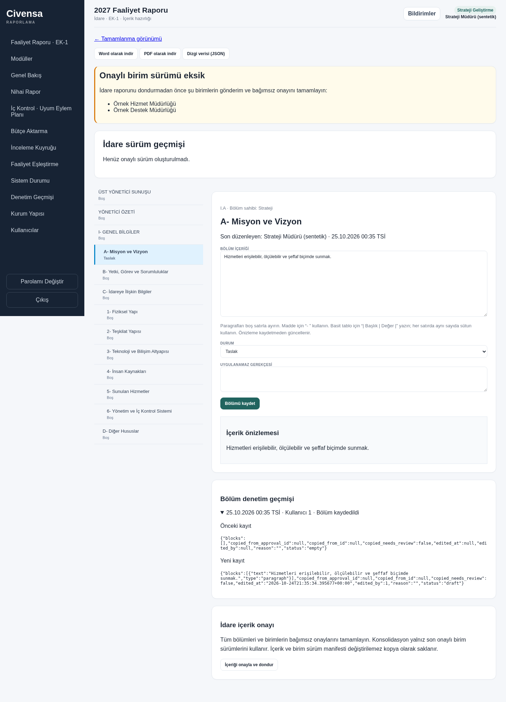

**Görünen metinler ve tablolar:**

- `div`: Civensa RAPORLAMA
- `h1`: 2027 Faaliyet Raporu
- `p`: İdare · EK-1 · İçerik hazırlığı
- `div`: Strateji Geliştirme Strateji Müdürü (sentetik)
- `p`: ← Tamamlanma görünümü
- `p`: Word olarak indir PDF olarak indir Dizgi verisi (JSON)
- `h2`: Onaylı birim sürümü eksik
- `p`: İdare raporunu dondurmadan önce şu birimlerin gönderim ve bağımsız onayını tamamlayın:
- `h2`: İdare sürüm geçmişi
- `p`: Henüz onaylı sürüm oluşturulmadı.
- `p`: I.A · Bölüm sahibi: Strateji
- `h2`: A- Misyon ve Vizyon
- `p`: Son düzenleyen: Strateji Müdürü (sentetik) · 25.10.2026 00:35 TSİ
- `p`: Paragrafları boş satırla ayırın. Madde için “- ” kullanın. Basit tablo için “&#124; Başlık &#124; Değer &#124;” yazın; her satırda aynı sayıda sütun kullanın. Önizleme kaydetmeden güncellenir.
- `h3`: İçerik önizlemesi
- `p`: Hizmetleri erişilebilir, ölçülebilir ve şeffaf biçimde sunmak.
- `h3`: Bölüm denetim geçmişi
- `p`: Önceki kayıt
- `p`: Yeni kayıt
- `h3`: İdare içerik onayı
- `p`: Tüm bölümleri ve birimlerin bağımsız onaylarını tamamlayın. Konsolidasyon yalnız son onaylı birim sürümlerini kullanır. İçerik ve birim sürüm manifesti değiştirilemez kopya olarak saklanır.
- `li`: Örnek Hizmet Müdürlüğü
- `li`: Örnek Destek Müdürlüğü
- `pre`: {"blocks":[],"copied_from_approval_id":null,"copied_from_id":null,"copied_needs_review":false,"edited_at":null,"edited_by":null,"reason":"","status":"empty"}
- `pre`: {"blocks":[{"text":"Hizmetleri erişilebilir, ölçülebilir ve şeffaf biçimde sunmak.","type":"paragraph"}],"copied_from_approval_id":null,"copied_from_id":null,"copied_needs_review":false,"edited_at":"2026-10-24T21:35:34.395677+00:00","edited_by":1,"reason":"","status":"draft"}

**Bağlantı, düğme, form ve alanlar:**

| Öğe | Tür / etiket / bağlam | Hedef URL veya eylem | Ne yapar / mevcut değer |
| --- | --- | --- | --- |
| E001 | a · Faaliyet Raporu · EK-1 | `/activity-sections` | Bağlantıdaki ekranı veya dosyayı açar: Faaliyet Raporu · EK-1. |
| E002 | a · Modüller | `/modules` | Bağlantıdaki ekranı veya dosyayı açar: Modüller. |
| E003 | a · Genel Bakış | `/dashboard` | Bağlantıdaki ekranı veya dosyayı açar: Genel Bakış. |
| E004 | a · Nihai Rapor | `/report-builder` | Bağlantıdaki ekranı veya dosyayı açar: Nihai Rapor. |
| E005 | a · İç Kontrol · Uyum Eylem Planı | `/internal-control` | Bağlantıdaki ekranı veya dosyayı açar: İç Kontrol · Uyum Eylem Planı. |
| E006 | a · Bütçe Aktarma | `/budget-reallocations` | Bağlantıdaki ekranı veya dosyayı açar: Bütçe Aktarma. |
| E007 | a · İnceleme Kuyruğu | `/review` | Bağlantıdaki ekranı veya dosyayı açar: İnceleme Kuyruğu. |
| E008 | a · Faaliyet Eşleştirme | `/activity-mapping` | Bağlantıdaki ekranı veya dosyayı açar: Faaliyet Eşleştirme. |
| E009 | a · Sistem Durumu | `/operations` | Bağlantıdaki ekranı veya dosyayı açar: Sistem Durumu. |
| E010 | a · Denetim Geçmişi | `/audit` | Bağlantıdaki ekranı veya dosyayı açar: Denetim Geçmişi. |
| E011 | a · Kurum Yapısı | `/structure` | Bağlantıdaki ekranı veya dosyayı açar: Kurum Yapısı. |
| E012 | a · Kullanıcılar | `/users` | Bağlantıdaki ekranı veya dosyayı açar: Kullanıcılar. |
| E013 | button · Parolamı Değiştir (#changePasswordButton) | `#passwordModal` | Parola değiştirme penceresini açar. |
| E014 | form · Çıkış | `POST /logout` | Oturumu kapatıp giriş ekranına döner. |
| E015 | button · Çıkış | `POST /logout` | Oturumu kapatıp giriş ekranına döner. |
| E016 | button · Bildirimler (#notificationButton) | `GET /api/notifications → #notificationPanel` | Bildirim listesini açar. |
| E017 | a · ← Tamamlanma görünümü | `/activity-sections` | Bağlantıdaki ekranı veya dosyayı açar: ← Tamamlanma görünümü. |
| E018 | a · Word olarak indir | `/activity-sections/reports/1/export.docx` | Bağlantıdaki ekranı veya dosyayı açar: Word olarak indir. |
| E019 | a · PDF olarak indir | `/activity-sections/reports/1/export.pdf` | Bağlantıdaki ekranı veya dosyayı açar: PDF olarak indir. |
| E020 | a · Dizgi verisi (JSON) | `/activity-sections/reports/1/typeset.json` | Bağlantıdaki ekranı veya dosyayı açar: Dizgi verisi (JSON). |
| E021 | a · ÜST YÖNETİCİ SUNUŞU Boş | `?code=SUNUS` | Bağlantıdaki ekranı veya dosyayı açar: ÜST YÖNETİCİ SUNUŞU Boş. |
| E022 | a · YÖNETİCİ ÖZETİ Boş | `?code=OZET` | Bağlantıdaki ekranı veya dosyayı açar: YÖNETİCİ ÖZETİ Boş. |
| E023 | a · I- GENEL BİLGİLER Boş | `?code=I` | Bağlantıdaki ekranı veya dosyayı açar: I- GENEL BİLGİLER Boş. |
| E024 | a · A- Misyon ve Vizyon Taslak | `?code=I.A` | Bağlantıdaki ekranı veya dosyayı açar: A- Misyon ve Vizyon Taslak. |
| E025 | a · B- Yetki, Görev ve Sorumluluklar Boş | `?code=I.B` | Bağlantıdaki ekranı veya dosyayı açar: B- Yetki, Görev ve Sorumluluklar Boş. |
| E026 | a · C- İdareye İlişkin Bilgiler Boş | `?code=I.C` | Bağlantıdaki ekranı veya dosyayı açar: C- İdareye İlişkin Bilgiler Boş. |
| E027 | a · 1- Fiziksel Yapı Boş | `?code=I.C.1` | Bağlantıdaki ekranı veya dosyayı açar: 1- Fiziksel Yapı Boş. |
| E028 | a · 2- Teşkilat Yapısı Boş | `?code=I.C.2` | Bağlantıdaki ekranı veya dosyayı açar: 2- Teşkilat Yapısı Boş. |
| E029 | a · 3- Teknoloji ve Bilişim Altyapısı Boş | `?code=I.C.3` | Bağlantıdaki ekranı veya dosyayı açar: 3- Teknoloji ve Bilişim Altyapısı Boş. |
| E030 | a · 4- İnsan Kaynakları Boş | `?code=I.C.4` | Bağlantıdaki ekranı veya dosyayı açar: 4- İnsan Kaynakları Boş. |
| E031 | a · 5- Sunulan Hizmetler Boş | `?code=I.C.5` | Bağlantıdaki ekranı veya dosyayı açar: 5- Sunulan Hizmetler Boş. |
| E032 | a · 6- Yönetim ve İç Kontrol Sistemi Boş | `?code=I.C.6` | Bağlantıdaki ekranı veya dosyayı açar: 6- Yönetim ve İç Kontrol Sistemi Boş. |
| E033 | a · D- Diğer Hususlar Boş | `?code=I.D` | Bağlantıdaki ekranı veya dosyayı açar: D- Diğer Hususlar Boş. |
| E034 | a · II- AMAÇLAR ve HEDEFLER Boş | `?code=II` | Bağlantıdaki ekranı veya dosyayı açar: II- AMAÇLAR ve HEDEFLER Boş. |
| E035 | a · A- Temel Politika ve Öncelikler Boş | `?code=II.A` | Bağlantıdaki ekranı veya dosyayı açar: A- Temel Politika ve Öncelikler Boş. |
| E036 | a · B- İdarenin Stratejik Planında Yer Alan Amaç ve Hedefler Boş | `?code=II.B` | Bağlantıdaki ekranı veya dosyayı açar: B- İdarenin Stratejik Planında Yer Alan Amaç ve Hedefler Boş. |
| E037 | a · C- Diğer Hususlar Boş | `?code=II.C` | Bağlantıdaki ekranı veya dosyayı açar: C- Diğer Hususlar Boş. |
| E038 | a · III- FAALİYETLERE İLİŞKİN BİLGİ VE DEĞERLENDİRMELER Boş | `?code=III` | Bağlantıdaki ekranı veya dosyayı açar: III- FAALİYETLERE İLİŞKİN BİLGİ VE DEĞERLENDİRMELER Boş. |
| E039 | a · A- Malî Bilgiler Boş | `?code=III.A` | Bağlantıdaki ekranı veya dosyayı açar: A- Malî Bilgiler Boş. |
| E040 | a · 1- Bütçe Uygulama Sonuçları Taslak | `?code=III.A.1` | Bağlantıdaki ekranı veya dosyayı açar: 1- Bütçe Uygulama Sonuçları Taslak. |
| E041 | a · 2- Temel Malî Tablolara İlişkin Açıklamalar Boş | `?code=III.A.2` | Bağlantıdaki ekranı veya dosyayı açar: 2- Temel Malî Tablolara İlişkin Açıklamalar Boş. |
| E042 | a · 3- Malî Denetim Sonuçları Boş | `?code=III.A.3` | Bağlantıdaki ekranı veya dosyayı açar: 3- Malî Denetim Sonuçları Boş. |
| E043 | a · 4- Diğer Hususlar Boş | `?code=III.A.4` | Bağlantıdaki ekranı veya dosyayı açar: 4- Diğer Hususlar Boş. |
| E044 | a · B- Performans Bilgileri Boş | `?code=III.B` | Bağlantıdaki ekranı veya dosyayı açar: B- Performans Bilgileri Boş. |
| E045 | a · 1- Program, Alt Program, Faaliyet Bilgileri Boş | `?code=III.B.1` | Bağlantıdaki ekranı veya dosyayı açar: 1- Program, Alt Program, Faaliyet Bilgileri Boş. |
| E046 | a · 2- Performans Sonuçlarının Değerlendirilmesi Boş | `?code=III.B.2` | Bağlantıdaki ekranı veya dosyayı açar: 2- Performans Sonuçlarının Değerlendirilmesi Boş. |
| E047 | a · i. Alt program hedef ve göstergeleriyle ilgili gerçekleşme sonuçları ve değerlendirmeler Boş | `?code=III.B.2.i` | Bağlantıdaki ekranı veya dosyayı açar: i. Alt program hedef ve göstergeleriyle ilgili gerçekleşme sonuçları ve değerlendirmeler Boş. |
| E048 | a · ii. Performans denetim sonuçları Boş | `?code=III.B.2.ii` | Bağlantıdaki ekranı veya dosyayı açar: ii. Performans denetim sonuçları Boş. |
| E049 | a · 3- Stratejik Plan Değerlendirme Tabloları Boş | `?code=III.B.3` | Bağlantıdaki ekranı veya dosyayı açar: 3- Stratejik Plan Değerlendirme Tabloları Boş. |
| E050 | a · 4- Performans Bilgi Sisteminin Değerlendirilmesi Boş | `?code=III.B.4` | Bağlantıdaki ekranı veya dosyayı açar: 4- Performans Bilgi Sisteminin Değerlendirilmesi Boş. |
| E051 | a · 5- Diğer Hususlar Boş | `?code=III.B.5` | Bağlantıdaki ekranı veya dosyayı açar: 5- Diğer Hususlar Boş. |
| E052 | a · IV- KURUMSAL KABİLİYET VE KAPASİTENİN DEĞERLENDİRİLMESİ Boş | `?code=IV` | Bağlantıdaki ekranı veya dosyayı açar: IV- KURUMSAL KABİLİYET VE KAPASİTENİN DEĞERLENDİRİLMESİ Boş. |
| E053 | a · A- Üstünlükler Boş | `?code=IV.A` | Bağlantıdaki ekranı veya dosyayı açar: A- Üstünlükler Boş. |
| E054 | a · B- Zayıflıklar Boş | `?code=IV.B` | Bağlantıdaki ekranı veya dosyayı açar: B- Zayıflıklar Boş. |
| E055 | a · C- Değerlendirme Boş | `?code=IV.C` | Bağlantıdaki ekranı veya dosyayı açar: C- Değerlendirme Boş. |
| E056 | a · V- ÖNERİ VE TEDBİRLER Boş | `?code=V` | Bağlantıdaki ekranı veya dosyayı açar: V- ÖNERİ VE TEDBİRLER Boş. |
| E057 | a · EKLER Boş | `?code=EKLER` | Bağlantıdaki ekranı veya dosyayı açar: EKLER Boş. |
| E058 | form · Bölümü kaydet · A- Misyon ve Vizyon | `POST /activity-sections/reports/1/sections/I.A` | Bölümü kaydet işlemini form alanlarıyla gönderir; doğrulama sonrası kaydeder veya hata gösterir. |
| E059 | textarea · BÖLÜM İÇERİĞİ · A- Misyon ve Vizyon | `POST /activity-sections/reports/1/sections/I.A` | İşlem için BÖLÜM İÇERİĞİ değerini girer. Değer: Hizmetleri erişilebilir, ölçülebilir ve şeffaf biçimde sunmak.. |
| E060 | select · DURUM Boş Taslak Hazır Uygulanamaz · A- Misyon ve Vizyon | `POST /activity-sections/reports/1/sections/I.A` | Listeden seçim yapar. Değer: draft. Seçenekler: Boş; Taslak; Hazır; Uygulanamaz. |
| E061 | textarea · UYGULANAMAZ GEREKÇESİ · A- Misyon ve Vizyon | `POST /activity-sections/reports/1/sections/I.A` | İşlem için UYGULANAMAZ GEREKÇESİ değerini girer. |
| E062 | button · Bölümü kaydet · A- Misyon ve Vizyon | `POST /activity-sections/reports/1/sections/I.A` | Bölümü kaydet işlemini form alanlarıyla gönderir; doğrulama sonrası kaydeder veya hata gösterir. |
| E063 | summary · 25.10.2026 00:35 TSİ · Kullanıcı 1 · Bölüm kaydedildi · 25.10.2026 00:35 TSİ · Kullanıcı 1 · Bölüm kaydedildi | `Aynı sayfadaki ayrıntı bölümü` | İçerik ve form ayrıntılarını açar veya daraltır. |
| E064 | form · İçeriği onayla ve dondur · İdare içerik onayı | `POST /activity-sections/reports/1/freeze` | Kontrolleri geçen raporun değişmez sürümünü oluşturur. |
| E065 | button · İçeriği onayla ve dondur · İdare içerik onayı | `POST /activity-sections/reports/1/freeze` | Kontrolleri geçen raporun değişmez sürümünü oluşturur. |

<a id="ekran-012"></a>

### 012 · EK-1 bölüm editörü · Dolu / taslak

URL kalıbı: `/activity-sections/reports/{document_id}` · Çekilen URL: `/activity-sections/reports/2` · Rol: **department** · HTTP 200.

Seçilen rapor bölümünün metin, tablo ve durumunu gösterir.

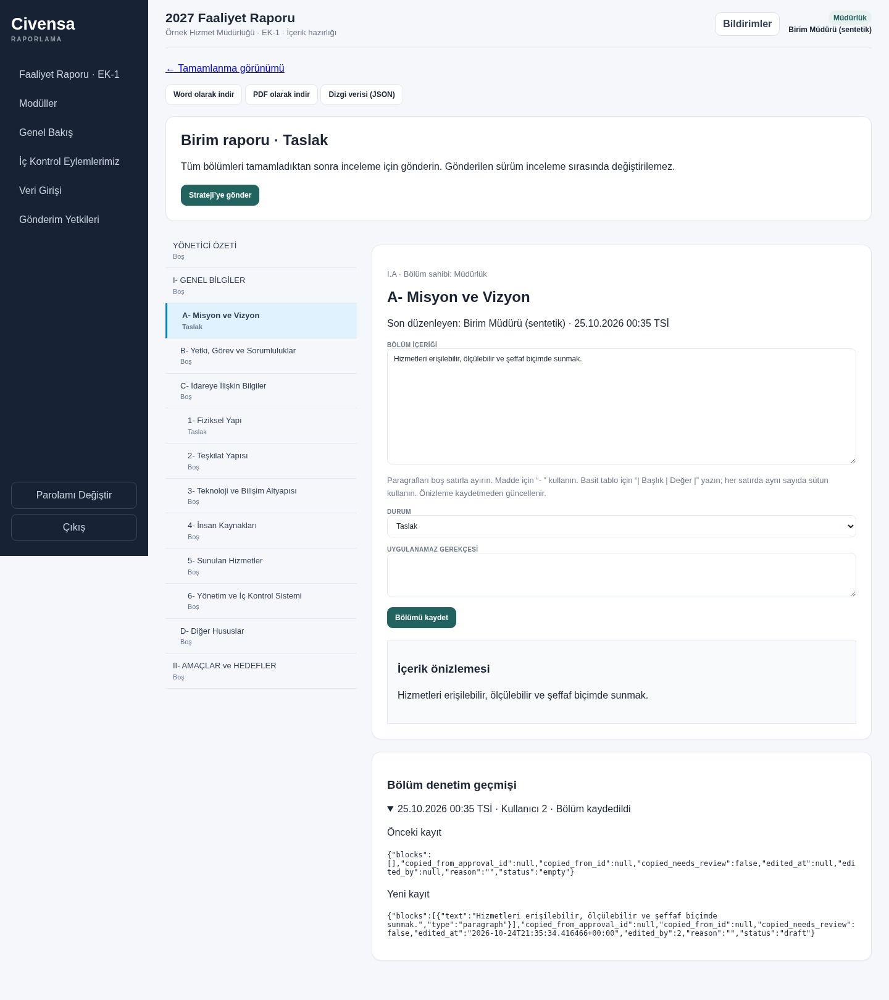

**Görünen metinler ve tablolar:**

- `div`: Civensa RAPORLAMA
- `h1`: 2027 Faaliyet Raporu
- `p`: Örnek Hizmet Müdürlüğü · EK-1 · İçerik hazırlığı
- `div`: Müdürlük Birim Müdürü (sentetik)
- `p`: ← Tamamlanma görünümü
- `p`: Word olarak indir PDF olarak indir Dizgi verisi (JSON)
- `h2`: Birim raporu · Taslak
- `p`: Tüm bölümleri tamamladıktan sonra inceleme için gönderin. Gönderilen sürüm inceleme sırasında değiştirilemez.
- `p`: I.A · Bölüm sahibi: Müdürlük
- `h2`: A- Misyon ve Vizyon
- `p`: Son düzenleyen: Birim Müdürü (sentetik) · 25.10.2026 00:35 TSİ
- `p`: Paragrafları boş satırla ayırın. Madde için “- ” kullanın. Basit tablo için “&#124; Başlık &#124; Değer &#124;” yazın; her satırda aynı sayıda sütun kullanın. Önizleme kaydetmeden güncellenir.
- `h3`: İçerik önizlemesi
- `p`: Hizmetleri erişilebilir, ölçülebilir ve şeffaf biçimde sunmak.
- `h3`: Bölüm denetim geçmişi
- `p`: Önceki kayıt
- `p`: Yeni kayıt
- `pre`: {"blocks":[],"copied_from_approval_id":null,"copied_from_id":null,"copied_needs_review":false,"edited_at":null,"edited_by":null,"reason":"","status":"empty"}
- `pre`: {"blocks":[{"text":"Hizmetleri erişilebilir, ölçülebilir ve şeffaf biçimde sunmak.","type":"paragraph"}],"copied_from_approval_id":null,"copied_from_id":null,"copied_needs_review":false,"edited_at":"2026-10-24T21:35:34.416466+00:00","edited_by":2,"reason":"","status":"draft"}

**Bağlantı, düğme, form ve alanlar:**

| Öğe | Tür / etiket / bağlam | Hedef URL veya eylem | Ne yapar / mevcut değer |
| --- | --- | --- | --- |
| E001 | a · Faaliyet Raporu · EK-1 | `/activity-sections` | Bağlantıdaki ekranı veya dosyayı açar: Faaliyet Raporu · EK-1. |
| E002 | a · Modüller | `/modules` | Bağlantıdaki ekranı veya dosyayı açar: Modüller. |
| E003 | a · Genel Bakış | `/dashboard` | Bağlantıdaki ekranı veya dosyayı açar: Genel Bakış. |
| E004 | a · İç Kontrol Eylemlerimiz | `/internal-control/our-actions` | Bağlantıdaki ekranı veya dosyayı açar: İç Kontrol Eylemlerimiz. |
| E005 | a · Veri Girişi | `/department/1` | Bağlantıdaki ekranı veya dosyayı açar: Veri Girişi. |
| E006 | a · Gönderim Yetkileri | `/submit-authorizations` | Bağlantıdaki ekranı veya dosyayı açar: Gönderim Yetkileri. |
| E007 | button · Parolamı Değiştir (#changePasswordButton) | `#passwordModal` | Parola değiştirme penceresini açar. |
| E008 | form · Çıkış | `POST /logout` | Oturumu kapatıp giriş ekranına döner. |
| E009 | button · Çıkış | `POST /logout` | Oturumu kapatıp giriş ekranına döner. |
| E010 | button · Bildirimler (#notificationButton) | `GET /api/notifications → #notificationPanel` | Bildirim listesini açar. |
| E011 | a · ← Tamamlanma görünümü | `/activity-sections` | Bağlantıdaki ekranı veya dosyayı açar: ← Tamamlanma görünümü. |
| E012 | a · Word olarak indir | `/activity-sections/reports/2/export.docx` | Bağlantıdaki ekranı veya dosyayı açar: Word olarak indir. |
| E013 | a · PDF olarak indir | `/activity-sections/reports/2/export.pdf` | Bağlantıdaki ekranı veya dosyayı açar: PDF olarak indir. |
| E014 | a · Dizgi verisi (JSON) | `/activity-sections/reports/2/typeset.json` | Bağlantıdaki ekranı veya dosyayı açar: Dizgi verisi (JSON). |
| E015 | form · Strateji’ye gönder · Birim raporu · Taslak | `POST /activity-sections/reports/2/workflow/submit` | Strateji’ye gönder işlemini form alanlarıyla gönderir; doğrulama sonrası kaydeder veya hata gösterir. |
| E016 | button · Strateji’ye gönder · Birim raporu · Taslak | `POST /activity-sections/reports/2/workflow/submit` | Strateji’ye gönder işlemini form alanlarıyla gönderir; doğrulama sonrası kaydeder veya hata gösterir. |
| E017 | a · YÖNETİCİ ÖZETİ Boş | `?code=OZET` | Bağlantıdaki ekranı veya dosyayı açar: YÖNETİCİ ÖZETİ Boş. |
| E018 | a · I- GENEL BİLGİLER Boş | `?code=I` | Bağlantıdaki ekranı veya dosyayı açar: I- GENEL BİLGİLER Boş. |
| E019 | a · A- Misyon ve Vizyon Taslak | `?code=I.A` | Bağlantıdaki ekranı veya dosyayı açar: A- Misyon ve Vizyon Taslak. |
| E020 | a · B- Yetki, Görev ve Sorumluluklar Boş | `?code=I.B` | Bağlantıdaki ekranı veya dosyayı açar: B- Yetki, Görev ve Sorumluluklar Boş. |
| E021 | a · C- İdareye İlişkin Bilgiler Boş | `?code=I.C` | Bağlantıdaki ekranı veya dosyayı açar: C- İdareye İlişkin Bilgiler Boş. |
| E022 | a · 1- Fiziksel Yapı Taslak | `?code=I.C.1` | Bağlantıdaki ekranı veya dosyayı açar: 1- Fiziksel Yapı Taslak. |
| E023 | a · 2- Teşkilat Yapısı Boş | `?code=I.C.2` | Bağlantıdaki ekranı veya dosyayı açar: 2- Teşkilat Yapısı Boş. |
| E024 | a · 3- Teknoloji ve Bilişim Altyapısı Boş | `?code=I.C.3` | Bağlantıdaki ekranı veya dosyayı açar: 3- Teknoloji ve Bilişim Altyapısı Boş. |
| E025 | a · 4- İnsan Kaynakları Boş | `?code=I.C.4` | Bağlantıdaki ekranı veya dosyayı açar: 4- İnsan Kaynakları Boş. |
| E026 | a · 5- Sunulan Hizmetler Boş | `?code=I.C.5` | Bağlantıdaki ekranı veya dosyayı açar: 5- Sunulan Hizmetler Boş. |
| E027 | a · 6- Yönetim ve İç Kontrol Sistemi Boş | `?code=I.C.6` | Bağlantıdaki ekranı veya dosyayı açar: 6- Yönetim ve İç Kontrol Sistemi Boş. |
| E028 | a · D- Diğer Hususlar Boş | `?code=I.D` | Bağlantıdaki ekranı veya dosyayı açar: D- Diğer Hususlar Boş. |
| E029 | a · II- AMAÇLAR ve HEDEFLER Boş | `?code=II` | Bağlantıdaki ekranı veya dosyayı açar: II- AMAÇLAR ve HEDEFLER Boş. |
| E030 | a · A- Temel Politika ve Öncelikler Boş | `?code=II.A` | Bağlantıdaki ekranı veya dosyayı açar: A- Temel Politika ve Öncelikler Boş. |
| E031 | a · B- İdarenin Stratejik Planında Yer Alan Amaç ve Hedefler Boş | `?code=II.B` | Bağlantıdaki ekranı veya dosyayı açar: B- İdarenin Stratejik Planında Yer Alan Amaç ve Hedefler Boş. |
| E032 | a · C- Diğer Hususlar Boş | `?code=II.C` | Bağlantıdaki ekranı veya dosyayı açar: C- Diğer Hususlar Boş. |
| E033 | a · III- FAALİYETLERE İLİŞKİN BİLGİ VE DEĞERLENDİRMELER Boş | `?code=III` | Bağlantıdaki ekranı veya dosyayı açar: III- FAALİYETLERE İLİŞKİN BİLGİ VE DEĞERLENDİRMELER Boş. |
| E034 | a · A- Malî Bilgiler Boş | `?code=III.A` | Bağlantıdaki ekranı veya dosyayı açar: A- Malî Bilgiler Boş. |
| E035 | a · 1- Bütçe Uygulama Sonuçları Boş | `?code=III.A.1` | Bağlantıdaki ekranı veya dosyayı açar: 1- Bütçe Uygulama Sonuçları Boş. |
| E036 | a · 2- Temel Malî Tablolara İlişkin Açıklamalar Boş | `?code=III.A.2` | Bağlantıdaki ekranı veya dosyayı açar: 2- Temel Malî Tablolara İlişkin Açıklamalar Boş. |
| E037 | a · 3- Malî Denetim Sonuçları Boş | `?code=III.A.3` | Bağlantıdaki ekranı veya dosyayı açar: 3- Malî Denetim Sonuçları Boş. |
| E038 | a · 4- Diğer Hususlar Boş | `?code=III.A.4` | Bağlantıdaki ekranı veya dosyayı açar: 4- Diğer Hususlar Boş. |
| E039 | a · B- Performans Bilgileri Boş | `?code=III.B` | Bağlantıdaki ekranı veya dosyayı açar: B- Performans Bilgileri Boş. |
| E040 | a · 1- Program, Alt Program, Faaliyet Bilgileri Boş | `?code=III.B.1` | Bağlantıdaki ekranı veya dosyayı açar: 1- Program, Alt Program, Faaliyet Bilgileri Boş. |
| E041 | a · 2- Performans Sonuçlarının Değerlendirilmesi Boş | `?code=III.B.2` | Bağlantıdaki ekranı veya dosyayı açar: 2- Performans Sonuçlarının Değerlendirilmesi Boş. |
| E042 | a · i. Alt program hedef ve göstergeleriyle ilgili gerçekleşme sonuçları ve değerlendirmeler Hazır | `?code=III.B.2.i` | Bağlantıdaki ekranı veya dosyayı açar: i. Alt program hedef ve göstergeleriyle ilgili gerçekleşme sonuçları ve değerlendirmeler Hazır. |
| E043 | a · ii. Performans denetim sonuçları Boş | `?code=III.B.2.ii` | Bağlantıdaki ekranı veya dosyayı açar: ii. Performans denetim sonuçları Boş. |
| E044 | a · 3- Stratejik Plan Değerlendirme Tabloları Boş | `?code=III.B.3` | Bağlantıdaki ekranı veya dosyayı açar: 3- Stratejik Plan Değerlendirme Tabloları Boş. |
| E045 | a · 4- Performans Bilgi Sisteminin Değerlendirilmesi Boş | `?code=III.B.4` | Bağlantıdaki ekranı veya dosyayı açar: 4- Performans Bilgi Sisteminin Değerlendirilmesi Boş. |
| E046 | a · 5- Diğer Hususlar Boş | `?code=III.B.5` | Bağlantıdaki ekranı veya dosyayı açar: 5- Diğer Hususlar Boş. |
| E047 | a · IV- KURUMSAL KABİLİYET VE KAPASİTENİN DEĞERLENDİRİLMESİ Boş | `?code=IV` | Bağlantıdaki ekranı veya dosyayı açar: IV- KURUMSAL KABİLİYET VE KAPASİTENİN DEĞERLENDİRİLMESİ Boş. |
| E048 | a · A- Üstünlükler Boş | `?code=IV.A` | Bağlantıdaki ekranı veya dosyayı açar: A- Üstünlükler Boş. |
| E049 | a · B- Zayıflıklar Boş | `?code=IV.B` | Bağlantıdaki ekranı veya dosyayı açar: B- Zayıflıklar Boş. |
| E050 | a · C- Değerlendirme Boş | `?code=IV.C` | Bağlantıdaki ekranı veya dosyayı açar: C- Değerlendirme Boş. |
| E051 | a · V- ÖNERİ VE TEDBİRLER Boş | `?code=V` | Bağlantıdaki ekranı veya dosyayı açar: V- ÖNERİ VE TEDBİRLER Boş. |
| E052 | a · EKLER Boş | `?code=EKLER` | Bağlantıdaki ekranı veya dosyayı açar: EKLER Boş. |
| E053 | form · Bölümü kaydet · A- Misyon ve Vizyon | `POST /activity-sections/reports/2/sections/I.A` | Bölümü kaydet işlemini form alanlarıyla gönderir; doğrulama sonrası kaydeder veya hata gösterir. |
| E054 | textarea · BÖLÜM İÇERİĞİ · A- Misyon ve Vizyon | `POST /activity-sections/reports/2/sections/I.A` | İşlem için BÖLÜM İÇERİĞİ değerini girer. Değer: Hizmetleri erişilebilir, ölçülebilir ve şeffaf biçimde sunmak.. |
| E055 | select · DURUM Boş Taslak Hazır Uygulanamaz · A- Misyon ve Vizyon | `POST /activity-sections/reports/2/sections/I.A` | Listeden seçim yapar. Değer: draft. Seçenekler: Boş; Taslak; Hazır; Uygulanamaz. |
| E056 | textarea · UYGULANAMAZ GEREKÇESİ · A- Misyon ve Vizyon | `POST /activity-sections/reports/2/sections/I.A` | İşlem için UYGULANAMAZ GEREKÇESİ değerini girer. |
| E057 | button · Bölümü kaydet · A- Misyon ve Vizyon | `POST /activity-sections/reports/2/sections/I.A` | Bölümü kaydet işlemini form alanlarıyla gönderir; doğrulama sonrası kaydeder veya hata gösterir. |
| E058 | summary · 25.10.2026 00:35 TSİ · Kullanıcı 2 · Bölüm kaydedildi · 25.10.2026 00:35 TSİ · Kullanıcı 2 · Bölüm kaydedildi | `Aynı sayfadaki ayrıntı bölümü` | İçerik ve form ayrıntılarını açar veya daraltır. |

<a id="ekran-013"></a>

### 013 · Güvence beyanı · Dolu / taslak

URL kalıbı: `/activity-sections/reports/{document_id}/assurances/{code}` · Çekilen URL: `/activity-sections/reports/1/assurances/EK-1` · Rol: **strategy** · HTTP 200.

Sabit beyan metninin yer, tarih ve imzacı alanlarını düzenler.

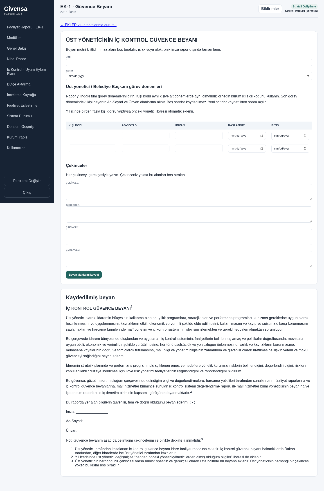

**Görünen metinler ve tablolar:**

- `div`: Civensa RAPORLAMA
- `h1`: EK-1 · Güvence Beyanı
- `p`: 2027 · İdare
- `div`: Strateji Geliştirme Strateji Müdürü (sentetik)
- `p`: ← EKLER ve tamamlanma durumu
- `h2`: ÜST YÖNETİCİNİN İÇ KONTROL GÜVENCE BEYANI
- `p`: Beyan metni kilitlidir. İmza alanı boş bırakılır; ıslak veya elektronik imza rapor dışında tamamlanır.
- `h3`: Üst yönetici / Belediye Başkanı görev dönemleri
- `p`: Rapor yılındaki tüm görev dönemlerini girin. Kişi kodu aynı kişiye ait dönemlerde aynı olmalıdır; örneğin kurum içi sicil kodunu kullanın. Son görev dönemindeki kişi beyanın Ad-Soyad ve Ünvan alanlarına alınır. Boş satırlar kaydedilmez. Yeni satırlar kaydettikten sonra açılır.
- `p`: Yıl içinde birden fazla kişi görev yaptıysa önceki yönetici ibaresi otomatik eklenir.
- `table`: KİŞİ KODU AD-SOYAD ÜNVAN BAŞLANGIÇ BİTİŞ
- `h3`: Çekinceler
- `p`: Her çekinceyi gerekçesiyle yazın. Çekinceniz yoksa bu alanları boş bırakın.
- `h2`: Kaydedilmiş beyan
- `h3`: İÇ KONTROL GÜVENCE BEYANI1
- `p`: Üst yönetici olarak; idaremin bütçesinin kalkınma planına, yıllık programlara, stratejik plan ve performans programları ile hizmet gereklerine uygun olarak hazırlanmasını ve uygulanmasını, kaynakların etkili, ekonomik ve verimli şekilde elde edilmesini, kullanılmasını ve kayıp ve suistimale karşı korunmasını sağlamaktan ve harcama birimlerinde malî yönetim ve iç kontrol sisteminin işleyişini izlemekten ve gerekli tedbirleri almaktan sorumluyum.
- `p`: Bu çerçevede idarem bünyesinde oluşturulan ve uygulanan iç kontrol sisteminin; faaliyetlerin belirlenmiş amaç ve politikalar doğrultusunda, mevzuata uygun etkili, ekonomik ve verimli bir şekilde yürütülmesine, her türlü usulsüzlük ve yolsuzluğun önlenmesine, varlık ve kaynakların korunmasına, muhasebe kayıtlarının doğru ve tam olarak tutulmasına, malî bilgi ve yönetim bilgisinin zamanında ve güvenilir olarak üretilmesine ilişkin yeterli ve makul güvenceyi sağladığını beyan ederim.
- `p`: İdaremin stratejik planında ve performans programında açıklanan amaç ve hedeflere yönelik kurumsal risklerin belirlendiğini, değerlendirildiğini, risklerin kabul edilebilir düzeye indirilmesi için ilave risk yönetimi faaliyetlerinin uygulandığını ve raporlandığını bildiririm.
- `p`: Bu güvence, gözetim sorumluluğum çerçevesinde edindiğim bilgi ve değerlendirmelere, harcama yetkilileri tarafından sunulan birim faaliyet raporlarına ve iç kontrol güvence beyanlarına, malî hizmetler birimince sunulan iç kontrol sistemi değerlendirme raporu ile malî hizmetler birim yöneticisinin beyanına ve iç denetim raporları ile iç denetim biriminin kapsamlı görüşüne dayanmaktadır.2
- `p`: Bu raporda yer alan bilgilerin güvenilir, tam ve doğru olduğunu beyan ederim. ( - )
- `p`: İmza: ________________
- `p`: Ad-Soyad:
- `p`: Ünvan:
- `p`: Not: Güvence beyanım aşağıda belirttiğim çekincelerim ile birlikte dikkate alınmalıdır:3
- `li`: Üst yönetici tarafından imzalanan iç kontrol güvence beyanı idare faaliyet raporuna eklenir. İç kontrol güvence beyanı bakanlıklarda Bakan tarafından, diğer idarelerde ise üst yönetici tarafından imzalanır.
- `li`: Yıl içerisinde üst yönetici değişmişse “benden önceki yönetici/yöneticilerden almış olduğum bilgiler” ibaresi de eklenir.
- `li`: Üst yöneticinin herhangi bir çekincesi varsa bunlar spesifik ve gerekçeli olarak liste halinde bu beyana eklenir. Üst yöneticinin herhangi bir çekincesi yoksa bu kısım boş bırakılır.

**Bağlantı, düğme, form ve alanlar:**

| Öğe | Tür / etiket / bağlam | Hedef URL veya eylem | Ne yapar / mevcut değer |
| --- | --- | --- | --- |
| E001 | a · Faaliyet Raporu · EK-1 | `/activity-sections` | Bağlantıdaki ekranı veya dosyayı açar: Faaliyet Raporu · EK-1. |
| E002 | a · Modüller | `/modules` | Bağlantıdaki ekranı veya dosyayı açar: Modüller. |
| E003 | a · Genel Bakış | `/dashboard` | Bağlantıdaki ekranı veya dosyayı açar: Genel Bakış. |
| E004 | a · Nihai Rapor | `/report-builder` | Bağlantıdaki ekranı veya dosyayı açar: Nihai Rapor. |
| E005 | a · İç Kontrol · Uyum Eylem Planı | `/internal-control` | Bağlantıdaki ekranı veya dosyayı açar: İç Kontrol · Uyum Eylem Planı. |
| E006 | a · Bütçe Aktarma | `/budget-reallocations` | Bağlantıdaki ekranı veya dosyayı açar: Bütçe Aktarma. |
| E007 | a · İnceleme Kuyruğu | `/review` | Bağlantıdaki ekranı veya dosyayı açar: İnceleme Kuyruğu. |
| E008 | a · Faaliyet Eşleştirme | `/activity-mapping` | Bağlantıdaki ekranı veya dosyayı açar: Faaliyet Eşleştirme. |
| E009 | a · Sistem Durumu | `/operations` | Bağlantıdaki ekranı veya dosyayı açar: Sistem Durumu. |
| E010 | a · Denetim Geçmişi | `/audit` | Bağlantıdaki ekranı veya dosyayı açar: Denetim Geçmişi. |
| E011 | a · Kurum Yapısı | `/structure` | Bağlantıdaki ekranı veya dosyayı açar: Kurum Yapısı. |
| E012 | a · Kullanıcılar | `/users` | Bağlantıdaki ekranı veya dosyayı açar: Kullanıcılar. |
| E013 | button · Parolamı Değiştir (#changePasswordButton) | `#passwordModal` | Parola değiştirme penceresini açar. |
| E014 | form · Çıkış | `POST /logout` | Oturumu kapatıp giriş ekranına döner. |
| E015 | button · Çıkış | `POST /logout` | Oturumu kapatıp giriş ekranına döner. |
| E016 | button · Bildirimler (#notificationButton) | `GET /api/notifications → #notificationPanel` | Bildirim listesini açar. |
| E017 | a · ← EKLER ve tamamlanma durumu | `/activity-sections/reports/1?code=EKLER` | Bağlantıdaki ekranı veya dosyayı açar: ← EKLER ve tamamlanma durumu. |
| E018 | form · Beyan alanlarını kaydet · ÜST YÖNETİCİNİN İÇ KONTROL GÜVENCE BEYANI | `POST /activity-sections/reports/1/assurances/EK-1` | Beyan alanlarını kaydet işlemini form alanlarıyla gönderir; doğrulama sonrası kaydeder veya hata gösterir. |
| E019 | input · YER · ÜST YÖNETİCİNİN İÇ KONTROL GÜVENCE BEYANI | `POST /activity-sections/reports/1/assurances/EK-1` | İşlem için YER değerini girer. |
| E020 | input · TARİH · ÜST YÖNETİCİNİN İÇ KONTROL GÜVENCE BEYANI | `POST /activity-sections/reports/1/assurances/EK-1` | İşlem için TARİH değerini girer. |
| E021 | input · Kişi kodu 1 · ÜST YÖNETİCİNİN İÇ KONTROL GÜVENCE BEYANI | `POST /activity-sections/reports/1/assurances/EK-1` | İşlem için Kişi kodu 1 değerini girer. |
| E022 | input · Ad-Soyad 1 · ÜST YÖNETİCİNİN İÇ KONTROL GÜVENCE BEYANI | `POST /activity-sections/reports/1/assurances/EK-1` | İşlem için Ad-Soyad 1 değerini girer. |
| E023 | input · Ünvan 1 · ÜST YÖNETİCİNİN İÇ KONTROL GÜVENCE BEYANI | `POST /activity-sections/reports/1/assurances/EK-1` | İşlem için Ünvan 1 değerini girer. |
| E024 | input · Başlangıç 1 · ÜST YÖNETİCİNİN İÇ KONTROL GÜVENCE BEYANI | `POST /activity-sections/reports/1/assurances/EK-1` | İşlem için Başlangıç 1 değerini girer. |
| E025 | input · Bitiş 1 · ÜST YÖNETİCİNİN İÇ KONTROL GÜVENCE BEYANI | `POST /activity-sections/reports/1/assurances/EK-1` | İşlem için Bitiş 1 değerini girer. |
| E026 | input · Kişi kodu 2 · ÜST YÖNETİCİNİN İÇ KONTROL GÜVENCE BEYANI | `POST /activity-sections/reports/1/assurances/EK-1` | İşlem için Kişi kodu 2 değerini girer. |
| E027 | input · Ad-Soyad 2 · ÜST YÖNETİCİNİN İÇ KONTROL GÜVENCE BEYANI | `POST /activity-sections/reports/1/assurances/EK-1` | İşlem için Ad-Soyad 2 değerini girer. |
| E028 | input · Ünvan 2 · ÜST YÖNETİCİNİN İÇ KONTROL GÜVENCE BEYANI | `POST /activity-sections/reports/1/assurances/EK-1` | İşlem için Ünvan 2 değerini girer. |
| E029 | input · Başlangıç 2 · ÜST YÖNETİCİNİN İÇ KONTROL GÜVENCE BEYANI | `POST /activity-sections/reports/1/assurances/EK-1` | İşlem için Başlangıç 2 değerini girer. |
| E030 | input · Bitiş 2 · ÜST YÖNETİCİNİN İÇ KONTROL GÜVENCE BEYANI | `POST /activity-sections/reports/1/assurances/EK-1` | İşlem için Bitiş 2 değerini girer. |
| E031 | textarea · ÇEKİNCE 1 · ÜST YÖNETİCİNİN İÇ KONTROL GÜVENCE BEYANI | `POST /activity-sections/reports/1/assurances/EK-1` | İşlem için ÇEKİNCE 1 değerini girer. |
| E032 | textarea · GEREKÇE 1 · ÜST YÖNETİCİNİN İÇ KONTROL GÜVENCE BEYANI | `POST /activity-sections/reports/1/assurances/EK-1` | İşlem için GEREKÇE 1 değerini girer. |
| E033 | textarea · ÇEKİNCE 2 · ÜST YÖNETİCİNİN İÇ KONTROL GÜVENCE BEYANI | `POST /activity-sections/reports/1/assurances/EK-1` | İşlem için ÇEKİNCE 2 değerini girer. |
| E034 | textarea · GEREKÇE 2 · ÜST YÖNETİCİNİN İÇ KONTROL GÜVENCE BEYANI | `POST /activity-sections/reports/1/assurances/EK-1` | İşlem için GEREKÇE 2 değerini girer. |
| E035 | button · Beyan alanlarını kaydet · ÜST YÖNETİCİNİN İÇ KONTROL GÜVENCE BEYANI | `POST /activity-sections/reports/1/assurances/EK-1` | Beyan alanlarını kaydet işlemini form alanlarıyla gönderir; doğrulama sonrası kaydeder veya hata gösterir. |

<a id="ekran-014"></a>

### 014 · Güvence beyanı · Dolu / taslak

URL kalıbı: `/activity-sections/reports/{document_id}/assurances/{code}` · Çekilen URL: `/activity-sections/reports/2/assurances/EK-2` · Rol: **department** · HTTP 200.

Sabit beyan metninin yer, tarih ve imzacı alanlarını düzenler.


**Görünen metinler ve tablolar:**

- `div`: Civensa RAPORLAMA
- `h1`: EK-2 · Güvence Beyanı
- `p`: 2027 · Örnek Hizmet Müdürlüğü
- `div`: Müdürlük Birim Müdürü (sentetik)
- `p`: ← EKLER ve tamamlanma durumu
- `h2`: HARCAMA YETKİLİSİNİN İÇ KONTROL GÜVENCE BEYANI
- `p`: Beyan metni kilitlidir. İmza alanı boş bırakılır; ıslak veya elektronik imza rapor dışında tamamlanır.
- `h3`: Harcama yetkilisi görev dönemleri
- `p`: Rapor yılındaki tüm görev dönemlerini girin. Kişi kodu aynı kişiye ait dönemlerde aynı olmalıdır; örneğin kurum içi sicil kodunu kullanın. Son görev dönemindeki kişi beyanın Ad-Soyad ve Ünvan alanlarına alınır. Boş satırlar kaydedilmez. Yeni satırlar kaydettikten sonra açılır.
- `p`: Yıl içinde birden fazla kişi görev yaptıysa önceki yönetici ibaresi otomatik eklenir.
- `table`: KİŞİ KODU AD-SOYAD ÜNVAN BAŞLANGIÇ BİTİŞ
- `h3`: Çekinceler
- `p`: Her çekinceyi gerekçesiyle yazın. Çekinceniz yoksa bu alanları boş bırakın.
- `h2`: Kaydedilmiş beyan
- `h3`: İÇ KONTROL GÜVENCE BEYANI1
- `p`: Harcama yetkilisi olarak, birimimde yürütülen faaliyetlerin görev, yetki ve sorumlulukların açık bir şekilde belirlendiği uygun bir kurumsal yapı içerisinde, etik değerleri benimsemiş, yeterli ve yetkin personel tarafından yürütülmesini, faaliyet ve süreçlere yönelik operasyonel risklerin belirlenmesini ve uygun kontrol faaliyetlerinin uygulanmasını, etkin bir bilgi ve iletişim sisteminin oluşturulmasını ve işletilmesini ve tüm bu faaliyetlerin sürekli ve sistemli bir şekilde izlenmesini ve geliştirilmesini sağlamaktan, verdiğim harcama talimatlarının bütçe ilke ve esaslarına, kanun ve diğer mevzuata uygun olmasından, kaynakların etkili, ekonomik ve verimli kullanılmasından ve üst yöneticiye ve yetkili mercilere hesap vermekten sorumluyum.
- `p`: Bu çerçevede, faaliyetlerin belirlenmiş amaç ve politikalar doğrultusunda, mevzuata uygun, etkili, ekonomik ve verimli bir şekilde yürütülmesine, her türlü usulsüzlük ve yolsuzluğun önlenmesine, varlık ve kaynakların korunmasına, muhasebe kayıtlarının doğru ve tam olarak tutulmasına, malî bilgi ve yönetim bilgisinin zamanında ve güvenilir olarak üretilmesine ilişkin yeterli ve makul güvence sağlayan bir iç kontrol sisteminin birimimde oluşturulduğunu ve uygulandığını beyan ederim.
- `p`: Birimimde yürütülen faaliyet ve süreçleri olumsuz etkileyebilecek riskler tespit edilmiş, değerlendirilmiş, bu risklerin etki ve olasılıklarını azaltacak tedbirler uygulanmış ve raporlanmıştır.
- `p`: Bu güvence, harcama yetkilisi olarak sahip olduğum iç kontrole ilişkin bilgi ve değerlendirmeler ile iç denetim raporlarına dayanmaktadır.2
- `p`: Bu raporda yer alan bilgilerin güvenilir, tam ve doğru olduğunu beyan ederim. ( - )
- `p`: İmza: ________________
- `p`: Ad-Soyad:
- `p`: Ünvan:
- `p`: Not: Güvence beyanım aşağıda belirttiğim çekincelerim ile birlikte dikkate alınmalıdır:3
- `li`: Harcama yetkilileri tarafından imzalanan iç kontrol güvence beyanı birim faaliyet raporlarına eklenir.
- `li`: Yıl içerisinde harcama yetkilisi değişmişse “benden önceki harcama yetkilisi/yetkililerinden almış olduğum bilgiler” ibaresi de eklenir.
- `li`: Harcama yetkilisinin herhangi bir çekincesi varsa bunlar spesifik ve gerekçeli olarak liste halinde bu beyana eklenir. Harcama yetkilisinin herhangi bir çekincesi yoksa bu kısım boş bırakılır.

**Bağlantı, düğme, form ve alanlar:**

| Öğe | Tür / etiket / bağlam | Hedef URL veya eylem | Ne yapar / mevcut değer |
| --- | --- | --- | --- |
| E001 | a · Faaliyet Raporu · EK-1 | `/activity-sections` | Bağlantıdaki ekranı veya dosyayı açar: Faaliyet Raporu · EK-1. |
| E002 | a · Modüller | `/modules` | Bağlantıdaki ekranı veya dosyayı açar: Modüller. |
| E003 | a · Genel Bakış | `/dashboard` | Bağlantıdaki ekranı veya dosyayı açar: Genel Bakış. |
| E004 | a · İç Kontrol Eylemlerimiz | `/internal-control/our-actions` | Bağlantıdaki ekranı veya dosyayı açar: İç Kontrol Eylemlerimiz. |
| E005 | a · Veri Girişi | `/department/1` | Bağlantıdaki ekranı veya dosyayı açar: Veri Girişi. |
| E006 | a · Gönderim Yetkileri | `/submit-authorizations` | Bağlantıdaki ekranı veya dosyayı açar: Gönderim Yetkileri. |
| E007 | button · Parolamı Değiştir (#changePasswordButton) | `#passwordModal` | Parola değiştirme penceresini açar. |
| E008 | form · Çıkış | `POST /logout` | Oturumu kapatıp giriş ekranına döner. |
| E009 | button · Çıkış | `POST /logout` | Oturumu kapatıp giriş ekranına döner. |
| E010 | button · Bildirimler (#notificationButton) | `GET /api/notifications → #notificationPanel` | Bildirim listesini açar. |
| E011 | a · ← EKLER ve tamamlanma durumu | `/activity-sections/reports/2?code=EKLER` | Bağlantıdaki ekranı veya dosyayı açar: ← EKLER ve tamamlanma durumu. |
| E012 | form · Beyan alanlarını kaydet · HARCAMA YETKİLİSİNİN İÇ KONTROL GÜVENCE BEYANI | `POST /activity-sections/reports/2/assurances/EK-2` | Beyan alanlarını kaydet işlemini form alanlarıyla gönderir; doğrulama sonrası kaydeder veya hata gösterir. |
| E013 | input · YER · HARCAMA YETKİLİSİNİN İÇ KONTROL GÜVENCE BEYANI | `POST /activity-sections/reports/2/assurances/EK-2` | İşlem için YER değerini girer. |
| E014 | input · TARİH · HARCAMA YETKİLİSİNİN İÇ KONTROL GÜVENCE BEYANI | `POST /activity-sections/reports/2/assurances/EK-2` | İşlem için TARİH değerini girer. |
| E015 | input · Kişi kodu 1 · HARCAMA YETKİLİSİNİN İÇ KONTROL GÜVENCE BEYANI | `POST /activity-sections/reports/2/assurances/EK-2` | İşlem için Kişi kodu 1 değerini girer. |
| E016 | input · Ad-Soyad 1 · HARCAMA YETKİLİSİNİN İÇ KONTROL GÜVENCE BEYANI | `POST /activity-sections/reports/2/assurances/EK-2` | İşlem için Ad-Soyad 1 değerini girer. |
| E017 | input · Ünvan 1 · HARCAMA YETKİLİSİNİN İÇ KONTROL GÜVENCE BEYANI | `POST /activity-sections/reports/2/assurances/EK-2` | İşlem için Ünvan 1 değerini girer. |
| E018 | input · Başlangıç 1 · HARCAMA YETKİLİSİNİN İÇ KONTROL GÜVENCE BEYANI | `POST /activity-sections/reports/2/assurances/EK-2` | İşlem için Başlangıç 1 değerini girer. |
| E019 | input · Bitiş 1 · HARCAMA YETKİLİSİNİN İÇ KONTROL GÜVENCE BEYANI | `POST /activity-sections/reports/2/assurances/EK-2` | İşlem için Bitiş 1 değerini girer. |
| E020 | input · Kişi kodu 2 · HARCAMA YETKİLİSİNİN İÇ KONTROL GÜVENCE BEYANI | `POST /activity-sections/reports/2/assurances/EK-2` | İşlem için Kişi kodu 2 değerini girer. |
| E021 | input · Ad-Soyad 2 · HARCAMA YETKİLİSİNİN İÇ KONTROL GÜVENCE BEYANI | `POST /activity-sections/reports/2/assurances/EK-2` | İşlem için Ad-Soyad 2 değerini girer. |
| E022 | input · Ünvan 2 · HARCAMA YETKİLİSİNİN İÇ KONTROL GÜVENCE BEYANI | `POST /activity-sections/reports/2/assurances/EK-2` | İşlem için Ünvan 2 değerini girer. |
| E023 | input · Başlangıç 2 · HARCAMA YETKİLİSİNİN İÇ KONTROL GÜVENCE BEYANI | `POST /activity-sections/reports/2/assurances/EK-2` | İşlem için Başlangıç 2 değerini girer. |
| E024 | input · Bitiş 2 · HARCAMA YETKİLİSİNİN İÇ KONTROL GÜVENCE BEYANI | `POST /activity-sections/reports/2/assurances/EK-2` | İşlem için Bitiş 2 değerini girer. |
| E025 | textarea · ÇEKİNCE 1 · HARCAMA YETKİLİSİNİN İÇ KONTROL GÜVENCE BEYANI | `POST /activity-sections/reports/2/assurances/EK-2` | İşlem için ÇEKİNCE 1 değerini girer. |
| E026 | textarea · GEREKÇE 1 · HARCAMA YETKİLİSİNİN İÇ KONTROL GÜVENCE BEYANI | `POST /activity-sections/reports/2/assurances/EK-2` | İşlem için GEREKÇE 1 değerini girer. |
| E027 | textarea · ÇEKİNCE 2 · HARCAMA YETKİLİSİNİN İÇ KONTROL GÜVENCE BEYANI | `POST /activity-sections/reports/2/assurances/EK-2` | İşlem için ÇEKİNCE 2 değerini girer. |
| E028 | textarea · GEREKÇE 2 · HARCAMA YETKİLİSİNİN İÇ KONTROL GÜVENCE BEYANI | `POST /activity-sections/reports/2/assurances/EK-2` | İşlem için GEREKÇE 2 değerini girer. |
| E029 | button · Beyan alanlarını kaydet · HARCAMA YETKİLİSİNİN İÇ KONTROL GÜVENCE BEYANI | `POST /activity-sections/reports/2/assurances/EK-2` | Beyan alanlarını kaydet işlemini form alanlarıyla gönderir; doğrulama sonrası kaydeder veya hata gösterir. |

<a id="ekran-015"></a>

### 015 · Malî içe aktarma önizlemesi · Dolu / taslak

URL kalıbı: `/activity-sections/reports/{document_id}/financial/imports/{import_id}` · Çekilen URL: `/activity-sections/reports/1/financial/imports/1` · Rol: **strategy** · HTTP 200.

Excel malî verilerinin farklarını ve satır hatalarını gösterir.

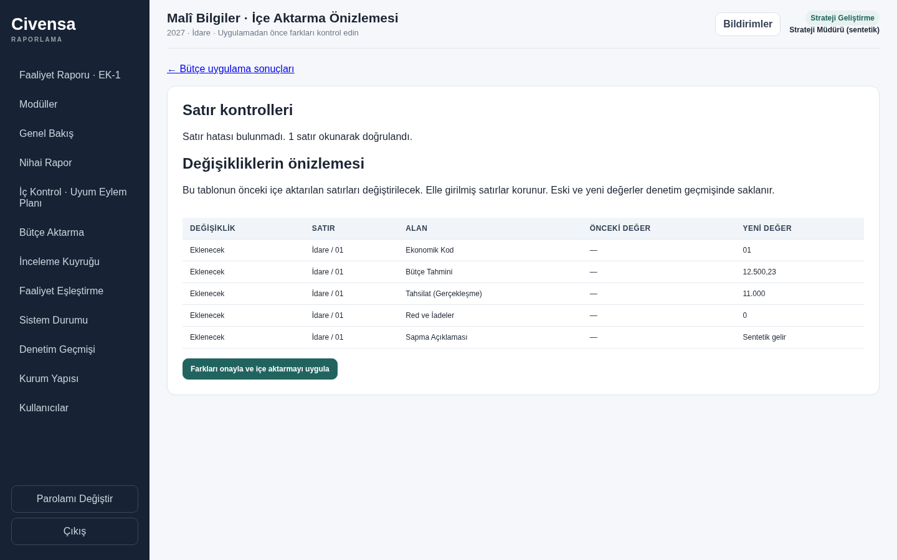

**Görünen metinler ve tablolar:**

- `div`: Civensa RAPORLAMA
- `h1`: Malî Bilgiler · İçe Aktarma Önizlemesi
- `p`: 2027 · İdare · Uygulamadan önce farkları kontrol edin
- `div`: Strateji Geliştirme Strateji Müdürü (sentetik)
- `p`: ← Bütçe uygulama sonuçları
- `h2`: Satır kontrolleri
- `p`: Satır hatası bulunmadı. 1 satır okunarak doğrulandı.
- `h2`: Değişikliklerin önizlemesi
- `p`: Bu tablonun önceki içe aktarılan satırları değiştirilecek. Elle girilmiş satırlar korunur. Eski ve yeni değerler denetim geçmişinde saklanır.
- `table`: DEĞİŞİKLİK SATIR ALAN ÖNCEKİ DEĞER YENİ DEĞER Eklenecek İdare / 01 Ekonomik Kod — 01 Eklenecek İdare / 01 Bütçe Tahmini — 12.500,23 Eklenecek İdare / 01 Tahsilat (Gerçekleşme) — 11.000 Eklenecek İdare / 01 Red ve İadeler — 0 Eklenecek İdare / 01 Sapma Açıklaması — Sentetik gelir

**Bağlantı, düğme, form ve alanlar:**

| Öğe | Tür / etiket / bağlam | Hedef URL veya eylem | Ne yapar / mevcut değer |
| --- | --- | --- | --- |
| E001 | a · Faaliyet Raporu · EK-1 | `/activity-sections` | Bağlantıdaki ekranı veya dosyayı açar: Faaliyet Raporu · EK-1. |
| E002 | a · Modüller | `/modules` | Bağlantıdaki ekranı veya dosyayı açar: Modüller. |
| E003 | a · Genel Bakış | `/dashboard` | Bağlantıdaki ekranı veya dosyayı açar: Genel Bakış. |
| E004 | a · Nihai Rapor | `/report-builder` | Bağlantıdaki ekranı veya dosyayı açar: Nihai Rapor. |
| E005 | a · İç Kontrol · Uyum Eylem Planı | `/internal-control` | Bağlantıdaki ekranı veya dosyayı açar: İç Kontrol · Uyum Eylem Planı. |
| E006 | a · Bütçe Aktarma | `/budget-reallocations` | Bağlantıdaki ekranı veya dosyayı açar: Bütçe Aktarma. |
| E007 | a · İnceleme Kuyruğu | `/review` | Bağlantıdaki ekranı veya dosyayı açar: İnceleme Kuyruğu. |
| E008 | a · Faaliyet Eşleştirme | `/activity-mapping` | Bağlantıdaki ekranı veya dosyayı açar: Faaliyet Eşleştirme. |
| E009 | a · Sistem Durumu | `/operations` | Bağlantıdaki ekranı veya dosyayı açar: Sistem Durumu. |
| E010 | a · Denetim Geçmişi | `/audit` | Bağlantıdaki ekranı veya dosyayı açar: Denetim Geçmişi. |
| E011 | a · Kurum Yapısı | `/structure` | Bağlantıdaki ekranı veya dosyayı açar: Kurum Yapısı. |
| E012 | a · Kullanıcılar | `/users` | Bağlantıdaki ekranı veya dosyayı açar: Kullanıcılar. |
| E013 | button · Parolamı Değiştir (#changePasswordButton) | `#passwordModal` | Parola değiştirme penceresini açar. |
| E014 | form · Çıkış | `POST /logout` | Oturumu kapatıp giriş ekranına döner. |
| E015 | button · Çıkış | `POST /logout` | Oturumu kapatıp giriş ekranına döner. |
| E016 | button · Bildirimler (#notificationButton) | `GET /api/notifications → #notificationPanel` | Bildirim listesini açar. |
| E017 | a · ← Bütçe uygulama sonuçları | `/activity-sections/reports/1?code=III.A.1` | Bağlantıdaki ekranı veya dosyayı açar: ← Bütçe uygulama sonuçları. |
| E018 | form · Farkları onayla ve içe aktarmayı uygula · Satır kontrolleri | `POST /activity-sections/reports/1/financial/imports/1/apply` | Önizlemedeki aktarımı doğrulayıp uygular. |
| E019 | button · Farkları onayla ve içe aktarmayı uygula · Satır kontrolleri | `POST /activity-sections/reports/1/financial/imports/1/apply` | Önizlemedeki aktarımı doğrulayıp uygular. |

<a id="ekran-016"></a>

### 016 · Denetim Geçmişi · Dolu / taslak

URL kalıbı: `/audit` · Çekilen URL: `/audit?period_id=1` · Rol: **strategy** · HTTP 200.

Kullanıcı işlemlerinin denetim kayıtlarını filtreler.

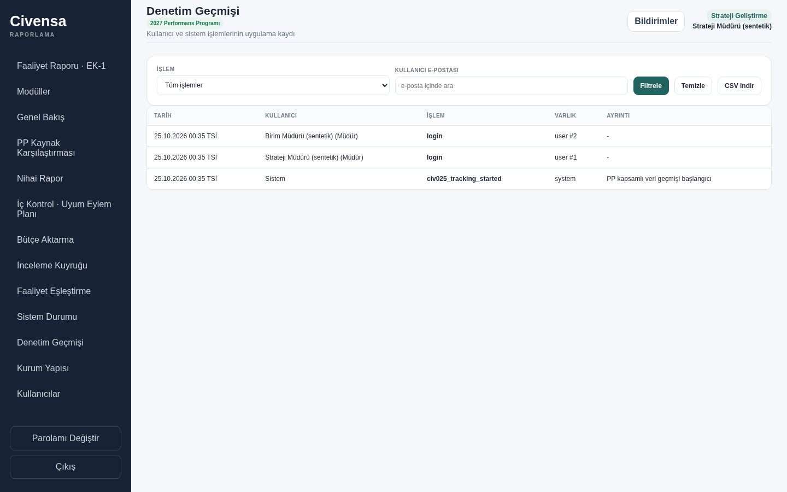

**Görünen metinler ve tablolar:**

- `div`: Civensa RAPORLAMA
- `h1`: Denetim Geçmişi
- `span`: 2027 Performans Programı
- `p`: Kullanıcı ve sistem işlemlerinin uygulama kaydı
- `div`: Strateji Geliştirme Strateji Müdürü (sentetik)
- `table`: TARİH KULLANICI İŞLEM VARLIK AYRINTI 25.10.2026 00:35 TSİ Birim Müdürü (sentetik) (Müdür) login user #2 - 25.10.2026 00:35 TSİ Strateji Müdürü (sentetik) (Müdür) login user #1 - 25.10.2026 00:35 TSİ Sistem civ025_tracking_started system PP kapsamlı veri geçmişi başlangıcı

**Bağlantı, düğme, form ve alanlar:**

| Öğe | Tür / etiket / bağlam | Hedef URL veya eylem | Ne yapar / mevcut değer |
| --- | --- | --- | --- |
| E001 | a · Faaliyet Raporu · EK-1 | `/activity-sections` | Bağlantıdaki ekranı veya dosyayı açar: Faaliyet Raporu · EK-1. |
| E002 | a · Modüller | `/modules` | Bağlantıdaki ekranı veya dosyayı açar: Modüller. |
| E003 | a · Genel Bakış | `/dashboard?period_id=1` | Bağlantıdaki ekranı veya dosyayı açar: Genel Bakış. |
| E004 | a · PP Kaynak Karşılaştırması | `/source-comparison?period_id=1` | Bağlantıdaki ekranı veya dosyayı açar: PP Kaynak Karşılaştırması. |
| E005 | a · Nihai Rapor | `/report-builder?period_id=1` | Bağlantıdaki ekranı veya dosyayı açar: Nihai Rapor. |
| E006 | a · İç Kontrol · Uyum Eylem Planı | `/internal-control` | Bağlantıdaki ekranı veya dosyayı açar: İç Kontrol · Uyum Eylem Planı. |
| E007 | a · Bütçe Aktarma | `/budget-reallocations` | Bağlantıdaki ekranı veya dosyayı açar: Bütçe Aktarma. |
| E008 | a · İnceleme Kuyruğu | `/review?period_id=1` | Bağlantıdaki ekranı veya dosyayı açar: İnceleme Kuyruğu. |
| E009 | a · Faaliyet Eşleştirme | `/activity-mapping?period_id=1` | Bağlantıdaki ekranı veya dosyayı açar: Faaliyet Eşleştirme. |
| E010 | a · Sistem Durumu | `/operations?period_id=1` | Bağlantıdaki ekranı veya dosyayı açar: Sistem Durumu. |
| E011 | a · Denetim Geçmişi | `/audit?period_id=1` | Bağlantıdaki ekranı veya dosyayı açar: Denetim Geçmişi. |
| E012 | a · Kurum Yapısı | `/structure?period_id=1` | Bağlantıdaki ekranı veya dosyayı açar: Kurum Yapısı. |
| E013 | a · Kullanıcılar | `/users?period_id=1` | Bağlantıdaki ekranı veya dosyayı açar: Kullanıcılar. |
| E014 | button · Parolamı Değiştir (#changePasswordButton) | `#passwordModal` | Parola değiştirme penceresini açar. |
| E015 | form · Çıkış | `POST /logout` | Oturumu kapatıp giriş ekranına döner. |
| E016 | button · Çıkış | `POST /logout` | Oturumu kapatıp giriş ekranına döner. |
| E017 | button · Bildirimler (#notificationButton) | `GET /api/notifications → #notificationPanel` | Bildirim listesini açar. |
| E018 | form · Filtrele | `GET /audit` | Alanlarla listeyi veya rapor görünümünü filtreler. |
| E019 | select · İŞLEM Tüm işlemler civ025_tracking_started login | `GET /audit` | Listeden seçim yapar. Seçenekler: Tüm işlemler; civ025_tracking_started; login. |
| E020 | input · KULLANICI E-POSTASI | `GET /audit` | İşlem için KULLANICI E-POSTASI değerini girer. |
| E021 | button · Filtrele | `GET /audit` | Alanlarla listeyi veya rapor görünümünü filtreler. |
| E022 | a · Temizle | `/audit?period_id=1` | Bağlantıdaki ekranı veya dosyayı açar: Temizle. |
| E023 | a · CSV indir | `/api/audit/export.csv?period_id=1&action=&user=` | Bağlantıdaki ekranı veya dosyayı açar: CSV indir. |

<a id="ekran-017"></a>

### 017 · Bütçe Aktarma · Boş liste

URL kalıbı: `/budget-reallocations` · Çekilen URL: `/budget-reallocations` · Rol: **strategy** · HTTP 200.

Kaydedilmiş bütçe aktarma işlemlerini listeler.

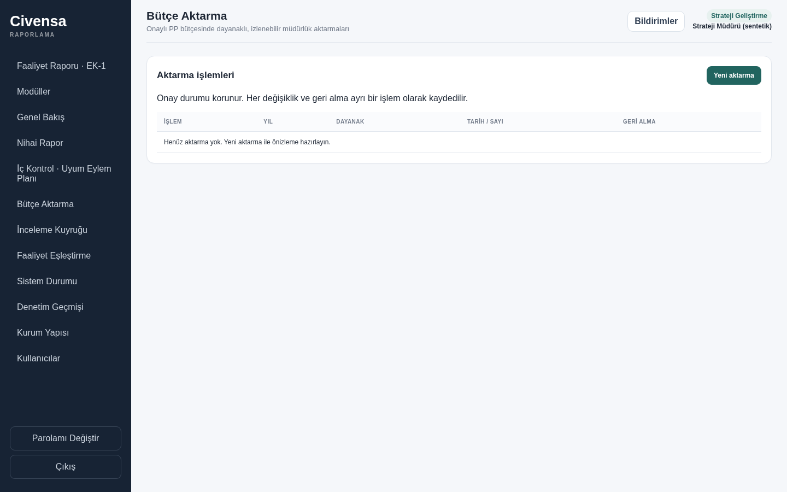

**Görünen metinler ve tablolar:**

- `div`: Civensa RAPORLAMA
- `h1`: Bütçe Aktarma
- `p`: Onaylı PP bütçesinde dayanaklı, izlenebilir müdürlük aktarmaları
- `div`: Strateji Geliştirme Strateji Müdürü (sentetik)
- `h2`: Aktarma işlemleri
- `p`: Onay durumu korunur. Her değişiklik ve geri alma ayrı bir işlem olarak kaydedilir.
- `table`: İŞLEM YIL DAYANAK TARİH / SAYI GERİ ALMA Henüz aktarma yok. Yeni aktarma ile önizleme hazırlayın.

**Bağlantı, düğme, form ve alanlar:**

| Öğe | Tür / etiket / bağlam | Hedef URL veya eylem | Ne yapar / mevcut değer |
| --- | --- | --- | --- |
| E001 | a · Faaliyet Raporu · EK-1 | `/activity-sections` | Bağlantıdaki ekranı veya dosyayı açar: Faaliyet Raporu · EK-1. |
| E002 | a · Modüller | `/modules` | Bağlantıdaki ekranı veya dosyayı açar: Modüller. |
| E003 | a · Genel Bakış | `/dashboard` | Bağlantıdaki ekranı veya dosyayı açar: Genel Bakış. |
| E004 | a · Nihai Rapor | `/report-builder` | Bağlantıdaki ekranı veya dosyayı açar: Nihai Rapor. |
| E005 | a · İç Kontrol · Uyum Eylem Planı | `/internal-control` | Bağlantıdaki ekranı veya dosyayı açar: İç Kontrol · Uyum Eylem Planı. |
| E006 | a · Bütçe Aktarma | `/budget-reallocations` | Bağlantıdaki ekranı veya dosyayı açar: Bütçe Aktarma. |
| E007 | a · İnceleme Kuyruğu | `/review` | Bağlantıdaki ekranı veya dosyayı açar: İnceleme Kuyruğu. |
| E008 | a · Faaliyet Eşleştirme | `/activity-mapping` | Bağlantıdaki ekranı veya dosyayı açar: Faaliyet Eşleştirme. |
| E009 | a · Sistem Durumu | `/operations` | Bağlantıdaki ekranı veya dosyayı açar: Sistem Durumu. |
| E010 | a · Denetim Geçmişi | `/audit` | Bağlantıdaki ekranı veya dosyayı açar: Denetim Geçmişi. |
| E011 | a · Kurum Yapısı | `/structure` | Bağlantıdaki ekranı veya dosyayı açar: Kurum Yapısı. |
| E012 | a · Kullanıcılar | `/users` | Bağlantıdaki ekranı veya dosyayı açar: Kullanıcılar. |
| E013 | button · Parolamı Değiştir (#changePasswordButton) | `#passwordModal` | Parola değiştirme penceresini açar. |
| E014 | form · Çıkış | `POST /logout` | Oturumu kapatıp giriş ekranına döner. |
| E015 | button · Çıkış | `POST /logout` | Oturumu kapatıp giriş ekranına döner. |
| E016 | button · Bildirimler (#notificationButton) | `GET /api/notifications → #notificationPanel` | Bildirim listesini açar. |
| E017 | a · Yeni aktarma · Aktarma işlemleri | `/budget-reallocations/new` | Bağlantıdaki ekranı veya dosyayı açar: Yeni aktarma. |

<a id="ekran-018"></a>

### 018 · Yeni Bütçe Aktarması · Dolu / taslak

URL kalıbı: `/budget-reallocations/new` · Çekilen URL: `/budget-reallocations/new` · Rol: **strategy** · HTTP 200.

Aktarma tutarlarını, önizlemeyi ve hukuki dayanağı hazırlar.

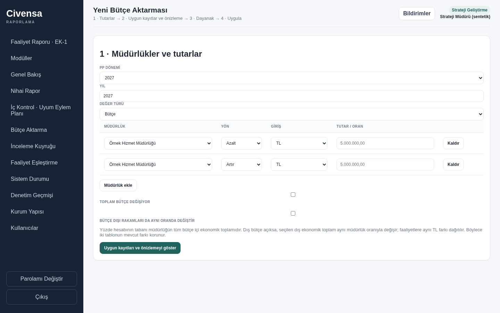

**Görünen metinler ve tablolar:**

- `div`: Civensa RAPORLAMA
- `h1`: Yeni Bütçe Aktarması
- `p`: 1 · Tutarlar → 2 · Uygun kayıtlar ve önizleme → 3 · Dayanak → 4 · Uygula
- `div`: Strateji Geliştirme Strateji Müdürü (sentetik)
- `h2`: 1 · Müdürlükler ve tutarlar
- `table`: MÜDÜRLÜK YÖN GİRİŞ TUTAR / ORAN Örnek Hizmet Müdürlüğü Strateji Geliştirme Müdürlüğü Örnek Destek Müdürlüğü Azalt Artır TL Yüzde (%) Kaldır Örnek Hizmet Müdürlüğü Strateji Geliştirme Müdürlüğü Örnek Destek Müdürlüğü Azalt Artır TL Yüzde (%) Kaldır
- `p`: Yüzde hesabının tabanı müdürlüğün tüm bütçe içi ekonomik toplamıdır. Dış bütçe açıksa, seçilen dış ekonomik toplam aynı müdürlük oranıyla değişir; faaliyetlere aynı TL farkı dağıtılır. Böylece iki tablonun mevcut farkı korunur.

**Bağlantı, düğme, form ve alanlar:**

| Öğe | Tür / etiket / bağlam | Hedef URL veya eylem | Ne yapar / mevcut değer |
| --- | --- | --- | --- |
| E001 | a · Faaliyet Raporu · EK-1 | `/activity-sections` | Bağlantıdaki ekranı veya dosyayı açar: Faaliyet Raporu · EK-1. |
| E002 | a · Modüller | `/modules` | Bağlantıdaki ekranı veya dosyayı açar: Modüller. |
| E003 | a · Genel Bakış | `/dashboard` | Bağlantıdaki ekranı veya dosyayı açar: Genel Bakış. |
| E004 | a · Nihai Rapor | `/report-builder` | Bağlantıdaki ekranı veya dosyayı açar: Nihai Rapor. |
| E005 | a · İç Kontrol · Uyum Eylem Planı | `/internal-control` | Bağlantıdaki ekranı veya dosyayı açar: İç Kontrol · Uyum Eylem Planı. |
| E006 | a · Bütçe Aktarma | `/budget-reallocations` | Bağlantıdaki ekranı veya dosyayı açar: Bütçe Aktarma. |
| E007 | a · İnceleme Kuyruğu | `/review` | Bağlantıdaki ekranı veya dosyayı açar: İnceleme Kuyruğu. |
| E008 | a · Faaliyet Eşleştirme | `/activity-mapping` | Bağlantıdaki ekranı veya dosyayı açar: Faaliyet Eşleştirme. |
| E009 | a · Sistem Durumu | `/operations` | Bağlantıdaki ekranı veya dosyayı açar: Sistem Durumu. |
| E010 | a · Denetim Geçmişi | `/audit` | Bağlantıdaki ekranı veya dosyayı açar: Denetim Geçmişi. |
| E011 | a · Kurum Yapısı | `/structure` | Bağlantıdaki ekranı veya dosyayı açar: Kurum Yapısı. |
| E012 | a · Kullanıcılar | `/users` | Bağlantıdaki ekranı veya dosyayı açar: Kullanıcılar. |
| E013 | button · Parolamı Değiştir (#changePasswordButton) | `#passwordModal` | Parola değiştirme penceresini açar. |
| E014 | form · Çıkış | `POST /logout` | Oturumu kapatıp giriş ekranına döner. |
| E015 | button · Çıkış | `POST /logout` | Oturumu kapatıp giriş ekranına döner. |
| E016 | button · Bildirimler (#notificationButton) | `GET /api/notifications → #notificationPanel` | Bildirim listesini açar. |
| E017 | select · PP DÖNEMİ 2027 (#period) · 1 · Müdürlükler ve tutarlar | `Aynı ekranın JavaScript işlem verisi` | Listeden seçim yapar. Değer: 1. Seçenekler: 2027. |
| E018 | input · YIL (#year) · 1 · Müdürlükler ve tutarlar | `Aynı ekranın JavaScript işlem verisi` | İşlem için YIL değerini girer. Değer: 2027. |
| E019 | select · DEĞER TÜRÜ Bütçe Tahmin Haziran sonu harcama Yıl sonu tahmini (#value-kind) · 1 · Müdürlükler ve tutarlar | `Aynı ekranın JavaScript işlem verisi` | Listeden seçim yapar. Değer: budget. Seçenekler: Bütçe; Tahmin; Haziran sonu harcama; Yıl sonu tahmini. |
| E020 | select · Örnek Hizmet Müdürlüğü Strateji Geliştirme Müdürlüğü Örnek Destek Müdürlüğü · Örnek Hizmet Müdürlüğü Strateji Geliştirme Müdürlüğü Örnek Destek Müdürlüğü | `Aynı ekranın JavaScript işlem verisi` | Listeden seçim yapar. Değer: 1. Seçenekler: Örnek Hizmet Müdürlüğü; Strateji Geliştirme Müdürlüğü; Örnek Destek Müdürlüğü. |
| E021 | select · Azalt Artır · Örnek Hizmet Müdürlüğü Strateji Geliştirme Müdürlüğü Örnek Destek Müdürlüğü | `Aynı ekranın JavaScript işlem verisi` | Listeden seçim yapar. Değer: decrease. Seçenekler: Azalt; Artır. |
| E022 | select · TL Yüzde (%) · Örnek Hizmet Müdürlüğü Strateji Geliştirme Müdürlüğü Örnek Destek Müdürlüğü | `Aynı ekranın JavaScript işlem verisi` | Listeden seçim yapar. Değer: amount. Seçenekler: TL; Yüzde (%). |
| E023 | input · 5.000.000,00 · Örnek Hizmet Müdürlüğü Strateji Geliştirme Müdürlüğü Örnek Destek Müdürlüğü | `Aynı ekranın JavaScript işlem verisi` | İşlem için 5.000.000,00 değerini girer. |
| E024 | button · Kaldır · Örnek Hizmet Müdürlüğü Strateji Geliştirme Müdürlüğü Örnek Destek Müdürlüğü | `Aktarma satırı` | Müdürlük satırını taslak aktarma formundan kaldırır. |
| E025 | select · Örnek Hizmet Müdürlüğü Strateji Geliştirme Müdürlüğü Örnek Destek Müdürlüğü · Örnek Hizmet Müdürlüğü Strateji Geliştirme Müdürlüğü Örnek Destek Müdürlüğü | `Aynı ekranın JavaScript işlem verisi` | Listeden seçim yapar. Değer: 1. Seçenekler: Örnek Hizmet Müdürlüğü; Strateji Geliştirme Müdürlüğü; Örnek Destek Müdürlüğü. |
| E026 | select · Azalt Artır · Örnek Hizmet Müdürlüğü Strateji Geliştirme Müdürlüğü Örnek Destek Müdürlüğü | `Aynı ekranın JavaScript işlem verisi` | Listeden seçim yapar. Değer: increase. Seçenekler: Azalt; Artır. |
| E027 | select · TL Yüzde (%) · Örnek Hizmet Müdürlüğü Strateji Geliştirme Müdürlüğü Örnek Destek Müdürlüğü | `Aynı ekranın JavaScript işlem verisi` | Listeden seçim yapar. Değer: amount. Seçenekler: TL; Yüzde (%). |
| E028 | input · 5.000.000,00 · Örnek Hizmet Müdürlüğü Strateji Geliştirme Müdürlüğü Örnek Destek Müdürlüğü | `Aynı ekranın JavaScript işlem verisi` | İşlem için 5.000.000,00 değerini girer. |
| E029 | button · Kaldır · Örnek Hizmet Müdürlüğü Strateji Geliştirme Müdürlüğü Örnek Destek Müdürlüğü | `Aktarma satırı` | Müdürlük satırını taslak aktarma formundan kaldırır. |
| E030 | button · Müdürlük ekle (#add-leg) · 1 · Müdürlükler ve tutarlar | `#legs` | Aktarmaya yeni müdürlük satırı ekler. |
| E031 | input · TOPLAM BÜTÇE DEĞİŞİYOR (#change-total) · 1 · Müdürlükler ve tutarlar | `Aynı ekranın JavaScript işlem verisi` | Seçeneği işaretler veya kaldırır. Değer: İşaretli değil. |
| E032 | input · BÜTÇE DIŞI RAKAMLARI DA AYNI ORANDA DEĞİŞTİR (#change-outside) · 1 · Müdürlükler ve tutarlar | `Aynı ekranın JavaScript işlem verisi` | Seçeneği işaretler veya kaldırır. Değer: İşaretli değil. |
| E033 | button · Uygun kayıtları ve önizlemeyi göster (#preview-button) · 1 · Müdürlükler ve tutarlar | `POST /api/budget-reallocations/choices + /api/budget-reallocations/preview` | Uygun ekonomik/faaliyet kayıtlarını ve aktarma önizlemesini hesaplar. |

<a id="ekran-019"></a>

### 019 · Parola değiştir · Dolu / taslak

URL kalıbı: `/change-password` · Çekilen URL: `/change-password` · Rol: **strategy** · HTTP 200.

Mevcut oturumun parolasını değiştirir.


**Görünen metinler ve tablolar:**

- `h1`: Kendi parolanızı belirleyin
- `p`: Devam etmek için kendi parolanızı belirleyin.
- `p`: Yeni parolanız en az 12 karakter olmalı ve geçici parolanızdan farklı olmalıdır.

**Bağlantı, düğme, form ve alanlar:**

| Öğe | Tür / etiket / bağlam | Hedef URL veya eylem | Ne yapar / mevcut değer |
| --- | --- | --- | --- |
| E001 | form · Parolamı belirle ve devam et (#firstPasswordForm) | `POST /api/me/change-password → /modules` | Geçici parolayı doğrular; kişisel parolayı belirleyip Modüller ekranına geçer. |
| E002 | input · MEVCUT GEÇİCİ PAROLA (#firstCurrentPassword) | `POST /api/me/change-password → /modules` | Geçici parolayı doğrular; kişisel parolayı belirleyip Modüller ekranına geçer. Zorunlu. |
| E003 | input · YENİ PAROLA (#firstNewPassword) | `POST /api/me/change-password → /modules` | Geçici parolayı doğrular; kişisel parolayı belirleyip Modüller ekranına geçer. Zorunlu. |
| E004 | input · YENİ PAROLA TEKRAR (#firstConfirmPassword) | `POST /api/me/change-password → /modules` | Geçici parolayı doğrular; kişisel parolayı belirleyip Modüller ekranına geçer. Zorunlu. |
| E005 | button · Parolamı belirle ve devam et | `POST /api/me/change-password → /modules` | Geçici parolayı doğrular; kişisel parolayı belirleyip Modüller ekranına geçer. |
| E006 | form · Çıkış | `POST /logout` | Oturumu kapatıp giriş ekranına döner. |
| E007 | button · Çıkış | `POST /logout` | Oturumu kapatıp giriş ekranına döner. |

<a id="ekran-020"></a>

### 020 · Parola değiştir · Dolu / taslak

URL kalıbı: `/change-password` · Çekilen URL: `/change-password` · Rol: **department** · HTTP 200.

Mevcut oturumun parolasını değiştirir.

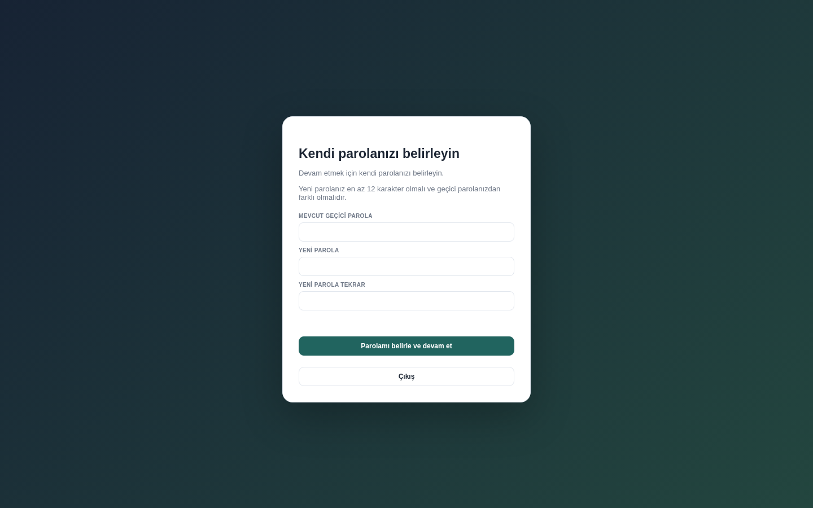

**Görünen metinler ve tablolar:**

- `h1`: Kendi parolanızı belirleyin
- `p`: Devam etmek için kendi parolanızı belirleyin.
- `p`: Yeni parolanız en az 12 karakter olmalı ve geçici parolanızdan farklı olmalıdır.

**Bağlantı, düğme, form ve alanlar:**

| Öğe | Tür / etiket / bağlam | Hedef URL veya eylem | Ne yapar / mevcut değer |
| --- | --- | --- | --- |
| E001 | form · Parolamı belirle ve devam et (#firstPasswordForm) | `POST /api/me/change-password → /modules` | Geçici parolayı doğrular; kişisel parolayı belirleyip Modüller ekranına geçer. |
| E002 | input · MEVCUT GEÇİCİ PAROLA (#firstCurrentPassword) | `POST /api/me/change-password → /modules` | Geçici parolayı doğrular; kişisel parolayı belirleyip Modüller ekranına geçer. Zorunlu. |
| E003 | input · YENİ PAROLA (#firstNewPassword) | `POST /api/me/change-password → /modules` | Geçici parolayı doğrular; kişisel parolayı belirleyip Modüller ekranına geçer. Zorunlu. |
| E004 | input · YENİ PAROLA TEKRAR (#firstConfirmPassword) | `POST /api/me/change-password → /modules` | Geçici parolayı doğrular; kişisel parolayı belirleyip Modüller ekranına geçer. Zorunlu. |
| E005 | button · Parolamı belirle ve devam et | `POST /api/me/change-password → /modules` | Geçici parolayı doğrular; kişisel parolayı belirleyip Modüller ekranına geçer. |
| E006 | form · Çıkış | `POST /logout` | Oturumu kapatıp giriş ekranına döner. |
| E007 | button · Çıkış | `POST /logout` | Oturumu kapatıp giriş ekranına döner. |

<a id="ekran-021"></a>

### 021 · Genel Bakış · Dolu / taslak

URL kalıbı: `/dashboard` · Çekilen URL: `/dashboard?period_id=1` · Rol: **strategy** · HTTP 200.

Dönemin veri girişini ve müdürlük paketlerini özetler.

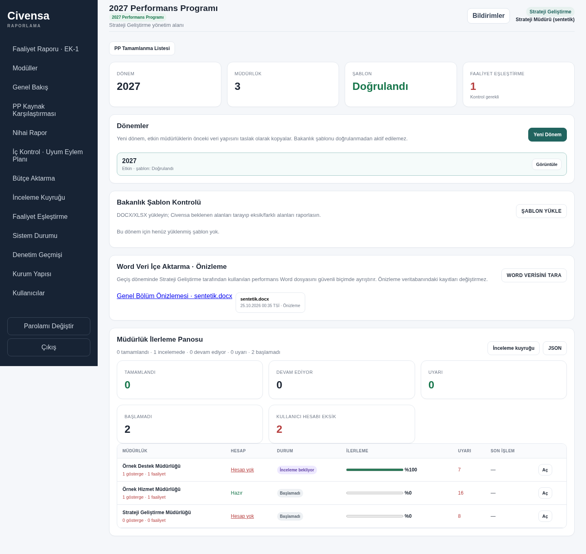

**Görünen metinler ve tablolar:**

- `div`: Civensa RAPORLAMA
- `h1`: 2027 Performans Programı
- `span`: 2027 Performans Programı
- `p`: Strateji Geliştirme yönetim alanı
- `div`: Strateji Geliştirme Strateji Müdürü (sentetik)
- `p`: PP Tamamlanma Listesi
- `h2`: Dönemler
- `p`: Yeni dönem, etkin müdürlüklerin önceki veri yapısını taslak olarak kopyalar. Bakanlık şablonu doğrulanmadan aktif edilemez.
- `h2`: Bakanlık Şablon Kontrolü
- `p`: DOCX/XLSX yükleyin; Civensa beklenen alanları tarayıp eksik/farklı alanları raporlasın.
- `p`: Bu dönem için henüz yüklenmiş şablon yok.
- `h2`: Word Veri İçe Aktarma · Önizleme
- `p`: Geçiş döneminde Strateji Geliştirme tarafından kullanılan performans Word dosyasını güvenli biçimde ayrıştırır. Önizleme veritabanındaki kayıtları değiştirmez.
- `h2`: Müdürlük İlerleme Panosu
- `p`: 0 tamamlandı · 1 incelemede · 0 devam ediyor · 0 uyarı · 2 başlamadı
- `table`: MÜDÜRLÜK HESAP DURUM İLERLEME UYARI SON İŞLEM Örnek Destek Müdürlüğü 1 gösterge · 1 faaliyet Hesap yok İnceleme bekliyor %100 7 — Aç Örnek Hizmet Müdürlüğü 1 gösterge · 1 faaliyet Hazır Başlamadı %0 16 — Aç Strateji Geliştirme Müdürlüğü 0 gösterge · 0 faaliyet Hesap yok Başlamadı %0 8 — Aç
- `span`: Dönem
- `b`: 2027
- `span`: Müdürlük
- `b`: 3
- `span`: Şablon
- `b`: Doğrulandı
- `b`: 2027
- `span`: Etkin · şablon: Doğrulandı
- `span`: Tamamlandı
- `b`: 0
- `span`: Devam ediyor
- `b`: 0
- `span`: Uyarı
- `b`: 0
- `span`: Başlamadı
- `b`: 2
- `span`: Kullanıcı hesabı eksik
- `b`: 2

**Bağlantı, düğme, form ve alanlar:**

| Öğe | Tür / etiket / bağlam | Hedef URL veya eylem | Ne yapar / mevcut değer |
| --- | --- | --- | --- |
| E001 | a · Faaliyet Raporu · EK-1 | `/activity-sections` | Bağlantıdaki ekranı veya dosyayı açar: Faaliyet Raporu · EK-1. |
| E002 | a · Modüller | `/modules` | Bağlantıdaki ekranı veya dosyayı açar: Modüller. |
| E003 | a · Genel Bakış | `/dashboard?period_id=1` | Bağlantıdaki ekranı veya dosyayı açar: Genel Bakış. |
| E004 | a · PP Kaynak Karşılaştırması | `/source-comparison?period_id=1` | Bağlantıdaki ekranı veya dosyayı açar: PP Kaynak Karşılaştırması. |
| E005 | a · Nihai Rapor | `/report-builder?period_id=1` | Bağlantıdaki ekranı veya dosyayı açar: Nihai Rapor. |
| E006 | a · İç Kontrol · Uyum Eylem Planı | `/internal-control` | Bağlantıdaki ekranı veya dosyayı açar: İç Kontrol · Uyum Eylem Planı. |
| E007 | a · Bütçe Aktarma | `/budget-reallocations` | Bağlantıdaki ekranı veya dosyayı açar: Bütçe Aktarma. |
| E008 | a · İnceleme Kuyruğu | `/review?period_id=1` | Bağlantıdaki ekranı veya dosyayı açar: İnceleme Kuyruğu. |
| E009 | a · Faaliyet Eşleştirme | `/activity-mapping?period_id=1` | Bağlantıdaki ekranı veya dosyayı açar: Faaliyet Eşleştirme. |
| E010 | a · Sistem Durumu | `/operations?period_id=1` | Bağlantıdaki ekranı veya dosyayı açar: Sistem Durumu. |
| E011 | a · Denetim Geçmişi | `/audit?period_id=1` | Bağlantıdaki ekranı veya dosyayı açar: Denetim Geçmişi. |
| E012 | a · Kurum Yapısı | `/structure?period_id=1` | Bağlantıdaki ekranı veya dosyayı açar: Kurum Yapısı. |
| E013 | a · Kullanıcılar | `/users?period_id=1` | Bağlantıdaki ekranı veya dosyayı açar: Kullanıcılar. |
| E014 | button · Parolamı Değiştir (#changePasswordButton) | `#passwordModal` | Parola değiştirme penceresini açar. |
| E015 | form · Çıkış | `POST /logout` | Oturumu kapatıp giriş ekranına döner. |
| E016 | button · Çıkış | `POST /logout` | Oturumu kapatıp giriş ekranına döner. |
| E017 | button · Bildirimler (#notificationButton) | `GET /api/notifications → #notificationPanel` | Bildirim listesini açar. |
| E018 | a · PP Tamamlanma Listesi | `/report-builder/manifest?period_id=1` | Bağlantıdaki ekranı veya dosyayı açar: PP Tamamlanma Listesi. |
| E019 | a · FAALİYET EŞLEŞTİRME 1 Kontrol gerekli | `/activity-mapping?period_id=1` | Bağlantıdaki ekranı veya dosyayı açar: FAALİYET EŞLEŞTİRME 1 Kontrol gerekli. |
| E020 | button · Yeni Dönem (#newPeriodBtn) · Dönemler | `#newPeriodForm` | Yeni raporlama dönemi formunu açar. |
| E021 | form · Görüntüle · Dönemler | `POST /period/select/1` | Görüntüle işlemini form alanlarıyla gönderir; doğrulama sonrası kaydeder veya hata gösterir. |
| E022 | button · Görüntüle · Dönemler | `POST /period/select/1` | Görüntüle işlemini form alanlarıyla gönderir; doğrulama sonrası kaydeder veya hata gösterir. |
| E023 | a · Genel Bölüm Önizlemesi · sentetik.docx · Word Veri İçe Aktarma · Önizleme | `/report-builder/import/1?period_id=1` | Bağlantıdaki ekranı veya dosyayı açar: Genel Bölüm Önizlemesi · sentetik.docx. |
| E024 | button · sentetik.docx 25.10.2026 00:35 TSİ · Önizleme · Word Veri İçe Aktarma · Önizleme | `GET /api/template-snapshots/{snapshot}` | Şablon analizinin ayrıntılarını aynı ekranda gösterir. |
| E025 | a · İnceleme kuyruğu · Müdürlük İlerleme Panosu | `/review?period_id=1` | Bağlantıdaki ekranı veya dosyayı açar: İnceleme kuyruğu. |
| E026 | a · JSON · Müdürlük İlerleme Panosu | `/api/progress?period_id=1` | Bağlantıdaki ekranı veya dosyayı açar: JSON. |
| E027 | a · Hesap yok · Örnek Destek Müdürlüğü 1 gösterge · 1 faaliyet | `/users?period_id=1` | Bağlantıdaki ekranı veya dosyayı açar: Hesap yok. |
| E028 | a · Aç · Örnek Destek Müdürlüğü 1 gösterge · 1 faaliyet | `/department/3?period_id=1` | Bağlantıdaki ekranı veya dosyayı açar: Aç. |
| E029 | a · Aç · Örnek Hizmet Müdürlüğü 1 gösterge · 1 faaliyet | `/department/1?period_id=1` | Bağlantıdaki ekranı veya dosyayı açar: Aç. |
| E030 | a · Hesap yok · Strateji Geliştirme Müdürlüğü 0 gösterge · 0 faaliyet | `/users?period_id=1` | Bağlantıdaki ekranı veya dosyayı açar: Hesap yok. |
| E031 | a · Aç · Strateji Geliştirme Müdürlüğü 0 gösterge · 0 faaliyet | `/department/2?period_id=1` | Bağlantıdaki ekranı veya dosyayı açar: Aç. |

<a id="ekran-022"></a>

### 022 · Genel Bakış · Dolu / taslak

URL kalıbı: `/dashboard` · Çekilen URL: `/dashboard?period_id=1` · Rol: **department** · HTTP 200.

Dönemin veri girişini ve müdürlük paketlerini özetler.

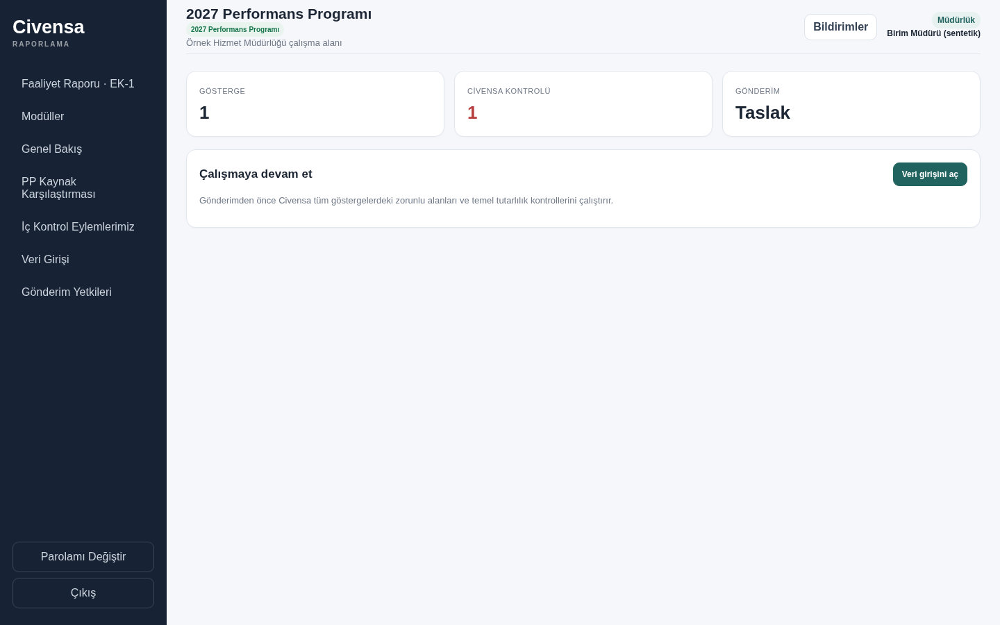

**Görünen metinler ve tablolar:**

- `div`: Civensa RAPORLAMA
- `h1`: 2027 Performans Programı
- `span`: 2027 Performans Programı
- `p`: Örnek Hizmet Müdürlüğü çalışma alanı
- `div`: Müdürlük Birim Müdürü (sentetik)
- `h2`: Çalışmaya devam et
- `p`: Gönderimden önce Civensa tüm göstergelerdeki zorunlu alanları ve temel tutarlılık kontrollerini çalıştırır.
- `span`: Gösterge
- `b`: 1
- `span`: Civensa kontrolü
- `b`: 1
- `span`: Gönderim
- `b`: Taslak

**Bağlantı, düğme, form ve alanlar:**

| Öğe | Tür / etiket / bağlam | Hedef URL veya eylem | Ne yapar / mevcut değer |
| --- | --- | --- | --- |
| E001 | a · Faaliyet Raporu · EK-1 | `/activity-sections` | Bağlantıdaki ekranı veya dosyayı açar: Faaliyet Raporu · EK-1. |
| E002 | a · Modüller | `/modules` | Bağlantıdaki ekranı veya dosyayı açar: Modüller. |
| E003 | a · Genel Bakış | `/dashboard?period_id=1` | Bağlantıdaki ekranı veya dosyayı açar: Genel Bakış. |
| E004 | a · PP Kaynak Karşılaştırması | `/source-comparison?period_id=1` | Bağlantıdaki ekranı veya dosyayı açar: PP Kaynak Karşılaştırması. |
| E005 | a · İç Kontrol Eylemlerimiz | `/internal-control/our-actions` | Bağlantıdaki ekranı veya dosyayı açar: İç Kontrol Eylemlerimiz. |
| E006 | a · Veri Girişi | `/department/1?period_id=1` | Bağlantıdaki ekranı veya dosyayı açar: Veri Girişi. |
| E007 | a · Gönderim Yetkileri | `/submit-authorizations?period_id=1` | Bağlantıdaki ekranı veya dosyayı açar: Gönderim Yetkileri. |
| E008 | button · Parolamı Değiştir (#changePasswordButton) | `#passwordModal` | Parola değiştirme penceresini açar. |
| E009 | form · Çıkış | `POST /logout` | Oturumu kapatıp giriş ekranına döner. |
| E010 | button · Çıkış | `POST /logout` | Oturumu kapatıp giriş ekranına döner. |
| E011 | button · Bildirimler (#notificationButton) | `GET /api/notifications → #notificationPanel` | Bildirim listesini açar. |
| E012 | a · Veri girişini aç · Çalışmaya devam et | `/department/1?period_id=1` | Bağlantıdaki ekranı veya dosyayı açar: Veri girişini aç. |

<a id="ekran-023"></a>

### 023 · Müdürlük veri girişi · Dolu / taslak

URL kalıbı: `/department/{department_id}` · Çekilen URL: `/department/1?period_id=1` · Rol: **strategy** · HTTP 200.

Gösterge hedeflerini ve faaliyet maliyetlerini gösterir ve düzenler.

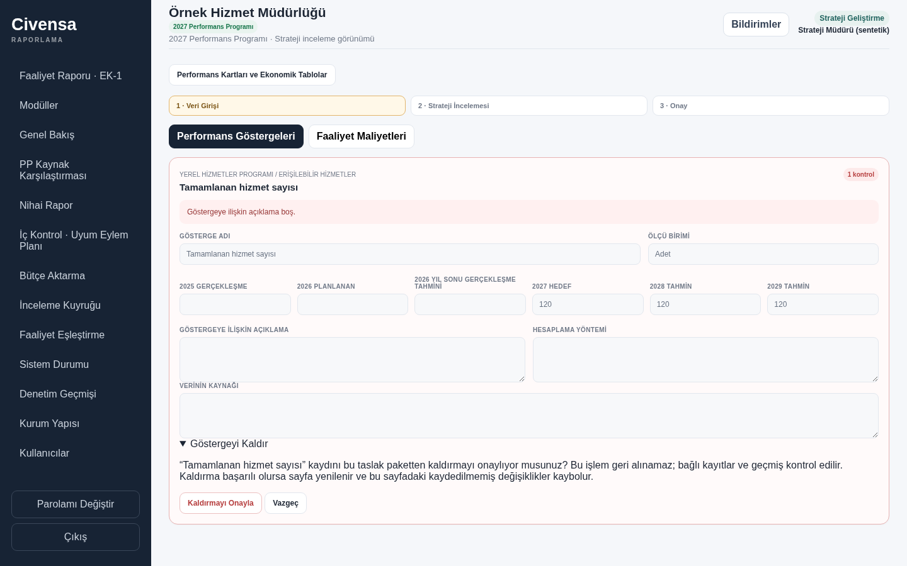

**Görünen metinler ve tablolar:**

- `div`: Civensa RAPORLAMA
- `h1`: Örnek Hizmet Müdürlüğü
- `span`: 2027 Performans Programı
- `p`: 2027 Performans Programı · Strateji inceleme görünümü
- `div`: Strateji Geliştirme Strateji Müdürü (sentetik)
- `p`: Performans Kartları ve Ekonomik Tablolar
- `div`: 1 · Veri Girişi 2 · Strateji İncelemesi 3 · Onay
- `h3`: Tamamlanan hizmet sayısı
- `span`: 1 kontrol
- `p`: “Tamamlanan hizmet sayısı” kaydını bu taslak paketten kaldırmayı onaylıyor musunuz? Bu işlem geri alınamaz; bağlı kayıtlar ve geçmiş kontrol edilir. Kaldırma başarılı olursa sayfa yenilenir ve bu sayfadaki kaydedilmemiş değişiklikler kaybolur.
- `span`: Yerel Hizmetler Programı / Erişilebilir Hizmetler

**Bağlantı, düğme, form ve alanlar:**

| Öğe | Tür / etiket / bağlam | Hedef URL veya eylem | Ne yapar / mevcut değer |
| --- | --- | --- | --- |
| E001 | a · Faaliyet Raporu · EK-1 | `/activity-sections` | Bağlantıdaki ekranı veya dosyayı açar: Faaliyet Raporu · EK-1. |
| E002 | a · Modüller | `/modules` | Bağlantıdaki ekranı veya dosyayı açar: Modüller. |
| E003 | a · Genel Bakış | `/dashboard?period_id=1` | Bağlantıdaki ekranı veya dosyayı açar: Genel Bakış. |
| E004 | a · PP Kaynak Karşılaştırması | `/source-comparison?period_id=1` | Bağlantıdaki ekranı veya dosyayı açar: PP Kaynak Karşılaştırması. |
| E005 | a · Nihai Rapor | `/report-builder?period_id=1` | Bağlantıdaki ekranı veya dosyayı açar: Nihai Rapor. |
| E006 | a · İç Kontrol · Uyum Eylem Planı | `/internal-control` | Bağlantıdaki ekranı veya dosyayı açar: İç Kontrol · Uyum Eylem Planı. |
| E007 | a · Bütçe Aktarma | `/budget-reallocations` | Bağlantıdaki ekranı veya dosyayı açar: Bütçe Aktarma. |
| E008 | a · İnceleme Kuyruğu | `/review?period_id=1` | Bağlantıdaki ekranı veya dosyayı açar: İnceleme Kuyruğu. |
| E009 | a · Faaliyet Eşleştirme | `/activity-mapping?period_id=1` | Bağlantıdaki ekranı veya dosyayı açar: Faaliyet Eşleştirme. |
| E010 | a · Sistem Durumu | `/operations?period_id=1` | Bağlantıdaki ekranı veya dosyayı açar: Sistem Durumu. |
| E011 | a · Denetim Geçmişi | `/audit?period_id=1` | Bağlantıdaki ekranı veya dosyayı açar: Denetim Geçmişi. |
| E012 | a · Kurum Yapısı | `/structure?period_id=1` | Bağlantıdaki ekranı veya dosyayı açar: Kurum Yapısı. |
| E013 | a · Kullanıcılar | `/users?period_id=1` | Bağlantıdaki ekranı veya dosyayı açar: Kullanıcılar. |
| E014 | button · Parolamı Değiştir (#changePasswordButton) | `#passwordModal` | Parola değiştirme penceresini açar. |
| E015 | form · Çıkış | `POST /logout` | Oturumu kapatıp giriş ekranına döner. |
| E016 | button · Çıkış | `POST /logout` | Oturumu kapatıp giriş ekranına döner. |
| E017 | button · Bildirimler (#notificationButton) | `GET /api/notifications → #notificationPanel` | Bildirim listesini açar. |
| E018 | a · Performans Kartları ve Ekonomik Tablolar | `/program/1?period_id=1` | Bağlantıdaki ekranı veya dosyayı açar: Performans Kartları ve Ekonomik Tablolar. |
| E019 | button · Performans Göstergeleri | `#indicators` | Seçilen veri giriş sekmesini gösterir. |
| E020 | button · Faaliyet Maliyetleri | `#activities` | Seçilen veri giriş sekmesini gösterir. |
| E021 | button · Göstergeye ilişkin açıklama boş. · Tamamlanan hizmet sayısı | `Aynı gösterge kartındaki sorunlu alan` | Kontrol mesajının ilgili alanına odaklanır. |
| E022 | input · GÖSTERGE ADI · Tamamlanan hizmet sayısı | `POST /api/indicators/1/save` | Mevcut değeri gösterir; bu görünümde değiştirilemez. Değer: Tamamlanan hizmet sayısı. |
| E023 | input · ÖLÇÜ BİRİMİ · Tamamlanan hizmet sayısı | `POST /api/indicators/1/save` | Mevcut değeri gösterir; bu görünümde değiştirilemez. Değer: Adet. |
| E024 | input · 2025 GERÇEKLEŞME · Tamamlanan hizmet sayısı | `POST /api/indicators/1/save` | Mevcut değeri gösterir; bu görünümde değiştirilemez. |
| E025 | input · 2026 PLANLANAN · Tamamlanan hizmet sayısı | `POST /api/indicators/1/save` | Mevcut değeri gösterir; bu görünümde değiştirilemez. |
| E026 | input · 2026 YIL SONU GERÇEKLEŞME TAHMİNİ · Tamamlanan hizmet sayısı | `POST /api/indicators/1/save` | Mevcut değeri gösterir; bu görünümde değiştirilemez. |
| E027 | input · 2027 HEDEF · Tamamlanan hizmet sayısı | `POST /api/indicators/1/save` | Mevcut değeri gösterir; bu görünümde değiştirilemez. Değer: 120. |
| E028 | input · 2028 TAHMİN · Tamamlanan hizmet sayısı | `POST /api/indicators/1/save` | Mevcut değeri gösterir; bu görünümde değiştirilemez. Değer: 120. |
| E029 | input · 2029 TAHMİN · Tamamlanan hizmet sayısı | `POST /api/indicators/1/save` | Mevcut değeri gösterir; bu görünümde değiştirilemez. Değer: 120. |
| E030 | textarea · GÖSTERGEYE İLİŞKİN AÇIKLAMA · Tamamlanan hizmet sayısı | `POST /api/indicators/1/save` | Mevcut değeri gösterir; bu görünümde değiştirilemez. |
| E031 | textarea · HESAPLAMA YÖNTEMİ · Tamamlanan hizmet sayısı | `POST /api/indicators/1/save` | Mevcut değeri gösterir; bu görünümde değiştirilemez. |
| E032 | textarea · VERİNİN KAYNAĞI · Tamamlanan hizmet sayısı | `POST /api/indicators/1/save` | Mevcut değeri gösterir; bu görünümde değiştirilemez. |
| E033 | summary · Göstergeyi Kaldır · Göstergeyi Kaldır | `Aynı sayfadaki ayrıntı bölümü` | İçerik ve form ayrıntılarını açar veya daraltır. |
| E034 | form · Kaldırmayı Onayla / Vazgeç · Göstergeyi Kaldır | `POST /program/1/indicator/1/remove` | Kaldırmayı Onayla / Vazgeç işlemini form alanlarıyla gönderir; doğrulama sonrası kaydeder veya hata gösterir. |
| E035 | button · Kaldırmayı Onayla · Göstergeyi Kaldır | `POST /program/1/indicator/1/remove` | Kaldırmayı Onayla işlemini form alanlarıyla gönderir; doğrulama sonrası kaydeder veya hata gösterir. |
| E036 | button · Vazgeç · Göstergeyi Kaldır | `Aynı taslak kaldırma kutusu` | Kaldırma kutusunu kaydetmeden kapatır. |

<a id="ekran-024"></a>

### 024 · Müdürlük veri girişi · Dolu / taslak

URL kalıbı: `/department/{department_id}` · Çekilen URL: `/department/1?period_id=1` · Rol: **department** · HTTP 200.

Gösterge hedeflerini ve faaliyet maliyetlerini gösterir ve düzenler.

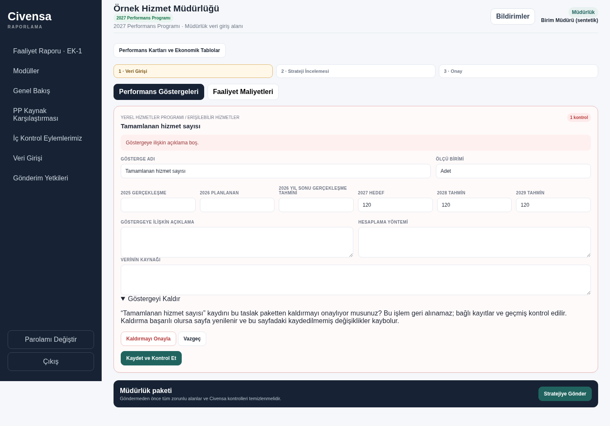

**Görünen metinler ve tablolar:**

- `div`: Civensa RAPORLAMA
- `h1`: Örnek Hizmet Müdürlüğü
- `span`: 2027 Performans Programı
- `p`: 2027 Performans Programı · Müdürlük veri giriş alanı
- `div`: Müdürlük Birim Müdürü (sentetik)
- `p`: Performans Kartları ve Ekonomik Tablolar
- `div`: 1 · Veri Girişi 2 · Strateji İncelemesi 3 · Onay
- `h3`: Tamamlanan hizmet sayısı
- `span`: 1 kontrol
- `p`: “Tamamlanan hizmet sayısı” kaydını bu taslak paketten kaldırmayı onaylıyor musunuz? Bu işlem geri alınamaz; bağlı kayıtlar ve geçmiş kontrol edilir. Kaldırma başarılı olursa sayfa yenilenir ve bu sayfadaki kaydedilmemiş değişiklikler kaybolur.
- `span`: Yerel Hizmetler Programı / Erişilebilir Hizmetler
- `b`: Müdürlük paketi
- `span`: Göndermeden önce tüm zorunlu alanlar ve Civensa kontrolleri temizlenmelidir.

**Bağlantı, düğme, form ve alanlar:**

| Öğe | Tür / etiket / bağlam | Hedef URL veya eylem | Ne yapar / mevcut değer |
| --- | --- | --- | --- |
| E001 | a · Faaliyet Raporu · EK-1 | `/activity-sections` | Bağlantıdaki ekranı veya dosyayı açar: Faaliyet Raporu · EK-1. |
| E002 | a · Modüller | `/modules` | Bağlantıdaki ekranı veya dosyayı açar: Modüller. |
| E003 | a · Genel Bakış | `/dashboard?period_id=1` | Bağlantıdaki ekranı veya dosyayı açar: Genel Bakış. |
| E004 | a · PP Kaynak Karşılaştırması | `/source-comparison?period_id=1` | Bağlantıdaki ekranı veya dosyayı açar: PP Kaynak Karşılaştırması. |
| E005 | a · İç Kontrol Eylemlerimiz | `/internal-control/our-actions` | Bağlantıdaki ekranı veya dosyayı açar: İç Kontrol Eylemlerimiz. |
| E006 | a · Veri Girişi | `/department/1?period_id=1` | Bağlantıdaki ekranı veya dosyayı açar: Veri Girişi. |
| E007 | a · Gönderim Yetkileri | `/submit-authorizations?period_id=1` | Bağlantıdaki ekranı veya dosyayı açar: Gönderim Yetkileri. |
| E008 | button · Parolamı Değiştir (#changePasswordButton) | `#passwordModal` | Parola değiştirme penceresini açar. |
| E009 | form · Çıkış | `POST /logout` | Oturumu kapatıp giriş ekranına döner. |
| E010 | button · Çıkış | `POST /logout` | Oturumu kapatıp giriş ekranına döner. |
| E011 | button · Bildirimler (#notificationButton) | `GET /api/notifications → #notificationPanel` | Bildirim listesini açar. |
| E012 | a · Performans Kartları ve Ekonomik Tablolar | `/program/1?period_id=1` | Bağlantıdaki ekranı veya dosyayı açar: Performans Kartları ve Ekonomik Tablolar. |
| E013 | button · Performans Göstergeleri | `#indicators` | Seçilen veri giriş sekmesini gösterir. |
| E014 | button · Faaliyet Maliyetleri | `#activities` | Seçilen veri giriş sekmesini gösterir. |
| E015 | button · Göstergeye ilişkin açıklama boş. · Tamamlanan hizmet sayısı | `Aynı gösterge kartındaki sorunlu alan` | Kontrol mesajının ilgili alanına odaklanır. |
| E016 | input · GÖSTERGE ADI · Tamamlanan hizmet sayısı | `POST /api/indicators/1/save` | İşlem için GÖSTERGE ADI değerini girer. Değer: Tamamlanan hizmet sayısı. |
| E017 | input · ÖLÇÜ BİRİMİ · Tamamlanan hizmet sayısı | `POST /api/indicators/1/save` | İşlem için ÖLÇÜ BİRİMİ değerini girer. Değer: Adet. |
| E018 | input · 2025 GERÇEKLEŞME · Tamamlanan hizmet sayısı | `POST /api/indicators/1/save` | İşlem için 2025 GERÇEKLEŞME değerini girer. |
| E019 | input · 2026 PLANLANAN · Tamamlanan hizmet sayısı | `POST /api/indicators/1/save` | İşlem için 2026 PLANLANAN değerini girer. |
| E020 | input · 2026 YIL SONU GERÇEKLEŞME TAHMİNİ · Tamamlanan hizmet sayısı | `POST /api/indicators/1/save` | İşlem için 2026 YIL SONU GERÇEKLEŞME TAHMİNİ değerini girer. |
| E021 | input · 2027 HEDEF · Tamamlanan hizmet sayısı | `POST /api/indicators/1/save` | İşlem için 2027 HEDEF değerini girer. Değer: 120. |
| E022 | input · 2028 TAHMİN · Tamamlanan hizmet sayısı | `POST /api/indicators/1/save` | İşlem için 2028 TAHMİN değerini girer. Değer: 120. |
| E023 | input · 2029 TAHMİN · Tamamlanan hizmet sayısı | `POST /api/indicators/1/save` | İşlem için 2029 TAHMİN değerini girer. Değer: 120. |
| E024 | textarea · GÖSTERGEYE İLİŞKİN AÇIKLAMA · Tamamlanan hizmet sayısı | `POST /api/indicators/1/save` | İşlem için GÖSTERGEYE İLİŞKİN AÇIKLAMA değerini girer. |
| E025 | textarea · HESAPLAMA YÖNTEMİ · Tamamlanan hizmet sayısı | `POST /api/indicators/1/save` | İşlem için HESAPLAMA YÖNTEMİ değerini girer. |
| E026 | textarea · VERİNİN KAYNAĞI · Tamamlanan hizmet sayısı | `POST /api/indicators/1/save` | İşlem için VERİNİN KAYNAĞI değerini girer. |
| E027 | summary · Göstergeyi Kaldır · Göstergeyi Kaldır | `Aynı sayfadaki ayrıntı bölümü` | İçerik ve form ayrıntılarını açar veya daraltır. |
| E028 | form · Kaldırmayı Onayla / Vazgeç · Göstergeyi Kaldır | `POST /program/1/indicator/1/remove` | Kaldırmayı Onayla / Vazgeç işlemini form alanlarıyla gönderir; doğrulama sonrası kaydeder veya hata gösterir. |
| E029 | button · Kaldırmayı Onayla · Göstergeyi Kaldır | `POST /program/1/indicator/1/remove` | Kaldırmayı Onayla işlemini form alanlarıyla gönderir; doğrulama sonrası kaydeder veya hata gösterir. |
| E030 | button · Vazgeç · Göstergeyi Kaldır | `Aynı taslak kaldırma kutusu` | Kaldırma kutusunu kaydetmeden kapatır. |
| E031 | button · Kaydet ve Kontrol Et · Tamamlanan hizmet sayısı | `POST /api/indicators/1/save` | Gösterge alanlarını ve yıllık değerlerini kaydeder, kontrolleri yeniler. |
| E032 | button · Stratejiye Gönder (#submitDepartment) | `POST /api/departments/1/submit` | Kontrolleri geçen müdürlük paketini Strateji incelemesine gönderir. |

<a id="ekran-025"></a>

### 025 · İç Kontrol planları · Dolu / taslak

URL kalıbı: `/internal-control` · Çekilen URL: `/internal-control` · Rol: **strategy** · HTTP 200.

Uyum eylem planlarını ve plan yüklemeyi gösterir.

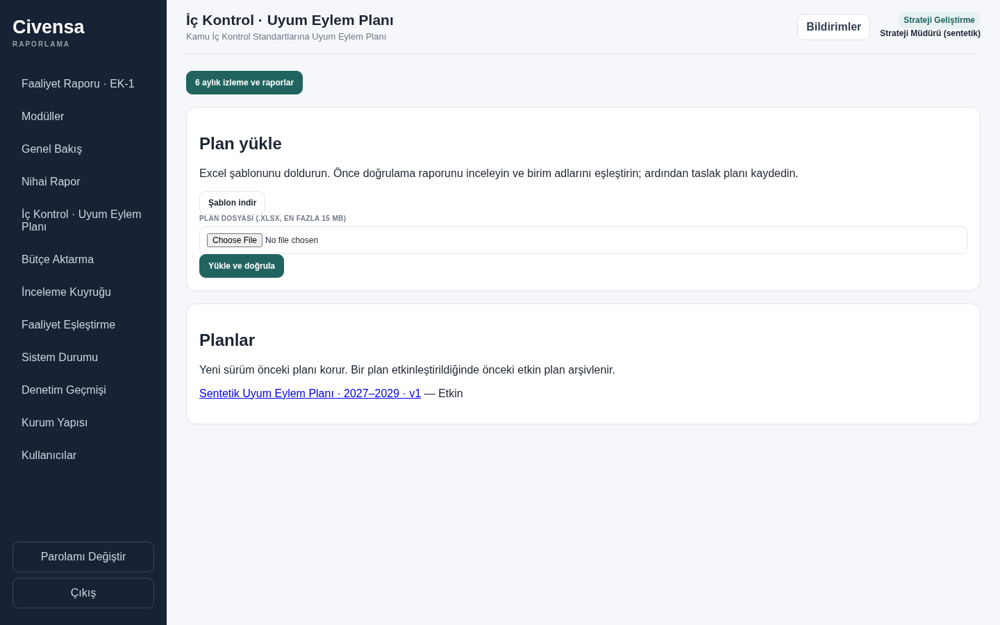

**Görünen metinler ve tablolar:**

- `div`: Civensa RAPORLAMA
- `h1`: İç Kontrol · Uyum Eylem Planı
- `p`: Kamu İç Kontrol Standartlarına Uyum Eylem Planı
- `div`: Strateji Geliştirme Strateji Müdürü (sentetik)
- `p`: 6 aylık izleme ve raporlar
- `h2`: Plan yükle
- `p`: Excel şablonunu doldurun. Önce doğrulama raporunu inceleyin ve birim adlarını eşleştirin; ardından taslak planı kaydedin.
- `h2`: Planlar
- `p`: Yeni sürüm önceki planı korur. Bir plan etkinleştirildiğinde önceki etkin plan arşivlenir.
- `p`: Sentetik Uyum Eylem Planı · 2027–2029 · v1 — Etkin

**Bağlantı, düğme, form ve alanlar:**

| Öğe | Tür / etiket / bağlam | Hedef URL veya eylem | Ne yapar / mevcut değer |
| --- | --- | --- | --- |
| E001 | a · Faaliyet Raporu · EK-1 | `/activity-sections` | Bağlantıdaki ekranı veya dosyayı açar: Faaliyet Raporu · EK-1. |
| E002 | a · Modüller | `/modules` | Bağlantıdaki ekranı veya dosyayı açar: Modüller. |
| E003 | a · Genel Bakış | `/dashboard` | Bağlantıdaki ekranı veya dosyayı açar: Genel Bakış. |
| E004 | a · Nihai Rapor | `/report-builder` | Bağlantıdaki ekranı veya dosyayı açar: Nihai Rapor. |
| E005 | a · İç Kontrol · Uyum Eylem Planı | `/internal-control` | Bağlantıdaki ekranı veya dosyayı açar: İç Kontrol · Uyum Eylem Planı. |
| E006 | a · Bütçe Aktarma | `/budget-reallocations` | Bağlantıdaki ekranı veya dosyayı açar: Bütçe Aktarma. |
| E007 | a · İnceleme Kuyruğu | `/review` | Bağlantıdaki ekranı veya dosyayı açar: İnceleme Kuyruğu. |
| E008 | a · Faaliyet Eşleştirme | `/activity-mapping` | Bağlantıdaki ekranı veya dosyayı açar: Faaliyet Eşleştirme. |
| E009 | a · Sistem Durumu | `/operations` | Bağlantıdaki ekranı veya dosyayı açar: Sistem Durumu. |
| E010 | a · Denetim Geçmişi | `/audit` | Bağlantıdaki ekranı veya dosyayı açar: Denetim Geçmişi. |
| E011 | a · Kurum Yapısı | `/structure` | Bağlantıdaki ekranı veya dosyayı açar: Kurum Yapısı. |
| E012 | a · Kullanıcılar | `/users` | Bağlantıdaki ekranı veya dosyayı açar: Kullanıcılar. |
| E013 | button · Parolamı Değiştir (#changePasswordButton) | `#passwordModal` | Parola değiştirme penceresini açar. |
| E014 | form · Çıkış | `POST /logout` | Oturumu kapatıp giriş ekranına döner. |
| E015 | button · Çıkış | `POST /logout` | Oturumu kapatıp giriş ekranına döner. |
| E016 | button · Bildirimler (#notificationButton) | `GET /api/notifications → #notificationPanel` | Bildirim listesini açar. |
| E017 | a · 6 aylık izleme ve raporlar | `/internal-control/monitoring` | Bağlantıdaki ekranı veya dosyayı açar: 6 aylık izleme ve raporlar. |
| E018 | a · Şablon indir · Plan yükle | `/internal-control/template.xlsx` | Bağlantıdaki ekranı veya dosyayı açar: Şablon indir. |
| E019 | form · Yükle ve doğrula · Plan yükle | `POST /internal-control/imports` | Seçilen plan dosyasını yükleyip kontrol ekranına geçer. |
| E020 | input · PLAN DOSYASI (.XLSX, EN FAZLA 15 MB) · Plan yükle | `POST /internal-control/imports` | Dosya seçer; ilgili işlemle yüklenir. Zorunlu. |
| E021 | button · Yükle ve doğrula · Plan yükle | `POST /internal-control/imports` | Seçilen plan dosyasını yükleyip kontrol ekranına geçer. |
| E022 | a · Sentetik Uyum Eylem Planı · 2027–2029 · v1 · Planlar | `/internal-control/plans/1` | Bağlantıdaki ekranı veya dosyayı açar: Sentetik Uyum Eylem Planı · 2027–2029 · v1. |

<a id="ekran-026"></a>

### 026 · İç Kontrol yükleme kontrolü · Dolu / taslak

URL kalıbı: `/internal-control/imports/{batch_id}` · Çekilen URL: `/internal-control/imports/1` · Rol: **strategy** · HTTP 200.

Plan dosyasının doğrulamasını ve birim eşlemelerini gösterir.

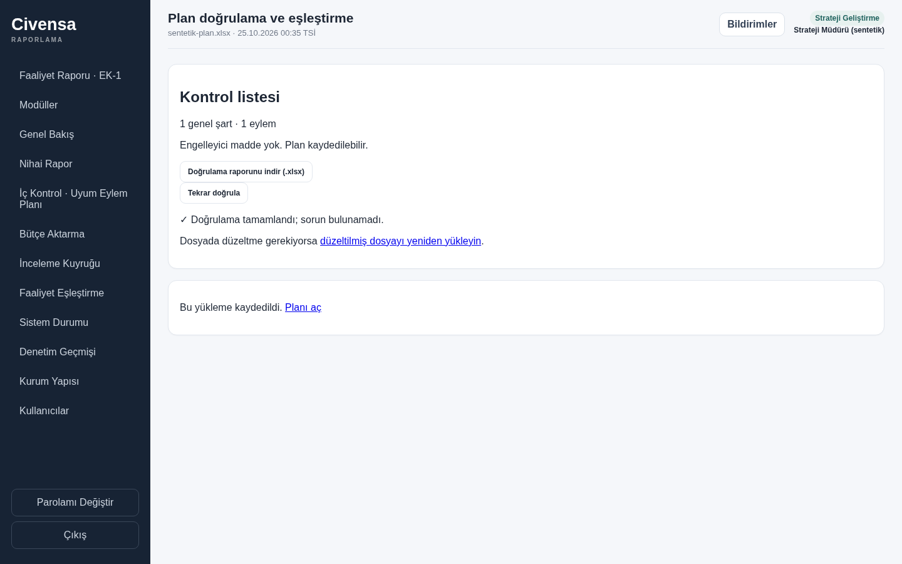

**Görünen metinler ve tablolar:**

- `div`: Civensa RAPORLAMA
- `h1`: Plan doğrulama ve eşleştirme
- `p`: sentetik-plan.xlsx · 25.10.2026 00:35 TSİ
- `div`: Strateji Geliştirme Strateji Müdürü (sentetik)
- `h2`: Kontrol listesi
- `p`: 1 genel şart · 1 eylem
- `p`: Engelleyici madde yok. Plan kaydedilebilir.
- `p`: ✓ Doğrulama tamamlandı; sorun bulunamadı.
- `p`: Dosyada düzeltme gerekiyorsa düzeltilmiş dosyayı yeniden yükleyin.
- `p`: Bu yükleme kaydedildi. Planı aç

**Bağlantı, düğme, form ve alanlar:**

| Öğe | Tür / etiket / bağlam | Hedef URL veya eylem | Ne yapar / mevcut değer |
| --- | --- | --- | --- |
| E001 | a · Faaliyet Raporu · EK-1 | `/activity-sections` | Bağlantıdaki ekranı veya dosyayı açar: Faaliyet Raporu · EK-1. |
| E002 | a · Modüller | `/modules` | Bağlantıdaki ekranı veya dosyayı açar: Modüller. |
| E003 | a · Genel Bakış | `/dashboard` | Bağlantıdaki ekranı veya dosyayı açar: Genel Bakış. |
| E004 | a · Nihai Rapor | `/report-builder` | Bağlantıdaki ekranı veya dosyayı açar: Nihai Rapor. |
| E005 | a · İç Kontrol · Uyum Eylem Planı | `/internal-control` | Bağlantıdaki ekranı veya dosyayı açar: İç Kontrol · Uyum Eylem Planı. |
| E006 | a · Bütçe Aktarma | `/budget-reallocations` | Bağlantıdaki ekranı veya dosyayı açar: Bütçe Aktarma. |
| E007 | a · İnceleme Kuyruğu | `/review` | Bağlantıdaki ekranı veya dosyayı açar: İnceleme Kuyruğu. |
| E008 | a · Faaliyet Eşleştirme | `/activity-mapping` | Bağlantıdaki ekranı veya dosyayı açar: Faaliyet Eşleştirme. |
| E009 | a · Sistem Durumu | `/operations` | Bağlantıdaki ekranı veya dosyayı açar: Sistem Durumu. |
| E010 | a · Denetim Geçmişi | `/audit` | Bağlantıdaki ekranı veya dosyayı açar: Denetim Geçmişi. |
| E011 | a · Kurum Yapısı | `/structure` | Bağlantıdaki ekranı veya dosyayı açar: Kurum Yapısı. |
| E012 | a · Kullanıcılar | `/users` | Bağlantıdaki ekranı veya dosyayı açar: Kullanıcılar. |
| E013 | button · Parolamı Değiştir (#changePasswordButton) | `#passwordModal` | Parola değiştirme penceresini açar. |
| E014 | form · Çıkış | `POST /logout` | Oturumu kapatıp giriş ekranına döner. |
| E015 | button · Çıkış | `POST /logout` | Oturumu kapatıp giriş ekranına döner. |
| E016 | button · Bildirimler (#notificationButton) | `GET /api/notifications → #notificationPanel` | Bildirim listesini açar. |
| E017 | a · Doğrulama raporunu indir (.xlsx) · Kontrol listesi | `/internal-control/imports/1/validation.xlsx` | Bağlantıdaki ekranı veya dosyayı açar: Doğrulama raporunu indir (.xlsx). |
| E018 | form · Tekrar doğrula · Kontrol listesi | `POST /internal-control/imports/1/validate` | Yüklenen dosyanın doğrulamasını yeniler. |
| E019 | button · Tekrar doğrula · Kontrol listesi | `POST /internal-control/imports/1/validate` | Yüklenen dosyanın doğrulamasını yeniler. |
| E020 | a · düzeltilmiş dosyayı yeniden yükleyin · Kontrol listesi | `/internal-control` | Bağlantıdaki ekranı veya dosyayı açar: düzeltilmiş dosyayı yeniden yükleyin. |
| E021 | a · Planı aç | `/internal-control/plans/1` | Bağlantıdaki ekranı veya dosyayı açar: Planı aç. |

<a id="ekran-027"></a>

### 027 · İç Kontrol izleme · Dolu / taslak

URL kalıbı: `/internal-control/monitoring` · Çekilen URL: `/internal-control/monitoring` · Rol: **strategy** · HTTP 200.

Altı aylık dönemleri, paket durumlarını ve raporları yönetir.


**Görünen metinler ve tablolar:**

- `div`: Civensa RAPORLAMA
- `h1`: İç Kontrol · 6 Aylık İzleme
- `p`: Strateji Geliştirme dönem yönetimi, inceleme ve raporlar
- `div`: Strateji Geliştirme Strateji Müdürü (sentetik)
- `h2`: İzleme dönemi aç
- `h2`: Dönem seçimi
- `h2`: 2027 · I. dönem Ocak–Haziran
- `p`: Son giriş: 31.12.2029 · Açık
- `h2`: Eylem bazında resmî rapor özeti
- `p`: Gerçekleşme Oranı: 0,00% (0/1)
- `p`: İlk 6 Aylık Başarı Yüzdesi: 0,00% (0/1)
- `p`: Plan toplamı: 1 eylem. Oranlar onaylı sorumlu birim girişlerinden hesaplanır.
- `table`: BİLEŞENLER EYLEM SAYISI GERÇEKLEŞEN GERÇEKLEŞMEYEN DEVAM EDEN TAMAMLANAN TOPLAM GERÇEKLEŞME ORANI (%) Kontrol Ortamı 1 0 1 0 0 0,00% (0/1) Risk Değerlendirme 0 0 0 0 0 0,00% (0/1) Kontrol Faaliyetleri 0 0 0 0 0 0,00% (0/1) Bilgi ve İletişim 0 0 0 0 0 0,00% (0/1) İzleme 0 0 0 0 0 0,00% (0/1)
- `h2`: Sorumlu birimlerin durumu
- `h3`: Örnek Hizmet Müdürlüğü · Taslak
- `p`: Girişler tamam.
- `h3`: Sorumlu eylemi bulunmayan müdürlükler
- `p`: Örnek Destek Müdürlüğü · Sorumlu eylem yok; gönderim beklenmiyor.
- `p`: Strateji Geliştirme Müdürlüğü · Sorumlu eylem yok; gönderim beklenmiyor.
- `h2`: Bileşen / standart durum sayıları
- `p`: Sayılar birim–eylem girişlerini gösterir; tüm müdürlük eylemleri her müdürlük için ayrı sayılır.
- `table`: BİLEŞEN STANDART TAMAMLANDI DEVAM EDİYOR BAŞLANMADI GECİKMEDE KISMEN TAMAMLANDI (DEVAM EDİYOR) EYLEM UYGUN GÖRÜLMEMİŞTİR GİRİŞ EKSİK KOS KOS1 0 1 0 0 0 0 0
- `h2`: İzleme raporları
- `p`: Nihai rapor için tüm sorumlu birimlerin onaylanması gerekir.
- `h3`: Resmî format
- `h2`: Dönemi kapat
- `p`: Kapatıldığında veri girişi ve inceleme işlemleri sona erer. İşlem geri alınamaz.
- `h2`: Dönem geçmişi (TSİ)
- `p`: Açıldı · Strateji Müdürü (sentetik) · 25.10.2026 00:35 TSİ ·

**Bağlantı, düğme, form ve alanlar:**

| Öğe | Tür / etiket / bağlam | Hedef URL veya eylem | Ne yapar / mevcut değer |
| --- | --- | --- | --- |
| E001 | a · Faaliyet Raporu · EK-1 | `/activity-sections` | Bağlantıdaki ekranı veya dosyayı açar: Faaliyet Raporu · EK-1. |
| E002 | a · Modüller | `/modules` | Bağlantıdaki ekranı veya dosyayı açar: Modüller. |
| E003 | a · Genel Bakış | `/dashboard` | Bağlantıdaki ekranı veya dosyayı açar: Genel Bakış. |
| E004 | a · Nihai Rapor | `/report-builder` | Bağlantıdaki ekranı veya dosyayı açar: Nihai Rapor. |
| E005 | a · İç Kontrol · Uyum Eylem Planı | `/internal-control` | Bağlantıdaki ekranı veya dosyayı açar: İç Kontrol · Uyum Eylem Planı. |
| E006 | a · Bütçe Aktarma | `/budget-reallocations` | Bağlantıdaki ekranı veya dosyayı açar: Bütçe Aktarma. |
| E007 | a · İnceleme Kuyruğu | `/review` | Bağlantıdaki ekranı veya dosyayı açar: İnceleme Kuyruğu. |
| E008 | a · Faaliyet Eşleştirme | `/activity-mapping` | Bağlantıdaki ekranı veya dosyayı açar: Faaliyet Eşleştirme. |
| E009 | a · Sistem Durumu | `/operations` | Bağlantıdaki ekranı veya dosyayı açar: Sistem Durumu. |
| E010 | a · Denetim Geçmişi | `/audit` | Bağlantıdaki ekranı veya dosyayı açar: Denetim Geçmişi. |
| E011 | a · Kurum Yapısı | `/structure` | Bağlantıdaki ekranı veya dosyayı açar: Kurum Yapısı. |
| E012 | a · Kullanıcılar | `/users` | Bağlantıdaki ekranı veya dosyayı açar: Kullanıcılar. |
| E013 | button · Parolamı Değiştir (#changePasswordButton) | `#passwordModal` | Parola değiştirme penceresini açar. |
| E014 | form · Çıkış | `POST /logout` | Oturumu kapatıp giriş ekranına döner. |
| E015 | button · Çıkış | `POST /logout` | Oturumu kapatıp giriş ekranına döner. |
| E016 | button · Bildirimler (#notificationButton) | `GET /api/notifications → #notificationPanel` | Bildirim listesini açar. |
| E017 | form · Dönemi aç · İzleme dönemi aç | `POST /internal-control/monitoring/open` | Plan için altı aylık izleme dönemi açar. |
| E018 | select · ETKİN PLAN Sentetik Uyum Eylem Planı · v1 · İzleme dönemi aç | `POST /internal-control/monitoring/open` | Listeden seçim yapar. Değer: 1. Seçenekler: Sentetik Uyum Eylem Planı · v1. |
| E019 | input · YIL · İzleme dönemi aç | `POST /internal-control/monitoring/open` | İşlem için YIL değerini girer. Değer: 2027. |
| E020 | select · YARIYIL I. dönem Ocak–Haziran II. dönem Temmuz–Aralık · İzleme dönemi aç | `POST /internal-control/monitoring/open` | Listeden seçim yapar. Değer: 1. Seçenekler: I. dönem Ocak–Haziran; II. dönem Temmuz–Aralık. |
| E021 | input · SON GİRİŞ TARİHİ · İzleme dönemi aç | `POST /internal-control/monitoring/open` | İşlem için SON GİRİŞ TARİHİ değerini girer. |
| E022 | button · Dönemi aç · İzleme dönemi aç | `POST /internal-control/monitoring/open` | Plan için altı aylık izleme dönemi açar. |
| E023 | form · Dönemi göster · Dönem seçimi | `GET /internal-control/monitoring` | Alanlarla listeyi veya rapor görünümünü filtreler. |
| E024 | select · İZLEME DÖNEMİ 2027 · I. dönem Ocak–Haziran · Açık · Dönem seçimi | `GET /internal-control/monitoring` | Listeden seçim yapar. Değer: 1. Seçenekler: 2027 · I. dönem Ocak–Haziran · Açık. |
| E025 | button · Dönemi göster · Dönem seçimi | `GET /internal-control/monitoring` | Alanlarla listeyi veya rapor görünümünü filtreler. |
| E026 | a · Örnek Hizmet Müdürlüğü · Örnek Hizmet Müdürlüğü · Taslak | `/internal-control/monitoring/batches/1` | Bağlantıdaki ekranı veya dosyayı açar: Örnek Hizmet Müdürlüğü. |
| E027 | a · Onaylı DOCX indir · İzleme raporları | `/internal-control/monitoring/periods/1/report.docx` | Bağlantıdaki ekranı veya dosyayı açar: Onaylı DOCX indir. |
| E028 | a · TASLAK DOCX indir · İzleme raporları | `/internal-control/monitoring/periods/1/report.docx?draft=true` | Bağlantıdaki ekranı veya dosyayı açar: TASLAK DOCX indir. |
| E029 | a · Onaylı XLSX indir · İzleme raporları | `/internal-control/monitoring/periods/1/report.xlsx` | Bağlantıdaki ekranı veya dosyayı açar: Onaylı XLSX indir. |
| E030 | a · TASLAK XLSX indir · İzleme raporları | `/internal-control/monitoring/periods/1/report.xlsx?draft=true` | Bağlantıdaki ekranı veya dosyayı açar: TASLAK XLSX indir. |
| E031 | a · Resmî format · Onaylı Word indir · İzleme raporları | `/internal-control/monitoring/periods/1/official-report.docx` | Bağlantıdaki ekranı veya dosyayı açar: Resmî format · Onaylı Word indir. |
| E032 | a · Resmî format · TASLAK Word indir · İzleme raporları | `/internal-control/monitoring/periods/1/official-report.docx?draft=true` | Bağlantıdaki ekranı veya dosyayı açar: Resmî format · TASLAK Word indir. |
| E033 | a · Resmî format · Onaylı Excel indir · İzleme raporları | `/internal-control/monitoring/periods/1/official-report.xlsx` | Bağlantıdaki ekranı veya dosyayı açar: Resmî format · Onaylı Excel indir. |
| E034 | a · Resmî format · TASLAK Excel indir · İzleme raporları | `/internal-control/monitoring/periods/1/official-report.xlsx?draft=true` | Bağlantıdaki ekranı veya dosyayı açar: Resmî format · TASLAK Excel indir. |
| E035 | form · 15 Mayıs için yıllık Excel indir · İzleme raporları | `GET /internal-control/monitoring/plans/1/annual.xlsx` | Alanlarla listeyi veya rapor görünümünü filtreler. |
| E036 | input · YILLIK DEĞERLENDİRME YILI · İzleme raporları | `GET /internal-control/monitoring/plans/1/annual.xlsx` | İşlem için YILLIK DEĞERLENDİRME YILI değerini girer. Değer: 2027. |
| E037 | button · 15 Mayıs için yıllık Excel indir · İzleme raporları | `GET /internal-control/monitoring/plans/1/annual.xlsx` | Alanlarla listeyi veya rapor görünümünü filtreler. |
| E038 | form · Gerekçeyle dönemi kapat · Dönemi kapat | `POST /internal-control/monitoring/periods/1/close` | İzleme dönemini gerekçeyle kapatır. |
| E039 | textarea · KAPATMA GEREKÇESİ · Dönemi kapat | `POST /internal-control/monitoring/periods/1/close` | İşlem için KAPATMA GEREKÇESİ değerini girer. |
| E040 | button · Gerekçeyle dönemi kapat · Dönemi kapat | `POST /internal-control/monitoring/periods/1/close` | İzleme dönemini gerekçeyle kapatır. |

<a id="ekran-028"></a>

### 028 · İç Kontrol izleme paketi · Dolu / taslak

URL kalıbı: `/internal-control/monitoring/batches/{batch_id}` · Çekilen URL: `/internal-control/monitoring/batches/1` · Rol: **strategy** · HTTP 200.

Eylemlerin gerçekleşme, kanıt ve onay geçmişini gösterir.

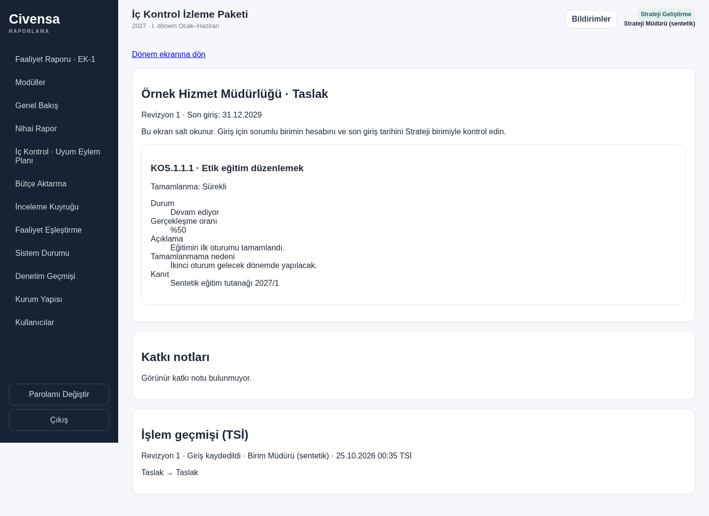

**Görünen metinler ve tablolar:**

- `div`: Civensa RAPORLAMA
- `h1`: İç Kontrol İzleme Paketi
- `p`: 2027 · I. dönem Ocak–Haziran
- `div`: Strateji Geliştirme Strateji Müdürü (sentetik)
- `p`: Dönem ekranına dön
- `h2`: Örnek Hizmet Müdürlüğü · Taslak
- `p`: Revizyon 1 · Son giriş: 31.12.2029
- `p`: Bu ekran salt okunur. Giriş için sorumlu birimin hesabını ve son giriş tarihini Strateji birimiyle kontrol edin.
- `h3`: KOS.1.1.1 · Etik eğitim düzenlemek
- `p`: Tamamlanma: Sürekli
- `h2`: Katkı notları
- `p`: Görünür katkı notu bulunmuyor.
- `h2`: İşlem geçmişi (TSİ)
- `p`: Revizyon 1 · Giriş kaydedildi · Birim Müdürü (sentetik) · 25.10.2026 00:35 TSİ
- `p`: Taslak → Taslak
- `dt`: Durum
- `dd`: Devam ediyor
- `dt`: Gerçekleşme oranı
- `dd`: %50
- `dt`: Açıklama
- `dd`: Eğitimin ilk oturumu tamamlandı.
- `dt`: Tamamlanmama nedeni
- `dd`: İkinci oturum gelecek dönemde yapılacak.
- `dt`: Kanıt
- `dd`: Sentetik eğitim tutanağı 2027/1

**Bağlantı, düğme, form ve alanlar:**

| Öğe | Tür / etiket / bağlam | Hedef URL veya eylem | Ne yapar / mevcut değer |
| --- | --- | --- | --- |
| E001 | a · Faaliyet Raporu · EK-1 | `/activity-sections` | Bağlantıdaki ekranı veya dosyayı açar: Faaliyet Raporu · EK-1. |
| E002 | a · Modüller | `/modules` | Bağlantıdaki ekranı veya dosyayı açar: Modüller. |
| E003 | a · Genel Bakış | `/dashboard` | Bağlantıdaki ekranı veya dosyayı açar: Genel Bakış. |
| E004 | a · Nihai Rapor | `/report-builder` | Bağlantıdaki ekranı veya dosyayı açar: Nihai Rapor. |
| E005 | a · İç Kontrol · Uyum Eylem Planı | `/internal-control` | Bağlantıdaki ekranı veya dosyayı açar: İç Kontrol · Uyum Eylem Planı. |
| E006 | a · Bütçe Aktarma | `/budget-reallocations` | Bağlantıdaki ekranı veya dosyayı açar: Bütçe Aktarma. |
| E007 | a · İnceleme Kuyruğu | `/review` | Bağlantıdaki ekranı veya dosyayı açar: İnceleme Kuyruğu. |
| E008 | a · Faaliyet Eşleştirme | `/activity-mapping` | Bağlantıdaki ekranı veya dosyayı açar: Faaliyet Eşleştirme. |
| E009 | a · Sistem Durumu | `/operations` | Bağlantıdaki ekranı veya dosyayı açar: Sistem Durumu. |
| E010 | a · Denetim Geçmişi | `/audit` | Bağlantıdaki ekranı veya dosyayı açar: Denetim Geçmişi. |
| E011 | a · Kurum Yapısı | `/structure` | Bağlantıdaki ekranı veya dosyayı açar: Kurum Yapısı. |
| E012 | a · Kullanıcılar | `/users` | Bağlantıdaki ekranı veya dosyayı açar: Kullanıcılar. |
| E013 | button · Parolamı Değiştir (#changePasswordButton) | `#passwordModal` | Parola değiştirme penceresini açar. |
| E014 | form · Çıkış | `POST /logout` | Oturumu kapatıp giriş ekranına döner. |
| E015 | button · Çıkış | `POST /logout` | Oturumu kapatıp giriş ekranına döner. |
| E016 | button · Bildirimler (#notificationButton) | `GET /api/notifications → #notificationPanel` | Bildirim listesini açar. |
| E017 | a · Dönem ekranına dön | `/internal-control/monitoring?period_id=1` | Bağlantıdaki ekranı veya dosyayı açar: Dönem ekranına dön. |

<a id="ekran-029"></a>

### 029 · İç Kontrol izleme paketi · Dolu / taslak

URL kalıbı: `/internal-control/monitoring/batches/{batch_id}` · Çekilen URL: `/internal-control/monitoring/batches/1` · Rol: **department** · HTTP 200.

Eylemlerin gerçekleşme, kanıt ve onay geçmişini gösterir.

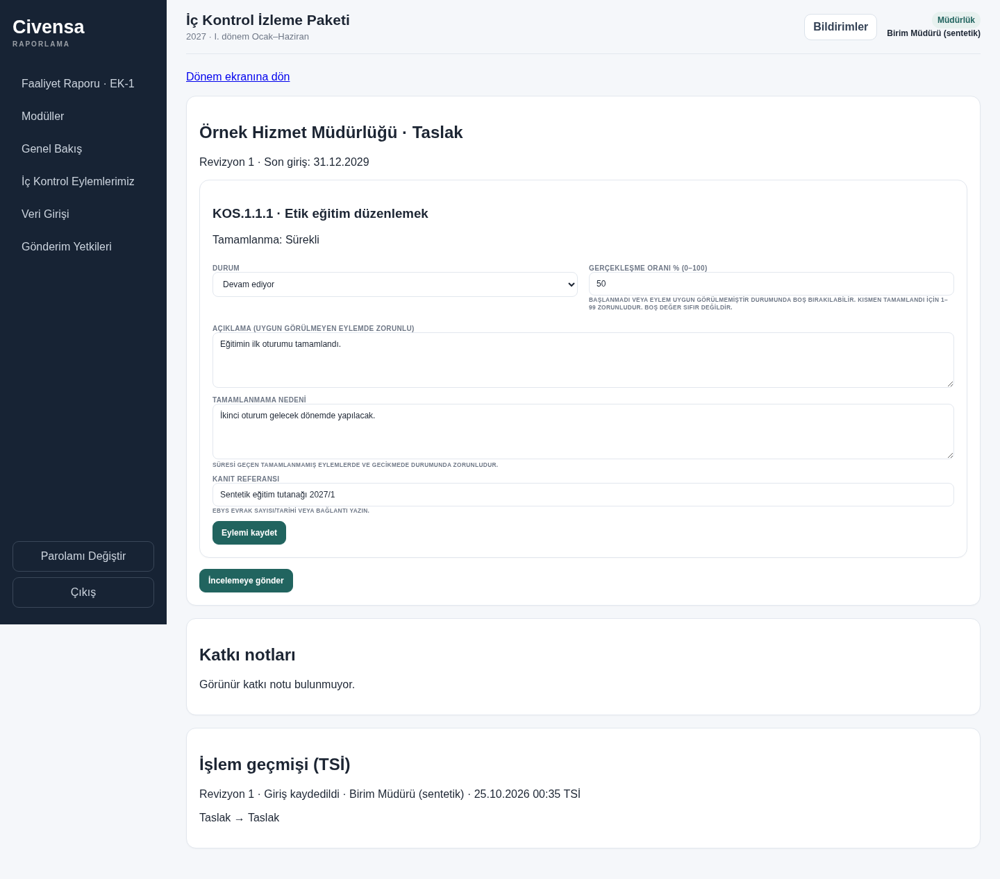

**Görünen metinler ve tablolar:**

- `div`: Civensa RAPORLAMA
- `h1`: İç Kontrol İzleme Paketi
- `p`: 2027 · I. dönem Ocak–Haziran
- `div`: Müdürlük Birim Müdürü (sentetik)
- `p`: Dönem ekranına dön
- `h2`: Örnek Hizmet Müdürlüğü · Taslak
- `p`: Revizyon 1 · Son giriş: 31.12.2029
- `h3`: KOS.1.1.1 · Etik eğitim düzenlemek
- `p`: Tamamlanma: Sürekli
- `h2`: Katkı notları
- `p`: Görünür katkı notu bulunmuyor.
- `h2`: İşlem geçmişi (TSİ)
- `p`: Revizyon 1 · Giriş kaydedildi · Birim Müdürü (sentetik) · 25.10.2026 00:35 TSİ
- `p`: Taslak → Taslak

**Bağlantı, düğme, form ve alanlar:**

| Öğe | Tür / etiket / bağlam | Hedef URL veya eylem | Ne yapar / mevcut değer |
| --- | --- | --- | --- |
| E001 | a · Faaliyet Raporu · EK-1 | `/activity-sections` | Bağlantıdaki ekranı veya dosyayı açar: Faaliyet Raporu · EK-1. |
| E002 | a · Modüller | `/modules` | Bağlantıdaki ekranı veya dosyayı açar: Modüller. |
| E003 | a · Genel Bakış | `/dashboard` | Bağlantıdaki ekranı veya dosyayı açar: Genel Bakış. |
| E004 | a · İç Kontrol Eylemlerimiz | `/internal-control/our-actions` | Bağlantıdaki ekranı veya dosyayı açar: İç Kontrol Eylemlerimiz. |
| E005 | a · Veri Girişi | `/department/1` | Bağlantıdaki ekranı veya dosyayı açar: Veri Girişi. |
| E006 | a · Gönderim Yetkileri | `/submit-authorizations` | Bağlantıdaki ekranı veya dosyayı açar: Gönderim Yetkileri. |
| E007 | button · Parolamı Değiştir (#changePasswordButton) | `#passwordModal` | Parola değiştirme penceresini açar. |
| E008 | form · Çıkış | `POST /logout` | Oturumu kapatıp giriş ekranına döner. |
| E009 | button · Çıkış | `POST /logout` | Oturumu kapatıp giriş ekranına döner. |
| E010 | button · Bildirimler (#notificationButton) | `GET /api/notifications → #notificationPanel` | Bildirim listesini açar. |
| E011 | a · Dönem ekranına dön | `/internal-control/our-actions?period_id=1` | Bağlantıdaki ekranı veya dosyayı açar: Dönem ekranına dön. |
| E012 | form · Eylemi kaydet (#ref: &lt;Node&gt;) · KOS.1.1.1 · Etik eğitim düzenlemek | `POST /internal-control/monitoring/batches/1/entry` | Eylemin gerçekleşme, ilerleme ve kanıt bilgilerini kaydeder. |
| E013 | select · DURUM Durum seçin Tamamlandı Devam ediyor Başlanmadı Gecikmede Kısmen tamamlandı (devam ediyor) Eylem uygun görülmemiştir · KOS.1.1.1 · Etik eğitim düzenlemek | `POST /internal-control/monitoring/batches/1/entry` | Listeden seçim yapar. Değer: ongoing. Seçenekler: Durum seçin; Tamamlandı; Devam ediyor; Başlanmadı; Gecikmede; Kısmen tamamlandı (devam ediyor); Eylem uygun görülmemiştir. |
| E014 | input · GERÇEKLEŞME ORANI % (0–100)BAŞLANMADI VEYA EYLEM UYGUN GÖRÜLMEMİŞTİR DURUMUNDA BOŞ BIRAKILABİLİR. KISMEN TAMAMLANDI İÇİN 1–99 ZORUNLUDUR. BOŞ DEĞER SIFIR DEĞİLDİR. · KOS.1.1.1 · Etik eğitim düzenlemek | `POST /internal-control/monitoring/batches/1/entry` | İşlem için GERÇEKLEŞME ORANI % (0–100)BAŞLANMADI VEYA EYLEM UYGUN GÖRÜLMEMİŞTİR DURUMUNDA BOŞ BIRAKILABİLİR. KISMEN TAMAMLANDI İÇİN 1–99 ZORUNLUDUR. BOŞ DEĞER SIFIR DEĞİLDİR. değerini girer. Değer: 50. |
| E015 | textarea · AÇIKLAMA (UYGUN GÖRÜLMEYEN EYLEMDE ZORUNLU) · KOS.1.1.1 · Etik eğitim düzenlemek | `POST /internal-control/monitoring/batches/1/entry` | İşlem için AÇIKLAMA (UYGUN GÖRÜLMEYEN EYLEMDE ZORUNLU) değerini girer. Değer: Eğitimin ilk oturumu tamamlandı.. |
| E016 | textarea · TAMAMLANMAMA NEDENİSÜRESİ GEÇEN TAMAMLANMAMIŞ EYLEMLERDE VE GECİKMEDE DURUMUNDA ZORUNLUDUR. · KOS.1.1.1 · Etik eğitim düzenlemek | `POST /internal-control/monitoring/batches/1/entry` | İşlem için TAMAMLANMAMA NEDENİSÜRESİ GEÇEN TAMAMLANMAMIŞ EYLEMLERDE VE GECİKMEDE DURUMUNDA ZORUNLUDUR. değerini girer. Değer: İkinci oturum gelecek dönemde yapılacak.. |
| E017 | input · KANIT REFERANSIEBYS EVRAK SAYISI/TARİHİ VEYA BAĞLANTI YAZIN. · KOS.1.1.1 · Etik eğitim düzenlemek | `POST /internal-control/monitoring/batches/1/entry` | İşlem için KANIT REFERANSIEBYS EVRAK SAYISI/TARİHİ VEYA BAĞLANTI YAZIN. değerini girer. Değer: Sentetik eğitim tutanağı 2027/1. |
| E018 | button · Eylemi kaydet · KOS.1.1.1 · Etik eğitim düzenlemek | `POST /internal-control/monitoring/batches/1/entry` | Eylemin gerçekleşme, ilerleme ve kanıt bilgilerini kaydeder. |
| E019 | form · İncelemeye gönder · Örnek Hizmet Müdürlüğü · Taslak | `POST /internal-control/monitoring/batches/1/transition` | Seçilen gönderim, onay veya iade kararını gerekçesiyle kaydeder. |
| E020 | button · İncelemeye gönder · Örnek Hizmet Müdürlüğü · Taslak | `POST /internal-control/monitoring/batches/1/transition` | Seçilen gönderim, onay veya iade kararını gerekçesiyle kaydeder. |

<a id="ekran-030"></a>

### 030 · İç Kontrol Eylemlerimiz · Dolu / taslak

URL kalıbı: `/internal-control/our-actions` · Çekilen URL: `/internal-control/our-actions` · Rol: **department** · HTTP 200.

Müdürlüğün sorumlu ve katkı verdiği eylemleri gösterir.

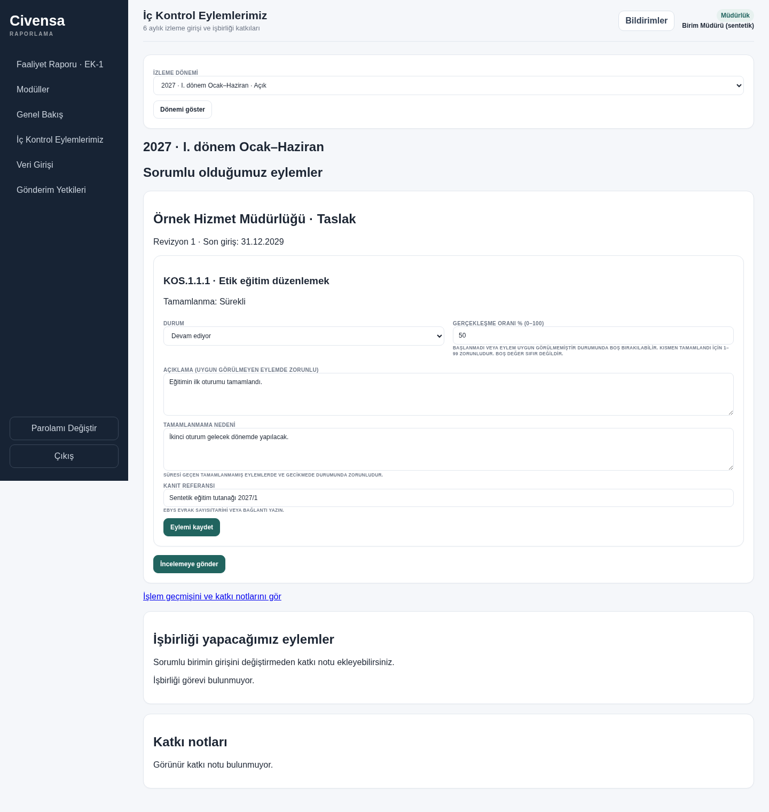

**Görünen metinler ve tablolar:**

- `div`: Civensa RAPORLAMA
- `h1`: İç Kontrol Eylemlerimiz
- `p`: 6 aylık izleme girişi ve işbirliği katkıları
- `div`: Müdürlük Birim Müdürü (sentetik)
- `h2`: 2027 · I. dönem Ocak–Haziran
- `h2`: Sorumlu olduğumuz eylemler
- `h2`: Örnek Hizmet Müdürlüğü · Taslak
- `p`: Revizyon 1 · Son giriş: 31.12.2029
- `h3`: KOS.1.1.1 · Etik eğitim düzenlemek
- `p`: Tamamlanma: Sürekli
- `p`: İşlem geçmişini ve katkı notlarını gör
- `h2`: İşbirliği yapacağımız eylemler
- `p`: Sorumlu birimin girişini değiştirmeden katkı notu ekleyebilirsiniz.
- `p`: İşbirliği görevi bulunmuyor.
- `h2`: Katkı notları
- `p`: Görünür katkı notu bulunmuyor.

**Bağlantı, düğme, form ve alanlar:**

| Öğe | Tür / etiket / bağlam | Hedef URL veya eylem | Ne yapar / mevcut değer |
| --- | --- | --- | --- |
| E001 | a · Faaliyet Raporu · EK-1 | `/activity-sections` | Bağlantıdaki ekranı veya dosyayı açar: Faaliyet Raporu · EK-1. |
| E002 | a · Modüller | `/modules` | Bağlantıdaki ekranı veya dosyayı açar: Modüller. |
| E003 | a · Genel Bakış | `/dashboard` | Bağlantıdaki ekranı veya dosyayı açar: Genel Bakış. |
| E004 | a · İç Kontrol Eylemlerimiz | `/internal-control/our-actions` | Bağlantıdaki ekranı veya dosyayı açar: İç Kontrol Eylemlerimiz. |
| E005 | a · Veri Girişi | `/department/1` | Bağlantıdaki ekranı veya dosyayı açar: Veri Girişi. |
| E006 | a · Gönderim Yetkileri | `/submit-authorizations` | Bağlantıdaki ekranı veya dosyayı açar: Gönderim Yetkileri. |
| E007 | button · Parolamı Değiştir (#changePasswordButton) | `#passwordModal` | Parola değiştirme penceresini açar. |
| E008 | form · Çıkış | `POST /logout` | Oturumu kapatıp giriş ekranına döner. |
| E009 | button · Çıkış | `POST /logout` | Oturumu kapatıp giriş ekranına döner. |
| E010 | button · Bildirimler (#notificationButton) | `GET /api/notifications → #notificationPanel` | Bildirim listesini açar. |
| E011 | form · Dönemi göster | `GET /internal-control/our-actions` | Alanlarla listeyi veya rapor görünümünü filtreler. |
| E012 | select · İZLEME DÖNEMİ 2027 · I. dönem Ocak–Haziran · Açık | `GET /internal-control/our-actions` | Listeden seçim yapar. Değer: 1. Seçenekler: 2027 · I. dönem Ocak–Haziran · Açık. |
| E013 | button · Dönemi göster | `GET /internal-control/our-actions` | Alanlarla listeyi veya rapor görünümünü filtreler. |
| E014 | form · Eylemi kaydet (#ref: &lt;Node&gt;) · KOS.1.1.1 · Etik eğitim düzenlemek | `POST /internal-control/monitoring/batches/1/entry` | Eylemin gerçekleşme, ilerleme ve kanıt bilgilerini kaydeder. |
| E015 | select · DURUM Durum seçin Tamamlandı Devam ediyor Başlanmadı Gecikmede Kısmen tamamlandı (devam ediyor) Eylem uygun görülmemiştir · KOS.1.1.1 · Etik eğitim düzenlemek | `POST /internal-control/monitoring/batches/1/entry` | Listeden seçim yapar. Değer: ongoing. Seçenekler: Durum seçin; Tamamlandı; Devam ediyor; Başlanmadı; Gecikmede; Kısmen tamamlandı (devam ediyor); Eylem uygun görülmemiştir. |
| E016 | input · GERÇEKLEŞME ORANI % (0–100)BAŞLANMADI VEYA EYLEM UYGUN GÖRÜLMEMİŞTİR DURUMUNDA BOŞ BIRAKILABİLİR. KISMEN TAMAMLANDI İÇİN 1–99 ZORUNLUDUR. BOŞ DEĞER SIFIR DEĞİLDİR. · KOS.1.1.1 · Etik eğitim düzenlemek | `POST /internal-control/monitoring/batches/1/entry` | İşlem için GERÇEKLEŞME ORANI % (0–100)BAŞLANMADI VEYA EYLEM UYGUN GÖRÜLMEMİŞTİR DURUMUNDA BOŞ BIRAKILABİLİR. KISMEN TAMAMLANDI İÇİN 1–99 ZORUNLUDUR. BOŞ DEĞER SIFIR DEĞİLDİR. değerini girer. Değer: 50. |
| E017 | textarea · AÇIKLAMA (UYGUN GÖRÜLMEYEN EYLEMDE ZORUNLU) · KOS.1.1.1 · Etik eğitim düzenlemek | `POST /internal-control/monitoring/batches/1/entry` | İşlem için AÇIKLAMA (UYGUN GÖRÜLMEYEN EYLEMDE ZORUNLU) değerini girer. Değer: Eğitimin ilk oturumu tamamlandı.. |
| E018 | textarea · TAMAMLANMAMA NEDENİSÜRESİ GEÇEN TAMAMLANMAMIŞ EYLEMLERDE VE GECİKMEDE DURUMUNDA ZORUNLUDUR. · KOS.1.1.1 · Etik eğitim düzenlemek | `POST /internal-control/monitoring/batches/1/entry` | İşlem için TAMAMLANMAMA NEDENİSÜRESİ GEÇEN TAMAMLANMAMIŞ EYLEMLERDE VE GECİKMEDE DURUMUNDA ZORUNLUDUR. değerini girer. Değer: İkinci oturum gelecek dönemde yapılacak.. |
| E019 | input · KANIT REFERANSIEBYS EVRAK SAYISI/TARİHİ VEYA BAĞLANTI YAZIN. · KOS.1.1.1 · Etik eğitim düzenlemek | `POST /internal-control/monitoring/batches/1/entry` | İşlem için KANIT REFERANSIEBYS EVRAK SAYISI/TARİHİ VEYA BAĞLANTI YAZIN. değerini girer. Değer: Sentetik eğitim tutanağı 2027/1. |
| E020 | button · Eylemi kaydet · KOS.1.1.1 · Etik eğitim düzenlemek | `POST /internal-control/monitoring/batches/1/entry` | Eylemin gerçekleşme, ilerleme ve kanıt bilgilerini kaydeder. |
| E021 | form · İncelemeye gönder · Örnek Hizmet Müdürlüğü · Taslak | `POST /internal-control/monitoring/batches/1/transition` | Seçilen gönderim, onay veya iade kararını gerekçesiyle kaydeder. |
| E022 | button · İncelemeye gönder · Örnek Hizmet Müdürlüğü · Taslak | `POST /internal-control/monitoring/batches/1/transition` | Seçilen gönderim, onay veya iade kararını gerekçesiyle kaydeder. |
| E023 | a · İşlem geçmişini ve katkı notlarını gör | `/internal-control/monitoring/batches/1` | Bağlantıdaki ekranı veya dosyayı açar: İşlem geçmişini ve katkı notlarını gör. |

<a id="ekran-031"></a>

### 031 · İç Kontrol plan kataloğu · Dolu / taslak

URL kalıbı: `/internal-control/plans/{plan_id}` · Çekilen URL: `/internal-control/plans/1` · Rol: **strategy** · HTTP 200.

Bileşen, standart, şart ve sorumlu birimlere göre eylemleri gösterir.

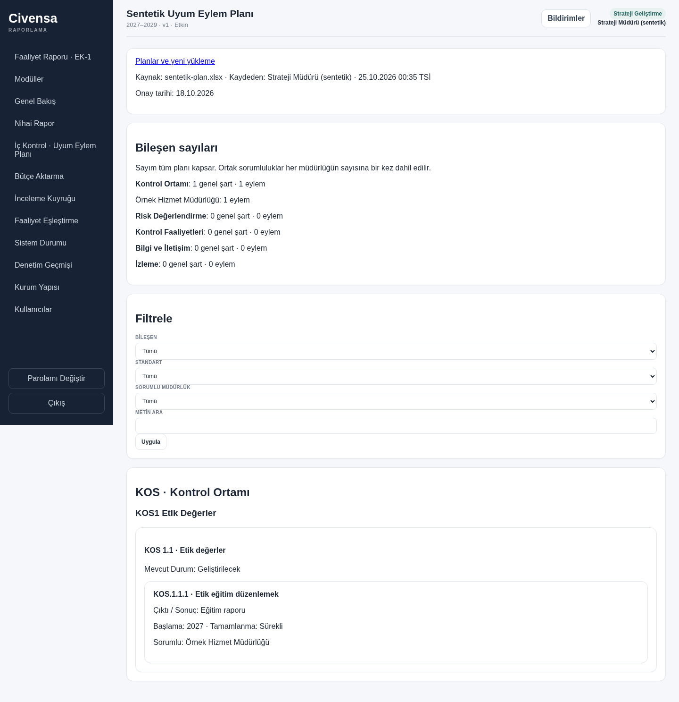

**Görünen metinler ve tablolar:**

- `div`: Civensa RAPORLAMA
- `h1`: Sentetik Uyum Eylem Planı
- `p`: 2027–2029 · v1 · Etkin
- `div`: Strateji Geliştirme Strateji Müdürü (sentetik)
- `p`: Kaynak: sentetik-plan.xlsx · Kaydeden: Strateji Müdürü (sentetik) · 25.10.2026 00:35 TSİ
- `p`: Onay tarihi: 18.10.2026
- `h2`: Bileşen sayıları
- `p`: Sayım tüm planı kapsar. Ortak sorumluluklar her müdürlüğün sayısına bir kez dahil edilir.
- `p`: Kontrol Ortamı: 1 genel şart · 1 eylem
- `p`: Örnek Hizmet Müdürlüğü: 1 eylem
- `p`: Risk Değerlendirme: 0 genel şart · 0 eylem
- `p`: Kontrol Faaliyetleri: 0 genel şart · 0 eylem
- `p`: Bilgi ve İletişim: 0 genel şart · 0 eylem
- `p`: İzleme: 0 genel şart · 0 eylem
- `h2`: Filtrele
- `h2`: KOS · Kontrol Ortamı
- `h3`: KOS1 Etik Değerler
- `h4`: KOS 1.1 · Etik değerler
- `p`: Mevcut Durum: Geliştirilecek
- `p`: Çıktı / Sonuç: Eğitim raporu
- `p`: Başlama: 2027 · Tamamlanma: Sürekli
- `p`: Sorumlu: Örnek Hizmet Müdürlüğü
- `strong`: KOS.1.1.1 · Etik eğitim düzenlemek

**Bağlantı, düğme, form ve alanlar:**

| Öğe | Tür / etiket / bağlam | Hedef URL veya eylem | Ne yapar / mevcut değer |
| --- | --- | --- | --- |
| E001 | a · Faaliyet Raporu · EK-1 | `/activity-sections` | Bağlantıdaki ekranı veya dosyayı açar: Faaliyet Raporu · EK-1. |
| E002 | a · Modüller | `/modules` | Bağlantıdaki ekranı veya dosyayı açar: Modüller. |
| E003 | a · Genel Bakış | `/dashboard` | Bağlantıdaki ekranı veya dosyayı açar: Genel Bakış. |
| E004 | a · Nihai Rapor | `/report-builder` | Bağlantıdaki ekranı veya dosyayı açar: Nihai Rapor. |
| E005 | a · İç Kontrol · Uyum Eylem Planı | `/internal-control` | Bağlantıdaki ekranı veya dosyayı açar: İç Kontrol · Uyum Eylem Planı. |
| E006 | a · Bütçe Aktarma | `/budget-reallocations` | Bağlantıdaki ekranı veya dosyayı açar: Bütçe Aktarma. |
| E007 | a · İnceleme Kuyruğu | `/review` | Bağlantıdaki ekranı veya dosyayı açar: İnceleme Kuyruğu. |
| E008 | a · Faaliyet Eşleştirme | `/activity-mapping` | Bağlantıdaki ekranı veya dosyayı açar: Faaliyet Eşleştirme. |
| E009 | a · Sistem Durumu | `/operations` | Bağlantıdaki ekranı veya dosyayı açar: Sistem Durumu. |
| E010 | a · Denetim Geçmişi | `/audit` | Bağlantıdaki ekranı veya dosyayı açar: Denetim Geçmişi. |
| E011 | a · Kurum Yapısı | `/structure` | Bağlantıdaki ekranı veya dosyayı açar: Kurum Yapısı. |
| E012 | a · Kullanıcılar | `/users` | Bağlantıdaki ekranı veya dosyayı açar: Kullanıcılar. |
| E013 | button · Parolamı Değiştir (#changePasswordButton) | `#passwordModal` | Parola değiştirme penceresini açar. |
| E014 | form · Çıkış | `POST /logout` | Oturumu kapatıp giriş ekranına döner. |
| E015 | button · Çıkış | `POST /logout` | Oturumu kapatıp giriş ekranına döner. |
| E016 | button · Bildirimler (#notificationButton) | `GET /api/notifications → #notificationPanel` | Bildirim listesini açar. |
| E017 | a · Planlar ve yeni yükleme | `/internal-control` | Bağlantıdaki ekranı veya dosyayı açar: Planlar ve yeni yükleme. |
| E018 | form · Uygula · Filtrele | `GET /internal-control/plans/1` | Alanlarla listeyi veya rapor görünümünü filtreler. |
| E019 | select · BİLEŞEN Tümü Kontrol Ortamı Risk Değerlendirme Kontrol Faaliyetleri Bilgi ve İletişim İzleme · Filtrele | `GET /internal-control/plans/1` | Listeden seçim yapar. Seçenekler: Tümü; Kontrol Ortamı; Risk Değerlendirme; Kontrol Faaliyetleri; Bilgi ve İletişim; İzleme. |
| E020 | select · STANDART Tümü KOS1 KOS2 KOS3 KOS4 RDS5 RDS6 KFS7 KFS8 KFS9 KFS10 KFS11 KFS12 BİS13 BİS14 BİS15 BİS16 İS17 İS18 · Filtrele | `GET /internal-control/plans/1` | Listeden seçim yapar. Seçenekler: Tümü; KOS1; KOS2; KOS3; KOS4; RDS5; RDS6; KFS7; KFS8; KFS9; KFS10; KFS11; KFS12; BİS13; BİS14; BİS15; BİS16; İS17; İS18. |
| E021 | select · SORUMLU MÜDÜRLÜK Tümü Örnek Destek Müdürlüğü Örnek Hizmet Müdürlüğü Strateji Geliştirme Müdürlüğü · Filtrele | `GET /internal-control/plans/1` | Listeden seçim yapar. Seçenekler: Tümü; Örnek Destek Müdürlüğü; Örnek Hizmet Müdürlüğü; Strateji Geliştirme Müdürlüğü. |
| E022 | input · METİN ARA · Filtrele | `GET /internal-control/plans/1` | İşlem için METİN ARA değerini girer. |
| E023 | button · Uygula · Filtrele | `GET /internal-control/plans/1` | Alanlarla listeyi veya rapor görünümünü filtreler. |

<a id="ekran-032"></a>

### 032 · Giriş · Oturum kapalı

URL kalıbı: `/login` · Çekilen URL: `/login` · Rol: **anonymous** · HTTP 200.

Hesabın oturumunu açar.

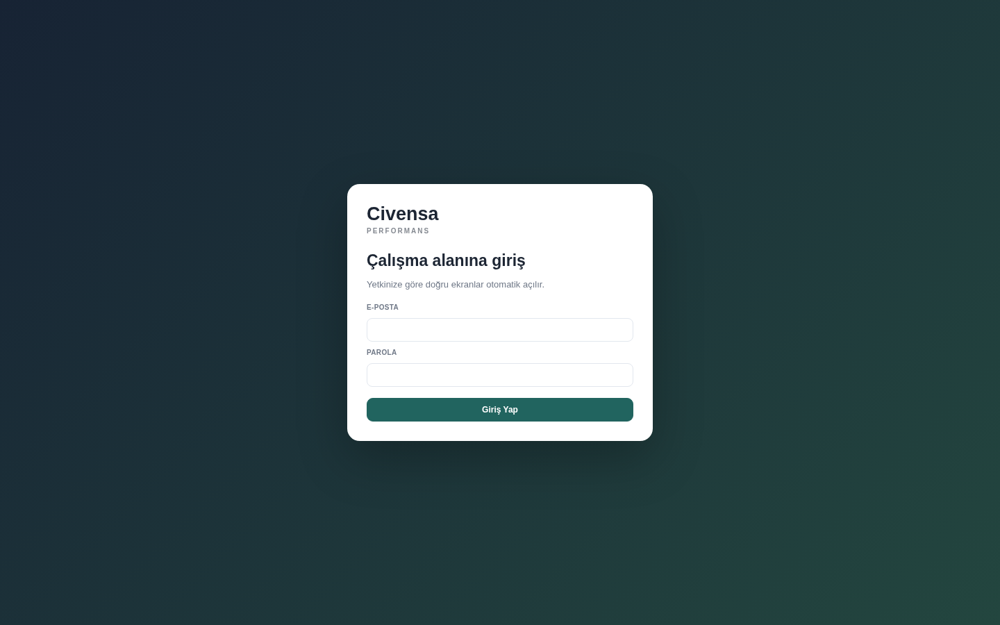

**Görünen metinler ve tablolar:**

- `h1`: Çalışma alanına giriş
- `p`: Yetkinize göre doğru ekranlar otomatik açılır.
- `div`: Civensa
- `span`: PERFORMANS

**Bağlantı, düğme, form ve alanlar:**

| Öğe | Tür / etiket / bağlam | Hedef URL veya eylem | Ne yapar / mevcut değer |
| --- | --- | --- | --- |
| E001 | form · Giriş Yap | `POST /login` | E-posta ve parola ile oturum açar; Modüller ekranına geçer. |
| E002 | input · email | `POST /login` | İşlem için email değerini girer. Zorunlu. |
| E003 | input · password | `POST /login` | İşlem için password değerini girer. Zorunlu. |
| E004 | button · Giriş Yap | `POST /login` | E-posta ve parola ile oturum açar; Modüller ekranına geçer. |

<a id="ekran-033"></a>

### 033 · Modüller · Dolu / taslak

URL kalıbı: `/modules` · Çekilen URL: `/modules` · Rol: **strategy** · HTTP 200.

Kullanıcının erişebildiği modülleri seçmesini sağlar.

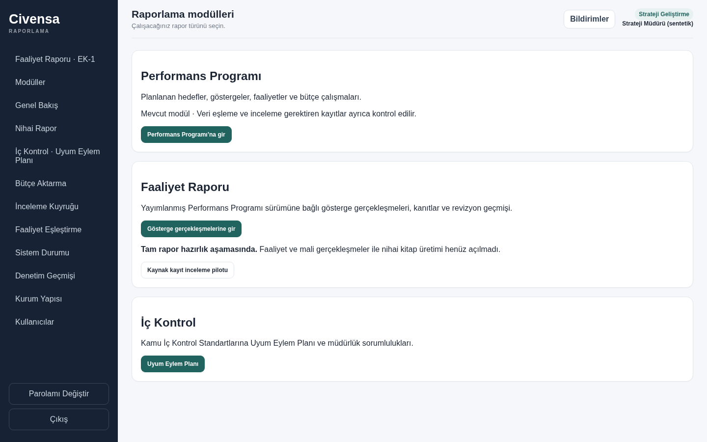

**Görünen metinler ve tablolar:**

- `div`: Civensa RAPORLAMA
- `h1`: Raporlama modülleri
- `p`: Çalışacağınız rapor türünü seçin.
- `div`: Strateji Geliştirme Strateji Müdürü (sentetik)
- `h2`: Performans Programı
- `p`: Planlanan hedefler, göstergeler, faaliyetler ve bütçe çalışmaları.
- `p`: Mevcut modül · Veri eşleme ve inceleme gerektiren kayıtlar ayrıca kontrol edilir.
- `h2`: Faaliyet Raporu
- `p`: Yayımlanmış Performans Programı sürümüne bağlı gösterge gerçekleşmeleri, kanıtlar ve revizyon geçmişi.
- `p`: Tam rapor hazırlık aşamasında. Faaliyet ve mali gerçekleşmeler ile nihai kitap üretimi henüz açılmadı.
- `h2`: İç Kontrol
- `p`: Kamu İç Kontrol Standartlarına Uyum Eylem Planı ve müdürlük sorumlulukları.

**Bağlantı, düğme, form ve alanlar:**

| Öğe | Tür / etiket / bağlam | Hedef URL veya eylem | Ne yapar / mevcut değer |
| --- | --- | --- | --- |
| E001 | a · Faaliyet Raporu · EK-1 | `/activity-sections` | Bağlantıdaki ekranı veya dosyayı açar: Faaliyet Raporu · EK-1. |
| E002 | a · Modüller | `/modules` | Bağlantıdaki ekranı veya dosyayı açar: Modüller. |
| E003 | a · Genel Bakış | `/dashboard` | Bağlantıdaki ekranı veya dosyayı açar: Genel Bakış. |
| E004 | a · Nihai Rapor | `/report-builder` | Bağlantıdaki ekranı veya dosyayı açar: Nihai Rapor. |
| E005 | a · İç Kontrol · Uyum Eylem Planı | `/internal-control` | Bağlantıdaki ekranı veya dosyayı açar: İç Kontrol · Uyum Eylem Planı. |
| E006 | a · Bütçe Aktarma | `/budget-reallocations` | Bağlantıdaki ekranı veya dosyayı açar: Bütçe Aktarma. |
| E007 | a · İnceleme Kuyruğu | `/review` | Bağlantıdaki ekranı veya dosyayı açar: İnceleme Kuyruğu. |
| E008 | a · Faaliyet Eşleştirme | `/activity-mapping` | Bağlantıdaki ekranı veya dosyayı açar: Faaliyet Eşleştirme. |
| E009 | a · Sistem Durumu | `/operations` | Bağlantıdaki ekranı veya dosyayı açar: Sistem Durumu. |
| E010 | a · Denetim Geçmişi | `/audit` | Bağlantıdaki ekranı veya dosyayı açar: Denetim Geçmişi. |
| E011 | a · Kurum Yapısı | `/structure` | Bağlantıdaki ekranı veya dosyayı açar: Kurum Yapısı. |
| E012 | a · Kullanıcılar | `/users` | Bağlantıdaki ekranı veya dosyayı açar: Kullanıcılar. |
| E013 | button · Parolamı Değiştir (#changePasswordButton) | `#passwordModal` | Parola değiştirme penceresini açar. |
| E014 | form · Çıkış | `POST /logout` | Oturumu kapatıp giriş ekranına döner. |
| E015 | button · Çıkış | `POST /logout` | Oturumu kapatıp giriş ekranına döner. |
| E016 | button · Bildirimler (#notificationButton) | `GET /api/notifications → #notificationPanel` | Bildirim listesini açar. |
| E017 | a · Performans Programı’na gir · Performans Programı | `/dashboard` | Bağlantıdaki ekranı veya dosyayı açar: Performans Programı’na gir. |
| E018 | a · Gösterge gerçekleşmelerine gir · Faaliyet Raporu | `/activity-reports` | Bağlantıdaki ekranı veya dosyayı açar: Gösterge gerçekleşmelerine gir. |
| E019 | a · Kaynak kayıt inceleme pilotu · Faaliyet Raporu | `/activity-report` | Bağlantıdaki ekranı veya dosyayı açar: Kaynak kayıt inceleme pilotu. |
| E020 | a · Uyum Eylem Planı · İç Kontrol | `/internal-control` | Bağlantıdaki ekranı veya dosyayı açar: Uyum Eylem Planı. |

<a id="ekran-034"></a>

### 034 · Modüller · Dolu / taslak

URL kalıbı: `/modules` · Çekilen URL: `/modules` · Rol: **department** · HTTP 200.

Kullanıcının erişebildiği modülleri seçmesini sağlar.

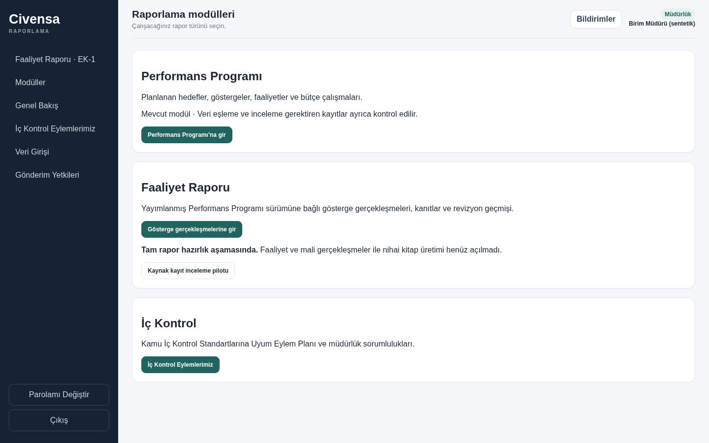

**Görünen metinler ve tablolar:**

- `div`: Civensa RAPORLAMA
- `h1`: Raporlama modülleri
- `p`: Çalışacağınız rapor türünü seçin.
- `div`: Müdürlük Birim Müdürü (sentetik)
- `h2`: Performans Programı
- `p`: Planlanan hedefler, göstergeler, faaliyetler ve bütçe çalışmaları.
- `p`: Mevcut modül · Veri eşleme ve inceleme gerektiren kayıtlar ayrıca kontrol edilir.
- `h2`: Faaliyet Raporu
- `p`: Yayımlanmış Performans Programı sürümüne bağlı gösterge gerçekleşmeleri, kanıtlar ve revizyon geçmişi.
- `p`: Tam rapor hazırlık aşamasında. Faaliyet ve mali gerçekleşmeler ile nihai kitap üretimi henüz açılmadı.
- `h2`: İç Kontrol
- `p`: Kamu İç Kontrol Standartlarına Uyum Eylem Planı ve müdürlük sorumlulukları.

**Bağlantı, düğme, form ve alanlar:**

| Öğe | Tür / etiket / bağlam | Hedef URL veya eylem | Ne yapar / mevcut değer |
| --- | --- | --- | --- |
| E001 | a · Faaliyet Raporu · EK-1 | `/activity-sections` | Bağlantıdaki ekranı veya dosyayı açar: Faaliyet Raporu · EK-1. |
| E002 | a · Modüller | `/modules` | Bağlantıdaki ekranı veya dosyayı açar: Modüller. |
| E003 | a · Genel Bakış | `/dashboard` | Bağlantıdaki ekranı veya dosyayı açar: Genel Bakış. |
| E004 | a · İç Kontrol Eylemlerimiz | `/internal-control/our-actions` | Bağlantıdaki ekranı veya dosyayı açar: İç Kontrol Eylemlerimiz. |
| E005 | a · Veri Girişi | `/department/1` | Bağlantıdaki ekranı veya dosyayı açar: Veri Girişi. |
| E006 | a · Gönderim Yetkileri | `/submit-authorizations` | Bağlantıdaki ekranı veya dosyayı açar: Gönderim Yetkileri. |
| E007 | button · Parolamı Değiştir (#changePasswordButton) | `#passwordModal` | Parola değiştirme penceresini açar. |
| E008 | form · Çıkış | `POST /logout` | Oturumu kapatıp giriş ekranına döner. |
| E009 | button · Çıkış | `POST /logout` | Oturumu kapatıp giriş ekranına döner. |
| E010 | button · Bildirimler (#notificationButton) | `GET /api/notifications → #notificationPanel` | Bildirim listesini açar. |
| E011 | a · Performans Programı’na gir · Performans Programı | `/dashboard` | Bağlantıdaki ekranı veya dosyayı açar: Performans Programı’na gir. |
| E012 | a · Gösterge gerçekleşmelerine gir · Faaliyet Raporu | `/activity-reports` | Bağlantıdaki ekranı veya dosyayı açar: Gösterge gerçekleşmelerine gir. |
| E013 | a · Kaynak kayıt inceleme pilotu · Faaliyet Raporu | `/activity-report` | Bağlantıdaki ekranı veya dosyayı açar: Kaynak kayıt inceleme pilotu. |
| E014 | a · İç Kontrol Eylemlerimiz · İç Kontrol | `/internal-control` | Bağlantıdaki ekranı veya dosyayı açar: İç Kontrol Eylemlerimiz. |

<a id="ekran-035"></a>

### 035 · Sistem Durumu · Dolu / taslak

URL kalıbı: `/operations` · Çekilen URL: `/operations?period_id=1` · Rol: **strategy** · HTTP 200.

Dönem, şablon, içe aktarma ve yayın kontrollerini gösterir.


**Görünen metinler ve tablolar:**

- `div`: Civensa RAPORLAMA
- `h1`: Sistem Durumu
- `span`: 2027 Performans Programı
- `p`: Civensa 5.0.0 · 2027 döneminin operasyon özeti
- `div`: Strateji Geliştirme Strateji Müdürü (sentetik)
- `h2`: Operasyonel görünürlük
- `p`: Canlı sağlık, kayıt bütünlüğü ve sürüm hazırlığı.
- `h2`: Teknik hazırlık · Engelli
- `p`: Yalnız şema, kayıt bütünlüğü ve temel operasyon kontrolleri. Tam PP yayın onayı aşağıdaki kontrol listesindedir.
- `h2`: PP yayın kontrol listesi · Engelli
- `p`: Tüm otomatik kontroller geçmeli ve tüm manuel maddeler kanıtla teyit edilmelidir. Onaylar 2027 döneminin mevcut içeriğine bağlıdır; içerik veya kontrol sonucu değişirse yeniden teyit gerekir.
- `p`: PP-19 canlı rol gözlemi: Doğrulanmadı · Sistem canlı rol kontrolü yapmaz. Yetkili kişinin manuel kanıtı aşağıda ayrıca gösterilir.
- `h3`: Otomatik yayın kapıları
- `h4`: Veritabanı bağlantısı · Geçti
- `p`: Sorumlu: Teknik sorumlu / Strateji
- `p`: Kontrol kaynağı: main.release_readiness.checks.database
- `h4`: Şema sürümü · Geçti
- `p`: Sorumlu: Teknik sorumlu / Strateji
- `p`: Kontrol kaynağı: main.release_readiness.checks.migration_head
- `h4`: Etkin dönem · Geçti
- `p`: Sorumlu: Teknik sorumlu / Strateji
- `p`: Kontrol kaynağı: main.release_readiness.checks.period_active
- `h4`: Müdürlük kayıtları · Geçti
- `p`: Sorumlu: Teknik sorumlu / Strateji
- `p`: Kontrol kaynağı: main.release_readiness.checks.departments_present
- `h4`: Gösterge kayıtları · Geçti
- `p`: Sorumlu: Teknik sorumlu / Strateji
- `p`: Kontrol kaynağı: main.release_readiness.checks.indicators_present
- `h4`: Faaliyet kayıtları · Geçti
- `p`: Sorumlu: Teknik sorumlu / Strateji
- `p`: Kontrol kaynağı: main.release_readiness.checks.activities_present
- `h4`: Faaliyet eşleştirmeleri (PP-08) · Engelli
- `p`: Sorumlu: Teknik sorumlu / Strateji
- `p`: Faaliyet Eşleştirme ekranında alt program, kart ve katalog eksiklerini tamamlayın.
- `p`: Kontrol kaynağı: main.release_readiness.checks.activity_mappings_complete
- `h4`: Faaliyet müdürlük bağlantıları · Geçti
- `p`: Sorumlu: Teknik sorumlu / Strateji
- `p`: Kontrol kaynağı: main.release_readiness.checks.no_orphan_activities
- `h4`: Gösterge müdürlük bağlantıları · Geçti
- `p`: Sorumlu: Teknik sorumlu / Strateji
- `p`: Kontrol kaynağı: main.release_readiness.checks.no_orphan_indicators
- `h4`: Etkin Müdür hesaplarının tekilliği · Geçti
- `p`: Sorumlu: Teknik sorumlu / Strateji
- `p`: Kontrol kaynağı: main.release_readiness.checks.no_duplicate_active_department_accounts
- `h4`: Gönderim ve bildirim şeması · Geçti
- `p`: Sorumlu: Teknik sorumlu / Strateji
- `p`: Kontrol kaynağı: main.release_readiness.checks.workflow_schema_present
- `h4`: Örnek Destek Müdürlüğü: dönem kapsamı · Geçti
- `p`: Sorumlu: Strateji / ilgili Müdürlük Müdürü
- `p`: Kontrol kaynağı: program_service.publication_checks / DepartmentScope
- `h4`: Örnek Destek Müdürlüğü: kayıt ve toplam doğrulaması · Engelli
- `p`: Sorumlu: Strateji / ilgili Müdürlük Müdürü
- `p`: İlgili müdürlük kayıtlarını, kapsamı ve Strateji onayını Nihai Rapor ekranında tamamlayın.
- `p`: Kontrol kaynağı: program_service.validate_department
- `h4`: Örnek Destek Müdürlüğü: Strateji onayı · Engelli
- `p`: Sorumlu: Strateji / ilgili Müdürlük Müdürü
- `p`: İlgili müdürlük kayıtlarını, kapsamı ve Strateji onayını Nihai Rapor ekranında tamamlayın.
- `p`: Kontrol kaynağı: Submission.status / submission_decision
- `h4`: Örnek Hizmet Müdürlüğü: dönem kapsamı · Geçti
- `p`: Sorumlu: Strateji / ilgili Müdürlük Müdürü
- `p`: Kontrol kaynağı: program_service.publication_checks / DepartmentScope
- `h4`: Örnek Hizmet Müdürlüğü: kayıt ve toplam doğrulaması · Engelli
- `p`: Sorumlu: Strateji / ilgili Müdürlük Müdürü
- `p`: İlgili müdürlük kayıtlarını, kapsamı ve Strateji onayını Nihai Rapor ekranında tamamlayın.
- `p`: Kontrol kaynağı: program_service.validate_department
- `h4`: Örnek Hizmet Müdürlüğü: Strateji onayı · Engelli
- `p`: Sorumlu: Strateji / ilgili Müdürlük Müdürü
- `p`: İlgili müdürlük kayıtlarını, kapsamı ve Strateji onayını Nihai Rapor ekranında tamamlayın.
- `p`: Kontrol kaynağı: Submission.status / submission_decision
- `h4`: Strateji Geliştirme Müdürlüğü: dönem kapsamı · Engelli
- `p`: Sorumlu: Strateji / ilgili Müdürlük Müdürü
- `p`: İlgili müdürlük kayıtlarını, kapsamı ve Strateji onayını Nihai Rapor ekranında tamamlayın.
- `p`: Kontrol kaynağı: program_service.publication_checks / DepartmentScope
- `h4`: Kitabın genel bilgi bölümleri · Geçti
- `p`: Sorumlu: Strateji / ilgili Müdürlük Müdürü
- `p`: Kontrol kaynağı: ReportSection / publication_checks
- `h4`: Sorumlu harcama birimleri kataloğu · Geçti
- `p`: Sorumlu: Strateji / ilgili Müdürlük Müdürü
- `p`: Kontrol kaynağı: OfficialActivity / publication_checks
- `h4`: Yerel Hizmetler Programı / 2027: maliyet ara toplamı · Engelli
- `p`: Sorumlu: Strateji / ilgili Müdürlük Müdürü
- `p`: İlgili müdürlük kayıtlarını, kapsamı ve Strateji onayını Nihai Rapor ekranında tamamlayın.
- `p`: Kontrol kaynağı: program_service.cost_reconciliation / ActivityCostValue.source_amount
- `h4`: Yerel Hizmetler Programı / 2028: maliyet ara toplamı · Engelli
- `p`: Sorumlu: Strateji / ilgili Müdürlük Müdürü
- `p`: İlgili müdürlük kayıtlarını, kapsamı ve Strateji onayını Nihai Rapor ekranında tamamlayın.
- `p`: Kontrol kaynağı: program_service.cost_reconciliation / ActivityCostValue.source_amount
- `h4`: Yerel Hizmetler Programı / 2029: maliyet ara toplamı · Engelli
- `p`: Sorumlu: Strateji / ilgili Müdürlük Müdürü
- `p`: İlgili müdürlük kayıtlarını, kapsamı ve Strateji onayını Nihai Rapor ekranında tamamlayın.
- `p`: Kontrol kaynağı: program_service.cost_reconciliation / ActivityCostValue.source_amount
- `h4`: Yerel Hizmetler Programı / Erişilebilir Hizmetler / 2027: maliyet ara toplamı · Engelli
- `p`: Sorumlu: Strateji / ilgili Müdürlük Müdürü
- `p`: İlgili müdürlük kayıtlarını, kapsamı ve Strateji onayını Nihai Rapor ekranında tamamlayın.
- `p`: Kontrol kaynağı: program_service.cost_reconciliation / ActivityCostValue.source_amount
- `h4`: Yerel Hizmetler Programı / Erişilebilir Hizmetler / 2028: maliyet ara toplamı · Engelli
- `p`: Sorumlu: Strateji / ilgili Müdürlük Müdürü
- `p`: İlgili müdürlük kayıtlarını, kapsamı ve Strateji onayını Nihai Rapor ekranında tamamlayın.
- `p`: Kontrol kaynağı: program_service.cost_reconciliation / ActivityCostValue.source_amount
- `h4`: Yerel Hizmetler Programı / Erişilebilir Hizmetler / 2029: maliyet ara toplamı · Engelli
- `p`: Sorumlu: Strateji / ilgili Müdürlük Müdürü
- `p`: İlgili müdürlük kayıtlarını, kapsamı ve Strateji onayını Nihai Rapor ekranında tamamlayın.
- `p`: Kontrol kaynağı: program_service.cost_reconciliation / ActivityCostValue.source_amount
- `h4`: Yerel Hizmetler Programı / Erişilebilir Hizmetler / Örnek Hizmet Müdürlüğü / 2027: maliyet ara toplamı · Engelli
- `p`: Sorumlu: Strateji / ilgili Müdürlük Müdürü
- `p`: İlgili müdürlük kayıtlarını, kapsamı ve Strateji onayını Nihai Rapor ekranında tamamlayın.
- `p`: Kontrol kaynağı: program_service.cost_reconciliation / ActivityCostValue.source_amount
- `h4`: Yerel Hizmetler Programı / Erişilebilir Hizmetler / Örnek Hizmet Müdürlüğü / 2028: maliyet ara toplamı · Engelli
- `p`: Sorumlu: Strateji / ilgili Müdürlük Müdürü
- `p`: İlgili müdürlük kayıtlarını, kapsamı ve Strateji onayını Nihai Rapor ekranında tamamlayın.
- `p`: Kontrol kaynağı: program_service.cost_reconciliation / ActivityCostValue.source_amount
- `h4`: Yerel Hizmetler Programı / Erişilebilir Hizmetler / Örnek Hizmet Müdürlüğü / 2029: maliyet ara toplamı · Engelli
- `p`: Sorumlu: Strateji / ilgili Müdürlük Müdürü
- `p`: İlgili müdürlük kayıtlarını, kapsamı ve Strateji onayını Nihai Rapor ekranında tamamlayın.
- `p`: Kontrol kaynağı: program_service.cost_reconciliation / ActivityCostValue.source_amount
- `h4`: Yerel Hizmetler Programı / Erişilebilir Hizmetler / Örnek Destek Müdürlüğü / 2027: maliyet ara toplamı · Geçti
- `p`: Sorumlu: Strateji / ilgili Müdürlük Müdürü
- `p`: Kontrol kaynağı: program_service.cost_reconciliation / ActivityCostValue.source_amount
- `h4`: Yerel Hizmetler Programı / Erişilebilir Hizmetler / Örnek Destek Müdürlüğü / 2028: maliyet ara toplamı · Geçti
- `p`: Sorumlu: Strateji / ilgili Müdürlük Müdürü
- `p`: Kontrol kaynağı: program_service.cost_reconciliation / ActivityCostValue.source_amount
- `h4`: Yerel Hizmetler Programı / Erişilebilir Hizmetler / Örnek Destek Müdürlüğü / 2029: maliyet ara toplamı · Geçti
- `p`: Sorumlu: Strateji / ilgili Müdürlük Müdürü
- `p`: Kontrol kaynağı: program_service.cost_reconciliation / ActivityCostValue.source_amount
- `h4`: Örnek Hizmet Müdürlüğü / 2027: maliyet ara toplamı · Engelli
- `p`: Sorumlu: Strateji / ilgili Müdürlük Müdürü
- `p`: İlgili müdürlük kayıtlarını, kapsamı ve Strateji onayını Nihai Rapor ekranında tamamlayın.
- `p`: Kontrol kaynağı: program_service.cost_reconciliation / ActivityCostValue.source_amount
- `h4`: Örnek Hizmet Müdürlüğü / 2028: maliyet ara toplamı · Engelli
- `p`: Sorumlu: Strateji / ilgili Müdürlük Müdürü
- `p`: İlgili müdürlük kayıtlarını, kapsamı ve Strateji onayını Nihai Rapor ekranında tamamlayın.
- `p`: Kontrol kaynağı: program_service.cost_reconciliation / ActivityCostValue.source_amount
- `h4`: Örnek Hizmet Müdürlüğü / 2029: maliyet ara toplamı · Engelli
- `p`: Sorumlu: Strateji / ilgili Müdürlük Müdürü
- `p`: İlgili müdürlük kayıtlarını, kapsamı ve Strateji onayını Nihai Rapor ekranında tamamlayın.
- `p`: Kontrol kaynağı: program_service.cost_reconciliation / ActivityCostValue.source_amount
- `h4`: Strateji Geliştirme Müdürlüğü / 2027: maliyet ara toplamı · Engelli
- `p`: Sorumlu: Strateji / ilgili Müdürlük Müdürü
- `p`: İlgili müdürlük kayıtlarını, kapsamı ve Strateji onayını Nihai Rapor ekranında tamamlayın.
- `p`: Kontrol kaynağı: program_service.cost_reconciliation / ActivityCostValue.source_amount
- `h4`: Strateji Geliştirme Müdürlüğü / 2028: maliyet ara toplamı · Engelli
- `p`: Sorumlu: Strateji / ilgili Müdürlük Müdürü
- `p`: İlgili müdürlük kayıtlarını, kapsamı ve Strateji onayını Nihai Rapor ekranında tamamlayın.
- `p`: Kontrol kaynağı: program_service.cost_reconciliation / ActivityCostValue.source_amount
- `h4`: Strateji Geliştirme Müdürlüğü / 2029: maliyet ara toplamı · Engelli
- `p`: Sorumlu: Strateji / ilgili Müdürlük Müdürü
- `p`: İlgili müdürlük kayıtlarını, kapsamı ve Strateji onayını Nihai Rapor ekranında tamamlayın.
- `p`: Kontrol kaynağı: program_service.cost_reconciliation / ActivityCostValue.source_amount
- `h4`: Örnek Destek Müdürlüğü / 2027: maliyet ara toplamı · Geçti
- `p`: Sorumlu: Strateji / ilgili Müdürlük Müdürü
- `p`: Kontrol kaynağı: program_service.cost_reconciliation / ActivityCostValue.source_amount
- `h4`: Örnek Destek Müdürlüğü / 2028: maliyet ara toplamı · Geçti
- `p`: Sorumlu: Strateji / ilgili Müdürlük Müdürü
- `p`: Kontrol kaynağı: program_service.cost_reconciliation / ActivityCostValue.source_amount
- `h4`: Örnek Destek Müdürlüğü / 2029: maliyet ara toplamı · Geçti
- `p`: Sorumlu: Strateji / ilgili Müdürlük Müdürü
- `p`: Kontrol kaynağı: program_service.cost_reconciliation / ActivityCostValue.source_amount
- `h3`: D1–D8 ve manuel yayın onayları
- `h4`: D1 · Kurulum, içe aktarma ve elle giriş · Elle onay bekliyor
- `p`: Sorumlu / gerekli onay: Strateji veri sorumlusu
- `p`: Resmî kaynak tablo kapsamını, ilk dönem/elle giriş ve kopyalama sonuçlarını; kalan Word çeşitleri ve eşzamanlı yükleme bulgularını kanıtlayın.
- `p`: Kanıt ve kişi onayı henüz kaydedilmedi.
- `p`: tests/test_word_import.py; tests/test_pp_import_submit_ready.py; tests/test_master_data.py
- `p`: Test kaynağının varlığı kullanıcı kabulü veya canlı doğrulama kanıtı değildir.
- `h4`: D2 · Müdürlük girişi ve düzeltmesi · Elle onay bekliyor
- `p`: Sorumlu / gerekli onay: Müdürlük Müdürü ve Strateji
- `p`: Dönem, boş/sıfır, taslak koruma ve onay sonrası hata düzeltme yolunu gerçek kullanıcıyla doğrulayın.
- `p`: Kanıt ve kişi onayı henüz kaydedilmedi.
- `p`: tests/test_indicator_update.py; tests/test_pp_period_context.py; tests/test_draft_removal.py
- `p`: Test kaynağının varlığı kullanıcı kabulü veya canlı doğrulama kanıtı değildir.
- `h4`: D3 · İnceleme, iade ve yeniden onay · Elle onay bekliyor
- `p`: Sorumlu / gerekli onay: Strateji inceleme sorumlusu
- `p`: Gönderim, gerekçeli iade, yeniden gönderim ve bağımsız onayı; bütçe dışı onaylı hata düzeltmesi sınırını kabul kanıtıyla kaydedin.
- `p`: Kanıt ve kişi onayı henüz kaydedilmedi.
- `p`: tests/test_submission_workflow.py; tests/test_review_errors.py
- `p`: Test kaynağının varlığı kullanıcı kabulü veya canlı doğrulama kanıtı değildir.
- `h4`: D4 · Değişmez ve hash içeren yayın · Elle onay bekliyor
- `p`: Sorumlu / gerekli onay: Teknik sorumlu ve Strateji
- `p`: Donmuş sürüm/hash ve başarısız yeniden yayın korumasını doğrulayın; PP-19 ayrıca teyit edilmelidir.
- `p`: Kanıt ve kişi onayı henüz kaydedilmedi.
- `p`: tests/test_publication_gates.py; tests/test_db_roles.py
- `p`: Test kaynağının varlığı kullanıcı kabulü veya canlı doğrulama kanıtı değildir.
- `h4`: D5 · Kaynak karşılaştırması ve toplamlar · Elle onay bekliyor
- `p`: Sorumlu / gerekli onay: Mali hizmetler kontrol sorumlusu
- `p`: Kaynak konumları, çelişki kararları, genel toplamlar ve program/alt program/müdürlük ara toplamlarını yayımlanacak içerikle mutabık kılın.
- `p`: Kanıt ve kişi onayı henüz kaydedilmedi.
- `p`: tests/test_source_conflicts.py; tests/test_institution_summary_evidence.py
- `p`: Test kaynağının varlığı kullanıcı kabulü veya canlı doğrulama kanıtı değildir.
- `h4`: D6 · Türkçe hata ve kurtarma akışları · Elle onay bekliyor
- `p`: Sorumlu / gerekli onay: Strateji kullanıcı kabul sorumlusu
- `p`: Ne/nerede/eylem mesajlarını, hatada form değerlerini ve yeniden denemeyi kullanıcı kabulüyle doğrulayın.
- `p`: Kanıt ve kişi onayı henüz kaydedilmedi.
- `p`: tests/test_pp_errors_forms.py
- `p`: Test kaynağının varlığı kullanıcı kabulü veya canlı doğrulama kanıtı değildir.
- `h4`: D7 · Kitap, Word ve PDF · Elle onay bekliyor
- `p`: Sorumlu / gerekli onay: Strateji yayın sorumlusu
- `p`: Bölüm sırası, tablo kapsamı ve büyük Word/PDF çıktısını kontrol edin; resmî düzen/sayfalama PP-24 ile ayrıca onaylanır.
- `p`: Kanıt ve kişi onayı henüz kaydedilmedi.
- `p`: app/book_export.py; tests/test_program.py
- `p`: Test kaynağının varlığı kullanıcı kabulü veya canlı doğrulama kanıtı değildir.
- `h4`: D8 · Teknik olmayan Strateji yönetimi · Elle onay bekliyor
- `p`: Sorumlu / gerekli onay: Strateji birim yöneticisi
- `p`: Kurum/dönem/hesap yönetimini, rol-müdürlük transfer politikasını, eşleştirmeyi ve hata kurtarmayı kullanıcıyla doğrulayın.
- `p`: Kanıt ve kişi onayı henüz kaydedilmedi.
- `p`: tests/test_master_data.py; tests/test_activity_mapping_gaps_ui.py; app/templates/operations.html
- `p`: Test kaynağının varlığı kullanıcı kabulü veya canlı doğrulama kanıtı değildir.
- `h4`: PP-19 · Üretim veritabanı rol doğrulaması · Doğrulanmadı
- `p`: Sorumlu / gerekli onay: Üretim yetkilisi ve teknik sorumlu
- `p`: Yetkili üretim sorumlusunun runtime/owner ayrımı, yetki ve geri dönüş kanıtını ekleyin. Yerel test canlı doğrulama değildir.
- `p`: Kanıt ve kişi onayı henüz kaydedilmedi.
- `p`: docs/operations/db-roles.md
- `p`: Test kaynağının varlığı kullanıcı kabulü veya canlı doğrulama kanıtı değildir.
- `h4`: PP-24 · Resmî PP kitap ve Word kabulü · Elle onay bekliyor
- `p`: Sorumlu / gerekli onay: Strateji yayın sorumlusu ve iş sahibi
- `p`: Resmî PP referansını, büyük Word/PDF düzen-sayfalama kabulünü ve kabul eden kişiyi kanıta ekleyin.
- `p`: Kanıt ve kişi onayı henüz kaydedilmedi.
- `p`: docs/reports/civ-008-performance-programme-audit.md (PP-24)
- `p`: Test kaynağının varlığı kullanıcı kabulü veya canlı doğrulama kanıtı değildir.
- `h4`: operations · Güvenlik, yedek ve geri dönüş kabulü · Elle onay bekliyor
- `p`: Sorumlu / gerekli onay: Teknik sorumlu
- `p`: Son commit CI kanıtını, giriş sınırı/oturum/menü kontrollerini ve yedekten geri dönüş provasını kaydedin.
- `p`: Kanıt ve kişi onayı henüz kaydedilmedi.
- `p`: .github/workflows/performance-program.yml; docs/operations/db-roles.md
- `p`: Test kaynağının varlığı kullanıcı kabulü veya canlı doğrulama kanıtı değildir.
- `h4`: owner · İş sahibi yayın onayı · Elle onay bekliyor
- `p`: Sorumlu / gerekli onay: Strateji birim yöneticisi / iş sahibi
- `p`: Tüm kapıları ve açık PP bulgularını inceleyin; yayın kararının kapsamını ve iş sahibi onayını kaydedin.
- `p`: Kanıt ve kişi onayı henüz kaydedilmedi.
- `p`: docs/operations/release-checklist.md
- `p`: Test kaynağının varlığı kullanıcı kabulü veya canlı doğrulama kanıtı değildir.
- `h3`: Manuel teyit kaydet
- `p`: Adınız ve kayıt zamanı sistem tarafından eklenir. Önceki kayıt değiştirilemez veya silinemez; düzeltme ve geri çekme yeni kayıt oluşturur. Kanıta sorumlu kişinin onayını, belge/sürüm bağlantısını ve kabul kapsamını yazın.
- `p`: Henüz teyit kaydı yok.
- `h2`: Kayıt Özeti
- `p`: Aktif olarak görüntülenen dönemin veritabanı sayıları.
- `table`: KAYNAK KAYIT Müdürlükler 3 Müdürlük kullanıcı hesapları 2 Kullanıcı hesabı olmayan müdürlükler 2 Performans göstergeleri 2 Faaliyetler 2 Eşleştirme bekleyen faaliyetler 1 Metin benzerliği önerisi bulunanlar 0 Güçlü öneriler (en az %50) 0
- `h2`: Gönderim Durumları
- `p`: Müdürlük paketlerinin dönem içindeki güncel dağılımı.
- `h2`: Denetim İzi
- `p`: Son kayıtlı işlem zamanı.
- `p`: 25.10.2026 00:35 TSİ
- `span`: Veritabanı bağlantısı · Geçti
- `span`: Şema sürümü · Geçti
- `span`: Etkin dönem · Geçti
- `span`: Müdürlük kayıtları · Geçti
- `span`: Gösterge kayıtları · Geçti
- `span`: Faaliyet kayıtları · Geçti
- `span`: Faaliyet eşleştirmeleri (PP-08) · Engelli
- `span`: Faaliyet müdürlük bağlantıları · Geçti
- `span`: Gösterge müdürlük bağlantıları · Geçti
- `span`: Etkin Müdür hesaplarının tekilliği · Geçti
- `span`: Gönderim ve bildirim şeması · Geçti
- `div`: 2 müdürlüğün etkin hesabı yok.
- `div`: 1 faaliyet insan eşleştirmesi bekliyor.
- `pre`: { "observed": { "backend": "postgresql", "latency_ms": 4.0, "status": "ok" }, "period_id": 1, "result": true }
- `pre`: { "observed": { "actual": "c086a1b2c3d4", "expected": "c086a1b2c3d4" }, "period_id": 1, "result": true }
- `pre`: { "observed": { "id": 1, "status": "active", "year": 2027 }, "period_id": 1, "result": true }
- `pre`: { "observed": 3, "period_id": 1, "result": true }
- `pre`: { "observed": 2, "period_id": 1, "result": true }
- `pre`: { "observed": 2, "period_id": 1, "result": true }
- `pre`: { "observed": { "card": 0, "catalogue": 1, "subprogram": 0, "total": 1 }, "period_id": 1, "result": false }
- `pre`: { "observed": 0, "period_id": 1, "result": true }
- `pre`: { "observed": 0, "period_id": 1, "result": true }
- `pre`: { "observed": [], "period_id": 1, "result": true }
- `pre`: { "observed": { "notifications": true, "submission_events": true }, "period_id": 1, "result": true }
- `pre`: { "errors": [], "observed": { "active_from": null, "active_to": null, "budget_code": null, "department_id": 3, "display_name": "", "id": 2, "period_id": 1, "position": 0, "reason": "", "status": "required" }, "period_id": 1, "warnings": [] }
- `pre`: { "errors": [ "\u00d6rnek Destek M\u00fcd\u00fcrl\u00fc\u011f\u00fc: Tamamlanan hizmet say\u0131s\u0131: G\u00f6stergeye ili\u015fkin a\u00e7\u0131klama bo\u015f.", "\u00d6rnek Destek M\u00fcd\u00fcrl\u00fc\u011f\u00fc: 2027: Hizmet Programlar\u0131 / B\u00fct\u00e7e \u0130\u00e7i: 6 ekonomik gider h\u00fccresi eksik (yoksa 0 girin).", "\u00d6rnek Destek M\u00fcd\u00fcrl\u00fc\u011f\u00fc: 2027: Hizmet Programlar\u0131 / B\u00fct\u00e7e D\u0131\u015f\u0131: 6 ekonomik gider h\u00fccresi eksik (yoksa 0 girin).", "\u00d6rnek Destek M\u00fcd\u00fcrl\u00fc\u011f\u00fc: 2028: Hizmet Programlar\u0131 / B\u00fct\u00e7e \u0130\u00e7i: 6 ekonomik gider h\u00fccresi eksik (yoksa 0 girin).", "\u00d6rnek Destek M\u00fcd\u00fcrl\u00fc\u011f\u00fc: 2028: Hizmet Programlar\u0131 / B\u00fct\u00e7e D\u0131\u015f\u0131: 6 ekonomik gider h\u00fccresi eksik (yoksa 0 girin).", "\u00d6rnek Destek M\u00fcd\u00fcrl\u00fc\u011f\u00fc: 2029: Hizmet Programlar\u0131 / B\u00fct\u00e7e \u0130\u00e7i: 6 ekonomik gider h\u00fccresi eksik (yoksa 0 girin).", "\u00d6rnek Destek M\u00fcd\u00fcrl\u00fc\u011f\u00fc: 2029: Hizmet Programlar\u0131 / B\u00fct\u00e7e D\u0131\u015f\u0131: 6 ekonomik gider h\u00fccresi eksik (yoksa 0 girin)." ], "observed": { "department_id": 3 }, "period_id": 1, "warnings": [] }
- `pre`: { "errors": [ "\u00d6rnek Destek M\u00fcd\u00fcrl\u00fc\u011f\u00fc: onay eksik." ], "observed": { "approval_event_id": null, "approver": null, "approver_id": null, "submission": { "department_id": 3, "id": 2, "period_id": 1, "return_note": "", "reviewed_at": null, "revision": 1, "status": "submitted", "submitted_at": null } }, "period_id": 1, "warnings": [] }
- `pre`: { "errors": [], "observed": { "active_from": null, "active_to": null, "budget_code": null, "department_id": 1, "display_name": "", "id": 1, "period_id": 1, "position": 0, "reason": "", "status": "required" }, "period_id": 1, "warnings": [] }
- `pre`: { "errors": [ "\u00d6rnek Hizmet M\u00fcd\u00fcrl\u00fc\u011f\u00fc: Tamamlanan hizmet say\u0131s\u0131: G\u00f6stergeye ili\u015fkin a\u00e7\u0131klama bo\u015f.", "\u00d6rnek Hizmet M\u00fcd\u00fcrl\u00fc\u011f\u00fc: Hizmet noktalar\u0131n\u0131n iyile\u015ftirilmesi: sorumlu harcama birimleri katalo\u011fu ba\u011flant\u0131s\u0131 eksik.", "\u00d6rnek Hizmet M\u00fcd\u00fcrl\u00fc\u011f\u00fc: 2029 Tahmin / Mal ve Hizmet Al\u0131m Giderleri / B\u00fct\u00e7e \u0130\u00e7i: ekonomik kaynak tutar\u0131 ve program grubu do\u011frulanmal\u0131.", "\u00d6rnek Hizmet M\u00fcd\u00fcrl\u00fc\u011f\u00fc: 2029 Tahmin / Mal ve Hizmet Al\u0131m Giderleri / B\u00fct\u00e7e D\u0131\u015f\u0131: ekonomik kaynak tutar\u0131 ve program grubu do\u011frulanmal\u0131.", "\u00d6rnek Hizmet M\u00fcd\u00fcrl\u00fc\u011f\u00fc: 2027: Hizmet Programlar\u0131 / B\u00fct\u00e7e \u0130\u00e7i: 6 ekonomik gider h\u00fccresi eksik (yoksa 0 girin).", "\u00d6rnek Hizmet M\u00fcd\u00fcrl\u00fc\u011f\u00fc: 2027: Hizmet Programlar\u0131 / B\u00fct\u00e7e D\u0131\u015f\u0131: 6 ekonomik gider h\u00fccresi eksik (yoksa 0 girin).", "\u00d6rnek Hizmet M\u00fcd\u00fcrl\u00fc\u011f\u00fc: 2027: Program Grubu Belirlenmeli / B\u00fct\u00e7e \u0130\u00e7i: 9 ekonomik gider h\u00fccresi eksik (yoksa 0 girin).", "\u00d6rnek Hizmet M\u00fcd\u00fcrl\u00fc\u011f\u00fc: 2027: Program Grubu Belirlenmeli / B\u00fct\u00e7e D\u0131\u015f\u0131: 9 ekonomik gider h\u00fccresi eksik (yoksa 0 girin).", "\u00d6rnek Hizmet M\u00fcd\u00fcrl\u00fc\u011f\u00fc: 2028: Hizmet Programlar\u0131 / B\u00fct\u00e7e \u0130\u00e7i: 6 ekonomik gider h\u00fccresi eksik (yoksa 0 girin).", "\u00d6rnek Hizmet M\u00fcd\u00fcrl\u00fc\u011f\u00fc: 2028: Hizmet Programlar\u0131 / B\u00fct\u00e7e D\u0131\u015f\u0131: 6 ekonomik gider h\u00fccresi eksik (yoksa 0 girin).", "\u00d6rnek Hizmet M\u00fcd\u00fcrl\u00fc\u011f\u00fc: 2028: Program Grubu Belirlenmeli / B\u00fct\u00e7e \u0130\u00e7i: 9 ekonomik gider h\u00fccresi eksik (yoksa 0 girin).", "\u00d6rnek Hizmet M\u00fcd\u00fcrl\u00fc\u011f\u00fc: 2028: Program Grubu Belirlenmeli / B\u00fct\u00e7e D\u0131\u015f\u0131: 9 ekonomik gider h\u00fccresi eksik (yoksa 0 girin).", "\u00d6rnek Hizmet M\u00fcd\u00fcrl\u00fc\u011f\u00fc: 2029: Hizmet Programlar\u0131 / B\u00fct\u00e7e \u0130\u00e7i: 7 ekonomik gider h\u00fccresi eksik (yoksa 0 girin).", "\u00d6rnek Hizmet M\u00fcd\u00fcrl\u00fc\u011f\u00fc: 2029: Hizmet Programlar\u0131 / B\u00fct\u00e7e D\u0131\u015f\u0131: 7 ekonomik gider h\u00fccresi eksik (yoksa 0 girin).", "\u00d6rnek Hizmet M\u00fcd\u00fcrl\u00fc\u011f\u00fc: 2029: Program Grubu Belirlenmeli / B\u00fct\u00e7e \u0130\u00e7i: 8 ekonomik gider h\u00fccresi eksik (yoksa 0 girin).", "\u00d6rnek Hizmet M\u00fcd\u00fcrl\u00fc\u011f\u00fc: 2029: Program Grubu Belirlenmeli / B\u00fct\u00e7e D\u0131\u015f\u0131: 8 ekonomik gider h\u00fccresi eksik (yoksa 0 girin)." ], "observed": { "department_id": 1 }, "period_id": 1, "warnings": [] }
- `pre`: { "errors": [ "\u00d6rnek Hizmet M\u00fcd\u00fcrl\u00fc\u011f\u00fc: onay eksik." ], "observed": { "approval_event_id": null, "approver": null, "approver_id": null, "submission": { "department_id": 1, "id": 1, "period_id": 1, "return_note": "", "reviewed_at": null, "revision": 1, "status": "draft", "submitted_at": null } }, "period_id": 1, "warnings": [] }
- `pre`: { "errors": [ "Strateji Geli\u015ftirme M\u00fcd\u00fcrl\u00fc\u011f\u00fc: d\u00f6nem kapsam\u0131 belirtilmeli." ], "observed": null, "period_id": 1, "warnings": [] }
- `pre`: { "errors": [], "observed": { "record_ids": [ 1 ] }, "period_id": 1, "warnings": [] }
- `pre`: { "errors": [], "observed": { "record_ids": [ 1, 2 ] }, "period_id": 1, "warnings": [] }
- `pre`: { "errors": [ "\u00d6rnek Hizmet M\u00fcd\u00fcrl\u00fc\u011f\u00fc / Hizmet noktalar\u0131n\u0131n iyile\u015ftirilmesi: program, alt program, kart veya katalog ba\u011flant\u0131s\u0131 eksik ya da kapsam\u0131 uyu\u015fmuyor. Faaliyet E\u015fle\u015ftirme ve Performans Kartlar\u0131 ekranlar\u0131nda ba\u011flant\u0131lar\u0131 tamamlay\u0131n." ], "observed": { "activity_ids": [ 1, 2 ], "amount": null, "complete": false, "department_id": null, "difference": null, "errors": [ "\u00d6rnek Hizmet M\u00fcd\u00fcrl\u00fc\u011f\u00fc / Hizmet noktalar\u0131n\u0131n iyile\u015ftirilmesi: program, alt program, kart veya katalog ba\u011flant\u0131s\u0131 eksik ya da kapsam\u0131 uyu\u015fmuyor. Faaliyet E\u015fle\u015ftirme ve Performans Kartlar\u0131 ekranlar\u0131nda ba\u011flant\u0131lar\u0131 tamamlay\u0131n." ], "label": "Program ara toplam\u0131: Yerel Hizmetler Program\u0131", "level": "program", "path": "Yerel Hizmetler Program\u0131", "program_id": 1, "source_amount": null, "status": "Yay\u0131n engeli", "subprogram_id": null, "value_kind": "budget", "warnings": [ "Yerel Hizmetler Program\u0131 / 2027 B\u00fct\u00e7e: kaynak toplam\u0131 yok (t\u00fcm faaliyetleri kapsayan kaynak tutar\u0131 bulunmuyor). Kaynak belgeyi kontrol edin." ], "year": 2027 }, "period_id": 1, "warnings": [ "Yerel Hizmetler Program\u0131 / 2027 B\u00fct\u00e7e: kaynak toplam\u0131 yok (t\u00fcm faaliyetleri kapsayan kaynak tutar\u0131 bulunmuyor). Kaynak belgeyi kontrol edin." ] }
- `pre`: { "errors": [ "\u00d6rnek Hizmet M\u00fcd\u00fcrl\u00fc\u011f\u00fc / Hizmet noktalar\u0131n\u0131n iyile\u015ftirilmesi: program, alt program, kart veya katalog ba\u011flant\u0131s\u0131 eksik ya da kapsam\u0131 uyu\u015fmuyor. Faaliyet E\u015fle\u015ftirme ve Performans Kartlar\u0131 ekranlar\u0131nda ba\u011flant\u0131lar\u0131 tamamlay\u0131n." ], "observed": { "activity_ids": [ 1, 2 ], "amount": null, "complete": false, "department_id": null, "difference": null, "errors": [ "\u00d6rnek Hizmet M\u00fcd\u00fcrl\u00fc\u011f\u00fc / Hizmet noktalar\u0131n\u0131n iyile\u015ftirilmesi: program, alt program, kart veya katalog ba\u011flant\u0131s\u0131 eksik ya da kapsam\u0131 uyu\u015fmuyor. Faaliyet E\u015fle\u015ftirme ve Performans Kartlar\u0131 ekranlar\u0131nda ba\u011flant\u0131lar\u0131 tamamlay\u0131n." ], "label": "Program ara toplam\u0131: Yerel Hizmetler Program\u0131", "level": "program", "path": "Yerel Hizmetler Program\u0131", "program_id": 1, "source_amount": null, "status": "Yay\u0131n engeli", "subprogram_id": null, "value_kind": "forecast", "warnings": [ "Yerel Hizmetler Program\u0131 / 2028 Tahmin: kaynak toplam\u0131 yok (t\u00fcm faaliyetleri kapsayan kaynak tutar\u0131 bulunmuyor). Kaynak belgeyi kontrol edin." ], "year": 2028 }, "period_id": 1, "warnings": [ "Yerel Hizmetler Program\u0131 / 2028 Tahmin: kaynak toplam\u0131 yok (t\u00fcm faaliyetleri kapsayan kaynak tutar\u0131 bulunmuyor). Kaynak belgeyi kontrol edin." ] }
- `pre`: { "errors": [ "\u00d6rnek Hizmet M\u00fcd\u00fcrl\u00fc\u011f\u00fc / Hizmet noktalar\u0131n\u0131n iyile\u015ftirilmesi: program, alt program, kart veya katalog ba\u011flant\u0131s\u0131 eksik ya da kapsam\u0131 uyu\u015fmuyor. Faaliyet E\u015fle\u015ftirme ve Performans Kartlar\u0131 ekranlar\u0131nda ba\u011flant\u0131lar\u0131 tamamlay\u0131n." ], "observed": { "activity_ids": [ 1, 2 ], "amount": null, "complete": false, "department_id": null, "difference": null, "errors": [ "\u00d6rnek Hizmet M\u00fcd\u00fcrl\u00fc\u011f\u00fc / Hizmet noktalar\u0131n\u0131n iyile\u015ftirilmesi: program, alt program, kart veya katalog ba\u011flant\u0131s\u0131 eksik ya da kapsam\u0131 uyu\u015fmuyor. Faaliyet E\u015fle\u015ftirme ve Performans Kartlar\u0131 ekranlar\u0131nda ba\u011flant\u0131lar\u0131 tamamlay\u0131n." ], "label": "Program ara toplam\u0131: Yerel Hizmetler Program\u0131", "level": "program", "path": "Yerel Hizmetler Program\u0131", "program_id": 1, "source_amount": null, "status": "Yay\u0131n engeli", "subprogram_id": null, "value_kind": "forecast", "warnings": [ "Yerel Hizmetler Program\u0131 / 2029 Tahmin: kaynak toplam\u0131 yok (t\u00fcm faaliyetleri kapsayan kaynak tutar\u0131 bulunmuyor). Kaynak belgeyi kontrol edin." ], "year": 2029 }, "period_id": 1, "warnings": [ "Yerel Hizmetler Program\u0131 / 2029 Tahmin: kaynak toplam\u0131 yok (t\u00fcm faaliyetleri kapsayan kaynak tutar\u0131 bulunmuyor). Kaynak belgeyi kontrol edin." ] }
- `pre`: { "errors": [ "\u00d6rnek Hizmet M\u00fcd\u00fcrl\u00fc\u011f\u00fc / Hizmet noktalar\u0131n\u0131n iyile\u015ftirilmesi: program, alt program, kart veya katalog ba\u011flant\u0131s\u0131 eksik ya da kapsam\u0131 uyu\u015fmuyor. Faaliyet E\u015fle\u015ftirme ve Performans Kartlar\u0131 ekranlar\u0131nda ba\u011flant\u0131lar\u0131 tamamlay\u0131n." ], "observed": { "activity_ids": [ 1, 2 ], "amount": null, "complete": false, "department_id": null, "difference": null, "errors": [ "\u00d6rnek Hizmet M\u00fcd\u00fcrl\u00fc\u011f\u00fc / Hizmet noktalar\u0131n\u0131n iyile\u015ftirilmesi: program, alt program, kart veya katalog ba\u011flant\u0131s\u0131 eksik ya da kapsam\u0131 uyu\u015fmuyor. Faaliyet E\u015fle\u015ftirme ve Performans Kartlar\u0131 ekranlar\u0131nda ba\u011flant\u0131lar\u0131 tamamlay\u0131n." ], "label": "Alt program ara toplam\u0131: Eri\u015filebilir Hizmetler", "level": "subprogram", "path": "Yerel Hizmetler Program\u0131 / Eri\u015filebilir Hizmetler", "program_id": 1, "source_amount": null, "status": "Yay\u0131n engeli", "subprogram_id": 1, "value_kind": "budget", "warnings": [ "Yerel Hizmetler Program\u0131 / Eri\u015filebilir Hizmetler / 2027 B\u00fct\u00e7e: kaynak toplam\u0131 yok (t\u00fcm faaliyetleri kapsayan kaynak tutar\u0131 bulunmuyor). Kaynak belgeyi kontrol edin." ], "year": 2027 }, "period_id": 1, "warnings": [ "Yerel Hizmetler Program\u0131 / Eri\u015filebilir Hizmetler / 2027 B\u00fct\u00e7e: kaynak toplam\u0131 yok (t\u00fcm faaliyetleri kapsayan kaynak tutar\u0131 bulunmuyor). Kaynak belgeyi kontrol edin." ] }
- `pre`: { "errors": [ "\u00d6rnek Hizmet M\u00fcd\u00fcrl\u00fc\u011f\u00fc / Hizmet noktalar\u0131n\u0131n iyile\u015ftirilmesi: program, alt program, kart veya katalog ba\u011flant\u0131s\u0131 eksik ya da kapsam\u0131 uyu\u015fmuyor. Faaliyet E\u015fle\u015ftirme ve Performans Kartlar\u0131 ekranlar\u0131nda ba\u011flant\u0131lar\u0131 tamamlay\u0131n." ], "observed": { "activity_ids": [ 1, 2 ], "amount": null, "complete": false, "department_id": null, "difference": null, "errors": [ "\u00d6rnek Hizmet M\u00fcd\u00fcrl\u00fc\u011f\u00fc / Hizmet noktalar\u0131n\u0131n iyile\u015ftirilmesi: program, alt program, kart veya katalog ba\u011flant\u0131s\u0131 eksik ya da kapsam\u0131 uyu\u015fmuyor. Faaliyet E\u015fle\u015ftirme ve Performans Kartlar\u0131 ekranlar\u0131nda ba\u011flant\u0131lar\u0131 tamamlay\u0131n." ], "label": "Alt program ara toplam\u0131: Eri\u015filebilir Hizmetler", "level": "subprogram", "path": "Yerel Hizmetler Program\u0131 / Eri\u015filebilir Hizmetler", "program_id": 1, "source_amount": null, "status": "Yay\u0131n engeli", "subprogram_id": 1, "value_kind": "forecast", "warnings": [ "Yerel Hizmetler Program\u0131 / Eri\u015filebilir Hizmetler / 2028 Tahmin: kaynak toplam\u0131 yok (t\u00fcm faaliyetleri kapsayan kaynak tutar\u0131 bulunmuyor). Kaynak belgeyi kontrol edin." ], "year": 2028 }, "period_id": 1, "warnings": [ "Yerel Hizmetler Program\u0131 / Eri\u015filebilir Hizmetler / 2028 Tahmin: kaynak toplam\u0131 yok (t\u00fcm faaliyetleri kapsayan kaynak tutar\u0131 bulunmuyor). Kaynak belgeyi kontrol edin." ] }
- `pre`: { "errors": [ "\u00d6rnek Hizmet M\u00fcd\u00fcrl\u00fc\u011f\u00fc / Hizmet noktalar\u0131n\u0131n iyile\u015ftirilmesi: program, alt program, kart veya katalog ba\u011flant\u0131s\u0131 eksik ya da kapsam\u0131 uyu\u015fmuyor. Faaliyet E\u015fle\u015ftirme ve Performans Kartlar\u0131 ekranlar\u0131nda ba\u011flant\u0131lar\u0131 tamamlay\u0131n." ], "observed": { "activity_ids": [ 1, 2 ], "amount": null, "complete": false, "department_id": null, "difference": null, "errors": [ "\u00d6rnek Hizmet M\u00fcd\u00fcrl\u00fc\u011f\u00fc / Hizmet noktalar\u0131n\u0131n iyile\u015ftirilmesi: program, alt program, kart veya katalog ba\u011flant\u0131s\u0131 eksik ya da kapsam\u0131 uyu\u015fmuyor. Faaliyet E\u015fle\u015ftirme ve Performans Kartlar\u0131 ekranlar\u0131nda ba\u011flant\u0131lar\u0131 tamamlay\u0131n." ], "label": "Alt program ara toplam\u0131: Eri\u015filebilir Hizmetler", "level": "subprogram", "path": "Yerel Hizmetler Program\u0131 / Eri\u015filebilir Hizmetler", "program_id": 1, "source_amount": null, "status": "Yay\u0131n engeli", "subprogram_id": 1, "value_kind": "forecast", "warnings": [ "Yerel Hizmetler Program\u0131 / Eri\u015filebilir Hizmetler / 2029 Tahmin: kaynak toplam\u0131 yok (t\u00fcm faaliyetleri kapsayan kaynak tutar\u0131 bulunmuyor). Kaynak belgeyi kontrol edin." ], "year": 2029 }, "period_id": 1, "warnings": [ "Yerel Hizmetler Program\u0131 / Eri\u015filebilir Hizmetler / 2029 Tahmin: kaynak toplam\u0131 yok (t\u00fcm faaliyetleri kapsayan kaynak tutar\u0131 bulunmuyor). Kaynak belgeyi kontrol edin." ] }
- `pre`: { "errors": [ "\u00d6rnek Hizmet M\u00fcd\u00fcrl\u00fc\u011f\u00fc / Hizmet noktalar\u0131n\u0131n iyile\u015ftirilmesi: program, alt program, kart veya katalog ba\u011flant\u0131s\u0131 eksik ya da kapsam\u0131 uyu\u015fmuyor. Faaliyet E\u015fle\u015ftirme ve Performans Kartlar\u0131 ekranlar\u0131nda ba\u011flant\u0131lar\u0131 tamamlay\u0131n." ], "observed": { "activity_ids": [ 1 ], "amount": null, "complete": false, "department_id": 1, "difference": null, "errors": [ "\u00d6rnek Hizmet M\u00fcd\u00fcrl\u00fc\u011f\u00fc / Hizmet noktalar\u0131n\u0131n iyile\u015ftirilmesi: program, alt program, kart veya katalog ba\u011flant\u0131s\u0131 eksik ya da kapsam\u0131 uyu\u015fmuyor. Faaliyet E\u015fle\u015ftirme ve Performans Kartlar\u0131 ekranlar\u0131nda ba\u011flant\u0131lar\u0131 tamamlay\u0131n." ], "label": "M\u00fcd\u00fcrl\u00fck ara toplam\u0131: \u00d6rnek Hizmet M\u00fcd\u00fcrl\u00fc\u011f\u00fc", "level": "department", "path": "Yerel Hizmetler Program\u0131 / Eri\u015filebilir Hizmetler / \u00d6rnek Hizmet M\u00fcd\u00fcrl\u00fc\u011f\u00fc", "program_id": 1, "source_amount": null, "status": "Yay\u0131n engeli", "subprogram_id": 1, "value_kind": "budget", "warnings": [ "Yerel Hizmetler Program\u0131 / Eri\u015filebilir Hizmetler / \u00d6rnek Hizmet M\u00fcd\u00fcrl\u00fc\u011f\u00fc / 2027 B\u00fct\u00e7e: kaynak toplam\u0131 yok (t\u00fcm faaliyetleri kapsayan kaynak tutar\u0131 bulunmuyor). Kaynak belgeyi kontrol edin." ], "year": 2027 }, "period_id": 1, "warnings": [ "Yerel Hizmetler Program\u0131 / Eri\u015filebilir Hizmetler / \u00d6rnek Hizmet M\u00fcd\u00fcrl\u00fc\u011f\u00fc / 2027 B\u00fct\u00e7e: kaynak toplam\u0131 yok (t\u00fcm faaliyetleri kapsayan kaynak tutar\u0131 bulunmuyor). Kaynak belgeyi kontrol edin." ] }
- `pre`: { "errors": [ "\u00d6rnek Hizmet M\u00fcd\u00fcrl\u00fc\u011f\u00fc / Hizmet noktalar\u0131n\u0131n iyile\u015ftirilmesi: program, alt program, kart veya katalog ba\u011flant\u0131s\u0131 eksik ya da kapsam\u0131 uyu\u015fmuyor. Faaliyet E\u015fle\u015ftirme ve Performans Kartlar\u0131 ekranlar\u0131nda ba\u011flant\u0131lar\u0131 tamamlay\u0131n." ], "observed": { "activity_ids": [ 1 ], "amount": null, "complete": false, "department_id": 1, "difference": null, "errors": [ "\u00d6rnek Hizmet M\u00fcd\u00fcrl\u00fc\u011f\u00fc / Hizmet noktalar\u0131n\u0131n iyile\u015ftirilmesi: program, alt program, kart veya katalog ba\u011flant\u0131s\u0131 eksik ya da kapsam\u0131 uyu\u015fmuyor. Faaliyet E\u015fle\u015ftirme ve Performans Kartlar\u0131 ekranlar\u0131nda ba\u011flant\u0131lar\u0131 tamamlay\u0131n." ], "label": "M\u00fcd\u00fcrl\u00fck ara toplam\u0131: \u00d6rnek Hizmet M\u00fcd\u00fcrl\u00fc\u011f\u00fc", "level": "department", "path": "Yerel Hizmetler Program\u0131 / Eri\u015filebilir Hizmetler / \u00d6rnek Hizmet M\u00fcd\u00fcrl\u00fc\u011f\u00fc", "program_id": 1, "source_amount": null, "status": "Yay\u0131n engeli", "subprogram_id": 1, "value_kind": "forecast", "warnings": [ "Yerel Hizmetler Program\u0131 / Eri\u015filebilir Hizmetler / \u00d6rnek Hizmet M\u00fcd\u00fcrl\u00fc\u011f\u00fc / 2028 Tahmin: kaynak toplam\u0131 yok (t\u00fcm faaliyetleri kapsayan kaynak tutar\u0131 bulunmuyor). Kaynak belgeyi kontrol edin." ], "year": 2028 }, "period_id": 1, "warnings": [ "Yerel Hizmetler Program\u0131 / Eri\u015filebilir Hizmetler / \u00d6rnek Hizmet M\u00fcd\u00fcrl\u00fc\u011f\u00fc / 2028 Tahmin: kaynak toplam\u0131 yok (t\u00fcm faaliyetleri kapsayan kaynak tutar\u0131 bulunmuyor). Kaynak belgeyi kontrol edin." ] }
- `pre`: { "errors": [ "\u00d6rnek Hizmet M\u00fcd\u00fcrl\u00fc\u011f\u00fc / Hizmet noktalar\u0131n\u0131n iyile\u015ftirilmesi: program, alt program, kart veya katalog ba\u011flant\u0131s\u0131 eksik ya da kapsam\u0131 uyu\u015fmuyor. Faaliyet E\u015fle\u015ftirme ve Performans Kartlar\u0131 ekranlar\u0131nda ba\u011flant\u0131lar\u0131 tamamlay\u0131n." ], "observed": { "activity_ids": [ 1 ], "amount": null, "complete": false, "department_id": 1, "difference": null, "errors": [ "\u00d6rnek Hizmet M\u00fcd\u00fcrl\u00fc\u011f\u00fc / Hizmet noktalar\u0131n\u0131n iyile\u015ftirilmesi: program, alt program, kart veya katalog ba\u011flant\u0131s\u0131 eksik ya da kapsam\u0131 uyu\u015fmuyor. Faaliyet E\u015fle\u015ftirme ve Performans Kartlar\u0131 ekranlar\u0131nda ba\u011flant\u0131lar\u0131 tamamlay\u0131n." ], "label": "M\u00fcd\u00fcrl\u00fck ara toplam\u0131: \u00d6rnek Hizmet M\u00fcd\u00fcrl\u00fc\u011f\u00fc", "level": "department", "path": "Yerel Hizmetler Program\u0131 / Eri\u015filebilir Hizmetler / \u00d6rnek Hizmet M\u00fcd\u00fcrl\u00fc\u011f\u00fc", "program_id": 1, "source_amount": null, "status": "Yay\u0131n engeli", "subprogram_id": 1, "value_kind": "forecast", "warnings": [ "Yerel Hizmetler Program\u0131 / Eri\u015filebilir Hizmetler / \u00d6rnek Hizmet M\u00fcd\u00fcrl\u00fc\u011f\u00fc / 2029 Tahmin: kaynak toplam\u0131 yok (t\u00fcm faaliyetleri kapsayan kaynak tutar\u0131 bulunmuyor). Kaynak belgeyi kontrol edin." ], "year": 2029 }, "period_id": 1, "warnings": [ "Yerel Hizmetler Program\u0131 / Eri\u015filebilir Hizmetler / \u00d6rnek Hizmet M\u00fcd\u00fcrl\u00fc\u011f\u00fc / 2029 Tahmin: kaynak toplam\u0131 yok (t\u00fcm faaliyetleri kapsayan kaynak tutar\u0131 bulunmuyor). Kaynak belgeyi kontrol edin." ] }
- `pre`: { "errors": [], "observed": { "activity_ids": [ 2 ], "amount": "12500.23", "complete": true, "department_id": 3, "difference": null, "errors": [], "label": "M\u00fcd\u00fcrl\u00fck ara toplam\u0131: \u00d6rnek Destek M\u00fcd\u00fcrl\u00fc\u011f\u00fc", "level": "department", "path": "Yerel Hizmetler Program\u0131 / Eri\u015filebilir Hizmetler / \u00d6rnek Destek M\u00fcd\u00fcrl\u00fc\u011f\u00fc", "program_id": 1, "source_amount": null, "status": "Uyar\u0131", "subprogram_id": 1, "value_kind": "budget", "warnings": [ "Yerel Hizmetler Program\u0131 / Eri\u015filebilir Hizmetler / \u00d6rnek Destek M\u00fcd\u00fcrl\u00fc\u011f\u00fc / 2027 B\u00fct\u00e7e: kaynak toplam\u0131 yok (t\u00fcm faaliyetleri kapsayan kaynak tutar\u0131 bulunmuyor). Kaynak belgeyi kontrol edin." ], "year": 2027 }, "period_id": 1, "warnings": [ "Yerel Hizmetler Program\u0131 / Eri\u015filebilir Hizmetler / \u00d6rnek Destek M\u00fcd\u00fcrl\u00fc\u011f\u00fc / 2027 B\u00fct\u00e7e: kaynak toplam\u0131 yok (t\u00fcm faaliyetleri kapsayan kaynak tutar\u0131 bulunmuyor). Kaynak belgeyi kontrol edin." ] }
- `pre`: { "errors": [], "observed": { "activity_ids": [ 2 ], "amount": "12500.23", "complete": true, "department_id": 3, "difference": null, "errors": [], "label": "M\u00fcd\u00fcrl\u00fck ara toplam\u0131: \u00d6rnek Destek M\u00fcd\u00fcrl\u00fc\u011f\u00fc", "level": "department", "path": "Yerel Hizmetler Program\u0131 / Eri\u015filebilir Hizmetler / \u00d6rnek Destek M\u00fcd\u00fcrl\u00fc\u011f\u00fc", "program_id": 1, "source_amount": null, "status": "Uyar\u0131", "subprogram_id": 1, "value_kind": "forecast", "warnings": [ "Yerel Hizmetler Program\u0131 / Eri\u015filebilir Hizmetler / \u00d6rnek Destek M\u00fcd\u00fcrl\u00fc\u011f\u00fc / 2028 Tahmin: kaynak toplam\u0131 yok (t\u00fcm faaliyetleri kapsayan kaynak tutar\u0131 bulunmuyor). Kaynak belgeyi kontrol edin." ], "year": 2028 }, "period_id": 1, "warnings": [ "Yerel Hizmetler Program\u0131 / Eri\u015filebilir Hizmetler / \u00d6rnek Destek M\u00fcd\u00fcrl\u00fc\u011f\u00fc / 2028 Tahmin: kaynak toplam\u0131 yok (t\u00fcm faaliyetleri kapsayan kaynak tutar\u0131 bulunmuyor). Kaynak belgeyi kontrol edin." ] }
- `pre`: { "errors": [], "observed": { "activity_ids": [ 2 ], "amount": "12500.23", "complete": true, "department_id": 3, "difference": null, "errors": [], "label": "M\u00fcd\u00fcrl\u00fck ara toplam\u0131: \u00d6rnek Destek M\u00fcd\u00fcrl\u00fc\u011f\u00fc", "level": "department", "path": "Yerel Hizmetler Program\u0131 / Eri\u015filebilir Hizmetler / \u00d6rnek Destek M\u00fcd\u00fcrl\u00fc\u011f\u00fc", "program_id": 1, "source_amount": null, "status": "Uyar\u0131", "subprogram_id": 1, "value_kind": "forecast", "warnings": [ "Yerel Hizmetler Program\u0131 / Eri\u015filebilir Hizmetler / \u00d6rnek Destek M\u00fcd\u00fcrl\u00fc\u011f\u00fc / 2029 Tahmin: kaynak toplam\u0131 yok (t\u00fcm faaliyetleri kapsayan kaynak tutar\u0131 bulunmuyor). Kaynak belgeyi kontrol edin." ], "year": 2029 }, "period_id": 1, "warnings": [ "Yerel Hizmetler Program\u0131 / Eri\u015filebilir Hizmetler / \u00d6rnek Destek M\u00fcd\u00fcrl\u00fc\u011f\u00fc / 2029 Tahmin: kaynak toplam\u0131 yok (t\u00fcm faaliyetleri kapsayan kaynak tutar\u0131 bulunmuyor). Kaynak belgeyi kontrol edin." ] }
- `pre`: { "errors": [ "\u00d6rnek Hizmet M\u00fcd\u00fcrl\u00fc\u011f\u00fc / Hizmet noktalar\u0131n\u0131n iyile\u015ftirilmesi: program, alt program, kart veya katalog ba\u011flant\u0131s\u0131 eksik ya da kapsam\u0131 uyu\u015fmuyor. Faaliyet E\u015fle\u015ftirme ve Performans Kartlar\u0131 ekranlar\u0131nda ba\u011flant\u0131lar\u0131 tamamlay\u0131n." ], "observed": { "activity_ids": [ 1 ], "amount": null, "complete": false, "department_id": 1, "difference": null, "errors": [ "\u00d6rnek Hizmet M\u00fcd\u00fcrl\u00fc\u011f\u00fc / Hizmet noktalar\u0131n\u0131n iyile\u015ftirilmesi: program, alt program, kart veya katalog ba\u011flant\u0131s\u0131 eksik ya da kapsam\u0131 uyu\u015fmuyor. Faaliyet E\u015fle\u015ftirme ve Performans Kartlar\u0131 ekranlar\u0131nda ba\u011flant\u0131lar\u0131 tamamlay\u0131n." ], "label": "M\u00fcd\u00fcrl\u00fck faaliyetleri toplam\u0131: \u00d6rnek Hizmet M\u00fcd\u00fcrl\u00fc\u011f\u00fc", "level": "department_total", "path": "\u00d6rnek Hizmet M\u00fcd\u00fcrl\u00fc\u011f\u00fc", "program_id": null, "source_amount": null, "status": "Yay\u0131n engeli", "subprogram_id": null, "value_kind": "budget", "warnings": [ "\u00d6rnek Hizmet M\u00fcd\u00fcrl\u00fc\u011f\u00fc / 2027 B\u00fct\u00e7e: kaynak toplam\u0131 yok (t\u00fcm faaliyetleri kapsayan kaynak tutar\u0131 bulunmuyor). Kaynak belgeyi kontrol edin." ], "year": 2027 }, "period_id": 1, "warnings": [ "\u00d6rnek Hizmet M\u00fcd\u00fcrl\u00fc\u011f\u00fc / 2027 B\u00fct\u00e7e: kaynak toplam\u0131 yok (t\u00fcm faaliyetleri kapsayan kaynak tutar\u0131 bulunmuyor). Kaynak belgeyi kontrol edin." ] }
- `pre`: { "errors": [ "\u00d6rnek Hizmet M\u00fcd\u00fcrl\u00fc\u011f\u00fc / Hizmet noktalar\u0131n\u0131n iyile\u015ftirilmesi: program, alt program, kart veya katalog ba\u011flant\u0131s\u0131 eksik ya da kapsam\u0131 uyu\u015fmuyor. Faaliyet E\u015fle\u015ftirme ve Performans Kartlar\u0131 ekranlar\u0131nda ba\u011flant\u0131lar\u0131 tamamlay\u0131n." ], "observed": { "activity_ids": [ 1 ], "amount": null, "complete": false, "department_id": 1, "difference": null, "errors": [ "\u00d6rnek Hizmet M\u00fcd\u00fcrl\u00fc\u011f\u00fc / Hizmet noktalar\u0131n\u0131n iyile\u015ftirilmesi: program, alt program, kart veya katalog ba\u011flant\u0131s\u0131 eksik ya da kapsam\u0131 uyu\u015fmuyor. Faaliyet E\u015fle\u015ftirme ve Performans Kartlar\u0131 ekranlar\u0131nda ba\u011flant\u0131lar\u0131 tamamlay\u0131n." ], "label": "M\u00fcd\u00fcrl\u00fck faaliyetleri toplam\u0131: \u00d6rnek Hizmet M\u00fcd\u00fcrl\u00fc\u011f\u00fc", "level": "department_total", "path": "\u00d6rnek Hizmet M\u00fcd\u00fcrl\u00fc\u011f\u00fc", "program_id": null, "source_amount": null, "status": "Yay\u0131n engeli", "subprogram_id": null, "value_kind": "forecast", "warnings": [ "\u00d6rnek Hizmet M\u00fcd\u00fcrl\u00fc\u011f\u00fc / 2028 Tahmin: kaynak toplam\u0131 yok (t\u00fcm faaliyetleri kapsayan kaynak tutar\u0131 bulunmuyor). Kaynak belgeyi kontrol edin." ], "year": 2028 }, "period_id": 1, "warnings": [ "\u00d6rnek Hizmet M\u00fcd\u00fcrl\u00fc\u011f\u00fc / 2028 Tahmin: kaynak toplam\u0131 yok (t\u00fcm faaliyetleri kapsayan kaynak tutar\u0131 bulunmuyor). Kaynak belgeyi kontrol edin." ] }
- `pre`: { "errors": [ "\u00d6rnek Hizmet M\u00fcd\u00fcrl\u00fc\u011f\u00fc / Hizmet noktalar\u0131n\u0131n iyile\u015ftirilmesi: program, alt program, kart veya katalog ba\u011flant\u0131s\u0131 eksik ya da kapsam\u0131 uyu\u015fmuyor. Faaliyet E\u015fle\u015ftirme ve Performans Kartlar\u0131 ekranlar\u0131nda ba\u011flant\u0131lar\u0131 tamamlay\u0131n." ], "observed": { "activity_ids": [ 1 ], "amount": null, "complete": false, "department_id": 1, "difference": null, "errors": [ "\u00d6rnek Hizmet M\u00fcd\u00fcrl\u00fc\u011f\u00fc / Hizmet noktalar\u0131n\u0131n iyile\u015ftirilmesi: program, alt program, kart veya katalog ba\u011flant\u0131s\u0131 eksik ya da kapsam\u0131 uyu\u015fmuyor. Faaliyet E\u015fle\u015ftirme ve Performans Kartlar\u0131 ekranlar\u0131nda ba\u011flant\u0131lar\u0131 tamamlay\u0131n." ], "label": "M\u00fcd\u00fcrl\u00fck faaliyetleri toplam\u0131: \u00d6rnek Hizmet M\u00fcd\u00fcrl\u00fc\u011f\u00fc", "level": "department_total", "path": "\u00d6rnek Hizmet M\u00fcd\u00fcrl\u00fc\u011f\u00fc", "program_id": null, "source_amount": null, "status": "Yay\u0131n engeli", "subprogram_id": null, "value_kind": "forecast", "warnings": [ "\u00d6rnek Hizmet M\u00fcd\u00fcrl\u00fc\u011f\u00fc / 2029 Tahmin: kaynak toplam\u0131 yok (t\u00fcm faaliyetleri kapsayan kaynak tutar\u0131 bulunmuyor). Kaynak belgeyi kontrol edin." ], "year": 2029 }, "period_id": 1, "warnings": [ "\u00d6rnek Hizmet M\u00fcd\u00fcrl\u00fc\u011f\u00fc / 2029 Tahmin: kaynak toplam\u0131 yok (t\u00fcm faaliyetleri kapsayan kaynak tutar\u0131 bulunmuyor). Kaynak belgeyi kontrol edin." ] }
- `pre`: { "errors": [ "Strateji Geli\u015ftirme M\u00fcd\u00fcrl\u00fc\u011f\u00fc / 2027: faaliyet kayd\u0131 yok; faaliyetleri ve maliyetlerini tamamlay\u0131n veya gerek\u00e7eli s\u0131f\u0131r b\u00fct\u00e7e kapsam\u0131n\u0131 se\u00e7in." ], "observed": { "activity_ids": [], "amount": null, "complete": false, "department_id": 2, "difference": null, "errors": [ "Strateji Geli\u015ftirme M\u00fcd\u00fcrl\u00fc\u011f\u00fc / 2027: faaliyet kayd\u0131 yok; faaliyetleri ve maliyetlerini tamamlay\u0131n veya gerek\u00e7eli s\u0131f\u0131r b\u00fct\u00e7e kapsam\u0131n\u0131 se\u00e7in." ], "label": "M\u00fcd\u00fcrl\u00fck faaliyetleri toplam\u0131: Strateji Geli\u015ftirme M\u00fcd\u00fcrl\u00fc\u011f\u00fc", "level": "department_total", "path": "Strateji Geli\u015ftirme M\u00fcd\u00fcrl\u00fc\u011f\u00fc", "program_id": null, "source_amount": null, "status": "Yay\u0131n engeli", "subprogram_id": null, "value_kind": "budget", "warnings": [ "Strateji Geli\u015ftirme M\u00fcd\u00fcrl\u00fc\u011f\u00fc / 2027 B\u00fct\u00e7e: kaynak toplam\u0131 yok (t\u00fcm faaliyetleri kapsayan kaynak tutar\u0131 bulunmuyor). Kaynak belgeyi kontrol edin." ], "year": 2027 }, "period_id": 1, "warnings": [ "Strateji Geli\u015ftirme M\u00fcd\u00fcrl\u00fc\u011f\u00fc / 2027 B\u00fct\u00e7e: kaynak toplam\u0131 yok (t\u00fcm faaliyetleri kapsayan kaynak tutar\u0131 bulunmuyor). Kaynak belgeyi kontrol edin." ] }
- `pre`: { "errors": [ "Strateji Geli\u015ftirme M\u00fcd\u00fcrl\u00fc\u011f\u00fc / 2028: faaliyet kayd\u0131 yok; faaliyetleri ve maliyetlerini tamamlay\u0131n veya gerek\u00e7eli s\u0131f\u0131r b\u00fct\u00e7e kapsam\u0131n\u0131 se\u00e7in." ], "observed": { "activity_ids": [], "amount": null, "complete": false, "department_id": 2, "difference": null, "errors": [ "Strateji Geli\u015ftirme M\u00fcd\u00fcrl\u00fc\u011f\u00fc / 2028: faaliyet kayd\u0131 yok; faaliyetleri ve maliyetlerini tamamlay\u0131n veya gerek\u00e7eli s\u0131f\u0131r b\u00fct\u00e7e kapsam\u0131n\u0131 se\u00e7in." ], "label": "M\u00fcd\u00fcrl\u00fck faaliyetleri toplam\u0131: Strateji Geli\u015ftirme M\u00fcd\u00fcrl\u00fc\u011f\u00fc", "level": "department_total", "path": "Strateji Geli\u015ftirme M\u00fcd\u00fcrl\u00fc\u011f\u00fc", "program_id": null, "source_amount": null, "status": "Yay\u0131n engeli", "subprogram_id": null, "value_kind": "forecast", "warnings": [ "Strateji Geli\u015ftirme M\u00fcd\u00fcrl\u00fc\u011f\u00fc / 2028 Tahmin: kaynak toplam\u0131 yok (t\u00fcm faaliyetleri kapsayan kaynak tutar\u0131 bulunmuyor). Kaynak belgeyi kontrol edin." ], "year": 2028 }, "period_id": 1, "warnings": [ "Strateji Geli\u015ftirme M\u00fcd\u00fcrl\u00fc\u011f\u00fc / 2028 Tahmin: kaynak toplam\u0131 yok (t\u00fcm faaliyetleri kapsayan kaynak tutar\u0131 bulunmuyor). Kaynak belgeyi kontrol edin." ] }
- `pre`: { "errors": [ "Strateji Geli\u015ftirme M\u00fcd\u00fcrl\u00fc\u011f\u00fc / 2029: faaliyet kayd\u0131 yok; faaliyetleri ve maliyetlerini tamamlay\u0131n veya gerek\u00e7eli s\u0131f\u0131r b\u00fct\u00e7e kapsam\u0131n\u0131 se\u00e7in." ], "observed": { "activity_ids": [], "amount": null, "complete": false, "department_id": 2, "difference": null, "errors": [ "Strateji Geli\u015ftirme M\u00fcd\u00fcrl\u00fc\u011f\u00fc / 2029: faaliyet kayd\u0131 yok; faaliyetleri ve maliyetlerini tamamlay\u0131n veya gerek\u00e7eli s\u0131f\u0131r b\u00fct\u00e7e kapsam\u0131n\u0131 se\u00e7in." ], "label": "M\u00fcd\u00fcrl\u00fck faaliyetleri toplam\u0131: Strateji Geli\u015ftirme M\u00fcd\u00fcrl\u00fc\u011f\u00fc", "level": "department_total", "path": "Strateji Geli\u015ftirme M\u00fcd\u00fcrl\u00fc\u011f\u00fc", "program_id": null, "source_amount": null, "status": "Yay\u0131n engeli", "subprogram_id": null, "value_kind": "forecast", "warnings": [ "Strateji Geli\u015ftirme M\u00fcd\u00fcrl\u00fc\u011f\u00fc / 2029 Tahmin: kaynak toplam\u0131 yok (t\u00fcm faaliyetleri kapsayan kaynak tutar\u0131 bulunmuyor). Kaynak belgeyi kontrol edin." ], "year": 2029 }, "period_id": 1, "warnings": [ "Strateji Geli\u015ftirme M\u00fcd\u00fcrl\u00fc\u011f\u00fc / 2029 Tahmin: kaynak toplam\u0131 yok (t\u00fcm faaliyetleri kapsayan kaynak tutar\u0131 bulunmuyor). Kaynak belgeyi kontrol edin." ] }
- `pre`: { "errors": [], "observed": { "activity_ids": [ 2 ], "amount": "12500.23", "complete": true, "department_id": 3, "difference": null, "errors": [], "label": "M\u00fcd\u00fcrl\u00fck faaliyetleri toplam\u0131: \u00d6rnek Destek M\u00fcd\u00fcrl\u00fc\u011f\u00fc", "level": "department_total", "path": "\u00d6rnek Destek M\u00fcd\u00fcrl\u00fc\u011f\u00fc", "program_id": null, "source_amount": null, "status": "Uyar\u0131", "subprogram_id": null, "value_kind": "budget", "warnings": [ "\u00d6rnek Destek M\u00fcd\u00fcrl\u00fc\u011f\u00fc / 2027 B\u00fct\u00e7e: kaynak toplam\u0131 yok (t\u00fcm faaliyetleri kapsayan kaynak tutar\u0131 bulunmuyor). Kaynak belgeyi kontrol edin." ], "year": 2027 }, "period_id": 1, "warnings": [ "\u00d6rnek Destek M\u00fcd\u00fcrl\u00fc\u011f\u00fc / 2027 B\u00fct\u00e7e: kaynak toplam\u0131 yok (t\u00fcm faaliyetleri kapsayan kaynak tutar\u0131 bulunmuyor). Kaynak belgeyi kontrol edin." ] }
- `pre`: { "errors": [], "observed": { "activity_ids": [ 2 ], "amount": "12500.23", "complete": true, "department_id": 3, "difference": null, "errors": [], "label": "M\u00fcd\u00fcrl\u00fck faaliyetleri toplam\u0131: \u00d6rnek Destek M\u00fcd\u00fcrl\u00fc\u011f\u00fc", "level": "department_total", "path": "\u00d6rnek Destek M\u00fcd\u00fcrl\u00fc\u011f\u00fc", "program_id": null, "source_amount": null, "status": "Uyar\u0131", "subprogram_id": null, "value_kind": "forecast", "warnings": [ "\u00d6rnek Destek M\u00fcd\u00fcrl\u00fc\u011f\u00fc / 2028 Tahmin: kaynak toplam\u0131 yok (t\u00fcm faaliyetleri kapsayan kaynak tutar\u0131 bulunmuyor). Kaynak belgeyi kontrol edin." ], "year": 2028 }, "period_id": 1, "warnings": [ "\u00d6rnek Destek M\u00fcd\u00fcrl\u00fc\u011f\u00fc / 2028 Tahmin: kaynak toplam\u0131 yok (t\u00fcm faaliyetleri kapsayan kaynak tutar\u0131 bulunmuyor). Kaynak belgeyi kontrol edin." ] }
- `pre`: { "errors": [], "observed": { "activity_ids": [ 2 ], "amount": "12500.23", "complete": true, "department_id": 3, "difference": null, "errors": [], "label": "M\u00fcd\u00fcrl\u00fck faaliyetleri toplam\u0131: \u00d6rnek Destek M\u00fcd\u00fcrl\u00fc\u011f\u00fc", "level": "department_total", "path": "\u00d6rnek Destek M\u00fcd\u00fcrl\u00fc\u011f\u00fc", "program_id": null, "source_amount": null, "status": "Uyar\u0131", "subprogram_id": null, "value_kind": "forecast", "warnings": [ "\u00d6rnek Destek M\u00fcd\u00fcrl\u00fc\u011f\u00fc / 2029 Tahmin: kaynak toplam\u0131 yok (t\u00fcm faaliyetleri kapsayan kaynak tutar\u0131 bulunmuyor). Kaynak belgeyi kontrol edin." ], "year": 2029 }, "period_id": 1, "warnings": [ "\u00d6rnek Destek M\u00fcd\u00fcrl\u00fc\u011f\u00fc / 2029 Tahmin: kaynak toplam\u0131 yok (t\u00fcm faaliyetleri kapsayan kaynak tutar\u0131 bulunmuyor). Kaynak belgeyi kontrol edin." ] }
- `span`: Uygulama
- `b`: Sağlıklı
- `small`: qa
- `span`: Veritabanı
- `b`: Sağlıklı
- `small`: postgresql · 3.9 ms
- `span`: Eşleştirme kuyruğu
- `b`: 1
- `small`: Kontrol gerekli
- `span`: Dönem
- `b`: 2027
- `small`: Etkin
- `span`: Taslak
- `b`: 1
- `span`: İncelemede
- `b`: 1

**Bağlantı, düğme, form ve alanlar:**

| Öğe | Tür / etiket / bağlam | Hedef URL veya eylem | Ne yapar / mevcut değer |
| --- | --- | --- | --- |
| E001 | a · Faaliyet Raporu · EK-1 | `/activity-sections` | Bağlantıdaki ekranı veya dosyayı açar: Faaliyet Raporu · EK-1. |
| E002 | a · Modüller | `/modules` | Bağlantıdaki ekranı veya dosyayı açar: Modüller. |
| E003 | a · Genel Bakış | `/dashboard?period_id=1` | Bağlantıdaki ekranı veya dosyayı açar: Genel Bakış. |
| E004 | a · PP Kaynak Karşılaştırması | `/source-comparison?period_id=1` | Bağlantıdaki ekranı veya dosyayı açar: PP Kaynak Karşılaştırması. |
| E005 | a · Nihai Rapor | `/report-builder?period_id=1` | Bağlantıdaki ekranı veya dosyayı açar: Nihai Rapor. |
| E006 | a · İç Kontrol · Uyum Eylem Planı | `/internal-control` | Bağlantıdaki ekranı veya dosyayı açar: İç Kontrol · Uyum Eylem Planı. |
| E007 | a · Bütçe Aktarma | `/budget-reallocations` | Bağlantıdaki ekranı veya dosyayı açar: Bütçe Aktarma. |
| E008 | a · İnceleme Kuyruğu | `/review?period_id=1` | Bağlantıdaki ekranı veya dosyayı açar: İnceleme Kuyruğu. |
| E009 | a · Faaliyet Eşleştirme | `/activity-mapping?period_id=1` | Bağlantıdaki ekranı veya dosyayı açar: Faaliyet Eşleştirme. |
| E010 | a · Sistem Durumu | `/operations?period_id=1` | Bağlantıdaki ekranı veya dosyayı açar: Sistem Durumu. |
| E011 | a · Denetim Geçmişi | `/audit?period_id=1` | Bağlantıdaki ekranı veya dosyayı açar: Denetim Geçmişi. |
| E012 | a · Kurum Yapısı | `/structure?period_id=1` | Bağlantıdaki ekranı veya dosyayı açar: Kurum Yapısı. |
| E013 | a · Kullanıcılar | `/users?period_id=1` | Bağlantıdaki ekranı veya dosyayı açar: Kullanıcılar. |
| E014 | button · Parolamı Değiştir (#changePasswordButton) | `#passwordModal` | Parola değiştirme penceresini açar. |
| E015 | form · Çıkış | `POST /logout` | Oturumu kapatıp giriş ekranına döner. |
| E016 | button · Çıkış | `POST /logout` | Oturumu kapatıp giriş ekranına döner. |
| E017 | button · Bildirimler (#notificationButton) | `GET /api/notifications → #notificationPanel` | Bildirim listesini açar. |
| E018 | a · Mantıksal Yedek İndir | `/api/operations/backup.json` | Bağlantıdaki ekranı veya dosyayı açar: Mantıksal Yedek İndir. |
| E019 | a · Kanıtları JSON olarak aç · Teknik hazırlık · Engelli | `/api/release/readiness?period_id=1` | Bağlantıdaki ekranı veya dosyayı açar: Kanıtları JSON olarak aç. |
| E020 | summary · Kontrol ve kanıt · Kontrol ve kanıt | `Aynı sayfadaki ayrıntı bölümü` | İçerik ve form ayrıntılarını açar veya daraltır. |
| E021 | summary · Kontrol ve kanıt · Kontrol ve kanıt | `Aynı sayfadaki ayrıntı bölümü` | İçerik ve form ayrıntılarını açar veya daraltır. |
| E022 | summary · Kontrol ve kanıt · Kontrol ve kanıt | `Aynı sayfadaki ayrıntı bölümü` | İçerik ve form ayrıntılarını açar veya daraltır. |
| E023 | summary · Kontrol ve kanıt · Kontrol ve kanıt | `Aynı sayfadaki ayrıntı bölümü` | İçerik ve form ayrıntılarını açar veya daraltır. |
| E024 | summary · Kontrol ve kanıt · Kontrol ve kanıt | `Aynı sayfadaki ayrıntı bölümü` | İçerik ve form ayrıntılarını açar veya daraltır. |
| E025 | summary · Kontrol ve kanıt · Kontrol ve kanıt | `Aynı sayfadaki ayrıntı bölümü` | İçerik ve form ayrıntılarını açar veya daraltır. |
| E026 | summary · Kontrol ve kanıt · Kontrol ve kanıt | `Aynı sayfadaki ayrıntı bölümü` | İçerik ve form ayrıntılarını açar veya daraltır. |
| E027 | summary · Kontrol ve kanıt · Kontrol ve kanıt | `Aynı sayfadaki ayrıntı bölümü` | İçerik ve form ayrıntılarını açar veya daraltır. |
| E028 | summary · Kontrol ve kanıt · Kontrol ve kanıt | `Aynı sayfadaki ayrıntı bölümü` | İçerik ve form ayrıntılarını açar veya daraltır. |
| E029 | summary · Kontrol ve kanıt · Kontrol ve kanıt | `Aynı sayfadaki ayrıntı bölümü` | İçerik ve form ayrıntılarını açar veya daraltır. |
| E030 | summary · Kontrol ve kanıt · Kontrol ve kanıt | `Aynı sayfadaki ayrıntı bölümü` | İçerik ve form ayrıntılarını açar veya daraltır. |
| E031 | summary · Kontrol ve kanıt · Kontrol ve kanıt | `Aynı sayfadaki ayrıntı bölümü` | İçerik ve form ayrıntılarını açar veya daraltır. |
| E032 | summary · Kontrol ve kanıt · Kontrol ve kanıt | `Aynı sayfadaki ayrıntı bölümü` | İçerik ve form ayrıntılarını açar veya daraltır. |
| E033 | summary · Kontrol ve kanıt · Kontrol ve kanıt | `Aynı sayfadaki ayrıntı bölümü` | İçerik ve form ayrıntılarını açar veya daraltır. |
| E034 | summary · Kontrol ve kanıt · Kontrol ve kanıt | `Aynı sayfadaki ayrıntı bölümü` | İçerik ve form ayrıntılarını açar veya daraltır. |
| E035 | summary · Kontrol ve kanıt · Kontrol ve kanıt | `Aynı sayfadaki ayrıntı bölümü` | İçerik ve form ayrıntılarını açar veya daraltır. |
| E036 | summary · Kontrol ve kanıt · Kontrol ve kanıt | `Aynı sayfadaki ayrıntı bölümü` | İçerik ve form ayrıntılarını açar veya daraltır. |
| E037 | summary · Kontrol ve kanıt · Kontrol ve kanıt | `Aynı sayfadaki ayrıntı bölümü` | İçerik ve form ayrıntılarını açar veya daraltır. |
| E038 | summary · Kontrol ve kanıt · Kontrol ve kanıt | `Aynı sayfadaki ayrıntı bölümü` | İçerik ve form ayrıntılarını açar veya daraltır. |
| E039 | summary · Kontrol ve kanıt · Kontrol ve kanıt | `Aynı sayfadaki ayrıntı bölümü` | İçerik ve form ayrıntılarını açar veya daraltır. |
| E040 | summary · Kontrol ve kanıt · Kontrol ve kanıt | `Aynı sayfadaki ayrıntı bölümü` | İçerik ve form ayrıntılarını açar veya daraltır. |
| E041 | summary · Kontrol ve kanıt · Kontrol ve kanıt | `Aynı sayfadaki ayrıntı bölümü` | İçerik ve form ayrıntılarını açar veya daraltır. |
| E042 | summary · Kontrol ve kanıt · Kontrol ve kanıt | `Aynı sayfadaki ayrıntı bölümü` | İçerik ve form ayrıntılarını açar veya daraltır. |
| E043 | summary · Kontrol ve kanıt · Kontrol ve kanıt | `Aynı sayfadaki ayrıntı bölümü` | İçerik ve form ayrıntılarını açar veya daraltır. |
| E044 | summary · Kontrol ve kanıt · Kontrol ve kanıt | `Aynı sayfadaki ayrıntı bölümü` | İçerik ve form ayrıntılarını açar veya daraltır. |
| E045 | summary · Kontrol ve kanıt · Kontrol ve kanıt | `Aynı sayfadaki ayrıntı bölümü` | İçerik ve form ayrıntılarını açar veya daraltır. |
| E046 | summary · Kontrol ve kanıt · Kontrol ve kanıt | `Aynı sayfadaki ayrıntı bölümü` | İçerik ve form ayrıntılarını açar veya daraltır. |
| E047 | summary · Kontrol ve kanıt · Kontrol ve kanıt | `Aynı sayfadaki ayrıntı bölümü` | İçerik ve form ayrıntılarını açar veya daraltır. |
| E048 | summary · Kontrol ve kanıt · Kontrol ve kanıt | `Aynı sayfadaki ayrıntı bölümü` | İçerik ve form ayrıntılarını açar veya daraltır. |
| E049 | summary · Kontrol ve kanıt · Kontrol ve kanıt | `Aynı sayfadaki ayrıntı bölümü` | İçerik ve form ayrıntılarını açar veya daraltır. |
| E050 | summary · Kontrol ve kanıt · Kontrol ve kanıt | `Aynı sayfadaki ayrıntı bölümü` | İçerik ve form ayrıntılarını açar veya daraltır. |
| E051 | summary · Kontrol ve kanıt · Kontrol ve kanıt | `Aynı sayfadaki ayrıntı bölümü` | İçerik ve form ayrıntılarını açar veya daraltır. |
| E052 | summary · Kontrol ve kanıt · Kontrol ve kanıt | `Aynı sayfadaki ayrıntı bölümü` | İçerik ve form ayrıntılarını açar veya daraltır. |
| E053 | summary · Kontrol ve kanıt · Kontrol ve kanıt | `Aynı sayfadaki ayrıntı bölümü` | İçerik ve form ayrıntılarını açar veya daraltır. |
| E054 | summary · Kontrol ve kanıt · Kontrol ve kanıt | `Aynı sayfadaki ayrıntı bölümü` | İçerik ve form ayrıntılarını açar veya daraltır. |
| E055 | summary · Kontrol ve kanıt · Kontrol ve kanıt | `Aynı sayfadaki ayrıntı bölümü` | İçerik ve form ayrıntılarını açar veya daraltır. |
| E056 | summary · Kontrol ve kanıt · Kontrol ve kanıt | `Aynı sayfadaki ayrıntı bölümü` | İçerik ve form ayrıntılarını açar veya daraltır. |
| E057 | summary · Kontrol ve kanıt · Kontrol ve kanıt | `Aynı sayfadaki ayrıntı bölümü` | İçerik ve form ayrıntılarını açar veya daraltır. |
| E058 | summary · Kontrol ve kanıt · Kontrol ve kanıt | `Aynı sayfadaki ayrıntı bölümü` | İçerik ve form ayrıntılarını açar veya daraltır. |
| E059 | summary · Kontrol ve kanıt · Kontrol ve kanıt | `Aynı sayfadaki ayrıntı bölümü` | İçerik ve form ayrıntılarını açar veya daraltır. |
| E060 | summary · Kontrol ve kanıt · Kontrol ve kanıt | `Aynı sayfadaki ayrıntı bölümü` | İçerik ve form ayrıntılarını açar veya daraltır. |
| E061 | summary · Kontrol kaynağı · Kontrol kaynağı | `Aynı sayfadaki ayrıntı bölümü` | İçerik ve form ayrıntılarını açar veya daraltır. |
| E062 | summary · Kontrol kaynağı · Kontrol kaynağı | `Aynı sayfadaki ayrıntı bölümü` | İçerik ve form ayrıntılarını açar veya daraltır. |
| E063 | summary · Kontrol kaynağı · Kontrol kaynağı | `Aynı sayfadaki ayrıntı bölümü` | İçerik ve form ayrıntılarını açar veya daraltır. |
| E064 | summary · Kontrol kaynağı · Kontrol kaynağı | `Aynı sayfadaki ayrıntı bölümü` | İçerik ve form ayrıntılarını açar veya daraltır. |
| E065 | summary · Kontrol kaynağı · Kontrol kaynağı | `Aynı sayfadaki ayrıntı bölümü` | İçerik ve form ayrıntılarını açar veya daraltır. |
| E066 | summary · Kontrol kaynağı · Kontrol kaynağı | `Aynı sayfadaki ayrıntı bölümü` | İçerik ve form ayrıntılarını açar veya daraltır. |
| E067 | summary · Kontrol kaynağı · Kontrol kaynağı | `Aynı sayfadaki ayrıntı bölümü` | İçerik ve form ayrıntılarını açar veya daraltır. |
| E068 | summary · Kontrol kaynağı · Kontrol kaynağı | `Aynı sayfadaki ayrıntı bölümü` | İçerik ve form ayrıntılarını açar veya daraltır. |
| E069 | summary · Kontrol kaynağı · Kontrol kaynağı | `Aynı sayfadaki ayrıntı bölümü` | İçerik ve form ayrıntılarını açar veya daraltır. |
| E070 | summary · Kontrol kaynağı · Kontrol kaynağı | `Aynı sayfadaki ayrıntı bölümü` | İçerik ve form ayrıntılarını açar veya daraltır. |
| E071 | summary · Kontrol kaynağı · Kontrol kaynağı | `Aynı sayfadaki ayrıntı bölümü` | İçerik ve form ayrıntılarını açar veya daraltır. |
| E072 | summary · Kontrol kaynağı · Kontrol kaynağı | `Aynı sayfadaki ayrıntı bölümü` | İçerik ve form ayrıntılarını açar veya daraltır. |
| E073 | form · Yeni teyit kaydı ekle · PP yayın kontrol listesi · Engelli | `POST /release/confirmations?period_id=1` | Yeni teyit kaydı ekle işlemini form alanlarıyla gönderir; doğrulama sonrası kaydeder veya hata gösterir. |
| E074 | select · KONTROL MADDESİ D1 · Kurulum, içe aktarma ve elle giriş D2 · Müdürlük girişi ve düzeltmesi D3 · İnceleme, iade ve yeniden onay D4 · Değişmez ve hash içeren yayın D5 · Kaynak karşılaştırması ve toplamlar D6 · Türkçe hata ve kurtarma akışları D7 · Kitap, Word ve PDF D8 · Teknik olmayan Strateji yönetimi PP-19 · Üretim veritabanı rol doğrulaması PP-24 · Resmî PP kitap ve Word kabulü operations · Güvenlik, yedek ve geri dönüş kabulü owner · İş sahibi yayın onayı · PP yayın kontrol listesi · Engelli | `POST /release/confirmations?period_id=1` | Listeden seçim yapar. Zorunlu. Değer: D1. Seçenekler: D1 · Kurulum, içe aktarma ve elle giriş; D2 · Müdürlük girişi ve düzeltmesi; D3 · İnceleme, iade ve yeniden onay; D4 · Değişmez ve hash içeren yayın; D5 · Kaynak karşılaştırması ve toplamlar; D6 · Türkçe hata ve kurtarma akışları; D7 · Kitap, Word ve PDF; D8 · Teknik olmayan Strateji yönetimi; PP-19 · Üretim veritabanı rol doğrulaması; PP-24 · Resmî PP kitap ve Word kabulü; operations · Güvenlik, yedek ve geri dönüş kabulü; owner · İş sahibi yayın onayı. |
| E075 | select · KARAR Kanıtla teyit et Teyidi geri çek · PP yayın kontrol listesi · Engelli | `POST /release/confirmations?period_id=1` | Listeden seçim yapar. Değer: confirmed. Seçenekler: Kanıtla teyit et; Teyidi geri çek. |
| E076 | textarea · GEREKÇE · PP yayın kontrol listesi · Engelli | `POST /release/confirmations?period_id=1` | İşlem için GEREKÇE değerini girer. Zorunlu. |
| E077 | textarea · KANIT VE SORUMLU KİŞİ ONAYI · PP yayın kontrol listesi · Engelli | `POST /release/confirmations?period_id=1` | İşlem için KANIT VE SORUMLU KİŞİ ONAYI değerini girer. Zorunlu. |
| E078 | button · Yeni teyit kaydı ekle · PP yayın kontrol listesi · Engelli | `POST /release/confirmations?period_id=1` | Yeni teyit kaydı ekle işlemini form alanlarıyla gönderir; doğrulama sonrası kaydeder veya hata gösterir. |
| E079 | summary · Değiştirilemez teyit geçmişi (0) · Değiştirilemez teyit geçmişi (0) | `Aynı sayfadaki ayrıntı bölümü` | İçerik ve form ayrıntılarını açar veya daraltır. |
| E080 | a · Eşleştirme kuyruğunu aç · Kayıt Özeti | `/activity-mapping?period_id=1` | Bağlantıdaki ekranı veya dosyayı açar: Eşleştirme kuyruğunu aç. |
| E081 | a · JSON Görünümü · Kayıt Özeti | `/api/operations/status?period_id=1` | Bağlantıdaki ekranı veya dosyayı açar: JSON Görünümü. |

<a id="ekran-036"></a>

### 036 · Rapor Hazırlığı · Dolu / taslak

URL kalıbı: `/program/{department_id}` · Çekilen URL: `/program/1?period_id=1` · Rol: **strategy** · HTTP 200.

Performans kartlarını ve ekonomik tabloları düzenler.

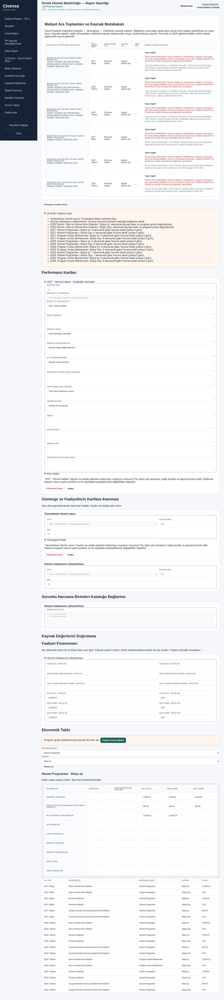

**Görünen metinler ve tablolar:**

- `div`: Civensa RAPORLAMA
- `h1`: Örnek Hizmet Müdürlüğü — Rapor Hazırlığı
- `span`: 2027 Performans Programı
- `p`: 2027 · Performans kartları, kaynak kontrolü ve ekonomik tablolar
- `div`: Strateji Geliştirme Strateji Müdürü (sentetik)
- `h2`: Maliyet Ara Toplamları ve Kaynak Mutabakatı
- `p`: Güncel faaliyet maliyetleri program → alt program → müdürlük sırasıyla toplanır. Bağlantısı veya tutarı eksik kayıt varsa kısmi toplam gösterilmez ve yayın durur. Kaynak toplamı, bütün alt kayıtların saklanan kaynak tutarlarından oluşur; bulunmaması uyarıdır. Personel ve SGK giderleri kitabın ortak maliyet tablosunda ayrıca gösterilir.
- `table`: PROGRAM / ALT PROGRAM / MÜDÜRLÜK YIL / DEĞER TÜRÜ HESAPLANAN (TL) KAYNAK (TL) FARK (TL) DURUM / YAPILACAK İŞLEM MÜDÜRLÜK ARA TOPLAMI: ÖRNEK HİZMET MÜDÜRLÜĞÜ YEREL HİZMETLER PROGRAMI / ERİŞİLEBİLİR HİZMETLER / ÖRNEK HİZMET MÜDÜRLÜĞÜ 2027 Bütçe Eksik ara toplam kaynak toplamı yok — Yayın engeli Örnek Hizmet Müdürlüğü / Hizmet noktalarının iyileştirilmesi: program, alt program, kart veya katalog bağlantısı eksik ya da kapsamı uyuşmuyor. Faaliyet Eşleştirme ve Performans Kartları ekranlarında bağlantıları tamamlayın. Yerel Hizmetler Programı / Erişilebilir Hizmetler / Örnek Hizmet Müdürlüğü / 2027 Bütçe: kaynak toplamı yok (tüm faaliyetleri kapsayan kaynak tutarı bulunmuyor). Kaynak belgeyi kontrol edin. MÜDÜRLÜK ARA TOPLAMI: ÖRNEK HİZMET MÜDÜRLÜĞÜ YEREL HİZMETLER PROGRAMI / ERİŞİLEBİLİR HİZMETLER / ÖRNEK HİZMET MÜDÜRLÜĞÜ 2028 Tahmin Eksik ara toplam kaynak toplamı yok — Yayın engeli Örnek Hizmet Müdürlüğü / Hizmet noktalarının iyileştirilmesi: program, alt program, kart veya katalog bağlantısı eksik ya da kapsamı uyuşmuyor. Faaliyet Eşleştirme ve Performans Kartları ekranlarında bağlantıları tamamlayın. Yerel Hizmetler Programı / Erişilebilir Hizmetler / Örnek Hizmet Müdürlüğü / 2028 Tahmin: kaynak toplamı yok (tüm faaliyetleri kapsayan kaynak tutarı bulunmuyor). Kaynak belgeyi kontrol edin. MÜDÜRLÜK ARA TOPLAMI: ÖRNEK HİZMET MÜDÜRLÜĞÜ YEREL HİZMETLER PROGRAMI / ERİŞİLEBİLİR HİZMETLER / ÖRNEK HİZMET MÜDÜRLÜĞÜ 2029 Tahmin Eksik ara toplam kaynak toplamı yok — Yayın engeli Örnek Hizmet Müdürlüğü / Hizmet noktalarının iyileştirilmesi: program, alt program, kart veya katalog bağlantısı eksik ya da kapsamı uyuşmuyor. Faaliyet Eşleştirme ve Performans Kartları ekranlarında bağlantıları tamamlayın. Yerel Hizmetler Programı / Erişilebilir Hizmetler / Örnek Hizmet Müdürlüğü / 2029 Tahmin: kaynak toplamı yok (tüm faaliyetleri kapsayan kaynak tutarı bulunmuyor). Kaynak belgeyi kontrol edin. MÜDÜRLÜK FAALİYETLERİ TOPLAMI: ÖRNEK HİZMET MÜDÜRLÜĞÜ ÖRNEK HİZMET MÜDÜRLÜĞÜ 2027 Bütçe Eksik ara toplam kaynak toplamı yok — Yayın engeli Örnek Hizmet Müdürlüğü / Hizmet noktalarının iyileştirilmesi: program, alt program, kart veya katalog bağlantısı eksik ya da kapsamı uyuşmuyor. Faaliyet Eşleştirme ve Performans Kartları ekranlarında bağlantıları tamamlayın. Örnek Hizmet Müdürlüğü / 2027 Bütçe: kaynak toplamı yok (tüm faaliyetleri kapsayan kaynak tutarı bulunmuyor). Kaynak belgeyi kontrol edin. MÜDÜRLÜK FAALİYETLERİ TOPLAMI: ÖRNEK HİZMET MÜDÜRLÜĞÜ ÖRNEK HİZMET MÜDÜRLÜĞÜ 2028 Tahmin Eksik ara toplam kaynak toplamı yok — Yayın engeli Örnek Hizmet Müdürlüğü / Hizmet noktalarının iyileştirilmesi: program, alt program, kart veya katalog bağlantısı eksik ya da kapsamı uyuşmuyor. Faaliyet Eşleştirme ve Performans Kartları ekranlarında bağlantıları tamamlayın. Örnek Hizmet Müdürlüğü / 2028 Tahmin: kaynak toplamı yok (tüm faaliyetleri kapsayan kaynak tutarı bulunmuyor). Kaynak belgeyi kontrol edin. MÜDÜRLÜK FAALİYETLERİ TOPLAMI: ÖRNEK HİZMET MÜDÜRLÜĞÜ ÖRNEK HİZMET MÜDÜRLÜĞÜ 2029 Tahmin Eksik ara toplam kaynak toplamı yok — Yayın engeli Örnek Hizmet Müdürlüğü / Hizmet noktalarının iyileştirilmesi: program, alt program, kart veya katalog bağlantısı eksik ya da kapsamı uyuşmuyor. Faaliyet Eşleştirme ve Performans Kartları ekranlarında bağlantıları tamamlayın. Örnek Hizmet Müdürlüğü / 2029 Tahmin: kaynak toplamı yok (tüm faaliyetleri kapsayan kaynak tutarı bulunmuyor). Kaynak belgeyi kontrol edin.
- `p`: Örnek Hizmet Müdürlüğü / Hizmet noktalarının iyileştirilmesi: program, alt program, kart veya katalog bağlantısı eksik ya da kapsamı uyuşmuyor. Faaliyet Eşleştirme ve Performans Kartları ekranlarında bağlantıları tamamlayın.
- `p`: Yerel Hizmetler Programı / Erişilebilir Hizmetler / Örnek Hizmet Müdürlüğü / 2027 Bütçe: kaynak toplamı yok (tüm faaliyetleri kapsayan kaynak tutarı bulunmuyor). Kaynak belgeyi kontrol edin.
- `p`: Örnek Hizmet Müdürlüğü / Hizmet noktalarının iyileştirilmesi: program, alt program, kart veya katalog bağlantısı eksik ya da kapsamı uyuşmuyor. Faaliyet Eşleştirme ve Performans Kartları ekranlarında bağlantıları tamamlayın.
- `p`: Yerel Hizmetler Programı / Erişilebilir Hizmetler / Örnek Hizmet Müdürlüğü / 2028 Tahmin: kaynak toplamı yok (tüm faaliyetleri kapsayan kaynak tutarı bulunmuyor). Kaynak belgeyi kontrol edin.
- `p`: Örnek Hizmet Müdürlüğü / Hizmet noktalarının iyileştirilmesi: program, alt program, kart veya katalog bağlantısı eksik ya da kapsamı uyuşmuyor. Faaliyet Eşleştirme ve Performans Kartları ekranlarında bağlantıları tamamlayın.
- `p`: Yerel Hizmetler Programı / Erişilebilir Hizmetler / Örnek Hizmet Müdürlüğü / 2029 Tahmin: kaynak toplamı yok (tüm faaliyetleri kapsayan kaynak tutarı bulunmuyor). Kaynak belgeyi kontrol edin.
- `p`: Örnek Hizmet Müdürlüğü / Hizmet noktalarının iyileştirilmesi: program, alt program, kart veya katalog bağlantısı eksik ya da kapsamı uyuşmuyor. Faaliyet Eşleştirme ve Performans Kartları ekranlarında bağlantıları tamamlayın.
- `p`: Örnek Hizmet Müdürlüğü / 2027 Bütçe: kaynak toplamı yok (tüm faaliyetleri kapsayan kaynak tutarı bulunmuyor). Kaynak belgeyi kontrol edin.
- `p`: Örnek Hizmet Müdürlüğü / Hizmet noktalarının iyileştirilmesi: program, alt program, kart veya katalog bağlantısı eksik ya da kapsamı uyuşmuyor. Faaliyet Eşleştirme ve Performans Kartları ekranlarında bağlantıları tamamlayın.
- `p`: Örnek Hizmet Müdürlüğü / 2028 Tahmin: kaynak toplamı yok (tüm faaliyetleri kapsayan kaynak tutarı bulunmuyor). Kaynak belgeyi kontrol edin.
- `p`: Örnek Hizmet Müdürlüğü / Hizmet noktalarının iyileştirilmesi: program, alt program, kart veya katalog bağlantısı eksik ya da kapsamı uyuşmuyor. Faaliyet Eşleştirme ve Performans Kartları ekranlarında bağlantıları tamamlayın.
- `p`: Örnek Hizmet Müdürlüğü / 2029 Tahmin: kaynak toplamı yok (tüm faaliyetleri kapsayan kaynak tutarı bulunmuyor). Kaynak belgeyi kontrol edin.
- `p`: Gösterge ve Faaliyet Girişi
- `h2`: Performans Kartları
- `p`: “2027 · Hizmet kalitesi” kaydını bu taslak paketten kaldırmayı onaylıyor musunuz? Bu işlem geri alınamaz; bağlı kayıtlar ve geçmiş kontrol edilir. Kaldırma başarılı olursa sayfa yenilenir ve bu sayfadaki kaydedilmemiş değişiklikler kaybolur.
- `h2`: Gösterge ve Faaliyetlerin Kartlara Atanması
- `p`: Aynı alt programda birden fazla kart olabilir. Kaydın ait olduğu kartı seçin.
- `p`: “Tamamlanan hizmet sayısı” kaydını bu taslak paketten kaldırmayı onaylıyor musunuz? Bu işlem geri alınamaz; bağlı kayıtlar ve geçmiş kontrol edilir. Kaldırma başarılı olursa sayfa yenilenir ve bu sayfadaki kaydedilmemiş değişiklikler kaybolur.
- `h2`: Sorumlu Harcama Birimleri Kataloğu Bağlantısı
- `h2`: Kaynak Değerlerini Doğrulama
- `h2`: Faaliyet Finansmanı
- `p`: Her dönemde bütçe içi ve bütçe dışını ayrı girin. Kaynak yoksa 0 yazın; henüz belirlenmediyse ikisini de boş bırakın. Toplam otomatik hesaplanır.
- `h2`: Ekonomik Tablo
- `p`: Program grubu belirlenmemiş kaynak hücreler var. Program Grubu Dağılımı
- `h3`: Hizmet Programları · Bütçe İçi
- `p`: Gider yoksa açıkça 0 girin. Boş hücre belirlenmemiştir.
- `table`: EKONOMİK AD 2026 BÜTÇE 2026 HAZİRAN SONU HARCAMA 2027 BÜTÇE 2028 TAHMİN 2029 TAHMİN PERSONEL GİDERLERİ SOSYAL GÜVENLİK KURUMUNA DEVLET PRİMİ GİDERLERİ MAL VE HİZMET ALIM GİDERLERİ FAİZ GİDERLERİ CARİ TRANSFERLER SERMAYE GİDERLERİ SERMAYE TRANSFERLERİ BORÇ VERME YEDEK ÖDENEKLER
- `table`: YIL / TÜR EKONOMİK AD PROGRAM GRUBU KAYNAK TUTAR 2027 / Bütçe Mal ve Hizmet Alım Giderleri Hizmet Programları Bütçe İçi 12.500,23 2027 / Bütçe Mal ve Hizmet Alım Giderleri Hizmet Programları Bütçe Dışı 0,00 2027 / Bütçe Personel Giderleri Hizmet Programları Bütçe İçi 1.500,00 2027 / Bütçe Personel Giderleri Hizmet Programları Bütçe Dışı 0,00 2027 / Bütçe Sosyal Güvenlik Kurumuna Devlet Primi Giderleri Hizmet Programları Bütçe İçi 500,00 2027 / Bütçe Sosyal Güvenlik Kurumuna Devlet Primi Giderleri Hizmet Programları Bütçe Dışı 0,00 2028 / Tahmin Mal ve Hizmet Alım Giderleri Hizmet Programları Bütçe İçi 12.500,23 2028 / Tahmin Mal ve Hizmet Alım Giderleri Hizmet Programları Bütçe Dışı 0,00 2028 / Tahmin Personel Giderleri Hizmet Programları Bütçe İçi 1.500,00 2028 / Tahmin Personel Giderleri Hizmet Programları Bütçe Dışı 0,00 2028 / Tahmin Sosyal Güvenlik Kurumuna Devlet Primi Giderleri Hizmet Programları Bütçe İçi 500,00 2028 / Tahmin Sosyal Güvenlik Kurumuna Devlet Primi Giderleri Hizmet Programları Bütçe Dışı 0,00 2029 / Tahmin Mal ve Hizmet Alım Giderleri Program Grubu Belirlenmeli Bütçe İçi 12.500,23 2029 / Tahmin Mal ve Hizmet Alım Giderleri Program Grubu Belirlenmeli Bütçe Dışı 0,00 2029 / Tahmin Personel Giderleri Hizmet Programları Bütçe İçi 1.500,00 2029 / Tahmin Personel Giderleri Hizmet Programları Bütçe Dışı 0,00 2029 / Tahmin Sosyal Güvenlik Kurumuna Devlet Primi Giderleri Hizmet Programları Bütçe İçi 500,00 2029 / Tahmin Sosyal Güvenlik Kurumuna Devlet Primi Giderleri Hizmet Programları Bütçe Dışı 0,00
- `li`: Tamamlanan hizmet sayısı: Göstergeye ilişkin açıklama boş.
- `li`: Hizmet noktalarının iyileştirilmesi: sorumlu harcama birimleri kataloğu bağlantısı eksik.
- `li`: 2029 Tahmin / Mal ve Hizmet Alım Giderleri / Bütçe İçi: ekonomik kaynak tutarı ve program grubu doğrulanmalı.
- `li`: 2029 Tahmin / Mal ve Hizmet Alım Giderleri / Bütçe Dışı: ekonomik kaynak tutarı ve program grubu doğrulanmalı.
- `li`: 2027: Hizmet Programları / Bütçe İçi: 6 ekonomik gider hücresi eksik (yoksa 0 girin).
- `li`: 2027: Hizmet Programları / Bütçe Dışı: 6 ekonomik gider hücresi eksik (yoksa 0 girin).
- `li`: 2027: Program Grubu Belirlenmeli / Bütçe İçi: 9 ekonomik gider hücresi eksik (yoksa 0 girin).
- `li`: 2027: Program Grubu Belirlenmeli / Bütçe Dışı: 9 ekonomik gider hücresi eksik (yoksa 0 girin).
- `li`: 2028: Hizmet Programları / Bütçe İçi: 6 ekonomik gider hücresi eksik (yoksa 0 girin).
- `li`: 2028: Hizmet Programları / Bütçe Dışı: 6 ekonomik gider hücresi eksik (yoksa 0 girin).
- `li`: 2028: Program Grubu Belirlenmeli / Bütçe İçi: 9 ekonomik gider hücresi eksik (yoksa 0 girin).
- `li`: 2028: Program Grubu Belirlenmeli / Bütçe Dışı: 9 ekonomik gider hücresi eksik (yoksa 0 girin).
- `li`: 2029: Hizmet Programları / Bütçe İçi: 7 ekonomik gider hücresi eksik (yoksa 0 girin).
- `li`: 2029: Hizmet Programları / Bütçe Dışı: 7 ekonomik gider hücresi eksik (yoksa 0 girin).
- `li`: 2029: Program Grubu Belirlenmeli / Bütçe İçi: 8 ekonomik gider hücresi eksik (yoksa 0 girin).
- `li`: 2029: Program Grubu Belirlenmeli / Bütçe Dışı: 8 ekonomik gider hücresi eksik (yoksa 0 girin).
- `b`: Tamamlanan hizmet sayısı
- `b`: Hizmet noktalarının iyileştirilmesi
- `b`: Hizmet noktalarının iyileştirilmesi

**Bağlantı, düğme, form ve alanlar:**

| Öğe | Tür / etiket / bağlam | Hedef URL veya eylem | Ne yapar / mevcut değer |
| --- | --- | --- | --- |
| E001 | a · Faaliyet Raporu · EK-1 | `/activity-sections` | Bağlantıdaki ekranı veya dosyayı açar: Faaliyet Raporu · EK-1. |
| E002 | a · Modüller | `/modules` | Bağlantıdaki ekranı veya dosyayı açar: Modüller. |
| E003 | a · Genel Bakış | `/dashboard?period_id=1` | Bağlantıdaki ekranı veya dosyayı açar: Genel Bakış. |
| E004 | a · PP Kaynak Karşılaştırması | `/source-comparison?period_id=1` | Bağlantıdaki ekranı veya dosyayı açar: PP Kaynak Karşılaştırması. |
| E005 | a · Nihai Rapor | `/report-builder?period_id=1` | Bağlantıdaki ekranı veya dosyayı açar: Nihai Rapor. |
| E006 | a · İç Kontrol · Uyum Eylem Planı | `/internal-control` | Bağlantıdaki ekranı veya dosyayı açar: İç Kontrol · Uyum Eylem Planı. |
| E007 | a · Bütçe Aktarma | `/budget-reallocations` | Bağlantıdaki ekranı veya dosyayı açar: Bütçe Aktarma. |
| E008 | a · İnceleme Kuyruğu | `/review?period_id=1` | Bağlantıdaki ekranı veya dosyayı açar: İnceleme Kuyruğu. |
| E009 | a · Faaliyet Eşleştirme | `/activity-mapping?period_id=1` | Bağlantıdaki ekranı veya dosyayı açar: Faaliyet Eşleştirme. |
| E010 | a · Sistem Durumu | `/operations?period_id=1` | Bağlantıdaki ekranı veya dosyayı açar: Sistem Durumu. |
| E011 | a · Denetim Geçmişi | `/audit?period_id=1` | Bağlantıdaki ekranı veya dosyayı açar: Denetim Geçmişi. |
| E012 | a · Kurum Yapısı | `/structure?period_id=1` | Bağlantıdaki ekranı veya dosyayı açar: Kurum Yapısı. |
| E013 | a · Kullanıcılar | `/users?period_id=1` | Bağlantıdaki ekranı veya dosyayı açar: Kullanıcılar. |
| E014 | button · Parolamı Değiştir (#changePasswordButton) | `#passwordModal` | Parola değiştirme penceresini açar. |
| E015 | form · Çıkış | `POST /logout` | Oturumu kapatıp giriş ekranına döner. |
| E016 | button · Çıkış | `POST /logout` | Oturumu kapatıp giriş ekranına döner. |
| E017 | button · Bildirimler (#notificationButton) | `GET /api/notifications → #notificationPanel` | Bildirim listesini açar. |
| E018 | a · Gösterge ve Faaliyet Girişi | `/department/1?period_id=1` | Bağlantıdaki ekranı veya dosyayı açar: Gösterge ve Faaliyet Girişi. |
| E019 | summary · 16 eksik / tutarsız kayıt · 16 eksik / tutarsız kayıt | `Aynı sayfadaki ayrıntı bölümü` | İçerik ve form ayrıntılarını açar veya daraltır. |
| E020 | summary · 2027 · Hizmet kalitesi · Erişilebilir Hizmetler · 2027 · Hizmet kalitesi · Erişilebilir Hizmetler | `Aynı sayfadaki ayrıntı bölümü` | İçerik ve form ayrıntılarını açar veya daraltır. |
| E021 | form · 2027 · Hizmet kalitesi · Erişilebilir Hizmetler (#ref: &lt;Node&gt;) · 2027 · Hizmet kalitesi · Erişilebilir Hizmetler | `POST /program/1/cards` | 2027 · Hizmet kalitesi · Erişilebilir Hizmetler işlemini form alanlarıyla gönderir; doğrulama sonrası kaydeder veya hata gösterir. |
| E022 | input · KİTAPTAKİ SIRA · 2027 · Hizmet kalitesi · Erişilebilir Hizmetler | `POST /program/1/cards` | Mevcut değeri gösterir; bu görünümde değiştirilemez. **Pasif.** Değer: 0. |
| E023 | select · PROGRAM / ALT PROGRAM Yerel Hizmetler Programı / Erişilebilir Hizmetler · 2027 · Hizmet kalitesi · Erişilebilir Hizmetler | `POST /program/1/cards` | Mevcut değeri gösterir; bu görünümde değiştirilemez. **Pasif.** Zorunlu. Değer: 1. Seçenekler: Yerel Hizmetler Programı / Erişilebilir Hizmetler. |
| E024 | textarea · BÜTÇE YILI / KART BAŞLIĞI · 2027 · Hizmet kalitesi · Erişilebilir Hizmetler | `POST /program/1/cards` | Mevcut değeri gösterir; bu görünümde değiştirilemez. **Pasif.** Değer: 2027 · Hizmet kalitesi. |
| E025 | textarea · İDARE / BİRİM ADI · 2027 · Hizmet kalitesi · Erişilebilir Hizmetler | `POST /program/1/cards` | Mevcut değeri gösterir; bu görünümde değiştirilemez. **Pasif.** |
| E026 | textarea · SORUMLU İDARE · 2027 · Hizmet kalitesi · Erişilebilir Hizmetler | `POST /program/1/cards` | Mevcut değeri gösterir; bu görünümde değiştirilemez. **Pasif.** Değer: Örnek Belediyesi (sentetik). |
| E027 | textarea · GEREKÇE VE AÇIKLAMALAR · 2027 · Hizmet kalitesi · Erişilebilir Hizmetler | `POST /program/1/cards` | Mevcut değeri gösterir; bu görünümde değiştirilemez. **Pasif.** Değer: Sentetik ihtiyaç değerlendirmesi. |
| E028 | textarea · ALT PROGRAMIN HEDEFİ · 2027 · Hizmet kalitesi · Erişilebilir Hizmetler | `POST /program/1/cards` | Mevcut değeri gösterir; bu görünümde değiştirilemez. **Pasif.** Değer: Hizmete erişimi artırmak. |
| E029 | textarea · GÖSTERGEYE İLİŞKİN ORTAK AÇIKLAMA · 2027 · Hizmet kalitesi · Erişilebilir Hizmetler | `POST /program/1/cards` | Mevcut değeri gösterir; bu görünümde değiştirilemez. **Pasif.** |
| E030 | textarea · ORTAK HESAPLAMA YÖNTEMİ · 2027 · Hizmet kalitesi · Erişilebilir Hizmetler | `POST /program/1/cards` | Mevcut değeri gösterir; bu görünümde değiştirilemez. **Pasif.** Değer: Yıllık hizmet kayıtlarının sayımı. |
| E031 | textarea · VERİNİN KAYNAĞI · 2027 · Hizmet kalitesi · Erişilebilir Hizmetler | `POST /program/1/cards` | Mevcut değeri gösterir; bu görünümde değiştirilemez. **Pasif.** Değer: Sentetik hizmet kayıtları. |
| E032 | textarea · DİPNOT · 2027 · Hizmet kalitesi · Erişilebilir Hizmetler | `POST /program/1/cards` | Mevcut değeri gösterir; bu görünümde değiştirilemez. **Pasif.** |
| E033 | textarea · KAYNAK SAYFA · 2027 · Hizmet kalitesi · Erişilebilir Hizmetler | `POST /program/1/cards` | Mevcut değeri gösterir; bu görünümde değiştirilemez. **Pasif.** |
| E034 | textarea · HİZMET ALANI · 2027 · Hizmet kalitesi · Erişilebilir Hizmetler | `POST /program/1/cards` | Mevcut değeri gösterir; bu görünümde değiştirilemez. **Pasif.** |
| E035 | textarea · STRATEJİK PLAN / PH BAĞLANTISI · 2027 · Hizmet kalitesi · Erişilebilir Hizmetler | `POST /program/1/cards` | Mevcut değeri gösterir; bu görünümde değiştirilemez. **Pasif.** |
| E036 | summary · Kartı Kaldır · Kartı Kaldır | `Aynı sayfadaki ayrıntı bölümü` | İçerik ve form ayrıntılarını açar veya daraltır. |
| E037 | form · Kaldırmayı Onayla / Vazgeç · Kartı Kaldır | `POST /program/1/cards/1/remove` | Kaldırmayı Onayla / Vazgeç işlemini form alanlarıyla gönderir; doğrulama sonrası kaydeder veya hata gösterir. |
| E038 | button · Kaldırmayı Onayla · Kartı Kaldır | `POST /program/1/cards/1/remove` | Kaldırmayı Onayla işlemini form alanlarıyla gönderir; doğrulama sonrası kaydeder veya hata gösterir. |
| E039 | button · Vazgeç · Kartı Kaldır | `Aynı taslak kaldırma kutusu` | Kaldırma kutusunu kaydetmeden kapatır. |
| E040 | form · Form | `POST /program/1/assign` | Form işlemini form alanlarıyla gönderir; doğrulama sonrası kaydeder veya hata gösterir. |
| E041 | select · KART Kart seçin 2027 · Hizmet kalitesi · Hizmete erişimi artırmak | `POST /program/1/assign` | Mevcut değeri gösterir; bu görünümde değiştirilemez. **Pasif.** Zorunlu. Değer: 1. Seçenekler: Kart seçin; 2027 · Hizmet kalitesi · Hizmete erişimi artırmak. |
| E042 | input · KAYNAK KODU | `POST /program/1/assign` | Mevcut değeri gösterir; bu görünümde değiştirilemez. **Pasif.** Değer: G-1. |
| E043 | input · SIRA | `POST /program/1/assign` | Mevcut değeri gösterir; bu görünümde değiştirilemez. **Pasif.** Değer: 0. |
| E044 | summary · Göstergeyi Kaldır · Göstergeyi Kaldır | `Aynı sayfadaki ayrıntı bölümü` | İçerik ve form ayrıntılarını açar veya daraltır. |
| E045 | form · Kaldırmayı Onayla / Vazgeç · Göstergeyi Kaldır | `POST /program/1/indicator/1/remove` | Kaldırmayı Onayla / Vazgeç işlemini form alanlarıyla gönderir; doğrulama sonrası kaydeder veya hata gösterir. |
| E046 | button · Kaldırmayı Onayla · Göstergeyi Kaldır | `POST /program/1/indicator/1/remove` | Kaldırmayı Onayla işlemini form alanlarıyla gönderir; doğrulama sonrası kaydeder veya hata gösterir. |
| E047 | button · Vazgeç · Göstergeyi Kaldır | `Aynı taslak kaldırma kutusu` | Kaldırma kutusunu kaydetmeden kapatır. |
| E048 | form · Form | `POST /program/1/assign` | Form işlemini form alanlarıyla gönderir; doğrulama sonrası kaydeder veya hata gösterir. |
| E049 | select · KART Kart seçin 2027 · Hizmet kalitesi · Hizmete erişimi artırmak | `POST /program/1/assign` | Mevcut değeri gösterir; bu görünümde değiştirilemez. **Pasif.** Zorunlu. Değer: 1. Seçenekler: Kart seçin; 2027 · Hizmet kalitesi · Hizmete erişimi artırmak. |
| E050 | input · KAYNAK KODU | `POST /program/1/assign` | Mevcut değeri gösterir; bu görünümde değiştirilemez. **Pasif.** Değer: F-1. |
| E051 | input · SIRA | `POST /program/1/assign` | Mevcut değeri gösterir; bu görünümde değiştirilemez. **Pasif.** Değer: 0. |
| E052 | form · Form | `POST /program/1/catalogue-link` | Form işlemini form alanlarıyla gönderir; doğrulama sonrası kaydeder veya hata gösterir. |
| E053 | select · RESMÎ FAALİYETLER 1.1.1 Hizmet sunumu 1.1.3 Hizmet sunumu | `POST /program/1/catalogue-link` | Mevcut değeri gösterir; bu görünümde değiştirilemez. **Pasif.** Seçenekler: 1.1.1 Hizmet sunumu; 1.1.3 Hizmet sunumu. |
| E054 | summary · Hizmet noktalarının iyileştirilmesi · Hizmet noktalarının iyileştirilmesi | `Aynı sayfadaki ayrıntı bölümü` | İçerik ve form ayrıntılarını açar veya daraltır. |
| E055 | form · Hizmet noktalarının iyileştirilmesi · Hizmet noktalarının iyileştirilmesi | `POST /program/1/finance/1` | Hizmet noktalarının iyileştirilmesi işlemini form alanlarıyla gönderir; doğrulama sonrası kaydeder veya hata gösterir. |
| E056 | input · 2026 BÜTÇE · BÜTÇE İÇİ · Hizmet noktalarının iyileştirilmesi | `POST /program/1/finance/1` | Mevcut değeri gösterir; bu görünümde değiştirilemez. **Pasif.** |
| E057 | input · 2026 BÜTÇE · BÜTÇE DIŞI · Hizmet noktalarının iyileştirilmesi | `POST /program/1/finance/1` | Mevcut değeri gösterir; bu görünümde değiştirilemez. **Pasif.** |
| E058 | input · 2026 HAZİRAN SONU HARCAMA · BÜTÇE İÇİ · Hizmet noktalarının iyileştirilmesi | `POST /program/1/finance/1` | Mevcut değeri gösterir; bu görünümde değiştirilemez. **Pasif.** |
| E059 | input · 2026 HAZİRAN SONU HARCAMA · BÜTÇE DIŞI · Hizmet noktalarının iyileştirilmesi | `POST /program/1/finance/1` | Mevcut değeri gösterir; bu görünümde değiştirilemez. **Pasif.** |
| E060 | input · 2026 YIL SONU HARCAMA TAHMİNİ · BÜTÇE İÇİ · Hizmet noktalarının iyileştirilmesi | `POST /program/1/finance/1` | Mevcut değeri gösterir; bu görünümde değiştirilemez. **Pasif.** |
| E061 | input · 2026 YIL SONU HARCAMA TAHMİNİ · BÜTÇE DIŞI · Hizmet noktalarının iyileştirilmesi | `POST /program/1/finance/1` | Mevcut değeri gösterir; bu görünümde değiştirilemez. **Pasif.** |
| E062 | input · 2027 BÜTÇE · BÜTÇE İÇİ · Hizmet noktalarının iyileştirilmesi | `POST /program/1/finance/1` | Mevcut değeri gösterir; bu görünümde değiştirilemez. **Pasif.** Değer: 12.500,23. |
| E063 | input · 2027 BÜTÇE · BÜTÇE DIŞI · Hizmet noktalarının iyileştirilmesi | `POST /program/1/finance/1` | Mevcut değeri gösterir; bu görünümde değiştirilemez. **Pasif.** Değer: 0,00. |
| E064 | input · 2028 TAHMİN · BÜTÇE İÇİ · Hizmet noktalarının iyileştirilmesi | `POST /program/1/finance/1` | Mevcut değeri gösterir; bu görünümde değiştirilemez. **Pasif.** Değer: 12.500,23. |
| E065 | input · 2028 TAHMİN · BÜTÇE DIŞI · Hizmet noktalarının iyileştirilmesi | `POST /program/1/finance/1` | Mevcut değeri gösterir; bu görünümde değiştirilemez. **Pasif.** Değer: 0,00. |
| E066 | input · 2029 TAHMİN · BÜTÇE İÇİ · Hizmet noktalarının iyileştirilmesi | `POST /program/1/finance/1` | Mevcut değeri gösterir; bu görünümde değiştirilemez. **Pasif.** Değer: 12.500,23. |
| E067 | input · 2029 TAHMİN · BÜTÇE DIŞI · Hizmet noktalarının iyileştirilmesi | `POST /program/1/finance/1` | Mevcut değeri gösterir; bu görünümde değiştirilemez. **Pasif.** Değer: 0,00. |
| E068 | a · Program Grubu Dağılımı | `/program/1/economic-split?period_id=1` | Bağlantıdaki ekranı veya dosyayı açar: Program Grubu Dağılımı. |
| E069 | form · Tabloyu Aç | `GET /program/1` | Alanlarla listeyi veya rapor görünümünü filtreler. |
| E070 | select · PROGRAM GRUBU Hizmet Programları Yönetim ve Destek Programı Program Dışı Giderler Program Grubu Belirlenmeli | `GET /program/1` | Listeden seçim yapar. Değer: service. Seçenekler: Hizmet Programları; Yönetim ve Destek Programı; Program Dışı Giderler; Program Grubu Belirlenmeli. |
| E071 | select · KAYNAK Bütçe İçi Bütçe Dışı | `GET /program/1` | Listeden seçim yapar. Değer: inside. Seçenekler: Bütçe İçi; Bütçe Dışı. |
| E072 | button · Tabloyu Aç | `GET /program/1` | Alanlarla listeyi veya rapor görünümünü filtreler. |
| E073 | form · Form (#economicGridForm) | `POST /program/1/economic-grid` | Form işlemini form alanlarıyla gönderir; doğrulama sonrası kaydeder veya hata gösterir. |
| E074 | input · Personel Giderleri 2026 Bütçe | `POST /program/1/economic-grid` | Mevcut değeri gösterir; bu görünümde değiştirilemez. **Pasif.** |
| E075 | input · Personel Giderleri 2026 Haziran Sonu Harcama | `POST /program/1/economic-grid` | Mevcut değeri gösterir; bu görünümde değiştirilemez. **Pasif.** |
| E076 | input · Personel Giderleri 2027 Bütçe | `POST /program/1/economic-grid` | Mevcut değeri gösterir; bu görünümde değiştirilemez. **Pasif.** Değer: 1.500,00. |
| E077 | input · Personel Giderleri 2028 Tahmin | `POST /program/1/economic-grid` | Mevcut değeri gösterir; bu görünümde değiştirilemez. **Pasif.** Değer: 1.500,00. |
| E078 | input · Personel Giderleri 2029 Tahmin | `POST /program/1/economic-grid` | Mevcut değeri gösterir; bu görünümde değiştirilemez. **Pasif.** Değer: 1.500,00. |
| E079 | input · Sosyal Güvenlik Kurumuna Devlet Primi Giderleri 2026 Bütçe | `POST /program/1/economic-grid` | Mevcut değeri gösterir; bu görünümde değiştirilemez. **Pasif.** |
| E080 | input · Sosyal Güvenlik Kurumuna Devlet Primi Giderleri 2026 Haziran Sonu Harcama | `POST /program/1/economic-grid` | Mevcut değeri gösterir; bu görünümde değiştirilemez. **Pasif.** |
| E081 | input · Sosyal Güvenlik Kurumuna Devlet Primi Giderleri 2027 Bütçe | `POST /program/1/economic-grid` | Mevcut değeri gösterir; bu görünümde değiştirilemez. **Pasif.** Değer: 500,00. |
| E082 | input · Sosyal Güvenlik Kurumuna Devlet Primi Giderleri 2028 Tahmin | `POST /program/1/economic-grid` | Mevcut değeri gösterir; bu görünümde değiştirilemez. **Pasif.** Değer: 500,00. |
| E083 | input · Sosyal Güvenlik Kurumuna Devlet Primi Giderleri 2029 Tahmin | `POST /program/1/economic-grid` | Mevcut değeri gösterir; bu görünümde değiştirilemez. **Pasif.** Değer: 500,00. |
| E084 | input · Mal ve Hizmet Alım Giderleri 2026 Bütçe | `POST /program/1/economic-grid` | Mevcut değeri gösterir; bu görünümde değiştirilemez. **Pasif.** |
| E085 | input · Mal ve Hizmet Alım Giderleri 2026 Haziran Sonu Harcama | `POST /program/1/economic-grid` | Mevcut değeri gösterir; bu görünümde değiştirilemez. **Pasif.** |
| E086 | input · Mal ve Hizmet Alım Giderleri 2027 Bütçe | `POST /program/1/economic-grid` | Mevcut değeri gösterir; bu görünümde değiştirilemez. **Pasif.** Değer: 12.500,23. |
| E087 | input · Mal ve Hizmet Alım Giderleri 2028 Tahmin | `POST /program/1/economic-grid` | Mevcut değeri gösterir; bu görünümde değiştirilemez. **Pasif.** Değer: 12.500,23. |
| E088 | input · Mal ve Hizmet Alım Giderleri 2029 Tahmin | `POST /program/1/economic-grid` | Mevcut değeri gösterir; bu görünümde değiştirilemez. **Pasif.** |
| E089 | input · Faiz Giderleri 2026 Bütçe | `POST /program/1/economic-grid` | Mevcut değeri gösterir; bu görünümde değiştirilemez. **Pasif.** |
| E090 | input · Faiz Giderleri 2026 Haziran Sonu Harcama | `POST /program/1/economic-grid` | Mevcut değeri gösterir; bu görünümde değiştirilemez. **Pasif.** |
| E091 | input · Faiz Giderleri 2027 Bütçe | `POST /program/1/economic-grid` | Mevcut değeri gösterir; bu görünümde değiştirilemez. **Pasif.** |
| E092 | input · Faiz Giderleri 2028 Tahmin | `POST /program/1/economic-grid` | Mevcut değeri gösterir; bu görünümde değiştirilemez. **Pasif.** |
| E093 | input · Faiz Giderleri 2029 Tahmin | `POST /program/1/economic-grid` | Mevcut değeri gösterir; bu görünümde değiştirilemez. **Pasif.** |
| E094 | input · Cari Transferler 2026 Bütçe | `POST /program/1/economic-grid` | Mevcut değeri gösterir; bu görünümde değiştirilemez. **Pasif.** |
| E095 | input · Cari Transferler 2026 Haziran Sonu Harcama | `POST /program/1/economic-grid` | Mevcut değeri gösterir; bu görünümde değiştirilemez. **Pasif.** |
| E096 | input · Cari Transferler 2027 Bütçe | `POST /program/1/economic-grid` | Mevcut değeri gösterir; bu görünümde değiştirilemez. **Pasif.** |
| E097 | input · Cari Transferler 2028 Tahmin | `POST /program/1/economic-grid` | Mevcut değeri gösterir; bu görünümde değiştirilemez. **Pasif.** |
| E098 | input · Cari Transferler 2029 Tahmin | `POST /program/1/economic-grid` | Mevcut değeri gösterir; bu görünümde değiştirilemez. **Pasif.** |
| E099 | input · Sermaye Giderleri 2026 Bütçe | `POST /program/1/economic-grid` | Mevcut değeri gösterir; bu görünümde değiştirilemez. **Pasif.** |
| E100 | input · Sermaye Giderleri 2026 Haziran Sonu Harcama | `POST /program/1/economic-grid` | Mevcut değeri gösterir; bu görünümde değiştirilemez. **Pasif.** |
| E101 | input · Sermaye Giderleri 2027 Bütçe | `POST /program/1/economic-grid` | Mevcut değeri gösterir; bu görünümde değiştirilemez. **Pasif.** |
| E102 | input · Sermaye Giderleri 2028 Tahmin | `POST /program/1/economic-grid` | Mevcut değeri gösterir; bu görünümde değiştirilemez. **Pasif.** |
| E103 | input · Sermaye Giderleri 2029 Tahmin | `POST /program/1/economic-grid` | Mevcut değeri gösterir; bu görünümde değiştirilemez. **Pasif.** |
| E104 | input · Sermaye Transferleri 2026 Bütçe | `POST /program/1/economic-grid` | Mevcut değeri gösterir; bu görünümde değiştirilemez. **Pasif.** |
| E105 | input · Sermaye Transferleri 2026 Haziran Sonu Harcama | `POST /program/1/economic-grid` | Mevcut değeri gösterir; bu görünümde değiştirilemez. **Pasif.** |
| E106 | input · Sermaye Transferleri 2027 Bütçe | `POST /program/1/economic-grid` | Mevcut değeri gösterir; bu görünümde değiştirilemez. **Pasif.** |
| E107 | input · Sermaye Transferleri 2028 Tahmin | `POST /program/1/economic-grid` | Mevcut değeri gösterir; bu görünümde değiştirilemez. **Pasif.** |
| E108 | input · Sermaye Transferleri 2029 Tahmin | `POST /program/1/economic-grid` | Mevcut değeri gösterir; bu görünümde değiştirilemez. **Pasif.** |
| E109 | input · Borç Verme 2026 Bütçe | `POST /program/1/economic-grid` | Mevcut değeri gösterir; bu görünümde değiştirilemez. **Pasif.** |
| E110 | input · Borç Verme 2026 Haziran Sonu Harcama | `POST /program/1/economic-grid` | Mevcut değeri gösterir; bu görünümde değiştirilemez. **Pasif.** |
| E111 | input · Borç Verme 2027 Bütçe | `POST /program/1/economic-grid` | Mevcut değeri gösterir; bu görünümde değiştirilemez. **Pasif.** |
| E112 | input · Borç Verme 2028 Tahmin | `POST /program/1/economic-grid` | Mevcut değeri gösterir; bu görünümde değiştirilemez. **Pasif.** |
| E113 | input · Borç Verme 2029 Tahmin | `POST /program/1/economic-grid` | Mevcut değeri gösterir; bu görünümde değiştirilemez. **Pasif.** |
| E114 | input · Yedek Ödenekler 2026 Bütçe | `POST /program/1/economic-grid` | Mevcut değeri gösterir; bu görünümde değiştirilemez. **Pasif.** |
| E115 | input · Yedek Ödenekler 2026 Haziran Sonu Harcama | `POST /program/1/economic-grid` | Mevcut değeri gösterir; bu görünümde değiştirilemez. **Pasif.** |
| E116 | input · Yedek Ödenekler 2027 Bütçe | `POST /program/1/economic-grid` | Mevcut değeri gösterir; bu görünümde değiştirilemez. **Pasif.** |
| E117 | input · Yedek Ödenekler 2028 Tahmin | `POST /program/1/economic-grid` | Mevcut değeri gösterir; bu görünümde değiştirilemez. **Pasif.** |
| E118 | input · Yedek Ödenekler 2029 Tahmin | `POST /program/1/economic-grid` | Mevcut değeri gösterir; bu görünümde değiştirilemez. **Pasif.** |

<a id="ekran-037"></a>

### 037 · Rapor Hazırlığı · Dolu / taslak

URL kalıbı: `/program/{department_id}` · Çekilen URL: `/program/1?period_id=1` · Rol: **department** · HTTP 200.

Performans kartlarını ve ekonomik tabloları düzenler.

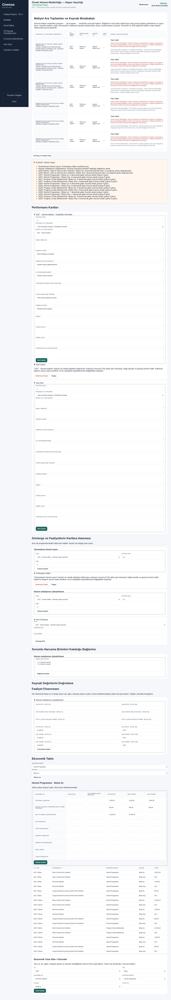

**Görünen metinler ve tablolar:**

- `div`: Civensa RAPORLAMA
- `h1`: Örnek Hizmet Müdürlüğü — Rapor Hazırlığı
- `span`: 2027 Performans Programı
- `p`: 2027 · Performans kartları, kaynak kontrolü ve ekonomik tablolar
- `div`: Müdürlük Birim Müdürü (sentetik)
- `h2`: Maliyet Ara Toplamları ve Kaynak Mutabakatı
- `p`: Güncel faaliyet maliyetleri program → alt program → müdürlük sırasıyla toplanır. Bağlantısı veya tutarı eksik kayıt varsa kısmi toplam gösterilmez ve yayın durur. Kaynak toplamı, bütün alt kayıtların saklanan kaynak tutarlarından oluşur; bulunmaması uyarıdır. Personel ve SGK giderleri kitabın ortak maliyet tablosunda ayrıca gösterilir.
- `table`: PROGRAM / ALT PROGRAM / MÜDÜRLÜK YIL / DEĞER TÜRÜ HESAPLANAN (TL) KAYNAK (TL) FARK (TL) DURUM / YAPILACAK İŞLEM MÜDÜRLÜK ARA TOPLAMI: ÖRNEK HİZMET MÜDÜRLÜĞÜ YEREL HİZMETLER PROGRAMI / ERİŞİLEBİLİR HİZMETLER / ÖRNEK HİZMET MÜDÜRLÜĞÜ 2027 Bütçe Eksik ara toplam kaynak toplamı yok — Yayın engeli Örnek Hizmet Müdürlüğü / Hizmet noktalarının iyileştirilmesi: program, alt program, kart veya katalog bağlantısı eksik ya da kapsamı uyuşmuyor. Faaliyet Eşleştirme ve Performans Kartları ekranlarında bağlantıları tamamlayın. Yerel Hizmetler Programı / Erişilebilir Hizmetler / Örnek Hizmet Müdürlüğü / 2027 Bütçe: kaynak toplamı yok (tüm faaliyetleri kapsayan kaynak tutarı bulunmuyor). Kaynak belgeyi kontrol edin. MÜDÜRLÜK ARA TOPLAMI: ÖRNEK HİZMET MÜDÜRLÜĞÜ YEREL HİZMETLER PROGRAMI / ERİŞİLEBİLİR HİZMETLER / ÖRNEK HİZMET MÜDÜRLÜĞÜ 2028 Tahmin Eksik ara toplam kaynak toplamı yok — Yayın engeli Örnek Hizmet Müdürlüğü / Hizmet noktalarının iyileştirilmesi: program, alt program, kart veya katalog bağlantısı eksik ya da kapsamı uyuşmuyor. Faaliyet Eşleştirme ve Performans Kartları ekranlarında bağlantıları tamamlayın. Yerel Hizmetler Programı / Erişilebilir Hizmetler / Örnek Hizmet Müdürlüğü / 2028 Tahmin: kaynak toplamı yok (tüm faaliyetleri kapsayan kaynak tutarı bulunmuyor). Kaynak belgeyi kontrol edin. MÜDÜRLÜK ARA TOPLAMI: ÖRNEK HİZMET MÜDÜRLÜĞÜ YEREL HİZMETLER PROGRAMI / ERİŞİLEBİLİR HİZMETLER / ÖRNEK HİZMET MÜDÜRLÜĞÜ 2029 Tahmin Eksik ara toplam kaynak toplamı yok — Yayın engeli Örnek Hizmet Müdürlüğü / Hizmet noktalarının iyileştirilmesi: program, alt program, kart veya katalog bağlantısı eksik ya da kapsamı uyuşmuyor. Faaliyet Eşleştirme ve Performans Kartları ekranlarında bağlantıları tamamlayın. Yerel Hizmetler Programı / Erişilebilir Hizmetler / Örnek Hizmet Müdürlüğü / 2029 Tahmin: kaynak toplamı yok (tüm faaliyetleri kapsayan kaynak tutarı bulunmuyor). Kaynak belgeyi kontrol edin. MÜDÜRLÜK FAALİYETLERİ TOPLAMI: ÖRNEK HİZMET MÜDÜRLÜĞÜ ÖRNEK HİZMET MÜDÜRLÜĞÜ 2027 Bütçe Eksik ara toplam kaynak toplamı yok — Yayın engeli Örnek Hizmet Müdürlüğü / Hizmet noktalarının iyileştirilmesi: program, alt program, kart veya katalog bağlantısı eksik ya da kapsamı uyuşmuyor. Faaliyet Eşleştirme ve Performans Kartları ekranlarında bağlantıları tamamlayın. Örnek Hizmet Müdürlüğü / 2027 Bütçe: kaynak toplamı yok (tüm faaliyetleri kapsayan kaynak tutarı bulunmuyor). Kaynak belgeyi kontrol edin. MÜDÜRLÜK FAALİYETLERİ TOPLAMI: ÖRNEK HİZMET MÜDÜRLÜĞÜ ÖRNEK HİZMET MÜDÜRLÜĞÜ 2028 Tahmin Eksik ara toplam kaynak toplamı yok — Yayın engeli Örnek Hizmet Müdürlüğü / Hizmet noktalarının iyileştirilmesi: program, alt program, kart veya katalog bağlantısı eksik ya da kapsamı uyuşmuyor. Faaliyet Eşleştirme ve Performans Kartları ekranlarında bağlantıları tamamlayın. Örnek Hizmet Müdürlüğü / 2028 Tahmin: kaynak toplamı yok (tüm faaliyetleri kapsayan kaynak tutarı bulunmuyor). Kaynak belgeyi kontrol edin. MÜDÜRLÜK FAALİYETLERİ TOPLAMI: ÖRNEK HİZMET MÜDÜRLÜĞÜ ÖRNEK HİZMET MÜDÜRLÜĞÜ 2029 Tahmin Eksik ara toplam kaynak toplamı yok — Yayın engeli Örnek Hizmet Müdürlüğü / Hizmet noktalarının iyileştirilmesi: program, alt program, kart veya katalog bağlantısı eksik ya da kapsamı uyuşmuyor. Faaliyet Eşleştirme ve Performans Kartları ekranlarında bağlantıları tamamlayın. Örnek Hizmet Müdürlüğü / 2029 Tahmin: kaynak toplamı yok (tüm faaliyetleri kapsayan kaynak tutarı bulunmuyor). Kaynak belgeyi kontrol edin.
- `p`: Örnek Hizmet Müdürlüğü / Hizmet noktalarının iyileştirilmesi: program, alt program, kart veya katalog bağlantısı eksik ya da kapsamı uyuşmuyor. Faaliyet Eşleştirme ve Performans Kartları ekranlarında bağlantıları tamamlayın.
- `p`: Yerel Hizmetler Programı / Erişilebilir Hizmetler / Örnek Hizmet Müdürlüğü / 2027 Bütçe: kaynak toplamı yok (tüm faaliyetleri kapsayan kaynak tutarı bulunmuyor). Kaynak belgeyi kontrol edin.
- `p`: Örnek Hizmet Müdürlüğü / Hizmet noktalarının iyileştirilmesi: program, alt program, kart veya katalog bağlantısı eksik ya da kapsamı uyuşmuyor. Faaliyet Eşleştirme ve Performans Kartları ekranlarında bağlantıları tamamlayın.
- `p`: Yerel Hizmetler Programı / Erişilebilir Hizmetler / Örnek Hizmet Müdürlüğü / 2028 Tahmin: kaynak toplamı yok (tüm faaliyetleri kapsayan kaynak tutarı bulunmuyor). Kaynak belgeyi kontrol edin.
- `p`: Örnek Hizmet Müdürlüğü / Hizmet noktalarının iyileştirilmesi: program, alt program, kart veya katalog bağlantısı eksik ya da kapsamı uyuşmuyor. Faaliyet Eşleştirme ve Performans Kartları ekranlarında bağlantıları tamamlayın.
- `p`: Yerel Hizmetler Programı / Erişilebilir Hizmetler / Örnek Hizmet Müdürlüğü / 2029 Tahmin: kaynak toplamı yok (tüm faaliyetleri kapsayan kaynak tutarı bulunmuyor). Kaynak belgeyi kontrol edin.
- `p`: Örnek Hizmet Müdürlüğü / Hizmet noktalarının iyileştirilmesi: program, alt program, kart veya katalog bağlantısı eksik ya da kapsamı uyuşmuyor. Faaliyet Eşleştirme ve Performans Kartları ekranlarında bağlantıları tamamlayın.
- `p`: Örnek Hizmet Müdürlüğü / 2027 Bütçe: kaynak toplamı yok (tüm faaliyetleri kapsayan kaynak tutarı bulunmuyor). Kaynak belgeyi kontrol edin.
- `p`: Örnek Hizmet Müdürlüğü / Hizmet noktalarının iyileştirilmesi: program, alt program, kart veya katalog bağlantısı eksik ya da kapsamı uyuşmuyor. Faaliyet Eşleştirme ve Performans Kartları ekranlarında bağlantıları tamamlayın.
- `p`: Örnek Hizmet Müdürlüğü / 2028 Tahmin: kaynak toplamı yok (tüm faaliyetleri kapsayan kaynak tutarı bulunmuyor). Kaynak belgeyi kontrol edin.
- `p`: Örnek Hizmet Müdürlüğü / Hizmet noktalarının iyileştirilmesi: program, alt program, kart veya katalog bağlantısı eksik ya da kapsamı uyuşmuyor. Faaliyet Eşleştirme ve Performans Kartları ekranlarında bağlantıları tamamlayın.
- `p`: Örnek Hizmet Müdürlüğü / 2029 Tahmin: kaynak toplamı yok (tüm faaliyetleri kapsayan kaynak tutarı bulunmuyor). Kaynak belgeyi kontrol edin.
- `p`: Gösterge ve Faaliyet Girişi
- `h2`: Performans Kartları
- `p`: “2027 · Hizmet kalitesi” kaydını bu taslak paketten kaldırmayı onaylıyor musunuz? Bu işlem geri alınamaz; bağlı kayıtlar ve geçmiş kontrol edilir. Kaldırma başarılı olursa sayfa yenilenir ve bu sayfadaki kaydedilmemiş değişiklikler kaybolur.
- `h2`: Gösterge ve Faaliyetlerin Kartlara Atanması
- `p`: Aynı alt programda birden fazla kart olabilir. Kaydın ait olduğu kartı seçin.
- `p`: “Tamamlanan hizmet sayısı” kaydını bu taslak paketten kaldırmayı onaylıyor musunuz? Bu işlem geri alınamaz; bağlı kayıtlar ve geçmiş kontrol edilir. Kaldırma başarılı olursa sayfa yenilenir ve bu sayfadaki kaydedilmemiş değişiklikler kaybolur.
- `h2`: Sorumlu Harcama Birimleri Kataloğu Bağlantısı
- `h2`: Kaynak Değerlerini Doğrulama
- `h2`: Faaliyet Finansmanı
- `p`: Her dönemde bütçe içi ve bütçe dışını ayrı girin. Kaynak yoksa 0 yazın; henüz belirlenmediyse ikisini de boş bırakın. Toplam otomatik hesaplanır.
- `h2`: Ekonomik Tablo
- `h3`: Hizmet Programları · Bütçe İçi
- `p`: Gider yoksa açıkça 0 girin. Boş hücre belirlenmemiştir.
- `table`: EKONOMİK AD 2026 BÜTÇE 2026 HAZİRAN SONU HARCAMA 2027 BÜTÇE 2028 TAHMİN 2029 TAHMİN PERSONEL GİDERLERİ SOSYAL GÜVENLİK KURUMUNA DEVLET PRİMİ GİDERLERİ MAL VE HİZMET ALIM GİDERLERİ FAİZ GİDERLERİ CARİ TRANSFERLER SERMAYE GİDERLERİ SERMAYE TRANSFERLERİ BORÇ VERME YEDEK ÖDENEKLER
- `table`: YIL / TÜR EKONOMİK AD PROGRAM GRUBU KAYNAK TUTAR 2027 / Bütçe Mal ve Hizmet Alım Giderleri Hizmet Programları Bütçe İçi 12.500,23 2027 / Bütçe Mal ve Hizmet Alım Giderleri Hizmet Programları Bütçe Dışı 0,00 2027 / Bütçe Personel Giderleri Hizmet Programları Bütçe İçi 1.500,00 2027 / Bütçe Personel Giderleri Hizmet Programları Bütçe Dışı 0,00 2027 / Bütçe Sosyal Güvenlik Kurumuna Devlet Primi Giderleri Hizmet Programları Bütçe İçi 500,00 2027 / Bütçe Sosyal Güvenlik Kurumuna Devlet Primi Giderleri Hizmet Programları Bütçe Dışı 0,00 2028 / Tahmin Mal ve Hizmet Alım Giderleri Hizmet Programları Bütçe İçi 12.500,23 2028 / Tahmin Mal ve Hizmet Alım Giderleri Hizmet Programları Bütçe Dışı 0,00 2028 / Tahmin Personel Giderleri Hizmet Programları Bütçe İçi 1.500,00 2028 / Tahmin Personel Giderleri Hizmet Programları Bütçe Dışı 0,00 2028 / Tahmin Sosyal Güvenlik Kurumuna Devlet Primi Giderleri Hizmet Programları Bütçe İçi 500,00 2028 / Tahmin Sosyal Güvenlik Kurumuna Devlet Primi Giderleri Hizmet Programları Bütçe Dışı 0,00 2029 / Tahmin Mal ve Hizmet Alım Giderleri Program Grubu Belirlenmeli Bütçe İçi 12.500,23 2029 / Tahmin Mal ve Hizmet Alım Giderleri Program Grubu Belirlenmeli Bütçe Dışı 0,00 2029 / Tahmin Personel Giderleri Hizmet Programları Bütçe İçi 1.500,00 2029 / Tahmin Personel Giderleri Hizmet Programları Bütçe Dışı 0,00 2029 / Tahmin Sosyal Güvenlik Kurumuna Devlet Primi Giderleri Hizmet Programları Bütçe İçi 500,00 2029 / Tahmin Sosyal Güvenlik Kurumuna Devlet Primi Giderleri Hizmet Programları Bütçe Dışı 0,00
- `h3`: Ekonomik Tutar Ekle / Güncelle
- `p`: Aynı yıl, tür, gider, program grubu ve kaynak seçildiğinde mevcut hücre güncellenir. Tutarı boş bırakmak o hücreyi kaldırır.
- `li`: Tamamlanan hizmet sayısı: Göstergeye ilişkin açıklama boş.
- `li`: Hizmet noktalarının iyileştirilmesi: sorumlu harcama birimleri kataloğu bağlantısı eksik.
- `li`: 2029 Tahmin / Mal ve Hizmet Alım Giderleri / Bütçe İçi: ekonomik kaynak tutarı ve program grubu doğrulanmalı.
- `li`: 2029 Tahmin / Mal ve Hizmet Alım Giderleri / Bütçe Dışı: ekonomik kaynak tutarı ve program grubu doğrulanmalı.
- `li`: 2027: Hizmet Programları / Bütçe İçi: 6 ekonomik gider hücresi eksik (yoksa 0 girin).
- `li`: 2027: Hizmet Programları / Bütçe Dışı: 6 ekonomik gider hücresi eksik (yoksa 0 girin).
- `li`: 2027: Program Grubu Belirlenmeli / Bütçe İçi: 9 ekonomik gider hücresi eksik (yoksa 0 girin).
- `li`: 2027: Program Grubu Belirlenmeli / Bütçe Dışı: 9 ekonomik gider hücresi eksik (yoksa 0 girin).
- `li`: 2028: Hizmet Programları / Bütçe İçi: 6 ekonomik gider hücresi eksik (yoksa 0 girin).
- `li`: 2028: Hizmet Programları / Bütçe Dışı: 6 ekonomik gider hücresi eksik (yoksa 0 girin).
- `li`: 2028: Program Grubu Belirlenmeli / Bütçe İçi: 9 ekonomik gider hücresi eksik (yoksa 0 girin).
- `li`: 2028: Program Grubu Belirlenmeli / Bütçe Dışı: 9 ekonomik gider hücresi eksik (yoksa 0 girin).
- `li`: 2029: Hizmet Programları / Bütçe İçi: 7 ekonomik gider hücresi eksik (yoksa 0 girin).
- `li`: 2029: Hizmet Programları / Bütçe Dışı: 7 ekonomik gider hücresi eksik (yoksa 0 girin).
- `li`: 2029: Program Grubu Belirlenmeli / Bütçe İçi: 8 ekonomik gider hücresi eksik (yoksa 0 girin).
- `li`: 2029: Program Grubu Belirlenmeli / Bütçe Dışı: 8 ekonomik gider hücresi eksik (yoksa 0 girin).
- `b`: Tamamlanan hizmet sayısı
- `b`: Hizmet noktalarının iyileştirilmesi
- `b`: Hizmet noktalarının iyileştirilmesi

**Bağlantı, düğme, form ve alanlar:**

| Öğe | Tür / etiket / bağlam | Hedef URL veya eylem | Ne yapar / mevcut değer |
| --- | --- | --- | --- |
| E001 | a · Faaliyet Raporu · EK-1 | `/activity-sections` | Bağlantıdaki ekranı veya dosyayı açar: Faaliyet Raporu · EK-1. |
| E002 | a · Modüller | `/modules` | Bağlantıdaki ekranı veya dosyayı açar: Modüller. |
| E003 | a · Genel Bakış | `/dashboard?period_id=1` | Bağlantıdaki ekranı veya dosyayı açar: Genel Bakış. |
| E004 | a · PP Kaynak Karşılaştırması | `/source-comparison?period_id=1` | Bağlantıdaki ekranı veya dosyayı açar: PP Kaynak Karşılaştırması. |
| E005 | a · İç Kontrol Eylemlerimiz | `/internal-control/our-actions` | Bağlantıdaki ekranı veya dosyayı açar: İç Kontrol Eylemlerimiz. |
| E006 | a · Veri Girişi | `/department/1?period_id=1` | Bağlantıdaki ekranı veya dosyayı açar: Veri Girişi. |
| E007 | a · Gönderim Yetkileri | `/submit-authorizations?period_id=1` | Bağlantıdaki ekranı veya dosyayı açar: Gönderim Yetkileri. |
| E008 | button · Parolamı Değiştir (#changePasswordButton) | `#passwordModal` | Parola değiştirme penceresini açar. |
| E009 | form · Çıkış | `POST /logout` | Oturumu kapatıp giriş ekranına döner. |
| E010 | button · Çıkış | `POST /logout` | Oturumu kapatıp giriş ekranına döner. |
| E011 | button · Bildirimler (#notificationButton) | `GET /api/notifications → #notificationPanel` | Bildirim listesini açar. |
| E012 | a · Gösterge ve Faaliyet Girişi | `/department/1?period_id=1` | Bağlantıdaki ekranı veya dosyayı açar: Gösterge ve Faaliyet Girişi. |
| E013 | summary · 16 eksik / tutarsız kayıt · 16 eksik / tutarsız kayıt | `Aynı sayfadaki ayrıntı bölümü` | İçerik ve form ayrıntılarını açar veya daraltır. |
| E014 | summary · 2027 · Hizmet kalitesi · Erişilebilir Hizmetler · 2027 · Hizmet kalitesi · Erişilebilir Hizmetler | `Aynı sayfadaki ayrıntı bölümü` | İçerik ve form ayrıntılarını açar veya daraltır. |
| E015 | form · Kartı Kaydet (#ref: &lt;Node&gt;) · 2027 · Hizmet kalitesi · Erişilebilir Hizmetler | `POST /program/1/cards` | Kartı Kaydet işlemini form alanlarıyla gönderir; doğrulama sonrası kaydeder veya hata gösterir. |
| E016 | input · KİTAPTAKİ SIRA · 2027 · Hizmet kalitesi · Erişilebilir Hizmetler | `POST /program/1/cards` | İşlem için KİTAPTAKİ SIRA değerini girer. Değer: 0. |
| E017 | select · PROGRAM / ALT PROGRAM Yerel Hizmetler Programı / Erişilebilir Hizmetler · 2027 · Hizmet kalitesi · Erişilebilir Hizmetler | `POST /program/1/cards` | Listeden seçim yapar. Zorunlu. Değer: 1. Seçenekler: Yerel Hizmetler Programı / Erişilebilir Hizmetler. |
| E018 | textarea · BÜTÇE YILI / KART BAŞLIĞI · 2027 · Hizmet kalitesi · Erişilebilir Hizmetler | `POST /program/1/cards` | İşlem için BÜTÇE YILI / KART BAŞLIĞI değerini girer. Değer: 2027 · Hizmet kalitesi. |
| E019 | textarea · İDARE / BİRİM ADI · 2027 · Hizmet kalitesi · Erişilebilir Hizmetler | `POST /program/1/cards` | İşlem için İDARE / BİRİM ADI değerini girer. |
| E020 | textarea · SORUMLU İDARE · 2027 · Hizmet kalitesi · Erişilebilir Hizmetler | `POST /program/1/cards` | İşlem için SORUMLU İDARE değerini girer. Değer: Örnek Belediyesi (sentetik). |
| E021 | textarea · GEREKÇE VE AÇIKLAMALAR · 2027 · Hizmet kalitesi · Erişilebilir Hizmetler | `POST /program/1/cards` | İşlem için GEREKÇE VE AÇIKLAMALAR değerini girer. Değer: Sentetik ihtiyaç değerlendirmesi. |
| E022 | textarea · ALT PROGRAMIN HEDEFİ · 2027 · Hizmet kalitesi · Erişilebilir Hizmetler | `POST /program/1/cards` | İşlem için ALT PROGRAMIN HEDEFİ değerini girer. Değer: Hizmete erişimi artırmak. |
| E023 | textarea · GÖSTERGEYE İLİŞKİN ORTAK AÇIKLAMA · 2027 · Hizmet kalitesi · Erişilebilir Hizmetler | `POST /program/1/cards` | İşlem için GÖSTERGEYE İLİŞKİN ORTAK AÇIKLAMA değerini girer. |
| E024 | textarea · ORTAK HESAPLAMA YÖNTEMİ · 2027 · Hizmet kalitesi · Erişilebilir Hizmetler | `POST /program/1/cards` | İşlem için ORTAK HESAPLAMA YÖNTEMİ değerini girer. Değer: Yıllık hizmet kayıtlarının sayımı. |
| E025 | textarea · VERİNİN KAYNAĞI · 2027 · Hizmet kalitesi · Erişilebilir Hizmetler | `POST /program/1/cards` | İşlem için VERİNİN KAYNAĞI değerini girer. Değer: Sentetik hizmet kayıtları. |
| E026 | textarea · DİPNOT · 2027 · Hizmet kalitesi · Erişilebilir Hizmetler | `POST /program/1/cards` | İşlem için DİPNOT değerini girer. |
| E027 | textarea · KAYNAK SAYFA · 2027 · Hizmet kalitesi · Erişilebilir Hizmetler | `POST /program/1/cards` | İşlem için KAYNAK SAYFA değerini girer. |
| E028 | textarea · HİZMET ALANI · 2027 · Hizmet kalitesi · Erişilebilir Hizmetler | `POST /program/1/cards` | İşlem için HİZMET ALANI değerini girer. |
| E029 | textarea · STRATEJİK PLAN / PH BAĞLANTISI · 2027 · Hizmet kalitesi · Erişilebilir Hizmetler | `POST /program/1/cards` | İşlem için STRATEJİK PLAN / PH BAĞLANTISI değerini girer. |
| E030 | button · Kartı Kaydet · 2027 · Hizmet kalitesi · Erişilebilir Hizmetler | `POST /program/1/cards` | Kartı Kaydet işlemini form alanlarıyla gönderir; doğrulama sonrası kaydeder veya hata gösterir. |
| E031 | summary · Kartı Kaldır · Kartı Kaldır | `Aynı sayfadaki ayrıntı bölümü` | İçerik ve form ayrıntılarını açar veya daraltır. |
| E032 | form · Kaldırmayı Onayla / Vazgeç · Kartı Kaldır | `POST /program/1/cards/1/remove` | Kaldırmayı Onayla / Vazgeç işlemini form alanlarıyla gönderir; doğrulama sonrası kaydeder veya hata gösterir. |
| E033 | button · Kaldırmayı Onayla · Kartı Kaldır | `POST /program/1/cards/1/remove` | Kaldırmayı Onayla işlemini form alanlarıyla gönderir; doğrulama sonrası kaydeder veya hata gösterir. |
| E034 | button · Vazgeç · Kartı Kaldır | `Aynı taslak kaldırma kutusu` | Kaldırma kutusunu kaydetmeden kapatır. |
| E035 | summary · Yeni Kart · Yeni Kart | `Aynı sayfadaki ayrıntı bölümü` | İçerik ve form ayrıntılarını açar veya daraltır. |
| E036 | form · Kartı Kaydet · Yeni Kart | `POST /program/1/cards` | Kartı Kaydet işlemini form alanlarıyla gönderir; doğrulama sonrası kaydeder veya hata gösterir. |
| E037 | input · KİTAPTAKİ SIRA · Yeni Kart | `POST /program/1/cards` | İşlem için KİTAPTAKİ SIRA değerini girer. Değer: 2. |
| E038 | select · PROGRAM / ALT PROGRAM Yerel Hizmetler Programı / Erişilebilir Hizmetler · Yeni Kart | `POST /program/1/cards` | Listeden seçim yapar. Zorunlu. Değer: 1. Seçenekler: Yerel Hizmetler Programı / Erişilebilir Hizmetler. |
| E039 | textarea · BÜTÇE YILI / KART BAŞLIĞI · Yeni Kart | `POST /program/1/cards` | İşlem için BÜTÇE YILI / KART BAŞLIĞI değerini girer. |
| E040 | textarea · İDARE / BİRİM ADI · Yeni Kart | `POST /program/1/cards` | İşlem için İDARE / BİRİM ADI değerini girer. |
| E041 | textarea · SORUMLU İDARE · Yeni Kart | `POST /program/1/cards` | İşlem için SORUMLU İDARE değerini girer. |
| E042 | textarea · GEREKÇE VE AÇIKLAMALAR · Yeni Kart | `POST /program/1/cards` | İşlem için GEREKÇE VE AÇIKLAMALAR değerini girer. |
| E043 | textarea · ALT PROGRAMIN HEDEFİ · Yeni Kart | `POST /program/1/cards` | İşlem için ALT PROGRAMIN HEDEFİ değerini girer. |
| E044 | textarea · GÖSTERGEYE İLİŞKİN ORTAK AÇIKLAMA · Yeni Kart | `POST /program/1/cards` | İşlem için GÖSTERGEYE İLİŞKİN ORTAK AÇIKLAMA değerini girer. |
| E045 | textarea · ORTAK HESAPLAMA YÖNTEMİ · Yeni Kart | `POST /program/1/cards` | İşlem için ORTAK HESAPLAMA YÖNTEMİ değerini girer. |
| E046 | textarea · VERİNİN KAYNAĞI · Yeni Kart | `POST /program/1/cards` | İşlem için VERİNİN KAYNAĞI değerini girer. |
| E047 | textarea · DİPNOT · Yeni Kart | `POST /program/1/cards` | İşlem için DİPNOT değerini girer. |
| E048 | textarea · KAYNAK SAYFA · Yeni Kart | `POST /program/1/cards` | İşlem için KAYNAK SAYFA değerini girer. |
| E049 | textarea · HİZMET ALANI · Yeni Kart | `POST /program/1/cards` | İşlem için HİZMET ALANI değerini girer. |
| E050 | textarea · STRATEJİK PLAN / PH BAĞLANTISI · Yeni Kart | `POST /program/1/cards` | İşlem için STRATEJİK PLAN / PH BAĞLANTISI değerini girer. |
| E051 | button · Kartı Kaydet · Yeni Kart | `POST /program/1/cards` | Kartı Kaydet işlemini form alanlarıyla gönderir; doğrulama sonrası kaydeder veya hata gösterir. |
| E052 | form · Atamayı Kaydet | `POST /program/1/assign` | Atamayı Kaydet işlemini form alanlarıyla gönderir; doğrulama sonrası kaydeder veya hata gösterir. |
| E053 | select · KART Kart seçin 2027 · Hizmet kalitesi · Hizmete erişimi artırmak | `POST /program/1/assign` | Listeden seçim yapar. Zorunlu. Değer: 1. Seçenekler: Kart seçin; 2027 · Hizmet kalitesi · Hizmete erişimi artırmak. |
| E054 | input · KAYNAK KODU | `POST /program/1/assign` | İşlem için KAYNAK KODU değerini girer. Değer: G-1. |
| E055 | input · SIRA | `POST /program/1/assign` | İşlem için SIRA değerini girer. Değer: 0. |
| E056 | button · Atamayı Kaydet | `POST /program/1/assign` | Atamayı Kaydet işlemini form alanlarıyla gönderir; doğrulama sonrası kaydeder veya hata gösterir. |
| E057 | summary · Göstergeyi Kaldır · Göstergeyi Kaldır | `Aynı sayfadaki ayrıntı bölümü` | İçerik ve form ayrıntılarını açar veya daraltır. |
| E058 | form · Kaldırmayı Onayla / Vazgeç · Göstergeyi Kaldır | `POST /program/1/indicator/1/remove` | Kaldırmayı Onayla / Vazgeç işlemini form alanlarıyla gönderir; doğrulama sonrası kaydeder veya hata gösterir. |
| E059 | button · Kaldırmayı Onayla · Göstergeyi Kaldır | `POST /program/1/indicator/1/remove` | Kaldırmayı Onayla işlemini form alanlarıyla gönderir; doğrulama sonrası kaydeder veya hata gösterir. |
| E060 | button · Vazgeç · Göstergeyi Kaldır | `Aynı taslak kaldırma kutusu` | Kaldırma kutusunu kaydetmeden kapatır. |
| E061 | form · Atamayı Kaydet | `POST /program/1/assign` | Atamayı Kaydet işlemini form alanlarıyla gönderir; doğrulama sonrası kaydeder veya hata gösterir. |
| E062 | select · KART Kart seçin 2027 · Hizmet kalitesi · Hizmete erişimi artırmak | `POST /program/1/assign` | Listeden seçim yapar. Zorunlu. Değer: 1. Seçenekler: Kart seçin; 2027 · Hizmet kalitesi · Hizmete erişimi artırmak. |
| E063 | input · KAYNAK KODU | `POST /program/1/assign` | İşlem için KAYNAK KODU değerini girer. Değer: F-1. |
| E064 | input · SIRA | `POST /program/1/assign` | İşlem için SIRA değerini girer. Değer: 0. |
| E065 | button · Atamayı Kaydet | `POST /program/1/assign` | Atamayı Kaydet işlemini form alanlarıyla gönderir; doğrulama sonrası kaydeder veya hata gösterir. |
| E066 | summary · Yeni Gösterge · Yeni Gösterge | `Aynı sayfadaki ayrıntı bölümü` | İçerik ve form ayrıntılarını açar veya daraltır. |
| E067 | form · Gösterge Ekle · Yeni Gösterge | `POST /program/1/indicator` | Gösterge Ekle işlemini form alanlarıyla gönderir; doğrulama sonrası kaydeder veya hata gösterir. |
| E068 | select · KART 2027 · Hizmet kalitesi · Hizmete erişimi artırmak · Yeni Gösterge | `POST /program/1/indicator` | Listeden seçim yapar. Değer: 1. Seçenekler: 2027 · Hizmet kalitesi · Hizmete erişimi artırmak. |
| E069 | input · GÖSTERGE ADI · Yeni Gösterge | `POST /program/1/indicator` | İşlem için GÖSTERGE ADI değerini girer. Zorunlu. |
| E070 | input · ÖLÇÜ BİRİMİ · Yeni Gösterge | `POST /program/1/indicator` | İşlem için ÖLÇÜ BİRİMİ değerini girer. Zorunlu. |
| E071 | button · Gösterge Ekle · Yeni Gösterge | `POST /program/1/indicator` | Gösterge Ekle işlemini form alanlarıyla gönderir; doğrulama sonrası kaydeder veya hata gösterir. |
| E072 | form · Bağlantıyı Kaydet | `POST /program/1/catalogue-link` | Bağlantıyı Kaydet işlemini form alanlarıyla gönderir; doğrulama sonrası kaydeder veya hata gösterir. |
| E073 | select · RESMÎ FAALİYETLER 1.1.1 Hizmet sunumu 1.1.3 Hizmet sunumu | `POST /program/1/catalogue-link` | Listeden seçim yapar. Seçenekler: 1.1.1 Hizmet sunumu; 1.1.3 Hizmet sunumu. |
| E074 | button · Bağlantıyı Kaydet | `POST /program/1/catalogue-link` | Bağlantıyı Kaydet işlemini form alanlarıyla gönderir; doğrulama sonrası kaydeder veya hata gösterir. |
| E075 | summary · Hizmet noktalarının iyileştirilmesi · Hizmet noktalarının iyileştirilmesi | `Aynı sayfadaki ayrıntı bölümü` | İçerik ve form ayrıntılarını açar veya daraltır. |
| E076 | form · Finansmanı Kaydet · Hizmet noktalarının iyileştirilmesi | `POST /program/1/finance/1` | Finansmanı Kaydet işlemini form alanlarıyla gönderir; doğrulama sonrası kaydeder veya hata gösterir. |
| E077 | input · 2026 BÜTÇE · BÜTÇE İÇİ · Hizmet noktalarının iyileştirilmesi | `POST /program/1/finance/1` | İşlem için 2026 BÜTÇE · BÜTÇE İÇİ değerini girer. |
| E078 | input · 2026 BÜTÇE · BÜTÇE DIŞI · Hizmet noktalarının iyileştirilmesi | `POST /program/1/finance/1` | İşlem için 2026 BÜTÇE · BÜTÇE DIŞI değerini girer. |
| E079 | input · 2026 HAZİRAN SONU HARCAMA · BÜTÇE İÇİ · Hizmet noktalarının iyileştirilmesi | `POST /program/1/finance/1` | İşlem için 2026 HAZİRAN SONU HARCAMA · BÜTÇE İÇİ değerini girer. |
| E080 | input · 2026 HAZİRAN SONU HARCAMA · BÜTÇE DIŞI · Hizmet noktalarının iyileştirilmesi | `POST /program/1/finance/1` | İşlem için 2026 HAZİRAN SONU HARCAMA · BÜTÇE DIŞI değerini girer. |
| E081 | input · 2026 YIL SONU HARCAMA TAHMİNİ · BÜTÇE İÇİ · Hizmet noktalarının iyileştirilmesi | `POST /program/1/finance/1` | İşlem için 2026 YIL SONU HARCAMA TAHMİNİ · BÜTÇE İÇİ değerini girer. |
| E082 | input · 2026 YIL SONU HARCAMA TAHMİNİ · BÜTÇE DIŞI · Hizmet noktalarının iyileştirilmesi | `POST /program/1/finance/1` | İşlem için 2026 YIL SONU HARCAMA TAHMİNİ · BÜTÇE DIŞI değerini girer. |
| E083 | input · 2027 BÜTÇE · BÜTÇE İÇİ · Hizmet noktalarının iyileştirilmesi | `POST /program/1/finance/1` | İşlem için 2027 BÜTÇE · BÜTÇE İÇİ değerini girer. Değer: 12.500,23. |
| E084 | input · 2027 BÜTÇE · BÜTÇE DIŞI · Hizmet noktalarının iyileştirilmesi | `POST /program/1/finance/1` | İşlem için 2027 BÜTÇE · BÜTÇE DIŞI değerini girer. Değer: 0,00. |
| E085 | input · 2028 TAHMİN · BÜTÇE İÇİ · Hizmet noktalarının iyileştirilmesi | `POST /program/1/finance/1` | İşlem için 2028 TAHMİN · BÜTÇE İÇİ değerini girer. Değer: 12.500,23. |
| E086 | input · 2028 TAHMİN · BÜTÇE DIŞI · Hizmet noktalarının iyileştirilmesi | `POST /program/1/finance/1` | İşlem için 2028 TAHMİN · BÜTÇE DIŞI değerini girer. Değer: 0,00. |
| E087 | input · 2029 TAHMİN · BÜTÇE İÇİ · Hizmet noktalarının iyileştirilmesi | `POST /program/1/finance/1` | İşlem için 2029 TAHMİN · BÜTÇE İÇİ değerini girer. Değer: 12.500,23. |
| E088 | input · 2029 TAHMİN · BÜTÇE DIŞI · Hizmet noktalarının iyileştirilmesi | `POST /program/1/finance/1` | İşlem için 2029 TAHMİN · BÜTÇE DIŞI değerini girer. Değer: 0,00. |
| E089 | button · Finansmanı Kaydet · Hizmet noktalarının iyileştirilmesi | `POST /program/1/finance/1` | Finansmanı Kaydet işlemini form alanlarıyla gönderir; doğrulama sonrası kaydeder veya hata gösterir. |
| E090 | form · Tabloyu Aç | `GET /program/1` | Alanlarla listeyi veya rapor görünümünü filtreler. |
| E091 | select · PROGRAM GRUBU Hizmet Programları Yönetim ve Destek Programı Program Dışı Giderler Program Grubu Belirlenmeli | `GET /program/1` | Listeden seçim yapar. Değer: service. Seçenekler: Hizmet Programları; Yönetim ve Destek Programı; Program Dışı Giderler; Program Grubu Belirlenmeli. |
| E092 | select · KAYNAK Bütçe İçi Bütçe Dışı | `GET /program/1` | Listeden seçim yapar. Değer: inside. Seçenekler: Bütçe İçi; Bütçe Dışı. |
| E093 | button · Tabloyu Aç | `GET /program/1` | Alanlarla listeyi veya rapor görünümünü filtreler. |
| E094 | form · Tabloyu Kaydet (#economicGridForm) | `POST /program/1/economic-grid` | Tabloyu Kaydet işlemini form alanlarıyla gönderir; doğrulama sonrası kaydeder veya hata gösterir. |
| E095 | input · Personel Giderleri 2026 Bütçe | `POST /program/1/economic-grid` | İşlem için Personel Giderleri 2026 Bütçe değerini girer. |
| E096 | input · Personel Giderleri 2026 Haziran Sonu Harcama | `POST /program/1/economic-grid` | İşlem için Personel Giderleri 2026 Haziran Sonu Harcama değerini girer. |
| E097 | input · Personel Giderleri 2027 Bütçe | `POST /program/1/economic-grid` | İşlem için Personel Giderleri 2027 Bütçe değerini girer. Değer: 1.500,00. |
| E098 | input · Personel Giderleri 2028 Tahmin | `POST /program/1/economic-grid` | İşlem için Personel Giderleri 2028 Tahmin değerini girer. Değer: 1.500,00. |
| E099 | input · Personel Giderleri 2029 Tahmin | `POST /program/1/economic-grid` | İşlem için Personel Giderleri 2029 Tahmin değerini girer. Değer: 1.500,00. |
| E100 | input · Sosyal Güvenlik Kurumuna Devlet Primi Giderleri 2026 Bütçe | `POST /program/1/economic-grid` | İşlem için Sosyal Güvenlik Kurumuna Devlet Primi Giderleri 2026 Bütçe değerini girer. |
| E101 | input · Sosyal Güvenlik Kurumuna Devlet Primi Giderleri 2026 Haziran Sonu Harcama | `POST /program/1/economic-grid` | İşlem için Sosyal Güvenlik Kurumuna Devlet Primi Giderleri 2026 Haziran Sonu Harcama değerini girer. |
| E102 | input · Sosyal Güvenlik Kurumuna Devlet Primi Giderleri 2027 Bütçe | `POST /program/1/economic-grid` | İşlem için Sosyal Güvenlik Kurumuna Devlet Primi Giderleri 2027 Bütçe değerini girer. Değer: 500,00. |
| E103 | input · Sosyal Güvenlik Kurumuna Devlet Primi Giderleri 2028 Tahmin | `POST /program/1/economic-grid` | İşlem için Sosyal Güvenlik Kurumuna Devlet Primi Giderleri 2028 Tahmin değerini girer. Değer: 500,00. |
| E104 | input · Sosyal Güvenlik Kurumuna Devlet Primi Giderleri 2029 Tahmin | `POST /program/1/economic-grid` | İşlem için Sosyal Güvenlik Kurumuna Devlet Primi Giderleri 2029 Tahmin değerini girer. Değer: 500,00. |
| E105 | input · Mal ve Hizmet Alım Giderleri 2026 Bütçe | `POST /program/1/economic-grid` | İşlem için Mal ve Hizmet Alım Giderleri 2026 Bütçe değerini girer. |
| E106 | input · Mal ve Hizmet Alım Giderleri 2026 Haziran Sonu Harcama | `POST /program/1/economic-grid` | İşlem için Mal ve Hizmet Alım Giderleri 2026 Haziran Sonu Harcama değerini girer. |
| E107 | input · Mal ve Hizmet Alım Giderleri 2027 Bütçe | `POST /program/1/economic-grid` | İşlem için Mal ve Hizmet Alım Giderleri 2027 Bütçe değerini girer. Değer: 12.500,23. |
| E108 | input · Mal ve Hizmet Alım Giderleri 2028 Tahmin | `POST /program/1/economic-grid` | İşlem için Mal ve Hizmet Alım Giderleri 2028 Tahmin değerini girer. Değer: 12.500,23. |
| E109 | input · Mal ve Hizmet Alım Giderleri 2029 Tahmin | `POST /program/1/economic-grid` | İşlem için Mal ve Hizmet Alım Giderleri 2029 Tahmin değerini girer. |
| E110 | input · Faiz Giderleri 2026 Bütçe | `POST /program/1/economic-grid` | İşlem için Faiz Giderleri 2026 Bütçe değerini girer. |
| E111 | input · Faiz Giderleri 2026 Haziran Sonu Harcama | `POST /program/1/economic-grid` | İşlem için Faiz Giderleri 2026 Haziran Sonu Harcama değerini girer. |
| E112 | input · Faiz Giderleri 2027 Bütçe | `POST /program/1/economic-grid` | İşlem için Faiz Giderleri 2027 Bütçe değerini girer. |
| E113 | input · Faiz Giderleri 2028 Tahmin | `POST /program/1/economic-grid` | İşlem için Faiz Giderleri 2028 Tahmin değerini girer. |
| E114 | input · Faiz Giderleri 2029 Tahmin | `POST /program/1/economic-grid` | İşlem için Faiz Giderleri 2029 Tahmin değerini girer. |
| E115 | input · Cari Transferler 2026 Bütçe | `POST /program/1/economic-grid` | İşlem için Cari Transferler 2026 Bütçe değerini girer. |
| E116 | input · Cari Transferler 2026 Haziran Sonu Harcama | `POST /program/1/economic-grid` | İşlem için Cari Transferler 2026 Haziran Sonu Harcama değerini girer. |
| E117 | input · Cari Transferler 2027 Bütçe | `POST /program/1/economic-grid` | İşlem için Cari Transferler 2027 Bütçe değerini girer. |
| E118 | input · Cari Transferler 2028 Tahmin | `POST /program/1/economic-grid` | İşlem için Cari Transferler 2028 Tahmin değerini girer. |
| E119 | input · Cari Transferler 2029 Tahmin | `POST /program/1/economic-grid` | İşlem için Cari Transferler 2029 Tahmin değerini girer. |
| E120 | input · Sermaye Giderleri 2026 Bütçe | `POST /program/1/economic-grid` | İşlem için Sermaye Giderleri 2026 Bütçe değerini girer. |
| E121 | input · Sermaye Giderleri 2026 Haziran Sonu Harcama | `POST /program/1/economic-grid` | İşlem için Sermaye Giderleri 2026 Haziran Sonu Harcama değerini girer. |
| E122 | input · Sermaye Giderleri 2027 Bütçe | `POST /program/1/economic-grid` | İşlem için Sermaye Giderleri 2027 Bütçe değerini girer. |
| E123 | input · Sermaye Giderleri 2028 Tahmin | `POST /program/1/economic-grid` | İşlem için Sermaye Giderleri 2028 Tahmin değerini girer. |
| E124 | input · Sermaye Giderleri 2029 Tahmin | `POST /program/1/economic-grid` | İşlem için Sermaye Giderleri 2029 Tahmin değerini girer. |
| E125 | input · Sermaye Transferleri 2026 Bütçe | `POST /program/1/economic-grid` | İşlem için Sermaye Transferleri 2026 Bütçe değerini girer. |
| E126 | input · Sermaye Transferleri 2026 Haziran Sonu Harcama | `POST /program/1/economic-grid` | İşlem için Sermaye Transferleri 2026 Haziran Sonu Harcama değerini girer. |
| E127 | input · Sermaye Transferleri 2027 Bütçe | `POST /program/1/economic-grid` | İşlem için Sermaye Transferleri 2027 Bütçe değerini girer. |
| E128 | input · Sermaye Transferleri 2028 Tahmin | `POST /program/1/economic-grid` | İşlem için Sermaye Transferleri 2028 Tahmin değerini girer. |
| E129 | input · Sermaye Transferleri 2029 Tahmin | `POST /program/1/economic-grid` | İşlem için Sermaye Transferleri 2029 Tahmin değerini girer. |
| E130 | input · Borç Verme 2026 Bütçe | `POST /program/1/economic-grid` | İşlem için Borç Verme 2026 Bütçe değerini girer. |
| E131 | input · Borç Verme 2026 Haziran Sonu Harcama | `POST /program/1/economic-grid` | İşlem için Borç Verme 2026 Haziran Sonu Harcama değerini girer. |
| E132 | input · Borç Verme 2027 Bütçe | `POST /program/1/economic-grid` | İşlem için Borç Verme 2027 Bütçe değerini girer. |
| E133 | input · Borç Verme 2028 Tahmin | `POST /program/1/economic-grid` | İşlem için Borç Verme 2028 Tahmin değerini girer. |
| E134 | input · Borç Verme 2029 Tahmin | `POST /program/1/economic-grid` | İşlem için Borç Verme 2029 Tahmin değerini girer. |
| E135 | input · Yedek Ödenekler 2026 Bütçe | `POST /program/1/economic-grid` | İşlem için Yedek Ödenekler 2026 Bütçe değerini girer. |
| E136 | input · Yedek Ödenekler 2026 Haziran Sonu Harcama | `POST /program/1/economic-grid` | İşlem için Yedek Ödenekler 2026 Haziran Sonu Harcama değerini girer. |
| E137 | input · Yedek Ödenekler 2027 Bütçe | `POST /program/1/economic-grid` | İşlem için Yedek Ödenekler 2027 Bütçe değerini girer. |
| E138 | input · Yedek Ödenekler 2028 Tahmin | `POST /program/1/economic-grid` | İşlem için Yedek Ödenekler 2028 Tahmin değerini girer. |
| E139 | input · Yedek Ödenekler 2029 Tahmin | `POST /program/1/economic-grid` | İşlem için Yedek Ödenekler 2029 Tahmin değerini girer. |
| E140 | button · Tabloyu Kaydet | `POST /program/1/economic-grid` | Tabloyu Kaydet işlemini form alanlarıyla gönderir; doğrulama sonrası kaydeder veya hata gösterir. |
| E141 | form · Tutarı Kaydet | `POST /program/1/economic` | Tutarı Kaydet işlemini form alanlarıyla gönderir; doğrulama sonrası kaydeder veya hata gösterir. |
| E142 | select · YIL 2026 2027 2028 2029 | `POST /program/1/economic` | Listeden seçim yapar. Değer: 2026. Seçenekler: 2026; 2027; 2028; 2029. |
| E143 | select · TÜR Bütçe Haziran Sonu Harcama Tahmin | `POST /program/1/economic` | Listeden seçim yapar. Değer: budget. Seçenekler: Bütçe; Haziran Sonu Harcama; Tahmin. |
| E144 | select · EKONOMİK AD Personel Giderleri Sosyal Güvenlik Kurumuna Devlet Primi Giderleri Mal ve Hizmet Alım Giderleri Faiz Giderleri Cari Transferler Sermaye Giderleri Sermaye Transferleri Borç Verme Yedek Ödenekler | `POST /program/1/economic` | Listeden seçim yapar. Değer: personnel. Seçenekler: Personel Giderleri; Sosyal Güvenlik Kurumuna Devlet Primi Giderleri; Mal ve Hizmet Alım Giderleri; Faiz Giderleri; Cari Transferler; Sermaye Giderleri; Sermaye Transferleri; Borç Verme; Yedek Ödenekler. |
| E145 | select · PROGRAM GRUBU Hizmet Programları Yönetim ve Destek Programı Program Dışı Giderler Program Grubu Belirlenmeli | `POST /program/1/economic` | Listeden seçim yapar. Değer: service. Seçenekler: Hizmet Programları; Yönetim ve Destek Programı; Program Dışı Giderler; Program Grubu Belirlenmeli. |
| E146 | select · KAYNAK Bütçe İçi Bütçe Dışı | `POST /program/1/economic` | Listeden seçim yapar. Değer: inside. Seçenekler: Bütçe İçi; Bütçe Dışı. |
| E147 | input · TUTAR (TL) | `POST /program/1/economic` | İşlem için TUTAR (TL) değerini girer. |
| E148 | button · Tutarı Kaydet | `POST /program/1/economic` | Tutarı Kaydet işlemini form alanlarıyla gönderir; doğrulama sonrası kaydeder veya hata gösterir. |

<a id="ekran-038"></a>

### 038 · Ekonomik dağılım · Dolu / taslak

URL kalıbı: `/program/{department_id}/economic-split` · Çekilen URL: `/program/1/economic-split?period_id=1` · Rol: **strategy** · HTTP 200.

Kaynak ekonomik tutarları program gruplarına dağıtır.

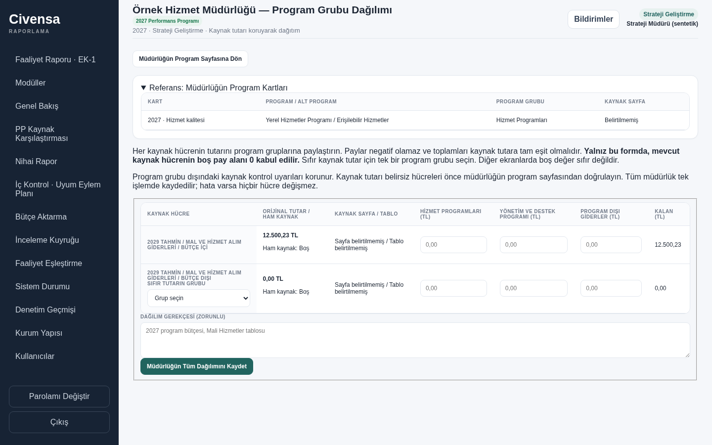

**Görünen metinler ve tablolar:**

- `div`: Civensa RAPORLAMA
- `h1`: Örnek Hizmet Müdürlüğü — Program Grubu Dağılımı
- `span`: 2027 Performans Programı
- `p`: 2027 · Strateji Geliştirme · Kaynak tutarı koruyarak dağıtım
- `div`: Strateji Geliştirme Strateji Müdürü (sentetik)
- `p`: Müdürlüğün Program Sayfasına Dön
- `table`: KART PROGRAM / ALT PROGRAM PROGRAM GRUBU KAYNAK SAYFA 2027 · Hizmet kalitesi Yerel Hizmetler Programı / Erişilebilir Hizmetler Hizmet Programları Belirtilmemiş
- `p`: Her kaynak hücrenin tutarını program gruplarına paylaştırın. Paylar negatif olamaz ve toplamları kaynak tutara tam eşit olmalıdır. Yalnız bu formda, mevcut kaynak hücrenin boş pay alanı 0 kabul edilir. Sıfır kaynak tutar için tek bir program grubu seçin. Diğer ekranlarda boş değer sıfır değildir.
- `p`: Program grubu dışındaki kaynak kontrol uyarıları korunur. Kaynak tutarı belirsiz hücreleri önce müdürlüğün program sayfasından doğrulayın. Tüm müdürlük tek işlemde kaydedilir; hata varsa hiçbir hücre değişmez.
- `table`: KAYNAK HÜCRE ORİJİNAL TUTAR / HAM KAYNAK KAYNAK SAYFA / TABLO HİZMET PROGRAMLARI (TL) YÖNETİM VE DESTEK PROGRAMI (TL) PROGRAM DIŞI GİDERLER (TL) KALAN (TL) 2029 TAHMİN / MAL VE HİZMET ALIM GİDERLERİ / BÜTÇE İÇİ 12.500,23 TL Ham kaynak: Boş Sayfa belirtilmemiş / Tablo belirtilmemiş 12.500,23 2029 TAHMİN / MAL VE HİZMET ALIM GİDERLERİ / BÜTÇE DIŞI SIFIR TUTARIN GRUBU Grup seçin Hizmet Programları Yönetim ve Destek Programı Program Dışı Giderler 0,00 TL Ham kaynak: Boş Sayfa belirtilmemiş / Tablo belirtilmemiş 0,00
- `p`: Ham kaynak: Boş
- `p`: Ham kaynak: Boş

**Bağlantı, düğme, form ve alanlar:**

| Öğe | Tür / etiket / bağlam | Hedef URL veya eylem | Ne yapar / mevcut değer |
| --- | --- | --- | --- |
| E001 | a · Faaliyet Raporu · EK-1 | `/activity-sections` | Bağlantıdaki ekranı veya dosyayı açar: Faaliyet Raporu · EK-1. |
| E002 | a · Modüller | `/modules` | Bağlantıdaki ekranı veya dosyayı açar: Modüller. |
| E003 | a · Genel Bakış | `/dashboard?period_id=1` | Bağlantıdaki ekranı veya dosyayı açar: Genel Bakış. |
| E004 | a · PP Kaynak Karşılaştırması | `/source-comparison?period_id=1` | Bağlantıdaki ekranı veya dosyayı açar: PP Kaynak Karşılaştırması. |
| E005 | a · Nihai Rapor | `/report-builder?period_id=1` | Bağlantıdaki ekranı veya dosyayı açar: Nihai Rapor. |
| E006 | a · İç Kontrol · Uyum Eylem Planı | `/internal-control` | Bağlantıdaki ekranı veya dosyayı açar: İç Kontrol · Uyum Eylem Planı. |
| E007 | a · Bütçe Aktarma | `/budget-reallocations` | Bağlantıdaki ekranı veya dosyayı açar: Bütçe Aktarma. |
| E008 | a · İnceleme Kuyruğu | `/review?period_id=1` | Bağlantıdaki ekranı veya dosyayı açar: İnceleme Kuyruğu. |
| E009 | a · Faaliyet Eşleştirme | `/activity-mapping?period_id=1` | Bağlantıdaki ekranı veya dosyayı açar: Faaliyet Eşleştirme. |
| E010 | a · Sistem Durumu | `/operations?period_id=1` | Bağlantıdaki ekranı veya dosyayı açar: Sistem Durumu. |
| E011 | a · Denetim Geçmişi | `/audit?period_id=1` | Bağlantıdaki ekranı veya dosyayı açar: Denetim Geçmişi. |
| E012 | a · Kurum Yapısı | `/structure?period_id=1` | Bağlantıdaki ekranı veya dosyayı açar: Kurum Yapısı. |
| E013 | a · Kullanıcılar | `/users?period_id=1` | Bağlantıdaki ekranı veya dosyayı açar: Kullanıcılar. |
| E014 | button · Parolamı Değiştir (#changePasswordButton) | `#passwordModal` | Parola değiştirme penceresini açar. |
| E015 | form · Çıkış | `POST /logout` | Oturumu kapatıp giriş ekranına döner. |
| E016 | button · Çıkış | `POST /logout` | Oturumu kapatıp giriş ekranına döner. |
| E017 | button · Bildirimler (#notificationButton) | `GET /api/notifications → #notificationPanel` | Bildirim listesini açar. |
| E018 | a · Müdürlüğün Program Sayfasına Dön | `/program/1?period_id=1` | Bağlantıdaki ekranı veya dosyayı açar: Müdürlüğün Program Sayfasına Dön. |
| E019 | summary · Referans: Müdürlüğün Program Kartları · Referans: Müdürlüğün Program Kartları | `Aynı sayfadaki ayrıntı bölümü` | İçerik ve form ayrıntılarını açar veya daraltır. |
| E020 | form · Müdürlüğün Tüm Dağılımını Kaydet (#economicSplitForm) | `POST /program/1/economic-split` | Müdürlüğün Tüm Dağılımını Kaydet işlemini form alanlarıyla gönderir; doğrulama sonrası kaydeder veya hata gösterir. |
| E021 | input · 2029 Tahmin / Mal ve Hizmet Alım Giderleri / Bütçe İçi / Hizmet Programları · 12.500,23 TL Ham kaynak: Boş | `POST /program/1/economic-split` | İşlem için 2029 Tahmin / Mal ve Hizmet Alım Giderleri / Bütçe İçi / Hizmet Programları değerini girer. |
| E022 | input · 2029 Tahmin / Mal ve Hizmet Alım Giderleri / Bütçe İçi / Yönetim ve Destek Programı · 12.500,23 TL Ham kaynak: Boş | `POST /program/1/economic-split` | İşlem için 2029 Tahmin / Mal ve Hizmet Alım Giderleri / Bütçe İçi / Yönetim ve Destek Programı değerini girer. |
| E023 | input · 2029 Tahmin / Mal ve Hizmet Alım Giderleri / Bütçe İçi / Program Dışı Giderler · 12.500,23 TL Ham kaynak: Boş | `POST /program/1/economic-split` | İşlem için 2029 Tahmin / Mal ve Hizmet Alım Giderleri / Bütçe İçi / Program Dışı Giderler değerini girer. |
| E024 | select · SIFIR TUTARIN GRUBU Grup seçin Hizmet Programları Yönetim ve Destek Programı Program Dışı Giderler · 0,00 TL Ham kaynak: Boş | `POST /program/1/economic-split` | Listeden seçim yapar. Zorunlu. Seçenekler: Grup seçin; Hizmet Programları; Yönetim ve Destek Programı; Program Dışı Giderler. |
| E025 | input · 2029 Tahmin / Mal ve Hizmet Alım Giderleri / Bütçe Dışı / Hizmet Programları · 0,00 TL Ham kaynak: Boş | `POST /program/1/economic-split` | İşlem için 2029 Tahmin / Mal ve Hizmet Alım Giderleri / Bütçe Dışı / Hizmet Programları değerini girer. |
| E026 | input · 2029 Tahmin / Mal ve Hizmet Alım Giderleri / Bütçe Dışı / Yönetim ve Destek Programı · 0,00 TL Ham kaynak: Boş | `POST /program/1/economic-split` | İşlem için 2029 Tahmin / Mal ve Hizmet Alım Giderleri / Bütçe Dışı / Yönetim ve Destek Programı değerini girer. |
| E027 | input · 2029 Tahmin / Mal ve Hizmet Alım Giderleri / Bütçe Dışı / Program Dışı Giderler · 0,00 TL Ham kaynak: Boş | `POST /program/1/economic-split` | İşlem için 2029 Tahmin / Mal ve Hizmet Alım Giderleri / Bütçe Dışı / Program Dışı Giderler değerini girer. |
| E028 | textarea · DAĞILIM GEREKÇESİ (ZORUNLU) | `POST /program/1/economic-split` | İşlem için DAĞILIM GEREKÇESİ (ZORUNLU) değerini girer. Zorunlu. |
| E029 | button · Müdürlüğün Tüm Dağılımını Kaydet | `POST /program/1/economic-split` | Müdürlüğün Tüm Dağılımını Kaydet işlemini form alanlarıyla gönderir; doğrulama sonrası kaydeder veya hata gösterir. |

<a id="ekran-039"></a>

### 039 · Nihai Rapor · Dolu / taslak

URL kalıbı: `/report-builder` · Çekilen URL: `/report-builder?period_id=1` · Rol: **strategy** · HTTP 200.

Genel bölümleri, kapsamı ve yayın hazırlığını yönetir.

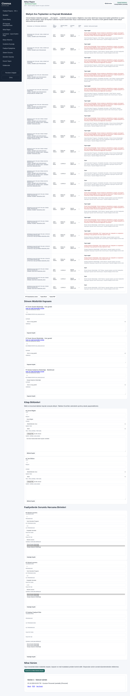

**Görünen metinler ve tablolar:**

- `div`: Civensa RAPORLAMA
- `h1`: Nihai Rapor
- `span`: 2027 Performans Programı
- `p`: 2027 · Kurum içeriği, kapsam ve yayın sürümleri
- `div`: Strateji Geliştirme Strateji Müdürü (sentetik)
- `h2`: Maliyet Ara Toplamları ve Kaynak Mutabakatı
- `p`: Güncel faaliyet maliyetleri program → alt program → müdürlük sırasıyla toplanır. Bağlantısı veya tutarı eksik kayıt varsa kısmi toplam gösterilmez ve yayın durur. Kaynak toplamı, bütün alt kayıtların saklanan kaynak tutarlarından oluşur; bulunmaması uyarıdır. Personel ve SGK giderleri kitabın ortak maliyet tablosunda ayrıca gösterilir.
- `table`: PROGRAM / ALT PROGRAM / MÜDÜRLÜK YIL / DEĞER TÜRÜ HESAPLANAN (TL) KAYNAK (TL) FARK (TL) DURUM / YAPILACAK İŞLEM PROGRAM ARA TOPLAMI: YEREL HİZMETLER PROGRAMI YEREL HİZMETLER PROGRAMI 2027 Bütçe Eksik ara toplam kaynak toplamı yok — Yayın engeli Örnek Hizmet Müdürlüğü / Hizmet noktalarının iyileştirilmesi: program, alt program, kart veya katalog bağlantısı eksik ya da kapsamı uyuşmuyor. Faaliyet Eşleştirme ve Performans Kartları ekranlarında bağlantıları tamamlayın. Yerel Hizmetler Programı / 2027 Bütçe: kaynak toplamı yok (tüm faaliyetleri kapsayan kaynak tutarı bulunmuyor). Kaynak belgeyi kontrol edin. PROGRAM ARA TOPLAMI: YEREL HİZMETLER PROGRAMI YEREL HİZMETLER PROGRAMI 2028 Tahmin Eksik ara toplam kaynak toplamı yok — Yayın engeli Örnek Hizmet Müdürlüğü / Hizmet noktalarının iyileştirilmesi: program, alt program, kart veya katalog bağlantısı eksik ya da kapsamı uyuşmuyor. Faaliyet Eşleştirme ve Performans Kartları ekranlarında bağlantıları tamamlayın. Yerel Hizmetler Programı / 2028 Tahmin: kaynak toplamı yok (tüm faaliyetleri kapsayan kaynak tutarı bulunmuyor). Kaynak belgeyi kontrol edin. PROGRAM ARA TOPLAMI: YEREL HİZMETLER PROGRAMI YEREL HİZMETLER PROGRAMI 2029 Tahmin Eksik ara toplam kaynak toplamı yok — Yayın engeli Örnek Hizmet Müdürlüğü / Hizmet noktalarının iyileştirilmesi: program, alt program, kart veya katalog bağlantısı eksik ya da kapsamı uyuşmuyor. Faaliyet Eşleştirme ve Performans Kartları ekranlarında bağlantıları tamamlayın. Yerel Hizmetler Programı / 2029 Tahmin: kaynak toplamı yok (tüm faaliyetleri kapsayan kaynak tutarı bulunmuyor). Kaynak belgeyi kontrol edin. ALT PROGRAM ARA TOPLAMI: ERİŞİLEBİLİR HİZMETLER YEREL HİZMETLER PROGRAMI / ERİŞİLEBİLİR HİZMETLER 2027 Bütçe Eksik ara toplam kaynak toplamı yok — Yayın engeli Örnek Hizmet Müdürlüğü / Hizmet noktalarının iyileştirilmesi: program, alt program, kart veya katalog bağlantısı eksik ya da kapsamı uyuşmuyor. Faaliyet Eşleştirme ve Performans Kartları ekranlarında bağlantıları tamamlayın. Yerel Hizmetler Programı / Erişilebilir Hizmetler / 2027 Bütçe: kaynak toplamı yok (tüm faaliyetleri kapsayan kaynak tutarı bulunmuyor). Kaynak belgeyi kontrol edin. ALT PROGRAM ARA TOPLAMI: ERİŞİLEBİLİR HİZMETLER YEREL HİZMETLER PROGRAMI / ERİŞİLEBİLİR HİZMETLER 2028 Tahmin Eksik ara toplam kaynak toplamı yok — Yayın engeli Örnek Hizmet Müdürlüğü / Hizmet noktalarının iyileştirilmesi: program, alt program, kart veya katalog bağlantısı eksik ya da kapsamı uyuşmuyor. Faaliyet Eşleştirme ve Performans Kartları ekranlarında bağlantıları tamamlayın. Yerel Hizmetler Programı / Erişilebilir Hizmetler / 2028 Tahmin: kaynak toplamı yok (tüm faaliyetleri kapsayan kaynak tutarı bulunmuyor). Kaynak belgeyi kontrol edin. ALT PROGRAM ARA TOPLAMI: ERİŞİLEBİLİR HİZMETLER YEREL HİZMETLER PROGRAMI / ERİŞİLEBİLİR HİZMETLER 2029 Tahmin Eksik ara toplam kaynak toplamı yok — Yayın engeli Örnek Hizmet Müdürlüğü / Hizmet noktalarının iyileştirilmesi: program, alt program, kart veya katalog bağlantısı eksik ya da kapsamı uyuşmuyor. Faaliyet Eşleştirme ve Performans Kartları ekranlarında bağlantıları tamamlayın. Yerel Hizmetler Programı / Erişilebilir Hizmetler / 2029 Tahmin: kaynak toplamı yok (tüm faaliyetleri kapsayan kaynak tutarı bulunmuyor). Kaynak belgeyi kontrol edin. MÜDÜRLÜK ARA TOPLAMI: ÖRNEK HİZMET MÜDÜRLÜĞÜ YEREL HİZMETLER PROGRAMI / ERİŞİLEBİLİR HİZMETLER / ÖRNEK HİZMET MÜDÜRLÜĞÜ 2027 Bütçe Eksik ara toplam kaynak toplamı yok — Yayın engeli Örnek Hizmet Müdürlüğü / Hizmet noktalarının iyileştirilmesi: program, alt program, kart veya katalog bağlantısı eksik ya da kapsamı uyuşmuyor. Faaliyet Eşleştirme ve Performans Kartları ekranlarında bağlantıları tamamlayın. Yerel Hizmetler Programı / Erişilebilir Hizmetler / Örnek Hizmet Müdürlüğü / 2027 Bütçe: kaynak toplamı yok (tüm faaliyetleri kapsayan kaynak tutarı bulunmuyor). Kaynak belgeyi kontrol edin. MÜDÜRLÜK ARA TOPLAMI: ÖRNEK HİZMET MÜDÜRLÜĞÜ YEREL HİZMETLER PROGRAMI / ERİŞİLEBİLİR HİZMETLER / ÖRNEK HİZMET MÜDÜRLÜĞÜ 2028 Tahmin Eksik ara toplam kaynak toplamı yok — Yayın engeli Örnek Hizmet Müdürlüğü / Hizmet noktalarının iyileştirilmesi: program, alt program, kart veya katalog bağlantısı eksik ya da kapsamı uyuşmuyor. Faaliyet Eşleştirme ve Performans Kartları ekranlarında bağlantıları tamamlayın. Yerel Hizmetler Programı / Erişilebilir Hizmetler / Örnek Hizmet Müdürlüğü / 2028 Tahmin: kaynak toplamı yok (tüm faaliyetleri kapsayan kaynak tutarı bulunmuyor). Kaynak belgeyi kontrol edin. MÜDÜRLÜK ARA TOPLAMI: ÖRNEK HİZMET MÜDÜRLÜĞÜ YEREL HİZMETLER PROGRAMI / ERİŞİLEBİLİR HİZMETLER / ÖRNEK HİZMET MÜDÜRLÜĞÜ 2029 Tahmin Eksik ara toplam kaynak toplamı yok — Yayın engeli Örnek Hizmet Müdürlüğü / Hizmet noktalarının iyileştirilmesi: program, alt program, kart veya katalog bağlantısı eksik ya da kapsamı uyuşmuyor. Faaliyet Eşleştirme ve Performans Kartları ekranlarında bağlantıları tamamlayın. Yerel Hizmetler Programı / Erişilebilir Hizmetler / Örnek Hizmet Müdürlüğü / 2029 Tahmin: kaynak toplamı yok (tüm faaliyetleri kapsayan kaynak tutarı bulunmuyor). Kaynak belgeyi kontrol edin. MÜDÜRLÜK ARA TOPLAMI: ÖRNEK DESTEK MÜDÜRLÜĞÜ YEREL HİZMETLER PROGRAMI / ERİŞİLEBİLİR HİZMETLER / ÖRNEK DESTEK MÜDÜRLÜĞÜ 2027 Bütçe 12.500,23 kaynak toplamı yok — Uyarı Yerel Hizmetler Programı / Erişilebilir Hizmetler / Örnek Destek Müdürlüğü / 2027 Bütçe: kaynak toplamı yok (tüm faaliyetleri kapsayan kaynak tutarı bulunmuyor). Kaynak belgeyi kontrol edin. MÜDÜRLÜK ARA TOPLAMI: ÖRNEK DESTEK MÜDÜRLÜĞÜ YEREL HİZMETLER PROGRAMI / ERİŞİLEBİLİR HİZMETLER / ÖRNEK DESTEK MÜDÜRLÜĞÜ 2028 Tahmin 12.500,23 kaynak toplamı yok — Uyarı Yerel Hizmetler Programı / Erişilebilir Hizmetler / Örnek Destek Müdürlüğü / 2028 Tahmin: kaynak toplamı yok (tüm faaliyetleri kapsayan kaynak tutarı bulunmuyor). Kaynak belgeyi kontrol edin. MÜDÜRLÜK ARA TOPLAMI: ÖRNEK DESTEK MÜDÜRLÜĞÜ YEREL HİZMETLER PROGRAMI / ERİŞİLEBİLİR HİZMETLER / ÖRNEK DESTEK MÜDÜRLÜĞÜ 2029 Tahmin 12.500,23 kaynak toplamı yok — Uyarı Yerel Hizmetler Programı / Erişilebilir Hizmetler / Örnek Destek Müdürlüğü / 2029 Tahmin: kaynak toplamı yok (tüm faaliyetleri kapsayan kaynak tutarı bulunmuyor). Kaynak belgeyi kontrol edin. MÜDÜRLÜK FAALİYETLERİ TOPLAMI: ÖRNEK HİZMET MÜDÜRLÜĞÜ ÖRNEK HİZMET MÜDÜRLÜĞÜ 2027 Bütçe Eksik ara toplam kaynak toplamı yok — Yayın engeli Örnek Hizmet Müdürlüğü / Hizmet noktalarının iyileştirilmesi: program, alt program, kart veya katalog bağlantısı eksik ya da kapsamı uyuşmuyor. Faaliyet Eşleştirme ve Performans Kartları ekranlarında bağlantıları tamamlayın. Örnek Hizmet Müdürlüğü / 2027 Bütçe: kaynak toplamı yok (tüm faaliyetleri kapsayan kaynak tutarı bulunmuyor). Kaynak belgeyi kontrol edin. MÜDÜRLÜK FAALİYETLERİ TOPLAMI: ÖRNEK HİZMET MÜDÜRLÜĞÜ ÖRNEK HİZMET MÜDÜRLÜĞÜ 2028 Tahmin Eksik ara toplam kaynak toplamı yok — Yayın engeli Örnek Hizmet Müdürlüğü / Hizmet noktalarının iyileştirilmesi: program, alt program, kart veya katalog bağlantısı eksik ya da kapsamı uyuşmuyor. Faaliyet Eşleştirme ve Performans Kartları ekranlarında bağlantıları tamamlayın. Örnek Hizmet Müdürlüğü / 2028 Tahmin: kaynak toplamı yok (tüm faaliyetleri kapsayan kaynak tutarı bulunmuyor). Kaynak belgeyi kontrol edin. MÜDÜRLÜK FAALİYETLERİ TOPLAMI: ÖRNEK HİZMET MÜDÜRLÜĞÜ ÖRNEK HİZMET MÜDÜRLÜĞÜ 2029 Tahmin Eksik ara toplam kaynak toplamı yok — Yayın engeli Örnek Hizmet Müdürlüğü / Hizmet noktalarının iyileştirilmesi: program, alt program, kart veya katalog bağlantısı eksik ya da kapsamı uyuşmuyor. Faaliyet Eşleştirme ve Performans Kartları ekranlarında bağlantıları tamamlayın. Örnek Hizmet Müdürlüğü / 2029 Tahmin: kaynak toplamı yok (tüm faaliyetleri kapsayan kaynak tutarı bulunmuyor). Kaynak belgeyi kontrol edin. MÜDÜRLÜK FAALİYETLERİ TOPLAMI: STRATEJİ GELİŞTİRME MÜDÜRLÜĞÜ STRATEJİ GELİŞTİRME MÜDÜRLÜĞÜ 2027 Bütçe Eksik ara toplam kaynak toplamı yok — Yayın engeli Strateji Geliştirme Müdürlüğü / 2027: faaliyet kaydı yok; faaliyetleri ve maliyetlerini tamamlayın veya gerekçeli sıfır bütçe kapsamını seçin. Strateji Geliştirme Müdürlüğü / 2027 Bütçe: kaynak toplamı yok (tüm faaliyetleri kapsayan kaynak tutarı bulunmuyor). Kaynak belgeyi kontrol edin. MÜDÜRLÜK FAALİYETLERİ TOPLAMI: STRATEJİ GELİŞTİRME MÜDÜRLÜĞÜ STRATEJİ GELİŞTİRME MÜDÜRLÜĞÜ 2028 Tahmin Eksik ara toplam kaynak toplamı yok — Yayın engeli Strateji Geliştirme Müdürlüğü / 2028: faaliyet kaydı yok; faaliyetleri ve maliyetlerini tamamlayın veya gerekçeli sıfır bütçe kapsamını seçin. Strateji Geliştirme Müdürlüğü / 2028 Tahmin: kaynak toplamı yok (tüm faaliyetleri kapsayan kaynak tutarı bulunmuyor). Kaynak belgeyi kontrol edin. MÜDÜRLÜK FAALİYETLERİ TOPLAMI: STRATEJİ GELİŞTİRME MÜDÜRLÜĞÜ STRATEJİ GELİŞTİRME MÜDÜRLÜĞÜ 2029 Tahmin Eksik ara toplam kaynak toplamı yok — Yayın engeli Strateji Geliştirme Müdürlüğü / 2029: faaliyet kaydı yok; faaliyetleri ve maliyetlerini tamamlayın veya gerekçeli sıfır bütçe kapsamını seçin. Strateji Geliştirme Müdürlüğü / 2029 Tahmin: kaynak toplamı yok (tüm faaliyetleri kapsayan kaynak tutarı bulunmuyor). Kaynak belgeyi kontrol edin. MÜDÜRLÜK FAALİYETLERİ TOPLAMI: ÖRNEK DESTEK MÜDÜRLÜĞÜ ÖRNEK DESTEK MÜDÜRLÜĞÜ 2027 Bütçe 12.500,23 kaynak toplamı yok — Uyarı Örnek Destek Müdürlüğü / 2027 Bütçe: kaynak toplamı yok (tüm faaliyetleri kapsayan kaynak tutarı bulunmuyor). Kaynak belgeyi kontrol edin. MÜDÜRLÜK FAALİYETLERİ TOPLAMI: ÖRNEK DESTEK MÜDÜRLÜĞÜ ÖRNEK DESTEK MÜDÜRLÜĞÜ 2028 Tahmin 12.500,23 kaynak toplamı yok — Uyarı Örnek Destek Müdürlüğü / 2028 Tahmin: kaynak toplamı yok (tüm faaliyetleri kapsayan kaynak tutarı bulunmuyor). Kaynak belgeyi kontrol edin. MÜDÜRLÜK FAALİYETLERİ TOPLAMI: ÖRNEK DESTEK MÜDÜRLÜĞÜ ÖRNEK DESTEK MÜDÜRLÜĞÜ 2029 Tahmin 12.500,23 kaynak toplamı yok — Uyarı Örnek Destek Müdürlüğü / 2029 Tahmin: kaynak toplamı yok (tüm faaliyetleri kapsayan kaynak tutarı bulunmuyor). Kaynak belgeyi kontrol edin.
- `p`: Örnek Hizmet Müdürlüğü / Hizmet noktalarının iyileştirilmesi: program, alt program, kart veya katalog bağlantısı eksik ya da kapsamı uyuşmuyor. Faaliyet Eşleştirme ve Performans Kartları ekranlarında bağlantıları tamamlayın.
- `p`: Yerel Hizmetler Programı / 2027 Bütçe: kaynak toplamı yok (tüm faaliyetleri kapsayan kaynak tutarı bulunmuyor). Kaynak belgeyi kontrol edin.
- `p`: Örnek Hizmet Müdürlüğü / Hizmet noktalarının iyileştirilmesi: program, alt program, kart veya katalog bağlantısı eksik ya da kapsamı uyuşmuyor. Faaliyet Eşleştirme ve Performans Kartları ekranlarında bağlantıları tamamlayın.
- `p`: Yerel Hizmetler Programı / 2028 Tahmin: kaynak toplamı yok (tüm faaliyetleri kapsayan kaynak tutarı bulunmuyor). Kaynak belgeyi kontrol edin.
- `p`: Örnek Hizmet Müdürlüğü / Hizmet noktalarının iyileştirilmesi: program, alt program, kart veya katalog bağlantısı eksik ya da kapsamı uyuşmuyor. Faaliyet Eşleştirme ve Performans Kartları ekranlarında bağlantıları tamamlayın.
- `p`: Yerel Hizmetler Programı / 2029 Tahmin: kaynak toplamı yok (tüm faaliyetleri kapsayan kaynak tutarı bulunmuyor). Kaynak belgeyi kontrol edin.
- `p`: Örnek Hizmet Müdürlüğü / Hizmet noktalarının iyileştirilmesi: program, alt program, kart veya katalog bağlantısı eksik ya da kapsamı uyuşmuyor. Faaliyet Eşleştirme ve Performans Kartları ekranlarında bağlantıları tamamlayın.
- `p`: Yerel Hizmetler Programı / Erişilebilir Hizmetler / 2027 Bütçe: kaynak toplamı yok (tüm faaliyetleri kapsayan kaynak tutarı bulunmuyor). Kaynak belgeyi kontrol edin.
- `p`: Örnek Hizmet Müdürlüğü / Hizmet noktalarının iyileştirilmesi: program, alt program, kart veya katalog bağlantısı eksik ya da kapsamı uyuşmuyor. Faaliyet Eşleştirme ve Performans Kartları ekranlarında bağlantıları tamamlayın.
- `p`: Yerel Hizmetler Programı / Erişilebilir Hizmetler / 2028 Tahmin: kaynak toplamı yok (tüm faaliyetleri kapsayan kaynak tutarı bulunmuyor). Kaynak belgeyi kontrol edin.
- `p`: Örnek Hizmet Müdürlüğü / Hizmet noktalarının iyileştirilmesi: program, alt program, kart veya katalog bağlantısı eksik ya da kapsamı uyuşmuyor. Faaliyet Eşleştirme ve Performans Kartları ekranlarında bağlantıları tamamlayın.
- `p`: Yerel Hizmetler Programı / Erişilebilir Hizmetler / 2029 Tahmin: kaynak toplamı yok (tüm faaliyetleri kapsayan kaynak tutarı bulunmuyor). Kaynak belgeyi kontrol edin.
- `p`: Örnek Hizmet Müdürlüğü / Hizmet noktalarının iyileştirilmesi: program, alt program, kart veya katalog bağlantısı eksik ya da kapsamı uyuşmuyor. Faaliyet Eşleştirme ve Performans Kartları ekranlarında bağlantıları tamamlayın.
- `p`: Yerel Hizmetler Programı / Erişilebilir Hizmetler / Örnek Hizmet Müdürlüğü / 2027 Bütçe: kaynak toplamı yok (tüm faaliyetleri kapsayan kaynak tutarı bulunmuyor). Kaynak belgeyi kontrol edin.
- `p`: Örnek Hizmet Müdürlüğü / Hizmet noktalarının iyileştirilmesi: program, alt program, kart veya katalog bağlantısı eksik ya da kapsamı uyuşmuyor. Faaliyet Eşleştirme ve Performans Kartları ekranlarında bağlantıları tamamlayın.
- `p`: Yerel Hizmetler Programı / Erişilebilir Hizmetler / Örnek Hizmet Müdürlüğü / 2028 Tahmin: kaynak toplamı yok (tüm faaliyetleri kapsayan kaynak tutarı bulunmuyor). Kaynak belgeyi kontrol edin.
- `p`: Örnek Hizmet Müdürlüğü / Hizmet noktalarının iyileştirilmesi: program, alt program, kart veya katalog bağlantısı eksik ya da kapsamı uyuşmuyor. Faaliyet Eşleştirme ve Performans Kartları ekranlarında bağlantıları tamamlayın.
- `p`: Yerel Hizmetler Programı / Erişilebilir Hizmetler / Örnek Hizmet Müdürlüğü / 2029 Tahmin: kaynak toplamı yok (tüm faaliyetleri kapsayan kaynak tutarı bulunmuyor). Kaynak belgeyi kontrol edin.
- `p`: Yerel Hizmetler Programı / Erişilebilir Hizmetler / Örnek Destek Müdürlüğü / 2027 Bütçe: kaynak toplamı yok (tüm faaliyetleri kapsayan kaynak tutarı bulunmuyor). Kaynak belgeyi kontrol edin.
- `p`: Yerel Hizmetler Programı / Erişilebilir Hizmetler / Örnek Destek Müdürlüğü / 2028 Tahmin: kaynak toplamı yok (tüm faaliyetleri kapsayan kaynak tutarı bulunmuyor). Kaynak belgeyi kontrol edin.
- `p`: Yerel Hizmetler Programı / Erişilebilir Hizmetler / Örnek Destek Müdürlüğü / 2029 Tahmin: kaynak toplamı yok (tüm faaliyetleri kapsayan kaynak tutarı bulunmuyor). Kaynak belgeyi kontrol edin.
- `p`: Örnek Hizmet Müdürlüğü / Hizmet noktalarının iyileştirilmesi: program, alt program, kart veya katalog bağlantısı eksik ya da kapsamı uyuşmuyor. Faaliyet Eşleştirme ve Performans Kartları ekranlarında bağlantıları tamamlayın.
- `p`: Örnek Hizmet Müdürlüğü / 2027 Bütçe: kaynak toplamı yok (tüm faaliyetleri kapsayan kaynak tutarı bulunmuyor). Kaynak belgeyi kontrol edin.
- `p`: Örnek Hizmet Müdürlüğü / Hizmet noktalarının iyileştirilmesi: program, alt program, kart veya katalog bağlantısı eksik ya da kapsamı uyuşmuyor. Faaliyet Eşleştirme ve Performans Kartları ekranlarında bağlantıları tamamlayın.
- `p`: Örnek Hizmet Müdürlüğü / 2028 Tahmin: kaynak toplamı yok (tüm faaliyetleri kapsayan kaynak tutarı bulunmuyor). Kaynak belgeyi kontrol edin.
- `p`: Örnek Hizmet Müdürlüğü / Hizmet noktalarının iyileştirilmesi: program, alt program, kart veya katalog bağlantısı eksik ya da kapsamı uyuşmuyor. Faaliyet Eşleştirme ve Performans Kartları ekranlarında bağlantıları tamamlayın.
- `p`: Örnek Hizmet Müdürlüğü / 2029 Tahmin: kaynak toplamı yok (tüm faaliyetleri kapsayan kaynak tutarı bulunmuyor). Kaynak belgeyi kontrol edin.
- `p`: Strateji Geliştirme Müdürlüğü / 2027: faaliyet kaydı yok; faaliyetleri ve maliyetlerini tamamlayın veya gerekçeli sıfır bütçe kapsamını seçin.
- `p`: Strateji Geliştirme Müdürlüğü / 2027 Bütçe: kaynak toplamı yok (tüm faaliyetleri kapsayan kaynak tutarı bulunmuyor). Kaynak belgeyi kontrol edin.
- `p`: Strateji Geliştirme Müdürlüğü / 2028: faaliyet kaydı yok; faaliyetleri ve maliyetlerini tamamlayın veya gerekçeli sıfır bütçe kapsamını seçin.
- `p`: Strateji Geliştirme Müdürlüğü / 2028 Tahmin: kaynak toplamı yok (tüm faaliyetleri kapsayan kaynak tutarı bulunmuyor). Kaynak belgeyi kontrol edin.
- `p`: Strateji Geliştirme Müdürlüğü / 2029: faaliyet kaydı yok; faaliyetleri ve maliyetlerini tamamlayın veya gerekçeli sıfır bütçe kapsamını seçin.
- `p`: Strateji Geliştirme Müdürlüğü / 2029 Tahmin: kaynak toplamı yok (tüm faaliyetleri kapsayan kaynak tutarı bulunmuyor). Kaynak belgeyi kontrol edin.
- `p`: Örnek Destek Müdürlüğü / 2027 Bütçe: kaynak toplamı yok (tüm faaliyetleri kapsayan kaynak tutarı bulunmuyor). Kaynak belgeyi kontrol edin.
- `p`: Örnek Destek Müdürlüğü / 2028 Tahmin: kaynak toplamı yok (tüm faaliyetleri kapsayan kaynak tutarı bulunmuyor). Kaynak belgeyi kontrol edin.
- `p`: Örnek Destek Müdürlüğü / 2029 Tahmin: kaynak toplamı yok (tüm faaliyetleri kapsayan kaynak tutarı bulunmuyor). Kaynak belgeyi kontrol edin.
- `p`: PP Tamamlanma Listesi Taslak Word Taslak PDF
- `h2`: Dönem Müdürlük Kapsamı
- `h2`: Kitap Bölümleri
- `p`: Metin ve kurumsal tabloları kaynak sırasıyla ekleyin. Tabloları Excel'den sekmelerle ayrılmış olarak yapıştırabilirsiniz.
- `h2`: Faaliyetlerde Sorumlu Harcama Birimleri
- `h2`: Nihai Sürüm
- `p`: Yayın öncesinde bütün müdürlük onayları, kapsam ve mali mutabakat yeniden kontrol edilir. Oluşturulan sürüm sonraki düzenlemelerden etkilenmez.
- `h3`: Sürüm 1 · Güncel sürüm
- `p`: 25.10.2026 00:35 TSİ · Kurulum Personeli (sentetik) (Personel)
- `p`: Word · PDF · Veri Arşivi

**Bağlantı, düğme, form ve alanlar:**

| Öğe | Tür / etiket / bağlam | Hedef URL veya eylem | Ne yapar / mevcut değer |
| --- | --- | --- | --- |
| E001 | a · Faaliyet Raporu · EK-1 | `/activity-sections` | Bağlantıdaki ekranı veya dosyayı açar: Faaliyet Raporu · EK-1. |
| E002 | a · Modüller | `/modules` | Bağlantıdaki ekranı veya dosyayı açar: Modüller. |
| E003 | a · Genel Bakış | `/dashboard?period_id=1` | Bağlantıdaki ekranı veya dosyayı açar: Genel Bakış. |
| E004 | a · PP Kaynak Karşılaştırması | `/source-comparison?period_id=1` | Bağlantıdaki ekranı veya dosyayı açar: PP Kaynak Karşılaştırması. |
| E005 | a · Nihai Rapor | `/report-builder?period_id=1` | Bağlantıdaki ekranı veya dosyayı açar: Nihai Rapor. |
| E006 | a · İç Kontrol · Uyum Eylem Planı | `/internal-control` | Bağlantıdaki ekranı veya dosyayı açar: İç Kontrol · Uyum Eylem Planı. |
| E007 | a · Bütçe Aktarma | `/budget-reallocations` | Bağlantıdaki ekranı veya dosyayı açar: Bütçe Aktarma. |
| E008 | a · İnceleme Kuyruğu | `/review?period_id=1` | Bağlantıdaki ekranı veya dosyayı açar: İnceleme Kuyruğu. |
| E009 | a · Faaliyet Eşleştirme | `/activity-mapping?period_id=1` | Bağlantıdaki ekranı veya dosyayı açar: Faaliyet Eşleştirme. |
| E010 | a · Sistem Durumu | `/operations?period_id=1` | Bağlantıdaki ekranı veya dosyayı açar: Sistem Durumu. |
| E011 | a · Denetim Geçmişi | `/audit?period_id=1` | Bağlantıdaki ekranı veya dosyayı açar: Denetim Geçmişi. |
| E012 | a · Kurum Yapısı | `/structure?period_id=1` | Bağlantıdaki ekranı veya dosyayı açar: Kurum Yapısı. |
| E013 | a · Kullanıcılar | `/users?period_id=1` | Bağlantıdaki ekranı veya dosyayı açar: Kullanıcılar. |
| E014 | button · Parolamı Değiştir (#changePasswordButton) | `#passwordModal` | Parola değiştirme penceresini açar. |
| E015 | form · Çıkış | `POST /logout` | Oturumu kapatıp giriş ekranına döner. |
| E016 | button · Çıkış | `POST /logout` | Oturumu kapatıp giriş ekranına döner. |
| E017 | button · Bildirimler (#notificationButton) | `GET /api/notifications → #notificationPanel` | Bildirim listesini açar. |
| E018 | a · PP Tamamlanma Listesi | `/report-builder/manifest?period_id=1` | Bağlantıdaki ekranı veya dosyayı açar: PP Tamamlanma Listesi. |
| E019 | a · Taslak Word | `/report-builder/preview.docx?period_id=1` | Bağlantıdaki ekranı veya dosyayı açar: Taslak Word. |
| E020 | a · Taslak PDF | `/report-builder/preview.pdf?period_id=1` | Bağlantıdaki ekranı veya dosyayı açar: Taslak PDF. |
| E021 | summary · Örnek Destek Müdürlüğü · Kart gerekli · Örnek Destek Müdürlüğü · Kart gerekli | `Aynı sayfadaki ayrıntı bölümü` | İçerik ve form ayrıntılarını açar veya daraltır. |
| E022 | a · Kart ve mali kontrolleri incele · Örnek Destek Müdürlüğü · Kart gerekli | `/program/3?period_id=1` | Bağlantıdaki ekranı veya dosyayı açar: Kart ve mali kontrolleri incele. |
| E023 | form · Kapsamı Kaydet · Örnek Destek Müdürlüğü · Kart gerekli | `POST /report-builder/scope` | Kapsamı Kaydet işlemini form alanlarıyla gönderir; doğrulama sonrası kaydeder veya hata gösterir. |
| E024 | input · KİTAPTAKİ MÜDÜRLÜK SIRASI · Örnek Destek Müdürlüğü · Kart gerekli | `POST /report-builder/scope` | İşlem için KİTAPTAKİ MÜDÜRLÜK SIRASI değerini girer. Değer: 0. |
| E025 | input · BU DÖNEM KİTAPTA KULLANILACAK AD · Örnek Destek Müdürlüğü · Kart gerekli | `POST /report-builder/scope` | İşlem için BU DÖNEM KİTAPTA KULLANILACAK AD değerini girer. |
| E026 | select · KAPSAM Kart ve onay gerekli Sıfır bütçeli, kart yok Bu dönem kapsam dışı · Örnek Destek Müdürlüğü · Kart gerekli | `POST /report-builder/scope` | Listeden seçim yapar. Değer: required. Seçenekler: Kart ve onay gerekli; Sıfır bütçeli, kart yok; Bu dönem kapsam dışı. |
| E027 | textarea · GEREKÇE · Örnek Destek Müdürlüğü · Kart gerekli | `POST /report-builder/scope` | İşlem için GEREKÇE değerini girer. |
| E028 | button · Kapsamı Kaydet · Örnek Destek Müdürlüğü · Kart gerekli | `POST /report-builder/scope` | Kapsamı Kaydet işlemini form alanlarıyla gönderir; doğrulama sonrası kaydeder veya hata gösterir. |
| E029 | summary · Örnek Hizmet Müdürlüğü · Kart gerekli · Örnek Hizmet Müdürlüğü · Kart gerekli | `Aynı sayfadaki ayrıntı bölümü` | İçerik ve form ayrıntılarını açar veya daraltır. |
| E030 | a · Kart ve mali kontrolleri incele · Örnek Hizmet Müdürlüğü · Kart gerekli | `/program/1?period_id=1` | Bağlantıdaki ekranı veya dosyayı açar: Kart ve mali kontrolleri incele. |
| E031 | form · Kapsamı Kaydet · Örnek Hizmet Müdürlüğü · Kart gerekli | `POST /report-builder/scope` | Kapsamı Kaydet işlemini form alanlarıyla gönderir; doğrulama sonrası kaydeder veya hata gösterir. |
| E032 | input · KİTAPTAKİ MÜDÜRLÜK SIRASI · Örnek Hizmet Müdürlüğü · Kart gerekli | `POST /report-builder/scope` | İşlem için KİTAPTAKİ MÜDÜRLÜK SIRASI değerini girer. Değer: 0. |
| E033 | input · BU DÖNEM KİTAPTA KULLANILACAK AD · Örnek Hizmet Müdürlüğü · Kart gerekli | `POST /report-builder/scope` | İşlem için BU DÖNEM KİTAPTA KULLANILACAK AD değerini girer. |
| E034 | select · KAPSAM Kart ve onay gerekli Sıfır bütçeli, kart yok Bu dönem kapsam dışı · Örnek Hizmet Müdürlüğü · Kart gerekli | `POST /report-builder/scope` | Listeden seçim yapar. Değer: required. Seçenekler: Kart ve onay gerekli; Sıfır bütçeli, kart yok; Bu dönem kapsam dışı. |
| E035 | textarea · GEREKÇE · Örnek Hizmet Müdürlüğü · Kart gerekli | `POST /report-builder/scope` | İşlem için GEREKÇE değerini girer. |
| E036 | button · Kapsamı Kaydet · Örnek Hizmet Müdürlüğü · Kart gerekli | `POST /report-builder/scope` | Kapsamı Kaydet işlemini form alanlarıyla gönderir; doğrulama sonrası kaydeder veya hata gösterir. |
| E037 | summary · Strateji Geliştirme Müdürlüğü · Belirtilmedi · Strateji Geliştirme Müdürlüğü · Belirtilmedi | `Aynı sayfadaki ayrıntı bölümü` | İçerik ve form ayrıntılarını açar veya daraltır. |
| E038 | a · Kart ve mali kontrolleri incele · Strateji Geliştirme Müdürlüğü · Belirtilmedi | `/program/2?period_id=1` | Bağlantıdaki ekranı veya dosyayı açar: Kart ve mali kontrolleri incele. |
| E039 | form · Kapsamı Kaydet · Strateji Geliştirme Müdürlüğü · Belirtilmedi | `POST /report-builder/scope` | Kapsamı Kaydet işlemini form alanlarıyla gönderir; doğrulama sonrası kaydeder veya hata gösterir. |
| E040 | input · KİTAPTAKİ MÜDÜRLÜK SIRASI · Strateji Geliştirme Müdürlüğü · Belirtilmedi | `POST /report-builder/scope` | İşlem için KİTAPTAKİ MÜDÜRLÜK SIRASI değerini girer. Değer: 3. |
| E041 | input · BU DÖNEM KİTAPTA KULLANILACAK AD · Strateji Geliştirme Müdürlüğü · Belirtilmedi | `POST /report-builder/scope` | İşlem için BU DÖNEM KİTAPTA KULLANILACAK AD değerini girer. Değer: Strateji Geliştirme Müdürlüğü. |
| E042 | select · KAPSAM Kart ve onay gerekli Sıfır bütçeli, kart yok Bu dönem kapsam dışı · Strateji Geliştirme Müdürlüğü · Belirtilmedi | `POST /report-builder/scope` | Listeden seçim yapar. Değer: required. Seçenekler: Kart ve onay gerekli; Sıfır bütçeli, kart yok; Bu dönem kapsam dışı. |
| E043 | textarea · GEREKÇE · Strateji Geliştirme Müdürlüğü · Belirtilmedi | `POST /report-builder/scope` | İşlem için GEREKÇE değerini girer. |
| E044 | button · Kapsamı Kaydet · Strateji Geliştirme Müdürlüğü · Belirtilmedi | `POST /report-builder/scope` | Kapsamı Kaydet işlemini form alanlarıyla gönderir; doğrulama sonrası kaydeder veya hata gösterir. |
| E045 | summary · Genel Bilgiler · Genel Bilgiler | `Aynı sayfadaki ayrıntı bölümü` | İçerik ve form ayrıntılarını açar veya daraltır. |
| E046 | form · Bölümü Kaydet (#ref: &lt;Node&gt;) · Genel Bilgiler | `POST /report-builder/section` | Bölümü Kaydet işlemini form alanlarıyla gönderir; doğrulama sonrası kaydeder veya hata gösterir. |
| E047 | input · SIRA · Genel Bilgiler | `POST /report-builder/section` | İşlem için SIRA değerini girer. Değer: 1. |
| E048 | input · BAŞLIK · Genel Bilgiler | `POST /report-builder/section` | İşlem için BAŞLIK değerini girer. Zorunlu. Değer: Genel Bilgiler. |
| E049 | select · KONUM Müdürlüklerden önce Mali özetlerden sonra · Genel Bilgiler | `POST /report-builder/section` | Listeden seçim yapar. Değer: before. Seçenekler: Müdürlüklerden önce; Mali özetlerden sonra. |
| E050 | select · İÇERİK TÜRÜ Metin Tablo Görsel · Genel Bilgiler | `POST /report-builder/section` | Listeden seçim yapar. Değer: text. Seçenekler: Metin; Tablo; Görsel. |
| E051 | input · PNG / JPEG (GÖRSEL TÜRÜ İÇİN) · Genel Bilgiler | `POST /report-builder/section` | Dosya seçer; ilgili işlemle yüklenir. |
| E052 | textarea · İÇERİK / GÖRSEL AÇIKLAMASI · Genel Bilgiler | `POST /report-builder/section` | İşlem için İÇERİK / GÖRSEL AÇIKLAMASI değerini girer. Değer: Bu ekran haritasındaki bütün kayıtlar sentetiktir.. |
| E053 | button · Bölümü Kaydet · Genel Bilgiler | `POST /report-builder/section` | Bölümü Kaydet işlemini form alanlarıyla gönderir; doğrulama sonrası kaydeder veya hata gösterir. |
| E054 | summary · Yeni Bölüm · Yeni Bölüm | `Aynı sayfadaki ayrıntı bölümü` | İçerik ve form ayrıntılarını açar veya daraltır. |
| E055 | form · Bölümü Kaydet · Yeni Bölüm | `POST /report-builder/section` | Bölümü Kaydet işlemini form alanlarıyla gönderir; doğrulama sonrası kaydeder veya hata gösterir. |
| E056 | input · SIRA · Yeni Bölüm | `POST /report-builder/section` | İşlem için SIRA değerini girer. Değer: 2. |
| E057 | input · BAŞLIK · Yeni Bölüm | `POST /report-builder/section` | İşlem için BAŞLIK değerini girer. Zorunlu. |
| E058 | select · KONUM Müdürlüklerden önce Mali özetlerden sonra · Yeni Bölüm | `POST /report-builder/section` | Listeden seçim yapar. Değer: before. Seçenekler: Müdürlüklerden önce; Mali özetlerden sonra. |
| E059 | select · İÇERİK TÜRÜ Metin Tablo Görsel · Yeni Bölüm | `POST /report-builder/section` | Listeden seçim yapar. Değer: text. Seçenekler: Metin; Tablo; Görsel. |
| E060 | input · PNG / JPEG (GÖRSEL TÜRÜ İÇİN) · Yeni Bölüm | `POST /report-builder/section` | Dosya seçer; ilgili işlemle yüklenir. |
| E061 | textarea · İÇERİK / GÖRSEL AÇIKLAMASI · Yeni Bölüm | `POST /report-builder/section` | İşlem için İÇERİK / GÖRSEL AÇIKLAMASI değerini girer. |
| E062 | button · Bölümü Kaydet · Yeni Bölüm | `POST /report-builder/section` | Bölümü Kaydet işlemini form alanlarıyla gönderir; doğrulama sonrası kaydeder veya hata gösterir. |
| E063 | summary · Hizmet sunumu · Hizmet sunumu | `Aynı sayfadaki ayrıntı bölümü` | İçerik ve form ayrıntılarını açar veya daraltır. |
| E064 | form · Kataloğu Kaydet (#ref: &lt;Node&gt;) · Hizmet sunumu | `POST /report-builder/catalogue` | Kataloğu Kaydet işlemini form alanlarıyla gönderir; doğrulama sonrası kaydeder veya hata gösterir. |
| E065 | input · PROGRAM KODU · Hizmet sunumu | `POST /report-builder/catalogue` | İşlem için PROGRAM KODU değerini girer. Zorunlu. Değer: 1. |
| E066 | input · PROGRAM ADI · Hizmet sunumu | `POST /report-builder/catalogue` | İşlem için PROGRAM ADI değerini girer. Zorunlu. Değer: Yerel Hizmetler Programı. |
| E067 | input · ALT PROGRAM KODU · Hizmet sunumu | `POST /report-builder/catalogue` | İşlem için ALT PROGRAM KODU değerini girer. Zorunlu. Değer: 1.1. |
| E068 | input · ALT PROGRAM ADI · Hizmet sunumu | `POST /report-builder/catalogue` | İşlem için ALT PROGRAM ADI değerini girer. Zorunlu. Değer: Erişilebilir Hizmetler. |
| E069 | input · FAALİYET KODU · Hizmet sunumu | `POST /report-builder/catalogue` | İşlem için FAALİYET KODU değerini girer. Zorunlu. Değer: 1.1.1. |
| E070 | input · FAALİYET ADI · Hizmet sunumu | `POST /report-builder/catalogue` | İşlem için FAALİYET ADI değerini girer. Zorunlu. Değer: Hizmet sunumu. |
| E071 | select · SORUMLU HARCAMA BİRİMLERİ Örnek Destek Müdürlüğü Örnek Hizmet Müdürlüğü Strateji Geliştirme Müdürlüğü · Hizmet sunumu | `POST /report-builder/catalogue` | Listeden seçim yapar. Zorunlu. Değer: 1. Seçenekler: Örnek Destek Müdürlüğü; Örnek Hizmet Müdürlüğü; Strateji Geliştirme Müdürlüğü. |
| E072 | button · Kataloğu Kaydet · Hizmet sunumu | `POST /report-builder/catalogue` | Kataloğu Kaydet işlemini form alanlarıyla gönderir; doğrulama sonrası kaydeder veya hata gösterir. |
| E073 | summary · Hizmet sunumu · Hizmet sunumu | `Aynı sayfadaki ayrıntı bölümü` | İçerik ve form ayrıntılarını açar veya daraltır. |
| E074 | form · Kataloğu Kaydet (#ref: &lt;Node&gt;) · Hizmet sunumu | `POST /report-builder/catalogue` | Kataloğu Kaydet işlemini form alanlarıyla gönderir; doğrulama sonrası kaydeder veya hata gösterir. |
| E075 | input · PROGRAM KODU · Hizmet sunumu | `POST /report-builder/catalogue` | İşlem için PROGRAM KODU değerini girer. Zorunlu. Değer: 1. |
| E076 | input · PROGRAM ADI · Hizmet sunumu | `POST /report-builder/catalogue` | İşlem için PROGRAM ADI değerini girer. Zorunlu. Değer: Yerel Hizmetler Programı. |
| E077 | input · ALT PROGRAM KODU · Hizmet sunumu | `POST /report-builder/catalogue` | İşlem için ALT PROGRAM KODU değerini girer. Zorunlu. Değer: 1.1. |
| E078 | input · ALT PROGRAM ADI · Hizmet sunumu | `POST /report-builder/catalogue` | İşlem için ALT PROGRAM ADI değerini girer. Zorunlu. Değer: Erişilebilir Hizmetler. |
| E079 | input · FAALİYET KODU · Hizmet sunumu | `POST /report-builder/catalogue` | İşlem için FAALİYET KODU değerini girer. Zorunlu. Değer: 1.1.3. |
| E080 | input · FAALİYET ADI · Hizmet sunumu | `POST /report-builder/catalogue` | İşlem için FAALİYET ADI değerini girer. Zorunlu. Değer: Hizmet sunumu. |
| E081 | select · SORUMLU HARCAMA BİRİMLERİ Örnek Destek Müdürlüğü Örnek Hizmet Müdürlüğü Strateji Geliştirme Müdürlüğü · Hizmet sunumu | `POST /report-builder/catalogue` | Listeden seçim yapar. Zorunlu. Değer: 3. Seçenekler: Örnek Destek Müdürlüğü; Örnek Hizmet Müdürlüğü; Strateji Geliştirme Müdürlüğü. |
| E082 | button · Kataloğu Kaydet · Hizmet sunumu | `POST /report-builder/catalogue` | Kataloğu Kaydet işlemini form alanlarıyla gönderir; doğrulama sonrası kaydeder veya hata gösterir. |
| E083 | summary · Katalog Faaliyeti Ekle · Katalog Faaliyeti Ekle | `Aynı sayfadaki ayrıntı bölümü` | İçerik ve form ayrıntılarını açar veya daraltır. |
| E084 | form · Kataloğu Kaydet · Katalog Faaliyeti Ekle | `POST /report-builder/catalogue` | Kataloğu Kaydet işlemini form alanlarıyla gönderir; doğrulama sonrası kaydeder veya hata gösterir. |
| E085 | input · PROGRAM KODU · Katalog Faaliyeti Ekle | `POST /report-builder/catalogue` | İşlem için PROGRAM KODU değerini girer. Zorunlu. |
| E086 | input · PROGRAM ADI · Katalog Faaliyeti Ekle | `POST /report-builder/catalogue` | İşlem için PROGRAM ADI değerini girer. Zorunlu. |
| E087 | input · ALT PROGRAM KODU · Katalog Faaliyeti Ekle | `POST /report-builder/catalogue` | İşlem için ALT PROGRAM KODU değerini girer. Zorunlu. |
| E088 | input · ALT PROGRAM ADI · Katalog Faaliyeti Ekle | `POST /report-builder/catalogue` | İşlem için ALT PROGRAM ADI değerini girer. Zorunlu. |
| E089 | input · FAALİYET KODU · Katalog Faaliyeti Ekle | `POST /report-builder/catalogue` | İşlem için FAALİYET KODU değerini girer. Zorunlu. |
| E090 | input · FAALİYET ADI · Katalog Faaliyeti Ekle | `POST /report-builder/catalogue` | İşlem için FAALİYET ADI değerini girer. Zorunlu. |
| E091 | select · SORUMLU HARCAMA BİRİMLERİ Örnek Destek Müdürlüğü Örnek Hizmet Müdürlüğü Strateji Geliştirme Müdürlüğü · Katalog Faaliyeti Ekle | `POST /report-builder/catalogue` | Listeden seçim yapar. Zorunlu. Seçenekler: Örnek Destek Müdürlüğü; Örnek Hizmet Müdürlüğü; Strateji Geliştirme Müdürlüğü. |
| E092 | button · Kataloğu Kaydet · Katalog Faaliyeti Ekle | `POST /report-builder/catalogue` | Kataloğu Kaydet işlemini form alanlarıyla gönderir; doğrulama sonrası kaydeder veya hata gösterir. |
| E093 | form · Kontrol Et ve Nihai Sürümü Oluştur | `POST /report-builder/publish` | Kontrol Et ve Nihai Sürümü Oluştur işlemini form alanlarıyla gönderir; doğrulama sonrası kaydeder veya hata gösterir. |
| E094 | button · Kontrol Et ve Nihai Sürümü Oluştur | `POST /report-builder/publish` | Kontrol Et ve Nihai Sürümü Oluştur işlemini form alanlarıyla gönderir; doğrulama sonrası kaydeder veya hata gösterir. |
| E095 | a · Word · Sürüm 1 · Güncel sürüm | `/publications/1.docx` | Bağlantıdaki ekranı veya dosyayı açar: Word. |
| E096 | a · PDF · Sürüm 1 · Güncel sürüm | `/publications/1.pdf` | Bağlantıdaki ekranı veya dosyayı açar: PDF. |
| E097 | a · Veri Arşivi · Sürüm 1 · Güncel sürüm | `/publications/1.json` | Bağlantıdaki ekranı veya dosyayı açar: Veri Arşivi. |

<a id="ekran-040"></a>

### 040 · Genel bölüm içe aktarma · Dolu / taslak

URL kalıbı: `/report-builder/import/{batch_id}` · Çekilen URL: `/report-builder/import/1?period_id=1` · Rol: **strategy** · HTTP 200.

Word genel bölümlerinin aktarım önizlemesini gösterir.

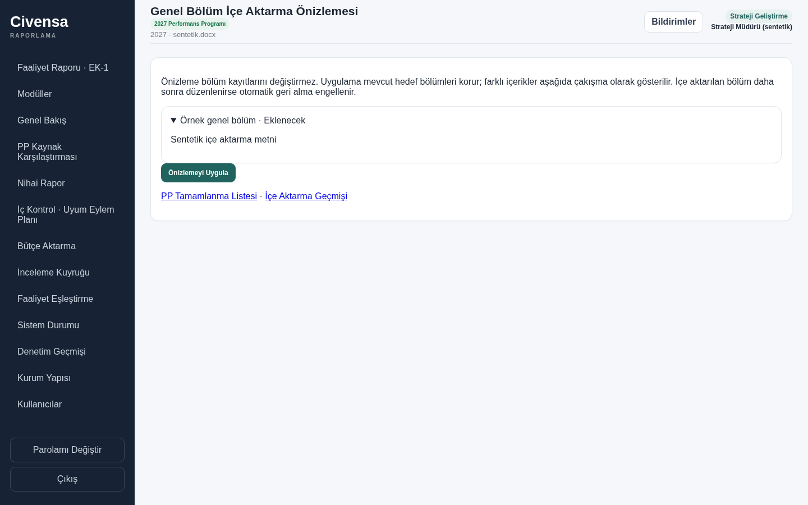

**Görünen metinler ve tablolar:**

- `div`: Civensa RAPORLAMA
- `h1`: Genel Bölüm İçe Aktarma Önizlemesi
- `span`: 2027 Performans Programı
- `p`: 2027 · sentetik.docx
- `div`: Strateji Geliştirme Strateji Müdürü (sentetik)
- `p`: Önizleme bölüm kayıtlarını değiştirmez. Uygulama mevcut hedef bölümleri korur; farklı içerikler aşağıda çakışma olarak gösterilir. İçe aktarılan bölüm daha sonra düzenlenirse otomatik geri alma engellenir.
- `p`: Sentetik içe aktarma metni
- `p`: PP Tamamlanma Listesi · İçe Aktarma Geçmişi

**Bağlantı, düğme, form ve alanlar:**

| Öğe | Tür / etiket / bağlam | Hedef URL veya eylem | Ne yapar / mevcut değer |
| --- | --- | --- | --- |
| E001 | a · Faaliyet Raporu · EK-1 | `/activity-sections` | Bağlantıdaki ekranı veya dosyayı açar: Faaliyet Raporu · EK-1. |
| E002 | a · Modüller | `/modules` | Bağlantıdaki ekranı veya dosyayı açar: Modüller. |
| E003 | a · Genel Bakış | `/dashboard?period_id=1` | Bağlantıdaki ekranı veya dosyayı açar: Genel Bakış. |
| E004 | a · PP Kaynak Karşılaştırması | `/source-comparison?period_id=1` | Bağlantıdaki ekranı veya dosyayı açar: PP Kaynak Karşılaştırması. |
| E005 | a · Nihai Rapor | `/report-builder?period_id=1` | Bağlantıdaki ekranı veya dosyayı açar: Nihai Rapor. |
| E006 | a · İç Kontrol · Uyum Eylem Planı | `/internal-control` | Bağlantıdaki ekranı veya dosyayı açar: İç Kontrol · Uyum Eylem Planı. |
| E007 | a · Bütçe Aktarma | `/budget-reallocations` | Bağlantıdaki ekranı veya dosyayı açar: Bütçe Aktarma. |
| E008 | a · İnceleme Kuyruğu | `/review?period_id=1` | Bağlantıdaki ekranı veya dosyayı açar: İnceleme Kuyruğu. |
| E009 | a · Faaliyet Eşleştirme | `/activity-mapping?period_id=1` | Bağlantıdaki ekranı veya dosyayı açar: Faaliyet Eşleştirme. |
| E010 | a · Sistem Durumu | `/operations?period_id=1` | Bağlantıdaki ekranı veya dosyayı açar: Sistem Durumu. |
| E011 | a · Denetim Geçmişi | `/audit?period_id=1` | Bağlantıdaki ekranı veya dosyayı açar: Denetim Geçmişi. |
| E012 | a · Kurum Yapısı | `/structure?period_id=1` | Bağlantıdaki ekranı veya dosyayı açar: Kurum Yapısı. |
| E013 | a · Kullanıcılar | `/users?period_id=1` | Bağlantıdaki ekranı veya dosyayı açar: Kullanıcılar. |
| E014 | button · Parolamı Değiştir (#changePasswordButton) | `#passwordModal` | Parola değiştirme penceresini açar. |
| E015 | form · Çıkış | `POST /logout` | Oturumu kapatıp giriş ekranına döner. |
| E016 | button · Çıkış | `POST /logout` | Oturumu kapatıp giriş ekranına döner. |
| E017 | button · Bildirimler (#notificationButton) | `GET /api/notifications → #notificationPanel` | Bildirim listesini açar. |
| E018 | summary · Örnek genel bölüm · Eklenecek · Örnek genel bölüm · Eklenecek | `Aynı sayfadaki ayrıntı bölümü` | İçerik ve form ayrıntılarını açar veya daraltır. |
| E019 | button · Önizlemeyi Uygula (#applySections) · Örnek genel bölüm · Eklenecek | `POST /api/import-batches/1/apply → /report-builder/manifest` | Önizlenen Word bölümlerini uygular ve tamamlanma listesine geçer. |
| E020 | a · PP Tamamlanma Listesi · Örnek genel bölüm · Eklenecek | `/report-builder/manifest?period_id=1` | Bağlantıdaki ekranı veya dosyayı açar: PP Tamamlanma Listesi. |
| E021 | a · İçe Aktarma Geçmişi · Örnek genel bölüm · Eklenecek | `/dashboard?period_id=1` | Bağlantıdaki ekranı veya dosyayı açar: İçe Aktarma Geçmişi. |

<a id="ekran-041"></a>

### 041 · Tamamlanma listesi · Dolu / taslak

URL kalıbı: `/report-builder/manifest` · Çekilen URL: `/report-builder/manifest?period_id=1` · Rol: **strategy** · HTTP 200.

Nihai yayın için eksik veri ve onayları listeler.

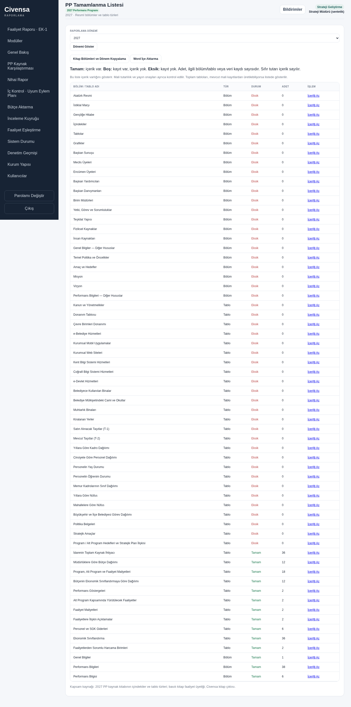

**Görünen metinler ve tablolar:**

- `div`: Civensa RAPORLAMA
- `h1`: PP Tamamlanma Listesi
- `span`: 2027 Performans Programı
- `p`: 2027 · Resmî bölümler ve tablo türleri
- `div`: Strateji Geliştirme Strateji Müdürü (sentetik)
- `p`: Kitap Bölümleri ve Dönem Kopyalama Word İçe Aktarma
- `p`: Tamam: içerik var. Boş: kayıt var, içerik yok. Eksik: kayıt yok. Adet, ilgili bölüm/tablo veya veri kaydı sayısıdır. Sıfır tutarı içerik sayılır.
- `p`: Bu liste içerik varlığını gösterir. Mali tutarlılık ve yayın onayları ayrıca kontrol edilir. Toplam tabloları, mevcut mali kayıtlardan üretilebiliyorsa listede gösterilir.
- `table`: BÖLÜM / TABLO ADI TÜR DURUM ADET İŞLEM Atatürk Resmi Bölüm Eksik 0 İçeriği Aç İstiklal Marşı Bölüm Eksik 0 İçeriği Aç Gençliğe Hitabe Bölüm Eksik 0 İçeriği Aç İçindekiler Bölüm Eksik 0 İçeriği Aç Tablolar Bölüm Eksik 0 İçeriği Aç Grafikler Bölüm Eksik 0 İçeriği Aç Başkan Sunuşu Bölüm Eksik 0 İçeriği Aç Meclis Üyeleri Bölüm Eksik 0 İçeriği Aç Encümen Üyeleri Bölüm Eksik 0 İçeriği Aç Başkan Yardımcıları Bölüm Eksik 0 İçeriği Aç Başkan Danışmanları Bölüm Eksik 0 İçeriği Aç Birim Müdürleri Bölüm Eksik 0 İçeriği Aç Yetki, Görev ve Sorumluluklar Bölüm Eksik 0 İçeriği Aç Teşkilat Yapısı Bölüm Eksik 0 İçeriği Aç Fiziksel Kaynaklar Bölüm Eksik 0 İçeriği Aç İnsan Kaynakları Bölüm Eksik 0 İçeriği Aç Genel Bilgiler — Diğer Hususlar Bölüm Eksik 0 İçeriği Aç Temel Politika ve Öncelikler Bölüm Eksik 0 İçeriği Aç Amaç ve Hedefler Bölüm Eksik 0 İçeriği Aç Misyon Bölüm Eksik 0 İçeriği Aç Vizyon Bölüm Eksik 0 İçeriği Aç Performans Bilgileri — Diğer Hususlar Bölüm Eksik 0 İçeriği Aç Kanun ve Yönetmelikler Tablo Eksik 0 İçeriği Aç Donanım Tablosu Tablo Eksik 0 İçeriği Aç Çevre Birimleri Donanımı Tablo Eksik 0 İçeriği Aç e-Belediye Hizmetleri Tablo Eksik 0 İçeriği Aç Kurumsal Mobil Uygulamalar Tablo Eksik 0 İçeriği Aç Kurumsal Web Siteleri Tablo Eksik 0 İçeriği Aç Kent Bilgi Sistemi Hizmetleri Tablo Eksik 0 İçeriği Aç Coğrafi Bilgi Sistemi Hizmetleri Tablo Eksik 0 İçeriği Aç e-Devlet Hizmetleri Tablo Eksik 0 İçeriği Aç Belediyece Kullanılan Binalar Tablo Eksik 0 İçeriği Aç Belediye Mülkiyetindeki Cami ve Okullar Tablo Eksik 0 İçeriği Aç Muhtarlık Binaları Tablo Eksik 0 İçeriği Aç Kiralanan Yerler Tablo Eksik 0 İçeriği Aç Satın Alınacak Taşıtlar (T-1) Tablo Eksik 0 İçeriği Aç Mevcut Taşıtlar (T-2) Tablo Eksik 0 İçeriği Aç Yıllara Göre Kadro Dağılımı Tablo Eksik 0 İçeriği Aç Cinsiyete Göre Personel Dağılımı Tablo Eksik 0 İçeriği Aç Personelin Yaş Durumu Tablo Eksik 0 İçeriği Aç Personelin Öğrenim Durumu Tablo Eksik 0 İçeriği Aç Memur Kadrolarının Sınıf Dağılımı Tablo Eksik 0 İçeriği Aç Yıllara Göre Nüfus Tablo Eksik 0 İçeriği Aç Mahallelere Göre Nüfus Tablo Eksik 0 İçeriği Aç Büyükşehir ve İlçe Belediyesi Görev Dağılımı Tablo Eksik 0 İçeriği Aç Politika Belgeleri Tablo Eksik 0 İçeriği Aç Stratejik Amaçlar Tablo Eksik 0 İçeriği Aç Program / Alt Program Hedefleri ve Stratejik Plan İlişkisi Tablo Eksik 0 İçeriği Aç İdarenin Toplam Kaynak İhtiyacı Tablo Tamam 36 İçeriği Aç Müdürlüklere Göre Bütçe Dağılımı Tablo Tamam 12 İçeriği Aç Program, Alt Program ve Faaliyet Maliyetleri Tablo Tamam 18 İçeriği Aç Bütçenin Ekonomik Sınıflandırmaya Göre Dağılımı Tablo Tamam 12 İçeriği Aç Performans Göstergeleri Tablo Tamam 2 İçeriği Aç Alt Program Kapsamında Yürütülecek Faaliyetler Tablo Tamam 2 İçeriği Aç Faaliyet Maliyetleri Tablo Tamam 2 İçeriği Aç Faaliyetlere İlişkin Açıklamalar Tablo Tamam 2 İçeriği Aç Personel ve SGK Giderleri Tablo Tamam 6 İçeriği Aç Ekonomik Sınıflandırma Tablo Tamam 36 İçeriği Aç Faaliyetlerden Sorumlu Harcama Birimleri Tablo Tamam 2 İçeriği Aç Genel Bilgiler Bölüm Tamam 1 İçeriği Aç Performans Bilgileri Bölüm Tamam 38 İçeriği Aç Performans Bilgisi Bölüm Tamam 6 İçeriği Aç
- `p`: Kapsam kaynağı: 2027 PP kaynak kitabının içindekiler ve tablo türleri; basılı kitap faaliyet üyeliği; Civensa kitap çıktısı.

**Bağlantı, düğme, form ve alanlar:**

| Öğe | Tür / etiket / bağlam | Hedef URL veya eylem | Ne yapar / mevcut değer |
| --- | --- | --- | --- |
| E001 | a · Faaliyet Raporu · EK-1 | `/activity-sections` | Bağlantıdaki ekranı veya dosyayı açar: Faaliyet Raporu · EK-1. |
| E002 | a · Modüller | `/modules` | Bağlantıdaki ekranı veya dosyayı açar: Modüller. |
| E003 | a · Genel Bakış | `/dashboard?period_id=1` | Bağlantıdaki ekranı veya dosyayı açar: Genel Bakış. |
| E004 | a · PP Kaynak Karşılaştırması | `/source-comparison?period_id=1` | Bağlantıdaki ekranı veya dosyayı açar: PP Kaynak Karşılaştırması. |
| E005 | a · Nihai Rapor | `/report-builder?period_id=1` | Bağlantıdaki ekranı veya dosyayı açar: Nihai Rapor. |
| E006 | a · İç Kontrol · Uyum Eylem Planı | `/internal-control` | Bağlantıdaki ekranı veya dosyayı açar: İç Kontrol · Uyum Eylem Planı. |
| E007 | a · Bütçe Aktarma | `/budget-reallocations` | Bağlantıdaki ekranı veya dosyayı açar: Bütçe Aktarma. |
| E008 | a · İnceleme Kuyruğu | `/review?period_id=1` | Bağlantıdaki ekranı veya dosyayı açar: İnceleme Kuyruğu. |
| E009 | a · Faaliyet Eşleştirme | `/activity-mapping?period_id=1` | Bağlantıdaki ekranı veya dosyayı açar: Faaliyet Eşleştirme. |
| E010 | a · Sistem Durumu | `/operations?period_id=1` | Bağlantıdaki ekranı veya dosyayı açar: Sistem Durumu. |
| E011 | a · Denetim Geçmişi | `/audit?period_id=1` | Bağlantıdaki ekranı veya dosyayı açar: Denetim Geçmişi. |
| E012 | a · Kurum Yapısı | `/structure?period_id=1` | Bağlantıdaki ekranı veya dosyayı açar: Kurum Yapısı. |
| E013 | a · Kullanıcılar | `/users?period_id=1` | Bağlantıdaki ekranı veya dosyayı açar: Kullanıcılar. |
| E014 | button · Parolamı Değiştir (#changePasswordButton) | `#passwordModal` | Parola değiştirme penceresini açar. |
| E015 | form · Çıkış | `POST /logout` | Oturumu kapatıp giriş ekranına döner. |
| E016 | button · Çıkış | `POST /logout` | Oturumu kapatıp giriş ekranına döner. |
| E017 | button · Bildirimler (#notificationButton) | `GET /api/notifications → #notificationPanel` | Bildirim listesini açar. |
| E018 | form · Dönemi Göster | `GET /report-builder/manifest` | Alanlarla listeyi veya rapor görünümünü filtreler. |
| E019 | select · RAPORLAMA DÖNEMİ 2027 | `GET /report-builder/manifest` | Listeden seçim yapar. Değer: 1. Seçenekler: 2027. |
| E020 | button · Dönemi Göster | `GET /report-builder/manifest` | Alanlarla listeyi veya rapor görünümünü filtreler. |
| E021 | a · Kitap Bölümleri ve Dönem Kopyalama | `/report-builder?period_id=1` | Bağlantıdaki ekranı veya dosyayı açar: Kitap Bölümleri ve Dönem Kopyalama. |
| E022 | a · Word İçe Aktarma | `/dashboard?period_id=1` | Bağlantıdaki ekranı veya dosyayı açar: Word İçe Aktarma. |
| E023 | a · İçeriği Aç · Atatürk Resmi | `/report-builder?period_id=1#book-sections` | Bağlantıdaki ekranı veya dosyayı açar: İçeriği Aç. |
| E024 | a · İçeriği Aç · İstiklal Marşı | `/report-builder?period_id=1#book-sections` | Bağlantıdaki ekranı veya dosyayı açar: İçeriği Aç. |
| E025 | a · İçeriği Aç · Gençliğe Hitabe | `/report-builder?period_id=1#book-sections` | Bağlantıdaki ekranı veya dosyayı açar: İçeriği Aç. |
| E026 | a · İçeriği Aç · İçindekiler | `/report-builder?period_id=1#book-sections` | Bağlantıdaki ekranı veya dosyayı açar: İçeriği Aç. |
| E027 | a · İçeriği Aç · Tablolar | `/report-builder?period_id=1#book-sections` | Bağlantıdaki ekranı veya dosyayı açar: İçeriği Aç. |
| E028 | a · İçeriği Aç · Grafikler | `/report-builder?period_id=1#book-sections` | Bağlantıdaki ekranı veya dosyayı açar: İçeriği Aç. |
| E029 | a · İçeriği Aç · Başkan Sunuşu | `/report-builder?period_id=1#book-sections` | Bağlantıdaki ekranı veya dosyayı açar: İçeriği Aç. |
| E030 | a · İçeriği Aç · Meclis Üyeleri | `/report-builder?period_id=1#book-sections` | Bağlantıdaki ekranı veya dosyayı açar: İçeriği Aç. |
| E031 | a · İçeriği Aç · Encümen Üyeleri | `/report-builder?period_id=1#book-sections` | Bağlantıdaki ekranı veya dosyayı açar: İçeriği Aç. |
| E032 | a · İçeriği Aç · Başkan Yardımcıları | `/report-builder?period_id=1#book-sections` | Bağlantıdaki ekranı veya dosyayı açar: İçeriği Aç. |
| E033 | a · İçeriği Aç · Başkan Danışmanları | `/report-builder?period_id=1#book-sections` | Bağlantıdaki ekranı veya dosyayı açar: İçeriği Aç. |
| E034 | a · İçeriği Aç · Birim Müdürleri | `/report-builder?period_id=1#book-sections` | Bağlantıdaki ekranı veya dosyayı açar: İçeriği Aç. |
| E035 | a · İçeriği Aç · Yetki, Görev ve Sorumluluklar | `/report-builder?period_id=1#book-sections` | Bağlantıdaki ekranı veya dosyayı açar: İçeriği Aç. |
| E036 | a · İçeriği Aç · Teşkilat Yapısı | `/report-builder?period_id=1#book-sections` | Bağlantıdaki ekranı veya dosyayı açar: İçeriği Aç. |
| E037 | a · İçeriği Aç · Fiziksel Kaynaklar | `/report-builder?period_id=1#book-sections` | Bağlantıdaki ekranı veya dosyayı açar: İçeriği Aç. |
| E038 | a · İçeriği Aç · İnsan Kaynakları | `/report-builder?period_id=1#book-sections` | Bağlantıdaki ekranı veya dosyayı açar: İçeriği Aç. |
| E039 | a · İçeriği Aç · Genel Bilgiler — Diğer Hususlar | `/report-builder?period_id=1#book-sections` | Bağlantıdaki ekranı veya dosyayı açar: İçeriği Aç. |
| E040 | a · İçeriği Aç · Temel Politika ve Öncelikler | `/report-builder?period_id=1#book-sections` | Bağlantıdaki ekranı veya dosyayı açar: İçeriği Aç. |
| E041 | a · İçeriği Aç · Amaç ve Hedefler | `/report-builder?period_id=1#book-sections` | Bağlantıdaki ekranı veya dosyayı açar: İçeriği Aç. |
| E042 | a · İçeriği Aç · Misyon | `/report-builder?period_id=1#book-sections` | Bağlantıdaki ekranı veya dosyayı açar: İçeriği Aç. |
| E043 | a · İçeriği Aç · Vizyon | `/report-builder?period_id=1#book-sections` | Bağlantıdaki ekranı veya dosyayı açar: İçeriği Aç. |
| E044 | a · İçeriği Aç · Performans Bilgileri — Diğer Hususlar | `/report-builder?period_id=1#book-sections` | Bağlantıdaki ekranı veya dosyayı açar: İçeriği Aç. |
| E045 | a · İçeriği Aç · Kanun ve Yönetmelikler | `/report-builder?period_id=1#book-sections` | Bağlantıdaki ekranı veya dosyayı açar: İçeriği Aç. |
| E046 | a · İçeriği Aç · Donanım Tablosu | `/report-builder?period_id=1#book-sections` | Bağlantıdaki ekranı veya dosyayı açar: İçeriği Aç. |
| E047 | a · İçeriği Aç · Çevre Birimleri Donanımı | `/report-builder?period_id=1#book-sections` | Bağlantıdaki ekranı veya dosyayı açar: İçeriği Aç. |
| E048 | a · İçeriği Aç · e-Belediye Hizmetleri | `/report-builder?period_id=1#book-sections` | Bağlantıdaki ekranı veya dosyayı açar: İçeriği Aç. |
| E049 | a · İçeriği Aç · Kurumsal Mobil Uygulamalar | `/report-builder?period_id=1#book-sections` | Bağlantıdaki ekranı veya dosyayı açar: İçeriği Aç. |
| E050 | a · İçeriği Aç · Kurumsal Web Siteleri | `/report-builder?period_id=1#book-sections` | Bağlantıdaki ekranı veya dosyayı açar: İçeriği Aç. |
| E051 | a · İçeriği Aç · Kent Bilgi Sistemi Hizmetleri | `/report-builder?period_id=1#book-sections` | Bağlantıdaki ekranı veya dosyayı açar: İçeriği Aç. |
| E052 | a · İçeriği Aç · Coğrafi Bilgi Sistemi Hizmetleri | `/report-builder?period_id=1#book-sections` | Bağlantıdaki ekranı veya dosyayı açar: İçeriği Aç. |
| E053 | a · İçeriği Aç · e-Devlet Hizmetleri | `/report-builder?period_id=1#book-sections` | Bağlantıdaki ekranı veya dosyayı açar: İçeriği Aç. |
| E054 | a · İçeriği Aç · Belediyece Kullanılan Binalar | `/report-builder?period_id=1#book-sections` | Bağlantıdaki ekranı veya dosyayı açar: İçeriği Aç. |
| E055 | a · İçeriği Aç · Belediye Mülkiyetindeki Cami ve Okullar | `/report-builder?period_id=1#book-sections` | Bağlantıdaki ekranı veya dosyayı açar: İçeriği Aç. |
| E056 | a · İçeriği Aç · Muhtarlık Binaları | `/report-builder?period_id=1#book-sections` | Bağlantıdaki ekranı veya dosyayı açar: İçeriği Aç. |
| E057 | a · İçeriği Aç · Kiralanan Yerler | `/report-builder?period_id=1#book-sections` | Bağlantıdaki ekranı veya dosyayı açar: İçeriği Aç. |
| E058 | a · İçeriği Aç · Satın Alınacak Taşıtlar (T-1) | `/report-builder?period_id=1#book-sections` | Bağlantıdaki ekranı veya dosyayı açar: İçeriği Aç. |
| E059 | a · İçeriği Aç · Mevcut Taşıtlar (T-2) | `/report-builder?period_id=1#book-sections` | Bağlantıdaki ekranı veya dosyayı açar: İçeriği Aç. |
| E060 | a · İçeriği Aç · Yıllara Göre Kadro Dağılımı | `/report-builder?period_id=1#book-sections` | Bağlantıdaki ekranı veya dosyayı açar: İçeriği Aç. |
| E061 | a · İçeriği Aç · Cinsiyete Göre Personel Dağılımı | `/report-builder?period_id=1#book-sections` | Bağlantıdaki ekranı veya dosyayı açar: İçeriği Aç. |
| E062 | a · İçeriği Aç · Personelin Yaş Durumu | `/report-builder?period_id=1#book-sections` | Bağlantıdaki ekranı veya dosyayı açar: İçeriği Aç. |
| E063 | a · İçeriği Aç · Personelin Öğrenim Durumu | `/report-builder?period_id=1#book-sections` | Bağlantıdaki ekranı veya dosyayı açar: İçeriği Aç. |
| E064 | a · İçeriği Aç · Memur Kadrolarının Sınıf Dağılımı | `/report-builder?period_id=1#book-sections` | Bağlantıdaki ekranı veya dosyayı açar: İçeriği Aç. |
| E065 | a · İçeriği Aç · Yıllara Göre Nüfus | `/report-builder?period_id=1#book-sections` | Bağlantıdaki ekranı veya dosyayı açar: İçeriği Aç. |
| E066 | a · İçeriği Aç · Mahallelere Göre Nüfus | `/report-builder?period_id=1#book-sections` | Bağlantıdaki ekranı veya dosyayı açar: İçeriği Aç. |
| E067 | a · İçeriği Aç · Büyükşehir ve İlçe Belediyesi Görev Dağılımı | `/report-builder?period_id=1#book-sections` | Bağlantıdaki ekranı veya dosyayı açar: İçeriği Aç. |
| E068 | a · İçeriği Aç · Politika Belgeleri | `/report-builder?period_id=1#book-sections` | Bağlantıdaki ekranı veya dosyayı açar: İçeriği Aç. |
| E069 | a · İçeriği Aç · Stratejik Amaçlar | `/report-builder?period_id=1#book-sections` | Bağlantıdaki ekranı veya dosyayı açar: İçeriği Aç. |
| E070 | a · İçeriği Aç · Program / Alt Program Hedefleri ve Stratejik Plan İlişkisi | `/report-builder?period_id=1#book-sections` | Bağlantıdaki ekranı veya dosyayı açar: İçeriği Aç. |
| E071 | a · İçeriği Aç · İdarenin Toplam Kaynak İhtiyacı | `/program/1?period_id=1` | Bağlantıdaki ekranı veya dosyayı açar: İçeriği Aç. |
| E072 | a · İçeriği Aç · Müdürlüklere Göre Bütçe Dağılımı | `/program/1?period_id=1` | Bağlantıdaki ekranı veya dosyayı açar: İçeriği Aç. |
| E073 | a · İçeriği Aç · Program, Alt Program ve Faaliyet Maliyetleri | `/program/1?period_id=1` | Bağlantıdaki ekranı veya dosyayı açar: İçeriği Aç. |
| E074 | a · İçeriği Aç · Bütçenin Ekonomik Sınıflandırmaya Göre Dağılımı | `/program/1?period_id=1` | Bağlantıdaki ekranı veya dosyayı açar: İçeriği Aç. |
| E075 | a · İçeriği Aç · Performans Göstergeleri | `/program/1?period_id=1` | Bağlantıdaki ekranı veya dosyayı açar: İçeriği Aç. |
| E076 | a · İçeriği Aç · Alt Program Kapsamında Yürütülecek Faaliyetler | `/activity-mapping?period_id=1` | Bağlantıdaki ekranı veya dosyayı açar: İçeriği Aç. |
| E077 | a · İçeriği Aç · Faaliyet Maliyetleri | `/department/1?period_id=1` | Bağlantıdaki ekranı veya dosyayı açar: İçeriği Aç. |
| E078 | a · İçeriği Aç · Faaliyetlere İlişkin Açıklamalar | `/department/1?period_id=1` | Bağlantıdaki ekranı veya dosyayı açar: İçeriği Aç. |
| E079 | a · İçeriği Aç · Personel ve SGK Giderleri | `/department/1?period_id=1` | Bağlantıdaki ekranı veya dosyayı açar: İçeriği Aç. |
| E080 | a · İçeriği Aç · Ekonomik Sınıflandırma | `/program/1?period_id=1` | Bağlantıdaki ekranı veya dosyayı açar: İçeriği Aç. |
| E081 | a · İçeriği Aç · Faaliyetlerden Sorumlu Harcama Birimleri | `/report-builder?period_id=1#catalogue` | Bağlantıdaki ekranı veya dosyayı açar: İçeriği Aç. |
| E082 | a · İçeriği Aç · Genel Bilgiler | `/report-builder?period_id=1` | Bağlantıdaki ekranı veya dosyayı açar: İçeriği Aç. |
| E083 | a · İçeriği Aç · Performans Bilgileri | `/report-builder?period_id=1` | Bağlantıdaki ekranı veya dosyayı açar: İçeriği Aç. |
| E084 | a · İçeriği Aç · Performans Bilgisi | `/report-builder?period_id=1` | Bağlantıdaki ekranı veya dosyayı açar: İçeriği Aç. |

<a id="ekran-042"></a>

### 042 · İnceleme Kuyruğu · Dolu / taslak

URL kalıbı: `/review` · Çekilen URL: `/review?period_id=1` · Rol: **strategy** · HTTP 200.

Gönderilen müdürlük paketlerini inceleme ve karar için listeler.

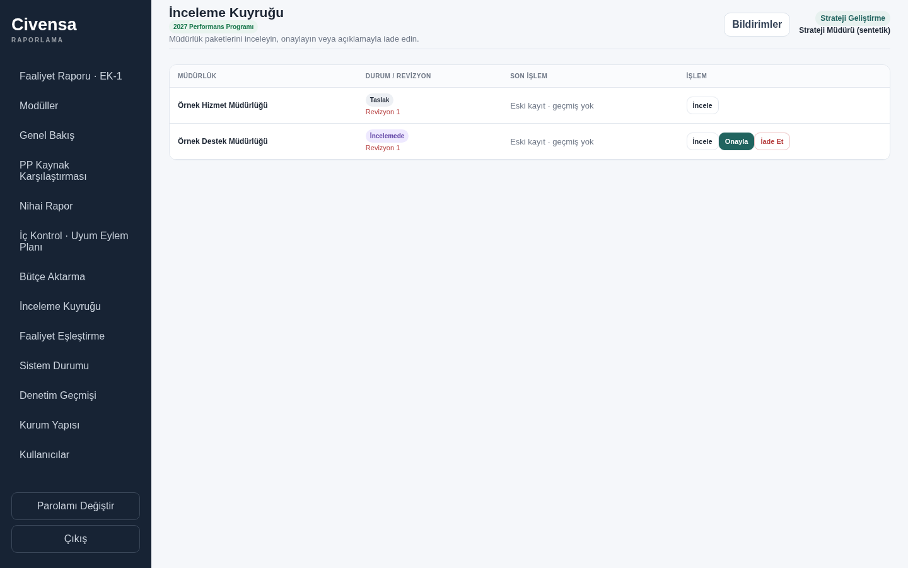

**Görünen metinler ve tablolar:**

- `div`: Civensa RAPORLAMA
- `h1`: İnceleme Kuyruğu
- `span`: 2027 Performans Programı
- `p`: Müdürlük paketlerini inceleyin, onaylayın veya açıklamayla iade edin.
- `div`: Strateji Geliştirme Strateji Müdürü (sentetik)
- `table`: MÜDÜRLÜK DURUM / REVİZYON SON İŞLEM İŞLEM Örnek Hizmet Müdürlüğü Taslak Revizyon 1 Eski kayıt · geçmiş yok İncele Örnek Destek Müdürlüğü İncelemede Revizyon 1 Eski kayıt · geçmiş yok İnceleOnaylaİade Et

**Bağlantı, düğme, form ve alanlar:**

| Öğe | Tür / etiket / bağlam | Hedef URL veya eylem | Ne yapar / mevcut değer |
| --- | --- | --- | --- |
| E001 | a · Faaliyet Raporu · EK-1 | `/activity-sections` | Bağlantıdaki ekranı veya dosyayı açar: Faaliyet Raporu · EK-1. |
| E002 | a · Modüller | `/modules` | Bağlantıdaki ekranı veya dosyayı açar: Modüller. |
| E003 | a · Genel Bakış | `/dashboard?period_id=1` | Bağlantıdaki ekranı veya dosyayı açar: Genel Bakış. |
| E004 | a · PP Kaynak Karşılaştırması | `/source-comparison?period_id=1` | Bağlantıdaki ekranı veya dosyayı açar: PP Kaynak Karşılaştırması. |
| E005 | a · Nihai Rapor | `/report-builder?period_id=1` | Bağlantıdaki ekranı veya dosyayı açar: Nihai Rapor. |
| E006 | a · İç Kontrol · Uyum Eylem Planı | `/internal-control` | Bağlantıdaki ekranı veya dosyayı açar: İç Kontrol · Uyum Eylem Planı. |
| E007 | a · Bütçe Aktarma | `/budget-reallocations` | Bağlantıdaki ekranı veya dosyayı açar: Bütçe Aktarma. |
| E008 | a · İnceleme Kuyruğu | `/review?period_id=1` | Bağlantıdaki ekranı veya dosyayı açar: İnceleme Kuyruğu. |
| E009 | a · Faaliyet Eşleştirme | `/activity-mapping?period_id=1` | Bağlantıdaki ekranı veya dosyayı açar: Faaliyet Eşleştirme. |
| E010 | a · Sistem Durumu | `/operations?period_id=1` | Bağlantıdaki ekranı veya dosyayı açar: Sistem Durumu. |
| E011 | a · Denetim Geçmişi | `/audit?period_id=1` | Bağlantıdaki ekranı veya dosyayı açar: Denetim Geçmişi. |
| E012 | a · Kurum Yapısı | `/structure?period_id=1` | Bağlantıdaki ekranı veya dosyayı açar: Kurum Yapısı. |
| E013 | a · Kullanıcılar | `/users?period_id=1` | Bağlantıdaki ekranı veya dosyayı açar: Kullanıcılar. |
| E014 | button · Parolamı Değiştir (#changePasswordButton) | `#passwordModal` | Parola değiştirme penceresini açar. |
| E015 | form · Çıkış | `POST /logout` | Oturumu kapatıp giriş ekranına döner. |
| E016 | button · Çıkış | `POST /logout` | Oturumu kapatıp giriş ekranına döner. |
| E017 | button · Bildirimler (#notificationButton) | `GET /api/notifications → #notificationPanel` | Bildirim listesini açar. |
| E018 | a · İncele · Örnek Hizmet Müdürlüğü | `/department/1?period_id=1` | Bağlantıdaki ekranı veya dosyayı açar: İncele. |
| E019 | a · İncele · Örnek Destek Müdürlüğü | `/department/3?period_id=1` | Bağlantıdaki ekranı veya dosyayı açar: İncele. |
| E020 | button · Onayla · Örnek Destek Müdürlüğü | `POST /api/submissions/2/decision` | Paketi onaylar; veri girişini kilitler. |
| E021 | button · İade Et · Örnek Destek Müdürlüğü | `#reviewModal` | Seçilen paket için iade gerekçesi penceresini açar. |

<a id="ekran-043"></a>

### 043 · PP Kaynak Karşılaştırması · Dolu / taslak

URL kalıbı: `/source-comparison` · Çekilen URL: `/source-comparison?period_id=1` · Rol: **strategy** · HTTP 200.

Kaynak belge ile dönem kayıtlarının farklarını gösterir.


**Görünen metinler ve tablolar:**

- `div`: Civensa RAPORLAMA
- `h1`: PP Kaynak Karşılaştırması
- `span`: 2027 Performans Programı
- `p`: 2027 dönemi · Word kaynak hücreleri ve güncel kayıtlar · Salt okunur
- `div`: Strateji Geliştirme Strateji Müdürü (sentetik)
- `p`: CSV İndir Genel Bakış
- `p`: Her satır özgün kaynak hücresini güncel kayıtla karşılaştırır. Bilinmeyen konumlar “Bilinmiyor” olarak gösterilir. Boş hücre sıfır değildir. Geri alınmış içe aktarmalar karşılaştırmaya katılmaz.
- `p`: Durumlar: Eşleşiyor · Kararla değişti · Fark var · Kaynakta yok · Kayıtta yok
- `p`: 66 karşılaştırma satırı
- `table`: MÜDÜRLÜK / KAYIT BELGE VE KONUM KAYNAK DEĞER GÜNCEL DEĞER FARK DURUM / KARAR Örnek Hizmet Müdürlüğü Gösterge: Tamamlanan hizmet sayısı 2027 Hedef Bilinmiyor · İçe aktarma Bilinmiyor Belge SHA-256: Bilinmiyor Tablo Bilinmiyor · Satır Bilinmiyor · Sütun Bilinmiyor · Sayfa Bilinmiyor — Kaynak hücre: Boş 120 — Kaynakta yok Bu güncel kaydın içe aktarmadan kaynak hücresi bulunamadı. Örnek Hizmet Müdürlüğü Gösterge: Tamamlanan hizmet sayısı 2028 Tahmin Bilinmiyor · İçe aktarma Bilinmiyor Belge SHA-256: Bilinmiyor Tablo Bilinmiyor · Satır Bilinmiyor · Sütun Bilinmiyor · Sayfa Bilinmiyor — Kaynak hücre: Boş 120 — Kaynakta yok Bu güncel kaydın içe aktarmadan kaynak hücresi bulunamadı. Örnek Hizmet Müdürlüğü Gösterge: Tamamlanan hizmet sayısı 2029 Tahmin Bilinmiyor · İçe aktarma Bilinmiyor Belge SHA-256: Bilinmiyor Tablo Bilinmiyor · Satır Bilinmiyor · Sütun Bilinmiyor · Sayfa Bilinmiyor — Kaynak hücre: Boş 120 — Kaynakta yok Bu güncel kaydın içe aktarmadan kaynak hücresi bulunamadı. Örnek Destek Müdürlüğü Gösterge: Tamamlanan hizmet sayısı 2027 Hedef Bilinmiyor · İçe aktarma Bilinmiyor Belge SHA-256: Bilinmiyor Tablo Bilinmiyor · Satır Bilinmiyor · Sütun Bilinmiyor · Sayfa Bilinmiyor — Kaynak hücre: Boş 120 — Kaynakta yok Bu güncel kaydın içe aktarmadan kaynak hücresi bulunamadı. Örnek Destek Müdürlüğü Gösterge: Tamamlanan hizmet sayısı 2028 Tahmin Bilinmiyor · İçe aktarma Bilinmiyor Belge SHA-256: Bilinmiyor Tablo Bilinmiyor · Satır Bilinmiyor · Sütun Bilinmiyor · Sayfa Bilinmiyor — Kaynak hücre: Boş 120 — Kaynakta yok Bu güncel kaydın içe aktarmadan kaynak hücresi bulunamadı. Örnek Destek Müdürlüğü Gösterge: Tamamlanan hizmet sayısı 2029 Tahmin Bilinmiyor · İçe aktarma Bilinmiyor Belge SHA-256: Bilinmiyor Tablo Bilinmiyor · Satır Bilinmiyor · Sütun Bilinmiyor · Sayfa Bilinmiyor — Kaynak hücre: Boş 120 — Kaynakta yok Bu güncel kaydın içe aktarmadan kaynak hücresi bulunamadı. Örnek Hizmet Müdürlüğü Faaliyet: Hizmet noktalarının iyileştirilmesi 2027 Bütçe Bütçe İçi Bilinmiyor · İçe aktarma Bilinmiyor Belge SHA-256: Bilinmiyor Tablo Bilinmiyor · Satır Bilinmiyor · Sütun Bilinmiyor · Sayfa Bilinmiyor — Kaynak hücre: Boş 12.500,23 — Kaynakta yok Bu güncel kaydın içe aktarmadan kaynak hücresi bulunamadı. Örnek Hizmet Müdürlüğü Faaliyet: Hizmet noktalarının iyileştirilmesi 2027 Bütçe Bütçe Dışı Bilinmiyor · İçe aktarma Bilinmiyor Belge SHA-256: Bilinmiyor Tablo Bilinmiyor · Satır Bilinmiyor · Sütun Bilinmiyor · Sayfa Bilinmiyor — Kaynak hücre: Boş 0,00 — Kaynakta yok Bu güncel kaydın içe aktarmadan kaynak hücresi bulunamadı. Örnek Hizmet Müdürlüğü Faaliyet: Hizmet noktalarının iyileştirilmesi 2027 Bütçe Toplam Bilinmiyor · İçe aktarma Bilinmiyor Belge SHA-256: Bilinmiyor Tablo Bilinmiyor · Satır Bilinmiyor · Sütun Bilinmiyor · Sayfa Bilinmiyor — Kaynak hücre: Boş 12.500,23 — Kaynakta yok Bu güncel kaydın içe aktarmadan kaynak hücresi bulunamadı. Örnek Hizmet Müdürlüğü Faaliyet: Hizmet noktalarının iyileştirilmesi 2028 Tahmin Bütçe İçi Bilinmiyor · İçe aktarma Bilinmiyor Belge SHA-256: Bilinmiyor Tablo Bilinmiyor · Satır Bilinmiyor · Sütun Bilinmiyor · Sayfa Bilinmiyor — Kaynak hücre: Boş 12.500,23 — Kaynakta yok Bu güncel kaydın içe aktarmadan kaynak hücresi bulunamadı. Örnek Hizmet Müdürlüğü Faaliyet: Hizmet noktalarının iyileştirilmesi 2028 Tahmin Bütçe Dışı Bilinmiyor · İçe aktarma Bilinmiyor Belge SHA-256: Bilinmiyor Tablo Bilinmiyor · Satır Bilinmiyor · Sütun Bilinmiyor · Sayfa Bilinmiyor — Kaynak hücre: Boş 0,00 — Kaynakta yok Bu güncel kaydın içe aktarmadan kaynak hücresi bulunamadı. Örnek Hizmet Müdürlüğü Faaliyet: Hizmet noktalarının iyileştirilmesi 2028 Tahmin Toplam Bilinmiyor · İçe aktarma Bilinmiyor Belge SHA-256: Bilinmiyor Tablo Bilinmiyor · Satır Bilinmiyor · Sütun Bilinmiyor · Sayfa Bilinmiyor — Kaynak hücre: Boş 12.500,23 — Kaynakta yok Bu güncel kaydın içe aktarmadan kaynak hücresi bulunamadı. Örnek Hizmet Müdürlüğü Faaliyet: Hizmet noktalarının iyileştirilmesi 2029 Tahmin Bütçe İçi Bilinmiyor · İçe aktarma Bilinmiyor Belge SHA-256: Bilinmiyor Tablo Bilinmiyor · Satır Bilinmiyor · Sütun Bilinmiyor · Sayfa Bilinmiyor — Kaynak hücre: Boş 12.500,23 — Kaynakta yok Bu güncel kaydın içe aktarmadan kaynak hücresi bulunamadı. Örnek Hizmet Müdürlüğü Faaliyet: Hizmet noktalarının iyileştirilmesi 2029 Tahmin Bütçe Dışı Bilinmiyor · İçe aktarma Bilinmiyor Belge SHA-256: Bilinmiyor Tablo Bilinmiyor · Satır Bilinmiyor · Sütun Bilinmiyor · Sayfa Bilinmiyor — Kaynak hücre: Boş 0,00 — Kaynakta yok Bu güncel kaydın içe aktarmadan kaynak hücresi bulunamadı. Örnek Hizmet Müdürlüğü Faaliyet: Hizmet noktalarının iyileştirilmesi 2029 Tahmin Toplam Bilinmiyor · İçe aktarma Bilinmiyor Belge SHA-256: Bilinmiyor Tablo Bilinmiyor · Satır Bilinmiyor · Sütun Bilinmiyor · Sayfa Bilinmiyor — Kaynak hücre: Boş 12.500,23 — Kaynakta yok Bu güncel kaydın içe aktarmadan kaynak hücresi bulunamadı. Örnek Destek Müdürlüğü Faaliyet: Hizmet noktalarının iyileştirilmesi 2027 Bütçe Bütçe İçi Bilinmiyor · İçe aktarma Bilinmiyor Belge SHA-256: Bilinmiyor Tablo Bilinmiyor · Satır Bilinmiyor · Sütun Bilinmiyor · Sayfa Bilinmiyor — Kaynak hücre: Boş 12.500,23 — Kaynakta yok Bu güncel kaydın içe aktarmadan kaynak hücresi bulunamadı. Örnek Destek Müdürlüğü Faaliyet: Hizmet noktalarının iyileştirilmesi 2027 Bütçe Bütçe Dışı Bilinmiyor · İçe aktarma Bilinmiyor Belge SHA-256: Bilinmiyor Tablo Bilinmiyor · Satır Bilinmiyor · Sütun Bilinmiyor · Sayfa Bilinmiyor — Kaynak hücre: Boş 0,00 — Kaynakta yok Bu güncel kaydın içe aktarmadan kaynak hücresi bulunamadı. Örnek Destek Müdürlüğü Faaliyet: Hizmet noktalarının iyileştirilmesi 2027 Bütçe Toplam Bilinmiyor · İçe aktarma Bilinmiyor Belge SHA-256: Bilinmiyor Tablo Bilinmiyor · Satır Bilinmiyor · Sütun Bilinmiyor · Sayfa Bilinmiyor — Kaynak hücre: Boş 12.500,23 — Kaynakta yok Bu güncel kaydın içe aktarmadan kaynak hücresi bulunamadı. Örnek Destek Müdürlüğü Faaliyet: Hizmet noktalarının iyileştirilmesi 2028 Tahmin Bütçe İçi Bilinmiyor · İçe aktarma Bilinmiyor Belge SHA-256: Bilinmiyor Tablo Bilinmiyor · Satır Bilinmiyor · Sütun Bilinmiyor · Sayfa Bilinmiyor — Kaynak hücre: Boş 12.500,23 — Kaynakta yok Bu güncel kaydın içe aktarmadan kaynak hücresi bulunamadı. Örnek Destek Müdürlüğü Faaliyet: Hizmet noktalarının iyileştirilmesi 2028 Tahmin Bütçe Dışı Bilinmiyor · İçe aktarma Bilinmiyor Belge SHA-256: Bilinmiyor Tablo Bilinmiyor · Satır Bilinmiyor · Sütun Bilinmiyor · Sayfa Bilinmiyor — Kaynak hücre: Boş 0,00 — Kaynakta yok Bu güncel kaydın içe aktarmadan kaynak hücresi bulunamadı. Örnek Destek Müdürlüğü Faaliyet: Hizmet noktalarının iyileştirilmesi 2028 Tahmin Toplam Bilinmiyor · İçe aktarma Bilinmiyor Belge SHA-256: Bilinmiyor Tablo Bilinmiyor · Satır Bilinmiyor · Sütun Bilinmiyor · Sayfa Bilinmiyor — Kaynak hücre: Boş 12.500,23 — Kaynakta yok Bu güncel kaydın içe aktarmadan kaynak hücresi bulunamadı. Örnek Destek Müdürlüğü Faaliyet: Hizmet noktalarının iyileştirilmesi 2029 Tahmin Bütçe İçi Bilinmiyor · İçe aktarma Bilinmiyor Belge SHA-256: Bilinmiyor Tablo Bilinmiyor · Satır Bilinmiyor · Sütun Bilinmiyor · Sayfa Bilinmiyor — Kaynak hücre: Boş 12.500,23 — Kaynakta yok Bu güncel kaydın içe aktarmadan kaynak hücresi bulunamadı. Örnek Destek Müdürlüğü Faaliyet: Hizmet noktalarının iyileştirilmesi 2029 Tahmin Bütçe Dışı Bilinmiyor · İçe aktarma Bilinmiyor Belge SHA-256: Bilinmiyor Tablo Bilinmiyor · Satır Bilinmiyor · Sütun Bilinmiyor · Sayfa Bilinmiyor — Kaynak hücre: Boş 0,00 — Kaynakta yok Bu güncel kaydın içe aktarmadan kaynak hücresi bulunamadı. Örnek Destek Müdürlüğü Faaliyet: Hizmet noktalarının iyileştirilmesi 2029 Tahmin Toplam Bilinmiyor · İçe aktarma Bilinmiyor Belge SHA-256: Bilinmiyor Tablo Bilinmiyor · Satır Bilinmiyor · Sütun Bilinmiyor · Sayfa Bilinmiyor — Kaynak hücre: Boş 12.500,23 — Kaynakta yok Bu güncel kaydın içe aktarmadan kaynak hücresi bulunamadı. Örnek Hizmet Müdürlüğü Personel ve SGK Giderleri 2027 Bütçe Bilinmiyor · İçe aktarma Bilinmiyor Belge SHA-256: Bilinmiyor Tablo Bilinmiyor · Satır Bilinmiyor · Sütun Bilinmiyor · Sayfa Bilinmiyor — Kaynak hücre: Boş 2.000,00 — Kaynakta yok Bu güncel kaydın içe aktarmadan kaynak hücresi bulunamadı. Örnek Hizmet Müdürlüğü Personel ve SGK Giderleri 2028 Tahmin Bilinmiyor · İçe aktarma Bilinmiyor Belge SHA-256: Bilinmiyor Tablo Bilinmiyor · Satır Bilinmiyor · Sütun Bilinmiyor · Sayfa Bilinmiyor — Kaynak hücre: Boş 2.000,00 — Kaynakta yok Bu güncel kaydın içe aktarmadan kaynak hücresi bulunamadı. Örnek Hizmet Müdürlüğü Personel ve SGK Giderleri 2029 Tahmin Bilinmiyor · İçe aktarma Bilinmiyor Belge SHA-256: Bilinmiyor Tablo Bilinmiyor · Satır Bilinmiyor · Sütun Bilinmiyor · Sayfa Bilinmiyor — Kaynak hücre: Boş 2.000,00 — Kaynakta yok Bu güncel kaydın içe aktarmadan kaynak hücresi bulunamadı. Örnek Destek Müdürlüğü Personel ve SGK Giderleri 2027 Bütçe Bilinmiyor · İçe aktarma Bilinmiyor Belge SHA-256: Bilinmiyor Tablo Bilinmiyor · Satır Bilinmiyor · Sütun Bilinmiyor · Sayfa Bilinmiyor — Kaynak hücre: Boş 2.000,00 — Kaynakta yok Bu güncel kaydın içe aktarmadan kaynak hücresi bulunamadı. Örnek Destek Müdürlüğü Personel ve SGK Giderleri 2028 Tahmin Bilinmiyor · İçe aktarma Bilinmiyor Belge SHA-256: Bilinmiyor Tablo Bilinmiyor · Satır Bilinmiyor · Sütun Bilinmiyor · Sayfa Bilinmiyor — Kaynak hücre: Boş 2.000,00 — Kaynakta yok Bu güncel kaydın içe aktarmadan kaynak hücresi bulunamadı. Örnek Destek Müdürlüğü Personel ve SGK Giderleri 2029 Tahmin Bilinmiyor · İçe aktarma Bilinmiyor Belge SHA-256: Bilinmiyor Tablo Bilinmiyor · Satır Bilinmiyor · Sütun Bilinmiyor · Sayfa Bilinmiyor — Kaynak hücre: Boş 2.000,00 — Kaynakta yok Bu güncel kaydın içe aktarmadan kaynak hücresi bulunamadı. Örnek Hizmet Müdürlüğü Ekonomik sınıflandırma: Mal ve Hizmet Alım Giderleri / Hizmet Programları 2027 Bütçe Bütçe İçi Bilinmiyor · İçe aktarma Bilinmiyor Belge SHA-256: Bilinmiyor Tablo Bilinmiyor · Satır Bilinmiyor · Sütun Bilinmiyor · Sayfa Bilinmiyor — Kaynak hücre: Boş 12.500,23 — Kaynakta yok Bu güncel kaydın içe aktarmadan kaynak hücresi bulunamadı. Örnek Hizmet Müdürlüğü Ekonomik sınıflandırma: Mal ve Hizmet Alım Giderleri / Hizmet Programları 2027 Bütçe Bütçe Dışı Bilinmiyor · İçe aktarma Bilinmiyor Belge SHA-256: Bilinmiyor Tablo Bilinmiyor · Satır Bilinmiyor · Sütun Bilinmiyor · Sayfa Bilinmiyor — Kaynak hücre: Boş 0,00 — Kaynakta yok Bu güncel kaydın içe aktarmadan kaynak hücresi bulunamadı. Örnek Hizmet Müdürlüğü Ekonomik sınıflandırma: Personel Giderleri / Hizmet Programları 2027 Bütçe Bütçe İçi Bilinmiyor · İçe aktarma Bilinmiyor Belge SHA-256: Bilinmiyor Tablo Bilinmiyor · Satır Bilinmiyor · Sütun Bilinmiyor · Sayfa Bilinmiyor — Kaynak hücre: Boş 1.500,00 — Kaynakta yok Bu güncel kaydın içe aktarmadan kaynak hücresi bulunamadı. Örnek Hizmet Müdürlüğü Ekonomik sınıflandırma: Personel Giderleri / Hizmet Programları 2027 Bütçe Bütçe Dışı Bilinmiyor · İçe aktarma Bilinmiyor Belge SHA-256: Bilinmiyor Tablo Bilinmiyor · Satır Bilinmiyor · Sütun Bilinmiyor · Sayfa Bilinmiyor — Kaynak hücre: Boş 0,00 — Kaynakta yok Bu güncel kaydın içe aktarmadan kaynak hücresi bulunamadı. Örnek Hizmet Müdürlüğü Ekonomik sınıflandırma: Sosyal Güvenlik Kurumuna Devlet Primi Giderleri / Hizmet Programları 2027 Bütçe Bütçe İçi Bilinmiyor · İçe aktarma Bilinmiyor Belge SHA-256: Bilinmiyor Tablo Bilinmiyor · Satır Bilinmiyor · Sütun Bilinmiyor · Sayfa Bilinmiyor — Kaynak hücre: Boş 500,00 — Kaynakta yok Bu güncel kaydın içe aktarmadan kaynak hücresi bulunamadı. Örnek Hizmet Müdürlüğü Ekonomik sınıflandırma: Sosyal Güvenlik Kurumuna Devlet Primi Giderleri / Hizmet Programları 2027 Bütçe Bütçe Dışı Bilinmiyor · İçe aktarma Bilinmiyor Belge SHA-256: Bilinmiyor Tablo Bilinmiyor · Satır Bilinmiyor · Sütun Bilinmiyor · Sayfa Bilinmiyor — Kaynak hücre: Boş 0,00 — Kaynakta yok Bu güncel kaydın içe aktarmadan kaynak hücresi bulunamadı. Örnek Hizmet Müdürlüğü Ekonomik sınıflandırma: Mal ve Hizmet Alım Giderleri / Hizmet Programları 2028 Tahmin Bütçe İçi Bilinmiyor · İçe aktarma Bilinmiyor Belge SHA-256: Bilinmiyor Tablo Bilinmiyor · Satır Bilinmiyor · Sütun Bilinmiyor · Sayfa Bilinmiyor — Kaynak hücre: Boş 12.500,23 — Kaynakta yok Bu güncel kaydın içe aktarmadan kaynak hücresi bulunamadı. Örnek Hizmet Müdürlüğü Ekonomik sınıflandırma: Mal ve Hizmet Alım Giderleri / Hizmet Programları 2028 Tahmin Bütçe Dışı Bilinmiyor · İçe aktarma Bilinmiyor Belge SHA-256: Bilinmiyor Tablo Bilinmiyor · Satır Bilinmiyor · Sütun Bilinmiyor · Sayfa Bilinmiyor — Kaynak hücre: Boş 0,00 — Kaynakta yok Bu güncel kaydın içe aktarmadan kaynak hücresi bulunamadı. Örnek Hizmet Müdürlüğü Ekonomik sınıflandırma: Personel Giderleri / Hizmet Programları 2028 Tahmin Bütçe İçi Bilinmiyor · İçe aktarma Bilinmiyor Belge SHA-256: Bilinmiyor Tablo Bilinmiyor · Satır Bilinmiyor · Sütun Bilinmiyor · Sayfa Bilinmiyor — Kaynak hücre: Boş 1.500,00 — Kaynakta yok Bu güncel kaydın içe aktarmadan kaynak hücresi bulunamadı. Örnek Hizmet Müdürlüğü Ekonomik sınıflandırma: Personel Giderleri / Hizmet Programları 2028 Tahmin Bütçe Dışı Bilinmiyor · İçe aktarma Bilinmiyor Belge SHA-256: Bilinmiyor Tablo Bilinmiyor · Satır Bilinmiyor · Sütun Bilinmiyor · Sayfa Bilinmiyor — Kaynak hücre: Boş 0,00 — Kaynakta yok Bu güncel kaydın içe aktarmadan kaynak hücresi bulunamadı. Örnek Hizmet Müdürlüğü Ekonomik sınıflandırma: Sosyal Güvenlik Kurumuna Devlet Primi Giderleri / Hizmet Programları 2028 Tahmin Bütçe İçi Bilinmiyor · İçe aktarma Bilinmiyor Belge SHA-256: Bilinmiyor Tablo Bilinmiyor · Satır Bilinmiyor · Sütun Bilinmiyor · Sayfa Bilinmiyor — Kaynak hücre: Boş 500,00 — Kaynakta yok Bu güncel kaydın içe aktarmadan kaynak hücresi bulunamadı. Örnek Hizmet Müdürlüğü Ekonomik sınıflandırma: Sosyal Güvenlik Kurumuna Devlet Primi Giderleri / Hizmet Programları 2028 Tahmin Bütçe Dışı Bilinmiyor · İçe aktarma Bilinmiyor Belge SHA-256: Bilinmiyor Tablo Bilinmiyor · Satır Bilinmiyor · Sütun Bilinmiyor · Sayfa Bilinmiyor — Kaynak hücre: Boş 0,00 — Kaynakta yok Bu güncel kaydın içe aktarmadan kaynak hücresi bulunamadı. Örnek Hizmet Müdürlüğü Ekonomik sınıflandırma: Mal ve Hizmet Alım Giderleri / Program Grubu Belirlenmeli 2029 Tahmin Bütçe İçi Bilinmiyor · İçe aktarma Bilinmiyor Belge SHA-256: Bilinmiyor Tablo Bilinmiyor · Satır Bilinmiyor · Sütun Bilinmiyor · Sayfa Bilinmiyor — Kaynak hücre: Boş 12.500,23 — Kaynakta yok Bu güncel kaydın içe aktarmadan kaynak hücresi bulunamadı. Örnek Hizmet Müdürlüğü Ekonomik sınıflandırma: Mal ve Hizmet Alım Giderleri / Program Grubu Belirlenmeli 2029 Tahmin Bütçe Dışı Bilinmiyor · İçe aktarma Bilinmiyor Belge SHA-256: Bilinmiyor Tablo Bilinmiyor · Satır Bilinmiyor · Sütun Bilinmiyor · Sayfa Bilinmiyor — Kaynak hücre: Boş 0,00 — Kaynakta yok Bu güncel kaydın içe aktarmadan kaynak hücresi bulunamadı. Örnek Hizmet Müdürlüğü Ekonomik sınıflandırma: Personel Giderleri / Hizmet Programları 2029 Tahmin Bütçe İçi Bilinmiyor · İçe aktarma Bilinmiyor Belge SHA-256: Bilinmiyor Tablo Bilinmiyor · Satır Bilinmiyor · Sütun Bilinmiyor · Sayfa Bilinmiyor — Kaynak hücre: Boş 1.500,00 — Kaynakta yok Bu güncel kaydın içe aktarmadan kaynak hücresi bulunamadı. Örnek Hizmet Müdürlüğü Ekonomik sınıflandırma: Personel Giderleri / Hizmet Programları 2029 Tahmin Bütçe Dışı Bilinmiyor · İçe aktarma Bilinmiyor Belge SHA-256: Bilinmiyor Tablo Bilinmiyor · Satır Bilinmiyor · Sütun Bilinmiyor · Sayfa Bilinmiyor — Kaynak hücre: Boş 0,00 — Kaynakta yok Bu güncel kaydın içe aktarmadan kaynak hücresi bulunamadı. Örnek Hizmet Müdürlüğü Ekonomik sınıflandırma: Sosyal Güvenlik Kurumuna Devlet Primi Giderleri / Hizmet Programları 2029 Tahmin Bütçe İçi Bilinmiyor · İçe aktarma Bilinmiyor Belge SHA-256: Bilinmiyor Tablo Bilinmiyor · Satır Bilinmiyor · Sütun Bilinmiyor · Sayfa Bilinmiyor — Kaynak hücre: Boş 500,00 — Kaynakta yok Bu güncel kaydın içe aktarmadan kaynak hücresi bulunamadı. Örnek Hizmet Müdürlüğü Ekonomik sınıflandırma: Sosyal Güvenlik Kurumuna Devlet Primi Giderleri / Hizmet Programları 2029 Tahmin Bütçe Dışı Bilinmiyor · İçe aktarma Bilinmiyor Belge SHA-256: Bilinmiyor Tablo Bilinmiyor · Satır Bilinmiyor · Sütun Bilinmiyor · Sayfa Bilinmiyor — Kaynak hücre: Boş 0,00 — Kaynakta yok Bu güncel kaydın içe aktarmadan kaynak hücresi bulunamadı. Örnek Destek Müdürlüğü Ekonomik sınıflandırma: Mal ve Hizmet Alım Giderleri / Hizmet Programları 2027 Bütçe Bütçe İçi Bilinmiyor · İçe aktarma Bilinmiyor Belge SHA-256: Bilinmiyor Tablo Bilinmiyor · Satır Bilinmiyor · Sütun Bilinmiyor · Sayfa Bilinmiyor — Kaynak hücre: Boş 12.500,23 — Kaynakta yok Bu güncel kaydın içe aktarmadan kaynak hücresi bulunamadı. Örnek Destek Müdürlüğü Ekonomik sınıflandırma: Mal ve Hizmet Alım Giderleri / Hizmet Programları 2027 Bütçe Bütçe Dışı Bilinmiyor · İçe aktarma Bilinmiyor Belge SHA-256: Bilinmiyor Tablo Bilinmiyor · Satır Bilinmiyor · Sütun Bilinmiyor · Sayfa Bilinmiyor — Kaynak hücre: Boş 0,00 — Kaynakta yok Bu güncel kaydın içe aktarmadan kaynak hücresi bulunamadı. Örnek Destek Müdürlüğü Ekonomik sınıflandırma: Personel Giderleri / Hizmet Programları 2027 Bütçe Bütçe İçi Bilinmiyor · İçe aktarma Bilinmiyor Belge SHA-256: Bilinmiyor Tablo Bilinmiyor · Satır Bilinmiyor · Sütun Bilinmiyor · Sayfa Bilinmiyor — Kaynak hücre: Boş 1.500,00 — Kaynakta yok Bu güncel kaydın içe aktarmadan kaynak hücresi bulunamadı. Örnek Destek Müdürlüğü Ekonomik sınıflandırma: Personel Giderleri / Hizmet Programları 2027 Bütçe Bütçe Dışı Bilinmiyor · İçe aktarma Bilinmiyor Belge SHA-256: Bilinmiyor Tablo Bilinmiyor · Satır Bilinmiyor · Sütun Bilinmiyor · Sayfa Bilinmiyor — Kaynak hücre: Boş 0,00 — Kaynakta yok Bu güncel kaydın içe aktarmadan kaynak hücresi bulunamadı. Örnek Destek Müdürlüğü Ekonomik sınıflandırma: Sosyal Güvenlik Kurumuna Devlet Primi Giderleri / Hizmet Programları 2027 Bütçe Bütçe İçi Bilinmiyor · İçe aktarma Bilinmiyor Belge SHA-256: Bilinmiyor Tablo Bilinmiyor · Satır Bilinmiyor · Sütun Bilinmiyor · Sayfa Bilinmiyor — Kaynak hücre: Boş 500,00 — Kaynakta yok Bu güncel kaydın içe aktarmadan kaynak hücresi bulunamadı. Örnek Destek Müdürlüğü Ekonomik sınıflandırma: Sosyal Güvenlik Kurumuna Devlet Primi Giderleri / Hizmet Programları 2027 Bütçe Bütçe Dışı Bilinmiyor · İçe aktarma Bilinmiyor Belge SHA-256: Bilinmiyor Tablo Bilinmiyor · Satır Bilinmiyor · Sütun Bilinmiyor · Sayfa Bilinmiyor — Kaynak hücre: Boş 0,00 — Kaynakta yok Bu güncel kaydın içe aktarmadan kaynak hücresi bulunamadı. Örnek Destek Müdürlüğü Ekonomik sınıflandırma: Mal ve Hizmet Alım Giderleri / Hizmet Programları 2028 Tahmin Bütçe İçi Bilinmiyor · İçe aktarma Bilinmiyor Belge SHA-256: Bilinmiyor Tablo Bilinmiyor · Satır Bilinmiyor · Sütun Bilinmiyor · Sayfa Bilinmiyor — Kaynak hücre: Boş 12.500,23 — Kaynakta yok Bu güncel kaydın içe aktarmadan kaynak hücresi bulunamadı. Örnek Destek Müdürlüğü Ekonomik sınıflandırma: Mal ve Hizmet Alım Giderleri / Hizmet Programları 2028 Tahmin Bütçe Dışı Bilinmiyor · İçe aktarma Bilinmiyor Belge SHA-256: Bilinmiyor Tablo Bilinmiyor · Satır Bilinmiyor · Sütun Bilinmiyor · Sayfa Bilinmiyor — Kaynak hücre: Boş 0,00 — Kaynakta yok Bu güncel kaydın içe aktarmadan kaynak hücresi bulunamadı. Örnek Destek Müdürlüğü Ekonomik sınıflandırma: Personel Giderleri / Hizmet Programları 2028 Tahmin Bütçe İçi Bilinmiyor · İçe aktarma Bilinmiyor Belge SHA-256: Bilinmiyor Tablo Bilinmiyor · Satır Bilinmiyor · Sütun Bilinmiyor · Sayfa Bilinmiyor — Kaynak hücre: Boş 1.500,00 — Kaynakta yok Bu güncel kaydın içe aktarmadan kaynak hücresi bulunamadı. Örnek Destek Müdürlüğü Ekonomik sınıflandırma: Personel Giderleri / Hizmet Programları 2028 Tahmin Bütçe Dışı Bilinmiyor · İçe aktarma Bilinmiyor Belge SHA-256: Bilinmiyor Tablo Bilinmiyor · Satır Bilinmiyor · Sütun Bilinmiyor · Sayfa Bilinmiyor — Kaynak hücre: Boş 0,00 — Kaynakta yok Bu güncel kaydın içe aktarmadan kaynak hücresi bulunamadı. Örnek Destek Müdürlüğü Ekonomik sınıflandırma: Sosyal Güvenlik Kurumuna Devlet Primi Giderleri / Hizmet Programları 2028 Tahmin Bütçe İçi Bilinmiyor · İçe aktarma Bilinmiyor Belge SHA-256: Bilinmiyor Tablo Bilinmiyor · Satır Bilinmiyor · Sütun Bilinmiyor · Sayfa Bilinmiyor — Kaynak hücre: Boş 500,00 — Kaynakta yok Bu güncel kaydın içe aktarmadan kaynak hücresi bulunamadı. Örnek Destek Müdürlüğü Ekonomik sınıflandırma: Sosyal Güvenlik Kurumuna Devlet Primi Giderleri / Hizmet Programları 2028 Tahmin Bütçe Dışı Bilinmiyor · İçe aktarma Bilinmiyor Belge SHA-256: Bilinmiyor Tablo Bilinmiyor · Satır Bilinmiyor · Sütun Bilinmiyor · Sayfa Bilinmiyor — Kaynak hücre: Boş 0,00 — Kaynakta yok Bu güncel kaydın içe aktarmadan kaynak hücresi bulunamadı. Örnek Destek Müdürlüğü Ekonomik sınıflandırma: Mal ve Hizmet Alım Giderleri / Hizmet Programları 2029 Tahmin Bütçe İçi Bilinmiyor · İçe aktarma Bilinmiyor Belge SHA-256: Bilinmiyor Tablo Bilinmiyor · Satır Bilinmiyor · Sütun Bilinmiyor · Sayfa Bilinmiyor — Kaynak hücre: Boş 12.500,23 — Kaynakta yok Bu güncel kaydın içe aktarmadan kaynak hücresi bulunamadı. Örnek Destek Müdürlüğü Ekonomik sınıflandırma: Mal ve Hizmet Alım Giderleri / Hizmet Programları 2029 Tahmin Bütçe Dışı Bilinmiyor · İçe aktarma Bilinmiyor Belge SHA-256: Bilinmiyor Tablo Bilinmiyor · Satır Bilinmiyor · Sütun Bilinmiyor · Sayfa Bilinmiyor — Kaynak hücre: Boş 0,00 — Kaynakta yok Bu güncel kaydın içe aktarmadan kaynak hücresi bulunamadı. Örnek Destek Müdürlüğü Ekonomik sınıflandırma: Personel Giderleri / Hizmet Programları 2029 Tahmin Bütçe İçi Bilinmiyor · İçe aktarma Bilinmiyor Belge SHA-256: Bilinmiyor Tablo Bilinmiyor · Satır Bilinmiyor · Sütun Bilinmiyor · Sayfa Bilinmiyor — Kaynak hücre: Boş 1.500,00 — Kaynakta yok Bu güncel kaydın içe aktarmadan kaynak hücresi bulunamadı. Örnek Destek Müdürlüğü Ekonomik sınıflandırma: Personel Giderleri / Hizmet Programları 2029 Tahmin Bütçe Dışı Bilinmiyor · İçe aktarma Bilinmiyor Belge SHA-256: Bilinmiyor Tablo Bilinmiyor · Satır Bilinmiyor · Sütun Bilinmiyor · Sayfa Bilinmiyor — Kaynak hücre: Boş 0,00 — Kaynakta yok Bu güncel kaydın içe aktarmadan kaynak hücresi bulunamadı. Örnek Destek Müdürlüğü Ekonomik sınıflandırma: Sosyal Güvenlik Kurumuna Devlet Primi Giderleri / Hizmet Programları 2029 Tahmin Bütçe İçi Bilinmiyor · İçe aktarma Bilinmiyor Belge SHA-256: Bilinmiyor Tablo Bilinmiyor · Satır Bilinmiyor · Sütun Bilinmiyor · Sayfa Bilinmiyor — Kaynak hücre: Boş 500,00 — Kaynakta yok Bu güncel kaydın içe aktarmadan kaynak hücresi bulunamadı. Örnek Destek Müdürlüğü Ekonomik sınıflandırma: Sosyal Güvenlik Kurumuna Devlet Primi Giderleri / Hizmet Programları 2029 Tahmin Bütçe Dışı Bilinmiyor · İçe aktarma Bilinmiyor Belge SHA-256: Bilinmiyor Tablo Bilinmiyor · Satır Bilinmiyor · Sütun Bilinmiyor · Sayfa Bilinmiyor — Kaynak hücre: Boş 0,00 — Kaynakta yok Bu güncel kaydın içe aktarmadan kaynak hücresi bulunamadı.
- `p`: Gösterge: Tamamlanan hizmet sayısı
- `p`: Belge SHA-256: Bilinmiyor
- `p`: Tablo Bilinmiyor · Satır Bilinmiyor · Sütun Bilinmiyor · Sayfa Bilinmiyor
- `p`: Kaynak hücre: Boş
- `p`: Bu güncel kaydın içe aktarmadan kaynak hücresi bulunamadı.
- `p`: Gösterge: Tamamlanan hizmet sayısı
- `p`: Belge SHA-256: Bilinmiyor
- `p`: Tablo Bilinmiyor · Satır Bilinmiyor · Sütun Bilinmiyor · Sayfa Bilinmiyor
- `p`: Kaynak hücre: Boş
- `p`: Bu güncel kaydın içe aktarmadan kaynak hücresi bulunamadı.
- `p`: Gösterge: Tamamlanan hizmet sayısı
- `p`: Belge SHA-256: Bilinmiyor
- `p`: Tablo Bilinmiyor · Satır Bilinmiyor · Sütun Bilinmiyor · Sayfa Bilinmiyor
- `p`: Kaynak hücre: Boş
- `p`: Bu güncel kaydın içe aktarmadan kaynak hücresi bulunamadı.
- `p`: Gösterge: Tamamlanan hizmet sayısı
- `p`: Belge SHA-256: Bilinmiyor
- `p`: Tablo Bilinmiyor · Satır Bilinmiyor · Sütun Bilinmiyor · Sayfa Bilinmiyor
- `p`: Kaynak hücre: Boş
- `p`: Bu güncel kaydın içe aktarmadan kaynak hücresi bulunamadı.
- `p`: Gösterge: Tamamlanan hizmet sayısı
- `p`: Belge SHA-256: Bilinmiyor
- `p`: Tablo Bilinmiyor · Satır Bilinmiyor · Sütun Bilinmiyor · Sayfa Bilinmiyor
- `p`: Kaynak hücre: Boş
- `p`: Bu güncel kaydın içe aktarmadan kaynak hücresi bulunamadı.
- `p`: Gösterge: Tamamlanan hizmet sayısı
- `p`: Belge SHA-256: Bilinmiyor
- `p`: Tablo Bilinmiyor · Satır Bilinmiyor · Sütun Bilinmiyor · Sayfa Bilinmiyor
- `p`: Kaynak hücre: Boş
- `p`: Bu güncel kaydın içe aktarmadan kaynak hücresi bulunamadı.
- `p`: Faaliyet: Hizmet noktalarının iyileştirilmesi
- `p`: Belge SHA-256: Bilinmiyor
- `p`: Tablo Bilinmiyor · Satır Bilinmiyor · Sütun Bilinmiyor · Sayfa Bilinmiyor
- `p`: Kaynak hücre: Boş
- `p`: Bu güncel kaydın içe aktarmadan kaynak hücresi bulunamadı.
- `p`: Faaliyet: Hizmet noktalarının iyileştirilmesi
- `p`: Belge SHA-256: Bilinmiyor
- `p`: Tablo Bilinmiyor · Satır Bilinmiyor · Sütun Bilinmiyor · Sayfa Bilinmiyor
- `p`: Kaynak hücre: Boş
- `p`: Bu güncel kaydın içe aktarmadan kaynak hücresi bulunamadı.
- `p`: Faaliyet: Hizmet noktalarının iyileştirilmesi
- `p`: Belge SHA-256: Bilinmiyor
- `p`: Tablo Bilinmiyor · Satır Bilinmiyor · Sütun Bilinmiyor · Sayfa Bilinmiyor
- `p`: Kaynak hücre: Boş
- `p`: Bu güncel kaydın içe aktarmadan kaynak hücresi bulunamadı.
- `p`: Faaliyet: Hizmet noktalarının iyileştirilmesi
- `p`: Belge SHA-256: Bilinmiyor
- `p`: Tablo Bilinmiyor · Satır Bilinmiyor · Sütun Bilinmiyor · Sayfa Bilinmiyor
- `p`: Kaynak hücre: Boş
- `p`: Bu güncel kaydın içe aktarmadan kaynak hücresi bulunamadı.
- `p`: Faaliyet: Hizmet noktalarının iyileştirilmesi
- `p`: Belge SHA-256: Bilinmiyor
- `p`: Tablo Bilinmiyor · Satır Bilinmiyor · Sütun Bilinmiyor · Sayfa Bilinmiyor
- `p`: Kaynak hücre: Boş
- `p`: Bu güncel kaydın içe aktarmadan kaynak hücresi bulunamadı.
- `p`: Faaliyet: Hizmet noktalarının iyileştirilmesi
- `p`: Belge SHA-256: Bilinmiyor
- `p`: Tablo Bilinmiyor · Satır Bilinmiyor · Sütun Bilinmiyor · Sayfa Bilinmiyor
- `p`: Kaynak hücre: Boş
- `p`: Bu güncel kaydın içe aktarmadan kaynak hücresi bulunamadı.
- `p`: Faaliyet: Hizmet noktalarının iyileştirilmesi
- `p`: Belge SHA-256: Bilinmiyor
- `p`: Tablo Bilinmiyor · Satır Bilinmiyor · Sütun Bilinmiyor · Sayfa Bilinmiyor
- `p`: Kaynak hücre: Boş
- `p`: Bu güncel kaydın içe aktarmadan kaynak hücresi bulunamadı.
- `p`: Faaliyet: Hizmet noktalarının iyileştirilmesi
- `p`: Belge SHA-256: Bilinmiyor
- `p`: Tablo Bilinmiyor · Satır Bilinmiyor · Sütun Bilinmiyor · Sayfa Bilinmiyor
- `p`: Kaynak hücre: Boş
- `p`: Bu güncel kaydın içe aktarmadan kaynak hücresi bulunamadı.
- `p`: Faaliyet: Hizmet noktalarının iyileştirilmesi
- `p`: Belge SHA-256: Bilinmiyor
- `p`: Tablo Bilinmiyor · Satır Bilinmiyor · Sütun Bilinmiyor · Sayfa Bilinmiyor
- `p`: Kaynak hücre: Boş
- `p`: Bu güncel kaydın içe aktarmadan kaynak hücresi bulunamadı.
- `p`: Faaliyet: Hizmet noktalarının iyileştirilmesi
- `p`: Belge SHA-256: Bilinmiyor
- `p`: Tablo Bilinmiyor · Satır Bilinmiyor · Sütun Bilinmiyor · Sayfa Bilinmiyor
- `p`: Kaynak hücre: Boş
- `p`: Bu güncel kaydın içe aktarmadan kaynak hücresi bulunamadı.
- `p`: Faaliyet: Hizmet noktalarının iyileştirilmesi
- `p`: Belge SHA-256: Bilinmiyor
- `p`: Tablo Bilinmiyor · Satır Bilinmiyor · Sütun Bilinmiyor · Sayfa Bilinmiyor
- `p`: Kaynak hücre: Boş
- `p`: Bu güncel kaydın içe aktarmadan kaynak hücresi bulunamadı.
- `p`: Faaliyet: Hizmet noktalarının iyileştirilmesi
- `p`: Belge SHA-256: Bilinmiyor
- `p`: Tablo Bilinmiyor · Satır Bilinmiyor · Sütun Bilinmiyor · Sayfa Bilinmiyor
- `p`: Kaynak hücre: Boş
- `p`: Bu güncel kaydın içe aktarmadan kaynak hücresi bulunamadı.
- `p`: Faaliyet: Hizmet noktalarının iyileştirilmesi
- `p`: Belge SHA-256: Bilinmiyor
- `p`: Tablo Bilinmiyor · Satır Bilinmiyor · Sütun Bilinmiyor · Sayfa Bilinmiyor
- `p`: Kaynak hücre: Boş
- `p`: Bu güncel kaydın içe aktarmadan kaynak hücresi bulunamadı.
- `p`: Faaliyet: Hizmet noktalarının iyileştirilmesi
- `p`: Belge SHA-256: Bilinmiyor
- `p`: Tablo Bilinmiyor · Satır Bilinmiyor · Sütun Bilinmiyor · Sayfa Bilinmiyor
- `p`: Kaynak hücre: Boş
- `p`: Bu güncel kaydın içe aktarmadan kaynak hücresi bulunamadı.
- `p`: Faaliyet: Hizmet noktalarının iyileştirilmesi
- `p`: Belge SHA-256: Bilinmiyor
- `p`: Tablo Bilinmiyor · Satır Bilinmiyor · Sütun Bilinmiyor · Sayfa Bilinmiyor
- `p`: Kaynak hücre: Boş
- `p`: Bu güncel kaydın içe aktarmadan kaynak hücresi bulunamadı.
- `p`: Faaliyet: Hizmet noktalarının iyileştirilmesi
- `p`: Belge SHA-256: Bilinmiyor
- `p`: Tablo Bilinmiyor · Satır Bilinmiyor · Sütun Bilinmiyor · Sayfa Bilinmiyor
- `p`: Kaynak hücre: Boş
- `p`: Bu güncel kaydın içe aktarmadan kaynak hücresi bulunamadı.
- `p`: Faaliyet: Hizmet noktalarının iyileştirilmesi
- `p`: Belge SHA-256: Bilinmiyor
- `p`: Tablo Bilinmiyor · Satır Bilinmiyor · Sütun Bilinmiyor · Sayfa Bilinmiyor
- `p`: Kaynak hücre: Boş
- `p`: Bu güncel kaydın içe aktarmadan kaynak hücresi bulunamadı.
- `p`: Faaliyet: Hizmet noktalarının iyileştirilmesi
- `p`: Belge SHA-256: Bilinmiyor
- `p`: Tablo Bilinmiyor · Satır Bilinmiyor · Sütun Bilinmiyor · Sayfa Bilinmiyor
- `p`: Kaynak hücre: Boş
- `p`: Bu güncel kaydın içe aktarmadan kaynak hücresi bulunamadı.
- `p`: Personel ve SGK Giderleri
- `p`: Belge SHA-256: Bilinmiyor
- `p`: Tablo Bilinmiyor · Satır Bilinmiyor · Sütun Bilinmiyor · Sayfa Bilinmiyor
- `p`: Kaynak hücre: Boş
- `p`: Bu güncel kaydın içe aktarmadan kaynak hücresi bulunamadı.
- `p`: Personel ve SGK Giderleri
- `p`: Belge SHA-256: Bilinmiyor
- `p`: Tablo Bilinmiyor · Satır Bilinmiyor · Sütun Bilinmiyor · Sayfa Bilinmiyor
- `p`: Kaynak hücre: Boş
- `p`: Bu güncel kaydın içe aktarmadan kaynak hücresi bulunamadı.
- `p`: Personel ve SGK Giderleri
- `p`: Belge SHA-256: Bilinmiyor
- `p`: Tablo Bilinmiyor · Satır Bilinmiyor · Sütun Bilinmiyor · Sayfa Bilinmiyor
- `p`: Kaynak hücre: Boş
- `p`: Bu güncel kaydın içe aktarmadan kaynak hücresi bulunamadı.
- `p`: Personel ve SGK Giderleri
- `p`: Belge SHA-256: Bilinmiyor
- `p`: Tablo Bilinmiyor · Satır Bilinmiyor · Sütun Bilinmiyor · Sayfa Bilinmiyor
- `p`: Kaynak hücre: Boş
- `p`: Bu güncel kaydın içe aktarmadan kaynak hücresi bulunamadı.
- `p`: Personel ve SGK Giderleri
- `p`: Belge SHA-256: Bilinmiyor
- `p`: Tablo Bilinmiyor · Satır Bilinmiyor · Sütun Bilinmiyor · Sayfa Bilinmiyor
- `p`: Kaynak hücre: Boş
- `p`: Bu güncel kaydın içe aktarmadan kaynak hücresi bulunamadı.
- `p`: Personel ve SGK Giderleri
- `p`: Belge SHA-256: Bilinmiyor
- `p`: Tablo Bilinmiyor · Satır Bilinmiyor · Sütun Bilinmiyor · Sayfa Bilinmiyor
- `p`: Kaynak hücre: Boş
- `p`: Bu güncel kaydın içe aktarmadan kaynak hücresi bulunamadı.
- `p`: Ekonomik sınıflandırma: Mal ve Hizmet Alım Giderleri / Hizmet Programları
- `p`: Belge SHA-256: Bilinmiyor
- `p`: Tablo Bilinmiyor · Satır Bilinmiyor · Sütun Bilinmiyor · Sayfa Bilinmiyor
- `p`: Kaynak hücre: Boş
- `p`: Bu güncel kaydın içe aktarmadan kaynak hücresi bulunamadı.
- `p`: Ekonomik sınıflandırma: Mal ve Hizmet Alım Giderleri / Hizmet Programları
- `p`: Belge SHA-256: Bilinmiyor
- `p`: Tablo Bilinmiyor · Satır Bilinmiyor · Sütun Bilinmiyor · Sayfa Bilinmiyor
- `p`: Kaynak hücre: Boş
- `p`: Bu güncel kaydın içe aktarmadan kaynak hücresi bulunamadı.
- `p`: Ekonomik sınıflandırma: Personel Giderleri / Hizmet Programları
- `p`: Belge SHA-256: Bilinmiyor
- `p`: Tablo Bilinmiyor · Satır Bilinmiyor · Sütun Bilinmiyor · Sayfa Bilinmiyor
- `p`: Kaynak hücre: Boş
- `p`: Bu güncel kaydın içe aktarmadan kaynak hücresi bulunamadı.
- `p`: Ekonomik sınıflandırma: Personel Giderleri / Hizmet Programları
- `p`: Belge SHA-256: Bilinmiyor
- `p`: Tablo Bilinmiyor · Satır Bilinmiyor · Sütun Bilinmiyor · Sayfa Bilinmiyor
- `p`: Kaynak hücre: Boş
- `p`: Bu güncel kaydın içe aktarmadan kaynak hücresi bulunamadı.
- `p`: Ekonomik sınıflandırma: Sosyal Güvenlik Kurumuna Devlet Primi Giderleri / Hizmet Programları
- `p`: Belge SHA-256: Bilinmiyor
- `p`: Tablo Bilinmiyor · Satır Bilinmiyor · Sütun Bilinmiyor · Sayfa Bilinmiyor
- `p`: Kaynak hücre: Boş
- `p`: Bu güncel kaydın içe aktarmadan kaynak hücresi bulunamadı.
- `p`: Ekonomik sınıflandırma: Sosyal Güvenlik Kurumuna Devlet Primi Giderleri / Hizmet Programları
- `p`: Belge SHA-256: Bilinmiyor
- `p`: Tablo Bilinmiyor · Satır Bilinmiyor · Sütun Bilinmiyor · Sayfa Bilinmiyor
- `p`: Kaynak hücre: Boş
- `p`: Bu güncel kaydın içe aktarmadan kaynak hücresi bulunamadı.
- `p`: Ekonomik sınıflandırma: Mal ve Hizmet Alım Giderleri / Hizmet Programları
- `p`: Belge SHA-256: Bilinmiyor
- `p`: Tablo Bilinmiyor · Satır Bilinmiyor · Sütun Bilinmiyor · Sayfa Bilinmiyor
- `p`: Kaynak hücre: Boş
- `p`: Bu güncel kaydın içe aktarmadan kaynak hücresi bulunamadı.
- `p`: Ekonomik sınıflandırma: Mal ve Hizmet Alım Giderleri / Hizmet Programları
- `p`: Belge SHA-256: Bilinmiyor
- `p`: Tablo Bilinmiyor · Satır Bilinmiyor · Sütun Bilinmiyor · Sayfa Bilinmiyor
- `p`: Kaynak hücre: Boş
- `p`: Bu güncel kaydın içe aktarmadan kaynak hücresi bulunamadı.
- `p`: Ekonomik sınıflandırma: Personel Giderleri / Hizmet Programları
- `p`: Belge SHA-256: Bilinmiyor
- `p`: Tablo Bilinmiyor · Satır Bilinmiyor · Sütun Bilinmiyor · Sayfa Bilinmiyor
- `p`: Kaynak hücre: Boş
- `p`: Bu güncel kaydın içe aktarmadan kaynak hücresi bulunamadı.
- `p`: Ekonomik sınıflandırma: Personel Giderleri / Hizmet Programları
- `p`: Belge SHA-256: Bilinmiyor
- `p`: Tablo Bilinmiyor · Satır Bilinmiyor · Sütun Bilinmiyor · Sayfa Bilinmiyor
- `p`: Kaynak hücre: Boş
- `p`: Bu güncel kaydın içe aktarmadan kaynak hücresi bulunamadı.
- `p`: Ekonomik sınıflandırma: Sosyal Güvenlik Kurumuna Devlet Primi Giderleri / Hizmet Programları
- `p`: Belge SHA-256: Bilinmiyor
- `p`: Tablo Bilinmiyor · Satır Bilinmiyor · Sütun Bilinmiyor · Sayfa Bilinmiyor
- `p`: Kaynak hücre: Boş
- `p`: Bu güncel kaydın içe aktarmadan kaynak hücresi bulunamadı.
- `p`: Ekonomik sınıflandırma: Sosyal Güvenlik Kurumuna Devlet Primi Giderleri / Hizmet Programları
- `p`: Belge SHA-256: Bilinmiyor
- `p`: Tablo Bilinmiyor · Satır Bilinmiyor · Sütun Bilinmiyor · Sayfa Bilinmiyor
- `p`: Kaynak hücre: Boş
- `p`: Bu güncel kaydın içe aktarmadan kaynak hücresi bulunamadı.
- `p`: Ekonomik sınıflandırma: Mal ve Hizmet Alım Giderleri / Program Grubu Belirlenmeli
- `p`: Belge SHA-256: Bilinmiyor
- `p`: Tablo Bilinmiyor · Satır Bilinmiyor · Sütun Bilinmiyor · Sayfa Bilinmiyor
- `p`: Kaynak hücre: Boş
- `p`: Bu güncel kaydın içe aktarmadan kaynak hücresi bulunamadı.
- `p`: Ekonomik sınıflandırma: Mal ve Hizmet Alım Giderleri / Program Grubu Belirlenmeli
- `p`: Belge SHA-256: Bilinmiyor
- `p`: Tablo Bilinmiyor · Satır Bilinmiyor · Sütun Bilinmiyor · Sayfa Bilinmiyor
- `p`: Kaynak hücre: Boş
- `p`: Bu güncel kaydın içe aktarmadan kaynak hücresi bulunamadı.
- `p`: Ekonomik sınıflandırma: Personel Giderleri / Hizmet Programları
- `p`: Belge SHA-256: Bilinmiyor
- `p`: Tablo Bilinmiyor · Satır Bilinmiyor · Sütun Bilinmiyor · Sayfa Bilinmiyor
- `p`: Kaynak hücre: Boş
- `p`: Bu güncel kaydın içe aktarmadan kaynak hücresi bulunamadı.
- `p`: Ekonomik sınıflandırma: Personel Giderleri / Hizmet Programları
- `p`: Belge SHA-256: Bilinmiyor
- `p`: Tablo Bilinmiyor · Satır Bilinmiyor · Sütun Bilinmiyor · Sayfa Bilinmiyor
- `p`: Kaynak hücre: Boş
- `p`: Bu güncel kaydın içe aktarmadan kaynak hücresi bulunamadı.
- `p`: Ekonomik sınıflandırma: Sosyal Güvenlik Kurumuna Devlet Primi Giderleri / Hizmet Programları
- `p`: Belge SHA-256: Bilinmiyor
- `p`: Tablo Bilinmiyor · Satır Bilinmiyor · Sütun Bilinmiyor · Sayfa Bilinmiyor
- `p`: Kaynak hücre: Boş
- `p`: Bu güncel kaydın içe aktarmadan kaynak hücresi bulunamadı.
- `p`: Ekonomik sınıflandırma: Sosyal Güvenlik Kurumuna Devlet Primi Giderleri / Hizmet Programları
- `p`: Belge SHA-256: Bilinmiyor
- `p`: Tablo Bilinmiyor · Satır Bilinmiyor · Sütun Bilinmiyor · Sayfa Bilinmiyor
- `p`: Kaynak hücre: Boş
- `p`: Bu güncel kaydın içe aktarmadan kaynak hücresi bulunamadı.
- `p`: Ekonomik sınıflandırma: Mal ve Hizmet Alım Giderleri / Hizmet Programları
- `p`: Belge SHA-256: Bilinmiyor
- `p`: Tablo Bilinmiyor · Satır Bilinmiyor · Sütun Bilinmiyor · Sayfa Bilinmiyor
- `p`: Kaynak hücre: Boş
- `p`: Bu güncel kaydın içe aktarmadan kaynak hücresi bulunamadı.
- `p`: Ekonomik sınıflandırma: Mal ve Hizmet Alım Giderleri / Hizmet Programları
- `p`: Belge SHA-256: Bilinmiyor
- `p`: Tablo Bilinmiyor · Satır Bilinmiyor · Sütun Bilinmiyor · Sayfa Bilinmiyor
- `p`: Kaynak hücre: Boş
- `p`: Bu güncel kaydın içe aktarmadan kaynak hücresi bulunamadı.
- `p`: Ekonomik sınıflandırma: Personel Giderleri / Hizmet Programları
- `p`: Belge SHA-256: Bilinmiyor
- `p`: Tablo Bilinmiyor · Satır Bilinmiyor · Sütun Bilinmiyor · Sayfa Bilinmiyor
- `p`: Kaynak hücre: Boş
- `p`: Bu güncel kaydın içe aktarmadan kaynak hücresi bulunamadı.
- `p`: Ekonomik sınıflandırma: Personel Giderleri / Hizmet Programları
- `p`: Belge SHA-256: Bilinmiyor
- `p`: Tablo Bilinmiyor · Satır Bilinmiyor · Sütun Bilinmiyor · Sayfa Bilinmiyor
- `p`: Kaynak hücre: Boş
- `p`: Bu güncel kaydın içe aktarmadan kaynak hücresi bulunamadı.
- `p`: Ekonomik sınıflandırma: Sosyal Güvenlik Kurumuna Devlet Primi Giderleri / Hizmet Programları
- `p`: Belge SHA-256: Bilinmiyor
- `p`: Tablo Bilinmiyor · Satır Bilinmiyor · Sütun Bilinmiyor · Sayfa Bilinmiyor
- `p`: Kaynak hücre: Boş
- `p`: Bu güncel kaydın içe aktarmadan kaynak hücresi bulunamadı.
- `p`: Ekonomik sınıflandırma: Sosyal Güvenlik Kurumuna Devlet Primi Giderleri / Hizmet Programları
- `p`: Belge SHA-256: Bilinmiyor
- `p`: Tablo Bilinmiyor · Satır Bilinmiyor · Sütun Bilinmiyor · Sayfa Bilinmiyor
- `p`: Kaynak hücre: Boş
- `p`: Bu güncel kaydın içe aktarmadan kaynak hücresi bulunamadı.
- `p`: Ekonomik sınıflandırma: Mal ve Hizmet Alım Giderleri / Hizmet Programları
- `p`: Belge SHA-256: Bilinmiyor
- `p`: Tablo Bilinmiyor · Satır Bilinmiyor · Sütun Bilinmiyor · Sayfa Bilinmiyor
- `p`: Kaynak hücre: Boş
- `p`: Bu güncel kaydın içe aktarmadan kaynak hücresi bulunamadı.
- `p`: Ekonomik sınıflandırma: Mal ve Hizmet Alım Giderleri / Hizmet Programları
- `p`: Belge SHA-256: Bilinmiyor
- `p`: Tablo Bilinmiyor · Satır Bilinmiyor · Sütun Bilinmiyor · Sayfa Bilinmiyor
- `p`: Kaynak hücre: Boş
- `p`: Bu güncel kaydın içe aktarmadan kaynak hücresi bulunamadı.
- `p`: Ekonomik sınıflandırma: Personel Giderleri / Hizmet Programları
- `p`: Belge SHA-256: Bilinmiyor
- `p`: Tablo Bilinmiyor · Satır Bilinmiyor · Sütun Bilinmiyor · Sayfa Bilinmiyor
- `p`: Kaynak hücre: Boş
- `p`: Bu güncel kaydın içe aktarmadan kaynak hücresi bulunamadı.
- `p`: Ekonomik sınıflandırma: Personel Giderleri / Hizmet Programları
- `p`: Belge SHA-256: Bilinmiyor
- `p`: Tablo Bilinmiyor · Satır Bilinmiyor · Sütun Bilinmiyor · Sayfa Bilinmiyor
- `p`: Kaynak hücre: Boş
- `p`: Bu güncel kaydın içe aktarmadan kaynak hücresi bulunamadı.
- `p`: Ekonomik sınıflandırma: Sosyal Güvenlik Kurumuna Devlet Primi Giderleri / Hizmet Programları
- `p`: Belge SHA-256: Bilinmiyor
- `p`: Tablo Bilinmiyor · Satır Bilinmiyor · Sütun Bilinmiyor · Sayfa Bilinmiyor
- `p`: Kaynak hücre: Boş
- `p`: Bu güncel kaydın içe aktarmadan kaynak hücresi bulunamadı.
- `p`: Ekonomik sınıflandırma: Sosyal Güvenlik Kurumuna Devlet Primi Giderleri / Hizmet Programları
- `p`: Belge SHA-256: Bilinmiyor
- `p`: Tablo Bilinmiyor · Satır Bilinmiyor · Sütun Bilinmiyor · Sayfa Bilinmiyor
- `p`: Kaynak hücre: Boş
- `p`: Bu güncel kaydın içe aktarmadan kaynak hücresi bulunamadı.
- `p`: Ekonomik sınıflandırma: Mal ve Hizmet Alım Giderleri / Hizmet Programları
- `p`: Belge SHA-256: Bilinmiyor
- `p`: Tablo Bilinmiyor · Satır Bilinmiyor · Sütun Bilinmiyor · Sayfa Bilinmiyor
- `p`: Kaynak hücre: Boş
- `p`: Bu güncel kaydın içe aktarmadan kaynak hücresi bulunamadı.
- `p`: Ekonomik sınıflandırma: Mal ve Hizmet Alım Giderleri / Hizmet Programları
- `p`: Belge SHA-256: Bilinmiyor
- `p`: Tablo Bilinmiyor · Satır Bilinmiyor · Sütun Bilinmiyor · Sayfa Bilinmiyor
- `p`: Kaynak hücre: Boş
- `p`: Bu güncel kaydın içe aktarmadan kaynak hücresi bulunamadı.
- `p`: Ekonomik sınıflandırma: Personel Giderleri / Hizmet Programları
- `p`: Belge SHA-256: Bilinmiyor
- `p`: Tablo Bilinmiyor · Satır Bilinmiyor · Sütun Bilinmiyor · Sayfa Bilinmiyor
- `p`: Kaynak hücre: Boş
- `p`: Bu güncel kaydın içe aktarmadan kaynak hücresi bulunamadı.
- `p`: Ekonomik sınıflandırma: Personel Giderleri / Hizmet Programları
- `p`: Belge SHA-256: Bilinmiyor
- `p`: Tablo Bilinmiyor · Satır Bilinmiyor · Sütun Bilinmiyor · Sayfa Bilinmiyor
- `p`: Kaynak hücre: Boş
- `p`: Bu güncel kaydın içe aktarmadan kaynak hücresi bulunamadı.
- `p`: Ekonomik sınıflandırma: Sosyal Güvenlik Kurumuna Devlet Primi Giderleri / Hizmet Programları
- `p`: Belge SHA-256: Bilinmiyor
- `p`: Tablo Bilinmiyor · Satır Bilinmiyor · Sütun Bilinmiyor · Sayfa Bilinmiyor
- `p`: Kaynak hücre: Boş
- `p`: Bu güncel kaydın içe aktarmadan kaynak hücresi bulunamadı.
- `p`: Ekonomik sınıflandırma: Sosyal Güvenlik Kurumuna Devlet Primi Giderleri / Hizmet Programları
- `p`: Belge SHA-256: Bilinmiyor
- `p`: Tablo Bilinmiyor · Satır Bilinmiyor · Sütun Bilinmiyor · Sayfa Bilinmiyor
- `p`: Kaynak hücre: Boş
- `p`: Bu güncel kaydın içe aktarmadan kaynak hücresi bulunamadı.
- `h2`: Maliyet Ara Toplamları ve Kaynak Mutabakatı
- `p`: Güncel faaliyet maliyetleri program → alt program → müdürlük sırasıyla toplanır. Bağlantısı veya tutarı eksik kayıt varsa kısmi toplam gösterilmez ve yayın durur. Kaynak toplamı, bütün alt kayıtların saklanan kaynak tutarlarından oluşur; bulunmaması uyarıdır. Personel ve SGK giderleri kitabın ortak maliyet tablosunda ayrıca gösterilir.
- `table`: PROGRAM / ALT PROGRAM / MÜDÜRLÜK YIL / DEĞER TÜRÜ HESAPLANAN (TL) KAYNAK (TL) FARK (TL) DURUM / YAPILACAK İŞLEM PROGRAM ARA TOPLAMI: YEREL HİZMETLER PROGRAMI YEREL HİZMETLER PROGRAMI 2026 Bütçe Eksik ara toplam kaynak toplamı yok — Yayın engeli Örnek Hizmet Müdürlüğü / Hizmet noktalarının iyileştirilmesi: program, alt program, kart veya katalog bağlantısı eksik ya da kapsamı uyuşmuyor. Faaliyet Eşleştirme ve Performans Kartları ekranlarında bağlantıları tamamlayın. Yerel Hizmetler Programı / Hizmet noktalarının iyileştirilmesi / 2026 Bütçe: maliyet bilgisi eksik, doğrulanmamış veya bütçe içi + dışı toplamı uyuşmuyor. Faaliyet maliyetlerini kontrol edip tamamlayın. Yerel Hizmetler Programı / Hizmet noktalarının iyileştirilmesi / 2026 Bütçe: maliyet bilgisi eksik, doğrulanmamış veya bütçe içi + dışı toplamı uyuşmuyor. Faaliyet maliyetlerini kontrol edip tamamlayın. Yerel Hizmetler Programı / 2026 Bütçe: kaynak toplamı yok (tüm faaliyetleri kapsayan kaynak tutarı bulunmuyor). Kaynak belgeyi kontrol edin. PROGRAM ARA TOPLAMI: YEREL HİZMETLER PROGRAMI YEREL HİZMETLER PROGRAMI 2026 Haziran Sonu Harcama Eksik ara toplam kaynak toplamı yok — Yayın engeli Örnek Hizmet Müdürlüğü / Hizmet noktalarının iyileştirilmesi: program, alt program, kart veya katalog bağlantısı eksik ya da kapsamı uyuşmuyor. Faaliyet Eşleştirme ve Performans Kartları ekranlarında bağlantıları tamamlayın. Yerel Hizmetler Programı / Hizmet noktalarının iyileştirilmesi / 2026 Haziran Sonu Harcama: maliyet bilgisi eksik, doğrulanmamış veya bütçe içi + dışı toplamı uyuşmuyor. Faaliyet maliyetlerini kontrol edip tamamlayın. Yerel Hizmetler Programı / Hizmet noktalarının iyileştirilmesi / 2026 Haziran Sonu Harcama: maliyet bilgisi eksik, doğrulanmamış veya bütçe içi + dışı toplamı uyuşmuyor. Faaliyet maliyetlerini kontrol edip tamamlayın. Yerel Hizmetler Programı / 2026 Haziran Sonu Harcama: kaynak toplamı yok (tüm faaliyetleri kapsayan kaynak tutarı bulunmuyor). Kaynak belgeyi kontrol edin. PROGRAM ARA TOPLAMI: YEREL HİZMETLER PROGRAMI YEREL HİZMETLER PROGRAMI 2026 Yıl Sonu Tahmini Eksik ara toplam kaynak toplamı yok — Yayın engeli Örnek Hizmet Müdürlüğü / Hizmet noktalarının iyileştirilmesi: program, alt program, kart veya katalog bağlantısı eksik ya da kapsamı uyuşmuyor. Faaliyet Eşleştirme ve Performans Kartları ekranlarında bağlantıları tamamlayın. Yerel Hizmetler Programı / Hizmet noktalarının iyileştirilmesi / 2026 Yıl Sonu Tahmini: maliyet bilgisi eksik, doğrulanmamış veya bütçe içi + dışı toplamı uyuşmuyor. Faaliyet maliyetlerini kontrol edip tamamlayın. Yerel Hizmetler Programı / Hizmet noktalarının iyileştirilmesi / 2026 Yıl Sonu Tahmini: maliyet bilgisi eksik, doğrulanmamış veya bütçe içi + dışı toplamı uyuşmuyor. Faaliyet maliyetlerini kontrol edip tamamlayın. Yerel Hizmetler Programı / 2026 Yıl Sonu Tahmini: kaynak toplamı yok (tüm faaliyetleri kapsayan kaynak tutarı bulunmuyor). Kaynak belgeyi kontrol edin. PROGRAM ARA TOPLAMI: YEREL HİZMETLER PROGRAMI YEREL HİZMETLER PROGRAMI 2027 Bütçe Eksik ara toplam kaynak toplamı yok — Yayın engeli Örnek Hizmet Müdürlüğü / Hizmet noktalarının iyileştirilmesi: program, alt program, kart veya katalog bağlantısı eksik ya da kapsamı uyuşmuyor. Faaliyet Eşleştirme ve Performans Kartları ekranlarında bağlantıları tamamlayın. Yerel Hizmetler Programı / 2027 Bütçe: kaynak toplamı yok (tüm faaliyetleri kapsayan kaynak tutarı bulunmuyor). Kaynak belgeyi kontrol edin. PROGRAM ARA TOPLAMI: YEREL HİZMETLER PROGRAMI YEREL HİZMETLER PROGRAMI 2028 Tahmin Eksik ara toplam kaynak toplamı yok — Yayın engeli Örnek Hizmet Müdürlüğü / Hizmet noktalarının iyileştirilmesi: program, alt program, kart veya katalog bağlantısı eksik ya da kapsamı uyuşmuyor. Faaliyet Eşleştirme ve Performans Kartları ekranlarında bağlantıları tamamlayın. Yerel Hizmetler Programı / 2028 Tahmin: kaynak toplamı yok (tüm faaliyetleri kapsayan kaynak tutarı bulunmuyor). Kaynak belgeyi kontrol edin. PROGRAM ARA TOPLAMI: YEREL HİZMETLER PROGRAMI YEREL HİZMETLER PROGRAMI 2029 Tahmin Eksik ara toplam kaynak toplamı yok — Yayın engeli Örnek Hizmet Müdürlüğü / Hizmet noktalarının iyileştirilmesi: program, alt program, kart veya katalog bağlantısı eksik ya da kapsamı uyuşmuyor. Faaliyet Eşleştirme ve Performans Kartları ekranlarında bağlantıları tamamlayın. Yerel Hizmetler Programı / 2029 Tahmin: kaynak toplamı yok (tüm faaliyetleri kapsayan kaynak tutarı bulunmuyor). Kaynak belgeyi kontrol edin. ALT PROGRAM ARA TOPLAMI: ERİŞİLEBİLİR HİZMETLER YEREL HİZMETLER PROGRAMI / ERİŞİLEBİLİR HİZMETLER 2026 Bütçe Eksik ara toplam kaynak toplamı yok — Yayın engeli Örnek Hizmet Müdürlüğü / Hizmet noktalarının iyileştirilmesi: program, alt program, kart veya katalog bağlantısı eksik ya da kapsamı uyuşmuyor. Faaliyet Eşleştirme ve Performans Kartları ekranlarında bağlantıları tamamlayın. Yerel Hizmetler Programı / Erişilebilir Hizmetler / Hizmet noktalarının iyileştirilmesi / 2026 Bütçe: maliyet bilgisi eksik, doğrulanmamış veya bütçe içi + dışı toplamı uyuşmuyor. Faaliyet maliyetlerini kontrol edip tamamlayın. Yerel Hizmetler Programı / Erişilebilir Hizmetler / Hizmet noktalarının iyileştirilmesi / 2026 Bütçe: maliyet bilgisi eksik, doğrulanmamış veya bütçe içi + dışı toplamı uyuşmuyor. Faaliyet maliyetlerini kontrol edip tamamlayın. Yerel Hizmetler Programı / Erişilebilir Hizmetler / 2026 Bütçe: kaynak toplamı yok (tüm faaliyetleri kapsayan kaynak tutarı bulunmuyor). Kaynak belgeyi kontrol edin. ALT PROGRAM ARA TOPLAMI: ERİŞİLEBİLİR HİZMETLER YEREL HİZMETLER PROGRAMI / ERİŞİLEBİLİR HİZMETLER 2026 Haziran Sonu Harcama Eksik ara toplam kaynak toplamı yok — Yayın engeli Örnek Hizmet Müdürlüğü / Hizmet noktalarının iyileştirilmesi: program, alt program, kart veya katalog bağlantısı eksik ya da kapsamı uyuşmuyor. Faaliyet Eşleştirme ve Performans Kartları ekranlarında bağlantıları tamamlayın. Yerel Hizmetler Programı / Erişilebilir Hizmetler / Hizmet noktalarının iyileştirilmesi / 2026 Haziran Sonu Harcama: maliyet bilgisi eksik, doğrulanmamış veya bütçe içi + dışı toplamı uyuşmuyor. Faaliyet maliyetlerini kontrol edip tamamlayın. Yerel Hizmetler Programı / Erişilebilir Hizmetler / Hizmet noktalarının iyileştirilmesi / 2026 Haziran Sonu Harcama: maliyet bilgisi eksik, doğrulanmamış veya bütçe içi + dışı toplamı uyuşmuyor. Faaliyet maliyetlerini kontrol edip tamamlayın. Yerel Hizmetler Programı / Erişilebilir Hizmetler / 2026 Haziran Sonu Harcama: kaynak toplamı yok (tüm faaliyetleri kapsayan kaynak tutarı bulunmuyor). Kaynak belgeyi kontrol edin. ALT PROGRAM ARA TOPLAMI: ERİŞİLEBİLİR HİZMETLER YEREL HİZMETLER PROGRAMI / ERİŞİLEBİLİR HİZMETLER 2026 Yıl Sonu Tahmini Eksik ara toplam kaynak toplamı yok — Yayın engeli Örnek Hizmet Müdürlüğü / Hizmet noktalarının iyileştirilmesi: program, alt program, kart veya katalog bağlantısı eksik ya da kapsamı uyuşmuyor. Faaliyet Eşleştirme ve Performans Kartları ekranlarında bağlantıları tamamlayın. Yerel Hizmetler Programı / Erişilebilir Hizmetler / Hizmet noktalarının iyileştirilmesi / 2026 Yıl Sonu Tahmini: maliyet bilgisi eksik, doğrulanmamış veya bütçe içi + dışı toplamı uyuşmuyor. Faaliyet maliyetlerini kontrol edip tamamlayın. Yerel Hizmetler Programı / Erişilebilir Hizmetler / Hizmet noktalarının iyileştirilmesi / 2026 Yıl Sonu Tahmini: maliyet bilgisi eksik, doğrulanmamış veya bütçe içi + dışı toplamı uyuşmuyor. Faaliyet maliyetlerini kontrol edip tamamlayın. Yerel Hizmetler Programı / Erişilebilir Hizmetler / 2026 Yıl Sonu Tahmini: kaynak toplamı yok (tüm faaliyetleri kapsayan kaynak tutarı bulunmuyor). Kaynak belgeyi kontrol edin. ALT PROGRAM ARA TOPLAMI: ERİŞİLEBİLİR HİZMETLER YEREL HİZMETLER PROGRAMI / ERİŞİLEBİLİR HİZMETLER 2027 Bütçe Eksik ara toplam kaynak toplamı yok — Yayın engeli Örnek Hizmet Müdürlüğü / Hizmet noktalarının iyileştirilmesi: program, alt program, kart veya katalog bağlantısı eksik ya da kapsamı uyuşmuyor. Faaliyet Eşleştirme ve Performans Kartları ekranlarında bağlantıları tamamlayın. Yerel Hizmetler Programı / Erişilebilir Hizmetler / 2027 Bütçe: kaynak toplamı yok (tüm faaliyetleri kapsayan kaynak tutarı bulunmuyor). Kaynak belgeyi kontrol edin. ALT PROGRAM ARA TOPLAMI: ERİŞİLEBİLİR HİZMETLER YEREL HİZMETLER PROGRAMI / ERİŞİLEBİLİR HİZMETLER 2028 Tahmin Eksik ara toplam kaynak toplamı yok — Yayın engeli Örnek Hizmet Müdürlüğü / Hizmet noktalarının iyileştirilmesi: program, alt program, kart veya katalog bağlantısı eksik ya da kapsamı uyuşmuyor. Faaliyet Eşleştirme ve Performans Kartları ekranlarında bağlantıları tamamlayın. Yerel Hizmetler Programı / Erişilebilir Hizmetler / 2028 Tahmin: kaynak toplamı yok (tüm faaliyetleri kapsayan kaynak tutarı bulunmuyor). Kaynak belgeyi kontrol edin. ALT PROGRAM ARA TOPLAMI: ERİŞİLEBİLİR HİZMETLER YEREL HİZMETLER PROGRAMI / ERİŞİLEBİLİR HİZMETLER 2029 Tahmin Eksik ara toplam kaynak toplamı yok — Yayın engeli Örnek Hizmet Müdürlüğü / Hizmet noktalarının iyileştirilmesi: program, alt program, kart veya katalog bağlantısı eksik ya da kapsamı uyuşmuyor. Faaliyet Eşleştirme ve Performans Kartları ekranlarında bağlantıları tamamlayın. Yerel Hizmetler Programı / Erişilebilir Hizmetler / 2029 Tahmin: kaynak toplamı yok (tüm faaliyetleri kapsayan kaynak tutarı bulunmuyor). Kaynak belgeyi kontrol edin. MÜDÜRLÜK ARA TOPLAMI: ÖRNEK HİZMET MÜDÜRLÜĞÜ YEREL HİZMETLER PROGRAMI / ERİŞİLEBİLİR HİZMETLER / ÖRNEK HİZMET MÜDÜRLÜĞÜ 2026 Bütçe Eksik ara toplam kaynak toplamı yok — Yayın engeli Örnek Hizmet Müdürlüğü / Hizmet noktalarının iyileştirilmesi: program, alt program, kart veya katalog bağlantısı eksik ya da kapsamı uyuşmuyor. Faaliyet Eşleştirme ve Performans Kartları ekranlarında bağlantıları tamamlayın. Yerel Hizmetler Programı / Erişilebilir Hizmetler / Örnek Hizmet Müdürlüğü / Hizmet noktalarının iyileştirilmesi / 2026 Bütçe: maliyet bilgisi eksik, doğrulanmamış veya bütçe içi + dışı toplamı uyuşmuyor. Faaliyet maliyetlerini kontrol edip tamamlayın. Yerel Hizmetler Programı / Erişilebilir Hizmetler / Örnek Hizmet Müdürlüğü / 2026 Bütçe: kaynak toplamı yok (tüm faaliyetleri kapsayan kaynak tutarı bulunmuyor). Kaynak belgeyi kontrol edin. MÜDÜRLÜK ARA TOPLAMI: ÖRNEK HİZMET MÜDÜRLÜĞÜ YEREL HİZMETLER PROGRAMI / ERİŞİLEBİLİR HİZMETLER / ÖRNEK HİZMET MÜDÜRLÜĞÜ 2026 Haziran Sonu Harcama Eksik ara toplam kaynak toplamı yok — Yayın engeli Örnek Hizmet Müdürlüğü / Hizmet noktalarının iyileştirilmesi: program, alt program, kart veya katalog bağlantısı eksik ya da kapsamı uyuşmuyor. Faaliyet Eşleştirme ve Performans Kartları ekranlarında bağlantıları tamamlayın. Yerel Hizmetler Programı / Erişilebilir Hizmetler / Örnek Hizmet Müdürlüğü / Hizmet noktalarının iyileştirilmesi / 2026 Haziran Sonu Harcama: maliyet bilgisi eksik, doğrulanmamış veya bütçe içi + dışı toplamı uyuşmuyor. Faaliyet maliyetlerini kontrol edip tamamlayın. Yerel Hizmetler Programı / Erişilebilir Hizmetler / Örnek Hizmet Müdürlüğü / 2026 Haziran Sonu Harcama: kaynak toplamı yok (tüm faaliyetleri kapsayan kaynak tutarı bulunmuyor). Kaynak belgeyi kontrol edin. MÜDÜRLÜK ARA TOPLAMI: ÖRNEK HİZMET MÜDÜRLÜĞÜ YEREL HİZMETLER PROGRAMI / ERİŞİLEBİLİR HİZMETLER / ÖRNEK HİZMET MÜDÜRLÜĞÜ 2026 Yıl Sonu Tahmini Eksik ara toplam kaynak toplamı yok — Yayın engeli Örnek Hizmet Müdürlüğü / Hizmet noktalarının iyileştirilmesi: program, alt program, kart veya katalog bağlantısı eksik ya da kapsamı uyuşmuyor. Faaliyet Eşleştirme ve Performans Kartları ekranlarında bağlantıları tamamlayın. Yerel Hizmetler Programı / Erişilebilir Hizmetler / Örnek Hizmet Müdürlüğü / Hizmet noktalarının iyileştirilmesi / 2026 Yıl Sonu Tahmini: maliyet bilgisi eksik, doğrulanmamış veya bütçe içi + dışı toplamı uyuşmuyor. Faaliyet maliyetlerini kontrol edip tamamlayın. Yerel Hizmetler Programı / Erişilebilir Hizmetler / Örnek Hizmet Müdürlüğü / 2026 Yıl Sonu Tahmini: kaynak toplamı yok (tüm faaliyetleri kapsayan kaynak tutarı bulunmuyor). Kaynak belgeyi kontrol edin. MÜDÜRLÜK ARA TOPLAMI: ÖRNEK HİZMET MÜDÜRLÜĞÜ YEREL HİZMETLER PROGRAMI / ERİŞİLEBİLİR HİZMETLER / ÖRNEK HİZMET MÜDÜRLÜĞÜ 2027 Bütçe Eksik ara toplam kaynak toplamı yok — Yayın engeli Örnek Hizmet Müdürlüğü / Hizmet noktalarının iyileştirilmesi: program, alt program, kart veya katalog bağlantısı eksik ya da kapsamı uyuşmuyor. Faaliyet Eşleştirme ve Performans Kartları ekranlarında bağlantıları tamamlayın. Yerel Hizmetler Programı / Erişilebilir Hizmetler / Örnek Hizmet Müdürlüğü / 2027 Bütçe: kaynak toplamı yok (tüm faaliyetleri kapsayan kaynak tutarı bulunmuyor). Kaynak belgeyi kontrol edin. MÜDÜRLÜK ARA TOPLAMI: ÖRNEK HİZMET MÜDÜRLÜĞÜ YEREL HİZMETLER PROGRAMI / ERİŞİLEBİLİR HİZMETLER / ÖRNEK HİZMET MÜDÜRLÜĞÜ 2028 Tahmin Eksik ara toplam kaynak toplamı yok — Yayın engeli Örnek Hizmet Müdürlüğü / Hizmet noktalarının iyileştirilmesi: program, alt program, kart veya katalog bağlantısı eksik ya da kapsamı uyuşmuyor. Faaliyet Eşleştirme ve Performans Kartları ekranlarında bağlantıları tamamlayın. Yerel Hizmetler Programı / Erişilebilir Hizmetler / Örnek Hizmet Müdürlüğü / 2028 Tahmin: kaynak toplamı yok (tüm faaliyetleri kapsayan kaynak tutarı bulunmuyor). Kaynak belgeyi kontrol edin. MÜDÜRLÜK ARA TOPLAMI: ÖRNEK HİZMET MÜDÜRLÜĞÜ YEREL HİZMETLER PROGRAMI / ERİŞİLEBİLİR HİZMETLER / ÖRNEK HİZMET MÜDÜRLÜĞÜ 2029 Tahmin Eksik ara toplam kaynak toplamı yok — Yayın engeli Örnek Hizmet Müdürlüğü / Hizmet noktalarının iyileştirilmesi: program, alt program, kart veya katalog bağlantısı eksik ya da kapsamı uyuşmuyor. Faaliyet Eşleştirme ve Performans Kartları ekranlarında bağlantıları tamamlayın. Yerel Hizmetler Programı / Erişilebilir Hizmetler / Örnek Hizmet Müdürlüğü / 2029 Tahmin: kaynak toplamı yok (tüm faaliyetleri kapsayan kaynak tutarı bulunmuyor). Kaynak belgeyi kontrol edin. MÜDÜRLÜK ARA TOPLAMI: ÖRNEK DESTEK MÜDÜRLÜĞÜ YEREL HİZMETLER PROGRAMI / ERİŞİLEBİLİR HİZMETLER / ÖRNEK DESTEK MÜDÜRLÜĞÜ 2026 Bütçe Eksik ara toplam kaynak toplamı yok — Yayın engeli Yerel Hizmetler Programı / Erişilebilir Hizmetler / Örnek Destek Müdürlüğü / Hizmet noktalarının iyileştirilmesi / 2026 Bütçe: maliyet bilgisi eksik, doğrulanmamış veya bütçe içi + dışı toplamı uyuşmuyor. Faaliyet maliyetlerini kontrol edip tamamlayın. Yerel Hizmetler Programı / Erişilebilir Hizmetler / Örnek Destek Müdürlüğü / 2026 Bütçe: kaynak toplamı yok (tüm faaliyetleri kapsayan kaynak tutarı bulunmuyor). Kaynak belgeyi kontrol edin. MÜDÜRLÜK ARA TOPLAMI: ÖRNEK DESTEK MÜDÜRLÜĞÜ YEREL HİZMETLER PROGRAMI / ERİŞİLEBİLİR HİZMETLER / ÖRNEK DESTEK MÜDÜRLÜĞÜ 2026 Haziran Sonu Harcama Eksik ara toplam kaynak toplamı yok — Yayın engeli Yerel Hizmetler Programı / Erişilebilir Hizmetler / Örnek Destek Müdürlüğü / Hizmet noktalarının iyileştirilmesi / 2026 Haziran Sonu Harcama: maliyet bilgisi eksik, doğrulanmamış veya bütçe içi + dışı toplamı uyuşmuyor. Faaliyet maliyetlerini kontrol edip tamamlayın. Yerel Hizmetler Programı / Erişilebilir Hizmetler / Örnek Destek Müdürlüğü / 2026 Haziran Sonu Harcama: kaynak toplamı yok (tüm faaliyetleri kapsayan kaynak tutarı bulunmuyor). Kaynak belgeyi kontrol edin. MÜDÜRLÜK ARA TOPLAMI: ÖRNEK DESTEK MÜDÜRLÜĞÜ YEREL HİZMETLER PROGRAMI / ERİŞİLEBİLİR HİZMETLER / ÖRNEK DESTEK MÜDÜRLÜĞÜ 2026 Yıl Sonu Tahmini Eksik ara toplam kaynak toplamı yok — Yayın engeli Yerel Hizmetler Programı / Erişilebilir Hizmetler / Örnek Destek Müdürlüğü / Hizmet noktalarının iyileştirilmesi / 2026 Yıl Sonu Tahmini: maliyet bilgisi eksik, doğrulanmamış veya bütçe içi + dışı toplamı uyuşmuyor. Faaliyet maliyetlerini kontrol edip tamamlayın. Yerel Hizmetler Programı / Erişilebilir Hizmetler / Örnek Destek Müdürlüğü / 2026 Yıl Sonu Tahmini: kaynak toplamı yok (tüm faaliyetleri kapsayan kaynak tutarı bulunmuyor). Kaynak belgeyi kontrol edin. MÜDÜRLÜK ARA TOPLAMI: ÖRNEK DESTEK MÜDÜRLÜĞÜ YEREL HİZMETLER PROGRAMI / ERİŞİLEBİLİR HİZMETLER / ÖRNEK DESTEK MÜDÜRLÜĞÜ 2027 Bütçe 12.500,23 kaynak toplamı yok — Uyarı Yerel Hizmetler Programı / Erişilebilir Hizmetler / Örnek Destek Müdürlüğü / 2027 Bütçe: kaynak toplamı yok (tüm faaliyetleri kapsayan kaynak tutarı bulunmuyor). Kaynak belgeyi kontrol edin. MÜDÜRLÜK ARA TOPLAMI: ÖRNEK DESTEK MÜDÜRLÜĞÜ YEREL HİZMETLER PROGRAMI / ERİŞİLEBİLİR HİZMETLER / ÖRNEK DESTEK MÜDÜRLÜĞÜ 2028 Tahmin 12.500,23 kaynak toplamı yok — Uyarı Yerel Hizmetler Programı / Erişilebilir Hizmetler / Örnek Destek Müdürlüğü / 2028 Tahmin: kaynak toplamı yok (tüm faaliyetleri kapsayan kaynak tutarı bulunmuyor). Kaynak belgeyi kontrol edin. MÜDÜRLÜK ARA TOPLAMI: ÖRNEK DESTEK MÜDÜRLÜĞÜ YEREL HİZMETLER PROGRAMI / ERİŞİLEBİLİR HİZMETLER / ÖRNEK DESTEK MÜDÜRLÜĞÜ 2029 Tahmin 12.500,23 kaynak toplamı yok — Uyarı Yerel Hizmetler Programı / Erişilebilir Hizmetler / Örnek Destek Müdürlüğü / 2029 Tahmin: kaynak toplamı yok (tüm faaliyetleri kapsayan kaynak tutarı bulunmuyor). Kaynak belgeyi kontrol edin. MÜDÜRLÜK FAALİYETLERİ TOPLAMI: ÖRNEK HİZMET MÜDÜRLÜĞÜ ÖRNEK HİZMET MÜDÜRLÜĞÜ 2026 Bütçe Eksik ara toplam kaynak toplamı yok — Yayın engeli Örnek Hizmet Müdürlüğü / Hizmet noktalarının iyileştirilmesi: program, alt program, kart veya katalog bağlantısı eksik ya da kapsamı uyuşmuyor. Faaliyet Eşleştirme ve Performans Kartları ekranlarında bağlantıları tamamlayın. Örnek Hizmet Müdürlüğü / Hizmet noktalarının iyileştirilmesi / 2026 Bütçe: maliyet bilgisi eksik, doğrulanmamış veya bütçe içi + dışı toplamı uyuşmuyor. Faaliyet maliyetlerini kontrol edip tamamlayın. Örnek Hizmet Müdürlüğü / 2026 Bütçe: kaynak toplamı yok (tüm faaliyetleri kapsayan kaynak tutarı bulunmuyor). Kaynak belgeyi kontrol edin. MÜDÜRLÜK FAALİYETLERİ TOPLAMI: ÖRNEK HİZMET MÜDÜRLÜĞÜ ÖRNEK HİZMET MÜDÜRLÜĞÜ 2026 Haziran Sonu Harcama Eksik ara toplam kaynak toplamı yok — Yayın engeli Örnek Hizmet Müdürlüğü / Hizmet noktalarının iyileştirilmesi: program, alt program, kart veya katalog bağlantısı eksik ya da kapsamı uyuşmuyor. Faaliyet Eşleştirme ve Performans Kartları ekranlarında bağlantıları tamamlayın. Örnek Hizmet Müdürlüğü / Hizmet noktalarının iyileştirilmesi / 2026 Haziran Sonu Harcama: maliyet bilgisi eksik, doğrulanmamış veya bütçe içi + dışı toplamı uyuşmuyor. Faaliyet maliyetlerini kontrol edip tamamlayın. Örnek Hizmet Müdürlüğü / 2026 Haziran Sonu Harcama: kaynak toplamı yok (tüm faaliyetleri kapsayan kaynak tutarı bulunmuyor). Kaynak belgeyi kontrol edin. MÜDÜRLÜK FAALİYETLERİ TOPLAMI: ÖRNEK HİZMET MÜDÜRLÜĞÜ ÖRNEK HİZMET MÜDÜRLÜĞÜ 2026 Yıl Sonu Tahmini Eksik ara toplam kaynak toplamı yok — Yayın engeli Örnek Hizmet Müdürlüğü / Hizmet noktalarının iyileştirilmesi: program, alt program, kart veya katalog bağlantısı eksik ya da kapsamı uyuşmuyor. Faaliyet Eşleştirme ve Performans Kartları ekranlarında bağlantıları tamamlayın. Örnek Hizmet Müdürlüğü / Hizmet noktalarının iyileştirilmesi / 2026 Yıl Sonu Tahmini: maliyet bilgisi eksik, doğrulanmamış veya bütçe içi + dışı toplamı uyuşmuyor. Faaliyet maliyetlerini kontrol edip tamamlayın. Örnek Hizmet Müdürlüğü / 2026 Yıl Sonu Tahmini: kaynak toplamı yok (tüm faaliyetleri kapsayan kaynak tutarı bulunmuyor). Kaynak belgeyi kontrol edin. MÜDÜRLÜK FAALİYETLERİ TOPLAMI: ÖRNEK HİZMET MÜDÜRLÜĞÜ ÖRNEK HİZMET MÜDÜRLÜĞÜ 2027 Bütçe Eksik ara toplam kaynak toplamı yok — Yayın engeli Örnek Hizmet Müdürlüğü / Hizmet noktalarının iyileştirilmesi: program, alt program, kart veya katalog bağlantısı eksik ya da kapsamı uyuşmuyor. Faaliyet Eşleştirme ve Performans Kartları ekranlarında bağlantıları tamamlayın. Örnek Hizmet Müdürlüğü / 2027 Bütçe: kaynak toplamı yok (tüm faaliyetleri kapsayan kaynak tutarı bulunmuyor). Kaynak belgeyi kontrol edin. MÜDÜRLÜK FAALİYETLERİ TOPLAMI: ÖRNEK HİZMET MÜDÜRLÜĞÜ ÖRNEK HİZMET MÜDÜRLÜĞÜ 2028 Tahmin Eksik ara toplam kaynak toplamı yok — Yayın engeli Örnek Hizmet Müdürlüğü / Hizmet noktalarının iyileştirilmesi: program, alt program, kart veya katalog bağlantısı eksik ya da kapsamı uyuşmuyor. Faaliyet Eşleştirme ve Performans Kartları ekranlarında bağlantıları tamamlayın. Örnek Hizmet Müdürlüğü / 2028 Tahmin: kaynak toplamı yok (tüm faaliyetleri kapsayan kaynak tutarı bulunmuyor). Kaynak belgeyi kontrol edin. MÜDÜRLÜK FAALİYETLERİ TOPLAMI: ÖRNEK HİZMET MÜDÜRLÜĞÜ ÖRNEK HİZMET MÜDÜRLÜĞÜ 2029 Tahmin Eksik ara toplam kaynak toplamı yok — Yayın engeli Örnek Hizmet Müdürlüğü / Hizmet noktalarının iyileştirilmesi: program, alt program, kart veya katalog bağlantısı eksik ya da kapsamı uyuşmuyor. Faaliyet Eşleştirme ve Performans Kartları ekranlarında bağlantıları tamamlayın. Örnek Hizmet Müdürlüğü / 2029 Tahmin: kaynak toplamı yok (tüm faaliyetleri kapsayan kaynak tutarı bulunmuyor). Kaynak belgeyi kontrol edin. MÜDÜRLÜK FAALİYETLERİ TOPLAMI: STRATEJİ GELİŞTİRME MÜDÜRLÜĞÜ STRATEJİ GELİŞTİRME MÜDÜRLÜĞÜ 2026 Bütçe Eksik ara toplam kaynak toplamı yok — Yayın engeli Strateji Geliştirme Müdürlüğü / 2026: faaliyet kaydı yok; faaliyetleri ve maliyetlerini tamamlayın veya gerekçeli sıfır bütçe kapsamını seçin. Strateji Geliştirme Müdürlüğü / 2026 Bütçe: kaynak toplamı yok (tüm faaliyetleri kapsayan kaynak tutarı bulunmuyor). Kaynak belgeyi kontrol edin. MÜDÜRLÜK FAALİYETLERİ TOPLAMI: STRATEJİ GELİŞTİRME MÜDÜRLÜĞÜ STRATEJİ GELİŞTİRME MÜDÜRLÜĞÜ 2026 Haziran Sonu Harcama Eksik ara toplam kaynak toplamı yok — Yayın engeli Strateji Geliştirme Müdürlüğü / 2026: faaliyet kaydı yok; faaliyetleri ve maliyetlerini tamamlayın veya gerekçeli sıfır bütçe kapsamını seçin. Strateji Geliştirme Müdürlüğü / 2026 Haziran Sonu Harcama: kaynak toplamı yok (tüm faaliyetleri kapsayan kaynak tutarı bulunmuyor). Kaynak belgeyi kontrol edin. MÜDÜRLÜK FAALİYETLERİ TOPLAMI: STRATEJİ GELİŞTİRME MÜDÜRLÜĞÜ STRATEJİ GELİŞTİRME MÜDÜRLÜĞÜ 2026 Yıl Sonu Tahmini Eksik ara toplam kaynak toplamı yok — Yayın engeli Strateji Geliştirme Müdürlüğü / 2026: faaliyet kaydı yok; faaliyetleri ve maliyetlerini tamamlayın veya gerekçeli sıfır bütçe kapsamını seçin. Strateji Geliştirme Müdürlüğü / 2026 Yıl Sonu Tahmini: kaynak toplamı yok (tüm faaliyetleri kapsayan kaynak tutarı bulunmuyor). Kaynak belgeyi kontrol edin. MÜDÜRLÜK FAALİYETLERİ TOPLAMI: STRATEJİ GELİŞTİRME MÜDÜRLÜĞÜ STRATEJİ GELİŞTİRME MÜDÜRLÜĞÜ 2027 Bütçe Eksik ara toplam kaynak toplamı yok — Yayın engeli Strateji Geliştirme Müdürlüğü / 2027: faaliyet kaydı yok; faaliyetleri ve maliyetlerini tamamlayın veya gerekçeli sıfır bütçe kapsamını seçin. Strateji Geliştirme Müdürlüğü / 2027 Bütçe: kaynak toplamı yok (tüm faaliyetleri kapsayan kaynak tutarı bulunmuyor). Kaynak belgeyi kontrol edin. MÜDÜRLÜK FAALİYETLERİ TOPLAMI: STRATEJİ GELİŞTİRME MÜDÜRLÜĞÜ STRATEJİ GELİŞTİRME MÜDÜRLÜĞÜ 2028 Tahmin Eksik ara toplam kaynak toplamı yok — Yayın engeli Strateji Geliştirme Müdürlüğü / 2028: faaliyet kaydı yok; faaliyetleri ve maliyetlerini tamamlayın veya gerekçeli sıfır bütçe kapsamını seçin. Strateji Geliştirme Müdürlüğü / 2028 Tahmin: kaynak toplamı yok (tüm faaliyetleri kapsayan kaynak tutarı bulunmuyor). Kaynak belgeyi kontrol edin. MÜDÜRLÜK FAALİYETLERİ TOPLAMI: STRATEJİ GELİŞTİRME MÜDÜRLÜĞÜ STRATEJİ GELİŞTİRME MÜDÜRLÜĞÜ 2029 Tahmin Eksik ara toplam kaynak toplamı yok — Yayın engeli Strateji Geliştirme Müdürlüğü / 2029: faaliyet kaydı yok; faaliyetleri ve maliyetlerini tamamlayın veya gerekçeli sıfır bütçe kapsamını seçin. Strateji Geliştirme Müdürlüğü / 2029 Tahmin: kaynak toplamı yok (tüm faaliyetleri kapsayan kaynak tutarı bulunmuyor). Kaynak belgeyi kontrol edin. MÜDÜRLÜK FAALİYETLERİ TOPLAMI: ÖRNEK DESTEK MÜDÜRLÜĞÜ ÖRNEK DESTEK MÜDÜRLÜĞÜ 2026 Bütçe Eksik ara toplam kaynak toplamı yok — Yayın engeli Örnek Destek Müdürlüğü / Hizmet noktalarının iyileştirilmesi / 2026 Bütçe: maliyet bilgisi eksik, doğrulanmamış veya bütçe içi + dışı toplamı uyuşmuyor. Faaliyet maliyetlerini kontrol edip tamamlayın. Örnek Destek Müdürlüğü / 2026 Bütçe: kaynak toplamı yok (tüm faaliyetleri kapsayan kaynak tutarı bulunmuyor). Kaynak belgeyi kontrol edin. MÜDÜRLÜK FAALİYETLERİ TOPLAMI: ÖRNEK DESTEK MÜDÜRLÜĞÜ ÖRNEK DESTEK MÜDÜRLÜĞÜ 2026 Haziran Sonu Harcama Eksik ara toplam kaynak toplamı yok — Yayın engeli Örnek Destek Müdürlüğü / Hizmet noktalarının iyileştirilmesi / 2026 Haziran Sonu Harcama: maliyet bilgisi eksik, doğrulanmamış veya bütçe içi + dışı toplamı uyuşmuyor. Faaliyet maliyetlerini kontrol edip tamamlayın. Örnek Destek Müdürlüğü / 2026 Haziran Sonu Harcama: kaynak toplamı yok (tüm faaliyetleri kapsayan kaynak tutarı bulunmuyor). Kaynak belgeyi kontrol edin. MÜDÜRLÜK FAALİYETLERİ TOPLAMI: ÖRNEK DESTEK MÜDÜRLÜĞÜ ÖRNEK DESTEK MÜDÜRLÜĞÜ 2026 Yıl Sonu Tahmini Eksik ara toplam kaynak toplamı yok — Yayın engeli Örnek Destek Müdürlüğü / Hizmet noktalarının iyileştirilmesi / 2026 Yıl Sonu Tahmini: maliyet bilgisi eksik, doğrulanmamış veya bütçe içi + dışı toplamı uyuşmuyor. Faaliyet maliyetlerini kontrol edip tamamlayın. Örnek Destek Müdürlüğü / 2026 Yıl Sonu Tahmini: kaynak toplamı yok (tüm faaliyetleri kapsayan kaynak tutarı bulunmuyor). Kaynak belgeyi kontrol edin. MÜDÜRLÜK FAALİYETLERİ TOPLAMI: ÖRNEK DESTEK MÜDÜRLÜĞÜ ÖRNEK DESTEK MÜDÜRLÜĞÜ 2027 Bütçe 12.500,23 kaynak toplamı yok — Uyarı Örnek Destek Müdürlüğü / 2027 Bütçe: kaynak toplamı yok (tüm faaliyetleri kapsayan kaynak tutarı bulunmuyor). Kaynak belgeyi kontrol edin. MÜDÜRLÜK FAALİYETLERİ TOPLAMI: ÖRNEK DESTEK MÜDÜRLÜĞÜ ÖRNEK DESTEK MÜDÜRLÜĞÜ 2028 Tahmin 12.500,23 kaynak toplamı yok — Uyarı Örnek Destek Müdürlüğü / 2028 Tahmin: kaynak toplamı yok (tüm faaliyetleri kapsayan kaynak tutarı bulunmuyor). Kaynak belgeyi kontrol edin. MÜDÜRLÜK FAALİYETLERİ TOPLAMI: ÖRNEK DESTEK MÜDÜRLÜĞÜ ÖRNEK DESTEK MÜDÜRLÜĞÜ 2029 Tahmin 12.500,23 kaynak toplamı yok — Uyarı Örnek Destek Müdürlüğü / 2029 Tahmin: kaynak toplamı yok (tüm faaliyetleri kapsayan kaynak tutarı bulunmuyor). Kaynak belgeyi kontrol edin.
- `p`: Örnek Hizmet Müdürlüğü / Hizmet noktalarının iyileştirilmesi: program, alt program, kart veya katalog bağlantısı eksik ya da kapsamı uyuşmuyor. Faaliyet Eşleştirme ve Performans Kartları ekranlarında bağlantıları tamamlayın.
- `p`: Yerel Hizmetler Programı / Hizmet noktalarının iyileştirilmesi / 2026 Bütçe: maliyet bilgisi eksik, doğrulanmamış veya bütçe içi + dışı toplamı uyuşmuyor. Faaliyet maliyetlerini kontrol edip tamamlayın.
- `p`: Yerel Hizmetler Programı / Hizmet noktalarının iyileştirilmesi / 2026 Bütçe: maliyet bilgisi eksik, doğrulanmamış veya bütçe içi + dışı toplamı uyuşmuyor. Faaliyet maliyetlerini kontrol edip tamamlayın.
- `p`: Yerel Hizmetler Programı / 2026 Bütçe: kaynak toplamı yok (tüm faaliyetleri kapsayan kaynak tutarı bulunmuyor). Kaynak belgeyi kontrol edin.
- `p`: Örnek Hizmet Müdürlüğü / Hizmet noktalarının iyileştirilmesi: program, alt program, kart veya katalog bağlantısı eksik ya da kapsamı uyuşmuyor. Faaliyet Eşleştirme ve Performans Kartları ekranlarında bağlantıları tamamlayın.
- `p`: Yerel Hizmetler Programı / Hizmet noktalarının iyileştirilmesi / 2026 Haziran Sonu Harcama: maliyet bilgisi eksik, doğrulanmamış veya bütçe içi + dışı toplamı uyuşmuyor. Faaliyet maliyetlerini kontrol edip tamamlayın.
- `p`: Yerel Hizmetler Programı / Hizmet noktalarının iyileştirilmesi / 2026 Haziran Sonu Harcama: maliyet bilgisi eksik, doğrulanmamış veya bütçe içi + dışı toplamı uyuşmuyor. Faaliyet maliyetlerini kontrol edip tamamlayın.
- `p`: Yerel Hizmetler Programı / 2026 Haziran Sonu Harcama: kaynak toplamı yok (tüm faaliyetleri kapsayan kaynak tutarı bulunmuyor). Kaynak belgeyi kontrol edin.
- `p`: Örnek Hizmet Müdürlüğü / Hizmet noktalarının iyileştirilmesi: program, alt program, kart veya katalog bağlantısı eksik ya da kapsamı uyuşmuyor. Faaliyet Eşleştirme ve Performans Kartları ekranlarında bağlantıları tamamlayın.
- `p`: Yerel Hizmetler Programı / Hizmet noktalarının iyileştirilmesi / 2026 Yıl Sonu Tahmini: maliyet bilgisi eksik, doğrulanmamış veya bütçe içi + dışı toplamı uyuşmuyor. Faaliyet maliyetlerini kontrol edip tamamlayın.
- `p`: Yerel Hizmetler Programı / Hizmet noktalarının iyileştirilmesi / 2026 Yıl Sonu Tahmini: maliyet bilgisi eksik, doğrulanmamış veya bütçe içi + dışı toplamı uyuşmuyor. Faaliyet maliyetlerini kontrol edip tamamlayın.
- `p`: Yerel Hizmetler Programı / 2026 Yıl Sonu Tahmini: kaynak toplamı yok (tüm faaliyetleri kapsayan kaynak tutarı bulunmuyor). Kaynak belgeyi kontrol edin.
- `p`: Örnek Hizmet Müdürlüğü / Hizmet noktalarının iyileştirilmesi: program, alt program, kart veya katalog bağlantısı eksik ya da kapsamı uyuşmuyor. Faaliyet Eşleştirme ve Performans Kartları ekranlarında bağlantıları tamamlayın.
- `p`: Yerel Hizmetler Programı / 2027 Bütçe: kaynak toplamı yok (tüm faaliyetleri kapsayan kaynak tutarı bulunmuyor). Kaynak belgeyi kontrol edin.
- `p`: Örnek Hizmet Müdürlüğü / Hizmet noktalarının iyileştirilmesi: program, alt program, kart veya katalog bağlantısı eksik ya da kapsamı uyuşmuyor. Faaliyet Eşleştirme ve Performans Kartları ekranlarında bağlantıları tamamlayın.
- `p`: Yerel Hizmetler Programı / 2028 Tahmin: kaynak toplamı yok (tüm faaliyetleri kapsayan kaynak tutarı bulunmuyor). Kaynak belgeyi kontrol edin.
- `p`: Örnek Hizmet Müdürlüğü / Hizmet noktalarının iyileştirilmesi: program, alt program, kart veya katalog bağlantısı eksik ya da kapsamı uyuşmuyor. Faaliyet Eşleştirme ve Performans Kartları ekranlarında bağlantıları tamamlayın.
- `p`: Yerel Hizmetler Programı / 2029 Tahmin: kaynak toplamı yok (tüm faaliyetleri kapsayan kaynak tutarı bulunmuyor). Kaynak belgeyi kontrol edin.
- `p`: Örnek Hizmet Müdürlüğü / Hizmet noktalarının iyileştirilmesi: program, alt program, kart veya katalog bağlantısı eksik ya da kapsamı uyuşmuyor. Faaliyet Eşleştirme ve Performans Kartları ekranlarında bağlantıları tamamlayın.
- `p`: Yerel Hizmetler Programı / Erişilebilir Hizmetler / Hizmet noktalarının iyileştirilmesi / 2026 Bütçe: maliyet bilgisi eksik, doğrulanmamış veya bütçe içi + dışı toplamı uyuşmuyor. Faaliyet maliyetlerini kontrol edip tamamlayın.
- `p`: Yerel Hizmetler Programı / Erişilebilir Hizmetler / Hizmet noktalarının iyileştirilmesi / 2026 Bütçe: maliyet bilgisi eksik, doğrulanmamış veya bütçe içi + dışı toplamı uyuşmuyor. Faaliyet maliyetlerini kontrol edip tamamlayın.
- `p`: Yerel Hizmetler Programı / Erişilebilir Hizmetler / 2026 Bütçe: kaynak toplamı yok (tüm faaliyetleri kapsayan kaynak tutarı bulunmuyor). Kaynak belgeyi kontrol edin.
- `p`: Örnek Hizmet Müdürlüğü / Hizmet noktalarının iyileştirilmesi: program, alt program, kart veya katalog bağlantısı eksik ya da kapsamı uyuşmuyor. Faaliyet Eşleştirme ve Performans Kartları ekranlarında bağlantıları tamamlayın.
- `p`: Yerel Hizmetler Programı / Erişilebilir Hizmetler / Hizmet noktalarının iyileştirilmesi / 2026 Haziran Sonu Harcama: maliyet bilgisi eksik, doğrulanmamış veya bütçe içi + dışı toplamı uyuşmuyor. Faaliyet maliyetlerini kontrol edip tamamlayın.
- `p`: Yerel Hizmetler Programı / Erişilebilir Hizmetler / Hizmet noktalarının iyileştirilmesi / 2026 Haziran Sonu Harcama: maliyet bilgisi eksik, doğrulanmamış veya bütçe içi + dışı toplamı uyuşmuyor. Faaliyet maliyetlerini kontrol edip tamamlayın.
- `p`: Yerel Hizmetler Programı / Erişilebilir Hizmetler / 2026 Haziran Sonu Harcama: kaynak toplamı yok (tüm faaliyetleri kapsayan kaynak tutarı bulunmuyor). Kaynak belgeyi kontrol edin.
- `p`: Örnek Hizmet Müdürlüğü / Hizmet noktalarının iyileştirilmesi: program, alt program, kart veya katalog bağlantısı eksik ya da kapsamı uyuşmuyor. Faaliyet Eşleştirme ve Performans Kartları ekranlarında bağlantıları tamamlayın.
- `p`: Yerel Hizmetler Programı / Erişilebilir Hizmetler / Hizmet noktalarının iyileştirilmesi / 2026 Yıl Sonu Tahmini: maliyet bilgisi eksik, doğrulanmamış veya bütçe içi + dışı toplamı uyuşmuyor. Faaliyet maliyetlerini kontrol edip tamamlayın.
- `p`: Yerel Hizmetler Programı / Erişilebilir Hizmetler / Hizmet noktalarının iyileştirilmesi / 2026 Yıl Sonu Tahmini: maliyet bilgisi eksik, doğrulanmamış veya bütçe içi + dışı toplamı uyuşmuyor. Faaliyet maliyetlerini kontrol edip tamamlayın.
- `p`: Yerel Hizmetler Programı / Erişilebilir Hizmetler / 2026 Yıl Sonu Tahmini: kaynak toplamı yok (tüm faaliyetleri kapsayan kaynak tutarı bulunmuyor). Kaynak belgeyi kontrol edin.
- `p`: Örnek Hizmet Müdürlüğü / Hizmet noktalarının iyileştirilmesi: program, alt program, kart veya katalog bağlantısı eksik ya da kapsamı uyuşmuyor. Faaliyet Eşleştirme ve Performans Kartları ekranlarında bağlantıları tamamlayın.
- `p`: Yerel Hizmetler Programı / Erişilebilir Hizmetler / 2027 Bütçe: kaynak toplamı yok (tüm faaliyetleri kapsayan kaynak tutarı bulunmuyor). Kaynak belgeyi kontrol edin.
- `p`: Örnek Hizmet Müdürlüğü / Hizmet noktalarının iyileştirilmesi: program, alt program, kart veya katalog bağlantısı eksik ya da kapsamı uyuşmuyor. Faaliyet Eşleştirme ve Performans Kartları ekranlarında bağlantıları tamamlayın.
- `p`: Yerel Hizmetler Programı / Erişilebilir Hizmetler / 2028 Tahmin: kaynak toplamı yok (tüm faaliyetleri kapsayan kaynak tutarı bulunmuyor). Kaynak belgeyi kontrol edin.
- `p`: Örnek Hizmet Müdürlüğü / Hizmet noktalarının iyileştirilmesi: program, alt program, kart veya katalog bağlantısı eksik ya da kapsamı uyuşmuyor. Faaliyet Eşleştirme ve Performans Kartları ekranlarında bağlantıları tamamlayın.
- `p`: Yerel Hizmetler Programı / Erişilebilir Hizmetler / 2029 Tahmin: kaynak toplamı yok (tüm faaliyetleri kapsayan kaynak tutarı bulunmuyor). Kaynak belgeyi kontrol edin.
- `p`: Örnek Hizmet Müdürlüğü / Hizmet noktalarının iyileştirilmesi: program, alt program, kart veya katalog bağlantısı eksik ya da kapsamı uyuşmuyor. Faaliyet Eşleştirme ve Performans Kartları ekranlarında bağlantıları tamamlayın.
- `p`: Yerel Hizmetler Programı / Erişilebilir Hizmetler / Örnek Hizmet Müdürlüğü / Hizmet noktalarının iyileştirilmesi / 2026 Bütçe: maliyet bilgisi eksik, doğrulanmamış veya bütçe içi + dışı toplamı uyuşmuyor. Faaliyet maliyetlerini kontrol edip tamamlayın.
- `p`: Yerel Hizmetler Programı / Erişilebilir Hizmetler / Örnek Hizmet Müdürlüğü / 2026 Bütçe: kaynak toplamı yok (tüm faaliyetleri kapsayan kaynak tutarı bulunmuyor). Kaynak belgeyi kontrol edin.
- `p`: Örnek Hizmet Müdürlüğü / Hizmet noktalarının iyileştirilmesi: program, alt program, kart veya katalog bağlantısı eksik ya da kapsamı uyuşmuyor. Faaliyet Eşleştirme ve Performans Kartları ekranlarında bağlantıları tamamlayın.
- `p`: Yerel Hizmetler Programı / Erişilebilir Hizmetler / Örnek Hizmet Müdürlüğü / Hizmet noktalarının iyileştirilmesi / 2026 Haziran Sonu Harcama: maliyet bilgisi eksik, doğrulanmamış veya bütçe içi + dışı toplamı uyuşmuyor. Faaliyet maliyetlerini kontrol edip tamamlayın.
- `p`: Yerel Hizmetler Programı / Erişilebilir Hizmetler / Örnek Hizmet Müdürlüğü / 2026 Haziran Sonu Harcama: kaynak toplamı yok (tüm faaliyetleri kapsayan kaynak tutarı bulunmuyor). Kaynak belgeyi kontrol edin.
- `p`: Örnek Hizmet Müdürlüğü / Hizmet noktalarının iyileştirilmesi: program, alt program, kart veya katalog bağlantısı eksik ya da kapsamı uyuşmuyor. Faaliyet Eşleştirme ve Performans Kartları ekranlarında bağlantıları tamamlayın.
- `p`: Yerel Hizmetler Programı / Erişilebilir Hizmetler / Örnek Hizmet Müdürlüğü / Hizmet noktalarının iyileştirilmesi / 2026 Yıl Sonu Tahmini: maliyet bilgisi eksik, doğrulanmamış veya bütçe içi + dışı toplamı uyuşmuyor. Faaliyet maliyetlerini kontrol edip tamamlayın.
- `p`: Yerel Hizmetler Programı / Erişilebilir Hizmetler / Örnek Hizmet Müdürlüğü / 2026 Yıl Sonu Tahmini: kaynak toplamı yok (tüm faaliyetleri kapsayan kaynak tutarı bulunmuyor). Kaynak belgeyi kontrol edin.
- `p`: Örnek Hizmet Müdürlüğü / Hizmet noktalarının iyileştirilmesi: program, alt program, kart veya katalog bağlantısı eksik ya da kapsamı uyuşmuyor. Faaliyet Eşleştirme ve Performans Kartları ekranlarında bağlantıları tamamlayın.
- `p`: Yerel Hizmetler Programı / Erişilebilir Hizmetler / Örnek Hizmet Müdürlüğü / 2027 Bütçe: kaynak toplamı yok (tüm faaliyetleri kapsayan kaynak tutarı bulunmuyor). Kaynak belgeyi kontrol edin.
- `p`: Örnek Hizmet Müdürlüğü / Hizmet noktalarının iyileştirilmesi: program, alt program, kart veya katalog bağlantısı eksik ya da kapsamı uyuşmuyor. Faaliyet Eşleştirme ve Performans Kartları ekranlarında bağlantıları tamamlayın.
- `p`: Yerel Hizmetler Programı / Erişilebilir Hizmetler / Örnek Hizmet Müdürlüğü / 2028 Tahmin: kaynak toplamı yok (tüm faaliyetleri kapsayan kaynak tutarı bulunmuyor). Kaynak belgeyi kontrol edin.
- `p`: Örnek Hizmet Müdürlüğü / Hizmet noktalarının iyileştirilmesi: program, alt program, kart veya katalog bağlantısı eksik ya da kapsamı uyuşmuyor. Faaliyet Eşleştirme ve Performans Kartları ekranlarında bağlantıları tamamlayın.
- `p`: Yerel Hizmetler Programı / Erişilebilir Hizmetler / Örnek Hizmet Müdürlüğü / 2029 Tahmin: kaynak toplamı yok (tüm faaliyetleri kapsayan kaynak tutarı bulunmuyor). Kaynak belgeyi kontrol edin.
- `p`: Yerel Hizmetler Programı / Erişilebilir Hizmetler / Örnek Destek Müdürlüğü / Hizmet noktalarının iyileştirilmesi / 2026 Bütçe: maliyet bilgisi eksik, doğrulanmamış veya bütçe içi + dışı toplamı uyuşmuyor. Faaliyet maliyetlerini kontrol edip tamamlayın.
- `p`: Yerel Hizmetler Programı / Erişilebilir Hizmetler / Örnek Destek Müdürlüğü / 2026 Bütçe: kaynak toplamı yok (tüm faaliyetleri kapsayan kaynak tutarı bulunmuyor). Kaynak belgeyi kontrol edin.
- `p`: Yerel Hizmetler Programı / Erişilebilir Hizmetler / Örnek Destek Müdürlüğü / Hizmet noktalarının iyileştirilmesi / 2026 Haziran Sonu Harcama: maliyet bilgisi eksik, doğrulanmamış veya bütçe içi + dışı toplamı uyuşmuyor. Faaliyet maliyetlerini kontrol edip tamamlayın.
- `p`: Yerel Hizmetler Programı / Erişilebilir Hizmetler / Örnek Destek Müdürlüğü / 2026 Haziran Sonu Harcama: kaynak toplamı yok (tüm faaliyetleri kapsayan kaynak tutarı bulunmuyor). Kaynak belgeyi kontrol edin.
- `p`: Yerel Hizmetler Programı / Erişilebilir Hizmetler / Örnek Destek Müdürlüğü / Hizmet noktalarının iyileştirilmesi / 2026 Yıl Sonu Tahmini: maliyet bilgisi eksik, doğrulanmamış veya bütçe içi + dışı toplamı uyuşmuyor. Faaliyet maliyetlerini kontrol edip tamamlayın.
- `p`: Yerel Hizmetler Programı / Erişilebilir Hizmetler / Örnek Destek Müdürlüğü / 2026 Yıl Sonu Tahmini: kaynak toplamı yok (tüm faaliyetleri kapsayan kaynak tutarı bulunmuyor). Kaynak belgeyi kontrol edin.
- `p`: Yerel Hizmetler Programı / Erişilebilir Hizmetler / Örnek Destek Müdürlüğü / 2027 Bütçe: kaynak toplamı yok (tüm faaliyetleri kapsayan kaynak tutarı bulunmuyor). Kaynak belgeyi kontrol edin.
- `p`: Yerel Hizmetler Programı / Erişilebilir Hizmetler / Örnek Destek Müdürlüğü / 2028 Tahmin: kaynak toplamı yok (tüm faaliyetleri kapsayan kaynak tutarı bulunmuyor). Kaynak belgeyi kontrol edin.
- `p`: Yerel Hizmetler Programı / Erişilebilir Hizmetler / Örnek Destek Müdürlüğü / 2029 Tahmin: kaynak toplamı yok (tüm faaliyetleri kapsayan kaynak tutarı bulunmuyor). Kaynak belgeyi kontrol edin.
- `p`: Örnek Hizmet Müdürlüğü / Hizmet noktalarının iyileştirilmesi: program, alt program, kart veya katalog bağlantısı eksik ya da kapsamı uyuşmuyor. Faaliyet Eşleştirme ve Performans Kartları ekranlarında bağlantıları tamamlayın.
- `p`: Örnek Hizmet Müdürlüğü / Hizmet noktalarının iyileştirilmesi / 2026 Bütçe: maliyet bilgisi eksik, doğrulanmamış veya bütçe içi + dışı toplamı uyuşmuyor. Faaliyet maliyetlerini kontrol edip tamamlayın.
- `p`: Örnek Hizmet Müdürlüğü / 2026 Bütçe: kaynak toplamı yok (tüm faaliyetleri kapsayan kaynak tutarı bulunmuyor). Kaynak belgeyi kontrol edin.
- `p`: Örnek Hizmet Müdürlüğü / Hizmet noktalarının iyileştirilmesi: program, alt program, kart veya katalog bağlantısı eksik ya da kapsamı uyuşmuyor. Faaliyet Eşleştirme ve Performans Kartları ekranlarında bağlantıları tamamlayın.
- `p`: Örnek Hizmet Müdürlüğü / Hizmet noktalarının iyileştirilmesi / 2026 Haziran Sonu Harcama: maliyet bilgisi eksik, doğrulanmamış veya bütçe içi + dışı toplamı uyuşmuyor. Faaliyet maliyetlerini kontrol edip tamamlayın.
- `p`: Örnek Hizmet Müdürlüğü / 2026 Haziran Sonu Harcama: kaynak toplamı yok (tüm faaliyetleri kapsayan kaynak tutarı bulunmuyor). Kaynak belgeyi kontrol edin.
- `p`: Örnek Hizmet Müdürlüğü / Hizmet noktalarının iyileştirilmesi: program, alt program, kart veya katalog bağlantısı eksik ya da kapsamı uyuşmuyor. Faaliyet Eşleştirme ve Performans Kartları ekranlarında bağlantıları tamamlayın.
- `p`: Örnek Hizmet Müdürlüğü / Hizmet noktalarının iyileştirilmesi / 2026 Yıl Sonu Tahmini: maliyet bilgisi eksik, doğrulanmamış veya bütçe içi + dışı toplamı uyuşmuyor. Faaliyet maliyetlerini kontrol edip tamamlayın.
- `p`: Örnek Hizmet Müdürlüğü / 2026 Yıl Sonu Tahmini: kaynak toplamı yok (tüm faaliyetleri kapsayan kaynak tutarı bulunmuyor). Kaynak belgeyi kontrol edin.
- `p`: Örnek Hizmet Müdürlüğü / Hizmet noktalarının iyileştirilmesi: program, alt program, kart veya katalog bağlantısı eksik ya da kapsamı uyuşmuyor. Faaliyet Eşleştirme ve Performans Kartları ekranlarında bağlantıları tamamlayın.
- `p`: Örnek Hizmet Müdürlüğü / 2027 Bütçe: kaynak toplamı yok (tüm faaliyetleri kapsayan kaynak tutarı bulunmuyor). Kaynak belgeyi kontrol edin.
- `p`: Örnek Hizmet Müdürlüğü / Hizmet noktalarının iyileştirilmesi: program, alt program, kart veya katalog bağlantısı eksik ya da kapsamı uyuşmuyor. Faaliyet Eşleştirme ve Performans Kartları ekranlarında bağlantıları tamamlayın.
- `p`: Örnek Hizmet Müdürlüğü / 2028 Tahmin: kaynak toplamı yok (tüm faaliyetleri kapsayan kaynak tutarı bulunmuyor). Kaynak belgeyi kontrol edin.
- `p`: Örnek Hizmet Müdürlüğü / Hizmet noktalarının iyileştirilmesi: program, alt program, kart veya katalog bağlantısı eksik ya da kapsamı uyuşmuyor. Faaliyet Eşleştirme ve Performans Kartları ekranlarında bağlantıları tamamlayın.
- `p`: Örnek Hizmet Müdürlüğü / 2029 Tahmin: kaynak toplamı yok (tüm faaliyetleri kapsayan kaynak tutarı bulunmuyor). Kaynak belgeyi kontrol edin.
- `p`: Strateji Geliştirme Müdürlüğü / 2026: faaliyet kaydı yok; faaliyetleri ve maliyetlerini tamamlayın veya gerekçeli sıfır bütçe kapsamını seçin.
- `p`: Strateji Geliştirme Müdürlüğü / 2026 Bütçe: kaynak toplamı yok (tüm faaliyetleri kapsayan kaynak tutarı bulunmuyor). Kaynak belgeyi kontrol edin.
- `p`: Strateji Geliştirme Müdürlüğü / 2026: faaliyet kaydı yok; faaliyetleri ve maliyetlerini tamamlayın veya gerekçeli sıfır bütçe kapsamını seçin.
- `p`: Strateji Geliştirme Müdürlüğü / 2026 Haziran Sonu Harcama: kaynak toplamı yok (tüm faaliyetleri kapsayan kaynak tutarı bulunmuyor). Kaynak belgeyi kontrol edin.
- `p`: Strateji Geliştirme Müdürlüğü / 2026: faaliyet kaydı yok; faaliyetleri ve maliyetlerini tamamlayın veya gerekçeli sıfır bütçe kapsamını seçin.
- `p`: Strateji Geliştirme Müdürlüğü / 2026 Yıl Sonu Tahmini: kaynak toplamı yok (tüm faaliyetleri kapsayan kaynak tutarı bulunmuyor). Kaynak belgeyi kontrol edin.
- `p`: Strateji Geliştirme Müdürlüğü / 2027: faaliyet kaydı yok; faaliyetleri ve maliyetlerini tamamlayın veya gerekçeli sıfır bütçe kapsamını seçin.
- `p`: Strateji Geliştirme Müdürlüğü / 2027 Bütçe: kaynak toplamı yok (tüm faaliyetleri kapsayan kaynak tutarı bulunmuyor). Kaynak belgeyi kontrol edin.
- `p`: Strateji Geliştirme Müdürlüğü / 2028: faaliyet kaydı yok; faaliyetleri ve maliyetlerini tamamlayın veya gerekçeli sıfır bütçe kapsamını seçin.
- `p`: Strateji Geliştirme Müdürlüğü / 2028 Tahmin: kaynak toplamı yok (tüm faaliyetleri kapsayan kaynak tutarı bulunmuyor). Kaynak belgeyi kontrol edin.
- `p`: Strateji Geliştirme Müdürlüğü / 2029: faaliyet kaydı yok; faaliyetleri ve maliyetlerini tamamlayın veya gerekçeli sıfır bütçe kapsamını seçin.
- `p`: Strateji Geliştirme Müdürlüğü / 2029 Tahmin: kaynak toplamı yok (tüm faaliyetleri kapsayan kaynak tutarı bulunmuyor). Kaynak belgeyi kontrol edin.
- `p`: Örnek Destek Müdürlüğü / Hizmet noktalarının iyileştirilmesi / 2026 Bütçe: maliyet bilgisi eksik, doğrulanmamış veya bütçe içi + dışı toplamı uyuşmuyor. Faaliyet maliyetlerini kontrol edip tamamlayın.
- `p`: Örnek Destek Müdürlüğü / 2026 Bütçe: kaynak toplamı yok (tüm faaliyetleri kapsayan kaynak tutarı bulunmuyor). Kaynak belgeyi kontrol edin.
- `p`: Örnek Destek Müdürlüğü / Hizmet noktalarının iyileştirilmesi / 2026 Haziran Sonu Harcama: maliyet bilgisi eksik, doğrulanmamış veya bütçe içi + dışı toplamı uyuşmuyor. Faaliyet maliyetlerini kontrol edip tamamlayın.
- `p`: Örnek Destek Müdürlüğü / 2026 Haziran Sonu Harcama: kaynak toplamı yok (tüm faaliyetleri kapsayan kaynak tutarı bulunmuyor). Kaynak belgeyi kontrol edin.
- `p`: Örnek Destek Müdürlüğü / Hizmet noktalarının iyileştirilmesi / 2026 Yıl Sonu Tahmini: maliyet bilgisi eksik, doğrulanmamış veya bütçe içi + dışı toplamı uyuşmuyor. Faaliyet maliyetlerini kontrol edip tamamlayın.
- `p`: Örnek Destek Müdürlüğü / 2026 Yıl Sonu Tahmini: kaynak toplamı yok (tüm faaliyetleri kapsayan kaynak tutarı bulunmuyor). Kaynak belgeyi kontrol edin.
- `p`: Örnek Destek Müdürlüğü / 2027 Bütçe: kaynak toplamı yok (tüm faaliyetleri kapsayan kaynak tutarı bulunmuyor). Kaynak belgeyi kontrol edin.
- `p`: Örnek Destek Müdürlüğü / 2028 Tahmin: kaynak toplamı yok (tüm faaliyetleri kapsayan kaynak tutarı bulunmuyor). Kaynak belgeyi kontrol edin.
- `p`: Örnek Destek Müdürlüğü / 2029 Tahmin: kaynak toplamı yok (tüm faaliyetleri kapsayan kaynak tutarı bulunmuyor). Kaynak belgeyi kontrol edin.

**Bağlantı, düğme, form ve alanlar:**

| Öğe | Tür / etiket / bağlam | Hedef URL veya eylem | Ne yapar / mevcut değer |
| --- | --- | --- | --- |
| E001 | a · Faaliyet Raporu · EK-1 | `/activity-sections` | Bağlantıdaki ekranı veya dosyayı açar: Faaliyet Raporu · EK-1. |
| E002 | a · Modüller | `/modules` | Bağlantıdaki ekranı veya dosyayı açar: Modüller. |
| E003 | a · Genel Bakış | `/dashboard?period_id=1` | Bağlantıdaki ekranı veya dosyayı açar: Genel Bakış. |
| E004 | a · PP Kaynak Karşılaştırması | `/source-comparison?period_id=1` | Bağlantıdaki ekranı veya dosyayı açar: PP Kaynak Karşılaştırması. |
| E005 | a · Nihai Rapor | `/report-builder?period_id=1` | Bağlantıdaki ekranı veya dosyayı açar: Nihai Rapor. |
| E006 | a · İç Kontrol · Uyum Eylem Planı | `/internal-control` | Bağlantıdaki ekranı veya dosyayı açar: İç Kontrol · Uyum Eylem Planı. |
| E007 | a · Bütçe Aktarma | `/budget-reallocations` | Bağlantıdaki ekranı veya dosyayı açar: Bütçe Aktarma. |
| E008 | a · İnceleme Kuyruğu | `/review?period_id=1` | Bağlantıdaki ekranı veya dosyayı açar: İnceleme Kuyruğu. |
| E009 | a · Faaliyet Eşleştirme | `/activity-mapping?period_id=1` | Bağlantıdaki ekranı veya dosyayı açar: Faaliyet Eşleştirme. |
| E010 | a · Sistem Durumu | `/operations?period_id=1` | Bağlantıdaki ekranı veya dosyayı açar: Sistem Durumu. |
| E011 | a · Denetim Geçmişi | `/audit?period_id=1` | Bağlantıdaki ekranı veya dosyayı açar: Denetim Geçmişi. |
| E012 | a · Kurum Yapısı | `/structure?period_id=1` | Bağlantıdaki ekranı veya dosyayı açar: Kurum Yapısı. |
| E013 | a · Kullanıcılar | `/users?period_id=1` | Bağlantıdaki ekranı veya dosyayı açar: Kullanıcılar. |
| E014 | button · Parolamı Değiştir (#changePasswordButton) | `#passwordModal` | Parola değiştirme penceresini açar. |
| E015 | form · Çıkış | `POST /logout` | Oturumu kapatıp giriş ekranına döner. |
| E016 | button · Çıkış | `POST /logout` | Oturumu kapatıp giriş ekranına döner. |
| E017 | button · Bildirimler (#notificationButton) | `GET /api/notifications → #notificationPanel` | Bildirim listesini açar. |
| E018 | a · CSV İndir | `/source-comparison.csv?period_id=1` | Bağlantıdaki ekranı veya dosyayı açar: CSV İndir. |
| E019 | a · Genel Bakış | `/dashboard?period_id=1` | Bağlantıdaki ekranı veya dosyayı açar: Genel Bakış. |
| E020 | summary · Bilinmiyor · İçe aktarma Bilinmiyor · Örnek Hizmet Müdürlüğü Gösterge: Tamamlanan hizmet sayısı 2027 Hedef | `Aynı sayfadaki ayrıntı bölümü` | İçerik ve form ayrıntılarını açar veya daraltır. |
| E021 | summary · Bilinmiyor · İçe aktarma Bilinmiyor · Örnek Hizmet Müdürlüğü Gösterge: Tamamlanan hizmet sayısı 2028 Tahmin | `Aynı sayfadaki ayrıntı bölümü` | İçerik ve form ayrıntılarını açar veya daraltır. |
| E022 | summary · Bilinmiyor · İçe aktarma Bilinmiyor · Örnek Hizmet Müdürlüğü Gösterge: Tamamlanan hizmet sayısı 2029 Tahmin | `Aynı sayfadaki ayrıntı bölümü` | İçerik ve form ayrıntılarını açar veya daraltır. |
| E023 | summary · Bilinmiyor · İçe aktarma Bilinmiyor · Örnek Destek Müdürlüğü Gösterge: Tamamlanan hizmet sayısı 2027 Hedef | `Aynı sayfadaki ayrıntı bölümü` | İçerik ve form ayrıntılarını açar veya daraltır. |
| E024 | summary · Bilinmiyor · İçe aktarma Bilinmiyor · Örnek Destek Müdürlüğü Gösterge: Tamamlanan hizmet sayısı 2028 Tahmin | `Aynı sayfadaki ayrıntı bölümü` | İçerik ve form ayrıntılarını açar veya daraltır. |
| E025 | summary · Bilinmiyor · İçe aktarma Bilinmiyor · Örnek Destek Müdürlüğü Gösterge: Tamamlanan hizmet sayısı 2029 Tahmin | `Aynı sayfadaki ayrıntı bölümü` | İçerik ve form ayrıntılarını açar veya daraltır. |
| E026 | summary · Bilinmiyor · İçe aktarma Bilinmiyor · Örnek Hizmet Müdürlüğü Faaliyet: Hizmet noktalarının iyileştirilmesi 2027 Bütçe Bütçe İçi | `Aynı sayfadaki ayrıntı bölümü` | İçerik ve form ayrıntılarını açar veya daraltır. |
| E027 | summary · Bilinmiyor · İçe aktarma Bilinmiyor · Örnek Hizmet Müdürlüğü Faaliyet: Hizmet noktalarının iyileştirilmesi 2027 Bütçe Bütçe Dışı | `Aynı sayfadaki ayrıntı bölümü` | İçerik ve form ayrıntılarını açar veya daraltır. |
| E028 | summary · Bilinmiyor · İçe aktarma Bilinmiyor · Örnek Hizmet Müdürlüğü Faaliyet: Hizmet noktalarının iyileştirilmesi 2027 Bütçe Toplam | `Aynı sayfadaki ayrıntı bölümü` | İçerik ve form ayrıntılarını açar veya daraltır. |
| E029 | summary · Bilinmiyor · İçe aktarma Bilinmiyor · Örnek Hizmet Müdürlüğü Faaliyet: Hizmet noktalarının iyileştirilmesi 2028 Tahmin Bütçe İçi | `Aynı sayfadaki ayrıntı bölümü` | İçerik ve form ayrıntılarını açar veya daraltır. |
| E030 | summary · Bilinmiyor · İçe aktarma Bilinmiyor · Örnek Hizmet Müdürlüğü Faaliyet: Hizmet noktalarının iyileştirilmesi 2028 Tahmin Bütçe Dışı | `Aynı sayfadaki ayrıntı bölümü` | İçerik ve form ayrıntılarını açar veya daraltır. |
| E031 | summary · Bilinmiyor · İçe aktarma Bilinmiyor · Örnek Hizmet Müdürlüğü Faaliyet: Hizmet noktalarının iyileştirilmesi 2028 Tahmin Toplam | `Aynı sayfadaki ayrıntı bölümü` | İçerik ve form ayrıntılarını açar veya daraltır. |
| E032 | summary · Bilinmiyor · İçe aktarma Bilinmiyor · Örnek Hizmet Müdürlüğü Faaliyet: Hizmet noktalarının iyileştirilmesi 2029 Tahmin Bütçe İçi | `Aynı sayfadaki ayrıntı bölümü` | İçerik ve form ayrıntılarını açar veya daraltır. |
| E033 | summary · Bilinmiyor · İçe aktarma Bilinmiyor · Örnek Hizmet Müdürlüğü Faaliyet: Hizmet noktalarının iyileştirilmesi 2029 Tahmin Bütçe Dışı | `Aynı sayfadaki ayrıntı bölümü` | İçerik ve form ayrıntılarını açar veya daraltır. |
| E034 | summary · Bilinmiyor · İçe aktarma Bilinmiyor · Örnek Hizmet Müdürlüğü Faaliyet: Hizmet noktalarının iyileştirilmesi 2029 Tahmin Toplam | `Aynı sayfadaki ayrıntı bölümü` | İçerik ve form ayrıntılarını açar veya daraltır. |
| E035 | summary · Bilinmiyor · İçe aktarma Bilinmiyor · Örnek Destek Müdürlüğü Faaliyet: Hizmet noktalarının iyileştirilmesi 2027 Bütçe Bütçe İçi | `Aynı sayfadaki ayrıntı bölümü` | İçerik ve form ayrıntılarını açar veya daraltır. |
| E036 | summary · Bilinmiyor · İçe aktarma Bilinmiyor · Örnek Destek Müdürlüğü Faaliyet: Hizmet noktalarının iyileştirilmesi 2027 Bütçe Bütçe Dışı | `Aynı sayfadaki ayrıntı bölümü` | İçerik ve form ayrıntılarını açar veya daraltır. |
| E037 | summary · Bilinmiyor · İçe aktarma Bilinmiyor · Örnek Destek Müdürlüğü Faaliyet: Hizmet noktalarının iyileştirilmesi 2027 Bütçe Toplam | `Aynı sayfadaki ayrıntı bölümü` | İçerik ve form ayrıntılarını açar veya daraltır. |
| E038 | summary · Bilinmiyor · İçe aktarma Bilinmiyor · Örnek Destek Müdürlüğü Faaliyet: Hizmet noktalarının iyileştirilmesi 2028 Tahmin Bütçe İçi | `Aynı sayfadaki ayrıntı bölümü` | İçerik ve form ayrıntılarını açar veya daraltır. |
| E039 | summary · Bilinmiyor · İçe aktarma Bilinmiyor · Örnek Destek Müdürlüğü Faaliyet: Hizmet noktalarının iyileştirilmesi 2028 Tahmin Bütçe Dışı | `Aynı sayfadaki ayrıntı bölümü` | İçerik ve form ayrıntılarını açar veya daraltır. |
| E040 | summary · Bilinmiyor · İçe aktarma Bilinmiyor · Örnek Destek Müdürlüğü Faaliyet: Hizmet noktalarının iyileştirilmesi 2028 Tahmin Toplam | `Aynı sayfadaki ayrıntı bölümü` | İçerik ve form ayrıntılarını açar veya daraltır. |
| E041 | summary · Bilinmiyor · İçe aktarma Bilinmiyor · Örnek Destek Müdürlüğü Faaliyet: Hizmet noktalarının iyileştirilmesi 2029 Tahmin Bütçe İçi | `Aynı sayfadaki ayrıntı bölümü` | İçerik ve form ayrıntılarını açar veya daraltır. |
| E042 | summary · Bilinmiyor · İçe aktarma Bilinmiyor · Örnek Destek Müdürlüğü Faaliyet: Hizmet noktalarının iyileştirilmesi 2029 Tahmin Bütçe Dışı | `Aynı sayfadaki ayrıntı bölümü` | İçerik ve form ayrıntılarını açar veya daraltır. |
| E043 | summary · Bilinmiyor · İçe aktarma Bilinmiyor · Örnek Destek Müdürlüğü Faaliyet: Hizmet noktalarının iyileştirilmesi 2029 Tahmin Toplam | `Aynı sayfadaki ayrıntı bölümü` | İçerik ve form ayrıntılarını açar veya daraltır. |
| E044 | summary · Bilinmiyor · İçe aktarma Bilinmiyor · Örnek Hizmet Müdürlüğü Personel ve SGK Giderleri 2027 Bütçe | `Aynı sayfadaki ayrıntı bölümü` | İçerik ve form ayrıntılarını açar veya daraltır. |
| E045 | summary · Bilinmiyor · İçe aktarma Bilinmiyor · Örnek Hizmet Müdürlüğü Personel ve SGK Giderleri 2028 Tahmin | `Aynı sayfadaki ayrıntı bölümü` | İçerik ve form ayrıntılarını açar veya daraltır. |
| E046 | summary · Bilinmiyor · İçe aktarma Bilinmiyor · Örnek Hizmet Müdürlüğü Personel ve SGK Giderleri 2029 Tahmin | `Aynı sayfadaki ayrıntı bölümü` | İçerik ve form ayrıntılarını açar veya daraltır. |
| E047 | summary · Bilinmiyor · İçe aktarma Bilinmiyor · Örnek Destek Müdürlüğü Personel ve SGK Giderleri 2027 Bütçe | `Aynı sayfadaki ayrıntı bölümü` | İçerik ve form ayrıntılarını açar veya daraltır. |
| E048 | summary · Bilinmiyor · İçe aktarma Bilinmiyor · Örnek Destek Müdürlüğü Personel ve SGK Giderleri 2028 Tahmin | `Aynı sayfadaki ayrıntı bölümü` | İçerik ve form ayrıntılarını açar veya daraltır. |
| E049 | summary · Bilinmiyor · İçe aktarma Bilinmiyor · Örnek Destek Müdürlüğü Personel ve SGK Giderleri 2029 Tahmin | `Aynı sayfadaki ayrıntı bölümü` | İçerik ve form ayrıntılarını açar veya daraltır. |
| E050 | summary · Bilinmiyor · İçe aktarma Bilinmiyor · Örnek Hizmet Müdürlüğü Ekonomik sınıflandırma: Mal ve Hizmet Alım Giderleri / Hizmet Programları 2027 Bütçe Bütçe İçi | `Aynı sayfadaki ayrıntı bölümü` | İçerik ve form ayrıntılarını açar veya daraltır. |
| E051 | summary · Bilinmiyor · İçe aktarma Bilinmiyor · Örnek Hizmet Müdürlüğü Ekonomik sınıflandırma: Mal ve Hizmet Alım Giderleri / Hizmet Programları 2027 Bütçe Bütçe Dışı | `Aynı sayfadaki ayrıntı bölümü` | İçerik ve form ayrıntılarını açar veya daraltır. |
| E052 | summary · Bilinmiyor · İçe aktarma Bilinmiyor · Örnek Hizmet Müdürlüğü Ekonomik sınıflandırma: Personel Giderleri / Hizmet Programları 2027 Bütçe Bütçe İçi | `Aynı sayfadaki ayrıntı bölümü` | İçerik ve form ayrıntılarını açar veya daraltır. |
| E053 | summary · Bilinmiyor · İçe aktarma Bilinmiyor · Örnek Hizmet Müdürlüğü Ekonomik sınıflandırma: Personel Giderleri / Hizmet Programları 2027 Bütçe Bütçe Dışı | `Aynı sayfadaki ayrıntı bölümü` | İçerik ve form ayrıntılarını açar veya daraltır. |
| E054 | summary · Bilinmiyor · İçe aktarma Bilinmiyor · Örnek Hizmet Müdürlüğü Ekonomik sınıflandırma: Sosyal Güvenlik Kurumuna Devlet Primi Giderleri / Hizmet Programları 2027 Bütçe Bütçe İçi | `Aynı sayfadaki ayrıntı bölümü` | İçerik ve form ayrıntılarını açar veya daraltır. |
| E055 | summary · Bilinmiyor · İçe aktarma Bilinmiyor · Örnek Hizmet Müdürlüğü Ekonomik sınıflandırma: Sosyal Güvenlik Kurumuna Devlet Primi Giderleri / Hizmet Programları 2027 Bütçe Bütçe Dışı | `Aynı sayfadaki ayrıntı bölümü` | İçerik ve form ayrıntılarını açar veya daraltır. |
| E056 | summary · Bilinmiyor · İçe aktarma Bilinmiyor · Örnek Hizmet Müdürlüğü Ekonomik sınıflandırma: Mal ve Hizmet Alım Giderleri / Hizmet Programları 2028 Tahmin Bütçe İçi | `Aynı sayfadaki ayrıntı bölümü` | İçerik ve form ayrıntılarını açar veya daraltır. |
| E057 | summary · Bilinmiyor · İçe aktarma Bilinmiyor · Örnek Hizmet Müdürlüğü Ekonomik sınıflandırma: Mal ve Hizmet Alım Giderleri / Hizmet Programları 2028 Tahmin Bütçe Dışı | `Aynı sayfadaki ayrıntı bölümü` | İçerik ve form ayrıntılarını açar veya daraltır. |
| E058 | summary · Bilinmiyor · İçe aktarma Bilinmiyor · Örnek Hizmet Müdürlüğü Ekonomik sınıflandırma: Personel Giderleri / Hizmet Programları 2028 Tahmin Bütçe İçi | `Aynı sayfadaki ayrıntı bölümü` | İçerik ve form ayrıntılarını açar veya daraltır. |
| E059 | summary · Bilinmiyor · İçe aktarma Bilinmiyor · Örnek Hizmet Müdürlüğü Ekonomik sınıflandırma: Personel Giderleri / Hizmet Programları 2028 Tahmin Bütçe Dışı | `Aynı sayfadaki ayrıntı bölümü` | İçerik ve form ayrıntılarını açar veya daraltır. |
| E060 | summary · Bilinmiyor · İçe aktarma Bilinmiyor · Örnek Hizmet Müdürlüğü Ekonomik sınıflandırma: Sosyal Güvenlik Kurumuna Devlet Primi Giderleri / Hizmet Programları 2028 Tahmin Bütçe İçi | `Aynı sayfadaki ayrıntı bölümü` | İçerik ve form ayrıntılarını açar veya daraltır. |
| E061 | summary · Bilinmiyor · İçe aktarma Bilinmiyor · Örnek Hizmet Müdürlüğü Ekonomik sınıflandırma: Sosyal Güvenlik Kurumuna Devlet Primi Giderleri / Hizmet Programları 2028 Tahmin Bütçe Dışı | `Aynı sayfadaki ayrıntı bölümü` | İçerik ve form ayrıntılarını açar veya daraltır. |
| E062 | summary · Bilinmiyor · İçe aktarma Bilinmiyor · Örnek Hizmet Müdürlüğü Ekonomik sınıflandırma: Mal ve Hizmet Alım Giderleri / Program Grubu Belirlenmeli 2029 Tahmin Bütçe İçi | `Aynı sayfadaki ayrıntı bölümü` | İçerik ve form ayrıntılarını açar veya daraltır. |
| E063 | summary · Bilinmiyor · İçe aktarma Bilinmiyor · Örnek Hizmet Müdürlüğü Ekonomik sınıflandırma: Mal ve Hizmet Alım Giderleri / Program Grubu Belirlenmeli 2029 Tahmin Bütçe Dışı | `Aynı sayfadaki ayrıntı bölümü` | İçerik ve form ayrıntılarını açar veya daraltır. |
| E064 | summary · Bilinmiyor · İçe aktarma Bilinmiyor · Örnek Hizmet Müdürlüğü Ekonomik sınıflandırma: Personel Giderleri / Hizmet Programları 2029 Tahmin Bütçe İçi | `Aynı sayfadaki ayrıntı bölümü` | İçerik ve form ayrıntılarını açar veya daraltır. |
| E065 | summary · Bilinmiyor · İçe aktarma Bilinmiyor · Örnek Hizmet Müdürlüğü Ekonomik sınıflandırma: Personel Giderleri / Hizmet Programları 2029 Tahmin Bütçe Dışı | `Aynı sayfadaki ayrıntı bölümü` | İçerik ve form ayrıntılarını açar veya daraltır. |
| E066 | summary · Bilinmiyor · İçe aktarma Bilinmiyor · Örnek Hizmet Müdürlüğü Ekonomik sınıflandırma: Sosyal Güvenlik Kurumuna Devlet Primi Giderleri / Hizmet Programları 2029 Tahmin Bütçe İçi | `Aynı sayfadaki ayrıntı bölümü` | İçerik ve form ayrıntılarını açar veya daraltır. |
| E067 | summary · Bilinmiyor · İçe aktarma Bilinmiyor · Örnek Hizmet Müdürlüğü Ekonomik sınıflandırma: Sosyal Güvenlik Kurumuna Devlet Primi Giderleri / Hizmet Programları 2029 Tahmin Bütçe Dışı | `Aynı sayfadaki ayrıntı bölümü` | İçerik ve form ayrıntılarını açar veya daraltır. |
| E068 | summary · Bilinmiyor · İçe aktarma Bilinmiyor · Örnek Destek Müdürlüğü Ekonomik sınıflandırma: Mal ve Hizmet Alım Giderleri / Hizmet Programları 2027 Bütçe Bütçe İçi | `Aynı sayfadaki ayrıntı bölümü` | İçerik ve form ayrıntılarını açar veya daraltır. |
| E069 | summary · Bilinmiyor · İçe aktarma Bilinmiyor · Örnek Destek Müdürlüğü Ekonomik sınıflandırma: Mal ve Hizmet Alım Giderleri / Hizmet Programları 2027 Bütçe Bütçe Dışı | `Aynı sayfadaki ayrıntı bölümü` | İçerik ve form ayrıntılarını açar veya daraltır. |
| E070 | summary · Bilinmiyor · İçe aktarma Bilinmiyor · Örnek Destek Müdürlüğü Ekonomik sınıflandırma: Personel Giderleri / Hizmet Programları 2027 Bütçe Bütçe İçi | `Aynı sayfadaki ayrıntı bölümü` | İçerik ve form ayrıntılarını açar veya daraltır. |
| E071 | summary · Bilinmiyor · İçe aktarma Bilinmiyor · Örnek Destek Müdürlüğü Ekonomik sınıflandırma: Personel Giderleri / Hizmet Programları 2027 Bütçe Bütçe Dışı | `Aynı sayfadaki ayrıntı bölümü` | İçerik ve form ayrıntılarını açar veya daraltır. |
| E072 | summary · Bilinmiyor · İçe aktarma Bilinmiyor · Örnek Destek Müdürlüğü Ekonomik sınıflandırma: Sosyal Güvenlik Kurumuna Devlet Primi Giderleri / Hizmet Programları 2027 Bütçe Bütçe İçi | `Aynı sayfadaki ayrıntı bölümü` | İçerik ve form ayrıntılarını açar veya daraltır. |
| E073 | summary · Bilinmiyor · İçe aktarma Bilinmiyor · Örnek Destek Müdürlüğü Ekonomik sınıflandırma: Sosyal Güvenlik Kurumuna Devlet Primi Giderleri / Hizmet Programları 2027 Bütçe Bütçe Dışı | `Aynı sayfadaki ayrıntı bölümü` | İçerik ve form ayrıntılarını açar veya daraltır. |
| E074 | summary · Bilinmiyor · İçe aktarma Bilinmiyor · Örnek Destek Müdürlüğü Ekonomik sınıflandırma: Mal ve Hizmet Alım Giderleri / Hizmet Programları 2028 Tahmin Bütçe İçi | `Aynı sayfadaki ayrıntı bölümü` | İçerik ve form ayrıntılarını açar veya daraltır. |
| E075 | summary · Bilinmiyor · İçe aktarma Bilinmiyor · Örnek Destek Müdürlüğü Ekonomik sınıflandırma: Mal ve Hizmet Alım Giderleri / Hizmet Programları 2028 Tahmin Bütçe Dışı | `Aynı sayfadaki ayrıntı bölümü` | İçerik ve form ayrıntılarını açar veya daraltır. |
| E076 | summary · Bilinmiyor · İçe aktarma Bilinmiyor · Örnek Destek Müdürlüğü Ekonomik sınıflandırma: Personel Giderleri / Hizmet Programları 2028 Tahmin Bütçe İçi | `Aynı sayfadaki ayrıntı bölümü` | İçerik ve form ayrıntılarını açar veya daraltır. |
| E077 | summary · Bilinmiyor · İçe aktarma Bilinmiyor · Örnek Destek Müdürlüğü Ekonomik sınıflandırma: Personel Giderleri / Hizmet Programları 2028 Tahmin Bütçe Dışı | `Aynı sayfadaki ayrıntı bölümü` | İçerik ve form ayrıntılarını açar veya daraltır. |
| E078 | summary · Bilinmiyor · İçe aktarma Bilinmiyor · Örnek Destek Müdürlüğü Ekonomik sınıflandırma: Sosyal Güvenlik Kurumuna Devlet Primi Giderleri / Hizmet Programları 2028 Tahmin Bütçe İçi | `Aynı sayfadaki ayrıntı bölümü` | İçerik ve form ayrıntılarını açar veya daraltır. |
| E079 | summary · Bilinmiyor · İçe aktarma Bilinmiyor · Örnek Destek Müdürlüğü Ekonomik sınıflandırma: Sosyal Güvenlik Kurumuna Devlet Primi Giderleri / Hizmet Programları 2028 Tahmin Bütçe Dışı | `Aynı sayfadaki ayrıntı bölümü` | İçerik ve form ayrıntılarını açar veya daraltır. |
| E080 | summary · Bilinmiyor · İçe aktarma Bilinmiyor · Örnek Destek Müdürlüğü Ekonomik sınıflandırma: Mal ve Hizmet Alım Giderleri / Hizmet Programları 2029 Tahmin Bütçe İçi | `Aynı sayfadaki ayrıntı bölümü` | İçerik ve form ayrıntılarını açar veya daraltır. |
| E081 | summary · Bilinmiyor · İçe aktarma Bilinmiyor · Örnek Destek Müdürlüğü Ekonomik sınıflandırma: Mal ve Hizmet Alım Giderleri / Hizmet Programları 2029 Tahmin Bütçe Dışı | `Aynı sayfadaki ayrıntı bölümü` | İçerik ve form ayrıntılarını açar veya daraltır. |
| E082 | summary · Bilinmiyor · İçe aktarma Bilinmiyor · Örnek Destek Müdürlüğü Ekonomik sınıflandırma: Personel Giderleri / Hizmet Programları 2029 Tahmin Bütçe İçi | `Aynı sayfadaki ayrıntı bölümü` | İçerik ve form ayrıntılarını açar veya daraltır. |
| E083 | summary · Bilinmiyor · İçe aktarma Bilinmiyor · Örnek Destek Müdürlüğü Ekonomik sınıflandırma: Personel Giderleri / Hizmet Programları 2029 Tahmin Bütçe Dışı | `Aynı sayfadaki ayrıntı bölümü` | İçerik ve form ayrıntılarını açar veya daraltır. |
| E084 | summary · Bilinmiyor · İçe aktarma Bilinmiyor · Örnek Destek Müdürlüğü Ekonomik sınıflandırma: Sosyal Güvenlik Kurumuna Devlet Primi Giderleri / Hizmet Programları 2029 Tahmin Bütçe İçi | `Aynı sayfadaki ayrıntı bölümü` | İçerik ve form ayrıntılarını açar veya daraltır. |
| E085 | summary · Bilinmiyor · İçe aktarma Bilinmiyor · Örnek Destek Müdürlüğü Ekonomik sınıflandırma: Sosyal Güvenlik Kurumuna Devlet Primi Giderleri / Hizmet Programları 2029 Tahmin Bütçe Dışı | `Aynı sayfadaki ayrıntı bölümü` | İçerik ve form ayrıntılarını açar veya daraltır. |

<a id="ekran-044"></a>

### 044 · PP Kaynak Karşılaştırması · Dolu / taslak

URL kalıbı: `/source-comparison` · Çekilen URL: `/source-comparison?period_id=1` · Rol: **department** · HTTP 200.

Kaynak belge ile dönem kayıtlarının farklarını gösterir.

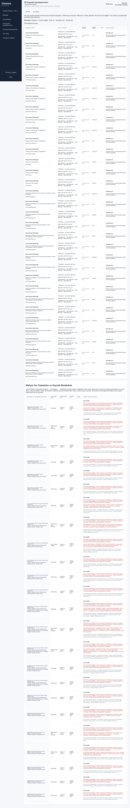

**Görünen metinler ve tablolar:**

- `div`: Civensa RAPORLAMA
- `h1`: PP Kaynak Karşılaştırması
- `span`: 2027 Performans Programı
- `p`: 2027 dönemi · Word kaynak hücreleri ve güncel kayıtlar · Salt okunur
- `div`: Müdürlük Birim Müdürü (sentetik)
- `p`: CSV İndir Genel Bakış
- `p`: Her satır özgün kaynak hücresini güncel kayıtla karşılaştırır. Bilinmeyen konumlar “Bilinmiyor” olarak gösterilir. Boş hücre sıfır değildir. Geri alınmış içe aktarmalar karşılaştırmaya katılmaz.
- `p`: Durumlar: Eşleşiyor · Kararla değişti · Fark var · Kaynakta yok · Kayıtta yok
- `p`: 33 karşılaştırma satırı
- `table`: MÜDÜRLÜK / KAYIT BELGE VE KONUM KAYNAK DEĞER GÜNCEL DEĞER FARK DURUM / KARAR Örnek Hizmet Müdürlüğü Gösterge: Tamamlanan hizmet sayısı 2027 Hedef Bilinmiyor · İçe aktarma Bilinmiyor Belge SHA-256: Bilinmiyor Tablo Bilinmiyor · Satır Bilinmiyor · Sütun Bilinmiyor · Sayfa Bilinmiyor — Kaynak hücre: Boş 120 — Kaynakta yok Bu güncel kaydın içe aktarmadan kaynak hücresi bulunamadı. Örnek Hizmet Müdürlüğü Gösterge: Tamamlanan hizmet sayısı 2028 Tahmin Bilinmiyor · İçe aktarma Bilinmiyor Belge SHA-256: Bilinmiyor Tablo Bilinmiyor · Satır Bilinmiyor · Sütun Bilinmiyor · Sayfa Bilinmiyor — Kaynak hücre: Boş 120 — Kaynakta yok Bu güncel kaydın içe aktarmadan kaynak hücresi bulunamadı. Örnek Hizmet Müdürlüğü Gösterge: Tamamlanan hizmet sayısı 2029 Tahmin Bilinmiyor · İçe aktarma Bilinmiyor Belge SHA-256: Bilinmiyor Tablo Bilinmiyor · Satır Bilinmiyor · Sütun Bilinmiyor · Sayfa Bilinmiyor — Kaynak hücre: Boş 120 — Kaynakta yok Bu güncel kaydın içe aktarmadan kaynak hücresi bulunamadı. Örnek Hizmet Müdürlüğü Faaliyet: Hizmet noktalarının iyileştirilmesi 2027 Bütçe Bütçe İçi Bilinmiyor · İçe aktarma Bilinmiyor Belge SHA-256: Bilinmiyor Tablo Bilinmiyor · Satır Bilinmiyor · Sütun Bilinmiyor · Sayfa Bilinmiyor — Kaynak hücre: Boş 12.500,23 — Kaynakta yok Bu güncel kaydın içe aktarmadan kaynak hücresi bulunamadı. Örnek Hizmet Müdürlüğü Faaliyet: Hizmet noktalarının iyileştirilmesi 2027 Bütçe Bütçe Dışı Bilinmiyor · İçe aktarma Bilinmiyor Belge SHA-256: Bilinmiyor Tablo Bilinmiyor · Satır Bilinmiyor · Sütun Bilinmiyor · Sayfa Bilinmiyor — Kaynak hücre: Boş 0,00 — Kaynakta yok Bu güncel kaydın içe aktarmadan kaynak hücresi bulunamadı. Örnek Hizmet Müdürlüğü Faaliyet: Hizmet noktalarının iyileştirilmesi 2027 Bütçe Toplam Bilinmiyor · İçe aktarma Bilinmiyor Belge SHA-256: Bilinmiyor Tablo Bilinmiyor · Satır Bilinmiyor · Sütun Bilinmiyor · Sayfa Bilinmiyor — Kaynak hücre: Boş 12.500,23 — Kaynakta yok Bu güncel kaydın içe aktarmadan kaynak hücresi bulunamadı. Örnek Hizmet Müdürlüğü Faaliyet: Hizmet noktalarının iyileştirilmesi 2028 Tahmin Bütçe İçi Bilinmiyor · İçe aktarma Bilinmiyor Belge SHA-256: Bilinmiyor Tablo Bilinmiyor · Satır Bilinmiyor · Sütun Bilinmiyor · Sayfa Bilinmiyor — Kaynak hücre: Boş 12.500,23 — Kaynakta yok Bu güncel kaydın içe aktarmadan kaynak hücresi bulunamadı. Örnek Hizmet Müdürlüğü Faaliyet: Hizmet noktalarının iyileştirilmesi 2028 Tahmin Bütçe Dışı Bilinmiyor · İçe aktarma Bilinmiyor Belge SHA-256: Bilinmiyor Tablo Bilinmiyor · Satır Bilinmiyor · Sütun Bilinmiyor · Sayfa Bilinmiyor — Kaynak hücre: Boş 0,00 — Kaynakta yok Bu güncel kaydın içe aktarmadan kaynak hücresi bulunamadı. Örnek Hizmet Müdürlüğü Faaliyet: Hizmet noktalarının iyileştirilmesi 2028 Tahmin Toplam Bilinmiyor · İçe aktarma Bilinmiyor Belge SHA-256: Bilinmiyor Tablo Bilinmiyor · Satır Bilinmiyor · Sütun Bilinmiyor · Sayfa Bilinmiyor — Kaynak hücre: Boş 12.500,23 — Kaynakta yok Bu güncel kaydın içe aktarmadan kaynak hücresi bulunamadı. Örnek Hizmet Müdürlüğü Faaliyet: Hizmet noktalarının iyileştirilmesi 2029 Tahmin Bütçe İçi Bilinmiyor · İçe aktarma Bilinmiyor Belge SHA-256: Bilinmiyor Tablo Bilinmiyor · Satır Bilinmiyor · Sütun Bilinmiyor · Sayfa Bilinmiyor — Kaynak hücre: Boş 12.500,23 — Kaynakta yok Bu güncel kaydın içe aktarmadan kaynak hücresi bulunamadı. Örnek Hizmet Müdürlüğü Faaliyet: Hizmet noktalarının iyileştirilmesi 2029 Tahmin Bütçe Dışı Bilinmiyor · İçe aktarma Bilinmiyor Belge SHA-256: Bilinmiyor Tablo Bilinmiyor · Satır Bilinmiyor · Sütun Bilinmiyor · Sayfa Bilinmiyor — Kaynak hücre: Boş 0,00 — Kaynakta yok Bu güncel kaydın içe aktarmadan kaynak hücresi bulunamadı. Örnek Hizmet Müdürlüğü Faaliyet: Hizmet noktalarının iyileştirilmesi 2029 Tahmin Toplam Bilinmiyor · İçe aktarma Bilinmiyor Belge SHA-256: Bilinmiyor Tablo Bilinmiyor · Satır Bilinmiyor · Sütun Bilinmiyor · Sayfa Bilinmiyor — Kaynak hücre: Boş 12.500,23 — Kaynakta yok Bu güncel kaydın içe aktarmadan kaynak hücresi bulunamadı. Örnek Hizmet Müdürlüğü Personel ve SGK Giderleri 2027 Bütçe Bilinmiyor · İçe aktarma Bilinmiyor Belge SHA-256: Bilinmiyor Tablo Bilinmiyor · Satır Bilinmiyor · Sütun Bilinmiyor · Sayfa Bilinmiyor — Kaynak hücre: Boş 2.000,00 — Kaynakta yok Bu güncel kaydın içe aktarmadan kaynak hücresi bulunamadı. Örnek Hizmet Müdürlüğü Personel ve SGK Giderleri 2028 Tahmin Bilinmiyor · İçe aktarma Bilinmiyor Belge SHA-256: Bilinmiyor Tablo Bilinmiyor · Satır Bilinmiyor · Sütun Bilinmiyor · Sayfa Bilinmiyor — Kaynak hücre: Boş 2.000,00 — Kaynakta yok Bu güncel kaydın içe aktarmadan kaynak hücresi bulunamadı. Örnek Hizmet Müdürlüğü Personel ve SGK Giderleri 2029 Tahmin Bilinmiyor · İçe aktarma Bilinmiyor Belge SHA-256: Bilinmiyor Tablo Bilinmiyor · Satır Bilinmiyor · Sütun Bilinmiyor · Sayfa Bilinmiyor — Kaynak hücre: Boş 2.000,00 — Kaynakta yok Bu güncel kaydın içe aktarmadan kaynak hücresi bulunamadı. Örnek Hizmet Müdürlüğü Ekonomik sınıflandırma: Mal ve Hizmet Alım Giderleri / Hizmet Programları 2027 Bütçe Bütçe İçi Bilinmiyor · İçe aktarma Bilinmiyor Belge SHA-256: Bilinmiyor Tablo Bilinmiyor · Satır Bilinmiyor · Sütun Bilinmiyor · Sayfa Bilinmiyor — Kaynak hücre: Boş 12.500,23 — Kaynakta yok Bu güncel kaydın içe aktarmadan kaynak hücresi bulunamadı. Örnek Hizmet Müdürlüğü Ekonomik sınıflandırma: Mal ve Hizmet Alım Giderleri / Hizmet Programları 2027 Bütçe Bütçe Dışı Bilinmiyor · İçe aktarma Bilinmiyor Belge SHA-256: Bilinmiyor Tablo Bilinmiyor · Satır Bilinmiyor · Sütun Bilinmiyor · Sayfa Bilinmiyor — Kaynak hücre: Boş 0,00 — Kaynakta yok Bu güncel kaydın içe aktarmadan kaynak hücresi bulunamadı. Örnek Hizmet Müdürlüğü Ekonomik sınıflandırma: Personel Giderleri / Hizmet Programları 2027 Bütçe Bütçe İçi Bilinmiyor · İçe aktarma Bilinmiyor Belge SHA-256: Bilinmiyor Tablo Bilinmiyor · Satır Bilinmiyor · Sütun Bilinmiyor · Sayfa Bilinmiyor — Kaynak hücre: Boş 1.500,00 — Kaynakta yok Bu güncel kaydın içe aktarmadan kaynak hücresi bulunamadı. Örnek Hizmet Müdürlüğü Ekonomik sınıflandırma: Personel Giderleri / Hizmet Programları 2027 Bütçe Bütçe Dışı Bilinmiyor · İçe aktarma Bilinmiyor Belge SHA-256: Bilinmiyor Tablo Bilinmiyor · Satır Bilinmiyor · Sütun Bilinmiyor · Sayfa Bilinmiyor — Kaynak hücre: Boş 0,00 — Kaynakta yok Bu güncel kaydın içe aktarmadan kaynak hücresi bulunamadı. Örnek Hizmet Müdürlüğü Ekonomik sınıflandırma: Sosyal Güvenlik Kurumuna Devlet Primi Giderleri / Hizmet Programları 2027 Bütçe Bütçe İçi Bilinmiyor · İçe aktarma Bilinmiyor Belge SHA-256: Bilinmiyor Tablo Bilinmiyor · Satır Bilinmiyor · Sütun Bilinmiyor · Sayfa Bilinmiyor — Kaynak hücre: Boş 500,00 — Kaynakta yok Bu güncel kaydın içe aktarmadan kaynak hücresi bulunamadı. Örnek Hizmet Müdürlüğü Ekonomik sınıflandırma: Sosyal Güvenlik Kurumuna Devlet Primi Giderleri / Hizmet Programları 2027 Bütçe Bütçe Dışı Bilinmiyor · İçe aktarma Bilinmiyor Belge SHA-256: Bilinmiyor Tablo Bilinmiyor · Satır Bilinmiyor · Sütun Bilinmiyor · Sayfa Bilinmiyor — Kaynak hücre: Boş 0,00 — Kaynakta yok Bu güncel kaydın içe aktarmadan kaynak hücresi bulunamadı. Örnek Hizmet Müdürlüğü Ekonomik sınıflandırma: Mal ve Hizmet Alım Giderleri / Hizmet Programları 2028 Tahmin Bütçe İçi Bilinmiyor · İçe aktarma Bilinmiyor Belge SHA-256: Bilinmiyor Tablo Bilinmiyor · Satır Bilinmiyor · Sütun Bilinmiyor · Sayfa Bilinmiyor — Kaynak hücre: Boş 12.500,23 — Kaynakta yok Bu güncel kaydın içe aktarmadan kaynak hücresi bulunamadı. Örnek Hizmet Müdürlüğü Ekonomik sınıflandırma: Mal ve Hizmet Alım Giderleri / Hizmet Programları 2028 Tahmin Bütçe Dışı Bilinmiyor · İçe aktarma Bilinmiyor Belge SHA-256: Bilinmiyor Tablo Bilinmiyor · Satır Bilinmiyor · Sütun Bilinmiyor · Sayfa Bilinmiyor — Kaynak hücre: Boş 0,00 — Kaynakta yok Bu güncel kaydın içe aktarmadan kaynak hücresi bulunamadı. Örnek Hizmet Müdürlüğü Ekonomik sınıflandırma: Personel Giderleri / Hizmet Programları 2028 Tahmin Bütçe İçi Bilinmiyor · İçe aktarma Bilinmiyor Belge SHA-256: Bilinmiyor Tablo Bilinmiyor · Satır Bilinmiyor · Sütun Bilinmiyor · Sayfa Bilinmiyor — Kaynak hücre: Boş 1.500,00 — Kaynakta yok Bu güncel kaydın içe aktarmadan kaynak hücresi bulunamadı. Örnek Hizmet Müdürlüğü Ekonomik sınıflandırma: Personel Giderleri / Hizmet Programları 2028 Tahmin Bütçe Dışı Bilinmiyor · İçe aktarma Bilinmiyor Belge SHA-256: Bilinmiyor Tablo Bilinmiyor · Satır Bilinmiyor · Sütun Bilinmiyor · Sayfa Bilinmiyor — Kaynak hücre: Boş 0,00 — Kaynakta yok Bu güncel kaydın içe aktarmadan kaynak hücresi bulunamadı. Örnek Hizmet Müdürlüğü Ekonomik sınıflandırma: Sosyal Güvenlik Kurumuna Devlet Primi Giderleri / Hizmet Programları 2028 Tahmin Bütçe İçi Bilinmiyor · İçe aktarma Bilinmiyor Belge SHA-256: Bilinmiyor Tablo Bilinmiyor · Satır Bilinmiyor · Sütun Bilinmiyor · Sayfa Bilinmiyor — Kaynak hücre: Boş 500,00 — Kaynakta yok Bu güncel kaydın içe aktarmadan kaynak hücresi bulunamadı. Örnek Hizmet Müdürlüğü Ekonomik sınıflandırma: Sosyal Güvenlik Kurumuna Devlet Primi Giderleri / Hizmet Programları 2028 Tahmin Bütçe Dışı Bilinmiyor · İçe aktarma Bilinmiyor Belge SHA-256: Bilinmiyor Tablo Bilinmiyor · Satır Bilinmiyor · Sütun Bilinmiyor · Sayfa Bilinmiyor — Kaynak hücre: Boş 0,00 — Kaynakta yok Bu güncel kaydın içe aktarmadan kaynak hücresi bulunamadı. Örnek Hizmet Müdürlüğü Ekonomik sınıflandırma: Mal ve Hizmet Alım Giderleri / Program Grubu Belirlenmeli 2029 Tahmin Bütçe İçi Bilinmiyor · İçe aktarma Bilinmiyor Belge SHA-256: Bilinmiyor Tablo Bilinmiyor · Satır Bilinmiyor · Sütun Bilinmiyor · Sayfa Bilinmiyor — Kaynak hücre: Boş 12.500,23 — Kaynakta yok Bu güncel kaydın içe aktarmadan kaynak hücresi bulunamadı. Örnek Hizmet Müdürlüğü Ekonomik sınıflandırma: Mal ve Hizmet Alım Giderleri / Program Grubu Belirlenmeli 2029 Tahmin Bütçe Dışı Bilinmiyor · İçe aktarma Bilinmiyor Belge SHA-256: Bilinmiyor Tablo Bilinmiyor · Satır Bilinmiyor · Sütun Bilinmiyor · Sayfa Bilinmiyor — Kaynak hücre: Boş 0,00 — Kaynakta yok Bu güncel kaydın içe aktarmadan kaynak hücresi bulunamadı. Örnek Hizmet Müdürlüğü Ekonomik sınıflandırma: Personel Giderleri / Hizmet Programları 2029 Tahmin Bütçe İçi Bilinmiyor · İçe aktarma Bilinmiyor Belge SHA-256: Bilinmiyor Tablo Bilinmiyor · Satır Bilinmiyor · Sütun Bilinmiyor · Sayfa Bilinmiyor — Kaynak hücre: Boş 1.500,00 — Kaynakta yok Bu güncel kaydın içe aktarmadan kaynak hücresi bulunamadı. Örnek Hizmet Müdürlüğü Ekonomik sınıflandırma: Personel Giderleri / Hizmet Programları 2029 Tahmin Bütçe Dışı Bilinmiyor · İçe aktarma Bilinmiyor Belge SHA-256: Bilinmiyor Tablo Bilinmiyor · Satır Bilinmiyor · Sütun Bilinmiyor · Sayfa Bilinmiyor — Kaynak hücre: Boş 0,00 — Kaynakta yok Bu güncel kaydın içe aktarmadan kaynak hücresi bulunamadı. Örnek Hizmet Müdürlüğü Ekonomik sınıflandırma: Sosyal Güvenlik Kurumuna Devlet Primi Giderleri / Hizmet Programları 2029 Tahmin Bütçe İçi Bilinmiyor · İçe aktarma Bilinmiyor Belge SHA-256: Bilinmiyor Tablo Bilinmiyor · Satır Bilinmiyor · Sütun Bilinmiyor · Sayfa Bilinmiyor — Kaynak hücre: Boş 500,00 — Kaynakta yok Bu güncel kaydın içe aktarmadan kaynak hücresi bulunamadı. Örnek Hizmet Müdürlüğü Ekonomik sınıflandırma: Sosyal Güvenlik Kurumuna Devlet Primi Giderleri / Hizmet Programları 2029 Tahmin Bütçe Dışı Bilinmiyor · İçe aktarma Bilinmiyor Belge SHA-256: Bilinmiyor Tablo Bilinmiyor · Satır Bilinmiyor · Sütun Bilinmiyor · Sayfa Bilinmiyor — Kaynak hücre: Boş 0,00 — Kaynakta yok Bu güncel kaydın içe aktarmadan kaynak hücresi bulunamadı.
- `p`: Gösterge: Tamamlanan hizmet sayısı
- `p`: Belge SHA-256: Bilinmiyor
- `p`: Tablo Bilinmiyor · Satır Bilinmiyor · Sütun Bilinmiyor · Sayfa Bilinmiyor
- `p`: Kaynak hücre: Boş
- `p`: Bu güncel kaydın içe aktarmadan kaynak hücresi bulunamadı.
- `p`: Gösterge: Tamamlanan hizmet sayısı
- `p`: Belge SHA-256: Bilinmiyor
- `p`: Tablo Bilinmiyor · Satır Bilinmiyor · Sütun Bilinmiyor · Sayfa Bilinmiyor
- `p`: Kaynak hücre: Boş
- `p`: Bu güncel kaydın içe aktarmadan kaynak hücresi bulunamadı.
- `p`: Gösterge: Tamamlanan hizmet sayısı
- `p`: Belge SHA-256: Bilinmiyor
- `p`: Tablo Bilinmiyor · Satır Bilinmiyor · Sütun Bilinmiyor · Sayfa Bilinmiyor
- `p`: Kaynak hücre: Boş
- `p`: Bu güncel kaydın içe aktarmadan kaynak hücresi bulunamadı.
- `p`: Faaliyet: Hizmet noktalarının iyileştirilmesi
- `p`: Belge SHA-256: Bilinmiyor
- `p`: Tablo Bilinmiyor · Satır Bilinmiyor · Sütun Bilinmiyor · Sayfa Bilinmiyor
- `p`: Kaynak hücre: Boş
- `p`: Bu güncel kaydın içe aktarmadan kaynak hücresi bulunamadı.
- `p`: Faaliyet: Hizmet noktalarının iyileştirilmesi
- `p`: Belge SHA-256: Bilinmiyor
- `p`: Tablo Bilinmiyor · Satır Bilinmiyor · Sütun Bilinmiyor · Sayfa Bilinmiyor
- `p`: Kaynak hücre: Boş
- `p`: Bu güncel kaydın içe aktarmadan kaynak hücresi bulunamadı.
- `p`: Faaliyet: Hizmet noktalarının iyileştirilmesi
- `p`: Belge SHA-256: Bilinmiyor
- `p`: Tablo Bilinmiyor · Satır Bilinmiyor · Sütun Bilinmiyor · Sayfa Bilinmiyor
- `p`: Kaynak hücre: Boş
- `p`: Bu güncel kaydın içe aktarmadan kaynak hücresi bulunamadı.
- `p`: Faaliyet: Hizmet noktalarının iyileştirilmesi
- `p`: Belge SHA-256: Bilinmiyor
- `p`: Tablo Bilinmiyor · Satır Bilinmiyor · Sütun Bilinmiyor · Sayfa Bilinmiyor
- `p`: Kaynak hücre: Boş
- `p`: Bu güncel kaydın içe aktarmadan kaynak hücresi bulunamadı.
- `p`: Faaliyet: Hizmet noktalarının iyileştirilmesi
- `p`: Belge SHA-256: Bilinmiyor
- `p`: Tablo Bilinmiyor · Satır Bilinmiyor · Sütun Bilinmiyor · Sayfa Bilinmiyor
- `p`: Kaynak hücre: Boş
- `p`: Bu güncel kaydın içe aktarmadan kaynak hücresi bulunamadı.
- `p`: Faaliyet: Hizmet noktalarının iyileştirilmesi
- `p`: Belge SHA-256: Bilinmiyor
- `p`: Tablo Bilinmiyor · Satır Bilinmiyor · Sütun Bilinmiyor · Sayfa Bilinmiyor
- `p`: Kaynak hücre: Boş
- `p`: Bu güncel kaydın içe aktarmadan kaynak hücresi bulunamadı.
- `p`: Faaliyet: Hizmet noktalarının iyileştirilmesi
- `p`: Belge SHA-256: Bilinmiyor
- `p`: Tablo Bilinmiyor · Satır Bilinmiyor · Sütun Bilinmiyor · Sayfa Bilinmiyor
- `p`: Kaynak hücre: Boş
- `p`: Bu güncel kaydın içe aktarmadan kaynak hücresi bulunamadı.
- `p`: Faaliyet: Hizmet noktalarının iyileştirilmesi
- `p`: Belge SHA-256: Bilinmiyor
- `p`: Tablo Bilinmiyor · Satır Bilinmiyor · Sütun Bilinmiyor · Sayfa Bilinmiyor
- `p`: Kaynak hücre: Boş
- `p`: Bu güncel kaydın içe aktarmadan kaynak hücresi bulunamadı.
- `p`: Faaliyet: Hizmet noktalarının iyileştirilmesi
- `p`: Belge SHA-256: Bilinmiyor
- `p`: Tablo Bilinmiyor · Satır Bilinmiyor · Sütun Bilinmiyor · Sayfa Bilinmiyor
- `p`: Kaynak hücre: Boş
- `p`: Bu güncel kaydın içe aktarmadan kaynak hücresi bulunamadı.
- `p`: Personel ve SGK Giderleri
- `p`: Belge SHA-256: Bilinmiyor
- `p`: Tablo Bilinmiyor · Satır Bilinmiyor · Sütun Bilinmiyor · Sayfa Bilinmiyor
- `p`: Kaynak hücre: Boş
- `p`: Bu güncel kaydın içe aktarmadan kaynak hücresi bulunamadı.
- `p`: Personel ve SGK Giderleri
- `p`: Belge SHA-256: Bilinmiyor
- `p`: Tablo Bilinmiyor · Satır Bilinmiyor · Sütun Bilinmiyor · Sayfa Bilinmiyor
- `p`: Kaynak hücre: Boş
- `p`: Bu güncel kaydın içe aktarmadan kaynak hücresi bulunamadı.
- `p`: Personel ve SGK Giderleri
- `p`: Belge SHA-256: Bilinmiyor
- `p`: Tablo Bilinmiyor · Satır Bilinmiyor · Sütun Bilinmiyor · Sayfa Bilinmiyor
- `p`: Kaynak hücre: Boş
- `p`: Bu güncel kaydın içe aktarmadan kaynak hücresi bulunamadı.
- `p`: Ekonomik sınıflandırma: Mal ve Hizmet Alım Giderleri / Hizmet Programları
- `p`: Belge SHA-256: Bilinmiyor
- `p`: Tablo Bilinmiyor · Satır Bilinmiyor · Sütun Bilinmiyor · Sayfa Bilinmiyor
- `p`: Kaynak hücre: Boş
- `p`: Bu güncel kaydın içe aktarmadan kaynak hücresi bulunamadı.
- `p`: Ekonomik sınıflandırma: Mal ve Hizmet Alım Giderleri / Hizmet Programları
- `p`: Belge SHA-256: Bilinmiyor
- `p`: Tablo Bilinmiyor · Satır Bilinmiyor · Sütun Bilinmiyor · Sayfa Bilinmiyor
- `p`: Kaynak hücre: Boş
- `p`: Bu güncel kaydın içe aktarmadan kaynak hücresi bulunamadı.
- `p`: Ekonomik sınıflandırma: Personel Giderleri / Hizmet Programları
- `p`: Belge SHA-256: Bilinmiyor
- `p`: Tablo Bilinmiyor · Satır Bilinmiyor · Sütun Bilinmiyor · Sayfa Bilinmiyor
- `p`: Kaynak hücre: Boş
- `p`: Bu güncel kaydın içe aktarmadan kaynak hücresi bulunamadı.
- `p`: Ekonomik sınıflandırma: Personel Giderleri / Hizmet Programları
- `p`: Belge SHA-256: Bilinmiyor
- `p`: Tablo Bilinmiyor · Satır Bilinmiyor · Sütun Bilinmiyor · Sayfa Bilinmiyor
- `p`: Kaynak hücre: Boş
- `p`: Bu güncel kaydın içe aktarmadan kaynak hücresi bulunamadı.
- `p`: Ekonomik sınıflandırma: Sosyal Güvenlik Kurumuna Devlet Primi Giderleri / Hizmet Programları
- `p`: Belge SHA-256: Bilinmiyor
- `p`: Tablo Bilinmiyor · Satır Bilinmiyor · Sütun Bilinmiyor · Sayfa Bilinmiyor
- `p`: Kaynak hücre: Boş
- `p`: Bu güncel kaydın içe aktarmadan kaynak hücresi bulunamadı.
- `p`: Ekonomik sınıflandırma: Sosyal Güvenlik Kurumuna Devlet Primi Giderleri / Hizmet Programları
- `p`: Belge SHA-256: Bilinmiyor
- `p`: Tablo Bilinmiyor · Satır Bilinmiyor · Sütun Bilinmiyor · Sayfa Bilinmiyor
- `p`: Kaynak hücre: Boş
- `p`: Bu güncel kaydın içe aktarmadan kaynak hücresi bulunamadı.
- `p`: Ekonomik sınıflandırma: Mal ve Hizmet Alım Giderleri / Hizmet Programları
- `p`: Belge SHA-256: Bilinmiyor
- `p`: Tablo Bilinmiyor · Satır Bilinmiyor · Sütun Bilinmiyor · Sayfa Bilinmiyor
- `p`: Kaynak hücre: Boş
- `p`: Bu güncel kaydın içe aktarmadan kaynak hücresi bulunamadı.
- `p`: Ekonomik sınıflandırma: Mal ve Hizmet Alım Giderleri / Hizmet Programları
- `p`: Belge SHA-256: Bilinmiyor
- `p`: Tablo Bilinmiyor · Satır Bilinmiyor · Sütun Bilinmiyor · Sayfa Bilinmiyor
- `p`: Kaynak hücre: Boş
- `p`: Bu güncel kaydın içe aktarmadan kaynak hücresi bulunamadı.
- `p`: Ekonomik sınıflandırma: Personel Giderleri / Hizmet Programları
- `p`: Belge SHA-256: Bilinmiyor
- `p`: Tablo Bilinmiyor · Satır Bilinmiyor · Sütun Bilinmiyor · Sayfa Bilinmiyor
- `p`: Kaynak hücre: Boş
- `p`: Bu güncel kaydın içe aktarmadan kaynak hücresi bulunamadı.
- `p`: Ekonomik sınıflandırma: Personel Giderleri / Hizmet Programları
- `p`: Belge SHA-256: Bilinmiyor
- `p`: Tablo Bilinmiyor · Satır Bilinmiyor · Sütun Bilinmiyor · Sayfa Bilinmiyor
- `p`: Kaynak hücre: Boş
- `p`: Bu güncel kaydın içe aktarmadan kaynak hücresi bulunamadı.
- `p`: Ekonomik sınıflandırma: Sosyal Güvenlik Kurumuna Devlet Primi Giderleri / Hizmet Programları
- `p`: Belge SHA-256: Bilinmiyor
- `p`: Tablo Bilinmiyor · Satır Bilinmiyor · Sütun Bilinmiyor · Sayfa Bilinmiyor
- `p`: Kaynak hücre: Boş
- `p`: Bu güncel kaydın içe aktarmadan kaynak hücresi bulunamadı.
- `p`: Ekonomik sınıflandırma: Sosyal Güvenlik Kurumuna Devlet Primi Giderleri / Hizmet Programları
- `p`: Belge SHA-256: Bilinmiyor
- `p`: Tablo Bilinmiyor · Satır Bilinmiyor · Sütun Bilinmiyor · Sayfa Bilinmiyor
- `p`: Kaynak hücre: Boş
- `p`: Bu güncel kaydın içe aktarmadan kaynak hücresi bulunamadı.
- `p`: Ekonomik sınıflandırma: Mal ve Hizmet Alım Giderleri / Program Grubu Belirlenmeli
- `p`: Belge SHA-256: Bilinmiyor
- `p`: Tablo Bilinmiyor · Satır Bilinmiyor · Sütun Bilinmiyor · Sayfa Bilinmiyor
- `p`: Kaynak hücre: Boş
- `p`: Bu güncel kaydın içe aktarmadan kaynak hücresi bulunamadı.
- `p`: Ekonomik sınıflandırma: Mal ve Hizmet Alım Giderleri / Program Grubu Belirlenmeli
- `p`: Belge SHA-256: Bilinmiyor
- `p`: Tablo Bilinmiyor · Satır Bilinmiyor · Sütun Bilinmiyor · Sayfa Bilinmiyor
- `p`: Kaynak hücre: Boş
- `p`: Bu güncel kaydın içe aktarmadan kaynak hücresi bulunamadı.
- `p`: Ekonomik sınıflandırma: Personel Giderleri / Hizmet Programları
- `p`: Belge SHA-256: Bilinmiyor
- `p`: Tablo Bilinmiyor · Satır Bilinmiyor · Sütun Bilinmiyor · Sayfa Bilinmiyor
- `p`: Kaynak hücre: Boş
- `p`: Bu güncel kaydın içe aktarmadan kaynak hücresi bulunamadı.
- `p`: Ekonomik sınıflandırma: Personel Giderleri / Hizmet Programları
- `p`: Belge SHA-256: Bilinmiyor
- `p`: Tablo Bilinmiyor · Satır Bilinmiyor · Sütun Bilinmiyor · Sayfa Bilinmiyor
- `p`: Kaynak hücre: Boş
- `p`: Bu güncel kaydın içe aktarmadan kaynak hücresi bulunamadı.
- `p`: Ekonomik sınıflandırma: Sosyal Güvenlik Kurumuna Devlet Primi Giderleri / Hizmet Programları
- `p`: Belge SHA-256: Bilinmiyor
- `p`: Tablo Bilinmiyor · Satır Bilinmiyor · Sütun Bilinmiyor · Sayfa Bilinmiyor
- `p`: Kaynak hücre: Boş
- `p`: Bu güncel kaydın içe aktarmadan kaynak hücresi bulunamadı.
- `p`: Ekonomik sınıflandırma: Sosyal Güvenlik Kurumuna Devlet Primi Giderleri / Hizmet Programları
- `p`: Belge SHA-256: Bilinmiyor
- `p`: Tablo Bilinmiyor · Satır Bilinmiyor · Sütun Bilinmiyor · Sayfa Bilinmiyor
- `p`: Kaynak hücre: Boş
- `p`: Bu güncel kaydın içe aktarmadan kaynak hücresi bulunamadı.
- `h2`: Maliyet Ara Toplamları ve Kaynak Mutabakatı
- `p`: Güncel faaliyet maliyetleri program → alt program → müdürlük sırasıyla toplanır. Bağlantısı veya tutarı eksik kayıt varsa kısmi toplam gösterilmez ve yayın durur. Kaynak toplamı, bütün alt kayıtların saklanan kaynak tutarlarından oluşur; bulunmaması uyarıdır. Personel ve SGK giderleri kitabın ortak maliyet tablosunda ayrıca gösterilir.
- `table`: PROGRAM / ALT PROGRAM / MÜDÜRLÜK YIL / DEĞER TÜRÜ HESAPLANAN (TL) KAYNAK (TL) FARK (TL) DURUM / YAPILACAK İŞLEM PROGRAM ARA TOPLAMI: YEREL HİZMETLER PROGRAMI YEREL HİZMETLER PROGRAMI 2026 Bütçe Eksik ara toplam kaynak toplamı yok — Yayın engeli Örnek Hizmet Müdürlüğü / Hizmet noktalarının iyileştirilmesi: program, alt program, kart veya katalog bağlantısı eksik ya da kapsamı uyuşmuyor. Faaliyet Eşleştirme ve Performans Kartları ekranlarında bağlantıları tamamlayın. Yerel Hizmetler Programı / Hizmet noktalarının iyileştirilmesi / 2026 Bütçe: maliyet bilgisi eksik, doğrulanmamış veya bütçe içi + dışı toplamı uyuşmuyor. Faaliyet maliyetlerini kontrol edip tamamlayın. Yerel Hizmetler Programı / 2026 Bütçe: kaynak toplamı yok (tüm faaliyetleri kapsayan kaynak tutarı bulunmuyor). Kaynak belgeyi kontrol edin. PROGRAM ARA TOPLAMI: YEREL HİZMETLER PROGRAMI YEREL HİZMETLER PROGRAMI 2026 Haziran Sonu Harcama Eksik ara toplam kaynak toplamı yok — Yayın engeli Örnek Hizmet Müdürlüğü / Hizmet noktalarının iyileştirilmesi: program, alt program, kart veya katalog bağlantısı eksik ya da kapsamı uyuşmuyor. Faaliyet Eşleştirme ve Performans Kartları ekranlarında bağlantıları tamamlayın. Yerel Hizmetler Programı / Hizmet noktalarının iyileştirilmesi / 2026 Haziran Sonu Harcama: maliyet bilgisi eksik, doğrulanmamış veya bütçe içi + dışı toplamı uyuşmuyor. Faaliyet maliyetlerini kontrol edip tamamlayın. Yerel Hizmetler Programı / 2026 Haziran Sonu Harcama: kaynak toplamı yok (tüm faaliyetleri kapsayan kaynak tutarı bulunmuyor). Kaynak belgeyi kontrol edin. PROGRAM ARA TOPLAMI: YEREL HİZMETLER PROGRAMI YEREL HİZMETLER PROGRAMI 2026 Yıl Sonu Tahmini Eksik ara toplam kaynak toplamı yok — Yayın engeli Örnek Hizmet Müdürlüğü / Hizmet noktalarının iyileştirilmesi: program, alt program, kart veya katalog bağlantısı eksik ya da kapsamı uyuşmuyor. Faaliyet Eşleştirme ve Performans Kartları ekranlarında bağlantıları tamamlayın. Yerel Hizmetler Programı / Hizmet noktalarının iyileştirilmesi / 2026 Yıl Sonu Tahmini: maliyet bilgisi eksik, doğrulanmamış veya bütçe içi + dışı toplamı uyuşmuyor. Faaliyet maliyetlerini kontrol edip tamamlayın. Yerel Hizmetler Programı / 2026 Yıl Sonu Tahmini: kaynak toplamı yok (tüm faaliyetleri kapsayan kaynak tutarı bulunmuyor). Kaynak belgeyi kontrol edin. PROGRAM ARA TOPLAMI: YEREL HİZMETLER PROGRAMI YEREL HİZMETLER PROGRAMI 2027 Bütçe Eksik ara toplam kaynak toplamı yok — Yayın engeli Örnek Hizmet Müdürlüğü / Hizmet noktalarının iyileştirilmesi: program, alt program, kart veya katalog bağlantısı eksik ya da kapsamı uyuşmuyor. Faaliyet Eşleştirme ve Performans Kartları ekranlarında bağlantıları tamamlayın. Yerel Hizmetler Programı / 2027 Bütçe: kaynak toplamı yok (tüm faaliyetleri kapsayan kaynak tutarı bulunmuyor). Kaynak belgeyi kontrol edin. PROGRAM ARA TOPLAMI: YEREL HİZMETLER PROGRAMI YEREL HİZMETLER PROGRAMI 2028 Tahmin Eksik ara toplam kaynak toplamı yok — Yayın engeli Örnek Hizmet Müdürlüğü / Hizmet noktalarının iyileştirilmesi: program, alt program, kart veya katalog bağlantısı eksik ya da kapsamı uyuşmuyor. Faaliyet Eşleştirme ve Performans Kartları ekranlarında bağlantıları tamamlayın. Yerel Hizmetler Programı / 2028 Tahmin: kaynak toplamı yok (tüm faaliyetleri kapsayan kaynak tutarı bulunmuyor). Kaynak belgeyi kontrol edin. PROGRAM ARA TOPLAMI: YEREL HİZMETLER PROGRAMI YEREL HİZMETLER PROGRAMI 2029 Tahmin Eksik ara toplam kaynak toplamı yok — Yayın engeli Örnek Hizmet Müdürlüğü / Hizmet noktalarının iyileştirilmesi: program, alt program, kart veya katalog bağlantısı eksik ya da kapsamı uyuşmuyor. Faaliyet Eşleştirme ve Performans Kartları ekranlarında bağlantıları tamamlayın. Yerel Hizmetler Programı / 2029 Tahmin: kaynak toplamı yok (tüm faaliyetleri kapsayan kaynak tutarı bulunmuyor). Kaynak belgeyi kontrol edin. ALT PROGRAM ARA TOPLAMI: ERİŞİLEBİLİR HİZMETLER YEREL HİZMETLER PROGRAMI / ERİŞİLEBİLİR HİZMETLER 2026 Bütçe Eksik ara toplam kaynak toplamı yok — Yayın engeli Örnek Hizmet Müdürlüğü / Hizmet noktalarının iyileştirilmesi: program, alt program, kart veya katalog bağlantısı eksik ya da kapsamı uyuşmuyor. Faaliyet Eşleştirme ve Performans Kartları ekranlarında bağlantıları tamamlayın. Yerel Hizmetler Programı / Erişilebilir Hizmetler / Hizmet noktalarının iyileştirilmesi / 2026 Bütçe: maliyet bilgisi eksik, doğrulanmamış veya bütçe içi + dışı toplamı uyuşmuyor. Faaliyet maliyetlerini kontrol edip tamamlayın. Yerel Hizmetler Programı / Erişilebilir Hizmetler / 2026 Bütçe: kaynak toplamı yok (tüm faaliyetleri kapsayan kaynak tutarı bulunmuyor). Kaynak belgeyi kontrol edin. ALT PROGRAM ARA TOPLAMI: ERİŞİLEBİLİR HİZMETLER YEREL HİZMETLER PROGRAMI / ERİŞİLEBİLİR HİZMETLER 2026 Haziran Sonu Harcama Eksik ara toplam kaynak toplamı yok — Yayın engeli Örnek Hizmet Müdürlüğü / Hizmet noktalarının iyileştirilmesi: program, alt program, kart veya katalog bağlantısı eksik ya da kapsamı uyuşmuyor. Faaliyet Eşleştirme ve Performans Kartları ekranlarında bağlantıları tamamlayın. Yerel Hizmetler Programı / Erişilebilir Hizmetler / Hizmet noktalarının iyileştirilmesi / 2026 Haziran Sonu Harcama: maliyet bilgisi eksik, doğrulanmamış veya bütçe içi + dışı toplamı uyuşmuyor. Faaliyet maliyetlerini kontrol edip tamamlayın. Yerel Hizmetler Programı / Erişilebilir Hizmetler / 2026 Haziran Sonu Harcama: kaynak toplamı yok (tüm faaliyetleri kapsayan kaynak tutarı bulunmuyor). Kaynak belgeyi kontrol edin. ALT PROGRAM ARA TOPLAMI: ERİŞİLEBİLİR HİZMETLER YEREL HİZMETLER PROGRAMI / ERİŞİLEBİLİR HİZMETLER 2026 Yıl Sonu Tahmini Eksik ara toplam kaynak toplamı yok — Yayın engeli Örnek Hizmet Müdürlüğü / Hizmet noktalarının iyileştirilmesi: program, alt program, kart veya katalog bağlantısı eksik ya da kapsamı uyuşmuyor. Faaliyet Eşleştirme ve Performans Kartları ekranlarında bağlantıları tamamlayın. Yerel Hizmetler Programı / Erişilebilir Hizmetler / Hizmet noktalarının iyileştirilmesi / 2026 Yıl Sonu Tahmini: maliyet bilgisi eksik, doğrulanmamış veya bütçe içi + dışı toplamı uyuşmuyor. Faaliyet maliyetlerini kontrol edip tamamlayın. Yerel Hizmetler Programı / Erişilebilir Hizmetler / 2026 Yıl Sonu Tahmini: kaynak toplamı yok (tüm faaliyetleri kapsayan kaynak tutarı bulunmuyor). Kaynak belgeyi kontrol edin. ALT PROGRAM ARA TOPLAMI: ERİŞİLEBİLİR HİZMETLER YEREL HİZMETLER PROGRAMI / ERİŞİLEBİLİR HİZMETLER 2027 Bütçe Eksik ara toplam kaynak toplamı yok — Yayın engeli Örnek Hizmet Müdürlüğü / Hizmet noktalarının iyileştirilmesi: program, alt program, kart veya katalog bağlantısı eksik ya da kapsamı uyuşmuyor. Faaliyet Eşleştirme ve Performans Kartları ekranlarında bağlantıları tamamlayın. Yerel Hizmetler Programı / Erişilebilir Hizmetler / 2027 Bütçe: kaynak toplamı yok (tüm faaliyetleri kapsayan kaynak tutarı bulunmuyor). Kaynak belgeyi kontrol edin. ALT PROGRAM ARA TOPLAMI: ERİŞİLEBİLİR HİZMETLER YEREL HİZMETLER PROGRAMI / ERİŞİLEBİLİR HİZMETLER 2028 Tahmin Eksik ara toplam kaynak toplamı yok — Yayın engeli Örnek Hizmet Müdürlüğü / Hizmet noktalarının iyileştirilmesi: program, alt program, kart veya katalog bağlantısı eksik ya da kapsamı uyuşmuyor. Faaliyet Eşleştirme ve Performans Kartları ekranlarında bağlantıları tamamlayın. Yerel Hizmetler Programı / Erişilebilir Hizmetler / 2028 Tahmin: kaynak toplamı yok (tüm faaliyetleri kapsayan kaynak tutarı bulunmuyor). Kaynak belgeyi kontrol edin. ALT PROGRAM ARA TOPLAMI: ERİŞİLEBİLİR HİZMETLER YEREL HİZMETLER PROGRAMI / ERİŞİLEBİLİR HİZMETLER 2029 Tahmin Eksik ara toplam kaynak toplamı yok — Yayın engeli Örnek Hizmet Müdürlüğü / Hizmet noktalarının iyileştirilmesi: program, alt program, kart veya katalog bağlantısı eksik ya da kapsamı uyuşmuyor. Faaliyet Eşleştirme ve Performans Kartları ekranlarında bağlantıları tamamlayın. Yerel Hizmetler Programı / Erişilebilir Hizmetler / 2029 Tahmin: kaynak toplamı yok (tüm faaliyetleri kapsayan kaynak tutarı bulunmuyor). Kaynak belgeyi kontrol edin. MÜDÜRLÜK ARA TOPLAMI: ÖRNEK HİZMET MÜDÜRLÜĞÜ YEREL HİZMETLER PROGRAMI / ERİŞİLEBİLİR HİZMETLER / ÖRNEK HİZMET MÜDÜRLÜĞÜ 2026 Bütçe Eksik ara toplam kaynak toplamı yok — Yayın engeli Örnek Hizmet Müdürlüğü / Hizmet noktalarının iyileştirilmesi: program, alt program, kart veya katalog bağlantısı eksik ya da kapsamı uyuşmuyor. Faaliyet Eşleştirme ve Performans Kartları ekranlarında bağlantıları tamamlayın. Yerel Hizmetler Programı / Erişilebilir Hizmetler / Örnek Hizmet Müdürlüğü / Hizmet noktalarının iyileştirilmesi / 2026 Bütçe: maliyet bilgisi eksik, doğrulanmamış veya bütçe içi + dışı toplamı uyuşmuyor. Faaliyet maliyetlerini kontrol edip tamamlayın. Yerel Hizmetler Programı / Erişilebilir Hizmetler / Örnek Hizmet Müdürlüğü / 2026 Bütçe: kaynak toplamı yok (tüm faaliyetleri kapsayan kaynak tutarı bulunmuyor). Kaynak belgeyi kontrol edin. MÜDÜRLÜK ARA TOPLAMI: ÖRNEK HİZMET MÜDÜRLÜĞÜ YEREL HİZMETLER PROGRAMI / ERİŞİLEBİLİR HİZMETLER / ÖRNEK HİZMET MÜDÜRLÜĞÜ 2026 Haziran Sonu Harcama Eksik ara toplam kaynak toplamı yok — Yayın engeli Örnek Hizmet Müdürlüğü / Hizmet noktalarının iyileştirilmesi: program, alt program, kart veya katalog bağlantısı eksik ya da kapsamı uyuşmuyor. Faaliyet Eşleştirme ve Performans Kartları ekranlarında bağlantıları tamamlayın. Yerel Hizmetler Programı / Erişilebilir Hizmetler / Örnek Hizmet Müdürlüğü / Hizmet noktalarının iyileştirilmesi / 2026 Haziran Sonu Harcama: maliyet bilgisi eksik, doğrulanmamış veya bütçe içi + dışı toplamı uyuşmuyor. Faaliyet maliyetlerini kontrol edip tamamlayın. Yerel Hizmetler Programı / Erişilebilir Hizmetler / Örnek Hizmet Müdürlüğü / 2026 Haziran Sonu Harcama: kaynak toplamı yok (tüm faaliyetleri kapsayan kaynak tutarı bulunmuyor). Kaynak belgeyi kontrol edin. MÜDÜRLÜK ARA TOPLAMI: ÖRNEK HİZMET MÜDÜRLÜĞÜ YEREL HİZMETLER PROGRAMI / ERİŞİLEBİLİR HİZMETLER / ÖRNEK HİZMET MÜDÜRLÜĞÜ 2026 Yıl Sonu Tahmini Eksik ara toplam kaynak toplamı yok — Yayın engeli Örnek Hizmet Müdürlüğü / Hizmet noktalarının iyileştirilmesi: program, alt program, kart veya katalog bağlantısı eksik ya da kapsamı uyuşmuyor. Faaliyet Eşleştirme ve Performans Kartları ekranlarında bağlantıları tamamlayın. Yerel Hizmetler Programı / Erişilebilir Hizmetler / Örnek Hizmet Müdürlüğü / Hizmet noktalarının iyileştirilmesi / 2026 Yıl Sonu Tahmini: maliyet bilgisi eksik, doğrulanmamış veya bütçe içi + dışı toplamı uyuşmuyor. Faaliyet maliyetlerini kontrol edip tamamlayın. Yerel Hizmetler Programı / Erişilebilir Hizmetler / Örnek Hizmet Müdürlüğü / 2026 Yıl Sonu Tahmini: kaynak toplamı yok (tüm faaliyetleri kapsayan kaynak tutarı bulunmuyor). Kaynak belgeyi kontrol edin. MÜDÜRLÜK ARA TOPLAMI: ÖRNEK HİZMET MÜDÜRLÜĞÜ YEREL HİZMETLER PROGRAMI / ERİŞİLEBİLİR HİZMETLER / ÖRNEK HİZMET MÜDÜRLÜĞÜ 2027 Bütçe Eksik ara toplam kaynak toplamı yok — Yayın engeli Örnek Hizmet Müdürlüğü / Hizmet noktalarının iyileştirilmesi: program, alt program, kart veya katalog bağlantısı eksik ya da kapsamı uyuşmuyor. Faaliyet Eşleştirme ve Performans Kartları ekranlarında bağlantıları tamamlayın. Yerel Hizmetler Programı / Erişilebilir Hizmetler / Örnek Hizmet Müdürlüğü / 2027 Bütçe: kaynak toplamı yok (tüm faaliyetleri kapsayan kaynak tutarı bulunmuyor). Kaynak belgeyi kontrol edin. MÜDÜRLÜK ARA TOPLAMI: ÖRNEK HİZMET MÜDÜRLÜĞÜ YEREL HİZMETLER PROGRAMI / ERİŞİLEBİLİR HİZMETLER / ÖRNEK HİZMET MÜDÜRLÜĞÜ 2028 Tahmin Eksik ara toplam kaynak toplamı yok — Yayın engeli Örnek Hizmet Müdürlüğü / Hizmet noktalarının iyileştirilmesi: program, alt program, kart veya katalog bağlantısı eksik ya da kapsamı uyuşmuyor. Faaliyet Eşleştirme ve Performans Kartları ekranlarında bağlantıları tamamlayın. Yerel Hizmetler Programı / Erişilebilir Hizmetler / Örnek Hizmet Müdürlüğü / 2028 Tahmin: kaynak toplamı yok (tüm faaliyetleri kapsayan kaynak tutarı bulunmuyor). Kaynak belgeyi kontrol edin. MÜDÜRLÜK ARA TOPLAMI: ÖRNEK HİZMET MÜDÜRLÜĞÜ YEREL HİZMETLER PROGRAMI / ERİŞİLEBİLİR HİZMETLER / ÖRNEK HİZMET MÜDÜRLÜĞÜ 2029 Tahmin Eksik ara toplam kaynak toplamı yok — Yayın engeli Örnek Hizmet Müdürlüğü / Hizmet noktalarının iyileştirilmesi: program, alt program, kart veya katalog bağlantısı eksik ya da kapsamı uyuşmuyor. Faaliyet Eşleştirme ve Performans Kartları ekranlarında bağlantıları tamamlayın. Yerel Hizmetler Programı / Erişilebilir Hizmetler / Örnek Hizmet Müdürlüğü / 2029 Tahmin: kaynak toplamı yok (tüm faaliyetleri kapsayan kaynak tutarı bulunmuyor). Kaynak belgeyi kontrol edin. MÜDÜRLÜK FAALİYETLERİ TOPLAMI: ÖRNEK HİZMET MÜDÜRLÜĞÜ ÖRNEK HİZMET MÜDÜRLÜĞÜ 2026 Bütçe Eksik ara toplam kaynak toplamı yok — Yayın engeli Örnek Hizmet Müdürlüğü / Hizmet noktalarının iyileştirilmesi: program, alt program, kart veya katalog bağlantısı eksik ya da kapsamı uyuşmuyor. Faaliyet Eşleştirme ve Performans Kartları ekranlarında bağlantıları tamamlayın. Örnek Hizmet Müdürlüğü / Hizmet noktalarının iyileştirilmesi / 2026 Bütçe: maliyet bilgisi eksik, doğrulanmamış veya bütçe içi + dışı toplamı uyuşmuyor. Faaliyet maliyetlerini kontrol edip tamamlayın. Örnek Hizmet Müdürlüğü / 2026 Bütçe: kaynak toplamı yok (tüm faaliyetleri kapsayan kaynak tutarı bulunmuyor). Kaynak belgeyi kontrol edin. MÜDÜRLÜK FAALİYETLERİ TOPLAMI: ÖRNEK HİZMET MÜDÜRLÜĞÜ ÖRNEK HİZMET MÜDÜRLÜĞÜ 2026 Haziran Sonu Harcama Eksik ara toplam kaynak toplamı yok — Yayın engeli Örnek Hizmet Müdürlüğü / Hizmet noktalarının iyileştirilmesi: program, alt program, kart veya katalog bağlantısı eksik ya da kapsamı uyuşmuyor. Faaliyet Eşleştirme ve Performans Kartları ekranlarında bağlantıları tamamlayın. Örnek Hizmet Müdürlüğü / Hizmet noktalarının iyileştirilmesi / 2026 Haziran Sonu Harcama: maliyet bilgisi eksik, doğrulanmamış veya bütçe içi + dışı toplamı uyuşmuyor. Faaliyet maliyetlerini kontrol edip tamamlayın. Örnek Hizmet Müdürlüğü / 2026 Haziran Sonu Harcama: kaynak toplamı yok (tüm faaliyetleri kapsayan kaynak tutarı bulunmuyor). Kaynak belgeyi kontrol edin. MÜDÜRLÜK FAALİYETLERİ TOPLAMI: ÖRNEK HİZMET MÜDÜRLÜĞÜ ÖRNEK HİZMET MÜDÜRLÜĞÜ 2026 Yıl Sonu Tahmini Eksik ara toplam kaynak toplamı yok — Yayın engeli Örnek Hizmet Müdürlüğü / Hizmet noktalarının iyileştirilmesi: program, alt program, kart veya katalog bağlantısı eksik ya da kapsamı uyuşmuyor. Faaliyet Eşleştirme ve Performans Kartları ekranlarında bağlantıları tamamlayın. Örnek Hizmet Müdürlüğü / Hizmet noktalarının iyileştirilmesi / 2026 Yıl Sonu Tahmini: maliyet bilgisi eksik, doğrulanmamış veya bütçe içi + dışı toplamı uyuşmuyor. Faaliyet maliyetlerini kontrol edip tamamlayın. Örnek Hizmet Müdürlüğü / 2026 Yıl Sonu Tahmini: kaynak toplamı yok (tüm faaliyetleri kapsayan kaynak tutarı bulunmuyor). Kaynak belgeyi kontrol edin. MÜDÜRLÜK FAALİYETLERİ TOPLAMI: ÖRNEK HİZMET MÜDÜRLÜĞÜ ÖRNEK HİZMET MÜDÜRLÜĞÜ 2027 Bütçe Eksik ara toplam kaynak toplamı yok — Yayın engeli Örnek Hizmet Müdürlüğü / Hizmet noktalarının iyileştirilmesi: program, alt program, kart veya katalog bağlantısı eksik ya da kapsamı uyuşmuyor. Faaliyet Eşleştirme ve Performans Kartları ekranlarında bağlantıları tamamlayın. Örnek Hizmet Müdürlüğü / 2027 Bütçe: kaynak toplamı yok (tüm faaliyetleri kapsayan kaynak tutarı bulunmuyor). Kaynak belgeyi kontrol edin. MÜDÜRLÜK FAALİYETLERİ TOPLAMI: ÖRNEK HİZMET MÜDÜRLÜĞÜ ÖRNEK HİZMET MÜDÜRLÜĞÜ 2028 Tahmin Eksik ara toplam kaynak toplamı yok — Yayın engeli Örnek Hizmet Müdürlüğü / Hizmet noktalarının iyileştirilmesi: program, alt program, kart veya katalog bağlantısı eksik ya da kapsamı uyuşmuyor. Faaliyet Eşleştirme ve Performans Kartları ekranlarında bağlantıları tamamlayın. Örnek Hizmet Müdürlüğü / 2028 Tahmin: kaynak toplamı yok (tüm faaliyetleri kapsayan kaynak tutarı bulunmuyor). Kaynak belgeyi kontrol edin. MÜDÜRLÜK FAALİYETLERİ TOPLAMI: ÖRNEK HİZMET MÜDÜRLÜĞÜ ÖRNEK HİZMET MÜDÜRLÜĞÜ 2029 Tahmin Eksik ara toplam kaynak toplamı yok — Yayın engeli Örnek Hizmet Müdürlüğü / Hizmet noktalarının iyileştirilmesi: program, alt program, kart veya katalog bağlantısı eksik ya da kapsamı uyuşmuyor. Faaliyet Eşleştirme ve Performans Kartları ekranlarında bağlantıları tamamlayın. Örnek Hizmet Müdürlüğü / 2029 Tahmin: kaynak toplamı yok (tüm faaliyetleri kapsayan kaynak tutarı bulunmuyor). Kaynak belgeyi kontrol edin.
- `p`: Örnek Hizmet Müdürlüğü / Hizmet noktalarının iyileştirilmesi: program, alt program, kart veya katalog bağlantısı eksik ya da kapsamı uyuşmuyor. Faaliyet Eşleştirme ve Performans Kartları ekranlarında bağlantıları tamamlayın.
- `p`: Yerel Hizmetler Programı / Hizmet noktalarının iyileştirilmesi / 2026 Bütçe: maliyet bilgisi eksik, doğrulanmamış veya bütçe içi + dışı toplamı uyuşmuyor. Faaliyet maliyetlerini kontrol edip tamamlayın.
- `p`: Yerel Hizmetler Programı / 2026 Bütçe: kaynak toplamı yok (tüm faaliyetleri kapsayan kaynak tutarı bulunmuyor). Kaynak belgeyi kontrol edin.
- `p`: Örnek Hizmet Müdürlüğü / Hizmet noktalarının iyileştirilmesi: program, alt program, kart veya katalog bağlantısı eksik ya da kapsamı uyuşmuyor. Faaliyet Eşleştirme ve Performans Kartları ekranlarında bağlantıları tamamlayın.
- `p`: Yerel Hizmetler Programı / Hizmet noktalarının iyileştirilmesi / 2026 Haziran Sonu Harcama: maliyet bilgisi eksik, doğrulanmamış veya bütçe içi + dışı toplamı uyuşmuyor. Faaliyet maliyetlerini kontrol edip tamamlayın.
- `p`: Yerel Hizmetler Programı / 2026 Haziran Sonu Harcama: kaynak toplamı yok (tüm faaliyetleri kapsayan kaynak tutarı bulunmuyor). Kaynak belgeyi kontrol edin.
- `p`: Örnek Hizmet Müdürlüğü / Hizmet noktalarının iyileştirilmesi: program, alt program, kart veya katalog bağlantısı eksik ya da kapsamı uyuşmuyor. Faaliyet Eşleştirme ve Performans Kartları ekranlarında bağlantıları tamamlayın.
- `p`: Yerel Hizmetler Programı / Hizmet noktalarının iyileştirilmesi / 2026 Yıl Sonu Tahmini: maliyet bilgisi eksik, doğrulanmamış veya bütçe içi + dışı toplamı uyuşmuyor. Faaliyet maliyetlerini kontrol edip tamamlayın.
- `p`: Yerel Hizmetler Programı / 2026 Yıl Sonu Tahmini: kaynak toplamı yok (tüm faaliyetleri kapsayan kaynak tutarı bulunmuyor). Kaynak belgeyi kontrol edin.
- `p`: Örnek Hizmet Müdürlüğü / Hizmet noktalarının iyileştirilmesi: program, alt program, kart veya katalog bağlantısı eksik ya da kapsamı uyuşmuyor. Faaliyet Eşleştirme ve Performans Kartları ekranlarında bağlantıları tamamlayın.
- `p`: Yerel Hizmetler Programı / 2027 Bütçe: kaynak toplamı yok (tüm faaliyetleri kapsayan kaynak tutarı bulunmuyor). Kaynak belgeyi kontrol edin.
- `p`: Örnek Hizmet Müdürlüğü / Hizmet noktalarının iyileştirilmesi: program, alt program, kart veya katalog bağlantısı eksik ya da kapsamı uyuşmuyor. Faaliyet Eşleştirme ve Performans Kartları ekranlarında bağlantıları tamamlayın.
- `p`: Yerel Hizmetler Programı / 2028 Tahmin: kaynak toplamı yok (tüm faaliyetleri kapsayan kaynak tutarı bulunmuyor). Kaynak belgeyi kontrol edin.
- `p`: Örnek Hizmet Müdürlüğü / Hizmet noktalarının iyileştirilmesi: program, alt program, kart veya katalog bağlantısı eksik ya da kapsamı uyuşmuyor. Faaliyet Eşleştirme ve Performans Kartları ekranlarında bağlantıları tamamlayın.
- `p`: Yerel Hizmetler Programı / 2029 Tahmin: kaynak toplamı yok (tüm faaliyetleri kapsayan kaynak tutarı bulunmuyor). Kaynak belgeyi kontrol edin.
- `p`: Örnek Hizmet Müdürlüğü / Hizmet noktalarının iyileştirilmesi: program, alt program, kart veya katalog bağlantısı eksik ya da kapsamı uyuşmuyor. Faaliyet Eşleştirme ve Performans Kartları ekranlarında bağlantıları tamamlayın.
- `p`: Yerel Hizmetler Programı / Erişilebilir Hizmetler / Hizmet noktalarının iyileştirilmesi / 2026 Bütçe: maliyet bilgisi eksik, doğrulanmamış veya bütçe içi + dışı toplamı uyuşmuyor. Faaliyet maliyetlerini kontrol edip tamamlayın.
- `p`: Yerel Hizmetler Programı / Erişilebilir Hizmetler / 2026 Bütçe: kaynak toplamı yok (tüm faaliyetleri kapsayan kaynak tutarı bulunmuyor). Kaynak belgeyi kontrol edin.
- `p`: Örnek Hizmet Müdürlüğü / Hizmet noktalarının iyileştirilmesi: program, alt program, kart veya katalog bağlantısı eksik ya da kapsamı uyuşmuyor. Faaliyet Eşleştirme ve Performans Kartları ekranlarında bağlantıları tamamlayın.
- `p`: Yerel Hizmetler Programı / Erişilebilir Hizmetler / Hizmet noktalarının iyileştirilmesi / 2026 Haziran Sonu Harcama: maliyet bilgisi eksik, doğrulanmamış veya bütçe içi + dışı toplamı uyuşmuyor. Faaliyet maliyetlerini kontrol edip tamamlayın.
- `p`: Yerel Hizmetler Programı / Erişilebilir Hizmetler / 2026 Haziran Sonu Harcama: kaynak toplamı yok (tüm faaliyetleri kapsayan kaynak tutarı bulunmuyor). Kaynak belgeyi kontrol edin.
- `p`: Örnek Hizmet Müdürlüğü / Hizmet noktalarının iyileştirilmesi: program, alt program, kart veya katalog bağlantısı eksik ya da kapsamı uyuşmuyor. Faaliyet Eşleştirme ve Performans Kartları ekranlarında bağlantıları tamamlayın.
- `p`: Yerel Hizmetler Programı / Erişilebilir Hizmetler / Hizmet noktalarının iyileştirilmesi / 2026 Yıl Sonu Tahmini: maliyet bilgisi eksik, doğrulanmamış veya bütçe içi + dışı toplamı uyuşmuyor. Faaliyet maliyetlerini kontrol edip tamamlayın.
- `p`: Yerel Hizmetler Programı / Erişilebilir Hizmetler / 2026 Yıl Sonu Tahmini: kaynak toplamı yok (tüm faaliyetleri kapsayan kaynak tutarı bulunmuyor). Kaynak belgeyi kontrol edin.
- `p`: Örnek Hizmet Müdürlüğü / Hizmet noktalarının iyileştirilmesi: program, alt program, kart veya katalog bağlantısı eksik ya da kapsamı uyuşmuyor. Faaliyet Eşleştirme ve Performans Kartları ekranlarında bağlantıları tamamlayın.
- `p`: Yerel Hizmetler Programı / Erişilebilir Hizmetler / 2027 Bütçe: kaynak toplamı yok (tüm faaliyetleri kapsayan kaynak tutarı bulunmuyor). Kaynak belgeyi kontrol edin.
- `p`: Örnek Hizmet Müdürlüğü / Hizmet noktalarının iyileştirilmesi: program, alt program, kart veya katalog bağlantısı eksik ya da kapsamı uyuşmuyor. Faaliyet Eşleştirme ve Performans Kartları ekranlarında bağlantıları tamamlayın.
- `p`: Yerel Hizmetler Programı / Erişilebilir Hizmetler / 2028 Tahmin: kaynak toplamı yok (tüm faaliyetleri kapsayan kaynak tutarı bulunmuyor). Kaynak belgeyi kontrol edin.
- `p`: Örnek Hizmet Müdürlüğü / Hizmet noktalarının iyileştirilmesi: program, alt program, kart veya katalog bağlantısı eksik ya da kapsamı uyuşmuyor. Faaliyet Eşleştirme ve Performans Kartları ekranlarında bağlantıları tamamlayın.
- `p`: Yerel Hizmetler Programı / Erişilebilir Hizmetler / 2029 Tahmin: kaynak toplamı yok (tüm faaliyetleri kapsayan kaynak tutarı bulunmuyor). Kaynak belgeyi kontrol edin.
- `p`: Örnek Hizmet Müdürlüğü / Hizmet noktalarının iyileştirilmesi: program, alt program, kart veya katalog bağlantısı eksik ya da kapsamı uyuşmuyor. Faaliyet Eşleştirme ve Performans Kartları ekranlarında bağlantıları tamamlayın.
- `p`: Yerel Hizmetler Programı / Erişilebilir Hizmetler / Örnek Hizmet Müdürlüğü / Hizmet noktalarının iyileştirilmesi / 2026 Bütçe: maliyet bilgisi eksik, doğrulanmamış veya bütçe içi + dışı toplamı uyuşmuyor. Faaliyet maliyetlerini kontrol edip tamamlayın.
- `p`: Yerel Hizmetler Programı / Erişilebilir Hizmetler / Örnek Hizmet Müdürlüğü / 2026 Bütçe: kaynak toplamı yok (tüm faaliyetleri kapsayan kaynak tutarı bulunmuyor). Kaynak belgeyi kontrol edin.
- `p`: Örnek Hizmet Müdürlüğü / Hizmet noktalarının iyileştirilmesi: program, alt program, kart veya katalog bağlantısı eksik ya da kapsamı uyuşmuyor. Faaliyet Eşleştirme ve Performans Kartları ekranlarında bağlantıları tamamlayın.
- `p`: Yerel Hizmetler Programı / Erişilebilir Hizmetler / Örnek Hizmet Müdürlüğü / Hizmet noktalarının iyileştirilmesi / 2026 Haziran Sonu Harcama: maliyet bilgisi eksik, doğrulanmamış veya bütçe içi + dışı toplamı uyuşmuyor. Faaliyet maliyetlerini kontrol edip tamamlayın.
- `p`: Yerel Hizmetler Programı / Erişilebilir Hizmetler / Örnek Hizmet Müdürlüğü / 2026 Haziran Sonu Harcama: kaynak toplamı yok (tüm faaliyetleri kapsayan kaynak tutarı bulunmuyor). Kaynak belgeyi kontrol edin.
- `p`: Örnek Hizmet Müdürlüğü / Hizmet noktalarının iyileştirilmesi: program, alt program, kart veya katalog bağlantısı eksik ya da kapsamı uyuşmuyor. Faaliyet Eşleştirme ve Performans Kartları ekranlarında bağlantıları tamamlayın.
- `p`: Yerel Hizmetler Programı / Erişilebilir Hizmetler / Örnek Hizmet Müdürlüğü / Hizmet noktalarının iyileştirilmesi / 2026 Yıl Sonu Tahmini: maliyet bilgisi eksik, doğrulanmamış veya bütçe içi + dışı toplamı uyuşmuyor. Faaliyet maliyetlerini kontrol edip tamamlayın.
- `p`: Yerel Hizmetler Programı / Erişilebilir Hizmetler / Örnek Hizmet Müdürlüğü / 2026 Yıl Sonu Tahmini: kaynak toplamı yok (tüm faaliyetleri kapsayan kaynak tutarı bulunmuyor). Kaynak belgeyi kontrol edin.
- `p`: Örnek Hizmet Müdürlüğü / Hizmet noktalarının iyileştirilmesi: program, alt program, kart veya katalog bağlantısı eksik ya da kapsamı uyuşmuyor. Faaliyet Eşleştirme ve Performans Kartları ekranlarında bağlantıları tamamlayın.
- `p`: Yerel Hizmetler Programı / Erişilebilir Hizmetler / Örnek Hizmet Müdürlüğü / 2027 Bütçe: kaynak toplamı yok (tüm faaliyetleri kapsayan kaynak tutarı bulunmuyor). Kaynak belgeyi kontrol edin.
- `p`: Örnek Hizmet Müdürlüğü / Hizmet noktalarının iyileştirilmesi: program, alt program, kart veya katalog bağlantısı eksik ya da kapsamı uyuşmuyor. Faaliyet Eşleştirme ve Performans Kartları ekranlarında bağlantıları tamamlayın.
- `p`: Yerel Hizmetler Programı / Erişilebilir Hizmetler / Örnek Hizmet Müdürlüğü / 2028 Tahmin: kaynak toplamı yok (tüm faaliyetleri kapsayan kaynak tutarı bulunmuyor). Kaynak belgeyi kontrol edin.
- `p`: Örnek Hizmet Müdürlüğü / Hizmet noktalarının iyileştirilmesi: program, alt program, kart veya katalog bağlantısı eksik ya da kapsamı uyuşmuyor. Faaliyet Eşleştirme ve Performans Kartları ekranlarında bağlantıları tamamlayın.
- `p`: Yerel Hizmetler Programı / Erişilebilir Hizmetler / Örnek Hizmet Müdürlüğü / 2029 Tahmin: kaynak toplamı yok (tüm faaliyetleri kapsayan kaynak tutarı bulunmuyor). Kaynak belgeyi kontrol edin.
- `p`: Örnek Hizmet Müdürlüğü / Hizmet noktalarının iyileştirilmesi: program, alt program, kart veya katalog bağlantısı eksik ya da kapsamı uyuşmuyor. Faaliyet Eşleştirme ve Performans Kartları ekranlarında bağlantıları tamamlayın.
- `p`: Örnek Hizmet Müdürlüğü / Hizmet noktalarının iyileştirilmesi / 2026 Bütçe: maliyet bilgisi eksik, doğrulanmamış veya bütçe içi + dışı toplamı uyuşmuyor. Faaliyet maliyetlerini kontrol edip tamamlayın.
- `p`: Örnek Hizmet Müdürlüğü / 2026 Bütçe: kaynak toplamı yok (tüm faaliyetleri kapsayan kaynak tutarı bulunmuyor). Kaynak belgeyi kontrol edin.
- `p`: Örnek Hizmet Müdürlüğü / Hizmet noktalarının iyileştirilmesi: program, alt program, kart veya katalog bağlantısı eksik ya da kapsamı uyuşmuyor. Faaliyet Eşleştirme ve Performans Kartları ekranlarında bağlantıları tamamlayın.
- `p`: Örnek Hizmet Müdürlüğü / Hizmet noktalarının iyileştirilmesi / 2026 Haziran Sonu Harcama: maliyet bilgisi eksik, doğrulanmamış veya bütçe içi + dışı toplamı uyuşmuyor. Faaliyet maliyetlerini kontrol edip tamamlayın.
- `p`: Örnek Hizmet Müdürlüğü / 2026 Haziran Sonu Harcama: kaynak toplamı yok (tüm faaliyetleri kapsayan kaynak tutarı bulunmuyor). Kaynak belgeyi kontrol edin.
- `p`: Örnek Hizmet Müdürlüğü / Hizmet noktalarının iyileştirilmesi: program, alt program, kart veya katalog bağlantısı eksik ya da kapsamı uyuşmuyor. Faaliyet Eşleştirme ve Performans Kartları ekranlarında bağlantıları tamamlayın.
- `p`: Örnek Hizmet Müdürlüğü / Hizmet noktalarının iyileştirilmesi / 2026 Yıl Sonu Tahmini: maliyet bilgisi eksik, doğrulanmamış veya bütçe içi + dışı toplamı uyuşmuyor. Faaliyet maliyetlerini kontrol edip tamamlayın.
- `p`: Örnek Hizmet Müdürlüğü / 2026 Yıl Sonu Tahmini: kaynak toplamı yok (tüm faaliyetleri kapsayan kaynak tutarı bulunmuyor). Kaynak belgeyi kontrol edin.
- `p`: Örnek Hizmet Müdürlüğü / Hizmet noktalarının iyileştirilmesi: program, alt program, kart veya katalog bağlantısı eksik ya da kapsamı uyuşmuyor. Faaliyet Eşleştirme ve Performans Kartları ekranlarında bağlantıları tamamlayın.
- `p`: Örnek Hizmet Müdürlüğü / 2027 Bütçe: kaynak toplamı yok (tüm faaliyetleri kapsayan kaynak tutarı bulunmuyor). Kaynak belgeyi kontrol edin.
- `p`: Örnek Hizmet Müdürlüğü / Hizmet noktalarının iyileştirilmesi: program, alt program, kart veya katalog bağlantısı eksik ya da kapsamı uyuşmuyor. Faaliyet Eşleştirme ve Performans Kartları ekranlarında bağlantıları tamamlayın.
- `p`: Örnek Hizmet Müdürlüğü / 2028 Tahmin: kaynak toplamı yok (tüm faaliyetleri kapsayan kaynak tutarı bulunmuyor). Kaynak belgeyi kontrol edin.
- `p`: Örnek Hizmet Müdürlüğü / Hizmet noktalarının iyileştirilmesi: program, alt program, kart veya katalog bağlantısı eksik ya da kapsamı uyuşmuyor. Faaliyet Eşleştirme ve Performans Kartları ekranlarında bağlantıları tamamlayın.
- `p`: Örnek Hizmet Müdürlüğü / 2029 Tahmin: kaynak toplamı yok (tüm faaliyetleri kapsayan kaynak tutarı bulunmuyor). Kaynak belgeyi kontrol edin.

**Bağlantı, düğme, form ve alanlar:**

| Öğe | Tür / etiket / bağlam | Hedef URL veya eylem | Ne yapar / mevcut değer |
| --- | --- | --- | --- |
| E001 | a · Faaliyet Raporu · EK-1 | `/activity-sections` | Bağlantıdaki ekranı veya dosyayı açar: Faaliyet Raporu · EK-1. |
| E002 | a · Modüller | `/modules` | Bağlantıdaki ekranı veya dosyayı açar: Modüller. |
| E003 | a · Genel Bakış | `/dashboard?period_id=1` | Bağlantıdaki ekranı veya dosyayı açar: Genel Bakış. |
| E004 | a · PP Kaynak Karşılaştırması | `/source-comparison?period_id=1` | Bağlantıdaki ekranı veya dosyayı açar: PP Kaynak Karşılaştırması. |
| E005 | a · İç Kontrol Eylemlerimiz | `/internal-control/our-actions` | Bağlantıdaki ekranı veya dosyayı açar: İç Kontrol Eylemlerimiz. |
| E006 | a · Veri Girişi | `/department/1?period_id=1` | Bağlantıdaki ekranı veya dosyayı açar: Veri Girişi. |
| E007 | a · Gönderim Yetkileri | `/submit-authorizations?period_id=1` | Bağlantıdaki ekranı veya dosyayı açar: Gönderim Yetkileri. |
| E008 | button · Parolamı Değiştir (#changePasswordButton) | `#passwordModal` | Parola değiştirme penceresini açar. |
| E009 | form · Çıkış | `POST /logout` | Oturumu kapatıp giriş ekranına döner. |
| E010 | button · Çıkış | `POST /logout` | Oturumu kapatıp giriş ekranına döner. |
| E011 | button · Bildirimler (#notificationButton) | `GET /api/notifications → #notificationPanel` | Bildirim listesini açar. |
| E012 | a · CSV İndir | `/source-comparison.csv?period_id=1&department_id=1` | Bağlantıdaki ekranı veya dosyayı açar: CSV İndir. |
| E013 | a · Genel Bakış | `/dashboard?period_id=1` | Bağlantıdaki ekranı veya dosyayı açar: Genel Bakış. |
| E014 | summary · Bilinmiyor · İçe aktarma Bilinmiyor · Örnek Hizmet Müdürlüğü Gösterge: Tamamlanan hizmet sayısı 2027 Hedef | `Aynı sayfadaki ayrıntı bölümü` | İçerik ve form ayrıntılarını açar veya daraltır. |
| E015 | summary · Bilinmiyor · İçe aktarma Bilinmiyor · Örnek Hizmet Müdürlüğü Gösterge: Tamamlanan hizmet sayısı 2028 Tahmin | `Aynı sayfadaki ayrıntı bölümü` | İçerik ve form ayrıntılarını açar veya daraltır. |
| E016 | summary · Bilinmiyor · İçe aktarma Bilinmiyor · Örnek Hizmet Müdürlüğü Gösterge: Tamamlanan hizmet sayısı 2029 Tahmin | `Aynı sayfadaki ayrıntı bölümü` | İçerik ve form ayrıntılarını açar veya daraltır. |
| E017 | summary · Bilinmiyor · İçe aktarma Bilinmiyor · Örnek Hizmet Müdürlüğü Faaliyet: Hizmet noktalarının iyileştirilmesi 2027 Bütçe Bütçe İçi | `Aynı sayfadaki ayrıntı bölümü` | İçerik ve form ayrıntılarını açar veya daraltır. |
| E018 | summary · Bilinmiyor · İçe aktarma Bilinmiyor · Örnek Hizmet Müdürlüğü Faaliyet: Hizmet noktalarının iyileştirilmesi 2027 Bütçe Bütçe Dışı | `Aynı sayfadaki ayrıntı bölümü` | İçerik ve form ayrıntılarını açar veya daraltır. |
| E019 | summary · Bilinmiyor · İçe aktarma Bilinmiyor · Örnek Hizmet Müdürlüğü Faaliyet: Hizmet noktalarının iyileştirilmesi 2027 Bütçe Toplam | `Aynı sayfadaki ayrıntı bölümü` | İçerik ve form ayrıntılarını açar veya daraltır. |
| E020 | summary · Bilinmiyor · İçe aktarma Bilinmiyor · Örnek Hizmet Müdürlüğü Faaliyet: Hizmet noktalarının iyileştirilmesi 2028 Tahmin Bütçe İçi | `Aynı sayfadaki ayrıntı bölümü` | İçerik ve form ayrıntılarını açar veya daraltır. |
| E021 | summary · Bilinmiyor · İçe aktarma Bilinmiyor · Örnek Hizmet Müdürlüğü Faaliyet: Hizmet noktalarının iyileştirilmesi 2028 Tahmin Bütçe Dışı | `Aynı sayfadaki ayrıntı bölümü` | İçerik ve form ayrıntılarını açar veya daraltır. |
| E022 | summary · Bilinmiyor · İçe aktarma Bilinmiyor · Örnek Hizmet Müdürlüğü Faaliyet: Hizmet noktalarının iyileştirilmesi 2028 Tahmin Toplam | `Aynı sayfadaki ayrıntı bölümü` | İçerik ve form ayrıntılarını açar veya daraltır. |
| E023 | summary · Bilinmiyor · İçe aktarma Bilinmiyor · Örnek Hizmet Müdürlüğü Faaliyet: Hizmet noktalarının iyileştirilmesi 2029 Tahmin Bütçe İçi | `Aynı sayfadaki ayrıntı bölümü` | İçerik ve form ayrıntılarını açar veya daraltır. |
| E024 | summary · Bilinmiyor · İçe aktarma Bilinmiyor · Örnek Hizmet Müdürlüğü Faaliyet: Hizmet noktalarının iyileştirilmesi 2029 Tahmin Bütçe Dışı | `Aynı sayfadaki ayrıntı bölümü` | İçerik ve form ayrıntılarını açar veya daraltır. |
| E025 | summary · Bilinmiyor · İçe aktarma Bilinmiyor · Örnek Hizmet Müdürlüğü Faaliyet: Hizmet noktalarının iyileştirilmesi 2029 Tahmin Toplam | `Aynı sayfadaki ayrıntı bölümü` | İçerik ve form ayrıntılarını açar veya daraltır. |
| E026 | summary · Bilinmiyor · İçe aktarma Bilinmiyor · Örnek Hizmet Müdürlüğü Personel ve SGK Giderleri 2027 Bütçe | `Aynı sayfadaki ayrıntı bölümü` | İçerik ve form ayrıntılarını açar veya daraltır. |
| E027 | summary · Bilinmiyor · İçe aktarma Bilinmiyor · Örnek Hizmet Müdürlüğü Personel ve SGK Giderleri 2028 Tahmin | `Aynı sayfadaki ayrıntı bölümü` | İçerik ve form ayrıntılarını açar veya daraltır. |
| E028 | summary · Bilinmiyor · İçe aktarma Bilinmiyor · Örnek Hizmet Müdürlüğü Personel ve SGK Giderleri 2029 Tahmin | `Aynı sayfadaki ayrıntı bölümü` | İçerik ve form ayrıntılarını açar veya daraltır. |
| E029 | summary · Bilinmiyor · İçe aktarma Bilinmiyor · Örnek Hizmet Müdürlüğü Ekonomik sınıflandırma: Mal ve Hizmet Alım Giderleri / Hizmet Programları 2027 Bütçe Bütçe İçi | `Aynı sayfadaki ayrıntı bölümü` | İçerik ve form ayrıntılarını açar veya daraltır. |
| E030 | summary · Bilinmiyor · İçe aktarma Bilinmiyor · Örnek Hizmet Müdürlüğü Ekonomik sınıflandırma: Mal ve Hizmet Alım Giderleri / Hizmet Programları 2027 Bütçe Bütçe Dışı | `Aynı sayfadaki ayrıntı bölümü` | İçerik ve form ayrıntılarını açar veya daraltır. |
| E031 | summary · Bilinmiyor · İçe aktarma Bilinmiyor · Örnek Hizmet Müdürlüğü Ekonomik sınıflandırma: Personel Giderleri / Hizmet Programları 2027 Bütçe Bütçe İçi | `Aynı sayfadaki ayrıntı bölümü` | İçerik ve form ayrıntılarını açar veya daraltır. |
| E032 | summary · Bilinmiyor · İçe aktarma Bilinmiyor · Örnek Hizmet Müdürlüğü Ekonomik sınıflandırma: Personel Giderleri / Hizmet Programları 2027 Bütçe Bütçe Dışı | `Aynı sayfadaki ayrıntı bölümü` | İçerik ve form ayrıntılarını açar veya daraltır. |
| E033 | summary · Bilinmiyor · İçe aktarma Bilinmiyor · Örnek Hizmet Müdürlüğü Ekonomik sınıflandırma: Sosyal Güvenlik Kurumuna Devlet Primi Giderleri / Hizmet Programları 2027 Bütçe Bütçe İçi | `Aynı sayfadaki ayrıntı bölümü` | İçerik ve form ayrıntılarını açar veya daraltır. |
| E034 | summary · Bilinmiyor · İçe aktarma Bilinmiyor · Örnek Hizmet Müdürlüğü Ekonomik sınıflandırma: Sosyal Güvenlik Kurumuna Devlet Primi Giderleri / Hizmet Programları 2027 Bütçe Bütçe Dışı | `Aynı sayfadaki ayrıntı bölümü` | İçerik ve form ayrıntılarını açar veya daraltır. |
| E035 | summary · Bilinmiyor · İçe aktarma Bilinmiyor · Örnek Hizmet Müdürlüğü Ekonomik sınıflandırma: Mal ve Hizmet Alım Giderleri / Hizmet Programları 2028 Tahmin Bütçe İçi | `Aynı sayfadaki ayrıntı bölümü` | İçerik ve form ayrıntılarını açar veya daraltır. |
| E036 | summary · Bilinmiyor · İçe aktarma Bilinmiyor · Örnek Hizmet Müdürlüğü Ekonomik sınıflandırma: Mal ve Hizmet Alım Giderleri / Hizmet Programları 2028 Tahmin Bütçe Dışı | `Aynı sayfadaki ayrıntı bölümü` | İçerik ve form ayrıntılarını açar veya daraltır. |
| E037 | summary · Bilinmiyor · İçe aktarma Bilinmiyor · Örnek Hizmet Müdürlüğü Ekonomik sınıflandırma: Personel Giderleri / Hizmet Programları 2028 Tahmin Bütçe İçi | `Aynı sayfadaki ayrıntı bölümü` | İçerik ve form ayrıntılarını açar veya daraltır. |
| E038 | summary · Bilinmiyor · İçe aktarma Bilinmiyor · Örnek Hizmet Müdürlüğü Ekonomik sınıflandırma: Personel Giderleri / Hizmet Programları 2028 Tahmin Bütçe Dışı | `Aynı sayfadaki ayrıntı bölümü` | İçerik ve form ayrıntılarını açar veya daraltır. |
| E039 | summary · Bilinmiyor · İçe aktarma Bilinmiyor · Örnek Hizmet Müdürlüğü Ekonomik sınıflandırma: Sosyal Güvenlik Kurumuna Devlet Primi Giderleri / Hizmet Programları 2028 Tahmin Bütçe İçi | `Aynı sayfadaki ayrıntı bölümü` | İçerik ve form ayrıntılarını açar veya daraltır. |
| E040 | summary · Bilinmiyor · İçe aktarma Bilinmiyor · Örnek Hizmet Müdürlüğü Ekonomik sınıflandırma: Sosyal Güvenlik Kurumuna Devlet Primi Giderleri / Hizmet Programları 2028 Tahmin Bütçe Dışı | `Aynı sayfadaki ayrıntı bölümü` | İçerik ve form ayrıntılarını açar veya daraltır. |
| E041 | summary · Bilinmiyor · İçe aktarma Bilinmiyor · Örnek Hizmet Müdürlüğü Ekonomik sınıflandırma: Mal ve Hizmet Alım Giderleri / Program Grubu Belirlenmeli 2029 Tahmin Bütçe İçi | `Aynı sayfadaki ayrıntı bölümü` | İçerik ve form ayrıntılarını açar veya daraltır. |
| E042 | summary · Bilinmiyor · İçe aktarma Bilinmiyor · Örnek Hizmet Müdürlüğü Ekonomik sınıflandırma: Mal ve Hizmet Alım Giderleri / Program Grubu Belirlenmeli 2029 Tahmin Bütçe Dışı | `Aynı sayfadaki ayrıntı bölümü` | İçerik ve form ayrıntılarını açar veya daraltır. |
| E043 | summary · Bilinmiyor · İçe aktarma Bilinmiyor · Örnek Hizmet Müdürlüğü Ekonomik sınıflandırma: Personel Giderleri / Hizmet Programları 2029 Tahmin Bütçe İçi | `Aynı sayfadaki ayrıntı bölümü` | İçerik ve form ayrıntılarını açar veya daraltır. |
| E044 | summary · Bilinmiyor · İçe aktarma Bilinmiyor · Örnek Hizmet Müdürlüğü Ekonomik sınıflandırma: Personel Giderleri / Hizmet Programları 2029 Tahmin Bütçe Dışı | `Aynı sayfadaki ayrıntı bölümü` | İçerik ve form ayrıntılarını açar veya daraltır. |
| E045 | summary · Bilinmiyor · İçe aktarma Bilinmiyor · Örnek Hizmet Müdürlüğü Ekonomik sınıflandırma: Sosyal Güvenlik Kurumuna Devlet Primi Giderleri / Hizmet Programları 2029 Tahmin Bütçe İçi | `Aynı sayfadaki ayrıntı bölümü` | İçerik ve form ayrıntılarını açar veya daraltır. |
| E046 | summary · Bilinmiyor · İçe aktarma Bilinmiyor · Örnek Hizmet Müdürlüğü Ekonomik sınıflandırma: Sosyal Güvenlik Kurumuna Devlet Primi Giderleri / Hizmet Programları 2029 Tahmin Bütçe Dışı | `Aynı sayfadaki ayrıntı bölümü` | İçerik ve form ayrıntılarını açar veya daraltır. |

<a id="ekran-045"></a>

### 045 · Kurum Yapısı · Dolu / taslak

URL kalıbı: `/structure` · Çekilen URL: `/structure?period_id=1` · Rol: **strategy** · HTTP 200.

Döneme bağlı müdürlük yapısı ve yapı kararlarını yönetir.


**Görünen metinler ve tablolar:**

- `div`: Civensa RAPORLAMA
- `h1`: Kurum Yapısı
- `span`: 2027 Performans Programı
- `p`: Müdürlükler ile döneme ait program, alt program ve sorumlulukları yönetin.
- `div`: Strateji Geliştirme Strateji Müdürü (sentetik)
- `h2`: Meclis kararına bağlı yapı değişikliği
- `p`: 5393 sayılı Kanun, madde 48 · Kararlar ve görev aktarımları geçmişiyle saklanır. Kullanıcı hesapları değişmez. Aktarılmayan işler yeni döneme kopyalanmaz.
- `p`: 1 / 6 · Değişiklik türü
- `h2`: Yapı değişikliği geçmişi
- `p`: Henüz meclis kararına bağlı yapı değişikliği yok.
- `h2`: Müdürlükler
- `p`: Müdürlük için stratejik plan bağlantısı zorunlu değildir. Pasif müdürlüklere yeni kapsam, alt program sorumluluğu veya hesap atanamaz; geçmiş kayıtlar korunur.
- `table`: MÜDÜRLÜK / KAYIT ADI DÜZENLE DURUM Örnek Destek Müdürlüğü #3 · Örnek Belediyesi (sentetik) ÖRNEK DESTEK MÜDÜRLÜĞÜ YENİ ADI Adı kaydet Etkin Pasifleştir Örnek Hizmet Müdürlüğü #1 · Örnek Belediyesi (sentetik) ÖRNEK HİZMET MÜDÜRLÜĞÜ YENİ ADI Adı kaydet Etkin Pasifleştir Strateji Geliştirme Müdürlüğü #2 · Örnek Belediyesi (sentetik) STRATEJİ GELİŞTİRME MÜDÜRLÜĞÜ YENİ ADI Adı kaydet Etkin Pasifleştir
- `h2`: Döneme Ait Yapı
- `p`: Her dönem kendi programlarını ve kapsamını tutar. Ad değişiklikleri yayımlanmış raporları ve onaylı anlık görüntüleri değiştirmez.
- `h3`: 2027 · Programlar
- `h3`: Alt Program Oluştur
- `p`: Seçilen etkin müdürlük için bu dönemde kapsam yoksa “Veri girecek” kapsamı oluşturulur. Mevcut sorumluluklar seçili gösterilir.
- `h3`: Dönem Kapsamı · 2027
- `p`: Kapsam bir müdürlüğün bu dönemde veri girip girmeyeceğini belirler. Alt program atamaları bu kapsama bağlıdır.
- `legend`: 1 · Değişiklik türü
- `legend`: Sorumlu müdürlükler · 2027
- `li`: Örnek Destek Müdürlüğü: Veri girecek
- `li`: Örnek Hizmet Müdürlüğü: Veri girecek

**Bağlantı, düğme, form ve alanlar:**

| Öğe | Tür / etiket / bağlam | Hedef URL veya eylem | Ne yapar / mevcut değer |
| --- | --- | --- | --- |
| E001 | a · Faaliyet Raporu · EK-1 | `/activity-sections` | Bağlantıdaki ekranı veya dosyayı açar: Faaliyet Raporu · EK-1. |
| E002 | a · Modüller | `/modules` | Bağlantıdaki ekranı veya dosyayı açar: Modüller. |
| E003 | a · Genel Bakış | `/dashboard?period_id=1` | Bağlantıdaki ekranı veya dosyayı açar: Genel Bakış. |
| E004 | a · PP Kaynak Karşılaştırması | `/source-comparison?period_id=1` | Bağlantıdaki ekranı veya dosyayı açar: PP Kaynak Karşılaştırması. |
| E005 | a · Nihai Rapor | `/report-builder?period_id=1` | Bağlantıdaki ekranı veya dosyayı açar: Nihai Rapor. |
| E006 | a · İç Kontrol · Uyum Eylem Planı | `/internal-control` | Bağlantıdaki ekranı veya dosyayı açar: İç Kontrol · Uyum Eylem Planı. |
| E007 | a · Bütçe Aktarma | `/budget-reallocations` | Bağlantıdaki ekranı veya dosyayı açar: Bütçe Aktarma. |
| E008 | a · İnceleme Kuyruğu | `/review?period_id=1` | Bağlantıdaki ekranı veya dosyayı açar: İnceleme Kuyruğu. |
| E009 | a · Faaliyet Eşleştirme | `/activity-mapping?period_id=1` | Bağlantıdaki ekranı veya dosyayı açar: Faaliyet Eşleştirme. |
| E010 | a · Sistem Durumu | `/operations?period_id=1` | Bağlantıdaki ekranı veya dosyayı açar: Sistem Durumu. |
| E011 | a · Denetim Geçmişi | `/audit?period_id=1` | Bağlantıdaki ekranı veya dosyayı açar: Denetim Geçmişi. |
| E012 | a · Kurum Yapısı | `/structure?period_id=1` | Bağlantıdaki ekranı veya dosyayı açar: Kurum Yapısı. |
| E013 | a · Kullanıcılar | `/users?period_id=1` | Bağlantıdaki ekranı veya dosyayı açar: Kullanıcılar. |
| E014 | button · Parolamı Değiştir (#changePasswordButton) | `#passwordModal` | Parola değiştirme penceresini açar. |
| E015 | form · Çıkış | `POST /logout` | Oturumu kapatıp giriş ekranına döner. |
| E016 | button · Çıkış | `POST /logout` | Oturumu kapatıp giriş ekranına döner. |
| E017 | button · Bildirimler (#notificationButton) | `GET /api/notifications → #notificationPanel` | Bildirim listesini açar. |
| E018 | form · İleri (#structure-wizard) · Meclis kararına bağlı yapı değişikliği | `POST /structure/changes` | İleri işlemini form alanlarıyla gönderir; doğrulama sonrası kaydeder veya hata gösterir. |
| E019 | select · TÜR Ad değişikliği Birleşme Bölünme Kapanış Yeni müdürlük (#structure-kind) · Meclis kararına bağlı yapı değişikliği | `POST /structure/changes` | Listeden seçim yapar. Değer: RENAMED. Seçenekler: Ad değişikliği; Birleşme; Bölünme; Kapanış; Yeni müdürlük. |
| E020 | select · KURUM Örnek Belediyesi (sentetik) · Meclis kararına bağlı yapı değişikliği | `POST /structure/changes` | Listeden seçim yapar. Değer: 1. Seçenekler: Örnek Belediyesi (sentetik). |
| E021 | button · İleri (#structure-next) · Meclis kararına bağlı yapı değişikliği | `Bir sonraki sihirbaz adımı` | Geçerli adımın alanlarını doğrulayıp sonraki adıma geçer. |
| E022 | form · Müdürlük oluştur · Müdürlükler | `POST /structure/departments` | Müdürlük oluştur işlemini form alanlarıyla gönderir; doğrulama sonrası kaydeder veya hata gösterir. |
| E023 | select · KURUM Örnek Belediyesi (sentetik) · Müdürlükler | `POST /structure/departments` | Listeden seçim yapar. Değer: 1. Seçenekler: Örnek Belediyesi (sentetik). |
| E024 | input · MÜDÜRLÜK ADI · Müdürlükler | `POST /structure/departments` | İşlem için MÜDÜRLÜK ADI değerini girer. Zorunlu. |
| E025 | button · Müdürlük oluştur · Müdürlükler | `POST /structure/departments` | Müdürlük oluştur işlemini form alanlarıyla gönderir; doğrulama sonrası kaydeder veya hata gösterir. |
| E026 | form · Adı kaydet · Örnek Destek Müdürlüğü #3 · Örnek Belediyesi (sentetik) | `POST /structure/departments/3/rename` | Adı kaydet işlemini form alanlarıyla gönderir; doğrulama sonrası kaydeder veya hata gösterir. |
| E027 | input · ÖRNEK DESTEK MÜDÜRLÜĞÜ YENİ ADI (#dept-3) · Örnek Destek Müdürlüğü #3 · Örnek Belediyesi (sentetik) | `POST /structure/departments/3/rename` | İşlem için ÖRNEK DESTEK MÜDÜRLÜĞÜ YENİ ADI değerini girer. Zorunlu. Değer: Örnek Destek Müdürlüğü. |
| E028 | button · Adı kaydet · Örnek Destek Müdürlüğü #3 · Örnek Belediyesi (sentetik) | `POST /structure/departments/3/rename` | Adı kaydet işlemini form alanlarıyla gönderir; doğrulama sonrası kaydeder veya hata gösterir. |
| E029 | form · Pasifleştir · Örnek Destek Müdürlüğü #3 · Örnek Belediyesi (sentetik) | `POST /structure/departments/3/active` | Pasifleştir işlemini form alanlarıyla gönderir; doğrulama sonrası kaydeder veya hata gösterir. |
| E030 | button · Pasifleştir · Örnek Destek Müdürlüğü #3 · Örnek Belediyesi (sentetik) | `POST /structure/departments/3/active` | Pasifleştir işlemini form alanlarıyla gönderir; doğrulama sonrası kaydeder veya hata gösterir. |
| E031 | form · Adı kaydet · Örnek Hizmet Müdürlüğü #1 · Örnek Belediyesi (sentetik) | `POST /structure/departments/1/rename` | Adı kaydet işlemini form alanlarıyla gönderir; doğrulama sonrası kaydeder veya hata gösterir. |
| E032 | input · ÖRNEK HİZMET MÜDÜRLÜĞÜ YENİ ADI (#dept-1) · Örnek Hizmet Müdürlüğü #1 · Örnek Belediyesi (sentetik) | `POST /structure/departments/1/rename` | İşlem için ÖRNEK HİZMET MÜDÜRLÜĞÜ YENİ ADI değerini girer. Zorunlu. Değer: Örnek Hizmet Müdürlüğü. |
| E033 | button · Adı kaydet · Örnek Hizmet Müdürlüğü #1 · Örnek Belediyesi (sentetik) | `POST /structure/departments/1/rename` | Adı kaydet işlemini form alanlarıyla gönderir; doğrulama sonrası kaydeder veya hata gösterir. |
| E034 | form · Pasifleştir · Örnek Hizmet Müdürlüğü #1 · Örnek Belediyesi (sentetik) | `POST /structure/departments/1/active` | Pasifleştir işlemini form alanlarıyla gönderir; doğrulama sonrası kaydeder veya hata gösterir. |
| E035 | button · Pasifleştir · Örnek Hizmet Müdürlüğü #1 · Örnek Belediyesi (sentetik) | `POST /structure/departments/1/active` | Pasifleştir işlemini form alanlarıyla gönderir; doğrulama sonrası kaydeder veya hata gösterir. |
| E036 | form · Adı kaydet · Strateji Geliştirme Müdürlüğü #2 · Örnek Belediyesi (sentetik) | `POST /structure/departments/2/rename` | Adı kaydet işlemini form alanlarıyla gönderir; doğrulama sonrası kaydeder veya hata gösterir. |
| E037 | input · STRATEJİ GELİŞTİRME MÜDÜRLÜĞÜ YENİ ADI (#dept-2) · Strateji Geliştirme Müdürlüğü #2 · Örnek Belediyesi (sentetik) | `POST /structure/departments/2/rename` | İşlem için STRATEJİ GELİŞTİRME MÜDÜRLÜĞÜ YENİ ADI değerini girer. Zorunlu. Değer: Strateji Geliştirme Müdürlüğü. |
| E038 | button · Adı kaydet · Strateji Geliştirme Müdürlüğü #2 · Örnek Belediyesi (sentetik) | `POST /structure/departments/2/rename` | Adı kaydet işlemini form alanlarıyla gönderir; doğrulama sonrası kaydeder veya hata gösterir. |
| E039 | form · Pasifleştir · Strateji Geliştirme Müdürlüğü #2 · Örnek Belediyesi (sentetik) | `POST /structure/departments/2/active` | Pasifleştir işlemini form alanlarıyla gönderir; doğrulama sonrası kaydeder veya hata gösterir. |
| E040 | button · Pasifleştir · Strateji Geliştirme Müdürlüğü #2 · Örnek Belediyesi (sentetik) | `POST /structure/departments/2/active` | Pasifleştir işlemini form alanlarıyla gönderir; doğrulama sonrası kaydeder veya hata gösterir. |
| E041 | form · Göster · Döneme Ait Yapı | `GET /structure` | Alanlarla listeyi veya rapor görünümünü filtreler. |
| E042 | select · DÖNEM 2027 · Döneme Ait Yapı | `GET /structure` | Listeden seçim yapar. Değer: 1. Seçenekler: 2027. |
| E043 | button · Göster · Döneme Ait Yapı | `GET /structure` | Alanlarla listeyi veya rapor görünümünü filtreler. |
| E044 | form · Program oluştur · Döneme Ait Yapı | `POST /structure/programs` | Program oluştur işlemini form alanlarıyla gönderir; doğrulama sonrası kaydeder veya hata gösterir. |
| E045 | input · PROGRAM ADI · Döneme Ait Yapı | `POST /structure/programs` | İşlem için PROGRAM ADI değerini girer. Zorunlu. |
| E046 | button · Program oluştur · Döneme Ait Yapı | `POST /structure/programs` | Program oluştur işlemini form alanlarıyla gönderir; doğrulama sonrası kaydeder veya hata gösterir. |
| E047 | form · Program adını kaydet · Döneme Ait Yapı | `POST /structure/programs/1` | Program adını kaydet işlemini form alanlarıyla gönderir; doğrulama sonrası kaydeder veya hata gösterir. |
| E048 | input · PROGRAM #1 · Döneme Ait Yapı | `POST /structure/programs/1` | İşlem için PROGRAM #1 değerini girer. Zorunlu. Değer: Yerel Hizmetler Programı. |
| E049 | button · Program adını kaydet · Döneme Ait Yapı | `POST /structure/programs/1` | Program adını kaydet işlemini form alanlarıyla gönderir; doğrulama sonrası kaydeder veya hata gösterir. |
| E050 | form · Alt program oluştur · Döneme Ait Yapı | `POST /structure/subprograms` | Alt program oluştur işlemini form alanlarıyla gönderir; doğrulama sonrası kaydeder veya hata gösterir. |
| E051 | select · ÜST PROGRAM Yerel Hizmetler Programı · Döneme Ait Yapı | `POST /structure/subprograms` | Listeden seçim yapar. Değer: 1. Seçenekler: Yerel Hizmetler Programı. |
| E052 | input · ALT PROGRAM ADI · Döneme Ait Yapı | `POST /structure/subprograms` | İşlem için ALT PROGRAM ADI değerini girer. Zorunlu. |
| E053 | textarea · GEREKÇE VE AÇIKLAMALAR · Döneme Ait Yapı | `POST /structure/subprograms` | İşlem için GEREKÇE VE AÇIKLAMALAR değerini girer. |
| E054 | textarea · ALT PROGRAM HEDEFİ · Döneme Ait Yapı | `POST /structure/subprograms` | İşlem için ALT PROGRAM HEDEFİ değerini girer. |
| E055 | button · Alt program oluştur · Döneme Ait Yapı | `POST /structure/subprograms` | Alt program oluştur işlemini form alanlarıyla gönderir; doğrulama sonrası kaydeder veya hata gösterir. |
| E056 | summary · Erişilebilir Hizmetler · Yerel Hizmetler Programı · Erişilebilir Hizmetler · Yerel Hizmetler Programı | `Aynı sayfadaki ayrıntı bölümü` | İçerik ve form ayrıntılarını açar veya daraltır. |
| E057 | form · Alt programı kaydet · Erişilebilir Hizmetler · Yerel Hizmetler Programı | `POST /structure/subprograms/1` | Alt programı kaydet işlemini form alanlarıyla gönderir; doğrulama sonrası kaydeder veya hata gösterir. |
| E058 | input · ALT PROGRAM ADI · Erişilebilir Hizmetler · Yerel Hizmetler Programı | `POST /structure/subprograms/1` | İşlem için ALT PROGRAM ADI değerini girer. Zorunlu. Değer: Erişilebilir Hizmetler. |
| E059 | textarea · GEREKÇE VE AÇIKLAMALAR · Erişilebilir Hizmetler · Yerel Hizmetler Programı | `POST /structure/subprograms/1` | İşlem için GEREKÇE VE AÇIKLAMALAR değerini girer. |
| E060 | textarea · ALT PROGRAM HEDEFİ · Erişilebilir Hizmetler · Yerel Hizmetler Programı | `POST /structure/subprograms/1` | İşlem için ALT PROGRAM HEDEFİ değerini girer. |
| E061 | button · Alt programı kaydet · Erişilebilir Hizmetler · Yerel Hizmetler Programı | `POST /structure/subprograms/1` | Alt programı kaydet işlemini form alanlarıyla gönderir; doğrulama sonrası kaydeder veya hata gösterir. |
| E062 | form · Sorumlulukları kaydet · Erişilebilir Hizmetler · Yerel Hizmetler Programı | `POST /structure/subprograms/1/responsibilities` | Sorumlulukları kaydet işlemini form alanlarıyla gönderir; doğrulama sonrası kaydeder veya hata gösterir. |
| E063 | input · ÖRNEK DESTEK MÜDÜRLÜĞÜ · Erişilebilir Hizmetler · Yerel Hizmetler Programı | `POST /structure/subprograms/1/responsibilities` | Seçeneği işaretler veya kaldırır. Değer: İşaretli değil. |
| E064 | input · ÖRNEK HİZMET MÜDÜRLÜĞÜ · Erişilebilir Hizmetler · Yerel Hizmetler Programı | `POST /structure/subprograms/1/responsibilities` | Seçeneği işaretler veya kaldırır. Değer: İşaretli değil. |
| E065 | input · STRATEJİ GELİŞTİRME MÜDÜRLÜĞÜ · Erişilebilir Hizmetler · Yerel Hizmetler Programı | `POST /structure/subprograms/1/responsibilities` | Seçeneği işaretler veya kaldırır. Değer: İşaretli değil. |
| E066 | button · Sorumlulukları kaydet · Erişilebilir Hizmetler · Yerel Hizmetler Programı | `POST /structure/subprograms/1/responsibilities` | Sorumlulukları kaydet işlemini form alanlarıyla gönderir; doğrulama sonrası kaydeder veya hata gösterir. |
| E067 | form · Kapsamı kaydet · Döneme Ait Yapı | `POST /structure/scopes` | Kapsamı kaydet işlemini form alanlarıyla gönderir; doğrulama sonrası kaydeder veya hata gösterir. |
| E068 | select · MÜDÜRLÜK Örnek Destek Müdürlüğü Örnek Hizmet Müdürlüğü Strateji Geliştirme Müdürlüğü · Döneme Ait Yapı | `POST /structure/scopes` | Listeden seçim yapar. Değer: 3. Seçenekler: Örnek Destek Müdürlüğü; Örnek Hizmet Müdürlüğü; Strateji Geliştirme Müdürlüğü. |
| E069 | input · DÖNEMDE GÖRÜNEN AD · Döneme Ait Yapı | `POST /structure/scopes` | İşlem için DÖNEMDE GÖRÜNEN AD değerini girer. |
| E070 | input · BÜTÇE KODU · Döneme Ait Yapı | `POST /structure/scopes` | İşlem için BÜTÇE KODU değerini girer. |
| E071 | input · ETKİNLİK BAŞLANGICI · Döneme Ait Yapı | `POST /structure/scopes` | İşlem için ETKİNLİK BAŞLANGICI değerini girer. |
| E072 | input · ETKİNLİK SONU · Döneme Ait Yapı | `POST /structure/scopes` | İşlem için ETKİNLİK SONU değerini girer. |
| E073 | select · KAPSAM Veri girecek Sıfır beyan Kapsam dışı · Döneme Ait Yapı | `POST /structure/scopes` | Listeden seçim yapar. Değer: required. Seçenekler: Veri girecek; Sıfır beyan; Kapsam dışı. |
| E074 | textarea · GEREKÇE · Döneme Ait Yapı | `POST /structure/scopes` | İşlem için GEREKÇE değerini girer. |
| E075 | button · Kapsamı kaydet · Döneme Ait Yapı | `POST /structure/scopes` | Kapsamı kaydet işlemini form alanlarıyla gönderir; doğrulama sonrası kaydeder veya hata gösterir. |

<a id="ekran-046"></a>

### 046 · Gönderim Yetkileri · Dolu / taslak

URL kalıbı: `/submit-authorizations` · Çekilen URL: `/submit-authorizations?period_id=1` · Rol: **department** · HTTP 200.

Müdürlüğün personel gönderim yetkilerini yönetir.

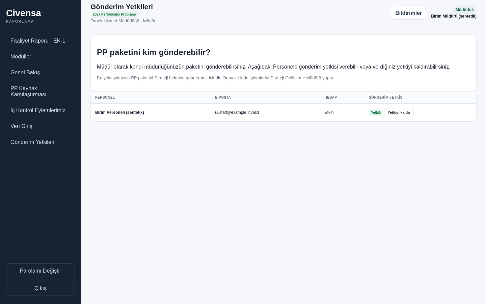

**Görünen metinler ve tablolar:**

- `div`: Civensa RAPORLAMA
- `h1`: Gönderim Yetkileri
- `span`: 2027 Performans Programı
- `p`: Örnek Hizmet Müdürlüğü · Müdür
- `div`: Müdürlük Birim Müdürü (sentetik)
- `h2`: PP paketini kim gönderebilir?
- `p`: Müdür olarak kendi müdürlüğünüzün paketini gönderebilirsiniz. Aşağıdaki Personele gönderim yetkisi verebilir veya verdiğiniz yetkiyi kaldırabilirsiniz.
- `p`: Bu yetki yalnızca PP paketini Strateji birimine göndermek içindir. Onay ve iade işlemlerini Strateji Geliştirme Müdürü yapar.
- `table`: PERSONEL E-POSTA HESAP GÖNDERİM YETKİSİ Birim Personeli (sentetik) ui.staff@example.invalid Etkin Yetkili Yetkiyi kaldır

**Bağlantı, düğme, form ve alanlar:**

| Öğe | Tür / etiket / bağlam | Hedef URL veya eylem | Ne yapar / mevcut değer |
| --- | --- | --- | --- |
| E001 | a · Faaliyet Raporu · EK-1 | `/activity-sections` | Bağlantıdaki ekranı veya dosyayı açar: Faaliyet Raporu · EK-1. |
| E002 | a · Modüller | `/modules` | Bağlantıdaki ekranı veya dosyayı açar: Modüller. |
| E003 | a · Genel Bakış | `/dashboard?period_id=1` | Bağlantıdaki ekranı veya dosyayı açar: Genel Bakış. |
| E004 | a · PP Kaynak Karşılaştırması | `/source-comparison?period_id=1` | Bağlantıdaki ekranı veya dosyayı açar: PP Kaynak Karşılaştırması. |
| E005 | a · İç Kontrol Eylemlerimiz | `/internal-control/our-actions` | Bağlantıdaki ekranı veya dosyayı açar: İç Kontrol Eylemlerimiz. |
| E006 | a · Veri Girişi | `/department/1?period_id=1` | Bağlantıdaki ekranı veya dosyayı açar: Veri Girişi. |
| E007 | a · Gönderim Yetkileri | `/submit-authorizations?period_id=1` | Bağlantıdaki ekranı veya dosyayı açar: Gönderim Yetkileri. |
| E008 | button · Parolamı Değiştir (#changePasswordButton) | `#passwordModal` | Parola değiştirme penceresini açar. |
| E009 | form · Çıkış | `POST /logout` | Oturumu kapatıp giriş ekranına döner. |
| E010 | button · Çıkış | `POST /logout` | Oturumu kapatıp giriş ekranına döner. |
| E011 | button · Bildirimler (#notificationButton) | `GET /api/notifications → #notificationPanel` | Bildirim listesini açar. |
| E012 | button · Yetkiyi kaldır · Birim Personeli (sentetik) | `POST /api/users/4/submit-authorization` | Personelin paket gönderim yetkisini açar veya kaldırır. |

<a id="ekran-047"></a>

### 047 · Kullanıcılar · Dolu / taslak

URL kalıbı: `/users` · Çekilen URL: `/users?period_id=1` · Rol: **strategy** · HTTP 200.

Kişisel test hesaplarını ve görevlerini yönetir.

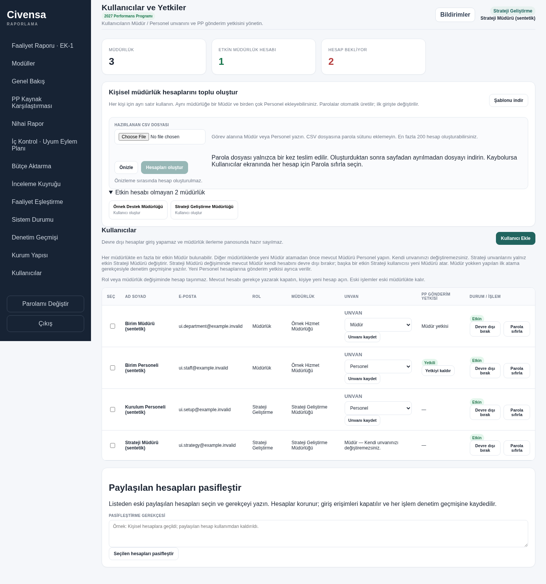

**Görünen metinler ve tablolar:**

- `div`: Civensa RAPORLAMA
- `h1`: Kullanıcılar ve Yetkiler
- `span`: 2027 Performans Programı
- `p`: Kullanıcıların Müdür / Personel unvanını ve PP gönderim yetkisini yönetin.
- `div`: Strateji Geliştirme Strateji Müdürü (sentetik)
- `h2`: Kişisel müdürlük hesaplarını toplu oluştur
- `p`: Her kişi için ayrı satır kullanın. Aynı müdürlüğe bir Müdür ve birden çok Personel ekleyebilirsiniz. Parolalar otomatik üretilir; ilk girişte değiştirilir.
- `p`: Görev alanına Müdür veya Personel yazın. CSV dosyasına parola sütunu eklemeyin. En fazla 200 hesap oluşturabilirsiniz.
- `p`: Parola dosyası yalnızca bir kez teslim edilir. Oluşturduktan sonra sayfadan ayrılmadan dosyayı indirin. Kaybolursa Kullanıcılar ekranında her hesap için Parola sıfırla seçin.
- `h2`: Kullanıcılar
- `p`: Devre dışı hesaplar giriş yapamaz ve müdürlük ilerleme panosunda hazır sayılmaz.
- `p`: Her müdürlükte en fazla bir etkin Müdür bulunabilir. Diğer müdürlüklerde yeni Müdür atamadan önce mevcut Müdürü Personel yapın. Kendi unvanınızı değiştiremezsiniz. Strateji unvanlarını yalnız etkin Strateji Müdürü değiştirir. Strateji Müdürü değişiminde mevcut Müdür kendi hesabını devre dışı bırakır; başka bir etkin Strateji kullanıcısı yeni Müdürü atar. Müdür yokken yapılan ilk atama gerekçesiyle denetim geçmişine yazılır. Yeni Personel hesaplarına gönderim yetkisi ayrıca verilir.
- `p`: Rol veya müdürlük değişiminde hesap taşınmaz. Mevcut hesabı gerekçe yazarak kapatın, kişiye yeni hesap açın. Eski işlemler eski müdürlükte kalır.
- `table`: SEÇ AD SOYAD E-POSTA ROL MÜDÜRLÜK UNVAN PP GÖNDERİM YETKİSİ DURUM / İŞLEM Birim Müdürü (sentetik) ui.department@example.invalid Müdürlük Örnek Hizmet Müdürlüğü UNVAN Personel Müdür Unvanı kaydet Müdür yetkisi Etkin Devre dışı bırak Parola sıfırla Birim Personeli (sentetik) ui.staff@example.invalid Müdürlük Örnek Hizmet Müdürlüğü UNVAN Personel Müdür Unvanı kaydet Yetkili Yetkiyi kaldır Etkin Devre dışı bırak Parola sıfırla Kurulum Personeli (sentetik) ui.setup@example.invalid Strateji Geliştirme Strateji Geliştirme Müdürlüğü UNVAN Personel Müdür Unvanı kaydet — Etkin Devre dışı bırak Parola sıfırla Strateji Müdürü (sentetik) ui.strategy@example.invalid Strateji Geliştirme Strateji Geliştirme Müdürlüğü Müdür — Kendi unvanınızı değiştiremezsiniz. — Etkin Devre dışı bırak Parola sıfırla
- `h2`: Paylaşılan hesapları pasifleştir
- `p`: Listeden eski paylaşılan hesapları seçin ve gerekçeyi yazın. Hesaplar korunur; giriş erişimleri kapatılır ve her işlem denetim geçmişine kaydedilir.
- `span`: Müdürlük
- `b`: 3
- `span`: Etkin müdürlük hesabı
- `b`: 1
- `span`: Hesap bekliyor
- `b`: 2
- `div`: Önizleme sırasında hesap oluşturulmaz.

**Bağlantı, düğme, form ve alanlar:**

| Öğe | Tür / etiket / bağlam | Hedef URL veya eylem | Ne yapar / mevcut değer |
| --- | --- | --- | --- |
| E001 | a · Faaliyet Raporu · EK-1 | `/activity-sections` | Bağlantıdaki ekranı veya dosyayı açar: Faaliyet Raporu · EK-1. |
| E002 | a · Modüller | `/modules` | Bağlantıdaki ekranı veya dosyayı açar: Modüller. |
| E003 | a · Genel Bakış | `/dashboard?period_id=1` | Bağlantıdaki ekranı veya dosyayı açar: Genel Bakış. |
| E004 | a · PP Kaynak Karşılaştırması | `/source-comparison?period_id=1` | Bağlantıdaki ekranı veya dosyayı açar: PP Kaynak Karşılaştırması. |
| E005 | a · Nihai Rapor | `/report-builder?period_id=1` | Bağlantıdaki ekranı veya dosyayı açar: Nihai Rapor. |
| E006 | a · İç Kontrol · Uyum Eylem Planı | `/internal-control` | Bağlantıdaki ekranı veya dosyayı açar: İç Kontrol · Uyum Eylem Planı. |
| E007 | a · Bütçe Aktarma | `/budget-reallocations` | Bağlantıdaki ekranı veya dosyayı açar: Bütçe Aktarma. |
| E008 | a · İnceleme Kuyruğu | `/review?period_id=1` | Bağlantıdaki ekranı veya dosyayı açar: İnceleme Kuyruğu. |
| E009 | a · Faaliyet Eşleştirme | `/activity-mapping?period_id=1` | Bağlantıdaki ekranı veya dosyayı açar: Faaliyet Eşleştirme. |
| E010 | a · Sistem Durumu | `/operations?period_id=1` | Bağlantıdaki ekranı veya dosyayı açar: Sistem Durumu. |
| E011 | a · Denetim Geçmişi | `/audit?period_id=1` | Bağlantıdaki ekranı veya dosyayı açar: Denetim Geçmişi. |
| E012 | a · Kurum Yapısı | `/structure?period_id=1` | Bağlantıdaki ekranı veya dosyayı açar: Kurum Yapısı. |
| E013 | a · Kullanıcılar | `/users?period_id=1` | Bağlantıdaki ekranı veya dosyayı açar: Kullanıcılar. |
| E014 | button · Parolamı Değiştir (#changePasswordButton) | `#passwordModal` | Parola değiştirme penceresini açar. |
| E015 | form · Çıkış | `POST /logout` | Oturumu kapatıp giriş ekranına döner. |
| E016 | button · Çıkış | `POST /logout` | Oturumu kapatıp giriş ekranına döner. |
| E017 | button · Bildirimler (#notificationButton) | `GET /api/notifications → #notificationPanel` | Bildirim listesini açar. |
| E018 | a · Şablonu indir · Kişisel müdürlük hesaplarını toplu oluştur | `/api/users/template.csv` | Bağlantıdaki ekranı veya dosyayı açar: Şablonu indir. |
| E019 | input · HAZIRLANAN CSV DOSYASI (#bulkUserFile) · Kişisel müdürlük hesaplarını toplu oluştur | `POST /api/users/bulk-preview → /api/users/bulk-import` | Dosya seçer; ilgili işlemle yüklenir. |
| E020 | button · Önizle (#previewBulkUsers) · Kişisel müdürlük hesaplarını toplu oluştur | `POST /api/users/bulk-preview` | CSV dosyasındaki kişisel hesapları oluşturmadan doğrular. |
| E021 | button · Hesapları oluştur (#applyBulkUsers) · Kişisel müdürlük hesaplarını toplu oluştur | `POST /api/users/bulk-import` | Önizlenen kişisel hesapları oluşturur. **Pasif.** |
| E022 | summary · Etkin hesabı olmayan 2 müdürlük · Etkin hesabı olmayan 2 müdürlük | `Aynı sayfadaki ayrıntı bölümü` | İçerik ve form ayrıntılarını açar veya daraltır. |
| E023 | button · Örnek Destek Müdürlüğü Kullanıcı oluştur · Etkin hesabı olmayan 2 müdürlük | `GET /api/template-snapshots/{snapshot}` | Şablon analizinin ayrıntılarını aynı ekranda gösterir. |
| E024 | button · Strateji Geliştirme Müdürlüğü Kullanıcı oluştur · Etkin hesabı olmayan 2 müdürlük | `GET /api/template-snapshots/{snapshot}` | Şablon analizinin ayrıntılarını aynı ekranda gösterir. |
| E025 | button · Kullanıcı Ekle (#newUserBtn) | `#newUserForm` | Yeni kişisel hesap formunu açar. |
| E026 | input · Birim Müdürü (sentetik) hesabını seç | `Aynı ekranın JavaScript işlem verisi` | Seçeneği işaretler veya kaldırır. Değer: İşaretli değil. |
| E027 | select · Birim Müdürü (sentetik) unvanı | `Aynı ekranın JavaScript işlem verisi` | Listeden seçim yapar. Değer: director. Seçenekler: Personel; Müdür. |
| E028 | button · Unvanı kaydet | `POST /api/users/2/position` | Kullanıcının personel veya müdür görevini kaydeder. |
| E029 | button · Devre dışı bırak | `POST /api/users/2/active` | Hesabın giriş erişimini etkinleştirir veya kapatır. |
| E030 | button · Parola sıfırla | `Hesabın geçici parola alanı` | Geçici parola yenileme alanını açar veya kapatır. |
| E031 | input · Birim Personeli (sentetik) hesabını seç | `Aynı ekranın JavaScript işlem verisi` | Seçeneği işaretler veya kaldırır. Değer: İşaretli değil. |
| E032 | select · Birim Personeli (sentetik) unvanı | `Aynı ekranın JavaScript işlem verisi` | Listeden seçim yapar. Değer: staff. Seçenekler: Personel; Müdür. |
| E033 | button · Unvanı kaydet | `POST /api/users/4/position` | Kullanıcının personel veya müdür görevini kaydeder. |
| E034 | button · Yetkiyi kaldır | `POST /api/users/4/submit-authorization` | Personelin paket gönderim yetkisini açar veya kaldırır. |
| E035 | button · Devre dışı bırak | `POST /api/users/4/active` | Hesabın giriş erişimini etkinleştirir veya kapatır. |
| E036 | button · Parola sıfırla | `Hesabın geçici parola alanı` | Geçici parola yenileme alanını açar veya kapatır. |
| E037 | input · Kurulum Personeli (sentetik) hesabını seç | `Aynı ekranın JavaScript işlem verisi` | Seçeneği işaretler veya kaldırır. Değer: İşaretli değil. |
| E038 | select · Kurulum Personeli (sentetik) unvanı | `Aynı ekranın JavaScript işlem verisi` | Listeden seçim yapar. Değer: staff. Seçenekler: Personel; Müdür. |
| E039 | button · Unvanı kaydet | `POST /api/users/3/position` | Kullanıcının personel veya müdür görevini kaydeder. |
| E040 | button · Devre dışı bırak | `POST /api/users/3/active` | Hesabın giriş erişimini etkinleştirir veya kapatır. |
| E041 | button · Parola sıfırla | `Hesabın geçici parola alanı` | Geçici parola yenileme alanını açar veya kapatır. |
| E042 | input · Strateji Müdürü (sentetik) hesabını seç | `Aynı ekranın JavaScript işlem verisi` | Seçeneği işaretler veya kaldırır. Değer: İşaretli değil. |
| E043 | button · Devre dışı bırak | `POST /api/users/1/active` | Hesabın giriş erişimini etkinleştirir veya kapatır. |
| E044 | button · Parola sıfırla | `Hesabın geçici parola alanı` | Geçici parola yenileme alanını açar veya kapatır. |
| E045 | textarea · PASİFLEŞTİRME GEREKÇESİ (#retireUsersReason) · Paylaşılan hesapları pasifleştir | `POST /api/users/bulk-deactivate` | İşlem için PASİFLEŞTİRME GEREKÇESİ değerini girer. Zorunlu. |
| E046 | button · Seçilen hesapları pasifleştir (#retireSelectedUsers) · Paylaşılan hesapları pasifleştir | `POST /api/users/bulk-deactivate` | Seçilen hesapları gerekçeyle pasifleştirir. |

<a id="ekran-048"></a>

### 048 · EK-1 bölüm editörü · Bölüm SUNUS

URL kalıbı: `/activity-sections/reports/{document_id}` · Çekilen URL: `/activity-sections/reports/1?code=SUNUS` · Rol: **strategy** · HTTP 200.

Seçilen rapor bölümünün metin, tablo ve durumunu gösterir.


**Görünen metinler ve tablolar:**

- `div`: Civensa RAPORLAMA
- `h1`: 2027 Faaliyet Raporu
- `p`: İdare · EK-1 · İçerik hazırlığı
- `div`: Strateji Geliştirme Strateji Müdürü (sentetik)
- `p`: ← Tamamlanma görünümü
- `p`: Word olarak indir PDF olarak indir Dizgi verisi (JSON)
- `h2`: Onaylı birim sürümü eksik
- `p`: İdare raporunu dondurmadan önce şu birimlerin gönderim ve bağımsız onayını tamamlayın:
- `h2`: İdare sürüm geçmişi
- `p`: Henüz onaylı sürüm oluşturulmadı.
- `p`: SUNUS · Bölüm sahibi: Strateji
- `h2`: ÜST YÖNETİCİ SUNUŞU
- `p`: Son düzenleyen: —
- `p`: Paragrafları boş satırla ayırın. Madde için “- ” kullanın. Basit tablo için “&#124; Başlık &#124; Değer &#124;” yazın; her satırda aynı sayıda sütun kullanın. Önizleme kaydetmeden güncellenir.
- `h3`: İçerik önizlemesi
- `h3`: Bölüm denetim geçmişi
- `p`: Henüz değişiklik kaydı yok.
- `h3`: İdare içerik onayı
- `p`: Tüm bölümleri ve birimlerin bağımsız onaylarını tamamlayın. Konsolidasyon yalnız son onaylı birim sürümlerini kullanır. İçerik ve birim sürüm manifesti değiştirilemez kopya olarak saklanır.
- `li`: Örnek Hizmet Müdürlüğü
- `li`: Örnek Destek Müdürlüğü

**Bağlantı, düğme, form ve alanlar:**

| Öğe | Tür / etiket / bağlam | Hedef URL veya eylem | Ne yapar / mevcut değer |
| --- | --- | --- | --- |
| E001 | a · Faaliyet Raporu · EK-1 | `/activity-sections` | Bağlantıdaki ekranı veya dosyayı açar: Faaliyet Raporu · EK-1. |
| E002 | a · Modüller | `/modules` | Bağlantıdaki ekranı veya dosyayı açar: Modüller. |
| E003 | a · Genel Bakış | `/dashboard` | Bağlantıdaki ekranı veya dosyayı açar: Genel Bakış. |
| E004 | a · Nihai Rapor | `/report-builder` | Bağlantıdaki ekranı veya dosyayı açar: Nihai Rapor. |
| E005 | a · İç Kontrol · Uyum Eylem Planı | `/internal-control` | Bağlantıdaki ekranı veya dosyayı açar: İç Kontrol · Uyum Eylem Planı. |
| E006 | a · Bütçe Aktarma | `/budget-reallocations` | Bağlantıdaki ekranı veya dosyayı açar: Bütçe Aktarma. |
| E007 | a · İnceleme Kuyruğu | `/review` | Bağlantıdaki ekranı veya dosyayı açar: İnceleme Kuyruğu. |
| E008 | a · Faaliyet Eşleştirme | `/activity-mapping` | Bağlantıdaki ekranı veya dosyayı açar: Faaliyet Eşleştirme. |
| E009 | a · Sistem Durumu | `/operations` | Bağlantıdaki ekranı veya dosyayı açar: Sistem Durumu. |
| E010 | a · Denetim Geçmişi | `/audit` | Bağlantıdaki ekranı veya dosyayı açar: Denetim Geçmişi. |
| E011 | a · Kurum Yapısı | `/structure` | Bağlantıdaki ekranı veya dosyayı açar: Kurum Yapısı. |
| E012 | a · Kullanıcılar | `/users` | Bağlantıdaki ekranı veya dosyayı açar: Kullanıcılar. |
| E013 | button · Parolamı Değiştir (#changePasswordButton) | `#passwordModal` | Parola değiştirme penceresini açar. |
| E014 | form · Çıkış | `POST /logout` | Oturumu kapatıp giriş ekranına döner. |
| E015 | button · Çıkış | `POST /logout` | Oturumu kapatıp giriş ekranına döner. |
| E016 | button · Bildirimler (#notificationButton) | `GET /api/notifications → #notificationPanel` | Bildirim listesini açar. |
| E017 | a · ← Tamamlanma görünümü | `/activity-sections` | Bağlantıdaki ekranı veya dosyayı açar: ← Tamamlanma görünümü. |
| E018 | a · Word olarak indir | `/activity-sections/reports/1/export.docx` | Bağlantıdaki ekranı veya dosyayı açar: Word olarak indir. |
| E019 | a · PDF olarak indir | `/activity-sections/reports/1/export.pdf` | Bağlantıdaki ekranı veya dosyayı açar: PDF olarak indir. |
| E020 | a · Dizgi verisi (JSON) | `/activity-sections/reports/1/typeset.json` | Bağlantıdaki ekranı veya dosyayı açar: Dizgi verisi (JSON). |
| E021 | a · ÜST YÖNETİCİ SUNUŞU Boş | `?code=SUNUS` | Bağlantıdaki ekranı veya dosyayı açar: ÜST YÖNETİCİ SUNUŞU Boş. |
| E022 | a · YÖNETİCİ ÖZETİ Boş | `?code=OZET` | Bağlantıdaki ekranı veya dosyayı açar: YÖNETİCİ ÖZETİ Boş. |
| E023 | a · I- GENEL BİLGİLER Boş | `?code=I` | Bağlantıdaki ekranı veya dosyayı açar: I- GENEL BİLGİLER Boş. |
| E024 | a · A- Misyon ve Vizyon Taslak | `?code=I.A` | Bağlantıdaki ekranı veya dosyayı açar: A- Misyon ve Vizyon Taslak. |
| E025 | a · B- Yetki, Görev ve Sorumluluklar Boş | `?code=I.B` | Bağlantıdaki ekranı veya dosyayı açar: B- Yetki, Görev ve Sorumluluklar Boş. |
| E026 | a · C- İdareye İlişkin Bilgiler Boş | `?code=I.C` | Bağlantıdaki ekranı veya dosyayı açar: C- İdareye İlişkin Bilgiler Boş. |
| E027 | a · 1- Fiziksel Yapı Boş | `?code=I.C.1` | Bağlantıdaki ekranı veya dosyayı açar: 1- Fiziksel Yapı Boş. |
| E028 | a · 2- Teşkilat Yapısı Boş | `?code=I.C.2` | Bağlantıdaki ekranı veya dosyayı açar: 2- Teşkilat Yapısı Boş. |
| E029 | a · 3- Teknoloji ve Bilişim Altyapısı Boş | `?code=I.C.3` | Bağlantıdaki ekranı veya dosyayı açar: 3- Teknoloji ve Bilişim Altyapısı Boş. |
| E030 | a · 4- İnsan Kaynakları Boş | `?code=I.C.4` | Bağlantıdaki ekranı veya dosyayı açar: 4- İnsan Kaynakları Boş. |
| E031 | a · 5- Sunulan Hizmetler Boş | `?code=I.C.5` | Bağlantıdaki ekranı veya dosyayı açar: 5- Sunulan Hizmetler Boş. |
| E032 | a · 6- Yönetim ve İç Kontrol Sistemi Boş | `?code=I.C.6` | Bağlantıdaki ekranı veya dosyayı açar: 6- Yönetim ve İç Kontrol Sistemi Boş. |
| E033 | a · D- Diğer Hususlar Boş | `?code=I.D` | Bağlantıdaki ekranı veya dosyayı açar: D- Diğer Hususlar Boş. |
| E034 | a · II- AMAÇLAR ve HEDEFLER Boş | `?code=II` | Bağlantıdaki ekranı veya dosyayı açar: II- AMAÇLAR ve HEDEFLER Boş. |
| E035 | a · A- Temel Politika ve Öncelikler Boş | `?code=II.A` | Bağlantıdaki ekranı veya dosyayı açar: A- Temel Politika ve Öncelikler Boş. |
| E036 | a · B- İdarenin Stratejik Planında Yer Alan Amaç ve Hedefler Boş | `?code=II.B` | Bağlantıdaki ekranı veya dosyayı açar: B- İdarenin Stratejik Planında Yer Alan Amaç ve Hedefler Boş. |
| E037 | a · C- Diğer Hususlar Boş | `?code=II.C` | Bağlantıdaki ekranı veya dosyayı açar: C- Diğer Hususlar Boş. |
| E038 | a · III- FAALİYETLERE İLİŞKİN BİLGİ VE DEĞERLENDİRMELER Boş | `?code=III` | Bağlantıdaki ekranı veya dosyayı açar: III- FAALİYETLERE İLİŞKİN BİLGİ VE DEĞERLENDİRMELER Boş. |
| E039 | a · A- Malî Bilgiler Boş | `?code=III.A` | Bağlantıdaki ekranı veya dosyayı açar: A- Malî Bilgiler Boş. |
| E040 | a · 1- Bütçe Uygulama Sonuçları Taslak | `?code=III.A.1` | Bağlantıdaki ekranı veya dosyayı açar: 1- Bütçe Uygulama Sonuçları Taslak. |
| E041 | a · 2- Temel Malî Tablolara İlişkin Açıklamalar Boş | `?code=III.A.2` | Bağlantıdaki ekranı veya dosyayı açar: 2- Temel Malî Tablolara İlişkin Açıklamalar Boş. |
| E042 | a · 3- Malî Denetim Sonuçları Boş | `?code=III.A.3` | Bağlantıdaki ekranı veya dosyayı açar: 3- Malî Denetim Sonuçları Boş. |
| E043 | a · 4- Diğer Hususlar Boş | `?code=III.A.4` | Bağlantıdaki ekranı veya dosyayı açar: 4- Diğer Hususlar Boş. |
| E044 | a · B- Performans Bilgileri Boş | `?code=III.B` | Bağlantıdaki ekranı veya dosyayı açar: B- Performans Bilgileri Boş. |
| E045 | a · 1- Program, Alt Program, Faaliyet Bilgileri Boş | `?code=III.B.1` | Bağlantıdaki ekranı veya dosyayı açar: 1- Program, Alt Program, Faaliyet Bilgileri Boş. |
| E046 | a · 2- Performans Sonuçlarının Değerlendirilmesi Boş | `?code=III.B.2` | Bağlantıdaki ekranı veya dosyayı açar: 2- Performans Sonuçlarının Değerlendirilmesi Boş. |
| E047 | a · i. Alt program hedef ve göstergeleriyle ilgili gerçekleşme sonuçları ve değerlendirmeler Boş | `?code=III.B.2.i` | Bağlantıdaki ekranı veya dosyayı açar: i. Alt program hedef ve göstergeleriyle ilgili gerçekleşme sonuçları ve değerlendirmeler Boş. |
| E048 | a · ii. Performans denetim sonuçları Boş | `?code=III.B.2.ii` | Bağlantıdaki ekranı veya dosyayı açar: ii. Performans denetim sonuçları Boş. |
| E049 | a · 3- Stratejik Plan Değerlendirme Tabloları Boş | `?code=III.B.3` | Bağlantıdaki ekranı veya dosyayı açar: 3- Stratejik Plan Değerlendirme Tabloları Boş. |
| E050 | a · 4- Performans Bilgi Sisteminin Değerlendirilmesi Boş | `?code=III.B.4` | Bağlantıdaki ekranı veya dosyayı açar: 4- Performans Bilgi Sisteminin Değerlendirilmesi Boş. |
| E051 | a · 5- Diğer Hususlar Boş | `?code=III.B.5` | Bağlantıdaki ekranı veya dosyayı açar: 5- Diğer Hususlar Boş. |
| E052 | a · IV- KURUMSAL KABİLİYET VE KAPASİTENİN DEĞERLENDİRİLMESİ Boş | `?code=IV` | Bağlantıdaki ekranı veya dosyayı açar: IV- KURUMSAL KABİLİYET VE KAPASİTENİN DEĞERLENDİRİLMESİ Boş. |
| E053 | a · A- Üstünlükler Boş | `?code=IV.A` | Bağlantıdaki ekranı veya dosyayı açar: A- Üstünlükler Boş. |
| E054 | a · B- Zayıflıklar Boş | `?code=IV.B` | Bağlantıdaki ekranı veya dosyayı açar: B- Zayıflıklar Boş. |
| E055 | a · C- Değerlendirme Boş | `?code=IV.C` | Bağlantıdaki ekranı veya dosyayı açar: C- Değerlendirme Boş. |
| E056 | a · V- ÖNERİ VE TEDBİRLER Boş | `?code=V` | Bağlantıdaki ekranı veya dosyayı açar: V- ÖNERİ VE TEDBİRLER Boş. |
| E057 | a · EKLER Boş | `?code=EKLER` | Bağlantıdaki ekranı veya dosyayı açar: EKLER Boş. |
| E058 | form · Bölümü kaydet · ÜST YÖNETİCİ SUNUŞU | `POST /activity-sections/reports/1/sections/SUNUS` | Bölümü kaydet işlemini form alanlarıyla gönderir; doğrulama sonrası kaydeder veya hata gösterir. |
| E059 | textarea · BÖLÜM İÇERİĞİ · ÜST YÖNETİCİ SUNUŞU | `POST /activity-sections/reports/1/sections/SUNUS` | İşlem için BÖLÜM İÇERİĞİ değerini girer. |
| E060 | select · DURUM Boş Taslak Hazır Uygulanamaz · ÜST YÖNETİCİ SUNUŞU | `POST /activity-sections/reports/1/sections/SUNUS` | Listeden seçim yapar. Değer: empty. Seçenekler: Boş; Taslak; Hazır; Uygulanamaz. |
| E061 | textarea · UYGULANAMAZ GEREKÇESİ · ÜST YÖNETİCİ SUNUŞU | `POST /activity-sections/reports/1/sections/SUNUS` | İşlem için UYGULANAMAZ GEREKÇESİ değerini girer. |
| E062 | button · Bölümü kaydet · ÜST YÖNETİCİ SUNUŞU | `POST /activity-sections/reports/1/sections/SUNUS` | Bölümü kaydet işlemini form alanlarıyla gönderir; doğrulama sonrası kaydeder veya hata gösterir. |
| E063 | form · İçeriği onayla ve dondur · İdare içerik onayı | `POST /activity-sections/reports/1/freeze` | Kontrolleri geçen raporun değişmez sürümünü oluşturur. |
| E064 | button · İçeriği onayla ve dondur · İdare içerik onayı | `POST /activity-sections/reports/1/freeze` | Kontrolleri geçen raporun değişmez sürümünü oluşturur. |

<a id="ekran-049"></a>

### 049 · EK-1 bölüm editörü · Bölüm I.C.1

URL kalıbı: `/activity-sections/reports/{document_id}` · Çekilen URL: `/activity-sections/reports/1?code=I.C.1` · Rol: **strategy** · HTTP 200.

Seçilen rapor bölümünün metin, tablo ve durumunu gösterir.

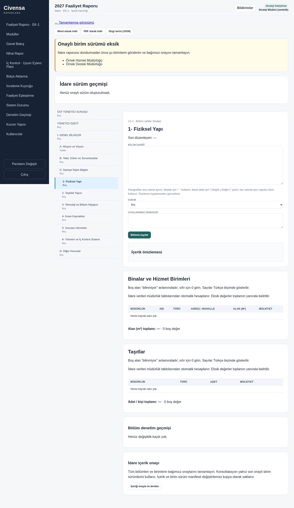

**Görünen metinler ve tablolar:**

- `div`: Civensa RAPORLAMA
- `h1`: 2027 Faaliyet Raporu
- `p`: İdare · EK-1 · İçerik hazırlığı
- `div`: Strateji Geliştirme Strateji Müdürü (sentetik)
- `p`: ← Tamamlanma görünümü
- `p`: Word olarak indir PDF olarak indir Dizgi verisi (JSON)
- `h2`: Onaylı birim sürümü eksik
- `p`: İdare raporunu dondurmadan önce şu birimlerin gönderim ve bağımsız onayını tamamlayın:
- `h2`: İdare sürüm geçmişi
- `p`: Henüz onaylı sürüm oluşturulmadı.
- `p`: I.C.1 · Bölüm sahibi: Strateji
- `h2`: 1- Fiziksel Yapı
- `p`: Son düzenleyen: —
- `p`: Paragrafları boş satırla ayırın. Madde için “- ” kullanın. Basit tablo için “&#124; Başlık &#124; Değer &#124;” yazın; her satırda aynı sayıda sütun kullanın. Önizleme kaydetmeden güncellenir.
- `h3`: İçerik önizlemesi
- `h2`: Binalar ve Hizmet Birimleri
- `p`: Boş alan “bilinmiyor” anlamındadır; sıfır için 0 girin. Sayılar Türkçe biçimde gösterilir.
- `p`: İdare verileri müdürlük tablolarından otomatik hesaplanır. Eksik değerler toplamın yanında belirtilir.
- `table`: MÜDÜRLÜK ADI TÜRÜ ADRES / MAHALLE ALAN (M²) MÜLKİYET Henüz kaynak satırı yok.
- `p`: Alan (m²) toplamı: — · 0 boş değer
- `h2`: Taşıtlar
- `p`: Boş alan “bilinmiyor” anlamındadır; sıfır için 0 girin. Sayılar Türkçe biçimde gösterilir.
- `p`: İdare verileri müdürlük tablolarından otomatik hesaplanır. Eksik değerler toplamın yanında belirtilir.
- `table`: MÜDÜRLÜK TÜRÜ ADET MÜLKİYET Henüz kaynak satırı yok.
- `p`: Adet / kişi toplamı: — · 0 boş değer
- `h3`: Bölüm denetim geçmişi
- `p`: Henüz değişiklik kaydı yok.
- `h3`: İdare içerik onayı
- `p`: Tüm bölümleri ve birimlerin bağımsız onaylarını tamamlayın. Konsolidasyon yalnız son onaylı birim sürümlerini kullanır. İçerik ve birim sürüm manifesti değiştirilemez kopya olarak saklanır.
- `li`: Örnek Hizmet Müdürlüğü
- `li`: Örnek Destek Müdürlüğü

**Bağlantı, düğme, form ve alanlar:**

| Öğe | Tür / etiket / bağlam | Hedef URL veya eylem | Ne yapar / mevcut değer |
| --- | --- | --- | --- |
| E001 | a · Faaliyet Raporu · EK-1 | `/activity-sections` | Bağlantıdaki ekranı veya dosyayı açar: Faaliyet Raporu · EK-1. |
| E002 | a · Modüller | `/modules` | Bağlantıdaki ekranı veya dosyayı açar: Modüller. |
| E003 | a · Genel Bakış | `/dashboard` | Bağlantıdaki ekranı veya dosyayı açar: Genel Bakış. |
| E004 | a · Nihai Rapor | `/report-builder` | Bağlantıdaki ekranı veya dosyayı açar: Nihai Rapor. |
| E005 | a · İç Kontrol · Uyum Eylem Planı | `/internal-control` | Bağlantıdaki ekranı veya dosyayı açar: İç Kontrol · Uyum Eylem Planı. |
| E006 | a · Bütçe Aktarma | `/budget-reallocations` | Bağlantıdaki ekranı veya dosyayı açar: Bütçe Aktarma. |
| E007 | a · İnceleme Kuyruğu | `/review` | Bağlantıdaki ekranı veya dosyayı açar: İnceleme Kuyruğu. |
| E008 | a · Faaliyet Eşleştirme | `/activity-mapping` | Bağlantıdaki ekranı veya dosyayı açar: Faaliyet Eşleştirme. |
| E009 | a · Sistem Durumu | `/operations` | Bağlantıdaki ekranı veya dosyayı açar: Sistem Durumu. |
| E010 | a · Denetim Geçmişi | `/audit` | Bağlantıdaki ekranı veya dosyayı açar: Denetim Geçmişi. |
| E011 | a · Kurum Yapısı | `/structure` | Bağlantıdaki ekranı veya dosyayı açar: Kurum Yapısı. |
| E012 | a · Kullanıcılar | `/users` | Bağlantıdaki ekranı veya dosyayı açar: Kullanıcılar. |
| E013 | button · Parolamı Değiştir (#changePasswordButton) | `#passwordModal` | Parola değiştirme penceresini açar. |
| E014 | form · Çıkış | `POST /logout` | Oturumu kapatıp giriş ekranına döner. |
| E015 | button · Çıkış | `POST /logout` | Oturumu kapatıp giriş ekranına döner. |
| E016 | button · Bildirimler (#notificationButton) | `GET /api/notifications → #notificationPanel` | Bildirim listesini açar. |
| E017 | a · ← Tamamlanma görünümü | `/activity-sections` | Bağlantıdaki ekranı veya dosyayı açar: ← Tamamlanma görünümü. |
| E018 | a · Word olarak indir | `/activity-sections/reports/1/export.docx` | Bağlantıdaki ekranı veya dosyayı açar: Word olarak indir. |
| E019 | a · PDF olarak indir | `/activity-sections/reports/1/export.pdf` | Bağlantıdaki ekranı veya dosyayı açar: PDF olarak indir. |
| E020 | a · Dizgi verisi (JSON) | `/activity-sections/reports/1/typeset.json` | Bağlantıdaki ekranı veya dosyayı açar: Dizgi verisi (JSON). |
| E021 | a · ÜST YÖNETİCİ SUNUŞU Boş | `?code=SUNUS` | Bağlantıdaki ekranı veya dosyayı açar: ÜST YÖNETİCİ SUNUŞU Boş. |
| E022 | a · YÖNETİCİ ÖZETİ Boş | `?code=OZET` | Bağlantıdaki ekranı veya dosyayı açar: YÖNETİCİ ÖZETİ Boş. |
| E023 | a · I- GENEL BİLGİLER Boş | `?code=I` | Bağlantıdaki ekranı veya dosyayı açar: I- GENEL BİLGİLER Boş. |
| E024 | a · A- Misyon ve Vizyon Taslak | `?code=I.A` | Bağlantıdaki ekranı veya dosyayı açar: A- Misyon ve Vizyon Taslak. |
| E025 | a · B- Yetki, Görev ve Sorumluluklar Boş | `?code=I.B` | Bağlantıdaki ekranı veya dosyayı açar: B- Yetki, Görev ve Sorumluluklar Boş. |
| E026 | a · C- İdareye İlişkin Bilgiler Boş | `?code=I.C` | Bağlantıdaki ekranı veya dosyayı açar: C- İdareye İlişkin Bilgiler Boş. |
| E027 | a · 1- Fiziksel Yapı Boş | `?code=I.C.1` | Bağlantıdaki ekranı veya dosyayı açar: 1- Fiziksel Yapı Boş. |
| E028 | a · 2- Teşkilat Yapısı Boş | `?code=I.C.2` | Bağlantıdaki ekranı veya dosyayı açar: 2- Teşkilat Yapısı Boş. |
| E029 | a · 3- Teknoloji ve Bilişim Altyapısı Boş | `?code=I.C.3` | Bağlantıdaki ekranı veya dosyayı açar: 3- Teknoloji ve Bilişim Altyapısı Boş. |
| E030 | a · 4- İnsan Kaynakları Boş | `?code=I.C.4` | Bağlantıdaki ekranı veya dosyayı açar: 4- İnsan Kaynakları Boş. |
| E031 | a · 5- Sunulan Hizmetler Boş | `?code=I.C.5` | Bağlantıdaki ekranı veya dosyayı açar: 5- Sunulan Hizmetler Boş. |
| E032 | a · 6- Yönetim ve İç Kontrol Sistemi Boş | `?code=I.C.6` | Bağlantıdaki ekranı veya dosyayı açar: 6- Yönetim ve İç Kontrol Sistemi Boş. |
| E033 | a · D- Diğer Hususlar Boş | `?code=I.D` | Bağlantıdaki ekranı veya dosyayı açar: D- Diğer Hususlar Boş. |
| E034 | a · II- AMAÇLAR ve HEDEFLER Boş | `?code=II` | Bağlantıdaki ekranı veya dosyayı açar: II- AMAÇLAR ve HEDEFLER Boş. |
| E035 | a · A- Temel Politika ve Öncelikler Boş | `?code=II.A` | Bağlantıdaki ekranı veya dosyayı açar: A- Temel Politika ve Öncelikler Boş. |
| E036 | a · B- İdarenin Stratejik Planında Yer Alan Amaç ve Hedefler Boş | `?code=II.B` | Bağlantıdaki ekranı veya dosyayı açar: B- İdarenin Stratejik Planında Yer Alan Amaç ve Hedefler Boş. |
| E037 | a · C- Diğer Hususlar Boş | `?code=II.C` | Bağlantıdaki ekranı veya dosyayı açar: C- Diğer Hususlar Boş. |
| E038 | a · III- FAALİYETLERE İLİŞKİN BİLGİ VE DEĞERLENDİRMELER Boş | `?code=III` | Bağlantıdaki ekranı veya dosyayı açar: III- FAALİYETLERE İLİŞKİN BİLGİ VE DEĞERLENDİRMELER Boş. |
| E039 | a · A- Malî Bilgiler Boş | `?code=III.A` | Bağlantıdaki ekranı veya dosyayı açar: A- Malî Bilgiler Boş. |
| E040 | a · 1- Bütçe Uygulama Sonuçları Taslak | `?code=III.A.1` | Bağlantıdaki ekranı veya dosyayı açar: 1- Bütçe Uygulama Sonuçları Taslak. |
| E041 | a · 2- Temel Malî Tablolara İlişkin Açıklamalar Boş | `?code=III.A.2` | Bağlantıdaki ekranı veya dosyayı açar: 2- Temel Malî Tablolara İlişkin Açıklamalar Boş. |
| E042 | a · 3- Malî Denetim Sonuçları Boş | `?code=III.A.3` | Bağlantıdaki ekranı veya dosyayı açar: 3- Malî Denetim Sonuçları Boş. |
| E043 | a · 4- Diğer Hususlar Boş | `?code=III.A.4` | Bağlantıdaki ekranı veya dosyayı açar: 4- Diğer Hususlar Boş. |
| E044 | a · B- Performans Bilgileri Boş | `?code=III.B` | Bağlantıdaki ekranı veya dosyayı açar: B- Performans Bilgileri Boş. |
| E045 | a · 1- Program, Alt Program, Faaliyet Bilgileri Boş | `?code=III.B.1` | Bağlantıdaki ekranı veya dosyayı açar: 1- Program, Alt Program, Faaliyet Bilgileri Boş. |
| E046 | a · 2- Performans Sonuçlarının Değerlendirilmesi Boş | `?code=III.B.2` | Bağlantıdaki ekranı veya dosyayı açar: 2- Performans Sonuçlarının Değerlendirilmesi Boş. |
| E047 | a · i. Alt program hedef ve göstergeleriyle ilgili gerçekleşme sonuçları ve değerlendirmeler Boş | `?code=III.B.2.i` | Bağlantıdaki ekranı veya dosyayı açar: i. Alt program hedef ve göstergeleriyle ilgili gerçekleşme sonuçları ve değerlendirmeler Boş. |
| E048 | a · ii. Performans denetim sonuçları Boş | `?code=III.B.2.ii` | Bağlantıdaki ekranı veya dosyayı açar: ii. Performans denetim sonuçları Boş. |
| E049 | a · 3- Stratejik Plan Değerlendirme Tabloları Boş | `?code=III.B.3` | Bağlantıdaki ekranı veya dosyayı açar: 3- Stratejik Plan Değerlendirme Tabloları Boş. |
| E050 | a · 4- Performans Bilgi Sisteminin Değerlendirilmesi Boş | `?code=III.B.4` | Bağlantıdaki ekranı veya dosyayı açar: 4- Performans Bilgi Sisteminin Değerlendirilmesi Boş. |
| E051 | a · 5- Diğer Hususlar Boş | `?code=III.B.5` | Bağlantıdaki ekranı veya dosyayı açar: 5- Diğer Hususlar Boş. |
| E052 | a · IV- KURUMSAL KABİLİYET VE KAPASİTENİN DEĞERLENDİRİLMESİ Boş | `?code=IV` | Bağlantıdaki ekranı veya dosyayı açar: IV- KURUMSAL KABİLİYET VE KAPASİTENİN DEĞERLENDİRİLMESİ Boş. |
| E053 | a · A- Üstünlükler Boş | `?code=IV.A` | Bağlantıdaki ekranı veya dosyayı açar: A- Üstünlükler Boş. |
| E054 | a · B- Zayıflıklar Boş | `?code=IV.B` | Bağlantıdaki ekranı veya dosyayı açar: B- Zayıflıklar Boş. |
| E055 | a · C- Değerlendirme Boş | `?code=IV.C` | Bağlantıdaki ekranı veya dosyayı açar: C- Değerlendirme Boş. |
| E056 | a · V- ÖNERİ VE TEDBİRLER Boş | `?code=V` | Bağlantıdaki ekranı veya dosyayı açar: V- ÖNERİ VE TEDBİRLER Boş. |
| E057 | a · EKLER Boş | `?code=EKLER` | Bağlantıdaki ekranı veya dosyayı açar: EKLER Boş. |
| E058 | form · Bölümü kaydet · 1- Fiziksel Yapı | `POST /activity-sections/reports/1/sections/I.C.1` | Bölümü kaydet işlemini form alanlarıyla gönderir; doğrulama sonrası kaydeder veya hata gösterir. |
| E059 | textarea · BÖLÜM İÇERİĞİ · 1- Fiziksel Yapı | `POST /activity-sections/reports/1/sections/I.C.1` | İşlem için BÖLÜM İÇERİĞİ değerini girer. |
| E060 | select · DURUM Boş Taslak Hazır Uygulanamaz · 1- Fiziksel Yapı | `POST /activity-sections/reports/1/sections/I.C.1` | Listeden seçim yapar. Değer: empty. Seçenekler: Boş; Taslak; Hazır; Uygulanamaz. |
| E061 | textarea · UYGULANAMAZ GEREKÇESİ · 1- Fiziksel Yapı | `POST /activity-sections/reports/1/sections/I.C.1` | İşlem için UYGULANAMAZ GEREKÇESİ değerini girer. |
| E062 | button · Bölümü kaydet · 1- Fiziksel Yapı | `POST /activity-sections/reports/1/sections/I.C.1` | Bölümü kaydet işlemini form alanlarıyla gönderir; doğrulama sonrası kaydeder veya hata gösterir. |
| E063 | form · İçeriği onayla ve dondur · İdare içerik onayı | `POST /activity-sections/reports/1/freeze` | Kontrolleri geçen raporun değişmez sürümünü oluşturur. |
| E064 | button · İçeriği onayla ve dondur · İdare içerik onayı | `POST /activity-sections/reports/1/freeze` | Kontrolleri geçen raporun değişmez sürümünü oluşturur. |

<a id="ekran-050"></a>

### 050 · EK-1 bölüm editörü · Bölüm I.C.2

URL kalıbı: `/activity-sections/reports/{document_id}` · Çekilen URL: `/activity-sections/reports/1?code=I.C.2` · Rol: **strategy** · HTTP 200.

Seçilen rapor bölümünün metin, tablo ve durumunu gösterir.

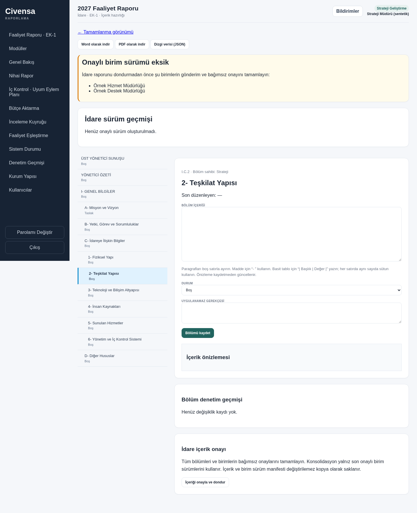

**Görünen metinler ve tablolar:**

- `div`: Civensa RAPORLAMA
- `h1`: 2027 Faaliyet Raporu
- `p`: İdare · EK-1 · İçerik hazırlığı
- `div`: Strateji Geliştirme Strateji Müdürü (sentetik)
- `p`: ← Tamamlanma görünümü
- `p`: Word olarak indir PDF olarak indir Dizgi verisi (JSON)
- `h2`: Onaylı birim sürümü eksik
- `p`: İdare raporunu dondurmadan önce şu birimlerin gönderim ve bağımsız onayını tamamlayın:
- `h2`: İdare sürüm geçmişi
- `p`: Henüz onaylı sürüm oluşturulmadı.
- `p`: I.C.2 · Bölüm sahibi: Strateji
- `h2`: 2- Teşkilat Yapısı
- `p`: Son düzenleyen: —
- `p`: Paragrafları boş satırla ayırın. Madde için “- ” kullanın. Basit tablo için “&#124; Başlık &#124; Değer &#124;” yazın; her satırda aynı sayıda sütun kullanın. Önizleme kaydetmeden güncellenir.
- `h3`: İçerik önizlemesi
- `h3`: Bölüm denetim geçmişi
- `p`: Henüz değişiklik kaydı yok.
- `h3`: İdare içerik onayı
- `p`: Tüm bölümleri ve birimlerin bağımsız onaylarını tamamlayın. Konsolidasyon yalnız son onaylı birim sürümlerini kullanır. İçerik ve birim sürüm manifesti değiştirilemez kopya olarak saklanır.
- `li`: Örnek Hizmet Müdürlüğü
- `li`: Örnek Destek Müdürlüğü

**Bağlantı, düğme, form ve alanlar:**

| Öğe | Tür / etiket / bağlam | Hedef URL veya eylem | Ne yapar / mevcut değer |
| --- | --- | --- | --- |
| E001 | a · Faaliyet Raporu · EK-1 | `/activity-sections` | Bağlantıdaki ekranı veya dosyayı açar: Faaliyet Raporu · EK-1. |
| E002 | a · Modüller | `/modules` | Bağlantıdaki ekranı veya dosyayı açar: Modüller. |
| E003 | a · Genel Bakış | `/dashboard` | Bağlantıdaki ekranı veya dosyayı açar: Genel Bakış. |
| E004 | a · Nihai Rapor | `/report-builder` | Bağlantıdaki ekranı veya dosyayı açar: Nihai Rapor. |
| E005 | a · İç Kontrol · Uyum Eylem Planı | `/internal-control` | Bağlantıdaki ekranı veya dosyayı açar: İç Kontrol · Uyum Eylem Planı. |
| E006 | a · Bütçe Aktarma | `/budget-reallocations` | Bağlantıdaki ekranı veya dosyayı açar: Bütçe Aktarma. |
| E007 | a · İnceleme Kuyruğu | `/review` | Bağlantıdaki ekranı veya dosyayı açar: İnceleme Kuyruğu. |
| E008 | a · Faaliyet Eşleştirme | `/activity-mapping` | Bağlantıdaki ekranı veya dosyayı açar: Faaliyet Eşleştirme. |
| E009 | a · Sistem Durumu | `/operations` | Bağlantıdaki ekranı veya dosyayı açar: Sistem Durumu. |
| E010 | a · Denetim Geçmişi | `/audit` | Bağlantıdaki ekranı veya dosyayı açar: Denetim Geçmişi. |
| E011 | a · Kurum Yapısı | `/structure` | Bağlantıdaki ekranı veya dosyayı açar: Kurum Yapısı. |
| E012 | a · Kullanıcılar | `/users` | Bağlantıdaki ekranı veya dosyayı açar: Kullanıcılar. |
| E013 | button · Parolamı Değiştir (#changePasswordButton) | `#passwordModal` | Parola değiştirme penceresini açar. |
| E014 | form · Çıkış | `POST /logout` | Oturumu kapatıp giriş ekranına döner. |
| E015 | button · Çıkış | `POST /logout` | Oturumu kapatıp giriş ekranına döner. |
| E016 | button · Bildirimler (#notificationButton) | `GET /api/notifications → #notificationPanel` | Bildirim listesini açar. |
| E017 | a · ← Tamamlanma görünümü | `/activity-sections` | Bağlantıdaki ekranı veya dosyayı açar: ← Tamamlanma görünümü. |
| E018 | a · Word olarak indir | `/activity-sections/reports/1/export.docx` | Bağlantıdaki ekranı veya dosyayı açar: Word olarak indir. |
| E019 | a · PDF olarak indir | `/activity-sections/reports/1/export.pdf` | Bağlantıdaki ekranı veya dosyayı açar: PDF olarak indir. |
| E020 | a · Dizgi verisi (JSON) | `/activity-sections/reports/1/typeset.json` | Bağlantıdaki ekranı veya dosyayı açar: Dizgi verisi (JSON). |
| E021 | a · ÜST YÖNETİCİ SUNUŞU Boş | `?code=SUNUS` | Bağlantıdaki ekranı veya dosyayı açar: ÜST YÖNETİCİ SUNUŞU Boş. |
| E022 | a · YÖNETİCİ ÖZETİ Boş | `?code=OZET` | Bağlantıdaki ekranı veya dosyayı açar: YÖNETİCİ ÖZETİ Boş. |
| E023 | a · I- GENEL BİLGİLER Boş | `?code=I` | Bağlantıdaki ekranı veya dosyayı açar: I- GENEL BİLGİLER Boş. |
| E024 | a · A- Misyon ve Vizyon Taslak | `?code=I.A` | Bağlantıdaki ekranı veya dosyayı açar: A- Misyon ve Vizyon Taslak. |
| E025 | a · B- Yetki, Görev ve Sorumluluklar Boş | `?code=I.B` | Bağlantıdaki ekranı veya dosyayı açar: B- Yetki, Görev ve Sorumluluklar Boş. |
| E026 | a · C- İdareye İlişkin Bilgiler Boş | `?code=I.C` | Bağlantıdaki ekranı veya dosyayı açar: C- İdareye İlişkin Bilgiler Boş. |
| E027 | a · 1- Fiziksel Yapı Boş | `?code=I.C.1` | Bağlantıdaki ekranı veya dosyayı açar: 1- Fiziksel Yapı Boş. |
| E028 | a · 2- Teşkilat Yapısı Boş | `?code=I.C.2` | Bağlantıdaki ekranı veya dosyayı açar: 2- Teşkilat Yapısı Boş. |
| E029 | a · 3- Teknoloji ve Bilişim Altyapısı Boş | `?code=I.C.3` | Bağlantıdaki ekranı veya dosyayı açar: 3- Teknoloji ve Bilişim Altyapısı Boş. |
| E030 | a · 4- İnsan Kaynakları Boş | `?code=I.C.4` | Bağlantıdaki ekranı veya dosyayı açar: 4- İnsan Kaynakları Boş. |
| E031 | a · 5- Sunulan Hizmetler Boş | `?code=I.C.5` | Bağlantıdaki ekranı veya dosyayı açar: 5- Sunulan Hizmetler Boş. |
| E032 | a · 6- Yönetim ve İç Kontrol Sistemi Boş | `?code=I.C.6` | Bağlantıdaki ekranı veya dosyayı açar: 6- Yönetim ve İç Kontrol Sistemi Boş. |
| E033 | a · D- Diğer Hususlar Boş | `?code=I.D` | Bağlantıdaki ekranı veya dosyayı açar: D- Diğer Hususlar Boş. |
| E034 | a · II- AMAÇLAR ve HEDEFLER Boş | `?code=II` | Bağlantıdaki ekranı veya dosyayı açar: II- AMAÇLAR ve HEDEFLER Boş. |
| E035 | a · A- Temel Politika ve Öncelikler Boş | `?code=II.A` | Bağlantıdaki ekranı veya dosyayı açar: A- Temel Politika ve Öncelikler Boş. |
| E036 | a · B- İdarenin Stratejik Planında Yer Alan Amaç ve Hedefler Boş | `?code=II.B` | Bağlantıdaki ekranı veya dosyayı açar: B- İdarenin Stratejik Planında Yer Alan Amaç ve Hedefler Boş. |
| E037 | a · C- Diğer Hususlar Boş | `?code=II.C` | Bağlantıdaki ekranı veya dosyayı açar: C- Diğer Hususlar Boş. |
| E038 | a · III- FAALİYETLERE İLİŞKİN BİLGİ VE DEĞERLENDİRMELER Boş | `?code=III` | Bağlantıdaki ekranı veya dosyayı açar: III- FAALİYETLERE İLİŞKİN BİLGİ VE DEĞERLENDİRMELER Boş. |
| E039 | a · A- Malî Bilgiler Boş | `?code=III.A` | Bağlantıdaki ekranı veya dosyayı açar: A- Malî Bilgiler Boş. |
| E040 | a · 1- Bütçe Uygulama Sonuçları Taslak | `?code=III.A.1` | Bağlantıdaki ekranı veya dosyayı açar: 1- Bütçe Uygulama Sonuçları Taslak. |
| E041 | a · 2- Temel Malî Tablolara İlişkin Açıklamalar Boş | `?code=III.A.2` | Bağlantıdaki ekranı veya dosyayı açar: 2- Temel Malî Tablolara İlişkin Açıklamalar Boş. |
| E042 | a · 3- Malî Denetim Sonuçları Boş | `?code=III.A.3` | Bağlantıdaki ekranı veya dosyayı açar: 3- Malî Denetim Sonuçları Boş. |
| E043 | a · 4- Diğer Hususlar Boş | `?code=III.A.4` | Bağlantıdaki ekranı veya dosyayı açar: 4- Diğer Hususlar Boş. |
| E044 | a · B- Performans Bilgileri Boş | `?code=III.B` | Bağlantıdaki ekranı veya dosyayı açar: B- Performans Bilgileri Boş. |
| E045 | a · 1- Program, Alt Program, Faaliyet Bilgileri Boş | `?code=III.B.1` | Bağlantıdaki ekranı veya dosyayı açar: 1- Program, Alt Program, Faaliyet Bilgileri Boş. |
| E046 | a · 2- Performans Sonuçlarının Değerlendirilmesi Boş | `?code=III.B.2` | Bağlantıdaki ekranı veya dosyayı açar: 2- Performans Sonuçlarının Değerlendirilmesi Boş. |
| E047 | a · i. Alt program hedef ve göstergeleriyle ilgili gerçekleşme sonuçları ve değerlendirmeler Boş | `?code=III.B.2.i` | Bağlantıdaki ekranı veya dosyayı açar: i. Alt program hedef ve göstergeleriyle ilgili gerçekleşme sonuçları ve değerlendirmeler Boş. |
| E048 | a · ii. Performans denetim sonuçları Boş | `?code=III.B.2.ii` | Bağlantıdaki ekranı veya dosyayı açar: ii. Performans denetim sonuçları Boş. |
| E049 | a · 3- Stratejik Plan Değerlendirme Tabloları Boş | `?code=III.B.3` | Bağlantıdaki ekranı veya dosyayı açar: 3- Stratejik Plan Değerlendirme Tabloları Boş. |
| E050 | a · 4- Performans Bilgi Sisteminin Değerlendirilmesi Boş | `?code=III.B.4` | Bağlantıdaki ekranı veya dosyayı açar: 4- Performans Bilgi Sisteminin Değerlendirilmesi Boş. |
| E051 | a · 5- Diğer Hususlar Boş | `?code=III.B.5` | Bağlantıdaki ekranı veya dosyayı açar: 5- Diğer Hususlar Boş. |
| E052 | a · IV- KURUMSAL KABİLİYET VE KAPASİTENİN DEĞERLENDİRİLMESİ Boş | `?code=IV` | Bağlantıdaki ekranı veya dosyayı açar: IV- KURUMSAL KABİLİYET VE KAPASİTENİN DEĞERLENDİRİLMESİ Boş. |
| E053 | a · A- Üstünlükler Boş | `?code=IV.A` | Bağlantıdaki ekranı veya dosyayı açar: A- Üstünlükler Boş. |
| E054 | a · B- Zayıflıklar Boş | `?code=IV.B` | Bağlantıdaki ekranı veya dosyayı açar: B- Zayıflıklar Boş. |
| E055 | a · C- Değerlendirme Boş | `?code=IV.C` | Bağlantıdaki ekranı veya dosyayı açar: C- Değerlendirme Boş. |
| E056 | a · V- ÖNERİ VE TEDBİRLER Boş | `?code=V` | Bağlantıdaki ekranı veya dosyayı açar: V- ÖNERİ VE TEDBİRLER Boş. |
| E057 | a · EKLER Boş | `?code=EKLER` | Bağlantıdaki ekranı veya dosyayı açar: EKLER Boş. |
| E058 | form · Bölümü kaydet · 2- Teşkilat Yapısı | `POST /activity-sections/reports/1/sections/I.C.2` | Bölümü kaydet işlemini form alanlarıyla gönderir; doğrulama sonrası kaydeder veya hata gösterir. |
| E059 | textarea · BÖLÜM İÇERİĞİ · 2- Teşkilat Yapısı | `POST /activity-sections/reports/1/sections/I.C.2` | İşlem için BÖLÜM İÇERİĞİ değerini girer. |
| E060 | select · DURUM Boş Taslak Hazır Uygulanamaz · 2- Teşkilat Yapısı | `POST /activity-sections/reports/1/sections/I.C.2` | Listeden seçim yapar. Değer: empty. Seçenekler: Boş; Taslak; Hazır; Uygulanamaz. |
| E061 | textarea · UYGULANAMAZ GEREKÇESİ · 2- Teşkilat Yapısı | `POST /activity-sections/reports/1/sections/I.C.2` | İşlem için UYGULANAMAZ GEREKÇESİ değerini girer. |
| E062 | button · Bölümü kaydet · 2- Teşkilat Yapısı | `POST /activity-sections/reports/1/sections/I.C.2` | Bölümü kaydet işlemini form alanlarıyla gönderir; doğrulama sonrası kaydeder veya hata gösterir. |
| E063 | form · İçeriği onayla ve dondur · İdare içerik onayı | `POST /activity-sections/reports/1/freeze` | Kontrolleri geçen raporun değişmez sürümünü oluşturur. |
| E064 | button · İçeriği onayla ve dondur · İdare içerik onayı | `POST /activity-sections/reports/1/freeze` | Kontrolleri geçen raporun değişmez sürümünü oluşturur. |

<a id="ekran-051"></a>

### 051 · EK-1 bölüm editörü · Bölüm I.C.3

URL kalıbı: `/activity-sections/reports/{document_id}` · Çekilen URL: `/activity-sections/reports/1?code=I.C.3` · Rol: **strategy** · HTTP 200.

Seçilen rapor bölümünün metin, tablo ve durumunu gösterir.

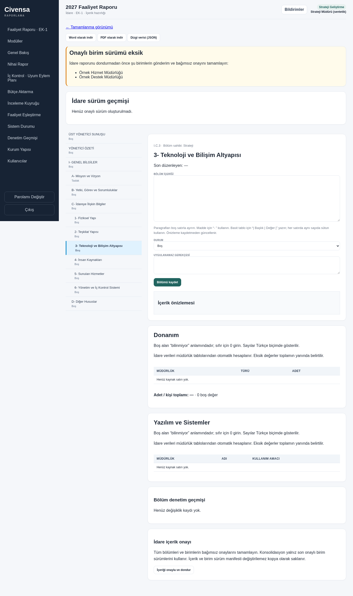

**Görünen metinler ve tablolar:**

- `div`: Civensa RAPORLAMA
- `h1`: 2027 Faaliyet Raporu
- `p`: İdare · EK-1 · İçerik hazırlığı
- `div`: Strateji Geliştirme Strateji Müdürü (sentetik)
- `p`: ← Tamamlanma görünümü
- `p`: Word olarak indir PDF olarak indir Dizgi verisi (JSON)
- `h2`: Onaylı birim sürümü eksik
- `p`: İdare raporunu dondurmadan önce şu birimlerin gönderim ve bağımsız onayını tamamlayın:
- `h2`: İdare sürüm geçmişi
- `p`: Henüz onaylı sürüm oluşturulmadı.
- `p`: I.C.3 · Bölüm sahibi: Strateji
- `h2`: 3- Teknoloji ve Bilişim Altyapısı
- `p`: Son düzenleyen: —
- `p`: Paragrafları boş satırla ayırın. Madde için “- ” kullanın. Basit tablo için “&#124; Başlık &#124; Değer &#124;” yazın; her satırda aynı sayıda sütun kullanın. Önizleme kaydetmeden güncellenir.
- `h3`: İçerik önizlemesi
- `h2`: Donanım
- `p`: Boş alan “bilinmiyor” anlamındadır; sıfır için 0 girin. Sayılar Türkçe biçimde gösterilir.
- `p`: İdare verileri müdürlük tablolarından otomatik hesaplanır. Eksik değerler toplamın yanında belirtilir.
- `table`: MÜDÜRLÜK TÜRÜ ADET Henüz kaynak satırı yok.
- `p`: Adet / kişi toplamı: — · 0 boş değer
- `h2`: Yazılım ve Sistemler
- `p`: Boş alan “bilinmiyor” anlamındadır; sıfır için 0 girin. Sayılar Türkçe biçimde gösterilir.
- `p`: İdare verileri müdürlük tablolarından otomatik hesaplanır. Eksik değerler toplamın yanında belirtilir.
- `table`: MÜDÜRLÜK ADI KULLANIM AMACI Henüz kaynak satırı yok.
- `h3`: Bölüm denetim geçmişi
- `p`: Henüz değişiklik kaydı yok.
- `h3`: İdare içerik onayı
- `p`: Tüm bölümleri ve birimlerin bağımsız onaylarını tamamlayın. Konsolidasyon yalnız son onaylı birim sürümlerini kullanır. İçerik ve birim sürüm manifesti değiştirilemez kopya olarak saklanır.
- `li`: Örnek Hizmet Müdürlüğü
- `li`: Örnek Destek Müdürlüğü

**Bağlantı, düğme, form ve alanlar:**

| Öğe | Tür / etiket / bağlam | Hedef URL veya eylem | Ne yapar / mevcut değer |
| --- | --- | --- | --- |
| E001 | a · Faaliyet Raporu · EK-1 | `/activity-sections` | Bağlantıdaki ekranı veya dosyayı açar: Faaliyet Raporu · EK-1. |
| E002 | a · Modüller | `/modules` | Bağlantıdaki ekranı veya dosyayı açar: Modüller. |
| E003 | a · Genel Bakış | `/dashboard` | Bağlantıdaki ekranı veya dosyayı açar: Genel Bakış. |
| E004 | a · Nihai Rapor | `/report-builder` | Bağlantıdaki ekranı veya dosyayı açar: Nihai Rapor. |
| E005 | a · İç Kontrol · Uyum Eylem Planı | `/internal-control` | Bağlantıdaki ekranı veya dosyayı açar: İç Kontrol · Uyum Eylem Planı. |
| E006 | a · Bütçe Aktarma | `/budget-reallocations` | Bağlantıdaki ekranı veya dosyayı açar: Bütçe Aktarma. |
| E007 | a · İnceleme Kuyruğu | `/review` | Bağlantıdaki ekranı veya dosyayı açar: İnceleme Kuyruğu. |
| E008 | a · Faaliyet Eşleştirme | `/activity-mapping` | Bağlantıdaki ekranı veya dosyayı açar: Faaliyet Eşleştirme. |
| E009 | a · Sistem Durumu | `/operations` | Bağlantıdaki ekranı veya dosyayı açar: Sistem Durumu. |
| E010 | a · Denetim Geçmişi | `/audit` | Bağlantıdaki ekranı veya dosyayı açar: Denetim Geçmişi. |
| E011 | a · Kurum Yapısı | `/structure` | Bağlantıdaki ekranı veya dosyayı açar: Kurum Yapısı. |
| E012 | a · Kullanıcılar | `/users` | Bağlantıdaki ekranı veya dosyayı açar: Kullanıcılar. |
| E013 | button · Parolamı Değiştir (#changePasswordButton) | `#passwordModal` | Parola değiştirme penceresini açar. |
| E014 | form · Çıkış | `POST /logout` | Oturumu kapatıp giriş ekranına döner. |
| E015 | button · Çıkış | `POST /logout` | Oturumu kapatıp giriş ekranına döner. |
| E016 | button · Bildirimler (#notificationButton) | `GET /api/notifications → #notificationPanel` | Bildirim listesini açar. |
| E017 | a · ← Tamamlanma görünümü | `/activity-sections` | Bağlantıdaki ekranı veya dosyayı açar: ← Tamamlanma görünümü. |
| E018 | a · Word olarak indir | `/activity-sections/reports/1/export.docx` | Bağlantıdaki ekranı veya dosyayı açar: Word olarak indir. |
| E019 | a · PDF olarak indir | `/activity-sections/reports/1/export.pdf` | Bağlantıdaki ekranı veya dosyayı açar: PDF olarak indir. |
| E020 | a · Dizgi verisi (JSON) | `/activity-sections/reports/1/typeset.json` | Bağlantıdaki ekranı veya dosyayı açar: Dizgi verisi (JSON). |
| E021 | a · ÜST YÖNETİCİ SUNUŞU Boş | `?code=SUNUS` | Bağlantıdaki ekranı veya dosyayı açar: ÜST YÖNETİCİ SUNUŞU Boş. |
| E022 | a · YÖNETİCİ ÖZETİ Boş | `?code=OZET` | Bağlantıdaki ekranı veya dosyayı açar: YÖNETİCİ ÖZETİ Boş. |
| E023 | a · I- GENEL BİLGİLER Boş | `?code=I` | Bağlantıdaki ekranı veya dosyayı açar: I- GENEL BİLGİLER Boş. |
| E024 | a · A- Misyon ve Vizyon Taslak | `?code=I.A` | Bağlantıdaki ekranı veya dosyayı açar: A- Misyon ve Vizyon Taslak. |
| E025 | a · B- Yetki, Görev ve Sorumluluklar Boş | `?code=I.B` | Bağlantıdaki ekranı veya dosyayı açar: B- Yetki, Görev ve Sorumluluklar Boş. |
| E026 | a · C- İdareye İlişkin Bilgiler Boş | `?code=I.C` | Bağlantıdaki ekranı veya dosyayı açar: C- İdareye İlişkin Bilgiler Boş. |
| E027 | a · 1- Fiziksel Yapı Boş | `?code=I.C.1` | Bağlantıdaki ekranı veya dosyayı açar: 1- Fiziksel Yapı Boş. |
| E028 | a · 2- Teşkilat Yapısı Boş | `?code=I.C.2` | Bağlantıdaki ekranı veya dosyayı açar: 2- Teşkilat Yapısı Boş. |
| E029 | a · 3- Teknoloji ve Bilişim Altyapısı Boş | `?code=I.C.3` | Bağlantıdaki ekranı veya dosyayı açar: 3- Teknoloji ve Bilişim Altyapısı Boş. |
| E030 | a · 4- İnsan Kaynakları Boş | `?code=I.C.4` | Bağlantıdaki ekranı veya dosyayı açar: 4- İnsan Kaynakları Boş. |
| E031 | a · 5- Sunulan Hizmetler Boş | `?code=I.C.5` | Bağlantıdaki ekranı veya dosyayı açar: 5- Sunulan Hizmetler Boş. |
| E032 | a · 6- Yönetim ve İç Kontrol Sistemi Boş | `?code=I.C.6` | Bağlantıdaki ekranı veya dosyayı açar: 6- Yönetim ve İç Kontrol Sistemi Boş. |
| E033 | a · D- Diğer Hususlar Boş | `?code=I.D` | Bağlantıdaki ekranı veya dosyayı açar: D- Diğer Hususlar Boş. |
| E034 | a · II- AMAÇLAR ve HEDEFLER Boş | `?code=II` | Bağlantıdaki ekranı veya dosyayı açar: II- AMAÇLAR ve HEDEFLER Boş. |
| E035 | a · A- Temel Politika ve Öncelikler Boş | `?code=II.A` | Bağlantıdaki ekranı veya dosyayı açar: A- Temel Politika ve Öncelikler Boş. |
| E036 | a · B- İdarenin Stratejik Planında Yer Alan Amaç ve Hedefler Boş | `?code=II.B` | Bağlantıdaki ekranı veya dosyayı açar: B- İdarenin Stratejik Planında Yer Alan Amaç ve Hedefler Boş. |
| E037 | a · C- Diğer Hususlar Boş | `?code=II.C` | Bağlantıdaki ekranı veya dosyayı açar: C- Diğer Hususlar Boş. |
| E038 | a · III- FAALİYETLERE İLİŞKİN BİLGİ VE DEĞERLENDİRMELER Boş | `?code=III` | Bağlantıdaki ekranı veya dosyayı açar: III- FAALİYETLERE İLİŞKİN BİLGİ VE DEĞERLENDİRMELER Boş. |
| E039 | a · A- Malî Bilgiler Boş | `?code=III.A` | Bağlantıdaki ekranı veya dosyayı açar: A- Malî Bilgiler Boş. |
| E040 | a · 1- Bütçe Uygulama Sonuçları Taslak | `?code=III.A.1` | Bağlantıdaki ekranı veya dosyayı açar: 1- Bütçe Uygulama Sonuçları Taslak. |
| E041 | a · 2- Temel Malî Tablolara İlişkin Açıklamalar Boş | `?code=III.A.2` | Bağlantıdaki ekranı veya dosyayı açar: 2- Temel Malî Tablolara İlişkin Açıklamalar Boş. |
| E042 | a · 3- Malî Denetim Sonuçları Boş | `?code=III.A.3` | Bağlantıdaki ekranı veya dosyayı açar: 3- Malî Denetim Sonuçları Boş. |
| E043 | a · 4- Diğer Hususlar Boş | `?code=III.A.4` | Bağlantıdaki ekranı veya dosyayı açar: 4- Diğer Hususlar Boş. |
| E044 | a · B- Performans Bilgileri Boş | `?code=III.B` | Bağlantıdaki ekranı veya dosyayı açar: B- Performans Bilgileri Boş. |
| E045 | a · 1- Program, Alt Program, Faaliyet Bilgileri Boş | `?code=III.B.1` | Bağlantıdaki ekranı veya dosyayı açar: 1- Program, Alt Program, Faaliyet Bilgileri Boş. |
| E046 | a · 2- Performans Sonuçlarının Değerlendirilmesi Boş | `?code=III.B.2` | Bağlantıdaki ekranı veya dosyayı açar: 2- Performans Sonuçlarının Değerlendirilmesi Boş. |
| E047 | a · i. Alt program hedef ve göstergeleriyle ilgili gerçekleşme sonuçları ve değerlendirmeler Boş | `?code=III.B.2.i` | Bağlantıdaki ekranı veya dosyayı açar: i. Alt program hedef ve göstergeleriyle ilgili gerçekleşme sonuçları ve değerlendirmeler Boş. |
| E048 | a · ii. Performans denetim sonuçları Boş | `?code=III.B.2.ii` | Bağlantıdaki ekranı veya dosyayı açar: ii. Performans denetim sonuçları Boş. |
| E049 | a · 3- Stratejik Plan Değerlendirme Tabloları Boş | `?code=III.B.3` | Bağlantıdaki ekranı veya dosyayı açar: 3- Stratejik Plan Değerlendirme Tabloları Boş. |
| E050 | a · 4- Performans Bilgi Sisteminin Değerlendirilmesi Boş | `?code=III.B.4` | Bağlantıdaki ekranı veya dosyayı açar: 4- Performans Bilgi Sisteminin Değerlendirilmesi Boş. |
| E051 | a · 5- Diğer Hususlar Boş | `?code=III.B.5` | Bağlantıdaki ekranı veya dosyayı açar: 5- Diğer Hususlar Boş. |
| E052 | a · IV- KURUMSAL KABİLİYET VE KAPASİTENİN DEĞERLENDİRİLMESİ Boş | `?code=IV` | Bağlantıdaki ekranı veya dosyayı açar: IV- KURUMSAL KABİLİYET VE KAPASİTENİN DEĞERLENDİRİLMESİ Boş. |
| E053 | a · A- Üstünlükler Boş | `?code=IV.A` | Bağlantıdaki ekranı veya dosyayı açar: A- Üstünlükler Boş. |
| E054 | a · B- Zayıflıklar Boş | `?code=IV.B` | Bağlantıdaki ekranı veya dosyayı açar: B- Zayıflıklar Boş. |
| E055 | a · C- Değerlendirme Boş | `?code=IV.C` | Bağlantıdaki ekranı veya dosyayı açar: C- Değerlendirme Boş. |
| E056 | a · V- ÖNERİ VE TEDBİRLER Boş | `?code=V` | Bağlantıdaki ekranı veya dosyayı açar: V- ÖNERİ VE TEDBİRLER Boş. |
| E057 | a · EKLER Boş | `?code=EKLER` | Bağlantıdaki ekranı veya dosyayı açar: EKLER Boş. |
| E058 | form · Bölümü kaydet · 3- Teknoloji ve Bilişim Altyapısı | `POST /activity-sections/reports/1/sections/I.C.3` | Bölümü kaydet işlemini form alanlarıyla gönderir; doğrulama sonrası kaydeder veya hata gösterir. |
| E059 | textarea · BÖLÜM İÇERİĞİ · 3- Teknoloji ve Bilişim Altyapısı | `POST /activity-sections/reports/1/sections/I.C.3` | İşlem için BÖLÜM İÇERİĞİ değerini girer. |
| E060 | select · DURUM Boş Taslak Hazır Uygulanamaz · 3- Teknoloji ve Bilişim Altyapısı | `POST /activity-sections/reports/1/sections/I.C.3` | Listeden seçim yapar. Değer: empty. Seçenekler: Boş; Taslak; Hazır; Uygulanamaz. |
| E061 | textarea · UYGULANAMAZ GEREKÇESİ · 3- Teknoloji ve Bilişim Altyapısı | `POST /activity-sections/reports/1/sections/I.C.3` | İşlem için UYGULANAMAZ GEREKÇESİ değerini girer. |
| E062 | button · Bölümü kaydet · 3- Teknoloji ve Bilişim Altyapısı | `POST /activity-sections/reports/1/sections/I.C.3` | Bölümü kaydet işlemini form alanlarıyla gönderir; doğrulama sonrası kaydeder veya hata gösterir. |
| E063 | form · İçeriği onayla ve dondur · İdare içerik onayı | `POST /activity-sections/reports/1/freeze` | Kontrolleri geçen raporun değişmez sürümünü oluşturur. |
| E064 | button · İçeriği onayla ve dondur · İdare içerik onayı | `POST /activity-sections/reports/1/freeze` | Kontrolleri geçen raporun değişmez sürümünü oluşturur. |

<a id="ekran-052"></a>

### 052 · EK-1 bölüm editörü · Bölüm I.C.4

URL kalıbı: `/activity-sections/reports/{document_id}` · Çekilen URL: `/activity-sections/reports/1?code=I.C.4` · Rol: **strategy** · HTTP 200.

Seçilen rapor bölümünün metin, tablo ve durumunu gösterir.

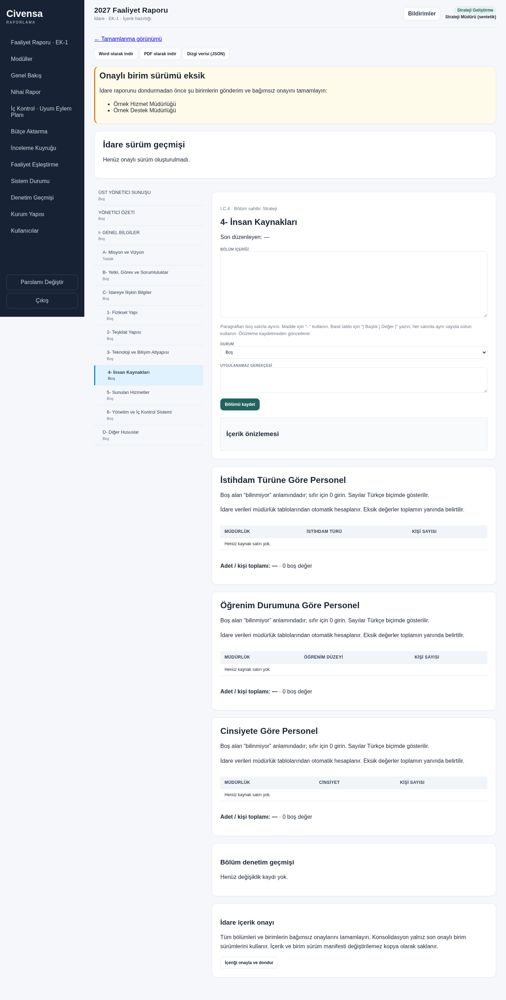

**Görünen metinler ve tablolar:**

- `div`: Civensa RAPORLAMA
- `h1`: 2027 Faaliyet Raporu
- `p`: İdare · EK-1 · İçerik hazırlığı
- `div`: Strateji Geliştirme Strateji Müdürü (sentetik)
- `p`: ← Tamamlanma görünümü
- `p`: Word olarak indir PDF olarak indir Dizgi verisi (JSON)
- `h2`: Onaylı birim sürümü eksik
- `p`: İdare raporunu dondurmadan önce şu birimlerin gönderim ve bağımsız onayını tamamlayın:
- `h2`: İdare sürüm geçmişi
- `p`: Henüz onaylı sürüm oluşturulmadı.
- `p`: I.C.4 · Bölüm sahibi: Strateji
- `h2`: 4- İnsan Kaynakları
- `p`: Son düzenleyen: —
- `p`: Paragrafları boş satırla ayırın. Madde için “- ” kullanın. Basit tablo için “&#124; Başlık &#124; Değer &#124;” yazın; her satırda aynı sayıda sütun kullanın. Önizleme kaydetmeden güncellenir.
- `h3`: İçerik önizlemesi
- `h2`: İstihdam Türüne Göre Personel
- `p`: Boş alan “bilinmiyor” anlamındadır; sıfır için 0 girin. Sayılar Türkçe biçimde gösterilir.
- `p`: İdare verileri müdürlük tablolarından otomatik hesaplanır. Eksik değerler toplamın yanında belirtilir.
- `table`: MÜDÜRLÜK İSTİHDAM TÜRÜ KİŞİ SAYISI Henüz kaynak satırı yok.
- `p`: Adet / kişi toplamı: — · 0 boş değer
- `h2`: Öğrenim Durumuna Göre Personel
- `p`: Boş alan “bilinmiyor” anlamındadır; sıfır için 0 girin. Sayılar Türkçe biçimde gösterilir.
- `p`: İdare verileri müdürlük tablolarından otomatik hesaplanır. Eksik değerler toplamın yanında belirtilir.
- `table`: MÜDÜRLÜK ÖĞRENİM DÜZEYİ KİŞİ SAYISI Henüz kaynak satırı yok.
- `p`: Adet / kişi toplamı: — · 0 boş değer
- `h2`: Cinsiyete Göre Personel
- `p`: Boş alan “bilinmiyor” anlamındadır; sıfır için 0 girin. Sayılar Türkçe biçimde gösterilir.
- `p`: İdare verileri müdürlük tablolarından otomatik hesaplanır. Eksik değerler toplamın yanında belirtilir.
- `table`: MÜDÜRLÜK CİNSİYET KİŞİ SAYISI Henüz kaynak satırı yok.
- `p`: Adet / kişi toplamı: — · 0 boş değer
- `h3`: Bölüm denetim geçmişi
- `p`: Henüz değişiklik kaydı yok.
- `h3`: İdare içerik onayı
- `p`: Tüm bölümleri ve birimlerin bağımsız onaylarını tamamlayın. Konsolidasyon yalnız son onaylı birim sürümlerini kullanır. İçerik ve birim sürüm manifesti değiştirilemez kopya olarak saklanır.
- `li`: Örnek Hizmet Müdürlüğü
- `li`: Örnek Destek Müdürlüğü

**Bağlantı, düğme, form ve alanlar:**

| Öğe | Tür / etiket / bağlam | Hedef URL veya eylem | Ne yapar / mevcut değer |
| --- | --- | --- | --- |
| E001 | a · Faaliyet Raporu · EK-1 | `/activity-sections` | Bağlantıdaki ekranı veya dosyayı açar: Faaliyet Raporu · EK-1. |
| E002 | a · Modüller | `/modules` | Bağlantıdaki ekranı veya dosyayı açar: Modüller. |
| E003 | a · Genel Bakış | `/dashboard` | Bağlantıdaki ekranı veya dosyayı açar: Genel Bakış. |
| E004 | a · Nihai Rapor | `/report-builder` | Bağlantıdaki ekranı veya dosyayı açar: Nihai Rapor. |
| E005 | a · İç Kontrol · Uyum Eylem Planı | `/internal-control` | Bağlantıdaki ekranı veya dosyayı açar: İç Kontrol · Uyum Eylem Planı. |
| E006 | a · Bütçe Aktarma | `/budget-reallocations` | Bağlantıdaki ekranı veya dosyayı açar: Bütçe Aktarma. |
| E007 | a · İnceleme Kuyruğu | `/review` | Bağlantıdaki ekranı veya dosyayı açar: İnceleme Kuyruğu. |
| E008 | a · Faaliyet Eşleştirme | `/activity-mapping` | Bağlantıdaki ekranı veya dosyayı açar: Faaliyet Eşleştirme. |
| E009 | a · Sistem Durumu | `/operations` | Bağlantıdaki ekranı veya dosyayı açar: Sistem Durumu. |
| E010 | a · Denetim Geçmişi | `/audit` | Bağlantıdaki ekranı veya dosyayı açar: Denetim Geçmişi. |
| E011 | a · Kurum Yapısı | `/structure` | Bağlantıdaki ekranı veya dosyayı açar: Kurum Yapısı. |
| E012 | a · Kullanıcılar | `/users` | Bağlantıdaki ekranı veya dosyayı açar: Kullanıcılar. |
| E013 | button · Parolamı Değiştir (#changePasswordButton) | `#passwordModal` | Parola değiştirme penceresini açar. |
| E014 | form · Çıkış | `POST /logout` | Oturumu kapatıp giriş ekranına döner. |
| E015 | button · Çıkış | `POST /logout` | Oturumu kapatıp giriş ekranına döner. |
| E016 | button · Bildirimler (#notificationButton) | `GET /api/notifications → #notificationPanel` | Bildirim listesini açar. |
| E017 | a · ← Tamamlanma görünümü | `/activity-sections` | Bağlantıdaki ekranı veya dosyayı açar: ← Tamamlanma görünümü. |
| E018 | a · Word olarak indir | `/activity-sections/reports/1/export.docx` | Bağlantıdaki ekranı veya dosyayı açar: Word olarak indir. |
| E019 | a · PDF olarak indir | `/activity-sections/reports/1/export.pdf` | Bağlantıdaki ekranı veya dosyayı açar: PDF olarak indir. |
| E020 | a · Dizgi verisi (JSON) | `/activity-sections/reports/1/typeset.json` | Bağlantıdaki ekranı veya dosyayı açar: Dizgi verisi (JSON). |
| E021 | a · ÜST YÖNETİCİ SUNUŞU Boş | `?code=SUNUS` | Bağlantıdaki ekranı veya dosyayı açar: ÜST YÖNETİCİ SUNUŞU Boş. |
| E022 | a · YÖNETİCİ ÖZETİ Boş | `?code=OZET` | Bağlantıdaki ekranı veya dosyayı açar: YÖNETİCİ ÖZETİ Boş. |
| E023 | a · I- GENEL BİLGİLER Boş | `?code=I` | Bağlantıdaki ekranı veya dosyayı açar: I- GENEL BİLGİLER Boş. |
| E024 | a · A- Misyon ve Vizyon Taslak | `?code=I.A` | Bağlantıdaki ekranı veya dosyayı açar: A- Misyon ve Vizyon Taslak. |
| E025 | a · B- Yetki, Görev ve Sorumluluklar Boş | `?code=I.B` | Bağlantıdaki ekranı veya dosyayı açar: B- Yetki, Görev ve Sorumluluklar Boş. |
| E026 | a · C- İdareye İlişkin Bilgiler Boş | `?code=I.C` | Bağlantıdaki ekranı veya dosyayı açar: C- İdareye İlişkin Bilgiler Boş. |
| E027 | a · 1- Fiziksel Yapı Boş | `?code=I.C.1` | Bağlantıdaki ekranı veya dosyayı açar: 1- Fiziksel Yapı Boş. |
| E028 | a · 2- Teşkilat Yapısı Boş | `?code=I.C.2` | Bağlantıdaki ekranı veya dosyayı açar: 2- Teşkilat Yapısı Boş. |
| E029 | a · 3- Teknoloji ve Bilişim Altyapısı Boş | `?code=I.C.3` | Bağlantıdaki ekranı veya dosyayı açar: 3- Teknoloji ve Bilişim Altyapısı Boş. |
| E030 | a · 4- İnsan Kaynakları Boş | `?code=I.C.4` | Bağlantıdaki ekranı veya dosyayı açar: 4- İnsan Kaynakları Boş. |
| E031 | a · 5- Sunulan Hizmetler Boş | `?code=I.C.5` | Bağlantıdaki ekranı veya dosyayı açar: 5- Sunulan Hizmetler Boş. |
| E032 | a · 6- Yönetim ve İç Kontrol Sistemi Boş | `?code=I.C.6` | Bağlantıdaki ekranı veya dosyayı açar: 6- Yönetim ve İç Kontrol Sistemi Boş. |
| E033 | a · D- Diğer Hususlar Boş | `?code=I.D` | Bağlantıdaki ekranı veya dosyayı açar: D- Diğer Hususlar Boş. |
| E034 | a · II- AMAÇLAR ve HEDEFLER Boş | `?code=II` | Bağlantıdaki ekranı veya dosyayı açar: II- AMAÇLAR ve HEDEFLER Boş. |
| E035 | a · A- Temel Politika ve Öncelikler Boş | `?code=II.A` | Bağlantıdaki ekranı veya dosyayı açar: A- Temel Politika ve Öncelikler Boş. |
| E036 | a · B- İdarenin Stratejik Planında Yer Alan Amaç ve Hedefler Boş | `?code=II.B` | Bağlantıdaki ekranı veya dosyayı açar: B- İdarenin Stratejik Planında Yer Alan Amaç ve Hedefler Boş. |
| E037 | a · C- Diğer Hususlar Boş | `?code=II.C` | Bağlantıdaki ekranı veya dosyayı açar: C- Diğer Hususlar Boş. |
| E038 | a · III- FAALİYETLERE İLİŞKİN BİLGİ VE DEĞERLENDİRMELER Boş | `?code=III` | Bağlantıdaki ekranı veya dosyayı açar: III- FAALİYETLERE İLİŞKİN BİLGİ VE DEĞERLENDİRMELER Boş. |
| E039 | a · A- Malî Bilgiler Boş | `?code=III.A` | Bağlantıdaki ekranı veya dosyayı açar: A- Malî Bilgiler Boş. |
| E040 | a · 1- Bütçe Uygulama Sonuçları Taslak | `?code=III.A.1` | Bağlantıdaki ekranı veya dosyayı açar: 1- Bütçe Uygulama Sonuçları Taslak. |
| E041 | a · 2- Temel Malî Tablolara İlişkin Açıklamalar Boş | `?code=III.A.2` | Bağlantıdaki ekranı veya dosyayı açar: 2- Temel Malî Tablolara İlişkin Açıklamalar Boş. |
| E042 | a · 3- Malî Denetim Sonuçları Boş | `?code=III.A.3` | Bağlantıdaki ekranı veya dosyayı açar: 3- Malî Denetim Sonuçları Boş. |
| E043 | a · 4- Diğer Hususlar Boş | `?code=III.A.4` | Bağlantıdaki ekranı veya dosyayı açar: 4- Diğer Hususlar Boş. |
| E044 | a · B- Performans Bilgileri Boş | `?code=III.B` | Bağlantıdaki ekranı veya dosyayı açar: B- Performans Bilgileri Boş. |
| E045 | a · 1- Program, Alt Program, Faaliyet Bilgileri Boş | `?code=III.B.1` | Bağlantıdaki ekranı veya dosyayı açar: 1- Program, Alt Program, Faaliyet Bilgileri Boş. |
| E046 | a · 2- Performans Sonuçlarının Değerlendirilmesi Boş | `?code=III.B.2` | Bağlantıdaki ekranı veya dosyayı açar: 2- Performans Sonuçlarının Değerlendirilmesi Boş. |
| E047 | a · i. Alt program hedef ve göstergeleriyle ilgili gerçekleşme sonuçları ve değerlendirmeler Boş | `?code=III.B.2.i` | Bağlantıdaki ekranı veya dosyayı açar: i. Alt program hedef ve göstergeleriyle ilgili gerçekleşme sonuçları ve değerlendirmeler Boş. |
| E048 | a · ii. Performans denetim sonuçları Boş | `?code=III.B.2.ii` | Bağlantıdaki ekranı veya dosyayı açar: ii. Performans denetim sonuçları Boş. |
| E049 | a · 3- Stratejik Plan Değerlendirme Tabloları Boş | `?code=III.B.3` | Bağlantıdaki ekranı veya dosyayı açar: 3- Stratejik Plan Değerlendirme Tabloları Boş. |
| E050 | a · 4- Performans Bilgi Sisteminin Değerlendirilmesi Boş | `?code=III.B.4` | Bağlantıdaki ekranı veya dosyayı açar: 4- Performans Bilgi Sisteminin Değerlendirilmesi Boş. |
| E051 | a · 5- Diğer Hususlar Boş | `?code=III.B.5` | Bağlantıdaki ekranı veya dosyayı açar: 5- Diğer Hususlar Boş. |
| E052 | a · IV- KURUMSAL KABİLİYET VE KAPASİTENİN DEĞERLENDİRİLMESİ Boş | `?code=IV` | Bağlantıdaki ekranı veya dosyayı açar: IV- KURUMSAL KABİLİYET VE KAPASİTENİN DEĞERLENDİRİLMESİ Boş. |
| E053 | a · A- Üstünlükler Boş | `?code=IV.A` | Bağlantıdaki ekranı veya dosyayı açar: A- Üstünlükler Boş. |
| E054 | a · B- Zayıflıklar Boş | `?code=IV.B` | Bağlantıdaki ekranı veya dosyayı açar: B- Zayıflıklar Boş. |
| E055 | a · C- Değerlendirme Boş | `?code=IV.C` | Bağlantıdaki ekranı veya dosyayı açar: C- Değerlendirme Boş. |
| E056 | a · V- ÖNERİ VE TEDBİRLER Boş | `?code=V` | Bağlantıdaki ekranı veya dosyayı açar: V- ÖNERİ VE TEDBİRLER Boş. |
| E057 | a · EKLER Boş | `?code=EKLER` | Bağlantıdaki ekranı veya dosyayı açar: EKLER Boş. |
| E058 | form · Bölümü kaydet · 4- İnsan Kaynakları | `POST /activity-sections/reports/1/sections/I.C.4` | Bölümü kaydet işlemini form alanlarıyla gönderir; doğrulama sonrası kaydeder veya hata gösterir. |
| E059 | textarea · BÖLÜM İÇERİĞİ · 4- İnsan Kaynakları | `POST /activity-sections/reports/1/sections/I.C.4` | İşlem için BÖLÜM İÇERİĞİ değerini girer. |
| E060 | select · DURUM Boş Taslak Hazır Uygulanamaz · 4- İnsan Kaynakları | `POST /activity-sections/reports/1/sections/I.C.4` | Listeden seçim yapar. Değer: empty. Seçenekler: Boş; Taslak; Hazır; Uygulanamaz. |
| E061 | textarea · UYGULANAMAZ GEREKÇESİ · 4- İnsan Kaynakları | `POST /activity-sections/reports/1/sections/I.C.4` | İşlem için UYGULANAMAZ GEREKÇESİ değerini girer. |
| E062 | button · Bölümü kaydet · 4- İnsan Kaynakları | `POST /activity-sections/reports/1/sections/I.C.4` | Bölümü kaydet işlemini form alanlarıyla gönderir; doğrulama sonrası kaydeder veya hata gösterir. |
| E063 | form · İçeriği onayla ve dondur · İdare içerik onayı | `POST /activity-sections/reports/1/freeze` | Kontrolleri geçen raporun değişmez sürümünü oluşturur. |
| E064 | button · İçeriği onayla ve dondur · İdare içerik onayı | `POST /activity-sections/reports/1/freeze` | Kontrolleri geçen raporun değişmez sürümünü oluşturur. |

<a id="ekran-053"></a>

### 053 · EK-1 bölüm editörü · Bölüm III.A.1

URL kalıbı: `/activity-sections/reports/{document_id}` · Çekilen URL: `/activity-sections/reports/1?code=III.A.1` · Rol: **strategy** · HTTP 200.

Seçilen rapor bölümünün metin, tablo ve durumunu gösterir.

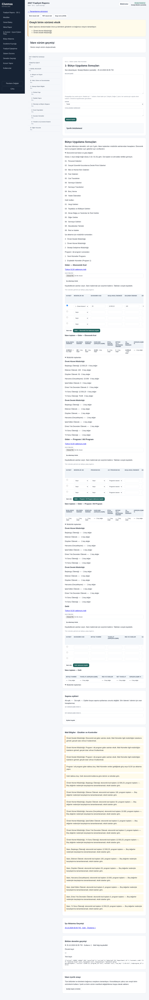

**Görünen metinler ve tablolar:**

- `div`: Civensa RAPORLAMA
- `h1`: 2027 Faaliyet Raporu
- `p`: İdare · EK-1 · İçerik hazırlığı
- `div`: Strateji Geliştirme Strateji Müdürü (sentetik)
- `p`: ← Tamamlanma görünümü
- `p`: Word olarak indir PDF olarak indir Dizgi verisi (JSON)
- `h2`: Onaylı birim sürümü eksik
- `p`: İdare raporunu dondurmadan önce şu birimlerin gönderim ve bağımsız onayını tamamlayın:
- `h2`: İdare sürüm geçmişi
- `p`: Henüz onaylı sürüm oluşturulmadı.
- `p`: III.A.1 · Bölüm sahibi: Mali Hizmetler
- `h2`: 1- Bütçe Uygulama Sonuçları
- `p`: Son düzenleyen: Strateji Müdürü (sentetik) · 25.10.2026 00:35 TSİ
- `p`: Paragrafları boş satırla ayırın. Madde için “- ” kullanın. Basit tablo için “&#124; Başlık &#124; Değer &#124;” yazın; her satırda aynı sayıda sütun kullanın. Önizleme kaydetmeden güncellenir.
- `h3`: İçerik önizlemesi
- `h2`: Bütçe Uygulama Sonuçları
- `p`: Boş tutar bilinmiyor demektir; sıfır için 0 girin. İdare toplamları müdürlük satırlarından hesaplanır. Ekonomik kod ve program tabloları aynı giderleri ayrı sınıflandırır.
- `p`: Düzey 1 veya isteğe bağlı düzey 2 (ör. 01.01) girin. Üst toplam ve alt kodları birlikte girmeyin.
- `p`: 01 · Personel Giderleri
- `p`: 02 · Sosyal Güvenlik Kurumlarına Devlet Primi Giderleri
- `p`: 03 · Mal ve Hizmet Alım Giderleri
- `p`: 04 · Faiz Giderleri
- `p`: 05 · Cari Transferler
- `p`: 06 · Sermaye Giderleri
- `p`: 07 · Sermaye Transferleri
- `p`: 08 · Borç Verme
- `p`: 09 · Yedek Ödenekler
- `p`: Gelir kodları:
- `p`: 01 · Vergi Gelirleri
- `p`: 03 · Teşebbüs ve Mülkiyet Gelirleri
- `p`: 04 · Alınan Bağış ve Yardımlar ile Özel Gelirler
- `p`: 05 · Diğer Gelirler
- `p`: 06 · Sermaye Gelirleri
- `p`: 08 · Alacaklardan Tahsilat
- `p`: 09 · Red ve İadeler
- `p`: İçe aktarma için müdürlük numaraları:
- `p`: 3 · Örnek Destek Müdürlüğü
- `p`: 1 · Örnek Hizmet Müdürlüğü
- `p`: 2 · Strateji Geliştirme Müdürlüğü
- `p`: Program / alt program numaraları:
- `p`: 1 · Yerel Hizmetler Programı
- `p`: 1 · Erişilebilir Hizmetler (Program 1)
- `h3`: Gider — Ekonomik Kod
- `p`: Türkçe XLSX şablonunu indir
- `p`: Kaydedilecek satırları seçin. Satırı kaldırmak için seçimini kaldırın. Tabloları sırayla kaydedin.
- `p`: Tüm sütunları görmek için tabloyu yatay kaydırın.
- `table`: KAYDET MÜDÜRLÜK NO EKONOMİK KOD BAŞLANGIÇ ÖDENEĞİ EKLENEN ÖDENEK DÜŞÜLEN ÖDENEK BİLDİRİLEN YIL SONU ÖDENEĞİ HARCAMA (GERÇEKLEŞME) İPTAL EDİLEN ÖDENEK ERTESİ YILA DEVREDEN ÖDENEK SAPMA AÇIKLAMASI HESAPLANAN YIL SONU / NET TAHSİLAT GERÇEKLEŞME % PP BÜTÇESİ (SALT OKUNUR) BİRİM SAPMA AÇIKLAMASI (SALT OKUNUR) Seçin 3 · Örnek Destek Müdürlüğü 1 · Örnek Hizmet Müdürlüğü 2 · Strateji Geliştirme Müdürlüğü 12.550,23 79,68 12.500,23 Yayın 1 Seçin 3 · Örnek Destek Müdürlüğü 1 · Örnek Hizmet Müdürlüğü 2 · Strateji Geliştirme Müdürlüğü — — — Seçin 3 · Örnek Destek Müdürlüğü 1 · Örnek Hizmet Müdürlüğü 2 · Strateji Geliştirme Müdürlüğü — — — Seçin 3 · Örnek Destek Müdürlüğü 1 · Örnek Hizmet Müdürlüğü 2 · Strateji Geliştirme Müdürlüğü — — —
- `h4`: İdare toplamı — Gider — Ekonomik Kod
- `table`: BAŞLANGIÇ ÖDENEĞİ EKLENEN ÖDENEK DÜŞÜLEN ÖDENEK HARCAMA (GERÇEKLEŞME) İPTAL EDİLEN ÖDENEK ERTESİ YILA DEVREDEN ÖDENEK YIL SONU ÖDENEĞİ GERÇEKLEŞME % 12.500,23 · 1 boş değer 100 · 1 boş değer 50 · 1 boş değer 10.000 · 1 boş değer 0 · 1 boş değer 0 · 1 boş değer 12.550,23 · 1 boş değer — · 1 boş değer
- `p`: Örnek Hizmet Müdürlüğü
- `p`: Başlangıç Ödeneği: 12.500,23 · 0 boş değer
- `p`: Eklenen Ödenek: 100 · 0 boş değer
- `p`: Düşülen Ödenek: 50 · 0 boş değer
- `p`: Harcama (Gerçekleşme): 10.000 · 0 boş değer
- `p`: İptal Edilen Ödenek: 0 · 0 boş değer
- `p`: Ertesi Yıla Devreden Ödenek: 0 · 0 boş değer
- `p`: Yıl Sonu Ödeneği: 12.550,23 · 0 boş değer
- `p`: Yıl Sonu Ödeneği: 79,68 · 0 boş değer
- `p`: Örnek Destek Müdürlüğü
- `p`: Başlangıç Ödeneği: — · 1 boş değer
- `p`: Eklenen Ödenek: — · 1 boş değer
- `p`: Düşülen Ödenek: — · 1 boş değer
- `p`: Harcama (Gerçekleşme): — · 1 boş değer
- `p`: İptal Edilen Ödenek: — · 1 boş değer
- `p`: Ertesi Yıla Devreden Ödenek: — · 1 boş değer
- `p`: Yıl Sonu Ödeneği: — · 1 boş değer
- `p`: Yıl Sonu Ödeneği: — · 1 boş değer
- `h3`: Gider — Program / Alt Program
- `p`: Türkçe XLSX şablonunu indir
- `p`: Kaydedilecek satırları seçin. Satırı kaldırmak için seçimini kaldırın. Tabloları sırayla kaydedin.
- `p`: Tüm sütunları görmek için tabloyu yatay kaydırın.
- `table`: KAYDET MÜDÜRLÜK NO PROGRAM NO ALT PROGRAM NO BAŞLANGIÇ ÖDENEĞİ EKLENEN ÖDENEK DÜŞÜLEN ÖDENEK BİLDİRİLEN YIL SONU ÖDENEĞİ HARCAMA (GERÇEKLEŞME) İPTAL EDİLEN ÖDENEK ERTESİ YILA DEVREDEN ÖDENEK SAPMA AÇIKLAMASI HESAPLANAN YIL SONU / NET TAHSİLAT GERÇEKLEŞME % BİRİM SAPMA AÇIKLAMASI (SALT OKUNUR) Seçin 3 · Örnek Destek Müdürlüğü 1 · Örnek Hizmet Müdürlüğü 2 · Strateji Geliştirme Müdürlüğü Seçin 1 · Yerel Hizmetler Programı Programın tamamı 1 · Erişilebilir Hizmetler (Program 1) — — Seçin 3 · Örnek Destek Müdürlüğü 1 · Örnek Hizmet Müdürlüğü 2 · Strateji Geliştirme Müdürlüğü Seçin 1 · Yerel Hizmetler Programı Programın tamamı 1 · Erişilebilir Hizmetler (Program 1) — — Seçin 3 · Örnek Destek Müdürlüğü 1 · Örnek Hizmet Müdürlüğü 2 · Strateji Geliştirme Müdürlüğü Seçin 1 · Yerel Hizmetler Programı Programın tamamı 1 · Erişilebilir Hizmetler (Program 1) — —
- `h4`: İdare toplamı — Gider — Program / Alt Program
- `table`: BAŞLANGIÇ ÖDENEĞİ EKLENEN ÖDENEK DÜŞÜLEN ÖDENEK HARCAMA (GERÇEKLEŞME) İPTAL EDİLEN ÖDENEK ERTESİ YILA DEVREDEN ÖDENEK YIL SONU ÖDENEĞİ GERÇEKLEŞME % — · 2 boş değer — · 2 boş değer — · 2 boş değer — · 2 boş değer — · 2 boş değer — · 2 boş değer — · 2 boş değer — · 2 boş değer
- `p`: Örnek Hizmet Müdürlüğü
- `p`: Başlangıç Ödeneği: — · 1 boş değer
- `p`: Eklenen Ödenek: — · 1 boş değer
- `p`: Düşülen Ödenek: — · 1 boş değer
- `p`: Harcama (Gerçekleşme): — · 1 boş değer
- `p`: İptal Edilen Ödenek: — · 1 boş değer
- `p`: Ertesi Yıla Devreden Ödenek: — · 1 boş değer
- `p`: Yıl Sonu Ödeneği: — · 1 boş değer
- `p`: Yıl Sonu Ödeneği: — · 1 boş değer
- `p`: Örnek Destek Müdürlüğü
- `p`: Başlangıç Ödeneği: — · 1 boş değer
- `p`: Eklenen Ödenek: — · 1 boş değer
- `p`: Düşülen Ödenek: — · 1 boş değer
- `p`: Harcama (Gerçekleşme): — · 1 boş değer
- `p`: İptal Edilen Ödenek: — · 1 boş değer
- `p`: Ertesi Yıla Devreden Ödenek: — · 1 boş değer
- `p`: Yıl Sonu Ödeneği: — · 1 boş değer
- `p`: Yıl Sonu Ödeneği: — · 1 boş değer
- `h3`: Gelir
- `p`: Türkçe XLSX şablonunu indir
- `p`: Kaydedilecek satırları seçin. Satırı kaldırmak için seçimini kaldırın. Tabloları sırayla kaydedin.
- `p`: Tüm sütunları görmek için tabloyu yatay kaydırın.
- `table`: KAYDET EKONOMİK KOD BÜTÇE TAHMİNİ TAHSİLAT (GERÇEKLEŞME) RED VE İADELER SAPMA AÇIKLAMASI HESAPLANAN YIL SONU / NET TAHSİLAT GERÇEKLEŞME % BİRİM SAPMA AÇIKLAMASI (SALT OKUNUR) — — — — — —
- `h4`: İdare toplamı — Gelir
- `table`: BÜTÇE TAHMİNİ TAHSİLAT (GERÇEKLEŞME) RED VE İADELER NET TAHSİLAT GERÇEKLEŞME % — · 0 boş değer — · 0 boş değer — · 0 boş değer — · 0 boş değer — · 0 boş değer
- `h3`: Sapma eşikleri
- `p`: Alt eşik: — · Üst eşik: —. Eşikler boşsa sapma açıklaması zorunlu değildir. Sıfır ödenek / tahmin için oran hesaplanmaz.
- `h3`: Malî Bilgiler · Eksikler ve Kontroller
- `p`: Örnek Destek Müdürlüğü: Ekonomik kod gider satırları eksik. Mali Hizmetler ilgili müdürlüğün tutarlarını girmeli; gerçek tutar sıfırsa 0 kullanılmalı.
- `p`: Örnek Hizmet Müdürlüğü: Program / alt program gider satırları eksik. Mali Hizmetler ilgili müdürlüğün tutarlarını girmeli; gerçek tutar sıfırsa 0 kullanılmalı.
- `p`: Örnek Destek Müdürlüğü: Program / alt program gider satırları eksik. Mali Hizmetler ilgili müdürlüğün tutarlarını girmeli; gerçek tutar sıfırsa 0 kullanılmalı.
- `p`: Program / alt program gider tablosu boş. Mali Hizmetler verileri geldiğinde giriş veya XLSX içe aktarma yapın.
- `p`: Gelir tablosu boş. Gelir ekonomik kodlarına göre tahmin ve tahsilatı girin.
- `p`: Örnek Hizmet Müdürlüğü, Başlangıç Ödeneği: ekonomik kod toplamı 12.500,23, program toplamı —. Boş değerler nedeniyle karşılaştırma tamamlanamadı; eksik tutarları girin.
- `p`: Örnek Hizmet Müdürlüğü, Eklenen Ödenek: ekonomik kod toplamı 100, program toplamı —. Boş değerler nedeniyle karşılaştırma tamamlanamadı; eksik tutarları girin.
- `p`: Örnek Hizmet Müdürlüğü, Düşülen Ödenek: ekonomik kod toplamı 50, program toplamı —. Boş değerler nedeniyle karşılaştırma tamamlanamadı; eksik tutarları girin.
- `p`: Örnek Hizmet Müdürlüğü, Harcama (Gerçekleşme): ekonomik kod toplamı 10.000, program toplamı —. Boş değerler nedeniyle karşılaştırma tamamlanamadı; eksik tutarları girin.
- `p`: Örnek Hizmet Müdürlüğü, İptal Edilen Ödenek: ekonomik kod toplamı 0, program toplamı —. Boş değerler nedeniyle karşılaştırma tamamlanamadı; eksik tutarları girin.
- `p`: Örnek Hizmet Müdürlüğü, Ertesi Yıla Devreden Ödenek: ekonomik kod toplamı 0, program toplamı —. Boş değerler nedeniyle karşılaştırma tamamlanamadı; eksik tutarları girin.
- `p`: Örnek Hizmet Müdürlüğü, Yıl Sonu Ödeneği: ekonomik kod toplamı 12.550,23, program toplamı —. Boş değerler nedeniyle karşılaştırma tamamlanamadı; eksik tutarları girin.
- `p`: İdare, Başlangıç Ödeneği: ekonomik kod toplamı 12.500,23, program toplamı —. Boş değerler nedeniyle karşılaştırma tamamlanamadı; eksik tutarları girin.
- `p`: İdare, Eklenen Ödenek: ekonomik kod toplamı 100, program toplamı —. Boş değerler nedeniyle karşılaştırma tamamlanamadı; eksik tutarları girin.
- `p`: İdare, Düşülen Ödenek: ekonomik kod toplamı 50, program toplamı —. Boş değerler nedeniyle karşılaştırma tamamlanamadı; eksik tutarları girin.
- `p`: İdare, Harcama (Gerçekleşme): ekonomik kod toplamı 10.000, program toplamı —. Boş değerler nedeniyle karşılaştırma tamamlanamadı; eksik tutarları girin.
- `p`: İdare, İptal Edilen Ödenek: ekonomik kod toplamı 0, program toplamı —. Boş değerler nedeniyle karşılaştırma tamamlanamadı; eksik tutarları girin.
- `p`: İdare, Ertesi Yıla Devreden Ödenek: ekonomik kod toplamı 0, program toplamı —. Boş değerler nedeniyle karşılaştırma tamamlanamadı; eksik tutarları girin.
- `p`: İdare, Yıl Sonu Ödeneği: ekonomik kod toplamı 12.550,23, program toplamı —. Boş değerler nedeniyle karşılaştırma tamamlanamadı; eksik tutarları girin.
- `h3`: İçe Aktarma Geçmişi
- `p`: 25.10.2026 00:35 TSİ · Gelir · Önizleme 1
- `h3`: Bölüm denetim geçmişi
- `p`: Önceki kayıt
- `p`: Yeni kayıt
- `h3`: İdare içerik onayı
- `p`: Tüm bölümleri ve birimlerin bağımsız onaylarını tamamlayın. Konsolidasyon yalnız son onaylı birim sürümlerini kullanır. İçerik ve birim sürüm manifesti değiştirilemez kopya olarak saklanır.
- `li`: Örnek Hizmet Müdürlüğü
- `li`: Örnek Destek Müdürlüğü
- `pre`: []
- `pre`: [{"actual":10000,"added":100,"cancelled":0,"carried":0,"deducted":50,"department_id":1,"economic_code":"03","entered_final":null,"estimate":null,"explanation":"Sentetik bütçe gerçekleşmesi","initial":12500.23,"program_id":null,"refunds":null,"row_key":"1:03:0:0","subprogram_id":null}]

**Bağlantı, düğme, form ve alanlar:**

| Öğe | Tür / etiket / bağlam | Hedef URL veya eylem | Ne yapar / mevcut değer |
| --- | --- | --- | --- |
| E001 | a · Faaliyet Raporu · EK-1 | `/activity-sections` | Bağlantıdaki ekranı veya dosyayı açar: Faaliyet Raporu · EK-1. |
| E002 | a · Modüller | `/modules` | Bağlantıdaki ekranı veya dosyayı açar: Modüller. |
| E003 | a · Genel Bakış | `/dashboard` | Bağlantıdaki ekranı veya dosyayı açar: Genel Bakış. |
| E004 | a · Nihai Rapor | `/report-builder` | Bağlantıdaki ekranı veya dosyayı açar: Nihai Rapor. |
| E005 | a · İç Kontrol · Uyum Eylem Planı | `/internal-control` | Bağlantıdaki ekranı veya dosyayı açar: İç Kontrol · Uyum Eylem Planı. |
| E006 | a · Bütçe Aktarma | `/budget-reallocations` | Bağlantıdaki ekranı veya dosyayı açar: Bütçe Aktarma. |
| E007 | a · İnceleme Kuyruğu | `/review` | Bağlantıdaki ekranı veya dosyayı açar: İnceleme Kuyruğu. |
| E008 | a · Faaliyet Eşleştirme | `/activity-mapping` | Bağlantıdaki ekranı veya dosyayı açar: Faaliyet Eşleştirme. |
| E009 | a · Sistem Durumu | `/operations` | Bağlantıdaki ekranı veya dosyayı açar: Sistem Durumu. |
| E010 | a · Denetim Geçmişi | `/audit` | Bağlantıdaki ekranı veya dosyayı açar: Denetim Geçmişi. |
| E011 | a · Kurum Yapısı | `/structure` | Bağlantıdaki ekranı veya dosyayı açar: Kurum Yapısı. |
| E012 | a · Kullanıcılar | `/users` | Bağlantıdaki ekranı veya dosyayı açar: Kullanıcılar. |
| E013 | button · Parolamı Değiştir (#changePasswordButton) | `#passwordModal` | Parola değiştirme penceresini açar. |
| E014 | form · Çıkış | `POST /logout` | Oturumu kapatıp giriş ekranına döner. |
| E015 | button · Çıkış | `POST /logout` | Oturumu kapatıp giriş ekranına döner. |
| E016 | button · Bildirimler (#notificationButton) | `GET /api/notifications → #notificationPanel` | Bildirim listesini açar. |
| E017 | a · ← Tamamlanma görünümü | `/activity-sections` | Bağlantıdaki ekranı veya dosyayı açar: ← Tamamlanma görünümü. |
| E018 | a · Word olarak indir | `/activity-sections/reports/1/export.docx` | Bağlantıdaki ekranı veya dosyayı açar: Word olarak indir. |
| E019 | a · PDF olarak indir | `/activity-sections/reports/1/export.pdf` | Bağlantıdaki ekranı veya dosyayı açar: PDF olarak indir. |
| E020 | a · Dizgi verisi (JSON) | `/activity-sections/reports/1/typeset.json` | Bağlantıdaki ekranı veya dosyayı açar: Dizgi verisi (JSON). |
| E021 | a · ÜST YÖNETİCİ SUNUŞU Boş | `?code=SUNUS` | Bağlantıdaki ekranı veya dosyayı açar: ÜST YÖNETİCİ SUNUŞU Boş. |
| E022 | a · YÖNETİCİ ÖZETİ Boş | `?code=OZET` | Bağlantıdaki ekranı veya dosyayı açar: YÖNETİCİ ÖZETİ Boş. |
| E023 | a · I- GENEL BİLGİLER Boş | `?code=I` | Bağlantıdaki ekranı veya dosyayı açar: I- GENEL BİLGİLER Boş. |
| E024 | a · A- Misyon ve Vizyon Taslak | `?code=I.A` | Bağlantıdaki ekranı veya dosyayı açar: A- Misyon ve Vizyon Taslak. |
| E025 | a · B- Yetki, Görev ve Sorumluluklar Boş | `?code=I.B` | Bağlantıdaki ekranı veya dosyayı açar: B- Yetki, Görev ve Sorumluluklar Boş. |
| E026 | a · C- İdareye İlişkin Bilgiler Boş | `?code=I.C` | Bağlantıdaki ekranı veya dosyayı açar: C- İdareye İlişkin Bilgiler Boş. |
| E027 | a · 1- Fiziksel Yapı Boş | `?code=I.C.1` | Bağlantıdaki ekranı veya dosyayı açar: 1- Fiziksel Yapı Boş. |
| E028 | a · 2- Teşkilat Yapısı Boş | `?code=I.C.2` | Bağlantıdaki ekranı veya dosyayı açar: 2- Teşkilat Yapısı Boş. |
| E029 | a · 3- Teknoloji ve Bilişim Altyapısı Boş | `?code=I.C.3` | Bağlantıdaki ekranı veya dosyayı açar: 3- Teknoloji ve Bilişim Altyapısı Boş. |
| E030 | a · 4- İnsan Kaynakları Boş | `?code=I.C.4` | Bağlantıdaki ekranı veya dosyayı açar: 4- İnsan Kaynakları Boş. |
| E031 | a · 5- Sunulan Hizmetler Boş | `?code=I.C.5` | Bağlantıdaki ekranı veya dosyayı açar: 5- Sunulan Hizmetler Boş. |
| E032 | a · 6- Yönetim ve İç Kontrol Sistemi Boş | `?code=I.C.6` | Bağlantıdaki ekranı veya dosyayı açar: 6- Yönetim ve İç Kontrol Sistemi Boş. |
| E033 | a · D- Diğer Hususlar Boş | `?code=I.D` | Bağlantıdaki ekranı veya dosyayı açar: D- Diğer Hususlar Boş. |
| E034 | a · II- AMAÇLAR ve HEDEFLER Boş | `?code=II` | Bağlantıdaki ekranı veya dosyayı açar: II- AMAÇLAR ve HEDEFLER Boş. |
| E035 | a · A- Temel Politika ve Öncelikler Boş | `?code=II.A` | Bağlantıdaki ekranı veya dosyayı açar: A- Temel Politika ve Öncelikler Boş. |
| E036 | a · B- İdarenin Stratejik Planında Yer Alan Amaç ve Hedefler Boş | `?code=II.B` | Bağlantıdaki ekranı veya dosyayı açar: B- İdarenin Stratejik Planında Yer Alan Amaç ve Hedefler Boş. |
| E037 | a · C- Diğer Hususlar Boş | `?code=II.C` | Bağlantıdaki ekranı veya dosyayı açar: C- Diğer Hususlar Boş. |
| E038 | a · III- FAALİYETLERE İLİŞKİN BİLGİ VE DEĞERLENDİRMELER Boş | `?code=III` | Bağlantıdaki ekranı veya dosyayı açar: III- FAALİYETLERE İLİŞKİN BİLGİ VE DEĞERLENDİRMELER Boş. |
| E039 | a · A- Malî Bilgiler Boş | `?code=III.A` | Bağlantıdaki ekranı veya dosyayı açar: A- Malî Bilgiler Boş. |
| E040 | a · 1- Bütçe Uygulama Sonuçları Taslak | `?code=III.A.1` | Bağlantıdaki ekranı veya dosyayı açar: 1- Bütçe Uygulama Sonuçları Taslak. |
| E041 | a · 2- Temel Malî Tablolara İlişkin Açıklamalar Boş | `?code=III.A.2` | Bağlantıdaki ekranı veya dosyayı açar: 2- Temel Malî Tablolara İlişkin Açıklamalar Boş. |
| E042 | a · 3- Malî Denetim Sonuçları Boş | `?code=III.A.3` | Bağlantıdaki ekranı veya dosyayı açar: 3- Malî Denetim Sonuçları Boş. |
| E043 | a · 4- Diğer Hususlar Boş | `?code=III.A.4` | Bağlantıdaki ekranı veya dosyayı açar: 4- Diğer Hususlar Boş. |
| E044 | a · B- Performans Bilgileri Boş | `?code=III.B` | Bağlantıdaki ekranı veya dosyayı açar: B- Performans Bilgileri Boş. |
| E045 | a · 1- Program, Alt Program, Faaliyet Bilgileri Boş | `?code=III.B.1` | Bağlantıdaki ekranı veya dosyayı açar: 1- Program, Alt Program, Faaliyet Bilgileri Boş. |
| E046 | a · 2- Performans Sonuçlarının Değerlendirilmesi Boş | `?code=III.B.2` | Bağlantıdaki ekranı veya dosyayı açar: 2- Performans Sonuçlarının Değerlendirilmesi Boş. |
| E047 | a · i. Alt program hedef ve göstergeleriyle ilgili gerçekleşme sonuçları ve değerlendirmeler Boş | `?code=III.B.2.i` | Bağlantıdaki ekranı veya dosyayı açar: i. Alt program hedef ve göstergeleriyle ilgili gerçekleşme sonuçları ve değerlendirmeler Boş. |
| E048 | a · ii. Performans denetim sonuçları Boş | `?code=III.B.2.ii` | Bağlantıdaki ekranı veya dosyayı açar: ii. Performans denetim sonuçları Boş. |
| E049 | a · 3- Stratejik Plan Değerlendirme Tabloları Boş | `?code=III.B.3` | Bağlantıdaki ekranı veya dosyayı açar: 3- Stratejik Plan Değerlendirme Tabloları Boş. |
| E050 | a · 4- Performans Bilgi Sisteminin Değerlendirilmesi Boş | `?code=III.B.4` | Bağlantıdaki ekranı veya dosyayı açar: 4- Performans Bilgi Sisteminin Değerlendirilmesi Boş. |
| E051 | a · 5- Diğer Hususlar Boş | `?code=III.B.5` | Bağlantıdaki ekranı veya dosyayı açar: 5- Diğer Hususlar Boş. |
| E052 | a · IV- KURUMSAL KABİLİYET VE KAPASİTENİN DEĞERLENDİRİLMESİ Boş | `?code=IV` | Bağlantıdaki ekranı veya dosyayı açar: IV- KURUMSAL KABİLİYET VE KAPASİTENİN DEĞERLENDİRİLMESİ Boş. |
| E053 | a · A- Üstünlükler Boş | `?code=IV.A` | Bağlantıdaki ekranı veya dosyayı açar: A- Üstünlükler Boş. |
| E054 | a · B- Zayıflıklar Boş | `?code=IV.B` | Bağlantıdaki ekranı veya dosyayı açar: B- Zayıflıklar Boş. |
| E055 | a · C- Değerlendirme Boş | `?code=IV.C` | Bağlantıdaki ekranı veya dosyayı açar: C- Değerlendirme Boş. |
| E056 | a · V- ÖNERİ VE TEDBİRLER Boş | `?code=V` | Bağlantıdaki ekranı veya dosyayı açar: V- ÖNERİ VE TEDBİRLER Boş. |
| E057 | a · EKLER Boş | `?code=EKLER` | Bağlantıdaki ekranı veya dosyayı açar: EKLER Boş. |
| E058 | form · Bölümü kaydet · 1- Bütçe Uygulama Sonuçları | `POST /activity-sections/reports/1/sections/III.A.1` | Bölümü kaydet işlemini form alanlarıyla gönderir; doğrulama sonrası kaydeder veya hata gösterir. |
| E059 | textarea · BÖLÜM İÇERİĞİ · 1- Bütçe Uygulama Sonuçları | `POST /activity-sections/reports/1/sections/III.A.1` | İşlem için BÖLÜM İÇERİĞİ değerini girer. |
| E060 | select · DURUM Boş Taslak Hazır Uygulanamaz · 1- Bütçe Uygulama Sonuçları | `POST /activity-sections/reports/1/sections/III.A.1` | Listeden seçim yapar. Değer: draft. Seçenekler: Boş; Taslak; Hazır; Uygulanamaz. |
| E061 | textarea · UYGULANAMAZ GEREKÇESİ · 1- Bütçe Uygulama Sonuçları | `POST /activity-sections/reports/1/sections/III.A.1` | İşlem için UYGULANAMAZ GEREKÇESİ değerini girer. |
| E062 | button · Bölümü kaydet · 1- Bütçe Uygulama Sonuçları | `POST /activity-sections/reports/1/sections/III.A.1` | Bölümü kaydet işlemini form alanlarıyla gönderir; doğrulama sonrası kaydeder veya hata gösterir. |
| E063 | summary · Ekonomik kod listesi ve giriş bilgileri · Ekonomik kod listesi ve giriş bilgileri | `Aynı sayfadaki ayrıntı bölümü` | İçerik ve form ayrıntılarını açar veya daraltır. |
| E064 | a · Türkçe XLSX şablonunu indir · Bütçe Uygulama Sonuçları | `/api/activity-sections/reports/1/financial/template/expenditure` | Bağlantıdaki ekranı veya dosyayı açar: Türkçe XLSX şablonunu indir. |
| E065 | form · İçe aktarmayı önizle · Bütçe Uygulama Sonuçları | `POST /activity-sections/reports/1/financial/imports/expenditure/preview` | İçe aktarmayı önizle işlemini form alanlarıyla gönderir; doğrulama sonrası kaydeder veya hata gösterir. |
| E066 | input · XLSX TABLOSU · Bütçe Uygulama Sonuçları | `POST /activity-sections/reports/1/financial/imports/expenditure/preview` | Dosya seçer; ilgili işlemle yüklenir. Zorunlu. |
| E067 | button · İçe aktarmayı önizle · Bütçe Uygulama Sonuçları | `POST /activity-sections/reports/1/financial/imports/expenditure/preview` | İçe aktarmayı önizle işlemini form alanlarıyla gönderir; doğrulama sonrası kaydeder veya hata gösterir. |
| E068 | form · Satır ekle / Gider — Ekonomik Kod tablosunu kaydet · Bütçe Uygulama Sonuçları | `POST /activity-sections/reports/1/financial/budget/expenditure` | Satır ekle / Gider — Ekonomik Kod tablosunu kaydet işlemini form alanlarıyla gönderir; doğrulama sonrası kaydeder veya hata gösterir. |
| E069 | input · 1. satırı kaydet · Bütçe Uygulama Sonuçları | `POST /activity-sections/reports/1/financial/budget/expenditure` | Seçeneği işaretler veya kaldırır. Değer: İşaretli. |
| E070 | select · Müdürlük No 1 · Bütçe Uygulama Sonuçları | `POST /activity-sections/reports/1/financial/budget/expenditure` | Listeden seçim yapar. Değer: 1. Seçenekler: Seçin; 3 · Örnek Destek Müdürlüğü; 1 · Örnek Hizmet Müdürlüğü; 2 · Strateji Geliştirme Müdürlüğü. |
| E071 | input · Ekonomik Kod 1 · Bütçe Uygulama Sonuçları | `POST /activity-sections/reports/1/financial/budget/expenditure` | İşlem için Ekonomik Kod 1 değerini girer. Değer: 03. |
| E072 | input · Başlangıç Ödeneği 1 · Bütçe Uygulama Sonuçları | `POST /activity-sections/reports/1/financial/budget/expenditure` | İşlem için Başlangıç Ödeneği 1 değerini girer. Değer: 12.500,23. |
| E073 | input · Eklenen Ödenek 1 · Bütçe Uygulama Sonuçları | `POST /activity-sections/reports/1/financial/budget/expenditure` | İşlem için Eklenen Ödenek 1 değerini girer. Değer: 100. |
| E074 | input · Düşülen Ödenek 1 · Bütçe Uygulama Sonuçları | `POST /activity-sections/reports/1/financial/budget/expenditure` | İşlem için Düşülen Ödenek 1 değerini girer. Değer: 50. |
| E075 | input · Bildirilen Yıl Sonu Ödeneği 1 · Bütçe Uygulama Sonuçları | `POST /activity-sections/reports/1/financial/budget/expenditure` | İşlem için Bildirilen Yıl Sonu Ödeneği 1 değerini girer. |
| E076 | input · Harcama (Gerçekleşme) 1 · Bütçe Uygulama Sonuçları | `POST /activity-sections/reports/1/financial/budget/expenditure` | İşlem için Harcama (Gerçekleşme) 1 değerini girer. Değer: 10.000. |
| E077 | input · İptal Edilen Ödenek 1 · Bütçe Uygulama Sonuçları | `POST /activity-sections/reports/1/financial/budget/expenditure` | İşlem için İptal Edilen Ödenek 1 değerini girer. Değer: 0. |
| E078 | input · Ertesi Yıla Devreden Ödenek 1 · Bütçe Uygulama Sonuçları | `POST /activity-sections/reports/1/financial/budget/expenditure` | İşlem için Ertesi Yıla Devreden Ödenek 1 değerini girer. Değer: 0. |
| E079 | input · Sapma Açıklaması 1 · Bütçe Uygulama Sonuçları | `POST /activity-sections/reports/1/financial/budget/expenditure` | İşlem için Sapma Açıklaması 1 değerini girer. Değer: Sentetik bütçe gerçekleşmesi. |
| E080 | input · 2. satırı kaydet · Bütçe Uygulama Sonuçları | `POST /activity-sections/reports/1/financial/budget/expenditure` | Seçeneği işaretler veya kaldırır. Değer: İşaretli değil. |
| E081 | select · Müdürlük No 2 · Bütçe Uygulama Sonuçları | `POST /activity-sections/reports/1/financial/budget/expenditure` | Listeden seçim yapar. Seçenekler: Seçin; 3 · Örnek Destek Müdürlüğü; 1 · Örnek Hizmet Müdürlüğü; 2 · Strateji Geliştirme Müdürlüğü. |
| E082 | input · Ekonomik Kod 2 · Bütçe Uygulama Sonuçları | `POST /activity-sections/reports/1/financial/budget/expenditure` | İşlem için Ekonomik Kod 2 değerini girer. |
| E083 | input · Başlangıç Ödeneği 2 · Bütçe Uygulama Sonuçları | `POST /activity-sections/reports/1/financial/budget/expenditure` | İşlem için Başlangıç Ödeneği 2 değerini girer. |
| E084 | input · Eklenen Ödenek 2 · Bütçe Uygulama Sonuçları | `POST /activity-sections/reports/1/financial/budget/expenditure` | İşlem için Eklenen Ödenek 2 değerini girer. |
| E085 | input · Düşülen Ödenek 2 · Bütçe Uygulama Sonuçları | `POST /activity-sections/reports/1/financial/budget/expenditure` | İşlem için Düşülen Ödenek 2 değerini girer. |
| E086 | input · Bildirilen Yıl Sonu Ödeneği 2 · Bütçe Uygulama Sonuçları | `POST /activity-sections/reports/1/financial/budget/expenditure` | İşlem için Bildirilen Yıl Sonu Ödeneği 2 değerini girer. |
| E087 | input · Harcama (Gerçekleşme) 2 · Bütçe Uygulama Sonuçları | `POST /activity-sections/reports/1/financial/budget/expenditure` | İşlem için Harcama (Gerçekleşme) 2 değerini girer. |
| E088 | input · İptal Edilen Ödenek 2 · Bütçe Uygulama Sonuçları | `POST /activity-sections/reports/1/financial/budget/expenditure` | İşlem için İptal Edilen Ödenek 2 değerini girer. |
| E089 | input · Ertesi Yıla Devreden Ödenek 2 · Bütçe Uygulama Sonuçları | `POST /activity-sections/reports/1/financial/budget/expenditure` | İşlem için Ertesi Yıla Devreden Ödenek 2 değerini girer. |
| E090 | input · Sapma Açıklaması 2 · Bütçe Uygulama Sonuçları | `POST /activity-sections/reports/1/financial/budget/expenditure` | İşlem için Sapma Açıklaması 2 değerini girer. |
| E091 | input · 3. satırı kaydet · Bütçe Uygulama Sonuçları | `POST /activity-sections/reports/1/financial/budget/expenditure` | Seçeneği işaretler veya kaldırır. Değer: İşaretli değil. |
| E092 | select · Müdürlük No 3 · Bütçe Uygulama Sonuçları | `POST /activity-sections/reports/1/financial/budget/expenditure` | Listeden seçim yapar. Seçenekler: Seçin; 3 · Örnek Destek Müdürlüğü; 1 · Örnek Hizmet Müdürlüğü; 2 · Strateji Geliştirme Müdürlüğü. |
| E093 | input · Ekonomik Kod 3 · Bütçe Uygulama Sonuçları | `POST /activity-sections/reports/1/financial/budget/expenditure` | İşlem için Ekonomik Kod 3 değerini girer. |
| E094 | input · Başlangıç Ödeneği 3 · Bütçe Uygulama Sonuçları | `POST /activity-sections/reports/1/financial/budget/expenditure` | İşlem için Başlangıç Ödeneği 3 değerini girer. |
| E095 | input · Eklenen Ödenek 3 · Bütçe Uygulama Sonuçları | `POST /activity-sections/reports/1/financial/budget/expenditure` | İşlem için Eklenen Ödenek 3 değerini girer. |
| E096 | input · Düşülen Ödenek 3 · Bütçe Uygulama Sonuçları | `POST /activity-sections/reports/1/financial/budget/expenditure` | İşlem için Düşülen Ödenek 3 değerini girer. |
| E097 | input · Bildirilen Yıl Sonu Ödeneği 3 · Bütçe Uygulama Sonuçları | `POST /activity-sections/reports/1/financial/budget/expenditure` | İşlem için Bildirilen Yıl Sonu Ödeneği 3 değerini girer. |
| E098 | input · Harcama (Gerçekleşme) 3 · Bütçe Uygulama Sonuçları | `POST /activity-sections/reports/1/financial/budget/expenditure` | İşlem için Harcama (Gerçekleşme) 3 değerini girer. |
| E099 | input · İptal Edilen Ödenek 3 · Bütçe Uygulama Sonuçları | `POST /activity-sections/reports/1/financial/budget/expenditure` | İşlem için İptal Edilen Ödenek 3 değerini girer. |
| E100 | input · Ertesi Yıla Devreden Ödenek 3 · Bütçe Uygulama Sonuçları | `POST /activity-sections/reports/1/financial/budget/expenditure` | İşlem için Ertesi Yıla Devreden Ödenek 3 değerini girer. |
| E101 | input · Sapma Açıklaması 3 · Bütçe Uygulama Sonuçları | `POST /activity-sections/reports/1/financial/budget/expenditure` | İşlem için Sapma Açıklaması 3 değerini girer. |
| E102 | input · 4. satırı kaydet · Bütçe Uygulama Sonuçları | `POST /activity-sections/reports/1/financial/budget/expenditure` | Seçeneği işaretler veya kaldırır. Değer: İşaretli değil. |
| E103 | select · Müdürlük No 4 · Bütçe Uygulama Sonuçları | `POST /activity-sections/reports/1/financial/budget/expenditure` | Listeden seçim yapar. Seçenekler: Seçin; 3 · Örnek Destek Müdürlüğü; 1 · Örnek Hizmet Müdürlüğü; 2 · Strateji Geliştirme Müdürlüğü. |
| E104 | input · Ekonomik Kod 4 · Bütçe Uygulama Sonuçları | `POST /activity-sections/reports/1/financial/budget/expenditure` | İşlem için Ekonomik Kod 4 değerini girer. |
| E105 | input · Başlangıç Ödeneği 4 · Bütçe Uygulama Sonuçları | `POST /activity-sections/reports/1/financial/budget/expenditure` | İşlem için Başlangıç Ödeneği 4 değerini girer. |
| E106 | input · Eklenen Ödenek 4 · Bütçe Uygulama Sonuçları | `POST /activity-sections/reports/1/financial/budget/expenditure` | İşlem için Eklenen Ödenek 4 değerini girer. |
| E107 | input · Düşülen Ödenek 4 · Bütçe Uygulama Sonuçları | `POST /activity-sections/reports/1/financial/budget/expenditure` | İşlem için Düşülen Ödenek 4 değerini girer. |
| E108 | input · Bildirilen Yıl Sonu Ödeneği 4 · Bütçe Uygulama Sonuçları | `POST /activity-sections/reports/1/financial/budget/expenditure` | İşlem için Bildirilen Yıl Sonu Ödeneği 4 değerini girer. |
| E109 | input · Harcama (Gerçekleşme) 4 · Bütçe Uygulama Sonuçları | `POST /activity-sections/reports/1/financial/budget/expenditure` | İşlem için Harcama (Gerçekleşme) 4 değerini girer. |
| E110 | input · İptal Edilen Ödenek 4 · Bütçe Uygulama Sonuçları | `POST /activity-sections/reports/1/financial/budget/expenditure` | İşlem için İptal Edilen Ödenek 4 değerini girer. |
| E111 | input · Ertesi Yıla Devreden Ödenek 4 · Bütçe Uygulama Sonuçları | `POST /activity-sections/reports/1/financial/budget/expenditure` | İşlem için Ertesi Yıla Devreden Ödenek 4 değerini girer. |
| E112 | input · Sapma Açıklaması 4 · Bütçe Uygulama Sonuçları | `POST /activity-sections/reports/1/financial/budget/expenditure` | İşlem için Sapma Açıklaması 4 değerini girer. |
| E113 | button · Satır ekle · Bütçe Uygulama Sonuçları | `Aynı malî tablo` | Tabloya yeni satır ekler. |
| E114 | button · Gider — Ekonomik Kod tablosunu kaydet · Bütçe Uygulama Sonuçları | `POST /activity-sections/reports/1/financial/budget/expenditure` | Gider — Ekonomik Kod tablosunu kaydet işlemini form alanlarıyla gönderir; doğrulama sonrası kaydeder veya hata gösterir. |
| E115 | summary · Müdürlük toplamları · Müdürlük toplamları | `Aynı sayfadaki ayrıntı bölümü` | İçerik ve form ayrıntılarını açar veya daraltır. |
| E116 | a · Türkçe XLSX şablonunu indir · Bütçe Uygulama Sonuçları | `/api/activity-sections/reports/1/financial/template/programme` | Bağlantıdaki ekranı veya dosyayı açar: Türkçe XLSX şablonunu indir. |
| E117 | form · İçe aktarmayı önizle · Bütçe Uygulama Sonuçları | `POST /activity-sections/reports/1/financial/imports/programme/preview` | İçe aktarmayı önizle işlemini form alanlarıyla gönderir; doğrulama sonrası kaydeder veya hata gösterir. |
| E118 | input · XLSX TABLOSU · Bütçe Uygulama Sonuçları | `POST /activity-sections/reports/1/financial/imports/programme/preview` | Dosya seçer; ilgili işlemle yüklenir. Zorunlu. |
| E119 | button · İçe aktarmayı önizle · Bütçe Uygulama Sonuçları | `POST /activity-sections/reports/1/financial/imports/programme/preview` | İçe aktarmayı önizle işlemini form alanlarıyla gönderir; doğrulama sonrası kaydeder veya hata gösterir. |
| E120 | form · Satır ekle / Gider — Program / Alt Program tablosunu kaydet · Bütçe Uygulama Sonuçları | `POST /activity-sections/reports/1/financial/budget/programme` | Satır ekle / Gider — Program / Alt Program tablosunu kaydet işlemini form alanlarıyla gönderir; doğrulama sonrası kaydeder veya hata gösterir. |
| E121 | input · 1. satırı kaydet · Bütçe Uygulama Sonuçları | `POST /activity-sections/reports/1/financial/budget/programme` | Seçeneği işaretler veya kaldırır. Değer: İşaretli değil. |
| E122 | select · Müdürlük No 1 · Bütçe Uygulama Sonuçları | `POST /activity-sections/reports/1/financial/budget/programme` | Listeden seçim yapar. Seçenekler: Seçin; 3 · Örnek Destek Müdürlüğü; 1 · Örnek Hizmet Müdürlüğü; 2 · Strateji Geliştirme Müdürlüğü. |
| E123 | select · Program No 1 · Bütçe Uygulama Sonuçları | `POST /activity-sections/reports/1/financial/budget/programme` | Listeden seçim yapar. Seçenekler: Seçin; 1 · Yerel Hizmetler Programı. |
| E124 | select · Alt Program No 1 · Bütçe Uygulama Sonuçları | `POST /activity-sections/reports/1/financial/budget/programme` | Listeden seçim yapar. Seçenekler: Programın tamamı; 1 · Erişilebilir Hizmetler (Program 1). |
| E125 | input · Başlangıç Ödeneği 1 · Bütçe Uygulama Sonuçları | `POST /activity-sections/reports/1/financial/budget/programme` | İşlem için Başlangıç Ödeneği 1 değerini girer. |
| E126 | input · Eklenen Ödenek 1 · Bütçe Uygulama Sonuçları | `POST /activity-sections/reports/1/financial/budget/programme` | İşlem için Eklenen Ödenek 1 değerini girer. |
| E127 | input · Düşülen Ödenek 1 · Bütçe Uygulama Sonuçları | `POST /activity-sections/reports/1/financial/budget/programme` | İşlem için Düşülen Ödenek 1 değerini girer. |
| E128 | input · Bildirilen Yıl Sonu Ödeneği 1 · Bütçe Uygulama Sonuçları | `POST /activity-sections/reports/1/financial/budget/programme` | İşlem için Bildirilen Yıl Sonu Ödeneği 1 değerini girer. |
| E129 | input · Harcama (Gerçekleşme) 1 · Bütçe Uygulama Sonuçları | `POST /activity-sections/reports/1/financial/budget/programme` | İşlem için Harcama (Gerçekleşme) 1 değerini girer. |
| E130 | input · İptal Edilen Ödenek 1 · Bütçe Uygulama Sonuçları | `POST /activity-sections/reports/1/financial/budget/programme` | İşlem için İptal Edilen Ödenek 1 değerini girer. |
| E131 | input · Ertesi Yıla Devreden Ödenek 1 · Bütçe Uygulama Sonuçları | `POST /activity-sections/reports/1/financial/budget/programme` | İşlem için Ertesi Yıla Devreden Ödenek 1 değerini girer. |
| E132 | input · Sapma Açıklaması 1 · Bütçe Uygulama Sonuçları | `POST /activity-sections/reports/1/financial/budget/programme` | İşlem için Sapma Açıklaması 1 değerini girer. |
| E133 | input · 2. satırı kaydet · Bütçe Uygulama Sonuçları | `POST /activity-sections/reports/1/financial/budget/programme` | Seçeneği işaretler veya kaldırır. Değer: İşaretli değil. |
| E134 | select · Müdürlük No 2 · Bütçe Uygulama Sonuçları | `POST /activity-sections/reports/1/financial/budget/programme` | Listeden seçim yapar. Seçenekler: Seçin; 3 · Örnek Destek Müdürlüğü; 1 · Örnek Hizmet Müdürlüğü; 2 · Strateji Geliştirme Müdürlüğü. |
| E135 | select · Program No 2 · Bütçe Uygulama Sonuçları | `POST /activity-sections/reports/1/financial/budget/programme` | Listeden seçim yapar. Seçenekler: Seçin; 1 · Yerel Hizmetler Programı. |
| E136 | select · Alt Program No 2 · Bütçe Uygulama Sonuçları | `POST /activity-sections/reports/1/financial/budget/programme` | Listeden seçim yapar. Seçenekler: Programın tamamı; 1 · Erişilebilir Hizmetler (Program 1). |
| E137 | input · Başlangıç Ödeneği 2 · Bütçe Uygulama Sonuçları | `POST /activity-sections/reports/1/financial/budget/programme` | İşlem için Başlangıç Ödeneği 2 değerini girer. |
| E138 | input · Eklenen Ödenek 2 · Bütçe Uygulama Sonuçları | `POST /activity-sections/reports/1/financial/budget/programme` | İşlem için Eklenen Ödenek 2 değerini girer. |
| E139 | input · Düşülen Ödenek 2 · Bütçe Uygulama Sonuçları | `POST /activity-sections/reports/1/financial/budget/programme` | İşlem için Düşülen Ödenek 2 değerini girer. |
| E140 | input · Bildirilen Yıl Sonu Ödeneği 2 · Bütçe Uygulama Sonuçları | `POST /activity-sections/reports/1/financial/budget/programme` | İşlem için Bildirilen Yıl Sonu Ödeneği 2 değerini girer. |
| E141 | input · Harcama (Gerçekleşme) 2 · Bütçe Uygulama Sonuçları | `POST /activity-sections/reports/1/financial/budget/programme` | İşlem için Harcama (Gerçekleşme) 2 değerini girer. |
| E142 | input · İptal Edilen Ödenek 2 · Bütçe Uygulama Sonuçları | `POST /activity-sections/reports/1/financial/budget/programme` | İşlem için İptal Edilen Ödenek 2 değerini girer. |
| E143 | input · Ertesi Yıla Devreden Ödenek 2 · Bütçe Uygulama Sonuçları | `POST /activity-sections/reports/1/financial/budget/programme` | İşlem için Ertesi Yıla Devreden Ödenek 2 değerini girer. |
| E144 | input · Sapma Açıklaması 2 · Bütçe Uygulama Sonuçları | `POST /activity-sections/reports/1/financial/budget/programme` | İşlem için Sapma Açıklaması 2 değerini girer. |
| E145 | input · 3. satırı kaydet · Bütçe Uygulama Sonuçları | `POST /activity-sections/reports/1/financial/budget/programme` | Seçeneği işaretler veya kaldırır. Değer: İşaretli değil. |
| E146 | select · Müdürlük No 3 · Bütçe Uygulama Sonuçları | `POST /activity-sections/reports/1/financial/budget/programme` | Listeden seçim yapar. Seçenekler: Seçin; 3 · Örnek Destek Müdürlüğü; 1 · Örnek Hizmet Müdürlüğü; 2 · Strateji Geliştirme Müdürlüğü. |
| E147 | select · Program No 3 · Bütçe Uygulama Sonuçları | `POST /activity-sections/reports/1/financial/budget/programme` | Listeden seçim yapar. Seçenekler: Seçin; 1 · Yerel Hizmetler Programı. |
| E148 | select · Alt Program No 3 · Bütçe Uygulama Sonuçları | `POST /activity-sections/reports/1/financial/budget/programme` | Listeden seçim yapar. Seçenekler: Programın tamamı; 1 · Erişilebilir Hizmetler (Program 1). |
| E149 | input · Başlangıç Ödeneği 3 · Bütçe Uygulama Sonuçları | `POST /activity-sections/reports/1/financial/budget/programme` | İşlem için Başlangıç Ödeneği 3 değerini girer. |
| E150 | input · Eklenen Ödenek 3 · Bütçe Uygulama Sonuçları | `POST /activity-sections/reports/1/financial/budget/programme` | İşlem için Eklenen Ödenek 3 değerini girer. |
| E151 | input · Düşülen Ödenek 3 · Bütçe Uygulama Sonuçları | `POST /activity-sections/reports/1/financial/budget/programme` | İşlem için Düşülen Ödenek 3 değerini girer. |
| E152 | input · Bildirilen Yıl Sonu Ödeneği 3 · Bütçe Uygulama Sonuçları | `POST /activity-sections/reports/1/financial/budget/programme` | İşlem için Bildirilen Yıl Sonu Ödeneği 3 değerini girer. |
| E153 | input · Harcama (Gerçekleşme) 3 · Bütçe Uygulama Sonuçları | `POST /activity-sections/reports/1/financial/budget/programme` | İşlem için Harcama (Gerçekleşme) 3 değerini girer. |
| E154 | input · İptal Edilen Ödenek 3 · Bütçe Uygulama Sonuçları | `POST /activity-sections/reports/1/financial/budget/programme` | İşlem için İptal Edilen Ödenek 3 değerini girer. |
| E155 | input · Ertesi Yıla Devreden Ödenek 3 · Bütçe Uygulama Sonuçları | `POST /activity-sections/reports/1/financial/budget/programme` | İşlem için Ertesi Yıla Devreden Ödenek 3 değerini girer. |
| E156 | input · Sapma Açıklaması 3 · Bütçe Uygulama Sonuçları | `POST /activity-sections/reports/1/financial/budget/programme` | İşlem için Sapma Açıklaması 3 değerini girer. |
| E157 | button · Satır ekle · Bütçe Uygulama Sonuçları | `Aynı malî tablo` | Tabloya yeni satır ekler. |
| E158 | button · Gider — Program / Alt Program tablosunu kaydet · Bütçe Uygulama Sonuçları | `POST /activity-sections/reports/1/financial/budget/programme` | Gider — Program / Alt Program tablosunu kaydet işlemini form alanlarıyla gönderir; doğrulama sonrası kaydeder veya hata gösterir. |
| E159 | summary · Müdürlük toplamları · Müdürlük toplamları | `Aynı sayfadaki ayrıntı bölümü` | İçerik ve form ayrıntılarını açar veya daraltır. |
| E160 | a · Türkçe XLSX şablonunu indir · Bütçe Uygulama Sonuçları | `/api/activity-sections/reports/1/financial/template/revenue` | Bağlantıdaki ekranı veya dosyayı açar: Türkçe XLSX şablonunu indir. |
| E161 | form · İçe aktarmayı önizle · Bütçe Uygulama Sonuçları | `POST /activity-sections/reports/1/financial/imports/revenue/preview` | İçe aktarmayı önizle işlemini form alanlarıyla gönderir; doğrulama sonrası kaydeder veya hata gösterir. |
| E162 | input · XLSX TABLOSU · Bütçe Uygulama Sonuçları | `POST /activity-sections/reports/1/financial/imports/revenue/preview` | Dosya seçer; ilgili işlemle yüklenir. Zorunlu. |
| E163 | button · İçe aktarmayı önizle · Bütçe Uygulama Sonuçları | `POST /activity-sections/reports/1/financial/imports/revenue/preview` | İçe aktarmayı önizle işlemini form alanlarıyla gönderir; doğrulama sonrası kaydeder veya hata gösterir. |
| E164 | form · Satır ekle / Gelir tablosunu kaydet · Bütçe Uygulama Sonuçları | `POST /activity-sections/reports/1/financial/budget/revenue` | Satır ekle / Gelir tablosunu kaydet işlemini form alanlarıyla gönderir; doğrulama sonrası kaydeder veya hata gösterir. |
| E165 | input · 1. satırı kaydet · Bütçe Uygulama Sonuçları | `POST /activity-sections/reports/1/financial/budget/revenue` | Seçeneği işaretler veya kaldırır. Değer: İşaretli değil. |
| E166 | input · Ekonomik Kod 1 · Bütçe Uygulama Sonuçları | `POST /activity-sections/reports/1/financial/budget/revenue` | İşlem için Ekonomik Kod 1 değerini girer. |
| E167 | input · Bütçe Tahmini 1 · Bütçe Uygulama Sonuçları | `POST /activity-sections/reports/1/financial/budget/revenue` | İşlem için Bütçe Tahmini 1 değerini girer. |
| E168 | input · Tahsilat (Gerçekleşme) 1 · Bütçe Uygulama Sonuçları | `POST /activity-sections/reports/1/financial/budget/revenue` | İşlem için Tahsilat (Gerçekleşme) 1 değerini girer. |
| E169 | input · Red ve İadeler 1 · Bütçe Uygulama Sonuçları | `POST /activity-sections/reports/1/financial/budget/revenue` | İşlem için Red ve İadeler 1 değerini girer. |
| E170 | input · Sapma Açıklaması 1 · Bütçe Uygulama Sonuçları | `POST /activity-sections/reports/1/financial/budget/revenue` | İşlem için Sapma Açıklaması 1 değerini girer. |
| E171 | input · 2. satırı kaydet · Bütçe Uygulama Sonuçları | `POST /activity-sections/reports/1/financial/budget/revenue` | Seçeneği işaretler veya kaldırır. Değer: İşaretli değil. |
| E172 | input · Ekonomik Kod 2 · Bütçe Uygulama Sonuçları | `POST /activity-sections/reports/1/financial/budget/revenue` | İşlem için Ekonomik Kod 2 değerini girer. |
| E173 | input · Bütçe Tahmini 2 · Bütçe Uygulama Sonuçları | `POST /activity-sections/reports/1/financial/budget/revenue` | İşlem için Bütçe Tahmini 2 değerini girer. |
| E174 | input · Tahsilat (Gerçekleşme) 2 · Bütçe Uygulama Sonuçları | `POST /activity-sections/reports/1/financial/budget/revenue` | İşlem için Tahsilat (Gerçekleşme) 2 değerini girer. |
| E175 | input · Red ve İadeler 2 · Bütçe Uygulama Sonuçları | `POST /activity-sections/reports/1/financial/budget/revenue` | İşlem için Red ve İadeler 2 değerini girer. |
| E176 | input · Sapma Açıklaması 2 · Bütçe Uygulama Sonuçları | `POST /activity-sections/reports/1/financial/budget/revenue` | İşlem için Sapma Açıklaması 2 değerini girer. |
| E177 | input · 3. satırı kaydet · Bütçe Uygulama Sonuçları | `POST /activity-sections/reports/1/financial/budget/revenue` | Seçeneği işaretler veya kaldırır. Değer: İşaretli değil. |
| E178 | input · Ekonomik Kod 3 · Bütçe Uygulama Sonuçları | `POST /activity-sections/reports/1/financial/budget/revenue` | İşlem için Ekonomik Kod 3 değerini girer. |
| E179 | input · Bütçe Tahmini 3 · Bütçe Uygulama Sonuçları | `POST /activity-sections/reports/1/financial/budget/revenue` | İşlem için Bütçe Tahmini 3 değerini girer. |
| E180 | input · Tahsilat (Gerçekleşme) 3 · Bütçe Uygulama Sonuçları | `POST /activity-sections/reports/1/financial/budget/revenue` | İşlem için Tahsilat (Gerçekleşme) 3 değerini girer. |
| E181 | input · Red ve İadeler 3 · Bütçe Uygulama Sonuçları | `POST /activity-sections/reports/1/financial/budget/revenue` | İşlem için Red ve İadeler 3 değerini girer. |
| E182 | input · Sapma Açıklaması 3 · Bütçe Uygulama Sonuçları | `POST /activity-sections/reports/1/financial/budget/revenue` | İşlem için Sapma Açıklaması 3 değerini girer. |
| E183 | button · Satır ekle · Bütçe Uygulama Sonuçları | `Aynı malî tablo` | Tabloya yeni satır ekler. |
| E184 | button · Gelir tablosunu kaydet · Bütçe Uygulama Sonuçları | `POST /activity-sections/reports/1/financial/budget/revenue` | Gelir tablosunu kaydet işlemini form alanlarıyla gönderir; doğrulama sonrası kaydeder veya hata gösterir. |
| E185 | summary · Müdürlük toplamları · Müdürlük toplamları | `Aynı sayfadaki ayrıntı bölümü` | İçerik ve form ayrıntılarını açar veya daraltır. |
| E186 | form · Eşikleri kaydet · Sapma eşikleri | `POST /activity-sections/reports/1/financial/policy` | Eşikleri kaydet işlemini form alanlarıyla gönderir; doğrulama sonrası kaydeder veya hata gösterir. |
| E187 | input · ALT GERÇEKLEŞME ORANI % · Sapma eşikleri | `POST /activity-sections/reports/1/financial/policy` | İşlem için ALT GERÇEKLEŞME ORANI % değerini girer. |
| E188 | input · ÜST GERÇEKLEŞME ORANI % · Sapma eşikleri | `POST /activity-sections/reports/1/financial/policy` | İşlem için ÜST GERÇEKLEŞME ORANI % değerini girer. |
| E189 | button · Eşikleri kaydet · Sapma eşikleri | `POST /activity-sections/reports/1/financial/policy` | Eşikleri kaydet işlemini form alanlarıyla gönderir; doğrulama sonrası kaydeder veya hata gösterir. |
| E190 | a · 25.10.2026 00:35 TSİ · Gelir · Önizleme 1 · İçe Aktarma Geçmişi | `/activity-sections/reports/1/financial/imports/1` | Bağlantıdaki ekranı veya dosyayı açar: 25.10.2026 00:35 TSİ · Gelir · Önizleme 1. |
| E191 | summary · 25.10.2026 00:35 TSİ · Kullanıcı 1 · Malî bilgi kaydedildi · 25.10.2026 00:35 TSİ · Kullanıcı 1 · Malî bilgi kaydedildi | `Aynı sayfadaki ayrıntı bölümü` | İçerik ve form ayrıntılarını açar veya daraltır. |
| E192 | form · İçeriği onayla ve dondur · İdare içerik onayı | `POST /activity-sections/reports/1/freeze` | Kontrolleri geçen raporun değişmez sürümünü oluşturur. |
| E193 | button · İçeriği onayla ve dondur · İdare içerik onayı | `POST /activity-sections/reports/1/freeze` | Kontrolleri geçen raporun değişmez sürümünü oluşturur. |

<a id="ekran-054"></a>

### 054 · EK-1 bölüm editörü · Bölüm III.A.2

URL kalıbı: `/activity-sections/reports/{document_id}` · Çekilen URL: `/activity-sections/reports/1?code=III.A.2` · Rol: **strategy** · HTTP 200.

Seçilen rapor bölümünün metin, tablo ve durumunu gösterir.

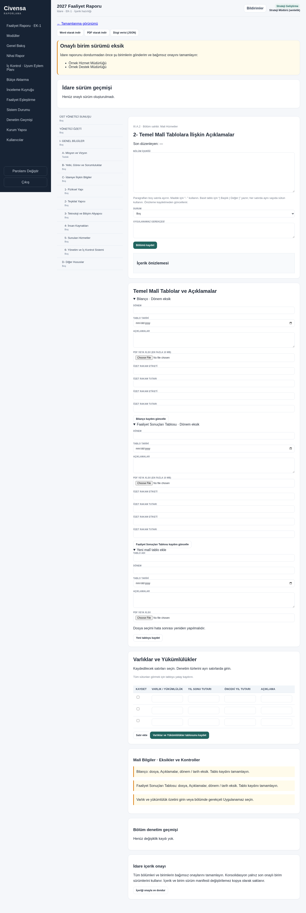

**Görünen metinler ve tablolar:**

- `div`: Civensa RAPORLAMA
- `h1`: 2027 Faaliyet Raporu
- `p`: İdare · EK-1 · İçerik hazırlığı
- `div`: Strateji Geliştirme Strateji Müdürü (sentetik)
- `p`: ← Tamamlanma görünümü
- `p`: Word olarak indir PDF olarak indir Dizgi verisi (JSON)
- `h2`: Onaylı birim sürümü eksik
- `p`: İdare raporunu dondurmadan önce şu birimlerin gönderim ve bağımsız onayını tamamlayın:
- `h2`: İdare sürüm geçmişi
- `p`: Henüz onaylı sürüm oluşturulmadı.
- `p`: III.A.2 · Bölüm sahibi: Mali Hizmetler
- `h2`: 2- Temel Malî Tablolara İlişkin Açıklamalar
- `p`: Son düzenleyen: —
- `p`: Paragrafları boş satırla ayırın. Madde için “- ” kullanın. Basit tablo için “&#124; Başlık &#124; Değer &#124;” yazın; her satırda aynı sayıda sütun kullanın. Önizleme kaydetmeden güncellenir.
- `h3`: İçerik önizlemesi
- `h2`: Temel Malî Tablolar ve Açıklamalar
- `p`: Dosya seçimi hata sonrası yeniden yapılmalıdır.
- `h2`: Varlıklar ve Yükümlülükler
- `p`: Kaydedilecek satırları seçin. Denetim türlerini ayrı satırlarda girin.
- `p`: Tüm sütunları görmek için tabloyu yatay kaydırın.
- `table`: KAYDET VARLIK / YÜKÜMLÜLÜK YIL SONU TUTARI ÖNCEKİ YIL TUTARI AÇIKLAMA
- `h3`: Malî Bilgiler · Eksikler ve Kontroller
- `p`: Bilanço: dosya, Açıklamalar, dönem / tarih eksik. Tablo kaydını tamamlayın.
- `p`: Faaliyet Sonuçları Tablosu: dosya, Açıklamalar, dönem / tarih eksik. Tablo kaydını tamamlayın.
- `p`: Varlık ve yükümlülük özetini girin veya bölümde gerekçeli Uygulanamaz seçin.
- `h3`: Bölüm denetim geçmişi
- `p`: Henüz değişiklik kaydı yok.
- `h3`: İdare içerik onayı
- `p`: Tüm bölümleri ve birimlerin bağımsız onaylarını tamamlayın. Konsolidasyon yalnız son onaylı birim sürümlerini kullanır. İçerik ve birim sürüm manifesti değiştirilemez kopya olarak saklanır.
- `li`: Örnek Hizmet Müdürlüğü
- `li`: Örnek Destek Müdürlüğü

**Bağlantı, düğme, form ve alanlar:**

| Öğe | Tür / etiket / bağlam | Hedef URL veya eylem | Ne yapar / mevcut değer |
| --- | --- | --- | --- |
| E001 | a · Faaliyet Raporu · EK-1 | `/activity-sections` | Bağlantıdaki ekranı veya dosyayı açar: Faaliyet Raporu · EK-1. |
| E002 | a · Modüller | `/modules` | Bağlantıdaki ekranı veya dosyayı açar: Modüller. |
| E003 | a · Genel Bakış | `/dashboard` | Bağlantıdaki ekranı veya dosyayı açar: Genel Bakış. |
| E004 | a · Nihai Rapor | `/report-builder` | Bağlantıdaki ekranı veya dosyayı açar: Nihai Rapor. |
| E005 | a · İç Kontrol · Uyum Eylem Planı | `/internal-control` | Bağlantıdaki ekranı veya dosyayı açar: İç Kontrol · Uyum Eylem Planı. |
| E006 | a · Bütçe Aktarma | `/budget-reallocations` | Bağlantıdaki ekranı veya dosyayı açar: Bütçe Aktarma. |
| E007 | a · İnceleme Kuyruğu | `/review` | Bağlantıdaki ekranı veya dosyayı açar: İnceleme Kuyruğu. |
| E008 | a · Faaliyet Eşleştirme | `/activity-mapping` | Bağlantıdaki ekranı veya dosyayı açar: Faaliyet Eşleştirme. |
| E009 | a · Sistem Durumu | `/operations` | Bağlantıdaki ekranı veya dosyayı açar: Sistem Durumu. |
| E010 | a · Denetim Geçmişi | `/audit` | Bağlantıdaki ekranı veya dosyayı açar: Denetim Geçmişi. |
| E011 | a · Kurum Yapısı | `/structure` | Bağlantıdaki ekranı veya dosyayı açar: Kurum Yapısı. |
| E012 | a · Kullanıcılar | `/users` | Bağlantıdaki ekranı veya dosyayı açar: Kullanıcılar. |
| E013 | button · Parolamı Değiştir (#changePasswordButton) | `#passwordModal` | Parola değiştirme penceresini açar. |
| E014 | form · Çıkış | `POST /logout` | Oturumu kapatıp giriş ekranına döner. |
| E015 | button · Çıkış | `POST /logout` | Oturumu kapatıp giriş ekranına döner. |
| E016 | button · Bildirimler (#notificationButton) | `GET /api/notifications → #notificationPanel` | Bildirim listesini açar. |
| E017 | a · ← Tamamlanma görünümü | `/activity-sections` | Bağlantıdaki ekranı veya dosyayı açar: ← Tamamlanma görünümü. |
| E018 | a · Word olarak indir | `/activity-sections/reports/1/export.docx` | Bağlantıdaki ekranı veya dosyayı açar: Word olarak indir. |
| E019 | a · PDF olarak indir | `/activity-sections/reports/1/export.pdf` | Bağlantıdaki ekranı veya dosyayı açar: PDF olarak indir. |
| E020 | a · Dizgi verisi (JSON) | `/activity-sections/reports/1/typeset.json` | Bağlantıdaki ekranı veya dosyayı açar: Dizgi verisi (JSON). |
| E021 | a · ÜST YÖNETİCİ SUNUŞU Boş | `?code=SUNUS` | Bağlantıdaki ekranı veya dosyayı açar: ÜST YÖNETİCİ SUNUŞU Boş. |
| E022 | a · YÖNETİCİ ÖZETİ Boş | `?code=OZET` | Bağlantıdaki ekranı veya dosyayı açar: YÖNETİCİ ÖZETİ Boş. |
| E023 | a · I- GENEL BİLGİLER Boş | `?code=I` | Bağlantıdaki ekranı veya dosyayı açar: I- GENEL BİLGİLER Boş. |
| E024 | a · A- Misyon ve Vizyon Taslak | `?code=I.A` | Bağlantıdaki ekranı veya dosyayı açar: A- Misyon ve Vizyon Taslak. |
| E025 | a · B- Yetki, Görev ve Sorumluluklar Boş | `?code=I.B` | Bağlantıdaki ekranı veya dosyayı açar: B- Yetki, Görev ve Sorumluluklar Boş. |
| E026 | a · C- İdareye İlişkin Bilgiler Boş | `?code=I.C` | Bağlantıdaki ekranı veya dosyayı açar: C- İdareye İlişkin Bilgiler Boş. |
| E027 | a · 1- Fiziksel Yapı Boş | `?code=I.C.1` | Bağlantıdaki ekranı veya dosyayı açar: 1- Fiziksel Yapı Boş. |
| E028 | a · 2- Teşkilat Yapısı Boş | `?code=I.C.2` | Bağlantıdaki ekranı veya dosyayı açar: 2- Teşkilat Yapısı Boş. |
| E029 | a · 3- Teknoloji ve Bilişim Altyapısı Boş | `?code=I.C.3` | Bağlantıdaki ekranı veya dosyayı açar: 3- Teknoloji ve Bilişim Altyapısı Boş. |
| E030 | a · 4- İnsan Kaynakları Boş | `?code=I.C.4` | Bağlantıdaki ekranı veya dosyayı açar: 4- İnsan Kaynakları Boş. |
| E031 | a · 5- Sunulan Hizmetler Boş | `?code=I.C.5` | Bağlantıdaki ekranı veya dosyayı açar: 5- Sunulan Hizmetler Boş. |
| E032 | a · 6- Yönetim ve İç Kontrol Sistemi Boş | `?code=I.C.6` | Bağlantıdaki ekranı veya dosyayı açar: 6- Yönetim ve İç Kontrol Sistemi Boş. |
| E033 | a · D- Diğer Hususlar Boş | `?code=I.D` | Bağlantıdaki ekranı veya dosyayı açar: D- Diğer Hususlar Boş. |
| E034 | a · II- AMAÇLAR ve HEDEFLER Boş | `?code=II` | Bağlantıdaki ekranı veya dosyayı açar: II- AMAÇLAR ve HEDEFLER Boş. |
| E035 | a · A- Temel Politika ve Öncelikler Boş | `?code=II.A` | Bağlantıdaki ekranı veya dosyayı açar: A- Temel Politika ve Öncelikler Boş. |
| E036 | a · B- İdarenin Stratejik Planında Yer Alan Amaç ve Hedefler Boş | `?code=II.B` | Bağlantıdaki ekranı veya dosyayı açar: B- İdarenin Stratejik Planında Yer Alan Amaç ve Hedefler Boş. |
| E037 | a · C- Diğer Hususlar Boş | `?code=II.C` | Bağlantıdaki ekranı veya dosyayı açar: C- Diğer Hususlar Boş. |
| E038 | a · III- FAALİYETLERE İLİŞKİN BİLGİ VE DEĞERLENDİRMELER Boş | `?code=III` | Bağlantıdaki ekranı veya dosyayı açar: III- FAALİYETLERE İLİŞKİN BİLGİ VE DEĞERLENDİRMELER Boş. |
| E039 | a · A- Malî Bilgiler Boş | `?code=III.A` | Bağlantıdaki ekranı veya dosyayı açar: A- Malî Bilgiler Boş. |
| E040 | a · 1- Bütçe Uygulama Sonuçları Taslak | `?code=III.A.1` | Bağlantıdaki ekranı veya dosyayı açar: 1- Bütçe Uygulama Sonuçları Taslak. |
| E041 | a · 2- Temel Malî Tablolara İlişkin Açıklamalar Boş | `?code=III.A.2` | Bağlantıdaki ekranı veya dosyayı açar: 2- Temel Malî Tablolara İlişkin Açıklamalar Boş. |
| E042 | a · 3- Malî Denetim Sonuçları Boş | `?code=III.A.3` | Bağlantıdaki ekranı veya dosyayı açar: 3- Malî Denetim Sonuçları Boş. |
| E043 | a · 4- Diğer Hususlar Boş | `?code=III.A.4` | Bağlantıdaki ekranı veya dosyayı açar: 4- Diğer Hususlar Boş. |
| E044 | a · B- Performans Bilgileri Boş | `?code=III.B` | Bağlantıdaki ekranı veya dosyayı açar: B- Performans Bilgileri Boş. |
| E045 | a · 1- Program, Alt Program, Faaliyet Bilgileri Boş | `?code=III.B.1` | Bağlantıdaki ekranı veya dosyayı açar: 1- Program, Alt Program, Faaliyet Bilgileri Boş. |
| E046 | a · 2- Performans Sonuçlarının Değerlendirilmesi Boş | `?code=III.B.2` | Bağlantıdaki ekranı veya dosyayı açar: 2- Performans Sonuçlarının Değerlendirilmesi Boş. |
| E047 | a · i. Alt program hedef ve göstergeleriyle ilgili gerçekleşme sonuçları ve değerlendirmeler Boş | `?code=III.B.2.i` | Bağlantıdaki ekranı veya dosyayı açar: i. Alt program hedef ve göstergeleriyle ilgili gerçekleşme sonuçları ve değerlendirmeler Boş. |
| E048 | a · ii. Performans denetim sonuçları Boş | `?code=III.B.2.ii` | Bağlantıdaki ekranı veya dosyayı açar: ii. Performans denetim sonuçları Boş. |
| E049 | a · 3- Stratejik Plan Değerlendirme Tabloları Boş | `?code=III.B.3` | Bağlantıdaki ekranı veya dosyayı açar: 3- Stratejik Plan Değerlendirme Tabloları Boş. |
| E050 | a · 4- Performans Bilgi Sisteminin Değerlendirilmesi Boş | `?code=III.B.4` | Bağlantıdaki ekranı veya dosyayı açar: 4- Performans Bilgi Sisteminin Değerlendirilmesi Boş. |
| E051 | a · 5- Diğer Hususlar Boş | `?code=III.B.5` | Bağlantıdaki ekranı veya dosyayı açar: 5- Diğer Hususlar Boş. |
| E052 | a · IV- KURUMSAL KABİLİYET VE KAPASİTENİN DEĞERLENDİRİLMESİ Boş | `?code=IV` | Bağlantıdaki ekranı veya dosyayı açar: IV- KURUMSAL KABİLİYET VE KAPASİTENİN DEĞERLENDİRİLMESİ Boş. |
| E053 | a · A- Üstünlükler Boş | `?code=IV.A` | Bağlantıdaki ekranı veya dosyayı açar: A- Üstünlükler Boş. |
| E054 | a · B- Zayıflıklar Boş | `?code=IV.B` | Bağlantıdaki ekranı veya dosyayı açar: B- Zayıflıklar Boş. |
| E055 | a · C- Değerlendirme Boş | `?code=IV.C` | Bağlantıdaki ekranı veya dosyayı açar: C- Değerlendirme Boş. |
| E056 | a · V- ÖNERİ VE TEDBİRLER Boş | `?code=V` | Bağlantıdaki ekranı veya dosyayı açar: V- ÖNERİ VE TEDBİRLER Boş. |
| E057 | a · EKLER Boş | `?code=EKLER` | Bağlantıdaki ekranı veya dosyayı açar: EKLER Boş. |
| E058 | form · Bölümü kaydet · 2- Temel Malî Tablolara İlişkin Açıklamalar | `POST /activity-sections/reports/1/sections/III.A.2` | Bölümü kaydet işlemini form alanlarıyla gönderir; doğrulama sonrası kaydeder veya hata gösterir. |
| E059 | textarea · BÖLÜM İÇERİĞİ · 2- Temel Malî Tablolara İlişkin Açıklamalar | `POST /activity-sections/reports/1/sections/III.A.2` | İşlem için BÖLÜM İÇERİĞİ değerini girer. |
| E060 | select · DURUM Boş Taslak Hazır Uygulanamaz · 2- Temel Malî Tablolara İlişkin Açıklamalar | `POST /activity-sections/reports/1/sections/III.A.2` | Listeden seçim yapar. Değer: empty. Seçenekler: Boş; Taslak; Hazır; Uygulanamaz. |
| E061 | textarea · UYGULANAMAZ GEREKÇESİ · 2- Temel Malî Tablolara İlişkin Açıklamalar | `POST /activity-sections/reports/1/sections/III.A.2` | İşlem için UYGULANAMAZ GEREKÇESİ değerini girer. |
| E062 | button · Bölümü kaydet · 2- Temel Malî Tablolara İlişkin Açıklamalar | `POST /activity-sections/reports/1/sections/III.A.2` | Bölümü kaydet işlemini form alanlarıyla gönderir; doğrulama sonrası kaydeder veya hata gösterir. |
| E063 | summary · Bilanço · Dönem eksik · Bilanço · Dönem eksik | `Aynı sayfadaki ayrıntı bölümü` | İçerik ve form ayrıntılarını açar veya daraltır. |
| E064 | form · Bilanço kaydını güncelle · Bilanço · Dönem eksik | `POST /activity-sections/reports/1/financial/statements` | Bilanço kaydını güncelle işlemini form alanlarıyla gönderir; doğrulama sonrası kaydeder veya hata gösterir. |
| E065 | input · DÖNEM · Bilanço · Dönem eksik | `POST /activity-sections/reports/1/financial/statements` | İşlem için DÖNEM değerini girer. |
| E066 | input · TABLO TARİHİ · Bilanço · Dönem eksik | `POST /activity-sections/reports/1/financial/statements` | İşlem için TABLO TARİHİ değerini girer. |
| E067 | textarea · AÇIKLAMALAR · Bilanço · Dönem eksik | `POST /activity-sections/reports/1/financial/statements` | İşlem için AÇIKLAMALAR değerini girer. Zorunlu. |
| E068 | input · PDF VEYA XLSX (EN FAZLA 10 MB) · Bilanço · Dönem eksik | `POST /activity-sections/reports/1/financial/statements` | Dosya seçer; ilgili işlemle yüklenir. |
| E069 | input · ÖZET RAKAM ETİKETİ · Bilanço · Dönem eksik | `POST /activity-sections/reports/1/financial/statements` | İşlem için ÖZET RAKAM ETİKETİ değerini girer. |
| E070 | input · ÖZET RAKAM TUTARI · Bilanço · Dönem eksik | `POST /activity-sections/reports/1/financial/statements` | İşlem için ÖZET RAKAM TUTARI değerini girer. |
| E071 | input · ÖZET RAKAM ETİKETİ · Bilanço · Dönem eksik | `POST /activity-sections/reports/1/financial/statements` | İşlem için ÖZET RAKAM ETİKETİ değerini girer. |
| E072 | input · ÖZET RAKAM TUTARI · Bilanço · Dönem eksik | `POST /activity-sections/reports/1/financial/statements` | İşlem için ÖZET RAKAM TUTARI değerini girer. |
| E073 | button · Bilanço kaydını güncelle · Bilanço · Dönem eksik | `POST /activity-sections/reports/1/financial/statements` | Bilanço kaydını güncelle işlemini form alanlarıyla gönderir; doğrulama sonrası kaydeder veya hata gösterir. |
| E074 | summary · Faaliyet Sonuçları Tablosu · Dönem eksik · Faaliyet Sonuçları Tablosu · Dönem eksik | `Aynı sayfadaki ayrıntı bölümü` | İçerik ve form ayrıntılarını açar veya daraltır. |
| E075 | form · Faaliyet Sonuçları Tablosu kaydını güncelle · Faaliyet Sonuçları Tablosu · Dönem eksik | `POST /activity-sections/reports/1/financial/statements` | Faaliyet Sonuçları Tablosu kaydını güncelle işlemini form alanlarıyla gönderir; doğrulama sonrası kaydeder veya hata gösterir. |
| E076 | input · DÖNEM · Faaliyet Sonuçları Tablosu · Dönem eksik | `POST /activity-sections/reports/1/financial/statements` | İşlem için DÖNEM değerini girer. |
| E077 | input · TABLO TARİHİ · Faaliyet Sonuçları Tablosu · Dönem eksik | `POST /activity-sections/reports/1/financial/statements` | İşlem için TABLO TARİHİ değerini girer. |
| E078 | textarea · AÇIKLAMALAR · Faaliyet Sonuçları Tablosu · Dönem eksik | `POST /activity-sections/reports/1/financial/statements` | İşlem için AÇIKLAMALAR değerini girer. Zorunlu. |
| E079 | input · PDF VEYA XLSX (EN FAZLA 10 MB) · Faaliyet Sonuçları Tablosu · Dönem eksik | `POST /activity-sections/reports/1/financial/statements` | Dosya seçer; ilgili işlemle yüklenir. |
| E080 | input · ÖZET RAKAM ETİKETİ · Faaliyet Sonuçları Tablosu · Dönem eksik | `POST /activity-sections/reports/1/financial/statements` | İşlem için ÖZET RAKAM ETİKETİ değerini girer. |
| E081 | input · ÖZET RAKAM TUTARI · Faaliyet Sonuçları Tablosu · Dönem eksik | `POST /activity-sections/reports/1/financial/statements` | İşlem için ÖZET RAKAM TUTARI değerini girer. |
| E082 | input · ÖZET RAKAM ETİKETİ · Faaliyet Sonuçları Tablosu · Dönem eksik | `POST /activity-sections/reports/1/financial/statements` | İşlem için ÖZET RAKAM ETİKETİ değerini girer. |
| E083 | input · ÖZET RAKAM TUTARI · Faaliyet Sonuçları Tablosu · Dönem eksik | `POST /activity-sections/reports/1/financial/statements` | İşlem için ÖZET RAKAM TUTARI değerini girer. |
| E084 | button · Faaliyet Sonuçları Tablosu kaydını güncelle · Faaliyet Sonuçları Tablosu · Dönem eksik | `POST /activity-sections/reports/1/financial/statements` | Faaliyet Sonuçları Tablosu kaydını güncelle işlemini form alanlarıyla gönderir; doğrulama sonrası kaydeder veya hata gösterir. |
| E085 | summary · Yeni malî tablo ekle · Yeni malî tablo ekle | `Aynı sayfadaki ayrıntı bölümü` | İçerik ve form ayrıntılarını açar veya daraltır. |
| E086 | form · Yeni tabloyu kaydet · Yeni malî tablo ekle | `POST /activity-sections/reports/1/financial/statements` | Yeni tabloyu kaydet işlemini form alanlarıyla gönderir; doğrulama sonrası kaydeder veya hata gösterir. |
| E087 | input · TABLO ADI · Yeni malî tablo ekle | `POST /activity-sections/reports/1/financial/statements` | İşlem için TABLO ADI değerini girer. |
| E088 | input · DÖNEM · Yeni malî tablo ekle | `POST /activity-sections/reports/1/financial/statements` | İşlem için DÖNEM değerini girer. |
| E089 | input · TABLO TARİHİ · Yeni malî tablo ekle | `POST /activity-sections/reports/1/financial/statements` | İşlem için TABLO TARİHİ değerini girer. |
| E090 | textarea · AÇIKLAMALAR · Yeni malî tablo ekle | `POST /activity-sections/reports/1/financial/statements` | İşlem için AÇIKLAMALAR değerini girer. Zorunlu. |
| E091 | input · PDF VEYA XLSX · Yeni malî tablo ekle | `POST /activity-sections/reports/1/financial/statements` | Dosya seçer; ilgili işlemle yüklenir. |
| E092 | button · Yeni tabloyu kaydet · Yeni malî tablo ekle | `POST /activity-sections/reports/1/financial/statements` | Yeni tabloyu kaydet işlemini form alanlarıyla gönderir; doğrulama sonrası kaydeder veya hata gösterir. |
| E093 | form · Satır ekle / Varlıklar ve Yükümlülükler tablosunu kaydet · Varlıklar ve Yükümlülükler | `POST /activity-sections/reports/1/financial/entries/assets` | Satır ekle / Varlıklar ve Yükümlülükler tablosunu kaydet işlemini form alanlarıyla gönderir; doğrulama sonrası kaydeder veya hata gösterir. |
| E094 | input · 1. satırı kaydet · Varlıklar ve Yükümlülükler | `POST /activity-sections/reports/1/financial/entries/assets` | Seçeneği işaretler veya kaldırır. Değer: İşaretli değil. |
| E095 | input · Varlık / yükümlülük 1 · Varlıklar ve Yükümlülükler | `POST /activity-sections/reports/1/financial/entries/assets` | İşlem için Varlık / yükümlülük 1 değerini girer. |
| E096 | input · Yıl Sonu Tutarı 1 · Varlıklar ve Yükümlülükler | `POST /activity-sections/reports/1/financial/entries/assets` | İşlem için Yıl Sonu Tutarı 1 değerini girer. |
| E097 | input · Önceki Yıl Tutarı 1 · Varlıklar ve Yükümlülükler | `POST /activity-sections/reports/1/financial/entries/assets` | İşlem için Önceki Yıl Tutarı 1 değerini girer. |
| E098 | input · Açıklama 1 · Varlıklar ve Yükümlülükler | `POST /activity-sections/reports/1/financial/entries/assets` | İşlem için Açıklama 1 değerini girer. |
| E099 | input · 2. satırı kaydet · Varlıklar ve Yükümlülükler | `POST /activity-sections/reports/1/financial/entries/assets` | Seçeneği işaretler veya kaldırır. Değer: İşaretli değil. |
| E100 | input · Varlık / yükümlülük 2 · Varlıklar ve Yükümlülükler | `POST /activity-sections/reports/1/financial/entries/assets` | İşlem için Varlık / yükümlülük 2 değerini girer. |
| E101 | input · Yıl Sonu Tutarı 2 · Varlıklar ve Yükümlülükler | `POST /activity-sections/reports/1/financial/entries/assets` | İşlem için Yıl Sonu Tutarı 2 değerini girer. |
| E102 | input · Önceki Yıl Tutarı 2 · Varlıklar ve Yükümlülükler | `POST /activity-sections/reports/1/financial/entries/assets` | İşlem için Önceki Yıl Tutarı 2 değerini girer. |
| E103 | input · Açıklama 2 · Varlıklar ve Yükümlülükler | `POST /activity-sections/reports/1/financial/entries/assets` | İşlem için Açıklama 2 değerini girer. |
| E104 | input · 3. satırı kaydet · Varlıklar ve Yükümlülükler | `POST /activity-sections/reports/1/financial/entries/assets` | Seçeneği işaretler veya kaldırır. Değer: İşaretli değil. |
| E105 | input · Varlık / yükümlülük 3 · Varlıklar ve Yükümlülükler | `POST /activity-sections/reports/1/financial/entries/assets` | İşlem için Varlık / yükümlülük 3 değerini girer. |
| E106 | input · Yıl Sonu Tutarı 3 · Varlıklar ve Yükümlülükler | `POST /activity-sections/reports/1/financial/entries/assets` | İşlem için Yıl Sonu Tutarı 3 değerini girer. |
| E107 | input · Önceki Yıl Tutarı 3 · Varlıklar ve Yükümlülükler | `POST /activity-sections/reports/1/financial/entries/assets` | İşlem için Önceki Yıl Tutarı 3 değerini girer. |
| E108 | input · Açıklama 3 · Varlıklar ve Yükümlülükler | `POST /activity-sections/reports/1/financial/entries/assets` | İşlem için Açıklama 3 değerini girer. |
| E109 | button · Satır ekle · Varlıklar ve Yükümlülükler | `Aynı malî tablo` | Tabloya yeni satır ekler. |
| E110 | button · Varlıklar ve Yükümlülükler tablosunu kaydet · Varlıklar ve Yükümlülükler | `POST /activity-sections/reports/1/financial/entries/assets` | Varlıklar ve Yükümlülükler tablosunu kaydet işlemini form alanlarıyla gönderir; doğrulama sonrası kaydeder veya hata gösterir. |
| E111 | form · İçeriği onayla ve dondur · İdare içerik onayı | `POST /activity-sections/reports/1/freeze` | Kontrolleri geçen raporun değişmez sürümünü oluşturur. |
| E112 | button · İçeriği onayla ve dondur · İdare içerik onayı | `POST /activity-sections/reports/1/freeze` | Kontrolleri geçen raporun değişmez sürümünü oluşturur. |

<a id="ekran-055"></a>

### 055 · EK-1 bölüm editörü · Bölüm III.A.3

URL kalıbı: `/activity-sections/reports/{document_id}` · Çekilen URL: `/activity-sections/reports/1?code=III.A.3` · Rol: **strategy** · HTTP 200.

Seçilen rapor bölümünün metin, tablo ve durumunu gösterir.

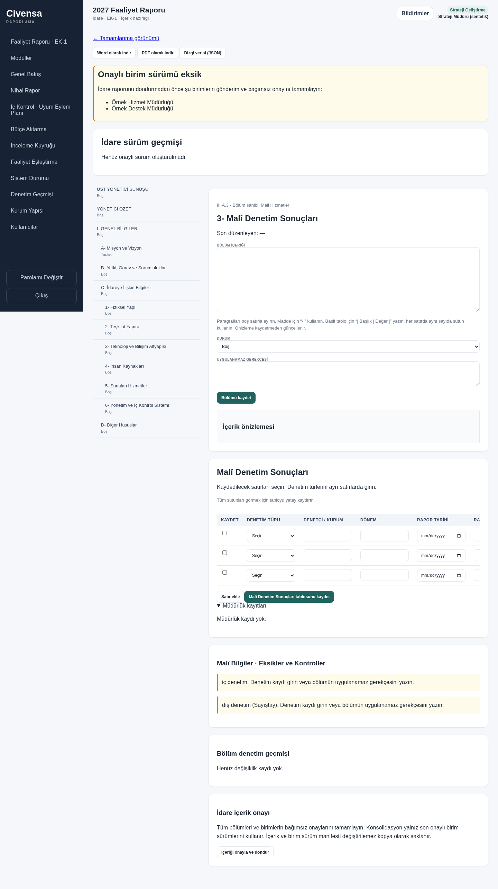

**Görünen metinler ve tablolar:**

- `div`: Civensa RAPORLAMA
- `h1`: 2027 Faaliyet Raporu
- `p`: İdare · EK-1 · İçerik hazırlığı
- `div`: Strateji Geliştirme Strateji Müdürü (sentetik)
- `p`: ← Tamamlanma görünümü
- `p`: Word olarak indir PDF olarak indir Dizgi verisi (JSON)
- `h2`: Onaylı birim sürümü eksik
- `p`: İdare raporunu dondurmadan önce şu birimlerin gönderim ve bağımsız onayını tamamlayın:
- `h2`: İdare sürüm geçmişi
- `p`: Henüz onaylı sürüm oluşturulmadı.
- `p`: III.A.3 · Bölüm sahibi: Mali Hizmetler
- `h2`: 3- Malî Denetim Sonuçları
- `p`: Son düzenleyen: —
- `p`: Paragrafları boş satırla ayırın. Madde için “- ” kullanın. Basit tablo için “&#124; Başlık &#124; Değer &#124;” yazın; her satırda aynı sayıda sütun kullanın. Önizleme kaydetmeden güncellenir.
- `h3`: İçerik önizlemesi
- `h2`: Malî Denetim Sonuçları
- `p`: Kaydedilecek satırları seçin. Denetim türlerini ayrı satırlarda girin.
- `p`: Tüm sütunları görmek için tabloyu yatay kaydırın.
- `table`: KAYDET DENETİM TÜRÜ DENETÇİ / KURUM DÖNEM RAPOR TARİHİ RAPOR SAYISI BULGU ÖZETİ ALINAN ÖNLEMLER DURUM Seçin iç denetim dış denetim (Sayıştay) Seçin iç denetim dış denetim (Sayıştay) Seçin iç denetim dış denetim (Sayıştay)
- `p`: Müdürlük kaydı yok.
- `h3`: Malî Bilgiler · Eksikler ve Kontroller
- `p`: iç denetim: Denetim kaydı girin veya bölümün uygulanamaz gerekçesini yazın.
- `p`: dış denetim (Sayıştay): Denetim kaydı girin veya bölümün uygulanamaz gerekçesini yazın.
- `h3`: Bölüm denetim geçmişi
- `p`: Henüz değişiklik kaydı yok.
- `h3`: İdare içerik onayı
- `p`: Tüm bölümleri ve birimlerin bağımsız onaylarını tamamlayın. Konsolidasyon yalnız son onaylı birim sürümlerini kullanır. İçerik ve birim sürüm manifesti değiştirilemez kopya olarak saklanır.
- `li`: Örnek Hizmet Müdürlüğü
- `li`: Örnek Destek Müdürlüğü

**Bağlantı, düğme, form ve alanlar:**

| Öğe | Tür / etiket / bağlam | Hedef URL veya eylem | Ne yapar / mevcut değer |
| --- | --- | --- | --- |
| E001 | a · Faaliyet Raporu · EK-1 | `/activity-sections` | Bağlantıdaki ekranı veya dosyayı açar: Faaliyet Raporu · EK-1. |
| E002 | a · Modüller | `/modules` | Bağlantıdaki ekranı veya dosyayı açar: Modüller. |
| E003 | a · Genel Bakış | `/dashboard` | Bağlantıdaki ekranı veya dosyayı açar: Genel Bakış. |
| E004 | a · Nihai Rapor | `/report-builder` | Bağlantıdaki ekranı veya dosyayı açar: Nihai Rapor. |
| E005 | a · İç Kontrol · Uyum Eylem Planı | `/internal-control` | Bağlantıdaki ekranı veya dosyayı açar: İç Kontrol · Uyum Eylem Planı. |
| E006 | a · Bütçe Aktarma | `/budget-reallocations` | Bağlantıdaki ekranı veya dosyayı açar: Bütçe Aktarma. |
| E007 | a · İnceleme Kuyruğu | `/review` | Bağlantıdaki ekranı veya dosyayı açar: İnceleme Kuyruğu. |
| E008 | a · Faaliyet Eşleştirme | `/activity-mapping` | Bağlantıdaki ekranı veya dosyayı açar: Faaliyet Eşleştirme. |
| E009 | a · Sistem Durumu | `/operations` | Bağlantıdaki ekranı veya dosyayı açar: Sistem Durumu. |
| E010 | a · Denetim Geçmişi | `/audit` | Bağlantıdaki ekranı veya dosyayı açar: Denetim Geçmişi. |
| E011 | a · Kurum Yapısı | `/structure` | Bağlantıdaki ekranı veya dosyayı açar: Kurum Yapısı. |
| E012 | a · Kullanıcılar | `/users` | Bağlantıdaki ekranı veya dosyayı açar: Kullanıcılar. |
| E013 | button · Parolamı Değiştir (#changePasswordButton) | `#passwordModal` | Parola değiştirme penceresini açar. |
| E014 | form · Çıkış | `POST /logout` | Oturumu kapatıp giriş ekranına döner. |
| E015 | button · Çıkış | `POST /logout` | Oturumu kapatıp giriş ekranına döner. |
| E016 | button · Bildirimler (#notificationButton) | `GET /api/notifications → #notificationPanel` | Bildirim listesini açar. |
| E017 | a · ← Tamamlanma görünümü | `/activity-sections` | Bağlantıdaki ekranı veya dosyayı açar: ← Tamamlanma görünümü. |
| E018 | a · Word olarak indir | `/activity-sections/reports/1/export.docx` | Bağlantıdaki ekranı veya dosyayı açar: Word olarak indir. |
| E019 | a · PDF olarak indir | `/activity-sections/reports/1/export.pdf` | Bağlantıdaki ekranı veya dosyayı açar: PDF olarak indir. |
| E020 | a · Dizgi verisi (JSON) | `/activity-sections/reports/1/typeset.json` | Bağlantıdaki ekranı veya dosyayı açar: Dizgi verisi (JSON). |
| E021 | a · ÜST YÖNETİCİ SUNUŞU Boş | `?code=SUNUS` | Bağlantıdaki ekranı veya dosyayı açar: ÜST YÖNETİCİ SUNUŞU Boş. |
| E022 | a · YÖNETİCİ ÖZETİ Boş | `?code=OZET` | Bağlantıdaki ekranı veya dosyayı açar: YÖNETİCİ ÖZETİ Boş. |
| E023 | a · I- GENEL BİLGİLER Boş | `?code=I` | Bağlantıdaki ekranı veya dosyayı açar: I- GENEL BİLGİLER Boş. |
| E024 | a · A- Misyon ve Vizyon Taslak | `?code=I.A` | Bağlantıdaki ekranı veya dosyayı açar: A- Misyon ve Vizyon Taslak. |
| E025 | a · B- Yetki, Görev ve Sorumluluklar Boş | `?code=I.B` | Bağlantıdaki ekranı veya dosyayı açar: B- Yetki, Görev ve Sorumluluklar Boş. |
| E026 | a · C- İdareye İlişkin Bilgiler Boş | `?code=I.C` | Bağlantıdaki ekranı veya dosyayı açar: C- İdareye İlişkin Bilgiler Boş. |
| E027 | a · 1- Fiziksel Yapı Boş | `?code=I.C.1` | Bağlantıdaki ekranı veya dosyayı açar: 1- Fiziksel Yapı Boş. |
| E028 | a · 2- Teşkilat Yapısı Boş | `?code=I.C.2` | Bağlantıdaki ekranı veya dosyayı açar: 2- Teşkilat Yapısı Boş. |
| E029 | a · 3- Teknoloji ve Bilişim Altyapısı Boş | `?code=I.C.3` | Bağlantıdaki ekranı veya dosyayı açar: 3- Teknoloji ve Bilişim Altyapısı Boş. |
| E030 | a · 4- İnsan Kaynakları Boş | `?code=I.C.4` | Bağlantıdaki ekranı veya dosyayı açar: 4- İnsan Kaynakları Boş. |
| E031 | a · 5- Sunulan Hizmetler Boş | `?code=I.C.5` | Bağlantıdaki ekranı veya dosyayı açar: 5- Sunulan Hizmetler Boş. |
| E032 | a · 6- Yönetim ve İç Kontrol Sistemi Boş | `?code=I.C.6` | Bağlantıdaki ekranı veya dosyayı açar: 6- Yönetim ve İç Kontrol Sistemi Boş. |
| E033 | a · D- Diğer Hususlar Boş | `?code=I.D` | Bağlantıdaki ekranı veya dosyayı açar: D- Diğer Hususlar Boş. |
| E034 | a · II- AMAÇLAR ve HEDEFLER Boş | `?code=II` | Bağlantıdaki ekranı veya dosyayı açar: II- AMAÇLAR ve HEDEFLER Boş. |
| E035 | a · A- Temel Politika ve Öncelikler Boş | `?code=II.A` | Bağlantıdaki ekranı veya dosyayı açar: A- Temel Politika ve Öncelikler Boş. |
| E036 | a · B- İdarenin Stratejik Planında Yer Alan Amaç ve Hedefler Boş | `?code=II.B` | Bağlantıdaki ekranı veya dosyayı açar: B- İdarenin Stratejik Planında Yer Alan Amaç ve Hedefler Boş. |
| E037 | a · C- Diğer Hususlar Boş | `?code=II.C` | Bağlantıdaki ekranı veya dosyayı açar: C- Diğer Hususlar Boş. |
| E038 | a · III- FAALİYETLERE İLİŞKİN BİLGİ VE DEĞERLENDİRMELER Boş | `?code=III` | Bağlantıdaki ekranı veya dosyayı açar: III- FAALİYETLERE İLİŞKİN BİLGİ VE DEĞERLENDİRMELER Boş. |
| E039 | a · A- Malî Bilgiler Boş | `?code=III.A` | Bağlantıdaki ekranı veya dosyayı açar: A- Malî Bilgiler Boş. |
| E040 | a · 1- Bütçe Uygulama Sonuçları Taslak | `?code=III.A.1` | Bağlantıdaki ekranı veya dosyayı açar: 1- Bütçe Uygulama Sonuçları Taslak. |
| E041 | a · 2- Temel Malî Tablolara İlişkin Açıklamalar Boş | `?code=III.A.2` | Bağlantıdaki ekranı veya dosyayı açar: 2- Temel Malî Tablolara İlişkin Açıklamalar Boş. |
| E042 | a · 3- Malî Denetim Sonuçları Boş | `?code=III.A.3` | Bağlantıdaki ekranı veya dosyayı açar: 3- Malî Denetim Sonuçları Boş. |
| E043 | a · 4- Diğer Hususlar Boş | `?code=III.A.4` | Bağlantıdaki ekranı veya dosyayı açar: 4- Diğer Hususlar Boş. |
| E044 | a · B- Performans Bilgileri Boş | `?code=III.B` | Bağlantıdaki ekranı veya dosyayı açar: B- Performans Bilgileri Boş. |
| E045 | a · 1- Program, Alt Program, Faaliyet Bilgileri Boş | `?code=III.B.1` | Bağlantıdaki ekranı veya dosyayı açar: 1- Program, Alt Program, Faaliyet Bilgileri Boş. |
| E046 | a · 2- Performans Sonuçlarının Değerlendirilmesi Boş | `?code=III.B.2` | Bağlantıdaki ekranı veya dosyayı açar: 2- Performans Sonuçlarının Değerlendirilmesi Boş. |
| E047 | a · i. Alt program hedef ve göstergeleriyle ilgili gerçekleşme sonuçları ve değerlendirmeler Boş | `?code=III.B.2.i` | Bağlantıdaki ekranı veya dosyayı açar: i. Alt program hedef ve göstergeleriyle ilgili gerçekleşme sonuçları ve değerlendirmeler Boş. |
| E048 | a · ii. Performans denetim sonuçları Boş | `?code=III.B.2.ii` | Bağlantıdaki ekranı veya dosyayı açar: ii. Performans denetim sonuçları Boş. |
| E049 | a · 3- Stratejik Plan Değerlendirme Tabloları Boş | `?code=III.B.3` | Bağlantıdaki ekranı veya dosyayı açar: 3- Stratejik Plan Değerlendirme Tabloları Boş. |
| E050 | a · 4- Performans Bilgi Sisteminin Değerlendirilmesi Boş | `?code=III.B.4` | Bağlantıdaki ekranı veya dosyayı açar: 4- Performans Bilgi Sisteminin Değerlendirilmesi Boş. |
| E051 | a · 5- Diğer Hususlar Boş | `?code=III.B.5` | Bağlantıdaki ekranı veya dosyayı açar: 5- Diğer Hususlar Boş. |
| E052 | a · IV- KURUMSAL KABİLİYET VE KAPASİTENİN DEĞERLENDİRİLMESİ Boş | `?code=IV` | Bağlantıdaki ekranı veya dosyayı açar: IV- KURUMSAL KABİLİYET VE KAPASİTENİN DEĞERLENDİRİLMESİ Boş. |
| E053 | a · A- Üstünlükler Boş | `?code=IV.A` | Bağlantıdaki ekranı veya dosyayı açar: A- Üstünlükler Boş. |
| E054 | a · B- Zayıflıklar Boş | `?code=IV.B` | Bağlantıdaki ekranı veya dosyayı açar: B- Zayıflıklar Boş. |
| E055 | a · C- Değerlendirme Boş | `?code=IV.C` | Bağlantıdaki ekranı veya dosyayı açar: C- Değerlendirme Boş. |
| E056 | a · V- ÖNERİ VE TEDBİRLER Boş | `?code=V` | Bağlantıdaki ekranı veya dosyayı açar: V- ÖNERİ VE TEDBİRLER Boş. |
| E057 | a · EKLER Boş | `?code=EKLER` | Bağlantıdaki ekranı veya dosyayı açar: EKLER Boş. |
| E058 | form · Bölümü kaydet · 3- Malî Denetim Sonuçları | `POST /activity-sections/reports/1/sections/III.A.3` | Bölümü kaydet işlemini form alanlarıyla gönderir; doğrulama sonrası kaydeder veya hata gösterir. |
| E059 | textarea · BÖLÜM İÇERİĞİ · 3- Malî Denetim Sonuçları | `POST /activity-sections/reports/1/sections/III.A.3` | İşlem için BÖLÜM İÇERİĞİ değerini girer. |
| E060 | select · DURUM Boş Taslak Hazır Uygulanamaz · 3- Malî Denetim Sonuçları | `POST /activity-sections/reports/1/sections/III.A.3` | Listeden seçim yapar. Değer: empty. Seçenekler: Boş; Taslak; Hazır; Uygulanamaz. |
| E061 | textarea · UYGULANAMAZ GEREKÇESİ · 3- Malî Denetim Sonuçları | `POST /activity-sections/reports/1/sections/III.A.3` | İşlem için UYGULANAMAZ GEREKÇESİ değerini girer. |
| E062 | button · Bölümü kaydet · 3- Malî Denetim Sonuçları | `POST /activity-sections/reports/1/sections/III.A.3` | Bölümü kaydet işlemini form alanlarıyla gönderir; doğrulama sonrası kaydeder veya hata gösterir. |
| E063 | form · Satır ekle / Malî Denetim Sonuçları tablosunu kaydet · Malî Denetim Sonuçları | `POST /activity-sections/reports/1/financial/entries/audit` | Satır ekle / Malî Denetim Sonuçları tablosunu kaydet işlemini form alanlarıyla gönderir; doğrulama sonrası kaydeder veya hata gösterir. |
| E064 | input · 1. satırı kaydet · Malî Denetim Sonuçları | `POST /activity-sections/reports/1/financial/entries/audit` | Seçeneği işaretler veya kaldırır. Değer: İşaretli değil. |
| E065 | select · Denetim Türü 1 · Malî Denetim Sonuçları | `POST /activity-sections/reports/1/financial/entries/audit` | Listeden seçim yapar. Seçenekler: Seçin; iç denetim; dış denetim (Sayıştay). |
| E066 | input · Denetçi / Kurum 1 · Malî Denetim Sonuçları | `POST /activity-sections/reports/1/financial/entries/audit` | İşlem için Denetçi / Kurum 1 değerini girer. |
| E067 | input · Dönem 1 · Malî Denetim Sonuçları | `POST /activity-sections/reports/1/financial/entries/audit` | İşlem için Dönem 1 değerini girer. |
| E068 | input · Rapor Tarihi 1 · Malî Denetim Sonuçları | `POST /activity-sections/reports/1/financial/entries/audit` | İşlem için Rapor Tarihi 1 değerini girer. |
| E069 | input · Rapor Sayısı 1 · Malî Denetim Sonuçları | `POST /activity-sections/reports/1/financial/entries/audit` | İşlem için Rapor Sayısı 1 değerini girer. |
| E070 | input · Bulgu Özeti 1 · Malî Denetim Sonuçları | `POST /activity-sections/reports/1/financial/entries/audit` | İşlem için Bulgu Özeti 1 değerini girer. |
| E071 | input · Alınan Önlemler 1 · Malî Denetim Sonuçları | `POST /activity-sections/reports/1/financial/entries/audit` | İşlem için Alınan Önlemler 1 değerini girer. |
| E072 | input · Durum 1 · Malî Denetim Sonuçları | `POST /activity-sections/reports/1/financial/entries/audit` | İşlem için Durum 1 değerini girer. |
| E073 | input · 2. satırı kaydet · Malî Denetim Sonuçları | `POST /activity-sections/reports/1/financial/entries/audit` | Seçeneği işaretler veya kaldırır. Değer: İşaretli değil. |
| E074 | select · Denetim Türü 2 · Malî Denetim Sonuçları | `POST /activity-sections/reports/1/financial/entries/audit` | Listeden seçim yapar. Seçenekler: Seçin; iç denetim; dış denetim (Sayıştay). |
| E075 | input · Denetçi / Kurum 2 · Malî Denetim Sonuçları | `POST /activity-sections/reports/1/financial/entries/audit` | İşlem için Denetçi / Kurum 2 değerini girer. |
| E076 | input · Dönem 2 · Malî Denetim Sonuçları | `POST /activity-sections/reports/1/financial/entries/audit` | İşlem için Dönem 2 değerini girer. |
| E077 | input · Rapor Tarihi 2 · Malî Denetim Sonuçları | `POST /activity-sections/reports/1/financial/entries/audit` | İşlem için Rapor Tarihi 2 değerini girer. |
| E078 | input · Rapor Sayısı 2 · Malî Denetim Sonuçları | `POST /activity-sections/reports/1/financial/entries/audit` | İşlem için Rapor Sayısı 2 değerini girer. |
| E079 | input · Bulgu Özeti 2 · Malî Denetim Sonuçları | `POST /activity-sections/reports/1/financial/entries/audit` | İşlem için Bulgu Özeti 2 değerini girer. |
| E080 | input · Alınan Önlemler 2 · Malî Denetim Sonuçları | `POST /activity-sections/reports/1/financial/entries/audit` | İşlem için Alınan Önlemler 2 değerini girer. |
| E081 | input · Durum 2 · Malî Denetim Sonuçları | `POST /activity-sections/reports/1/financial/entries/audit` | İşlem için Durum 2 değerini girer. |
| E082 | input · 3. satırı kaydet · Malî Denetim Sonuçları | `POST /activity-sections/reports/1/financial/entries/audit` | Seçeneği işaretler veya kaldırır. Değer: İşaretli değil. |
| E083 | select · Denetim Türü 3 · Malî Denetim Sonuçları | `POST /activity-sections/reports/1/financial/entries/audit` | Listeden seçim yapar. Seçenekler: Seçin; iç denetim; dış denetim (Sayıştay). |
| E084 | input · Denetçi / Kurum 3 · Malî Denetim Sonuçları | `POST /activity-sections/reports/1/financial/entries/audit` | İşlem için Denetçi / Kurum 3 değerini girer. |
| E085 | input · Dönem 3 · Malî Denetim Sonuçları | `POST /activity-sections/reports/1/financial/entries/audit` | İşlem için Dönem 3 değerini girer. |
| E086 | input · Rapor Tarihi 3 · Malî Denetim Sonuçları | `POST /activity-sections/reports/1/financial/entries/audit` | İşlem için Rapor Tarihi 3 değerini girer. |
| E087 | input · Rapor Sayısı 3 · Malî Denetim Sonuçları | `POST /activity-sections/reports/1/financial/entries/audit` | İşlem için Rapor Sayısı 3 değerini girer. |
| E088 | input · Bulgu Özeti 3 · Malî Denetim Sonuçları | `POST /activity-sections/reports/1/financial/entries/audit` | İşlem için Bulgu Özeti 3 değerini girer. |
| E089 | input · Alınan Önlemler 3 · Malî Denetim Sonuçları | `POST /activity-sections/reports/1/financial/entries/audit` | İşlem için Alınan Önlemler 3 değerini girer. |
| E090 | input · Durum 3 · Malî Denetim Sonuçları | `POST /activity-sections/reports/1/financial/entries/audit` | İşlem için Durum 3 değerini girer. |
| E091 | button · Satır ekle · Malî Denetim Sonuçları | `Aynı malî tablo` | Tabloya yeni satır ekler. |
| E092 | button · Malî Denetim Sonuçları tablosunu kaydet · Malî Denetim Sonuçları | `POST /activity-sections/reports/1/financial/entries/audit` | Malî Denetim Sonuçları tablosunu kaydet işlemini form alanlarıyla gönderir; doğrulama sonrası kaydeder veya hata gösterir. |
| E093 | summary · Müdürlük kayıtları · Müdürlük kayıtları | `Aynı sayfadaki ayrıntı bölümü` | İçerik ve form ayrıntılarını açar veya daraltır. |
| E094 | form · İçeriği onayla ve dondur · İdare içerik onayı | `POST /activity-sections/reports/1/freeze` | Kontrolleri geçen raporun değişmez sürümünü oluşturur. |
| E095 | button · İçeriği onayla ve dondur · İdare içerik onayı | `POST /activity-sections/reports/1/freeze` | Kontrolleri geçen raporun değişmez sürümünü oluşturur. |

<a id="ekran-056"></a>

### 056 · EK-1 bölüm editörü · Bölüm III.B.2.i

URL kalıbı: `/activity-sections/reports/{document_id}` · Çekilen URL: `/activity-sections/reports/1?code=III.B.2.i` · Rol: **strategy** · HTTP 200.

Seçilen rapor bölümünün metin, tablo ve durumunu gösterir.

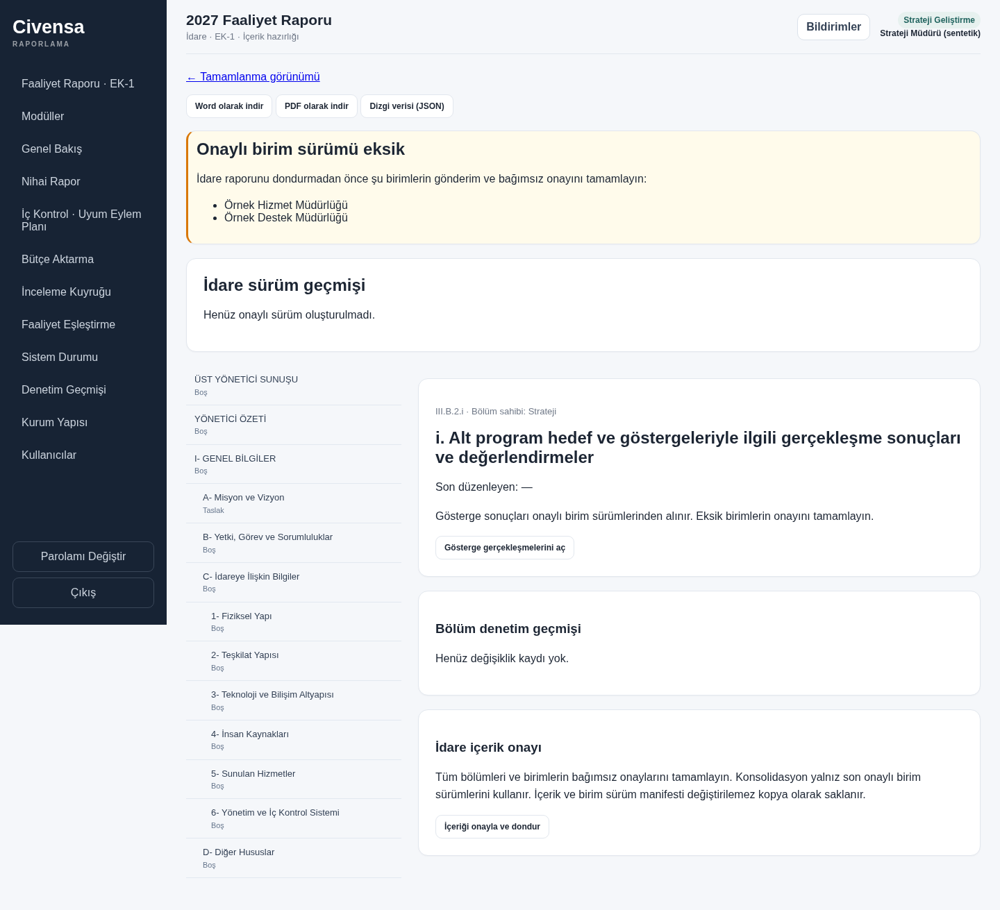

**Görünen metinler ve tablolar:**

- `div`: Civensa RAPORLAMA
- `h1`: 2027 Faaliyet Raporu
- `p`: İdare · EK-1 · İçerik hazırlığı
- `div`: Strateji Geliştirme Strateji Müdürü (sentetik)
- `p`: ← Tamamlanma görünümü
- `p`: Word olarak indir PDF olarak indir Dizgi verisi (JSON)
- `h2`: Onaylı birim sürümü eksik
- `p`: İdare raporunu dondurmadan önce şu birimlerin gönderim ve bağımsız onayını tamamlayın:
- `h2`: İdare sürüm geçmişi
- `p`: Henüz onaylı sürüm oluşturulmadı.
- `p`: III.B.2.i · Bölüm sahibi: Strateji
- `h2`: i. Alt program hedef ve göstergeleriyle ilgili gerçekleşme sonuçları ve değerlendirmeler
- `p`: Son düzenleyen: —
- `p`: Gösterge sonuçları onaylı birim sürümlerinden alınır. Eksik birimlerin onayını tamamlayın.
- `h3`: Bölüm denetim geçmişi
- `p`: Henüz değişiklik kaydı yok.
- `h3`: İdare içerik onayı
- `p`: Tüm bölümleri ve birimlerin bağımsız onaylarını tamamlayın. Konsolidasyon yalnız son onaylı birim sürümlerini kullanır. İçerik ve birim sürüm manifesti değiştirilemez kopya olarak saklanır.
- `li`: Örnek Hizmet Müdürlüğü
- `li`: Örnek Destek Müdürlüğü

**Bağlantı, düğme, form ve alanlar:**

| Öğe | Tür / etiket / bağlam | Hedef URL veya eylem | Ne yapar / mevcut değer |
| --- | --- | --- | --- |
| E001 | a · Faaliyet Raporu · EK-1 | `/activity-sections` | Bağlantıdaki ekranı veya dosyayı açar: Faaliyet Raporu · EK-1. |
| E002 | a · Modüller | `/modules` | Bağlantıdaki ekranı veya dosyayı açar: Modüller. |
| E003 | a · Genel Bakış | `/dashboard` | Bağlantıdaki ekranı veya dosyayı açar: Genel Bakış. |
| E004 | a · Nihai Rapor | `/report-builder` | Bağlantıdaki ekranı veya dosyayı açar: Nihai Rapor. |
| E005 | a · İç Kontrol · Uyum Eylem Planı | `/internal-control` | Bağlantıdaki ekranı veya dosyayı açar: İç Kontrol · Uyum Eylem Planı. |
| E006 | a · Bütçe Aktarma | `/budget-reallocations` | Bağlantıdaki ekranı veya dosyayı açar: Bütçe Aktarma. |
| E007 | a · İnceleme Kuyruğu | `/review` | Bağlantıdaki ekranı veya dosyayı açar: İnceleme Kuyruğu. |
| E008 | a · Faaliyet Eşleştirme | `/activity-mapping` | Bağlantıdaki ekranı veya dosyayı açar: Faaliyet Eşleştirme. |
| E009 | a · Sistem Durumu | `/operations` | Bağlantıdaki ekranı veya dosyayı açar: Sistem Durumu. |
| E010 | a · Denetim Geçmişi | `/audit` | Bağlantıdaki ekranı veya dosyayı açar: Denetim Geçmişi. |
| E011 | a · Kurum Yapısı | `/structure` | Bağlantıdaki ekranı veya dosyayı açar: Kurum Yapısı. |
| E012 | a · Kullanıcılar | `/users` | Bağlantıdaki ekranı veya dosyayı açar: Kullanıcılar. |
| E013 | button · Parolamı Değiştir (#changePasswordButton) | `#passwordModal` | Parola değiştirme penceresini açar. |
| E014 | form · Çıkış | `POST /logout` | Oturumu kapatıp giriş ekranına döner. |
| E015 | button · Çıkış | `POST /logout` | Oturumu kapatıp giriş ekranına döner. |
| E016 | button · Bildirimler (#notificationButton) | `GET /api/notifications → #notificationPanel` | Bildirim listesini açar. |
| E017 | a · ← Tamamlanma görünümü | `/activity-sections` | Bağlantıdaki ekranı veya dosyayı açar: ← Tamamlanma görünümü. |
| E018 | a · Word olarak indir | `/activity-sections/reports/1/export.docx` | Bağlantıdaki ekranı veya dosyayı açar: Word olarak indir. |
| E019 | a · PDF olarak indir | `/activity-sections/reports/1/export.pdf` | Bağlantıdaki ekranı veya dosyayı açar: PDF olarak indir. |
| E020 | a · Dizgi verisi (JSON) | `/activity-sections/reports/1/typeset.json` | Bağlantıdaki ekranı veya dosyayı açar: Dizgi verisi (JSON). |
| E021 | a · ÜST YÖNETİCİ SUNUŞU Boş | `?code=SUNUS` | Bağlantıdaki ekranı veya dosyayı açar: ÜST YÖNETİCİ SUNUŞU Boş. |
| E022 | a · YÖNETİCİ ÖZETİ Boş | `?code=OZET` | Bağlantıdaki ekranı veya dosyayı açar: YÖNETİCİ ÖZETİ Boş. |
| E023 | a · I- GENEL BİLGİLER Boş | `?code=I` | Bağlantıdaki ekranı veya dosyayı açar: I- GENEL BİLGİLER Boş. |
| E024 | a · A- Misyon ve Vizyon Taslak | `?code=I.A` | Bağlantıdaki ekranı veya dosyayı açar: A- Misyon ve Vizyon Taslak. |
| E025 | a · B- Yetki, Görev ve Sorumluluklar Boş | `?code=I.B` | Bağlantıdaki ekranı veya dosyayı açar: B- Yetki, Görev ve Sorumluluklar Boş. |
| E026 | a · C- İdareye İlişkin Bilgiler Boş | `?code=I.C` | Bağlantıdaki ekranı veya dosyayı açar: C- İdareye İlişkin Bilgiler Boş. |
| E027 | a · 1- Fiziksel Yapı Boş | `?code=I.C.1` | Bağlantıdaki ekranı veya dosyayı açar: 1- Fiziksel Yapı Boş. |
| E028 | a · 2- Teşkilat Yapısı Boş | `?code=I.C.2` | Bağlantıdaki ekranı veya dosyayı açar: 2- Teşkilat Yapısı Boş. |
| E029 | a · 3- Teknoloji ve Bilişim Altyapısı Boş | `?code=I.C.3` | Bağlantıdaki ekranı veya dosyayı açar: 3- Teknoloji ve Bilişim Altyapısı Boş. |
| E030 | a · 4- İnsan Kaynakları Boş | `?code=I.C.4` | Bağlantıdaki ekranı veya dosyayı açar: 4- İnsan Kaynakları Boş. |
| E031 | a · 5- Sunulan Hizmetler Boş | `?code=I.C.5` | Bağlantıdaki ekranı veya dosyayı açar: 5- Sunulan Hizmetler Boş. |
| E032 | a · 6- Yönetim ve İç Kontrol Sistemi Boş | `?code=I.C.6` | Bağlantıdaki ekranı veya dosyayı açar: 6- Yönetim ve İç Kontrol Sistemi Boş. |
| E033 | a · D- Diğer Hususlar Boş | `?code=I.D` | Bağlantıdaki ekranı veya dosyayı açar: D- Diğer Hususlar Boş. |
| E034 | a · II- AMAÇLAR ve HEDEFLER Boş | `?code=II` | Bağlantıdaki ekranı veya dosyayı açar: II- AMAÇLAR ve HEDEFLER Boş. |
| E035 | a · A- Temel Politika ve Öncelikler Boş | `?code=II.A` | Bağlantıdaki ekranı veya dosyayı açar: A- Temel Politika ve Öncelikler Boş. |
| E036 | a · B- İdarenin Stratejik Planında Yer Alan Amaç ve Hedefler Boş | `?code=II.B` | Bağlantıdaki ekranı veya dosyayı açar: B- İdarenin Stratejik Planında Yer Alan Amaç ve Hedefler Boş. |
| E037 | a · C- Diğer Hususlar Boş | `?code=II.C` | Bağlantıdaki ekranı veya dosyayı açar: C- Diğer Hususlar Boş. |
| E038 | a · III- FAALİYETLERE İLİŞKİN BİLGİ VE DEĞERLENDİRMELER Boş | `?code=III` | Bağlantıdaki ekranı veya dosyayı açar: III- FAALİYETLERE İLİŞKİN BİLGİ VE DEĞERLENDİRMELER Boş. |
| E039 | a · A- Malî Bilgiler Boş | `?code=III.A` | Bağlantıdaki ekranı veya dosyayı açar: A- Malî Bilgiler Boş. |
| E040 | a · 1- Bütçe Uygulama Sonuçları Taslak | `?code=III.A.1` | Bağlantıdaki ekranı veya dosyayı açar: 1- Bütçe Uygulama Sonuçları Taslak. |
| E041 | a · 2- Temel Malî Tablolara İlişkin Açıklamalar Boş | `?code=III.A.2` | Bağlantıdaki ekranı veya dosyayı açar: 2- Temel Malî Tablolara İlişkin Açıklamalar Boş. |
| E042 | a · 3- Malî Denetim Sonuçları Boş | `?code=III.A.3` | Bağlantıdaki ekranı veya dosyayı açar: 3- Malî Denetim Sonuçları Boş. |
| E043 | a · 4- Diğer Hususlar Boş | `?code=III.A.4` | Bağlantıdaki ekranı veya dosyayı açar: 4- Diğer Hususlar Boş. |
| E044 | a · B- Performans Bilgileri Boş | `?code=III.B` | Bağlantıdaki ekranı veya dosyayı açar: B- Performans Bilgileri Boş. |
| E045 | a · 1- Program, Alt Program, Faaliyet Bilgileri Boş | `?code=III.B.1` | Bağlantıdaki ekranı veya dosyayı açar: 1- Program, Alt Program, Faaliyet Bilgileri Boş. |
| E046 | a · 2- Performans Sonuçlarının Değerlendirilmesi Boş | `?code=III.B.2` | Bağlantıdaki ekranı veya dosyayı açar: 2- Performans Sonuçlarının Değerlendirilmesi Boş. |
| E047 | a · i. Alt program hedef ve göstergeleriyle ilgili gerçekleşme sonuçları ve değerlendirmeler Boş | `?code=III.B.2.i` | Bağlantıdaki ekranı veya dosyayı açar: i. Alt program hedef ve göstergeleriyle ilgili gerçekleşme sonuçları ve değerlendirmeler Boş. |
| E048 | a · ii. Performans denetim sonuçları Boş | `?code=III.B.2.ii` | Bağlantıdaki ekranı veya dosyayı açar: ii. Performans denetim sonuçları Boş. |
| E049 | a · 3- Stratejik Plan Değerlendirme Tabloları Boş | `?code=III.B.3` | Bağlantıdaki ekranı veya dosyayı açar: 3- Stratejik Plan Değerlendirme Tabloları Boş. |
| E050 | a · 4- Performans Bilgi Sisteminin Değerlendirilmesi Boş | `?code=III.B.4` | Bağlantıdaki ekranı veya dosyayı açar: 4- Performans Bilgi Sisteminin Değerlendirilmesi Boş. |
| E051 | a · 5- Diğer Hususlar Boş | `?code=III.B.5` | Bağlantıdaki ekranı veya dosyayı açar: 5- Diğer Hususlar Boş. |
| E052 | a · IV- KURUMSAL KABİLİYET VE KAPASİTENİN DEĞERLENDİRİLMESİ Boş | `?code=IV` | Bağlantıdaki ekranı veya dosyayı açar: IV- KURUMSAL KABİLİYET VE KAPASİTENİN DEĞERLENDİRİLMESİ Boş. |
| E053 | a · A- Üstünlükler Boş | `?code=IV.A` | Bağlantıdaki ekranı veya dosyayı açar: A- Üstünlükler Boş. |
| E054 | a · B- Zayıflıklar Boş | `?code=IV.B` | Bağlantıdaki ekranı veya dosyayı açar: B- Zayıflıklar Boş. |
| E055 | a · C- Değerlendirme Boş | `?code=IV.C` | Bağlantıdaki ekranı veya dosyayı açar: C- Değerlendirme Boş. |
| E056 | a · V- ÖNERİ VE TEDBİRLER Boş | `?code=V` | Bağlantıdaki ekranı veya dosyayı açar: V- ÖNERİ VE TEDBİRLER Boş. |
| E057 | a · EKLER Boş | `?code=EKLER` | Bağlantıdaki ekranı veya dosyayı açar: EKLER Boş. |
| E058 | a · Gösterge gerçekleşmelerini aç · i. Alt program hedef ve göstergeleriyle ilgili gerçekleşme sonuçları ve değerlendirmeler | `/activity-reports` | Bağlantıdaki ekranı veya dosyayı açar: Gösterge gerçekleşmelerini aç. |
| E059 | form · İçeriği onayla ve dondur · İdare içerik onayı | `POST /activity-sections/reports/1/freeze` | Kontrolleri geçen raporun değişmez sürümünü oluşturur. |
| E060 | button · İçeriği onayla ve dondur · İdare içerik onayı | `POST /activity-sections/reports/1/freeze` | Kontrolleri geçen raporun değişmez sürümünü oluşturur. |

<a id="ekran-057"></a>

### 057 · EK-1 bölüm editörü · Bölüm EKLER

URL kalıbı: `/activity-sections/reports/{document_id}` · Çekilen URL: `/activity-sections/reports/1?code=EKLER` · Rol: **strategy** · HTTP 200.

Seçilen rapor bölümünün metin, tablo ve durumunu gösterir.

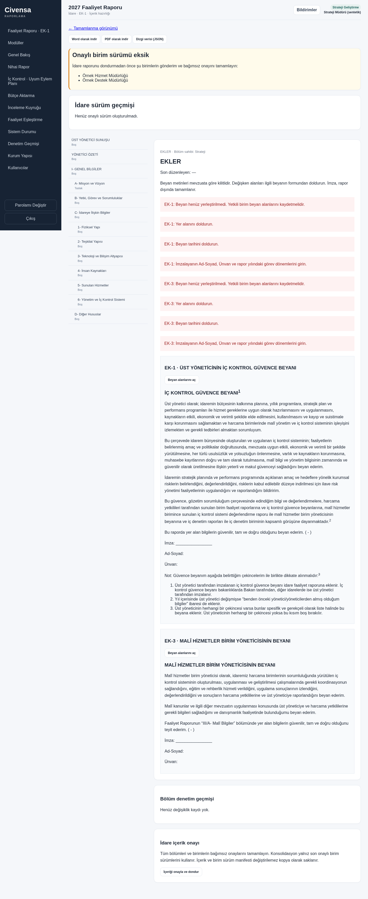

**Görünen metinler ve tablolar:**

- `div`: Civensa RAPORLAMA
- `h1`: 2027 Faaliyet Raporu
- `p`: İdare · EK-1 · İçerik hazırlığı
- `div`: Strateji Geliştirme Strateji Müdürü (sentetik)
- `p`: ← Tamamlanma görünümü
- `p`: Word olarak indir PDF olarak indir Dizgi verisi (JSON)
- `h2`: Onaylı birim sürümü eksik
- `p`: İdare raporunu dondurmadan önce şu birimlerin gönderim ve bağımsız onayını tamamlayın:
- `h2`: İdare sürüm geçmişi
- `p`: Henüz onaylı sürüm oluşturulmadı.
- `p`: EKLER · Bölüm sahibi: Strateji
- `h2`: EKLER
- `p`: Son düzenleyen: —
- `p`: Beyan metinleri mevzuata göre kilitlidir. Değişken alanları ilgili beyanın formundan doldurun. İmza, rapor dışında tamamlanır.
- `p`: EK-1: Beyan henüz yerleştirilmedi. Yetkili birim beyan alanlarını kaydetmelidir.
- `p`: EK-1: Yer alanını doldurun.
- `p`: EK-1: Beyan tarihini doldurun.
- `p`: EK-1: İmzalayanın Ad-Soyad, Ünvan ve rapor yılındaki görev dönemlerini girin.
- `p`: EK-3: Beyan henüz yerleştirilmedi. Yetkili birim beyan alanlarını kaydetmelidir.
- `p`: EK-3: Yer alanını doldurun.
- `p`: EK-3: Beyan tarihini doldurun.
- `p`: EK-3: İmzalayanın Ad-Soyad, Ünvan ve rapor yılındaki görev dönemlerini girin.
- `h3`: EK-1 · ÜST YÖNETİCİNİN İÇ KONTROL GÜVENCE BEYANI
- `h3`: İÇ KONTROL GÜVENCE BEYANI1
- `p`: Üst yönetici olarak; idaremin bütçesinin kalkınma planına, yıllık programlara, stratejik plan ve performans programları ile hizmet gereklerine uygun olarak hazırlanmasını ve uygulanmasını, kaynakların etkili, ekonomik ve verimli şekilde elde edilmesini, kullanılmasını ve kayıp ve suistimale karşı korunmasını sağlamaktan ve harcama birimlerinde malî yönetim ve iç kontrol sisteminin işleyişini izlemekten ve gerekli tedbirleri almaktan sorumluyum.
- `p`: Bu çerçevede idarem bünyesinde oluşturulan ve uygulanan iç kontrol sisteminin; faaliyetlerin belirlenmiş amaç ve politikalar doğrultusunda, mevzuata uygun etkili, ekonomik ve verimli bir şekilde yürütülmesine, her türlü usulsüzlük ve yolsuzluğun önlenmesine, varlık ve kaynakların korunmasına, muhasebe kayıtlarının doğru ve tam olarak tutulmasına, malî bilgi ve yönetim bilgisinin zamanında ve güvenilir olarak üretilmesine ilişkin yeterli ve makul güvenceyi sağladığını beyan ederim.
- `p`: İdaremin stratejik planında ve performans programında açıklanan amaç ve hedeflere yönelik kurumsal risklerin belirlendiğini, değerlendirildiğini, risklerin kabul edilebilir düzeye indirilmesi için ilave risk yönetimi faaliyetlerinin uygulandığını ve raporlandığını bildiririm.
- `p`: Bu güvence, gözetim sorumluluğum çerçevesinde edindiğim bilgi ve değerlendirmelere, harcama yetkilileri tarafından sunulan birim faaliyet raporlarına ve iç kontrol güvence beyanlarına, malî hizmetler birimince sunulan iç kontrol sistemi değerlendirme raporu ile malî hizmetler birim yöneticisinin beyanına ve iç denetim raporları ile iç denetim biriminin kapsamlı görüşüne dayanmaktadır.2
- `p`: Bu raporda yer alan bilgilerin güvenilir, tam ve doğru olduğunu beyan ederim. ( - )
- `p`: İmza: ________________
- `p`: Ad-Soyad:
- `p`: Ünvan:
- `p`: Not: Güvence beyanım aşağıda belirttiğim çekincelerim ile birlikte dikkate alınmalıdır:3
- `h3`: EK-3 · MALÎ HİZMETLER BİRİM YÖNETİCİSİNİN BEYANI
- `h3`: MALÎ HİZMETLER BİRİM YÖNETİCİSİNİN BEYANI
- `p`: Malî hizmetler birim yöneticisi olarak, idaremiz harcama birimlerinin sorumluluğunda yürütülen iç kontrol sisteminin oluşturulması, uygulanması ve geliştirilmesi çalışmalarında gerekli koordinasyonun sağlandığını, eğitim ve rehberlik hizmeti verildiğini, uygulama sonuçlarının izlendiğini, değerlendirildiğini ve sonuçların harcama yetkililerine ve üst yöneticiye raporlandığını beyan ederim.
- `p`: Malî kanunlar ve ilgili diğer mevzuatın uygulanması konusunda üst yöneticiye ve harcama yetkililerine gerekli bilgileri sağladığımı ve danışmanlık faaliyetinde bulunduğumu beyan ederim.
- `p`: Faaliyet Raporunun “III/A- Malî Bilgiler” bölümünde yer alan bilgilerin güvenilir, tam ve doğru olduğunu teyit ederim. ( - )
- `p`: İmza: ________________
- `p`: Ad-Soyad:
- `p`: Ünvan:
- `h3`: Bölüm denetim geçmişi
- `p`: Henüz değişiklik kaydı yok.
- `h3`: İdare içerik onayı
- `p`: Tüm bölümleri ve birimlerin bağımsız onaylarını tamamlayın. Konsolidasyon yalnız son onaylı birim sürümlerini kullanır. İçerik ve birim sürüm manifesti değiştirilemez kopya olarak saklanır.
- `li`: Örnek Hizmet Müdürlüğü
- `li`: Örnek Destek Müdürlüğü
- `li`: Üst yönetici tarafından imzalanan iç kontrol güvence beyanı idare faaliyet raporuna eklenir. İç kontrol güvence beyanı bakanlıklarda Bakan tarafından, diğer idarelerde ise üst yönetici tarafından imzalanır.
- `li`: Yıl içerisinde üst yönetici değişmişse “benden önceki yönetici/yöneticilerden almış olduğum bilgiler” ibaresi de eklenir.
- `li`: Üst yöneticinin herhangi bir çekincesi varsa bunlar spesifik ve gerekçeli olarak liste halinde bu beyana eklenir. Üst yöneticinin herhangi bir çekincesi yoksa bu kısım boş bırakılır.

**Bağlantı, düğme, form ve alanlar:**

| Öğe | Tür / etiket / bağlam | Hedef URL veya eylem | Ne yapar / mevcut değer |
| --- | --- | --- | --- |
| E001 | a · Faaliyet Raporu · EK-1 | `/activity-sections` | Bağlantıdaki ekranı veya dosyayı açar: Faaliyet Raporu · EK-1. |
| E002 | a · Modüller | `/modules` | Bağlantıdaki ekranı veya dosyayı açar: Modüller. |
| E003 | a · Genel Bakış | `/dashboard` | Bağlantıdaki ekranı veya dosyayı açar: Genel Bakış. |
| E004 | a · Nihai Rapor | `/report-builder` | Bağlantıdaki ekranı veya dosyayı açar: Nihai Rapor. |
| E005 | a · İç Kontrol · Uyum Eylem Planı | `/internal-control` | Bağlantıdaki ekranı veya dosyayı açar: İç Kontrol · Uyum Eylem Planı. |
| E006 | a · Bütçe Aktarma | `/budget-reallocations` | Bağlantıdaki ekranı veya dosyayı açar: Bütçe Aktarma. |
| E007 | a · İnceleme Kuyruğu | `/review` | Bağlantıdaki ekranı veya dosyayı açar: İnceleme Kuyruğu. |
| E008 | a · Faaliyet Eşleştirme | `/activity-mapping` | Bağlantıdaki ekranı veya dosyayı açar: Faaliyet Eşleştirme. |
| E009 | a · Sistem Durumu | `/operations` | Bağlantıdaki ekranı veya dosyayı açar: Sistem Durumu. |
| E010 | a · Denetim Geçmişi | `/audit` | Bağlantıdaki ekranı veya dosyayı açar: Denetim Geçmişi. |
| E011 | a · Kurum Yapısı | `/structure` | Bağlantıdaki ekranı veya dosyayı açar: Kurum Yapısı. |
| E012 | a · Kullanıcılar | `/users` | Bağlantıdaki ekranı veya dosyayı açar: Kullanıcılar. |
| E013 | button · Parolamı Değiştir (#changePasswordButton) | `#passwordModal` | Parola değiştirme penceresini açar. |
| E014 | form · Çıkış | `POST /logout` | Oturumu kapatıp giriş ekranına döner. |
| E015 | button · Çıkış | `POST /logout` | Oturumu kapatıp giriş ekranına döner. |
| E016 | button · Bildirimler (#notificationButton) | `GET /api/notifications → #notificationPanel` | Bildirim listesini açar. |
| E017 | a · ← Tamamlanma görünümü | `/activity-sections` | Bağlantıdaki ekranı veya dosyayı açar: ← Tamamlanma görünümü. |
| E018 | a · Word olarak indir | `/activity-sections/reports/1/export.docx` | Bağlantıdaki ekranı veya dosyayı açar: Word olarak indir. |
| E019 | a · PDF olarak indir | `/activity-sections/reports/1/export.pdf` | Bağlantıdaki ekranı veya dosyayı açar: PDF olarak indir. |
| E020 | a · Dizgi verisi (JSON) | `/activity-sections/reports/1/typeset.json` | Bağlantıdaki ekranı veya dosyayı açar: Dizgi verisi (JSON). |
| E021 | a · ÜST YÖNETİCİ SUNUŞU Boş | `?code=SUNUS` | Bağlantıdaki ekranı veya dosyayı açar: ÜST YÖNETİCİ SUNUŞU Boş. |
| E022 | a · YÖNETİCİ ÖZETİ Boş | `?code=OZET` | Bağlantıdaki ekranı veya dosyayı açar: YÖNETİCİ ÖZETİ Boş. |
| E023 | a · I- GENEL BİLGİLER Boş | `?code=I` | Bağlantıdaki ekranı veya dosyayı açar: I- GENEL BİLGİLER Boş. |
| E024 | a · A- Misyon ve Vizyon Taslak | `?code=I.A` | Bağlantıdaki ekranı veya dosyayı açar: A- Misyon ve Vizyon Taslak. |
| E025 | a · B- Yetki, Görev ve Sorumluluklar Boş | `?code=I.B` | Bağlantıdaki ekranı veya dosyayı açar: B- Yetki, Görev ve Sorumluluklar Boş. |
| E026 | a · C- İdareye İlişkin Bilgiler Boş | `?code=I.C` | Bağlantıdaki ekranı veya dosyayı açar: C- İdareye İlişkin Bilgiler Boş. |
| E027 | a · 1- Fiziksel Yapı Boş | `?code=I.C.1` | Bağlantıdaki ekranı veya dosyayı açar: 1- Fiziksel Yapı Boş. |
| E028 | a · 2- Teşkilat Yapısı Boş | `?code=I.C.2` | Bağlantıdaki ekranı veya dosyayı açar: 2- Teşkilat Yapısı Boş. |
| E029 | a · 3- Teknoloji ve Bilişim Altyapısı Boş | `?code=I.C.3` | Bağlantıdaki ekranı veya dosyayı açar: 3- Teknoloji ve Bilişim Altyapısı Boş. |
| E030 | a · 4- İnsan Kaynakları Boş | `?code=I.C.4` | Bağlantıdaki ekranı veya dosyayı açar: 4- İnsan Kaynakları Boş. |
| E031 | a · 5- Sunulan Hizmetler Boş | `?code=I.C.5` | Bağlantıdaki ekranı veya dosyayı açar: 5- Sunulan Hizmetler Boş. |
| E032 | a · 6- Yönetim ve İç Kontrol Sistemi Boş | `?code=I.C.6` | Bağlantıdaki ekranı veya dosyayı açar: 6- Yönetim ve İç Kontrol Sistemi Boş. |
| E033 | a · D- Diğer Hususlar Boş | `?code=I.D` | Bağlantıdaki ekranı veya dosyayı açar: D- Diğer Hususlar Boş. |
| E034 | a · II- AMAÇLAR ve HEDEFLER Boş | `?code=II` | Bağlantıdaki ekranı veya dosyayı açar: II- AMAÇLAR ve HEDEFLER Boş. |
| E035 | a · A- Temel Politika ve Öncelikler Boş | `?code=II.A` | Bağlantıdaki ekranı veya dosyayı açar: A- Temel Politika ve Öncelikler Boş. |
| E036 | a · B- İdarenin Stratejik Planında Yer Alan Amaç ve Hedefler Boş | `?code=II.B` | Bağlantıdaki ekranı veya dosyayı açar: B- İdarenin Stratejik Planında Yer Alan Amaç ve Hedefler Boş. |
| E037 | a · C- Diğer Hususlar Boş | `?code=II.C` | Bağlantıdaki ekranı veya dosyayı açar: C- Diğer Hususlar Boş. |
| E038 | a · III- FAALİYETLERE İLİŞKİN BİLGİ VE DEĞERLENDİRMELER Boş | `?code=III` | Bağlantıdaki ekranı veya dosyayı açar: III- FAALİYETLERE İLİŞKİN BİLGİ VE DEĞERLENDİRMELER Boş. |
| E039 | a · A- Malî Bilgiler Boş | `?code=III.A` | Bağlantıdaki ekranı veya dosyayı açar: A- Malî Bilgiler Boş. |
| E040 | a · 1- Bütçe Uygulama Sonuçları Taslak | `?code=III.A.1` | Bağlantıdaki ekranı veya dosyayı açar: 1- Bütçe Uygulama Sonuçları Taslak. |
| E041 | a · 2- Temel Malî Tablolara İlişkin Açıklamalar Boş | `?code=III.A.2` | Bağlantıdaki ekranı veya dosyayı açar: 2- Temel Malî Tablolara İlişkin Açıklamalar Boş. |
| E042 | a · 3- Malî Denetim Sonuçları Boş | `?code=III.A.3` | Bağlantıdaki ekranı veya dosyayı açar: 3- Malî Denetim Sonuçları Boş. |
| E043 | a · 4- Diğer Hususlar Boş | `?code=III.A.4` | Bağlantıdaki ekranı veya dosyayı açar: 4- Diğer Hususlar Boş. |
| E044 | a · B- Performans Bilgileri Boş | `?code=III.B` | Bağlantıdaki ekranı veya dosyayı açar: B- Performans Bilgileri Boş. |
| E045 | a · 1- Program, Alt Program, Faaliyet Bilgileri Boş | `?code=III.B.1` | Bağlantıdaki ekranı veya dosyayı açar: 1- Program, Alt Program, Faaliyet Bilgileri Boş. |
| E046 | a · 2- Performans Sonuçlarının Değerlendirilmesi Boş | `?code=III.B.2` | Bağlantıdaki ekranı veya dosyayı açar: 2- Performans Sonuçlarının Değerlendirilmesi Boş. |
| E047 | a · i. Alt program hedef ve göstergeleriyle ilgili gerçekleşme sonuçları ve değerlendirmeler Boş | `?code=III.B.2.i` | Bağlantıdaki ekranı veya dosyayı açar: i. Alt program hedef ve göstergeleriyle ilgili gerçekleşme sonuçları ve değerlendirmeler Boş. |
| E048 | a · ii. Performans denetim sonuçları Boş | `?code=III.B.2.ii` | Bağlantıdaki ekranı veya dosyayı açar: ii. Performans denetim sonuçları Boş. |
| E049 | a · 3- Stratejik Plan Değerlendirme Tabloları Boş | `?code=III.B.3` | Bağlantıdaki ekranı veya dosyayı açar: 3- Stratejik Plan Değerlendirme Tabloları Boş. |
| E050 | a · 4- Performans Bilgi Sisteminin Değerlendirilmesi Boş | `?code=III.B.4` | Bağlantıdaki ekranı veya dosyayı açar: 4- Performans Bilgi Sisteminin Değerlendirilmesi Boş. |
| E051 | a · 5- Diğer Hususlar Boş | `?code=III.B.5` | Bağlantıdaki ekranı veya dosyayı açar: 5- Diğer Hususlar Boş. |
| E052 | a · IV- KURUMSAL KABİLİYET VE KAPASİTENİN DEĞERLENDİRİLMESİ Boş | `?code=IV` | Bağlantıdaki ekranı veya dosyayı açar: IV- KURUMSAL KABİLİYET VE KAPASİTENİN DEĞERLENDİRİLMESİ Boş. |
| E053 | a · A- Üstünlükler Boş | `?code=IV.A` | Bağlantıdaki ekranı veya dosyayı açar: A- Üstünlükler Boş. |
| E054 | a · B- Zayıflıklar Boş | `?code=IV.B` | Bağlantıdaki ekranı veya dosyayı açar: B- Zayıflıklar Boş. |
| E055 | a · C- Değerlendirme Boş | `?code=IV.C` | Bağlantıdaki ekranı veya dosyayı açar: C- Değerlendirme Boş. |
| E056 | a · V- ÖNERİ VE TEDBİRLER Boş | `?code=V` | Bağlantıdaki ekranı veya dosyayı açar: V- ÖNERİ VE TEDBİRLER Boş. |
| E057 | a · EKLER Boş | `?code=EKLER` | Bağlantıdaki ekranı veya dosyayı açar: EKLER Boş. |
| E058 | a · Beyan alanlarını aç · EK-1 · ÜST YÖNETİCİNİN İÇ KONTROL GÜVENCE BEYANI | `/activity-sections/reports/1/assurances/EK-1` | Bağlantıdaki ekranı veya dosyayı açar: Beyan alanlarını aç. |
| E059 | a · Beyan alanlarını aç · EK-3 · MALÎ HİZMETLER BİRİM YÖNETİCİSİNİN BEYANI | `/activity-sections/reports/1/assurances/EK-3` | Bağlantıdaki ekranı veya dosyayı açar: Beyan alanlarını aç. |
| E060 | form · İçeriği onayla ve dondur · İdare içerik onayı | `POST /activity-sections/reports/1/freeze` | Kontrolleri geçen raporun değişmez sürümünü oluşturur. |
| E061 | button · İçeriği onayla ve dondur · İdare içerik onayı | `POST /activity-sections/reports/1/freeze` | Kontrolleri geçen raporun değişmez sürümünü oluşturur. |

<a id="ekran-058"></a>

### 058 · Müdürlük veri girişi · Faaliyet Maliyetleri sekmesi

URL kalıbı: `/department/{department_id}` · Çekilen URL: `/department/1?period_id=1` · Rol: **strategy** · HTTP 200.

Gösterge hedeflerini ve faaliyet maliyetlerini gösterir ve düzenler.


**Görünen metinler ve tablolar:**

- `div`: Civensa RAPORLAMA
- `h1`: Örnek Hizmet Müdürlüğü
- `span`: 2027 Performans Programı
- `p`: 2027 Performans Programı · Strateji inceleme görünümü
- `div`: Strateji Geliştirme Strateji Müdürü (sentetik)
- `p`: Performans Kartları ve Ekonomik Tablolar
- `div`: 1 · Veri Girişi 2 · Strateji İncelemesi 3 · Onay
- `h2`: Faaliyet Maliyetleri
- `p`: Bakanlık tablosundaki bütçe, ara dönem harcama, yıl sonu tahmini ve ileri yıl tahminleri dönemden otomatik türetilir.
- `table`: PROGRAM / ALT PROGRAM FAALİYET 2026 BÜTÇE 2026 HAZİRAN SONU HARCAMA 2026 YIL SONU HARCAMA TAHMİNİ 2027 BÜTÇE 2028 TAHMİN 2029 TAHMİN Program / Alt Program seçin Yerel Hizmetler Programı / Erişilebilir Hizmetler SÖZLEŞMEYE BAĞLI — AKTARMADA DEĞİŞMEZ BÜTÇE İÇİ BÜTÇE DIŞI BÜTÇE İÇİ BÜTÇE DIŞI BÜTÇE İÇİ BÜTÇE DIŞI BÜTÇE İÇİ BÜTÇE DIŞI BÜTÇE İÇİ BÜTÇE DIŞI BÜTÇE İÇİ BÜTÇE DIŞI Salt okunur Faaliyetler Toplamı Eksik veri Eksik veri Eksik veri 12.500,23 12.500,23 12.500,23 Personel ve SGK Giderleri Toplamı Genel Bütçe Toplamı Eksik veri Eksik veri Eksik veri 14.500,23 14.500,23 14.500,23

**Bağlantı, düğme, form ve alanlar:**

| Öğe | Tür / etiket / bağlam | Hedef URL veya eylem | Ne yapar / mevcut değer |
| --- | --- | --- | --- |
| E001 | a · Faaliyet Raporu · EK-1 | `/activity-sections` | Bağlantıdaki ekranı veya dosyayı açar: Faaliyet Raporu · EK-1. |
| E002 | a · Modüller | `/modules` | Bağlantıdaki ekranı veya dosyayı açar: Modüller. |
| E003 | a · Genel Bakış | `/dashboard?period_id=1` | Bağlantıdaki ekranı veya dosyayı açar: Genel Bakış. |
| E004 | a · PP Kaynak Karşılaştırması | `/source-comparison?period_id=1` | Bağlantıdaki ekranı veya dosyayı açar: PP Kaynak Karşılaştırması. |
| E005 | a · Nihai Rapor | `/report-builder?period_id=1` | Bağlantıdaki ekranı veya dosyayı açar: Nihai Rapor. |
| E006 | a · İç Kontrol · Uyum Eylem Planı | `/internal-control` | Bağlantıdaki ekranı veya dosyayı açar: İç Kontrol · Uyum Eylem Planı. |
| E007 | a · Bütçe Aktarma | `/budget-reallocations` | Bağlantıdaki ekranı veya dosyayı açar: Bütçe Aktarma. |
| E008 | a · İnceleme Kuyruğu | `/review?period_id=1` | Bağlantıdaki ekranı veya dosyayı açar: İnceleme Kuyruğu. |
| E009 | a · Faaliyet Eşleştirme | `/activity-mapping?period_id=1` | Bağlantıdaki ekranı veya dosyayı açar: Faaliyet Eşleştirme. |
| E010 | a · Sistem Durumu | `/operations?period_id=1` | Bağlantıdaki ekranı veya dosyayı açar: Sistem Durumu. |
| E011 | a · Denetim Geçmişi | `/audit?period_id=1` | Bağlantıdaki ekranı veya dosyayı açar: Denetim Geçmişi. |
| E012 | a · Kurum Yapısı | `/structure?period_id=1` | Bağlantıdaki ekranı veya dosyayı açar: Kurum Yapısı. |
| E013 | a · Kullanıcılar | `/users?period_id=1` | Bağlantıdaki ekranı veya dosyayı açar: Kullanıcılar. |
| E014 | button · Parolamı Değiştir (#changePasswordButton) | `#passwordModal` | Parola değiştirme penceresini açar. |
| E015 | form · Çıkış | `POST /logout` | Oturumu kapatıp giriş ekranına döner. |
| E016 | button · Çıkış | `POST /logout` | Oturumu kapatıp giriş ekranına döner. |
| E017 | button · Bildirimler (#notificationButton) | `GET /api/notifications → #notificationPanel` | Bildirim listesini açar. |
| E018 | a · Performans Kartları ve Ekonomik Tablolar | `/program/1?period_id=1` | Bağlantıdaki ekranı veya dosyayı açar: Performans Kartları ve Ekonomik Tablolar. |
| E019 | button · Performans Göstergeleri | `#indicators` | Seçilen veri giriş sekmesini gösterir. |
| E020 | button · Faaliyet Maliyetleri | `#activities` | Seçilen veri giriş sekmesini gösterir. |
| E021 | select · Program / Alt Program seçin Yerel Hizmetler Programı / Erişilebilir Hizmetler · Program / Alt Program seçin Yerel Hizmetler Programı / Erişilebilir Hizmetler | `PUT /api/activities/1` | Mevcut değeri gösterir; bu görünümde değiştirilemez. **Pasif.** Değer: 1. Seçenekler: Program / Alt Program seçin; Yerel Hizmetler Programı / Erişilebilir Hizmetler. |
| E022 | input · (etiketsiz) · Program / Alt Program seçin Yerel Hizmetler Programı / Erişilebilir Hizmetler | `PUT /api/activities/1` | Mevcut değeri gösterir; bu görünümde değiştirilemez. Değer: Hizmet noktalarının iyileştirilmesi. |
| E023 | textarea · Faaliyet açıklaması · Program / Alt Program seçin Yerel Hizmetler Programı / Erişilebilir Hizmetler | `PUT /api/activities/1` | Mevcut değeri gösterir; bu görünümde değiştirilemez. Değer: Sentetik yıllık çalışma. |
| E024 | input · SÖZLEŞMEYE BAĞLI — AKTARMADA DEĞİŞMEZ · Program / Alt Program seçin Yerel Hizmetler Programı / Erişilebilir Hizmetler | `POST /api/activities/1/contract-bound` | Mevcut değeri gösterir; bu görünümde değiştirilemez. **Pasif.** Değer: İşaretli değil. |
| E025 | input · BÜTÇE İÇİ · Program / Alt Program seçin Yerel Hizmetler Programı / Erişilebilir Hizmetler | `PUT /api/activities/1` | Mevcut değeri gösterir; bu görünümde değiştirilemez. |
| E026 | input · BÜTÇE DIŞI · Program / Alt Program seçin Yerel Hizmetler Programı / Erişilebilir Hizmetler | `PUT /api/activities/1` | Mevcut değeri gösterir; bu görünümde değiştirilemez. |
| E027 | input · BÜTÇE İÇİ · Program / Alt Program seçin Yerel Hizmetler Programı / Erişilebilir Hizmetler | `PUT /api/activities/1` | Mevcut değeri gösterir; bu görünümde değiştirilemez. |
| E028 | input · BÜTÇE DIŞI · Program / Alt Program seçin Yerel Hizmetler Programı / Erişilebilir Hizmetler | `PUT /api/activities/1` | Mevcut değeri gösterir; bu görünümde değiştirilemez. |
| E029 | input · BÜTÇE İÇİ · Program / Alt Program seçin Yerel Hizmetler Programı / Erişilebilir Hizmetler | `PUT /api/activities/1` | Mevcut değeri gösterir; bu görünümde değiştirilemez. |
| E030 | input · BÜTÇE DIŞI · Program / Alt Program seçin Yerel Hizmetler Programı / Erişilebilir Hizmetler | `PUT /api/activities/1` | Mevcut değeri gösterir; bu görünümde değiştirilemez. |
| E031 | input · BÜTÇE İÇİ · Program / Alt Program seçin Yerel Hizmetler Programı / Erişilebilir Hizmetler | `PUT /api/activities/1` | Mevcut değeri gösterir; bu görünümde değiştirilemez. Değer: 12.500,23. |
| E032 | input · BÜTÇE DIŞI · Program / Alt Program seçin Yerel Hizmetler Programı / Erişilebilir Hizmetler | `PUT /api/activities/1` | Mevcut değeri gösterir; bu görünümde değiştirilemez. Değer: 0,00. |
| E033 | input · BÜTÇE İÇİ · Program / Alt Program seçin Yerel Hizmetler Programı / Erişilebilir Hizmetler | `PUT /api/activities/1` | Mevcut değeri gösterir; bu görünümde değiştirilemez. Değer: 12.500,23. |
| E034 | input · BÜTÇE DIŞI · Program / Alt Program seçin Yerel Hizmetler Programı / Erişilebilir Hizmetler | `PUT /api/activities/1` | Mevcut değeri gösterir; bu görünümde değiştirilemez. Değer: 0,00. |
| E035 | input · BÜTÇE İÇİ · Program / Alt Program seçin Yerel Hizmetler Programı / Erişilebilir Hizmetler | `PUT /api/activities/1` | Mevcut değeri gösterir; bu görünümde değiştirilemez. Değer: 12.500,23. |
| E036 | input · BÜTÇE DIŞI · Program / Alt Program seçin Yerel Hizmetler Programı / Erişilebilir Hizmetler | `PUT /api/activities/1` | Mevcut değeri gösterir; bu görünümde değiştirilemez. Değer: 0,00. |
| E037 | input · (etiketsiz) · Personel ve SGK Giderleri Toplamı | `POST /api/departments/{department_id}/personnel-costs` | Mevcut değeri gösterir; bu görünümde değiştirilemez. |
| E038 | input · (etiketsiz) · Personel ve SGK Giderleri Toplamı | `POST /api/departments/{department_id}/personnel-costs` | Mevcut değeri gösterir; bu görünümde değiştirilemez. |
| E039 | input · (etiketsiz) · Personel ve SGK Giderleri Toplamı | `POST /api/departments/{department_id}/personnel-costs` | Mevcut değeri gösterir; bu görünümde değiştirilemez. |
| E040 | input · (etiketsiz) · Personel ve SGK Giderleri Toplamı | `POST /api/departments/{department_id}/personnel-costs` | Mevcut değeri gösterir; bu görünümde değiştirilemez. Değer: 2.000,00. |
| E041 | input · (etiketsiz) · Personel ve SGK Giderleri Toplamı | `POST /api/departments/{department_id}/personnel-costs` | Mevcut değeri gösterir; bu görünümde değiştirilemez. Değer: 2.000,00. |
| E042 | input · (etiketsiz) · Personel ve SGK Giderleri Toplamı | `POST /api/departments/{department_id}/personnel-costs` | Mevcut değeri gösterir; bu görünümde değiştirilemez. Değer: 2.000,00. |

<a id="ekran-059"></a>

### 059 · EK-1 bölüm editörü · Bölüm I.C.1

URL kalıbı: `/activity-sections/reports/{document_id}` · Çekilen URL: `/activity-sections/reports/2?code=I.C.1` · Rol: **department** · HTTP 200.

Seçilen rapor bölümünün metin, tablo ve durumunu gösterir.


**Görünen metinler ve tablolar:**

- `div`: Civensa RAPORLAMA
- `h1`: 2027 Faaliyet Raporu
- `p`: Örnek Hizmet Müdürlüğü · EK-1 · İçerik hazırlığı
- `div`: Müdürlük Birim Müdürü (sentetik)
- `p`: ← Tamamlanma görünümü
- `p`: Word olarak indir PDF olarak indir Dizgi verisi (JSON)
- `h2`: Birim raporu · Taslak
- `p`: Tüm bölümleri tamamladıktan sonra inceleme için gönderin. Gönderilen sürüm inceleme sırasında değiştirilemez.
- `p`: I.C.1 · Bölüm sahibi: Müdürlük
- `h2`: 1- Fiziksel Yapı
- `p`: Son düzenleyen: Birim Müdürü (sentetik) · 25.10.2026 00:35 TSİ
- `p`: Paragrafları boş satırla ayırın. Madde için “- ” kullanın. Basit tablo için “&#124; Başlık &#124; Değer &#124;” yazın; her satırda aynı sayıda sütun kullanın. Önizleme kaydetmeden güncellenir.
- `h3`: İçerik önizlemesi
- `h2`: Binalar ve Hizmet Birimleri
- `p`: Boş alan “bilinmiyor” anlamındadır; sıfır için 0 girin. Sayılar Türkçe biçimde gösterilir.
- `p`: Kaydedilecek satırları seçin. Satırı kaldırmak için seçimini kaldırın. Aynı sayfadaki tabloları sırayla kaydedin.
- `table`: KAYDET ADI TÜRÜ ADRES / MAHALLE ALAN (M²) MÜLKİYET Seçin mülk kira tahsis Seçin mülk kira tahsis Seçin mülk kira tahsis Seçin mülk kira tahsis
- `p`: Alan (m²) toplamı: 240,5 · 0 boş değer
- `h2`: Taşıtlar
- `p`: Boş alan “bilinmiyor” anlamındadır; sıfır için 0 girin. Sayılar Türkçe biçimde gösterilir.
- `p`: Kaydedilecek satırları seçin. Satırı kaldırmak için seçimini kaldırın. Aynı sayfadaki tabloları sırayla kaydedin.
- `table`: KAYDET TÜRÜ ADET MÜLKİYET Seçin mülk kira Seçin mülk kira Seçin mülk kira
- `p`: Adet / kişi toplamı: — · 0 boş değer
- `h3`: Bölüm denetim geçmişi
- `p`: Önceki kayıt
- `p`: Yeni kayıt
- `pre`: {"rows":[],"table":"buildings"}
- `pre`: {"rows":[{"address":"Örnek Mahalle","area":240.5,"category":"Hizmet binası","count":null,"name":"Örnek Hizmet Binası","ownership":"mülk","purpose":""}],"table":"buildings"}

**Bağlantı, düğme, form ve alanlar:**

| Öğe | Tür / etiket / bağlam | Hedef URL veya eylem | Ne yapar / mevcut değer |
| --- | --- | --- | --- |
| E001 | a · Faaliyet Raporu · EK-1 | `/activity-sections` | Bağlantıdaki ekranı veya dosyayı açar: Faaliyet Raporu · EK-1. |
| E002 | a · Modüller | `/modules` | Bağlantıdaki ekranı veya dosyayı açar: Modüller. |
| E003 | a · Genel Bakış | `/dashboard` | Bağlantıdaki ekranı veya dosyayı açar: Genel Bakış. |
| E004 | a · İç Kontrol Eylemlerimiz | `/internal-control/our-actions` | Bağlantıdaki ekranı veya dosyayı açar: İç Kontrol Eylemlerimiz. |
| E005 | a · Veri Girişi | `/department/1` | Bağlantıdaki ekranı veya dosyayı açar: Veri Girişi. |
| E006 | a · Gönderim Yetkileri | `/submit-authorizations` | Bağlantıdaki ekranı veya dosyayı açar: Gönderim Yetkileri. |
| E007 | button · Parolamı Değiştir (#changePasswordButton) | `#passwordModal` | Parola değiştirme penceresini açar. |
| E008 | form · Çıkış | `POST /logout` | Oturumu kapatıp giriş ekranına döner. |
| E009 | button · Çıkış | `POST /logout` | Oturumu kapatıp giriş ekranına döner. |
| E010 | button · Bildirimler (#notificationButton) | `GET /api/notifications → #notificationPanel` | Bildirim listesini açar. |
| E011 | a · ← Tamamlanma görünümü | `/activity-sections` | Bağlantıdaki ekranı veya dosyayı açar: ← Tamamlanma görünümü. |
| E012 | a · Word olarak indir | `/activity-sections/reports/2/export.docx` | Bağlantıdaki ekranı veya dosyayı açar: Word olarak indir. |
| E013 | a · PDF olarak indir | `/activity-sections/reports/2/export.pdf` | Bağlantıdaki ekranı veya dosyayı açar: PDF olarak indir. |
| E014 | a · Dizgi verisi (JSON) | `/activity-sections/reports/2/typeset.json` | Bağlantıdaki ekranı veya dosyayı açar: Dizgi verisi (JSON). |
| E015 | form · Strateji’ye gönder · Birim raporu · Taslak | `POST /activity-sections/reports/2/workflow/submit` | Strateji’ye gönder işlemini form alanlarıyla gönderir; doğrulama sonrası kaydeder veya hata gösterir. |
| E016 | button · Strateji’ye gönder · Birim raporu · Taslak | `POST /activity-sections/reports/2/workflow/submit` | Strateji’ye gönder işlemini form alanlarıyla gönderir; doğrulama sonrası kaydeder veya hata gösterir. |
| E017 | a · YÖNETİCİ ÖZETİ Boş | `?code=OZET` | Bağlantıdaki ekranı veya dosyayı açar: YÖNETİCİ ÖZETİ Boş. |
| E018 | a · I- GENEL BİLGİLER Boş | `?code=I` | Bağlantıdaki ekranı veya dosyayı açar: I- GENEL BİLGİLER Boş. |
| E019 | a · A- Misyon ve Vizyon Taslak | `?code=I.A` | Bağlantıdaki ekranı veya dosyayı açar: A- Misyon ve Vizyon Taslak. |
| E020 | a · B- Yetki, Görev ve Sorumluluklar Boş | `?code=I.B` | Bağlantıdaki ekranı veya dosyayı açar: B- Yetki, Görev ve Sorumluluklar Boş. |
| E021 | a · C- İdareye İlişkin Bilgiler Boş | `?code=I.C` | Bağlantıdaki ekranı veya dosyayı açar: C- İdareye İlişkin Bilgiler Boş. |
| E022 | a · 1- Fiziksel Yapı Taslak | `?code=I.C.1` | Bağlantıdaki ekranı veya dosyayı açar: 1- Fiziksel Yapı Taslak. |
| E023 | a · 2- Teşkilat Yapısı Boş | `?code=I.C.2` | Bağlantıdaki ekranı veya dosyayı açar: 2- Teşkilat Yapısı Boş. |
| E024 | a · 3- Teknoloji ve Bilişim Altyapısı Boş | `?code=I.C.3` | Bağlantıdaki ekranı veya dosyayı açar: 3- Teknoloji ve Bilişim Altyapısı Boş. |
| E025 | a · 4- İnsan Kaynakları Boş | `?code=I.C.4` | Bağlantıdaki ekranı veya dosyayı açar: 4- İnsan Kaynakları Boş. |
| E026 | a · 5- Sunulan Hizmetler Boş | `?code=I.C.5` | Bağlantıdaki ekranı veya dosyayı açar: 5- Sunulan Hizmetler Boş. |
| E027 | a · 6- Yönetim ve İç Kontrol Sistemi Boş | `?code=I.C.6` | Bağlantıdaki ekranı veya dosyayı açar: 6- Yönetim ve İç Kontrol Sistemi Boş. |
| E028 | a · D- Diğer Hususlar Boş | `?code=I.D` | Bağlantıdaki ekranı veya dosyayı açar: D- Diğer Hususlar Boş. |
| E029 | a · II- AMAÇLAR ve HEDEFLER Boş | `?code=II` | Bağlantıdaki ekranı veya dosyayı açar: II- AMAÇLAR ve HEDEFLER Boş. |
| E030 | a · A- Temel Politika ve Öncelikler Boş | `?code=II.A` | Bağlantıdaki ekranı veya dosyayı açar: A- Temel Politika ve Öncelikler Boş. |
| E031 | a · B- İdarenin Stratejik Planında Yer Alan Amaç ve Hedefler Boş | `?code=II.B` | Bağlantıdaki ekranı veya dosyayı açar: B- İdarenin Stratejik Planında Yer Alan Amaç ve Hedefler Boş. |
| E032 | a · C- Diğer Hususlar Boş | `?code=II.C` | Bağlantıdaki ekranı veya dosyayı açar: C- Diğer Hususlar Boş. |
| E033 | a · III- FAALİYETLERE İLİŞKİN BİLGİ VE DEĞERLENDİRMELER Boş | `?code=III` | Bağlantıdaki ekranı veya dosyayı açar: III- FAALİYETLERE İLİŞKİN BİLGİ VE DEĞERLENDİRMELER Boş. |
| E034 | a · A- Malî Bilgiler Boş | `?code=III.A` | Bağlantıdaki ekranı veya dosyayı açar: A- Malî Bilgiler Boş. |
| E035 | a · 1- Bütçe Uygulama Sonuçları Boş | `?code=III.A.1` | Bağlantıdaki ekranı veya dosyayı açar: 1- Bütçe Uygulama Sonuçları Boş. |
| E036 | a · 2- Temel Malî Tablolara İlişkin Açıklamalar Boş | `?code=III.A.2` | Bağlantıdaki ekranı veya dosyayı açar: 2- Temel Malî Tablolara İlişkin Açıklamalar Boş. |
| E037 | a · 3- Malî Denetim Sonuçları Boş | `?code=III.A.3` | Bağlantıdaki ekranı veya dosyayı açar: 3- Malî Denetim Sonuçları Boş. |
| E038 | a · 4- Diğer Hususlar Boş | `?code=III.A.4` | Bağlantıdaki ekranı veya dosyayı açar: 4- Diğer Hususlar Boş. |
| E039 | a · B- Performans Bilgileri Boş | `?code=III.B` | Bağlantıdaki ekranı veya dosyayı açar: B- Performans Bilgileri Boş. |
| E040 | a · 1- Program, Alt Program, Faaliyet Bilgileri Boş | `?code=III.B.1` | Bağlantıdaki ekranı veya dosyayı açar: 1- Program, Alt Program, Faaliyet Bilgileri Boş. |
| E041 | a · 2- Performans Sonuçlarının Değerlendirilmesi Boş | `?code=III.B.2` | Bağlantıdaki ekranı veya dosyayı açar: 2- Performans Sonuçlarının Değerlendirilmesi Boş. |
| E042 | a · i. Alt program hedef ve göstergeleriyle ilgili gerçekleşme sonuçları ve değerlendirmeler Hazır | `?code=III.B.2.i` | Bağlantıdaki ekranı veya dosyayı açar: i. Alt program hedef ve göstergeleriyle ilgili gerçekleşme sonuçları ve değerlendirmeler Hazır. |
| E043 | a · ii. Performans denetim sonuçları Boş | `?code=III.B.2.ii` | Bağlantıdaki ekranı veya dosyayı açar: ii. Performans denetim sonuçları Boş. |
| E044 | a · 3- Stratejik Plan Değerlendirme Tabloları Boş | `?code=III.B.3` | Bağlantıdaki ekranı veya dosyayı açar: 3- Stratejik Plan Değerlendirme Tabloları Boş. |
| E045 | a · 4- Performans Bilgi Sisteminin Değerlendirilmesi Boş | `?code=III.B.4` | Bağlantıdaki ekranı veya dosyayı açar: 4- Performans Bilgi Sisteminin Değerlendirilmesi Boş. |
| E046 | a · 5- Diğer Hususlar Boş | `?code=III.B.5` | Bağlantıdaki ekranı veya dosyayı açar: 5- Diğer Hususlar Boş. |
| E047 | a · IV- KURUMSAL KABİLİYET VE KAPASİTENİN DEĞERLENDİRİLMESİ Boş | `?code=IV` | Bağlantıdaki ekranı veya dosyayı açar: IV- KURUMSAL KABİLİYET VE KAPASİTENİN DEĞERLENDİRİLMESİ Boş. |
| E048 | a · A- Üstünlükler Boş | `?code=IV.A` | Bağlantıdaki ekranı veya dosyayı açar: A- Üstünlükler Boş. |
| E049 | a · B- Zayıflıklar Boş | `?code=IV.B` | Bağlantıdaki ekranı veya dosyayı açar: B- Zayıflıklar Boş. |
| E050 | a · C- Değerlendirme Boş | `?code=IV.C` | Bağlantıdaki ekranı veya dosyayı açar: C- Değerlendirme Boş. |
| E051 | a · V- ÖNERİ VE TEDBİRLER Boş | `?code=V` | Bağlantıdaki ekranı veya dosyayı açar: V- ÖNERİ VE TEDBİRLER Boş. |
| E052 | a · EKLER Boş | `?code=EKLER` | Bağlantıdaki ekranı veya dosyayı açar: EKLER Boş. |
| E053 | form · Bölümü kaydet · 1- Fiziksel Yapı | `POST /activity-sections/reports/2/sections/I.C.1` | Bölümü kaydet işlemini form alanlarıyla gönderir; doğrulama sonrası kaydeder veya hata gösterir. |
| E054 | textarea · BÖLÜM İÇERİĞİ · 1- Fiziksel Yapı | `POST /activity-sections/reports/2/sections/I.C.1` | İşlem için BÖLÜM İÇERİĞİ değerini girer. |
| E055 | select · DURUM Boş Taslak Hazır Uygulanamaz · 1- Fiziksel Yapı | `POST /activity-sections/reports/2/sections/I.C.1` | Listeden seçim yapar. Değer: draft. Seçenekler: Boş; Taslak; Hazır; Uygulanamaz. |
| E056 | textarea · UYGULANAMAZ GEREKÇESİ · 1- Fiziksel Yapı | `POST /activity-sections/reports/2/sections/I.C.1` | İşlem için UYGULANAMAZ GEREKÇESİ değerini girer. |
| E057 | button · Bölümü kaydet · 1- Fiziksel Yapı | `POST /activity-sections/reports/2/sections/I.C.1` | Bölümü kaydet işlemini form alanlarıyla gönderir; doğrulama sonrası kaydeder veya hata gösterir. |
| E058 | form · Satır ekle / Tabloyu kaydet · Binalar ve Hizmet Birimleri | `POST /activity-sections/reports/2/resources/buildings` | Satır ekle / Tabloyu kaydet işlemini form alanlarıyla gönderir; doğrulama sonrası kaydeder veya hata gösterir. |
| E059 | input · 1. satırı kaydet · Binalar ve Hizmet Birimleri | `POST /activity-sections/reports/2/resources/buildings` | Seçeneği işaretler veya kaldırır. Değer: İşaretli. |
| E060 | input · Adı 1 · Binalar ve Hizmet Birimleri | `POST /activity-sections/reports/2/resources/buildings` | İşlem için Adı 1 değerini girer. Değer: Örnek Hizmet Binası. |
| E061 | input · Türü 1 · Binalar ve Hizmet Birimleri | `POST /activity-sections/reports/2/resources/buildings` | İşlem için Türü 1 değerini girer. Değer: Hizmet binası. |
| E062 | input · Adres / mahalle 1 · Binalar ve Hizmet Birimleri | `POST /activity-sections/reports/2/resources/buildings` | İşlem için Adres / mahalle 1 değerini girer. Değer: Örnek Mahalle. |
| E063 | input · Alan (m²) 1 · Binalar ve Hizmet Birimleri | `POST /activity-sections/reports/2/resources/buildings` | İşlem için Alan (m²) 1 değerini girer. Değer: 240,5. |
| E064 | select · Mülkiyet 1 · Binalar ve Hizmet Birimleri | `POST /activity-sections/reports/2/resources/buildings` | Listeden seçim yapar. Değer: mülk. Seçenekler: Seçin; mülk; kira; tahsis. |
| E065 | input · 2. satırı kaydet · Binalar ve Hizmet Birimleri | `POST /activity-sections/reports/2/resources/buildings` | Seçeneği işaretler veya kaldırır. Değer: İşaretli değil. |
| E066 | input · Adı 2 · Binalar ve Hizmet Birimleri | `POST /activity-sections/reports/2/resources/buildings` | İşlem için Adı 2 değerini girer. |
| E067 | input · Türü 2 · Binalar ve Hizmet Birimleri | `POST /activity-sections/reports/2/resources/buildings` | İşlem için Türü 2 değerini girer. |
| E068 | input · Adres / mahalle 2 · Binalar ve Hizmet Birimleri | `POST /activity-sections/reports/2/resources/buildings` | İşlem için Adres / mahalle 2 değerini girer. |
| E069 | input · Alan (m²) 2 · Binalar ve Hizmet Birimleri | `POST /activity-sections/reports/2/resources/buildings` | İşlem için Alan (m²) 2 değerini girer. |
| E070 | select · Mülkiyet 2 · Binalar ve Hizmet Birimleri | `POST /activity-sections/reports/2/resources/buildings` | Listeden seçim yapar. Seçenekler: Seçin; mülk; kira; tahsis. |
| E071 | input · 3. satırı kaydet · Binalar ve Hizmet Birimleri | `POST /activity-sections/reports/2/resources/buildings` | Seçeneği işaretler veya kaldırır. Değer: İşaretli değil. |
| E072 | input · Adı 3 · Binalar ve Hizmet Birimleri | `POST /activity-sections/reports/2/resources/buildings` | İşlem için Adı 3 değerini girer. |
| E073 | input · Türü 3 · Binalar ve Hizmet Birimleri | `POST /activity-sections/reports/2/resources/buildings` | İşlem için Türü 3 değerini girer. |
| E074 | input · Adres / mahalle 3 · Binalar ve Hizmet Birimleri | `POST /activity-sections/reports/2/resources/buildings` | İşlem için Adres / mahalle 3 değerini girer. |
| E075 | input · Alan (m²) 3 · Binalar ve Hizmet Birimleri | `POST /activity-sections/reports/2/resources/buildings` | İşlem için Alan (m²) 3 değerini girer. |
| E076 | select · Mülkiyet 3 · Binalar ve Hizmet Birimleri | `POST /activity-sections/reports/2/resources/buildings` | Listeden seçim yapar. Seçenekler: Seçin; mülk; kira; tahsis. |
| E077 | input · 4. satırı kaydet · Binalar ve Hizmet Birimleri | `POST /activity-sections/reports/2/resources/buildings` | Seçeneği işaretler veya kaldırır. Değer: İşaretli değil. |
| E078 | input · Adı 4 · Binalar ve Hizmet Birimleri | `POST /activity-sections/reports/2/resources/buildings` | İşlem için Adı 4 değerini girer. |
| E079 | input · Türü 4 · Binalar ve Hizmet Birimleri | `POST /activity-sections/reports/2/resources/buildings` | İşlem için Türü 4 değerini girer. |
| E080 | input · Adres / mahalle 4 · Binalar ve Hizmet Birimleri | `POST /activity-sections/reports/2/resources/buildings` | İşlem için Adres / mahalle 4 değerini girer. |
| E081 | input · Alan (m²) 4 · Binalar ve Hizmet Birimleri | `POST /activity-sections/reports/2/resources/buildings` | İşlem için Alan (m²) 4 değerini girer. |
| E082 | select · Mülkiyet 4 · Binalar ve Hizmet Birimleri | `POST /activity-sections/reports/2/resources/buildings` | Listeden seçim yapar. Seçenekler: Seçin; mülk; kira; tahsis. |
| E083 | button · Satır ekle · Binalar ve Hizmet Birimleri | `Aynı malî tablo` | Tabloya yeni satır ekler. |
| E084 | button · Tabloyu kaydet · Binalar ve Hizmet Birimleri | `POST /activity-sections/reports/2/resources/buildings` | Tabloyu kaydet işlemini form alanlarıyla gönderir; doğrulama sonrası kaydeder veya hata gösterir. |
| E085 | form · Satır ekle / Tabloyu kaydet · Taşıtlar | `POST /activity-sections/reports/2/resources/vehicles` | Satır ekle / Tabloyu kaydet işlemini form alanlarıyla gönderir; doğrulama sonrası kaydeder veya hata gösterir. |
| E086 | input · 1. satırı kaydet · Taşıtlar | `POST /activity-sections/reports/2/resources/vehicles` | Seçeneği işaretler veya kaldırır. Değer: İşaretli değil. |
| E087 | input · Türü 1 · Taşıtlar | `POST /activity-sections/reports/2/resources/vehicles` | İşlem için Türü 1 değerini girer. |
| E088 | input · Adet 1 · Taşıtlar | `POST /activity-sections/reports/2/resources/vehicles` | İşlem için Adet 1 değerini girer. |
| E089 | select · Mülkiyet 1 · Taşıtlar | `POST /activity-sections/reports/2/resources/vehicles` | Listeden seçim yapar. Seçenekler: Seçin; mülk; kira. |
| E090 | input · 2. satırı kaydet · Taşıtlar | `POST /activity-sections/reports/2/resources/vehicles` | Seçeneği işaretler veya kaldırır. Değer: İşaretli değil. |
| E091 | input · Türü 2 · Taşıtlar | `POST /activity-sections/reports/2/resources/vehicles` | İşlem için Türü 2 değerini girer. |
| E092 | input · Adet 2 · Taşıtlar | `POST /activity-sections/reports/2/resources/vehicles` | İşlem için Adet 2 değerini girer. |
| E093 | select · Mülkiyet 2 · Taşıtlar | `POST /activity-sections/reports/2/resources/vehicles` | Listeden seçim yapar. Seçenekler: Seçin; mülk; kira. |
| E094 | input · 3. satırı kaydet · Taşıtlar | `POST /activity-sections/reports/2/resources/vehicles` | Seçeneği işaretler veya kaldırır. Değer: İşaretli değil. |
| E095 | input · Türü 3 · Taşıtlar | `POST /activity-sections/reports/2/resources/vehicles` | İşlem için Türü 3 değerini girer. |
| E096 | input · Adet 3 · Taşıtlar | `POST /activity-sections/reports/2/resources/vehicles` | İşlem için Adet 3 değerini girer. |
| E097 | select · Mülkiyet 3 · Taşıtlar | `POST /activity-sections/reports/2/resources/vehicles` | Listeden seçim yapar. Seçenekler: Seçin; mülk; kira. |
| E098 | button · Satır ekle · Taşıtlar | `Aynı malî tablo` | Tabloya yeni satır ekler. |
| E099 | button · Tabloyu kaydet · Taşıtlar | `POST /activity-sections/reports/2/resources/vehicles` | Tabloyu kaydet işlemini form alanlarıyla gönderir; doğrulama sonrası kaydeder veya hata gösterir. |
| E100 | summary · 25.10.2026 00:35 TSİ · Kullanıcı 2 · Kaynak tablosu kaydedildi · 25.10.2026 00:35 TSİ · Kullanıcı 2 · Kaynak tablosu kaydedildi | `Aynı sayfadaki ayrıntı bölümü` | İçerik ve form ayrıntılarını açar veya daraltır. |

<a id="ekran-060"></a>

### 060 · EK-1 bölüm editörü · Bölüm I.C.2

URL kalıbı: `/activity-sections/reports/{document_id}` · Çekilen URL: `/activity-sections/reports/2?code=I.C.2` · Rol: **department** · HTTP 200.

Seçilen rapor bölümünün metin, tablo ve durumunu gösterir.


**Görünen metinler ve tablolar:**

- `div`: Civensa RAPORLAMA
- `h1`: 2027 Faaliyet Raporu
- `p`: Örnek Hizmet Müdürlüğü · EK-1 · İçerik hazırlığı
- `div`: Müdürlük Birim Müdürü (sentetik)
- `p`: ← Tamamlanma görünümü
- `p`: Word olarak indir PDF olarak indir Dizgi verisi (JSON)
- `h2`: Birim raporu · Taslak
- `p`: Tüm bölümleri tamamladıktan sonra inceleme için gönderin. Gönderilen sürüm inceleme sırasında değiştirilemez.
- `p`: I.C.2 · Bölüm sahibi: Müdürlük
- `h2`: 2- Teşkilat Yapısı
- `p`: Son düzenleyen: —
- `p`: Paragrafları boş satırla ayırın. Madde için “- ” kullanın. Basit tablo için “&#124; Başlık &#124; Değer &#124;” yazın; her satırda aynı sayıda sütun kullanın. Önizleme kaydetmeden güncellenir.
- `h3`: İçerik önizlemesi
- `h3`: Bölüm denetim geçmişi
- `p`: Henüz değişiklik kaydı yok.

**Bağlantı, düğme, form ve alanlar:**

| Öğe | Tür / etiket / bağlam | Hedef URL veya eylem | Ne yapar / mevcut değer |
| --- | --- | --- | --- |
| E001 | a · Faaliyet Raporu · EK-1 | `/activity-sections` | Bağlantıdaki ekranı veya dosyayı açar: Faaliyet Raporu · EK-1. |
| E002 | a · Modüller | `/modules` | Bağlantıdaki ekranı veya dosyayı açar: Modüller. |
| E003 | a · Genel Bakış | `/dashboard` | Bağlantıdaki ekranı veya dosyayı açar: Genel Bakış. |
| E004 | a · İç Kontrol Eylemlerimiz | `/internal-control/our-actions` | Bağlantıdaki ekranı veya dosyayı açar: İç Kontrol Eylemlerimiz. |
| E005 | a · Veri Girişi | `/department/1` | Bağlantıdaki ekranı veya dosyayı açar: Veri Girişi. |
| E006 | a · Gönderim Yetkileri | `/submit-authorizations` | Bağlantıdaki ekranı veya dosyayı açar: Gönderim Yetkileri. |
| E007 | button · Parolamı Değiştir (#changePasswordButton) | `#passwordModal` | Parola değiştirme penceresini açar. |
| E008 | form · Çıkış | `POST /logout` | Oturumu kapatıp giriş ekranına döner. |
| E009 | button · Çıkış | `POST /logout` | Oturumu kapatıp giriş ekranına döner. |
| E010 | button · Bildirimler (#notificationButton) | `GET /api/notifications → #notificationPanel` | Bildirim listesini açar. |
| E011 | a · ← Tamamlanma görünümü | `/activity-sections` | Bağlantıdaki ekranı veya dosyayı açar: ← Tamamlanma görünümü. |
| E012 | a · Word olarak indir | `/activity-sections/reports/2/export.docx` | Bağlantıdaki ekranı veya dosyayı açar: Word olarak indir. |
| E013 | a · PDF olarak indir | `/activity-sections/reports/2/export.pdf` | Bağlantıdaki ekranı veya dosyayı açar: PDF olarak indir. |
| E014 | a · Dizgi verisi (JSON) | `/activity-sections/reports/2/typeset.json` | Bağlantıdaki ekranı veya dosyayı açar: Dizgi verisi (JSON). |
| E015 | form · Strateji’ye gönder · Birim raporu · Taslak | `POST /activity-sections/reports/2/workflow/submit` | Strateji’ye gönder işlemini form alanlarıyla gönderir; doğrulama sonrası kaydeder veya hata gösterir. |
| E016 | button · Strateji’ye gönder · Birim raporu · Taslak | `POST /activity-sections/reports/2/workflow/submit` | Strateji’ye gönder işlemini form alanlarıyla gönderir; doğrulama sonrası kaydeder veya hata gösterir. |
| E017 | a · YÖNETİCİ ÖZETİ Boş | `?code=OZET` | Bağlantıdaki ekranı veya dosyayı açar: YÖNETİCİ ÖZETİ Boş. |
| E018 | a · I- GENEL BİLGİLER Boş | `?code=I` | Bağlantıdaki ekranı veya dosyayı açar: I- GENEL BİLGİLER Boş. |
| E019 | a · A- Misyon ve Vizyon Taslak | `?code=I.A` | Bağlantıdaki ekranı veya dosyayı açar: A- Misyon ve Vizyon Taslak. |
| E020 | a · B- Yetki, Görev ve Sorumluluklar Boş | `?code=I.B` | Bağlantıdaki ekranı veya dosyayı açar: B- Yetki, Görev ve Sorumluluklar Boş. |
| E021 | a · C- İdareye İlişkin Bilgiler Boş | `?code=I.C` | Bağlantıdaki ekranı veya dosyayı açar: C- İdareye İlişkin Bilgiler Boş. |
| E022 | a · 1- Fiziksel Yapı Taslak | `?code=I.C.1` | Bağlantıdaki ekranı veya dosyayı açar: 1- Fiziksel Yapı Taslak. |
| E023 | a · 2- Teşkilat Yapısı Boş | `?code=I.C.2` | Bağlantıdaki ekranı veya dosyayı açar: 2- Teşkilat Yapısı Boş. |
| E024 | a · 3- Teknoloji ve Bilişim Altyapısı Boş | `?code=I.C.3` | Bağlantıdaki ekranı veya dosyayı açar: 3- Teknoloji ve Bilişim Altyapısı Boş. |
| E025 | a · 4- İnsan Kaynakları Boş | `?code=I.C.4` | Bağlantıdaki ekranı veya dosyayı açar: 4- İnsan Kaynakları Boş. |
| E026 | a · 5- Sunulan Hizmetler Boş | `?code=I.C.5` | Bağlantıdaki ekranı veya dosyayı açar: 5- Sunulan Hizmetler Boş. |
| E027 | a · 6- Yönetim ve İç Kontrol Sistemi Boş | `?code=I.C.6` | Bağlantıdaki ekranı veya dosyayı açar: 6- Yönetim ve İç Kontrol Sistemi Boş. |
| E028 | a · D- Diğer Hususlar Boş | `?code=I.D` | Bağlantıdaki ekranı veya dosyayı açar: D- Diğer Hususlar Boş. |
| E029 | a · II- AMAÇLAR ve HEDEFLER Boş | `?code=II` | Bağlantıdaki ekranı veya dosyayı açar: II- AMAÇLAR ve HEDEFLER Boş. |
| E030 | a · A- Temel Politika ve Öncelikler Boş | `?code=II.A` | Bağlantıdaki ekranı veya dosyayı açar: A- Temel Politika ve Öncelikler Boş. |
| E031 | a · B- İdarenin Stratejik Planında Yer Alan Amaç ve Hedefler Boş | `?code=II.B` | Bağlantıdaki ekranı veya dosyayı açar: B- İdarenin Stratejik Planında Yer Alan Amaç ve Hedefler Boş. |
| E032 | a · C- Diğer Hususlar Boş | `?code=II.C` | Bağlantıdaki ekranı veya dosyayı açar: C- Diğer Hususlar Boş. |
| E033 | a · III- FAALİYETLERE İLİŞKİN BİLGİ VE DEĞERLENDİRMELER Boş | `?code=III` | Bağlantıdaki ekranı veya dosyayı açar: III- FAALİYETLERE İLİŞKİN BİLGİ VE DEĞERLENDİRMELER Boş. |
| E034 | a · A- Malî Bilgiler Boş | `?code=III.A` | Bağlantıdaki ekranı veya dosyayı açar: A- Malî Bilgiler Boş. |
| E035 | a · 1- Bütçe Uygulama Sonuçları Boş | `?code=III.A.1` | Bağlantıdaki ekranı veya dosyayı açar: 1- Bütçe Uygulama Sonuçları Boş. |
| E036 | a · 2- Temel Malî Tablolara İlişkin Açıklamalar Boş | `?code=III.A.2` | Bağlantıdaki ekranı veya dosyayı açar: 2- Temel Malî Tablolara İlişkin Açıklamalar Boş. |
| E037 | a · 3- Malî Denetim Sonuçları Boş | `?code=III.A.3` | Bağlantıdaki ekranı veya dosyayı açar: 3- Malî Denetim Sonuçları Boş. |
| E038 | a · 4- Diğer Hususlar Boş | `?code=III.A.4` | Bağlantıdaki ekranı veya dosyayı açar: 4- Diğer Hususlar Boş. |
| E039 | a · B- Performans Bilgileri Boş | `?code=III.B` | Bağlantıdaki ekranı veya dosyayı açar: B- Performans Bilgileri Boş. |
| E040 | a · 1- Program, Alt Program, Faaliyet Bilgileri Boş | `?code=III.B.1` | Bağlantıdaki ekranı veya dosyayı açar: 1- Program, Alt Program, Faaliyet Bilgileri Boş. |
| E041 | a · 2- Performans Sonuçlarının Değerlendirilmesi Boş | `?code=III.B.2` | Bağlantıdaki ekranı veya dosyayı açar: 2- Performans Sonuçlarının Değerlendirilmesi Boş. |
| E042 | a · i. Alt program hedef ve göstergeleriyle ilgili gerçekleşme sonuçları ve değerlendirmeler Hazır | `?code=III.B.2.i` | Bağlantıdaki ekranı veya dosyayı açar: i. Alt program hedef ve göstergeleriyle ilgili gerçekleşme sonuçları ve değerlendirmeler Hazır. |
| E043 | a · ii. Performans denetim sonuçları Boş | `?code=III.B.2.ii` | Bağlantıdaki ekranı veya dosyayı açar: ii. Performans denetim sonuçları Boş. |
| E044 | a · 3- Stratejik Plan Değerlendirme Tabloları Boş | `?code=III.B.3` | Bağlantıdaki ekranı veya dosyayı açar: 3- Stratejik Plan Değerlendirme Tabloları Boş. |
| E045 | a · 4- Performans Bilgi Sisteminin Değerlendirilmesi Boş | `?code=III.B.4` | Bağlantıdaki ekranı veya dosyayı açar: 4- Performans Bilgi Sisteminin Değerlendirilmesi Boş. |
| E046 | a · 5- Diğer Hususlar Boş | `?code=III.B.5` | Bağlantıdaki ekranı veya dosyayı açar: 5- Diğer Hususlar Boş. |
| E047 | a · IV- KURUMSAL KABİLİYET VE KAPASİTENİN DEĞERLENDİRİLMESİ Boş | `?code=IV` | Bağlantıdaki ekranı veya dosyayı açar: IV- KURUMSAL KABİLİYET VE KAPASİTENİN DEĞERLENDİRİLMESİ Boş. |
| E048 | a · A- Üstünlükler Boş | `?code=IV.A` | Bağlantıdaki ekranı veya dosyayı açar: A- Üstünlükler Boş. |
| E049 | a · B- Zayıflıklar Boş | `?code=IV.B` | Bağlantıdaki ekranı veya dosyayı açar: B- Zayıflıklar Boş. |
| E050 | a · C- Değerlendirme Boş | `?code=IV.C` | Bağlantıdaki ekranı veya dosyayı açar: C- Değerlendirme Boş. |
| E051 | a · V- ÖNERİ VE TEDBİRLER Boş | `?code=V` | Bağlantıdaki ekranı veya dosyayı açar: V- ÖNERİ VE TEDBİRLER Boş. |
| E052 | a · EKLER Boş | `?code=EKLER` | Bağlantıdaki ekranı veya dosyayı açar: EKLER Boş. |
| E053 | form · Bölümü kaydet · 2- Teşkilat Yapısı | `POST /activity-sections/reports/2/sections/I.C.2` | Bölümü kaydet işlemini form alanlarıyla gönderir; doğrulama sonrası kaydeder veya hata gösterir. |
| E054 | textarea · BÖLÜM İÇERİĞİ · 2- Teşkilat Yapısı | `POST /activity-sections/reports/2/sections/I.C.2` | İşlem için BÖLÜM İÇERİĞİ değerini girer. |
| E055 | select · DURUM Boş Taslak Hazır Uygulanamaz · 2- Teşkilat Yapısı | `POST /activity-sections/reports/2/sections/I.C.2` | Listeden seçim yapar. Değer: empty. Seçenekler: Boş; Taslak; Hazır; Uygulanamaz. |
| E056 | textarea · UYGULANAMAZ GEREKÇESİ · 2- Teşkilat Yapısı | `POST /activity-sections/reports/2/sections/I.C.2` | İşlem için UYGULANAMAZ GEREKÇESİ değerini girer. |
| E057 | button · Bölümü kaydet · 2- Teşkilat Yapısı | `POST /activity-sections/reports/2/sections/I.C.2` | Bölümü kaydet işlemini form alanlarıyla gönderir; doğrulama sonrası kaydeder veya hata gösterir. |

<a id="ekran-061"></a>

### 061 · EK-1 bölüm editörü · Bölüm I.C.3

URL kalıbı: `/activity-sections/reports/{document_id}` · Çekilen URL: `/activity-sections/reports/2?code=I.C.3` · Rol: **department** · HTTP 200.

Seçilen rapor bölümünün metin, tablo ve durumunu gösterir.


**Görünen metinler ve tablolar:**

- `div`: Civensa RAPORLAMA
- `h1`: 2027 Faaliyet Raporu
- `p`: Örnek Hizmet Müdürlüğü · EK-1 · İçerik hazırlığı
- `div`: Müdürlük Birim Müdürü (sentetik)
- `p`: ← Tamamlanma görünümü
- `p`: Word olarak indir PDF olarak indir Dizgi verisi (JSON)
- `h2`: Birim raporu · Taslak
- `p`: Tüm bölümleri tamamladıktan sonra inceleme için gönderin. Gönderilen sürüm inceleme sırasında değiştirilemez.
- `p`: I.C.3 · Bölüm sahibi: Müdürlük
- `h2`: 3- Teknoloji ve Bilişim Altyapısı
- `p`: Son düzenleyen: —
- `p`: Paragrafları boş satırla ayırın. Madde için “- ” kullanın. Basit tablo için “&#124; Başlık &#124; Değer &#124;” yazın; her satırda aynı sayıda sütun kullanın. Önizleme kaydetmeden güncellenir.
- `h3`: İçerik önizlemesi
- `h2`: Donanım
- `p`: Boş alan “bilinmiyor” anlamındadır; sıfır için 0 girin. Sayılar Türkçe biçimde gösterilir.
- `p`: Kaydedilecek satırları seçin. Satırı kaldırmak için seçimini kaldırın. Aynı sayfadaki tabloları sırayla kaydedin.
- `table`: KAYDET TÜRÜ ADET
- `p`: Adet / kişi toplamı: — · 0 boş değer
- `h2`: Yazılım ve Sistemler
- `p`: Boş alan “bilinmiyor” anlamındadır; sıfır için 0 girin. Sayılar Türkçe biçimde gösterilir.
- `p`: Kaydedilecek satırları seçin. Satırı kaldırmak için seçimini kaldırın. Aynı sayfadaki tabloları sırayla kaydedin.
- `table`: KAYDET ADI KULLANIM AMACI
- `h3`: Bölüm denetim geçmişi
- `p`: Henüz değişiklik kaydı yok.

**Bağlantı, düğme, form ve alanlar:**

| Öğe | Tür / etiket / bağlam | Hedef URL veya eylem | Ne yapar / mevcut değer |
| --- | --- | --- | --- |
| E001 | a · Faaliyet Raporu · EK-1 | `/activity-sections` | Bağlantıdaki ekranı veya dosyayı açar: Faaliyet Raporu · EK-1. |
| E002 | a · Modüller | `/modules` | Bağlantıdaki ekranı veya dosyayı açar: Modüller. |
| E003 | a · Genel Bakış | `/dashboard` | Bağlantıdaki ekranı veya dosyayı açar: Genel Bakış. |
| E004 | a · İç Kontrol Eylemlerimiz | `/internal-control/our-actions` | Bağlantıdaki ekranı veya dosyayı açar: İç Kontrol Eylemlerimiz. |
| E005 | a · Veri Girişi | `/department/1` | Bağlantıdaki ekranı veya dosyayı açar: Veri Girişi. |
| E006 | a · Gönderim Yetkileri | `/submit-authorizations` | Bağlantıdaki ekranı veya dosyayı açar: Gönderim Yetkileri. |
| E007 | button · Parolamı Değiştir (#changePasswordButton) | `#passwordModal` | Parola değiştirme penceresini açar. |
| E008 | form · Çıkış | `POST /logout` | Oturumu kapatıp giriş ekranına döner. |
| E009 | button · Çıkış | `POST /logout` | Oturumu kapatıp giriş ekranına döner. |
| E010 | button · Bildirimler (#notificationButton) | `GET /api/notifications → #notificationPanel` | Bildirim listesini açar. |
| E011 | a · ← Tamamlanma görünümü | `/activity-sections` | Bağlantıdaki ekranı veya dosyayı açar: ← Tamamlanma görünümü. |
| E012 | a · Word olarak indir | `/activity-sections/reports/2/export.docx` | Bağlantıdaki ekranı veya dosyayı açar: Word olarak indir. |
| E013 | a · PDF olarak indir | `/activity-sections/reports/2/export.pdf` | Bağlantıdaki ekranı veya dosyayı açar: PDF olarak indir. |
| E014 | a · Dizgi verisi (JSON) | `/activity-sections/reports/2/typeset.json` | Bağlantıdaki ekranı veya dosyayı açar: Dizgi verisi (JSON). |
| E015 | form · Strateji’ye gönder · Birim raporu · Taslak | `POST /activity-sections/reports/2/workflow/submit` | Strateji’ye gönder işlemini form alanlarıyla gönderir; doğrulama sonrası kaydeder veya hata gösterir. |
| E016 | button · Strateji’ye gönder · Birim raporu · Taslak | `POST /activity-sections/reports/2/workflow/submit` | Strateji’ye gönder işlemini form alanlarıyla gönderir; doğrulama sonrası kaydeder veya hata gösterir. |
| E017 | a · YÖNETİCİ ÖZETİ Boş | `?code=OZET` | Bağlantıdaki ekranı veya dosyayı açar: YÖNETİCİ ÖZETİ Boş. |
| E018 | a · I- GENEL BİLGİLER Boş | `?code=I` | Bağlantıdaki ekranı veya dosyayı açar: I- GENEL BİLGİLER Boş. |
| E019 | a · A- Misyon ve Vizyon Taslak | `?code=I.A` | Bağlantıdaki ekranı veya dosyayı açar: A- Misyon ve Vizyon Taslak. |
| E020 | a · B- Yetki, Görev ve Sorumluluklar Boş | `?code=I.B` | Bağlantıdaki ekranı veya dosyayı açar: B- Yetki, Görev ve Sorumluluklar Boş. |
| E021 | a · C- İdareye İlişkin Bilgiler Boş | `?code=I.C` | Bağlantıdaki ekranı veya dosyayı açar: C- İdareye İlişkin Bilgiler Boş. |
| E022 | a · 1- Fiziksel Yapı Taslak | `?code=I.C.1` | Bağlantıdaki ekranı veya dosyayı açar: 1- Fiziksel Yapı Taslak. |
| E023 | a · 2- Teşkilat Yapısı Boş | `?code=I.C.2` | Bağlantıdaki ekranı veya dosyayı açar: 2- Teşkilat Yapısı Boş. |
| E024 | a · 3- Teknoloji ve Bilişim Altyapısı Boş | `?code=I.C.3` | Bağlantıdaki ekranı veya dosyayı açar: 3- Teknoloji ve Bilişim Altyapısı Boş. |
| E025 | a · 4- İnsan Kaynakları Boş | `?code=I.C.4` | Bağlantıdaki ekranı veya dosyayı açar: 4- İnsan Kaynakları Boş. |
| E026 | a · 5- Sunulan Hizmetler Boş | `?code=I.C.5` | Bağlantıdaki ekranı veya dosyayı açar: 5- Sunulan Hizmetler Boş. |
| E027 | a · 6- Yönetim ve İç Kontrol Sistemi Boş | `?code=I.C.6` | Bağlantıdaki ekranı veya dosyayı açar: 6- Yönetim ve İç Kontrol Sistemi Boş. |
| E028 | a · D- Diğer Hususlar Boş | `?code=I.D` | Bağlantıdaki ekranı veya dosyayı açar: D- Diğer Hususlar Boş. |
| E029 | a · II- AMAÇLAR ve HEDEFLER Boş | `?code=II` | Bağlantıdaki ekranı veya dosyayı açar: II- AMAÇLAR ve HEDEFLER Boş. |
| E030 | a · A- Temel Politika ve Öncelikler Boş | `?code=II.A` | Bağlantıdaki ekranı veya dosyayı açar: A- Temel Politika ve Öncelikler Boş. |
| E031 | a · B- İdarenin Stratejik Planında Yer Alan Amaç ve Hedefler Boş | `?code=II.B` | Bağlantıdaki ekranı veya dosyayı açar: B- İdarenin Stratejik Planında Yer Alan Amaç ve Hedefler Boş. |
| E032 | a · C- Diğer Hususlar Boş | `?code=II.C` | Bağlantıdaki ekranı veya dosyayı açar: C- Diğer Hususlar Boş. |
| E033 | a · III- FAALİYETLERE İLİŞKİN BİLGİ VE DEĞERLENDİRMELER Boş | `?code=III` | Bağlantıdaki ekranı veya dosyayı açar: III- FAALİYETLERE İLİŞKİN BİLGİ VE DEĞERLENDİRMELER Boş. |
| E034 | a · A- Malî Bilgiler Boş | `?code=III.A` | Bağlantıdaki ekranı veya dosyayı açar: A- Malî Bilgiler Boş. |
| E035 | a · 1- Bütçe Uygulama Sonuçları Boş | `?code=III.A.1` | Bağlantıdaki ekranı veya dosyayı açar: 1- Bütçe Uygulama Sonuçları Boş. |
| E036 | a · 2- Temel Malî Tablolara İlişkin Açıklamalar Boş | `?code=III.A.2` | Bağlantıdaki ekranı veya dosyayı açar: 2- Temel Malî Tablolara İlişkin Açıklamalar Boş. |
| E037 | a · 3- Malî Denetim Sonuçları Boş | `?code=III.A.3` | Bağlantıdaki ekranı veya dosyayı açar: 3- Malî Denetim Sonuçları Boş. |
| E038 | a · 4- Diğer Hususlar Boş | `?code=III.A.4` | Bağlantıdaki ekranı veya dosyayı açar: 4- Diğer Hususlar Boş. |
| E039 | a · B- Performans Bilgileri Boş | `?code=III.B` | Bağlantıdaki ekranı veya dosyayı açar: B- Performans Bilgileri Boş. |
| E040 | a · 1- Program, Alt Program, Faaliyet Bilgileri Boş | `?code=III.B.1` | Bağlantıdaki ekranı veya dosyayı açar: 1- Program, Alt Program, Faaliyet Bilgileri Boş. |
| E041 | a · 2- Performans Sonuçlarının Değerlendirilmesi Boş | `?code=III.B.2` | Bağlantıdaki ekranı veya dosyayı açar: 2- Performans Sonuçlarının Değerlendirilmesi Boş. |
| E042 | a · i. Alt program hedef ve göstergeleriyle ilgili gerçekleşme sonuçları ve değerlendirmeler Hazır | `?code=III.B.2.i` | Bağlantıdaki ekranı veya dosyayı açar: i. Alt program hedef ve göstergeleriyle ilgili gerçekleşme sonuçları ve değerlendirmeler Hazır. |
| E043 | a · ii. Performans denetim sonuçları Boş | `?code=III.B.2.ii` | Bağlantıdaki ekranı veya dosyayı açar: ii. Performans denetim sonuçları Boş. |
| E044 | a · 3- Stratejik Plan Değerlendirme Tabloları Boş | `?code=III.B.3` | Bağlantıdaki ekranı veya dosyayı açar: 3- Stratejik Plan Değerlendirme Tabloları Boş. |
| E045 | a · 4- Performans Bilgi Sisteminin Değerlendirilmesi Boş | `?code=III.B.4` | Bağlantıdaki ekranı veya dosyayı açar: 4- Performans Bilgi Sisteminin Değerlendirilmesi Boş. |
| E046 | a · 5- Diğer Hususlar Boş | `?code=III.B.5` | Bağlantıdaki ekranı veya dosyayı açar: 5- Diğer Hususlar Boş. |
| E047 | a · IV- KURUMSAL KABİLİYET VE KAPASİTENİN DEĞERLENDİRİLMESİ Boş | `?code=IV` | Bağlantıdaki ekranı veya dosyayı açar: IV- KURUMSAL KABİLİYET VE KAPASİTENİN DEĞERLENDİRİLMESİ Boş. |
| E048 | a · A- Üstünlükler Boş | `?code=IV.A` | Bağlantıdaki ekranı veya dosyayı açar: A- Üstünlükler Boş. |
| E049 | a · B- Zayıflıklar Boş | `?code=IV.B` | Bağlantıdaki ekranı veya dosyayı açar: B- Zayıflıklar Boş. |
| E050 | a · C- Değerlendirme Boş | `?code=IV.C` | Bağlantıdaki ekranı veya dosyayı açar: C- Değerlendirme Boş. |
| E051 | a · V- ÖNERİ VE TEDBİRLER Boş | `?code=V` | Bağlantıdaki ekranı veya dosyayı açar: V- ÖNERİ VE TEDBİRLER Boş. |
| E052 | a · EKLER Boş | `?code=EKLER` | Bağlantıdaki ekranı veya dosyayı açar: EKLER Boş. |
| E053 | form · Bölümü kaydet · 3- Teknoloji ve Bilişim Altyapısı | `POST /activity-sections/reports/2/sections/I.C.3` | Bölümü kaydet işlemini form alanlarıyla gönderir; doğrulama sonrası kaydeder veya hata gösterir. |
| E054 | textarea · BÖLÜM İÇERİĞİ · 3- Teknoloji ve Bilişim Altyapısı | `POST /activity-sections/reports/2/sections/I.C.3` | İşlem için BÖLÜM İÇERİĞİ değerini girer. |
| E055 | select · DURUM Boş Taslak Hazır Uygulanamaz · 3- Teknoloji ve Bilişim Altyapısı | `POST /activity-sections/reports/2/sections/I.C.3` | Listeden seçim yapar. Değer: empty. Seçenekler: Boş; Taslak; Hazır; Uygulanamaz. |
| E056 | textarea · UYGULANAMAZ GEREKÇESİ · 3- Teknoloji ve Bilişim Altyapısı | `POST /activity-sections/reports/2/sections/I.C.3` | İşlem için UYGULANAMAZ GEREKÇESİ değerini girer. |
| E057 | button · Bölümü kaydet · 3- Teknoloji ve Bilişim Altyapısı | `POST /activity-sections/reports/2/sections/I.C.3` | Bölümü kaydet işlemini form alanlarıyla gönderir; doğrulama sonrası kaydeder veya hata gösterir. |
| E058 | form · Satır ekle / Tabloyu kaydet · Donanım | `POST /activity-sections/reports/2/resources/hardware` | Satır ekle / Tabloyu kaydet işlemini form alanlarıyla gönderir; doğrulama sonrası kaydeder veya hata gösterir. |
| E059 | input · 1. satırı kaydet · Donanım | `POST /activity-sections/reports/2/resources/hardware` | Seçeneği işaretler veya kaldırır. Değer: İşaretli değil. |
| E060 | input · Türü 1 · Donanım | `POST /activity-sections/reports/2/resources/hardware` | İşlem için Türü 1 değerini girer. |
| E061 | input · Adet 1 · Donanım | `POST /activity-sections/reports/2/resources/hardware` | İşlem için Adet 1 değerini girer. |
| E062 | input · 2. satırı kaydet · Donanım | `POST /activity-sections/reports/2/resources/hardware` | Seçeneği işaretler veya kaldırır. Değer: İşaretli değil. |
| E063 | input · Türü 2 · Donanım | `POST /activity-sections/reports/2/resources/hardware` | İşlem için Türü 2 değerini girer. |
| E064 | input · Adet 2 · Donanım | `POST /activity-sections/reports/2/resources/hardware` | İşlem için Adet 2 değerini girer. |
| E065 | input · 3. satırı kaydet · Donanım | `POST /activity-sections/reports/2/resources/hardware` | Seçeneği işaretler veya kaldırır. Değer: İşaretli değil. |
| E066 | input · Türü 3 · Donanım | `POST /activity-sections/reports/2/resources/hardware` | İşlem için Türü 3 değerini girer. |
| E067 | input · Adet 3 · Donanım | `POST /activity-sections/reports/2/resources/hardware` | İşlem için Adet 3 değerini girer. |
| E068 | button · Satır ekle · Donanım | `Aynı malî tablo` | Tabloya yeni satır ekler. |
| E069 | button · Tabloyu kaydet · Donanım | `POST /activity-sections/reports/2/resources/hardware` | Tabloyu kaydet işlemini form alanlarıyla gönderir; doğrulama sonrası kaydeder veya hata gösterir. |
| E070 | form · Satır ekle / Tabloyu kaydet · Yazılım ve Sistemler | `POST /activity-sections/reports/2/resources/software` | Satır ekle / Tabloyu kaydet işlemini form alanlarıyla gönderir; doğrulama sonrası kaydeder veya hata gösterir. |
| E071 | input · 1. satırı kaydet · Yazılım ve Sistemler | `POST /activity-sections/reports/2/resources/software` | Seçeneği işaretler veya kaldırır. Değer: İşaretli değil. |
| E072 | input · Adı 1 · Yazılım ve Sistemler | `POST /activity-sections/reports/2/resources/software` | İşlem için Adı 1 değerini girer. |
| E073 | input · Kullanım amacı 1 · Yazılım ve Sistemler | `POST /activity-sections/reports/2/resources/software` | İşlem için Kullanım amacı 1 değerini girer. |
| E074 | input · 2. satırı kaydet · Yazılım ve Sistemler | `POST /activity-sections/reports/2/resources/software` | Seçeneği işaretler veya kaldırır. Değer: İşaretli değil. |
| E075 | input · Adı 2 · Yazılım ve Sistemler | `POST /activity-sections/reports/2/resources/software` | İşlem için Adı 2 değerini girer. |
| E076 | input · Kullanım amacı 2 · Yazılım ve Sistemler | `POST /activity-sections/reports/2/resources/software` | İşlem için Kullanım amacı 2 değerini girer. |
| E077 | input · 3. satırı kaydet · Yazılım ve Sistemler | `POST /activity-sections/reports/2/resources/software` | Seçeneği işaretler veya kaldırır. Değer: İşaretli değil. |
| E078 | input · Adı 3 · Yazılım ve Sistemler | `POST /activity-sections/reports/2/resources/software` | İşlem için Adı 3 değerini girer. |
| E079 | input · Kullanım amacı 3 · Yazılım ve Sistemler | `POST /activity-sections/reports/2/resources/software` | İşlem için Kullanım amacı 3 değerini girer. |
| E080 | button · Satır ekle · Yazılım ve Sistemler | `Aynı malî tablo` | Tabloya yeni satır ekler. |
| E081 | button · Tabloyu kaydet · Yazılım ve Sistemler | `POST /activity-sections/reports/2/resources/software` | Tabloyu kaydet işlemini form alanlarıyla gönderir; doğrulama sonrası kaydeder veya hata gösterir. |

<a id="ekran-062"></a>

### 062 · EK-1 bölüm editörü · Bölüm I.C.4

URL kalıbı: `/activity-sections/reports/{document_id}` · Çekilen URL: `/activity-sections/reports/2?code=I.C.4` · Rol: **department** · HTTP 200.

Seçilen rapor bölümünün metin, tablo ve durumunu gösterir.


**Görünen metinler ve tablolar:**

- `div`: Civensa RAPORLAMA
- `h1`: 2027 Faaliyet Raporu
- `p`: Örnek Hizmet Müdürlüğü · EK-1 · İçerik hazırlığı
- `div`: Müdürlük Birim Müdürü (sentetik)
- `p`: ← Tamamlanma görünümü
- `p`: Word olarak indir PDF olarak indir Dizgi verisi (JSON)
- `h2`: Birim raporu · Taslak
- `p`: Tüm bölümleri tamamladıktan sonra inceleme için gönderin. Gönderilen sürüm inceleme sırasında değiştirilemez.
- `p`: I.C.4 · Bölüm sahibi: Müdürlük
- `h2`: 4- İnsan Kaynakları
- `p`: Son düzenleyen: —
- `p`: Paragrafları boş satırla ayırın. Madde için “- ” kullanın. Basit tablo için “&#124; Başlık &#124; Değer &#124;” yazın; her satırda aynı sayıda sütun kullanın. Önizleme kaydetmeden güncellenir.
- `h3`: İçerik önizlemesi
- `h2`: İstihdam Türüne Göre Personel
- `p`: Boş alan “bilinmiyor” anlamındadır; sıfır için 0 girin. Sayılar Türkçe biçimde gösterilir.
- `p`: Kaydedilecek satırları seçin. Satırı kaldırmak için seçimini kaldırın. Aynı sayfadaki tabloları sırayla kaydedin.
- `table`: KAYDET İSTİHDAM TÜRÜ KİŞİ SAYISI Seçin memur sözleşmeli personel işçi — kadrolu işçi — geçici şirket personeli/hizmet alımı diğer Seçin memur sözleşmeli personel işçi — kadrolu işçi — geçici şirket personeli/hizmet alımı diğer Seçin memur sözleşmeli personel işçi — kadrolu işçi — geçici şirket personeli/hizmet alımı diğer
- `p`: Adet / kişi toplamı: — · 0 boş değer
- `h2`: Öğrenim Durumuna Göre Personel
- `p`: Boş alan “bilinmiyor” anlamındadır; sıfır için 0 girin. Sayılar Türkçe biçimde gösterilir.
- `p`: Kaydedilecek satırları seçin. Satırı kaldırmak için seçimini kaldırın. Aynı sayfadaki tabloları sırayla kaydedin.
- `table`: KAYDET ÖĞRENİM DÜZEYİ KİŞİ SAYISI
- `p`: Adet / kişi toplamı: — · 0 boş değer
- `h2`: Cinsiyete Göre Personel
- `p`: Boş alan “bilinmiyor” anlamındadır; sıfır için 0 girin. Sayılar Türkçe biçimde gösterilir.
- `p`: Kaydedilecek satırları seçin. Satırı kaldırmak için seçimini kaldırın. Aynı sayfadaki tabloları sırayla kaydedin.
- `table`: KAYDET CİNSİYET KİŞİ SAYISI
- `p`: Adet / kişi toplamı: — · 0 boş değer
- `h3`: Bölüm denetim geçmişi
- `p`: Henüz değişiklik kaydı yok.

**Bağlantı, düğme, form ve alanlar:**

| Öğe | Tür / etiket / bağlam | Hedef URL veya eylem | Ne yapar / mevcut değer |
| --- | --- | --- | --- |
| E001 | a · Faaliyet Raporu · EK-1 | `/activity-sections` | Bağlantıdaki ekranı veya dosyayı açar: Faaliyet Raporu · EK-1. |
| E002 | a · Modüller | `/modules` | Bağlantıdaki ekranı veya dosyayı açar: Modüller. |
| E003 | a · Genel Bakış | `/dashboard` | Bağlantıdaki ekranı veya dosyayı açar: Genel Bakış. |
| E004 | a · İç Kontrol Eylemlerimiz | `/internal-control/our-actions` | Bağlantıdaki ekranı veya dosyayı açar: İç Kontrol Eylemlerimiz. |
| E005 | a · Veri Girişi | `/department/1` | Bağlantıdaki ekranı veya dosyayı açar: Veri Girişi. |
| E006 | a · Gönderim Yetkileri | `/submit-authorizations` | Bağlantıdaki ekranı veya dosyayı açar: Gönderim Yetkileri. |
| E007 | button · Parolamı Değiştir (#changePasswordButton) | `#passwordModal` | Parola değiştirme penceresini açar. |
| E008 | form · Çıkış | `POST /logout` | Oturumu kapatıp giriş ekranına döner. |
| E009 | button · Çıkış | `POST /logout` | Oturumu kapatıp giriş ekranına döner. |
| E010 | button · Bildirimler (#notificationButton) | `GET /api/notifications → #notificationPanel` | Bildirim listesini açar. |
| E011 | a · ← Tamamlanma görünümü | `/activity-sections` | Bağlantıdaki ekranı veya dosyayı açar: ← Tamamlanma görünümü. |
| E012 | a · Word olarak indir | `/activity-sections/reports/2/export.docx` | Bağlantıdaki ekranı veya dosyayı açar: Word olarak indir. |
| E013 | a · PDF olarak indir | `/activity-sections/reports/2/export.pdf` | Bağlantıdaki ekranı veya dosyayı açar: PDF olarak indir. |
| E014 | a · Dizgi verisi (JSON) | `/activity-sections/reports/2/typeset.json` | Bağlantıdaki ekranı veya dosyayı açar: Dizgi verisi (JSON). |
| E015 | form · Strateji’ye gönder · Birim raporu · Taslak | `POST /activity-sections/reports/2/workflow/submit` | Strateji’ye gönder işlemini form alanlarıyla gönderir; doğrulama sonrası kaydeder veya hata gösterir. |
| E016 | button · Strateji’ye gönder · Birim raporu · Taslak | `POST /activity-sections/reports/2/workflow/submit` | Strateji’ye gönder işlemini form alanlarıyla gönderir; doğrulama sonrası kaydeder veya hata gösterir. |
| E017 | a · YÖNETİCİ ÖZETİ Boş | `?code=OZET` | Bağlantıdaki ekranı veya dosyayı açar: YÖNETİCİ ÖZETİ Boş. |
| E018 | a · I- GENEL BİLGİLER Boş | `?code=I` | Bağlantıdaki ekranı veya dosyayı açar: I- GENEL BİLGİLER Boş. |
| E019 | a · A- Misyon ve Vizyon Taslak | `?code=I.A` | Bağlantıdaki ekranı veya dosyayı açar: A- Misyon ve Vizyon Taslak. |
| E020 | a · B- Yetki, Görev ve Sorumluluklar Boş | `?code=I.B` | Bağlantıdaki ekranı veya dosyayı açar: B- Yetki, Görev ve Sorumluluklar Boş. |
| E021 | a · C- İdareye İlişkin Bilgiler Boş | `?code=I.C` | Bağlantıdaki ekranı veya dosyayı açar: C- İdareye İlişkin Bilgiler Boş. |
| E022 | a · 1- Fiziksel Yapı Taslak | `?code=I.C.1` | Bağlantıdaki ekranı veya dosyayı açar: 1- Fiziksel Yapı Taslak. |
| E023 | a · 2- Teşkilat Yapısı Boş | `?code=I.C.2` | Bağlantıdaki ekranı veya dosyayı açar: 2- Teşkilat Yapısı Boş. |
| E024 | a · 3- Teknoloji ve Bilişim Altyapısı Boş | `?code=I.C.3` | Bağlantıdaki ekranı veya dosyayı açar: 3- Teknoloji ve Bilişim Altyapısı Boş. |
| E025 | a · 4- İnsan Kaynakları Boş | `?code=I.C.4` | Bağlantıdaki ekranı veya dosyayı açar: 4- İnsan Kaynakları Boş. |
| E026 | a · 5- Sunulan Hizmetler Boş | `?code=I.C.5` | Bağlantıdaki ekranı veya dosyayı açar: 5- Sunulan Hizmetler Boş. |
| E027 | a · 6- Yönetim ve İç Kontrol Sistemi Boş | `?code=I.C.6` | Bağlantıdaki ekranı veya dosyayı açar: 6- Yönetim ve İç Kontrol Sistemi Boş. |
| E028 | a · D- Diğer Hususlar Boş | `?code=I.D` | Bağlantıdaki ekranı veya dosyayı açar: D- Diğer Hususlar Boş. |
| E029 | a · II- AMAÇLAR ve HEDEFLER Boş | `?code=II` | Bağlantıdaki ekranı veya dosyayı açar: II- AMAÇLAR ve HEDEFLER Boş. |
| E030 | a · A- Temel Politika ve Öncelikler Boş | `?code=II.A` | Bağlantıdaki ekranı veya dosyayı açar: A- Temel Politika ve Öncelikler Boş. |
| E031 | a · B- İdarenin Stratejik Planında Yer Alan Amaç ve Hedefler Boş | `?code=II.B` | Bağlantıdaki ekranı veya dosyayı açar: B- İdarenin Stratejik Planında Yer Alan Amaç ve Hedefler Boş. |
| E032 | a · C- Diğer Hususlar Boş | `?code=II.C` | Bağlantıdaki ekranı veya dosyayı açar: C- Diğer Hususlar Boş. |
| E033 | a · III- FAALİYETLERE İLİŞKİN BİLGİ VE DEĞERLENDİRMELER Boş | `?code=III` | Bağlantıdaki ekranı veya dosyayı açar: III- FAALİYETLERE İLİŞKİN BİLGİ VE DEĞERLENDİRMELER Boş. |
| E034 | a · A- Malî Bilgiler Boş | `?code=III.A` | Bağlantıdaki ekranı veya dosyayı açar: A- Malî Bilgiler Boş. |
| E035 | a · 1- Bütçe Uygulama Sonuçları Boş | `?code=III.A.1` | Bağlantıdaki ekranı veya dosyayı açar: 1- Bütçe Uygulama Sonuçları Boş. |
| E036 | a · 2- Temel Malî Tablolara İlişkin Açıklamalar Boş | `?code=III.A.2` | Bağlantıdaki ekranı veya dosyayı açar: 2- Temel Malî Tablolara İlişkin Açıklamalar Boş. |
| E037 | a · 3- Malî Denetim Sonuçları Boş | `?code=III.A.3` | Bağlantıdaki ekranı veya dosyayı açar: 3- Malî Denetim Sonuçları Boş. |
| E038 | a · 4- Diğer Hususlar Boş | `?code=III.A.4` | Bağlantıdaki ekranı veya dosyayı açar: 4- Diğer Hususlar Boş. |
| E039 | a · B- Performans Bilgileri Boş | `?code=III.B` | Bağlantıdaki ekranı veya dosyayı açar: B- Performans Bilgileri Boş. |
| E040 | a · 1- Program, Alt Program, Faaliyet Bilgileri Boş | `?code=III.B.1` | Bağlantıdaki ekranı veya dosyayı açar: 1- Program, Alt Program, Faaliyet Bilgileri Boş. |
| E041 | a · 2- Performans Sonuçlarının Değerlendirilmesi Boş | `?code=III.B.2` | Bağlantıdaki ekranı veya dosyayı açar: 2- Performans Sonuçlarının Değerlendirilmesi Boş. |
| E042 | a · i. Alt program hedef ve göstergeleriyle ilgili gerçekleşme sonuçları ve değerlendirmeler Hazır | `?code=III.B.2.i` | Bağlantıdaki ekranı veya dosyayı açar: i. Alt program hedef ve göstergeleriyle ilgili gerçekleşme sonuçları ve değerlendirmeler Hazır. |
| E043 | a · ii. Performans denetim sonuçları Boş | `?code=III.B.2.ii` | Bağlantıdaki ekranı veya dosyayı açar: ii. Performans denetim sonuçları Boş. |
| E044 | a · 3- Stratejik Plan Değerlendirme Tabloları Boş | `?code=III.B.3` | Bağlantıdaki ekranı veya dosyayı açar: 3- Stratejik Plan Değerlendirme Tabloları Boş. |
| E045 | a · 4- Performans Bilgi Sisteminin Değerlendirilmesi Boş | `?code=III.B.4` | Bağlantıdaki ekranı veya dosyayı açar: 4- Performans Bilgi Sisteminin Değerlendirilmesi Boş. |
| E046 | a · 5- Diğer Hususlar Boş | `?code=III.B.5` | Bağlantıdaki ekranı veya dosyayı açar: 5- Diğer Hususlar Boş. |
| E047 | a · IV- KURUMSAL KABİLİYET VE KAPASİTENİN DEĞERLENDİRİLMESİ Boş | `?code=IV` | Bağlantıdaki ekranı veya dosyayı açar: IV- KURUMSAL KABİLİYET VE KAPASİTENİN DEĞERLENDİRİLMESİ Boş. |
| E048 | a · A- Üstünlükler Boş | `?code=IV.A` | Bağlantıdaki ekranı veya dosyayı açar: A- Üstünlükler Boş. |
| E049 | a · B- Zayıflıklar Boş | `?code=IV.B` | Bağlantıdaki ekranı veya dosyayı açar: B- Zayıflıklar Boş. |
| E050 | a · C- Değerlendirme Boş | `?code=IV.C` | Bağlantıdaki ekranı veya dosyayı açar: C- Değerlendirme Boş. |
| E051 | a · V- ÖNERİ VE TEDBİRLER Boş | `?code=V` | Bağlantıdaki ekranı veya dosyayı açar: V- ÖNERİ VE TEDBİRLER Boş. |
| E052 | a · EKLER Boş | `?code=EKLER` | Bağlantıdaki ekranı veya dosyayı açar: EKLER Boş. |
| E053 | form · Bölümü kaydet · 4- İnsan Kaynakları | `POST /activity-sections/reports/2/sections/I.C.4` | Bölümü kaydet işlemini form alanlarıyla gönderir; doğrulama sonrası kaydeder veya hata gösterir. |
| E054 | textarea · BÖLÜM İÇERİĞİ · 4- İnsan Kaynakları | `POST /activity-sections/reports/2/sections/I.C.4` | İşlem için BÖLÜM İÇERİĞİ değerini girer. |
| E055 | select · DURUM Boş Taslak Hazır Uygulanamaz · 4- İnsan Kaynakları | `POST /activity-sections/reports/2/sections/I.C.4` | Listeden seçim yapar. Değer: empty. Seçenekler: Boş; Taslak; Hazır; Uygulanamaz. |
| E056 | textarea · UYGULANAMAZ GEREKÇESİ · 4- İnsan Kaynakları | `POST /activity-sections/reports/2/sections/I.C.4` | İşlem için UYGULANAMAZ GEREKÇESİ değerini girer. |
| E057 | button · Bölümü kaydet · 4- İnsan Kaynakları | `POST /activity-sections/reports/2/sections/I.C.4` | Bölümü kaydet işlemini form alanlarıyla gönderir; doğrulama sonrası kaydeder veya hata gösterir. |
| E058 | form · Satır ekle / Tabloyu kaydet · İstihdam Türüne Göre Personel | `POST /activity-sections/reports/2/resources/employment` | Satır ekle / Tabloyu kaydet işlemini form alanlarıyla gönderir; doğrulama sonrası kaydeder veya hata gösterir. |
| E059 | input · 1. satırı kaydet · İstihdam Türüne Göre Personel | `POST /activity-sections/reports/2/resources/employment` | Seçeneği işaretler veya kaldırır. Değer: İşaretli değil. |
| E060 | select · İstihdam türü 1 · İstihdam Türüne Göre Personel | `POST /activity-sections/reports/2/resources/employment` | Listeden seçim yapar. Seçenekler: Seçin; memur; sözleşmeli personel; işçi — kadrolu; işçi — geçici; şirket personeli/hizmet alımı; diğer. |
| E061 | input · Kişi sayısı 1 · İstihdam Türüne Göre Personel | `POST /activity-sections/reports/2/resources/employment` | İşlem için Kişi sayısı 1 değerini girer. |
| E062 | input · 2. satırı kaydet · İstihdam Türüne Göre Personel | `POST /activity-sections/reports/2/resources/employment` | Seçeneği işaretler veya kaldırır. Değer: İşaretli değil. |
| E063 | select · İstihdam türü 2 · İstihdam Türüne Göre Personel | `POST /activity-sections/reports/2/resources/employment` | Listeden seçim yapar. Seçenekler: Seçin; memur; sözleşmeli personel; işçi — kadrolu; işçi — geçici; şirket personeli/hizmet alımı; diğer. |
| E064 | input · Kişi sayısı 2 · İstihdam Türüne Göre Personel | `POST /activity-sections/reports/2/resources/employment` | İşlem için Kişi sayısı 2 değerini girer. |
| E065 | input · 3. satırı kaydet · İstihdam Türüne Göre Personel | `POST /activity-sections/reports/2/resources/employment` | Seçeneği işaretler veya kaldırır. Değer: İşaretli değil. |
| E066 | select · İstihdam türü 3 · İstihdam Türüne Göre Personel | `POST /activity-sections/reports/2/resources/employment` | Listeden seçim yapar. Seçenekler: Seçin; memur; sözleşmeli personel; işçi — kadrolu; işçi — geçici; şirket personeli/hizmet alımı; diğer. |
| E067 | input · Kişi sayısı 3 · İstihdam Türüne Göre Personel | `POST /activity-sections/reports/2/resources/employment` | İşlem için Kişi sayısı 3 değerini girer. |
| E068 | button · Satır ekle · İstihdam Türüne Göre Personel | `Aynı malî tablo` | Tabloya yeni satır ekler. |
| E069 | button · Tabloyu kaydet · İstihdam Türüne Göre Personel | `POST /activity-sections/reports/2/resources/employment` | Tabloyu kaydet işlemini form alanlarıyla gönderir; doğrulama sonrası kaydeder veya hata gösterir. |
| E070 | form · Satır ekle / Tabloyu kaydet · Öğrenim Durumuna Göre Personel | `POST /activity-sections/reports/2/resources/education` | Satır ekle / Tabloyu kaydet işlemini form alanlarıyla gönderir; doğrulama sonrası kaydeder veya hata gösterir. |
| E071 | input · 1. satırı kaydet · Öğrenim Durumuna Göre Personel | `POST /activity-sections/reports/2/resources/education` | Seçeneği işaretler veya kaldırır. Değer: İşaretli değil. |
| E072 | input · Öğrenim düzeyi 1 · Öğrenim Durumuna Göre Personel | `POST /activity-sections/reports/2/resources/education` | İşlem için Öğrenim düzeyi 1 değerini girer. |
| E073 | input · Kişi sayısı 1 · Öğrenim Durumuna Göre Personel | `POST /activity-sections/reports/2/resources/education` | İşlem için Kişi sayısı 1 değerini girer. |
| E074 | input · 2. satırı kaydet · Öğrenim Durumuna Göre Personel | `POST /activity-sections/reports/2/resources/education` | Seçeneği işaretler veya kaldırır. Değer: İşaretli değil. |
| E075 | input · Öğrenim düzeyi 2 · Öğrenim Durumuna Göre Personel | `POST /activity-sections/reports/2/resources/education` | İşlem için Öğrenim düzeyi 2 değerini girer. |
| E076 | input · Kişi sayısı 2 · Öğrenim Durumuna Göre Personel | `POST /activity-sections/reports/2/resources/education` | İşlem için Kişi sayısı 2 değerini girer. |
| E077 | input · 3. satırı kaydet · Öğrenim Durumuna Göre Personel | `POST /activity-sections/reports/2/resources/education` | Seçeneği işaretler veya kaldırır. Değer: İşaretli değil. |
| E078 | input · Öğrenim düzeyi 3 · Öğrenim Durumuna Göre Personel | `POST /activity-sections/reports/2/resources/education` | İşlem için Öğrenim düzeyi 3 değerini girer. |
| E079 | input · Kişi sayısı 3 · Öğrenim Durumuna Göre Personel | `POST /activity-sections/reports/2/resources/education` | İşlem için Kişi sayısı 3 değerini girer. |
| E080 | button · Satır ekle · Öğrenim Durumuna Göre Personel | `Aynı malî tablo` | Tabloya yeni satır ekler. |
| E081 | button · Tabloyu kaydet · Öğrenim Durumuna Göre Personel | `POST /activity-sections/reports/2/resources/education` | Tabloyu kaydet işlemini form alanlarıyla gönderir; doğrulama sonrası kaydeder veya hata gösterir. |
| E082 | form · Satır ekle / Tabloyu kaydet · Cinsiyete Göre Personel | `POST /activity-sections/reports/2/resources/gender` | Satır ekle / Tabloyu kaydet işlemini form alanlarıyla gönderir; doğrulama sonrası kaydeder veya hata gösterir. |
| E083 | input · 1. satırı kaydet · Cinsiyete Göre Personel | `POST /activity-sections/reports/2/resources/gender` | Seçeneği işaretler veya kaldırır. Değer: İşaretli değil. |
| E084 | input · Cinsiyet 1 · Cinsiyete Göre Personel | `POST /activity-sections/reports/2/resources/gender` | İşlem için Cinsiyet 1 değerini girer. |
| E085 | input · Kişi sayısı 1 · Cinsiyete Göre Personel | `POST /activity-sections/reports/2/resources/gender` | İşlem için Kişi sayısı 1 değerini girer. |
| E086 | input · 2. satırı kaydet · Cinsiyete Göre Personel | `POST /activity-sections/reports/2/resources/gender` | Seçeneği işaretler veya kaldırır. Değer: İşaretli değil. |
| E087 | input · Cinsiyet 2 · Cinsiyete Göre Personel | `POST /activity-sections/reports/2/resources/gender` | İşlem için Cinsiyet 2 değerini girer. |
| E088 | input · Kişi sayısı 2 · Cinsiyete Göre Personel | `POST /activity-sections/reports/2/resources/gender` | İşlem için Kişi sayısı 2 değerini girer. |
| E089 | input · 3. satırı kaydet · Cinsiyete Göre Personel | `POST /activity-sections/reports/2/resources/gender` | Seçeneği işaretler veya kaldırır. Değer: İşaretli değil. |
| E090 | input · Cinsiyet 3 · Cinsiyete Göre Personel | `POST /activity-sections/reports/2/resources/gender` | İşlem için Cinsiyet 3 değerini girer. |
| E091 | input · Kişi sayısı 3 · Cinsiyete Göre Personel | `POST /activity-sections/reports/2/resources/gender` | İşlem için Kişi sayısı 3 değerini girer. |
| E092 | button · Satır ekle · Cinsiyete Göre Personel | `Aynı malî tablo` | Tabloya yeni satır ekler. |
| E093 | button · Tabloyu kaydet · Cinsiyete Göre Personel | `POST /activity-sections/reports/2/resources/gender` | Tabloyu kaydet işlemini form alanlarıyla gönderir; doğrulama sonrası kaydeder veya hata gösterir. |

<a id="ekran-063"></a>

### 063 · EK-1 bölüm editörü · Bölüm III.A.1

URL kalıbı: `/activity-sections/reports/{document_id}` · Çekilen URL: `/activity-sections/reports/2?code=III.A.1` · Rol: **department** · HTTP 200.

Seçilen rapor bölümünün metin, tablo ve durumunu gösterir.


**Görünen metinler ve tablolar:**

- `div`: Civensa RAPORLAMA
- `h1`: 2027 Faaliyet Raporu
- `p`: Örnek Hizmet Müdürlüğü · EK-1 · İçerik hazırlığı
- `div`: Müdürlük Birim Müdürü (sentetik)
- `p`: ← Tamamlanma görünümü
- `p`: Word olarak indir PDF olarak indir Dizgi verisi (JSON)
- `h2`: Birim raporu · Taslak
- `p`: Tüm bölümleri tamamladıktan sonra inceleme için gönderin. Gönderilen sürüm inceleme sırasında değiştirilemez.
- `p`: III.A.1 · Bölüm sahibi: Mali Hizmetler
- `h2`: 1- Bütçe Uygulama Sonuçları
- `p`: Son düzenleyen: —
- `p`: Boş
- `h2`: Bütçe Uygulama Sonuçları
- `p`: Boş tutar bilinmiyor demektir; sıfır için 0 girin. İdare toplamları müdürlük satırlarından hesaplanır. Ekonomik kod ve program tabloları aynı giderleri ayrı sınıflandırır.
- `p`: Tutarları Mali Hizmetler idare raporunda yönetir. Aşağıda kendi birim satırlarınız ve sapma açıklamalarınız yer alır.
- `p`: Düzey 1 veya isteğe bağlı düzey 2 (ör. 01.01) girin. Üst toplam ve alt kodları birlikte girmeyin.
- `p`: 01 · Personel Giderleri
- `p`: 02 · Sosyal Güvenlik Kurumlarına Devlet Primi Giderleri
- `p`: 03 · Mal ve Hizmet Alım Giderleri
- `p`: 04 · Faiz Giderleri
- `p`: 05 · Cari Transferler
- `p`: 06 · Sermaye Giderleri
- `p`: 07 · Sermaye Transferleri
- `p`: 08 · Borç Verme
- `p`: 09 · Yedek Ödenekler
- `p`: Gelir kodları:
- `p`: 01 · Vergi Gelirleri
- `p`: 03 · Teşebbüs ve Mülkiyet Gelirleri
- `p`: 04 · Alınan Bağış ve Yardımlar ile Özel Gelirler
- `p`: 05 · Diğer Gelirler
- `p`: 06 · Sermaye Gelirleri
- `p`: 08 · Alacaklardan Tahsilat
- `p`: 09 · Red ve İadeler
- `p`: İçe aktarma için müdürlük numaraları:
- `p`: 3 · Örnek Destek Müdürlüğü
- `p`: 1 · Örnek Hizmet Müdürlüğü
- `p`: 2 · Strateji Geliştirme Müdürlüğü
- `p`: Program / alt program numaraları:
- `p`: 1 · Yerel Hizmetler Programı
- `p`: 1 · Erişilebilir Hizmetler (Program 1)
- `h3`: Gider — Ekonomik Kod
- `table`: MÜDÜRLÜK EKONOMİK KOD BAŞLANGIÇ ÖDENEĞİ EKLENEN ÖDENEK DÜŞÜLEN ÖDENEK BİLDİRİLEN YIL SONU ÖDENEĞİ HARCAMA (GERÇEKLEŞME) İPTAL EDİLEN ÖDENEK ERTESİ YILA DEVREDEN ÖDENEK SAPMA AÇIKLAMASI YIL SONU ÖDENEĞİ GERÇEKLEŞME % PP BÜTÇESİ BİRİM AÇIKLAMASI Örnek Hizmet Müdürlüğü 03 12.500,23 100 50 — 10.000 0 0 Sentetik bütçe gerçekleşmesi 12.550,23 79,68 12.500,23
- `h4`: Birim toplamı — Gider — Ekonomik Kod
- `table`: BAŞLANGIÇ ÖDENEĞİ EKLENEN ÖDENEK DÜŞÜLEN ÖDENEK HARCAMA (GERÇEKLEŞME) İPTAL EDİLEN ÖDENEK ERTESİ YILA DEVREDEN ÖDENEK YIL SONU ÖDENEĞİ GERÇEKLEŞME % 12.500,23 · 0 boş değer 100 · 0 boş değer 50 · 0 boş değer 10.000 · 0 boş değer 0 · 0 boş değer 0 · 0 boş değer 12.550,23 · 0 boş değer 79,68 · 0 boş değer
- `h3`: Gider — Program / Alt Program
- `table`: MÜDÜRLÜK PROGRAM NO ALT PROGRAM NO BAŞLANGIÇ ÖDENEĞİ EKLENEN ÖDENEK DÜŞÜLEN ÖDENEK BİLDİRİLEN YIL SONU ÖDENEĞİ HARCAMA (GERÇEKLEŞME) İPTAL EDİLEN ÖDENEK ERTESİ YILA DEVREDEN ÖDENEK SAPMA AÇIKLAMASI YIL SONU ÖDENEĞİ GERÇEKLEŞME % PP BÜTÇESİ BİRİM AÇIKLAMASI Henüz bütçe satırı yok.
- `h4`: Birim toplamı — Gider — Program / Alt Program
- `table`: BAŞLANGIÇ ÖDENEĞİ EKLENEN ÖDENEK DÜŞÜLEN ÖDENEK HARCAMA (GERÇEKLEŞME) İPTAL EDİLEN ÖDENEK ERTESİ YILA DEVREDEN ÖDENEK YIL SONU ÖDENEĞİ GERÇEKLEŞME % — · 1 boş değer — · 1 boş değer — · 1 boş değer — · 1 boş değer — · 1 boş değer — · 1 boş değer — · 1 boş değer — · 1 boş değer
- `h3`: Sapma eşikleri
- `p`: Alt eşik: — · Üst eşik: —. Eşikler boşsa sapma açıklaması zorunlu değildir. Sıfır ödenek / tahmin için oran hesaplanmaz.
- `h2`: Birim Sapma Açıklamaları
- `p`: Kaydedilecek satırları seçin. Denetim türlerini ayrı satırlarda girin.
- `p`: Tüm sütunları görmek için tabloyu yatay kaydırın.
- `table`: KAYDET BÜTÇE SATIRI SAPMA AÇIKLAMASI Bütçe satırı seçin Gider — Ekonomik Kod · 03 Bütçe satırı seçin Gider — Ekonomik Kod · 03 Bütçe satırı seçin Gider — Ekonomik Kod · 03
- `h3`: Malî Bilgiler · Eksikler ve Kontroller
- `p`: Örnek Hizmet Müdürlüğü: Program / alt program gider satırları eksik. Mali Hizmetler ilgili müdürlüğün tutarlarını girmeli; gerçek tutar sıfırsa 0 kullanılmalı.
- `p`: Program / alt program gider tablosu boş. Mali Hizmetler verileri geldiğinde giriş veya XLSX içe aktarma yapın.
- `p`: Örnek Hizmet Müdürlüğü, Başlangıç Ödeneği: ekonomik kod toplamı 12.500,23, program toplamı —. Boş değerler nedeniyle karşılaştırma tamamlanamadı; eksik tutarları girin.
- `p`: Örnek Hizmet Müdürlüğü, Eklenen Ödenek: ekonomik kod toplamı 100, program toplamı —. Boş değerler nedeniyle karşılaştırma tamamlanamadı; eksik tutarları girin.
- `p`: Örnek Hizmet Müdürlüğü, Düşülen Ödenek: ekonomik kod toplamı 50, program toplamı —. Boş değerler nedeniyle karşılaştırma tamamlanamadı; eksik tutarları girin.
- `p`: Örnek Hizmet Müdürlüğü, Harcama (Gerçekleşme): ekonomik kod toplamı 10.000, program toplamı —. Boş değerler nedeniyle karşılaştırma tamamlanamadı; eksik tutarları girin.
- `p`: Örnek Hizmet Müdürlüğü, İptal Edilen Ödenek: ekonomik kod toplamı 0, program toplamı —. Boş değerler nedeniyle karşılaştırma tamamlanamadı; eksik tutarları girin.
- `p`: Örnek Hizmet Müdürlüğü, Ertesi Yıla Devreden Ödenek: ekonomik kod toplamı 0, program toplamı —. Boş değerler nedeniyle karşılaştırma tamamlanamadı; eksik tutarları girin.
- `p`: Örnek Hizmet Müdürlüğü, Yıl Sonu Ödeneği: ekonomik kod toplamı 12.550,23, program toplamı —. Boş değerler nedeniyle karşılaştırma tamamlanamadı; eksik tutarları girin.
- `h3`: Bölüm denetim geçmişi
- `p`: Henüz değişiklik kaydı yok.

**Bağlantı, düğme, form ve alanlar:**

| Öğe | Tür / etiket / bağlam | Hedef URL veya eylem | Ne yapar / mevcut değer |
| --- | --- | --- | --- |
| E001 | a · Faaliyet Raporu · EK-1 | `/activity-sections` | Bağlantıdaki ekranı veya dosyayı açar: Faaliyet Raporu · EK-1. |
| E002 | a · Modüller | `/modules` | Bağlantıdaki ekranı veya dosyayı açar: Modüller. |
| E003 | a · Genel Bakış | `/dashboard` | Bağlantıdaki ekranı veya dosyayı açar: Genel Bakış. |
| E004 | a · İç Kontrol Eylemlerimiz | `/internal-control/our-actions` | Bağlantıdaki ekranı veya dosyayı açar: İç Kontrol Eylemlerimiz. |
| E005 | a · Veri Girişi | `/department/1` | Bağlantıdaki ekranı veya dosyayı açar: Veri Girişi. |
| E006 | a · Gönderim Yetkileri | `/submit-authorizations` | Bağlantıdaki ekranı veya dosyayı açar: Gönderim Yetkileri. |
| E007 | button · Parolamı Değiştir (#changePasswordButton) | `#passwordModal` | Parola değiştirme penceresini açar. |
| E008 | form · Çıkış | `POST /logout` | Oturumu kapatıp giriş ekranına döner. |
| E009 | button · Çıkış | `POST /logout` | Oturumu kapatıp giriş ekranına döner. |
| E010 | button · Bildirimler (#notificationButton) | `GET /api/notifications → #notificationPanel` | Bildirim listesini açar. |
| E011 | a · ← Tamamlanma görünümü | `/activity-sections` | Bağlantıdaki ekranı veya dosyayı açar: ← Tamamlanma görünümü. |
| E012 | a · Word olarak indir | `/activity-sections/reports/2/export.docx` | Bağlantıdaki ekranı veya dosyayı açar: Word olarak indir. |
| E013 | a · PDF olarak indir | `/activity-sections/reports/2/export.pdf` | Bağlantıdaki ekranı veya dosyayı açar: PDF olarak indir. |
| E014 | a · Dizgi verisi (JSON) | `/activity-sections/reports/2/typeset.json` | Bağlantıdaki ekranı veya dosyayı açar: Dizgi verisi (JSON). |
| E015 | form · Strateji’ye gönder · Birim raporu · Taslak | `POST /activity-sections/reports/2/workflow/submit` | Strateji’ye gönder işlemini form alanlarıyla gönderir; doğrulama sonrası kaydeder veya hata gösterir. |
| E016 | button · Strateji’ye gönder · Birim raporu · Taslak | `POST /activity-sections/reports/2/workflow/submit` | Strateji’ye gönder işlemini form alanlarıyla gönderir; doğrulama sonrası kaydeder veya hata gösterir. |
| E017 | a · YÖNETİCİ ÖZETİ Boş | `?code=OZET` | Bağlantıdaki ekranı veya dosyayı açar: YÖNETİCİ ÖZETİ Boş. |
| E018 | a · I- GENEL BİLGİLER Boş | `?code=I` | Bağlantıdaki ekranı veya dosyayı açar: I- GENEL BİLGİLER Boş. |
| E019 | a · A- Misyon ve Vizyon Taslak | `?code=I.A` | Bağlantıdaki ekranı veya dosyayı açar: A- Misyon ve Vizyon Taslak. |
| E020 | a · B- Yetki, Görev ve Sorumluluklar Boş | `?code=I.B` | Bağlantıdaki ekranı veya dosyayı açar: B- Yetki, Görev ve Sorumluluklar Boş. |
| E021 | a · C- İdareye İlişkin Bilgiler Boş | `?code=I.C` | Bağlantıdaki ekranı veya dosyayı açar: C- İdareye İlişkin Bilgiler Boş. |
| E022 | a · 1- Fiziksel Yapı Taslak | `?code=I.C.1` | Bağlantıdaki ekranı veya dosyayı açar: 1- Fiziksel Yapı Taslak. |
| E023 | a · 2- Teşkilat Yapısı Boş | `?code=I.C.2` | Bağlantıdaki ekranı veya dosyayı açar: 2- Teşkilat Yapısı Boş. |
| E024 | a · 3- Teknoloji ve Bilişim Altyapısı Boş | `?code=I.C.3` | Bağlantıdaki ekranı veya dosyayı açar: 3- Teknoloji ve Bilişim Altyapısı Boş. |
| E025 | a · 4- İnsan Kaynakları Boş | `?code=I.C.4` | Bağlantıdaki ekranı veya dosyayı açar: 4- İnsan Kaynakları Boş. |
| E026 | a · 5- Sunulan Hizmetler Boş | `?code=I.C.5` | Bağlantıdaki ekranı veya dosyayı açar: 5- Sunulan Hizmetler Boş. |
| E027 | a · 6- Yönetim ve İç Kontrol Sistemi Boş | `?code=I.C.6` | Bağlantıdaki ekranı veya dosyayı açar: 6- Yönetim ve İç Kontrol Sistemi Boş. |
| E028 | a · D- Diğer Hususlar Boş | `?code=I.D` | Bağlantıdaki ekranı veya dosyayı açar: D- Diğer Hususlar Boş. |
| E029 | a · II- AMAÇLAR ve HEDEFLER Boş | `?code=II` | Bağlantıdaki ekranı veya dosyayı açar: II- AMAÇLAR ve HEDEFLER Boş. |
| E030 | a · A- Temel Politika ve Öncelikler Boş | `?code=II.A` | Bağlantıdaki ekranı veya dosyayı açar: A- Temel Politika ve Öncelikler Boş. |
| E031 | a · B- İdarenin Stratejik Planında Yer Alan Amaç ve Hedefler Boş | `?code=II.B` | Bağlantıdaki ekranı veya dosyayı açar: B- İdarenin Stratejik Planında Yer Alan Amaç ve Hedefler Boş. |
| E032 | a · C- Diğer Hususlar Boş | `?code=II.C` | Bağlantıdaki ekranı veya dosyayı açar: C- Diğer Hususlar Boş. |
| E033 | a · III- FAALİYETLERE İLİŞKİN BİLGİ VE DEĞERLENDİRMELER Boş | `?code=III` | Bağlantıdaki ekranı veya dosyayı açar: III- FAALİYETLERE İLİŞKİN BİLGİ VE DEĞERLENDİRMELER Boş. |
| E034 | a · A- Malî Bilgiler Boş | `?code=III.A` | Bağlantıdaki ekranı veya dosyayı açar: A- Malî Bilgiler Boş. |
| E035 | a · 1- Bütçe Uygulama Sonuçları Boş | `?code=III.A.1` | Bağlantıdaki ekranı veya dosyayı açar: 1- Bütçe Uygulama Sonuçları Boş. |
| E036 | a · 2- Temel Malî Tablolara İlişkin Açıklamalar Boş | `?code=III.A.2` | Bağlantıdaki ekranı veya dosyayı açar: 2- Temel Malî Tablolara İlişkin Açıklamalar Boş. |
| E037 | a · 3- Malî Denetim Sonuçları Boş | `?code=III.A.3` | Bağlantıdaki ekranı veya dosyayı açar: 3- Malî Denetim Sonuçları Boş. |
| E038 | a · 4- Diğer Hususlar Boş | `?code=III.A.4` | Bağlantıdaki ekranı veya dosyayı açar: 4- Diğer Hususlar Boş. |
| E039 | a · B- Performans Bilgileri Boş | `?code=III.B` | Bağlantıdaki ekranı veya dosyayı açar: B- Performans Bilgileri Boş. |
| E040 | a · 1- Program, Alt Program, Faaliyet Bilgileri Boş | `?code=III.B.1` | Bağlantıdaki ekranı veya dosyayı açar: 1- Program, Alt Program, Faaliyet Bilgileri Boş. |
| E041 | a · 2- Performans Sonuçlarının Değerlendirilmesi Boş | `?code=III.B.2` | Bağlantıdaki ekranı veya dosyayı açar: 2- Performans Sonuçlarının Değerlendirilmesi Boş. |
| E042 | a · i. Alt program hedef ve göstergeleriyle ilgili gerçekleşme sonuçları ve değerlendirmeler Hazır | `?code=III.B.2.i` | Bağlantıdaki ekranı veya dosyayı açar: i. Alt program hedef ve göstergeleriyle ilgili gerçekleşme sonuçları ve değerlendirmeler Hazır. |
| E043 | a · ii. Performans denetim sonuçları Boş | `?code=III.B.2.ii` | Bağlantıdaki ekranı veya dosyayı açar: ii. Performans denetim sonuçları Boş. |
| E044 | a · 3- Stratejik Plan Değerlendirme Tabloları Boş | `?code=III.B.3` | Bağlantıdaki ekranı veya dosyayı açar: 3- Stratejik Plan Değerlendirme Tabloları Boş. |
| E045 | a · 4- Performans Bilgi Sisteminin Değerlendirilmesi Boş | `?code=III.B.4` | Bağlantıdaki ekranı veya dosyayı açar: 4- Performans Bilgi Sisteminin Değerlendirilmesi Boş. |
| E046 | a · 5- Diğer Hususlar Boş | `?code=III.B.5` | Bağlantıdaki ekranı veya dosyayı açar: 5- Diğer Hususlar Boş. |
| E047 | a · IV- KURUMSAL KABİLİYET VE KAPASİTENİN DEĞERLENDİRİLMESİ Boş | `?code=IV` | Bağlantıdaki ekranı veya dosyayı açar: IV- KURUMSAL KABİLİYET VE KAPASİTENİN DEĞERLENDİRİLMESİ Boş. |
| E048 | a · A- Üstünlükler Boş | `?code=IV.A` | Bağlantıdaki ekranı veya dosyayı açar: A- Üstünlükler Boş. |
| E049 | a · B- Zayıflıklar Boş | `?code=IV.B` | Bağlantıdaki ekranı veya dosyayı açar: B- Zayıflıklar Boş. |
| E050 | a · C- Değerlendirme Boş | `?code=IV.C` | Bağlantıdaki ekranı veya dosyayı açar: C- Değerlendirme Boş. |
| E051 | a · V- ÖNERİ VE TEDBİRLER Boş | `?code=V` | Bağlantıdaki ekranı veya dosyayı açar: V- ÖNERİ VE TEDBİRLER Boş. |
| E052 | a · EKLER Boş | `?code=EKLER` | Bağlantıdaki ekranı veya dosyayı açar: EKLER Boş. |
| E053 | summary · Ekonomik kod listesi ve giriş bilgileri · Ekonomik kod listesi ve giriş bilgileri | `Aynı sayfadaki ayrıntı bölümü` | İçerik ve form ayrıntılarını açar veya daraltır. |
| E054 | form · Satır ekle / Birim Sapma Açıklamaları tablosunu kaydet · Birim Sapma Açıklamaları | `POST /activity-sections/reports/2/financial/entries/explanations` | Satır ekle / Birim Sapma Açıklamaları tablosunu kaydet işlemini form alanlarıyla gönderir; doğrulama sonrası kaydeder veya hata gösterir. |
| E055 | input · 1. satırı kaydet · Birim Sapma Açıklamaları | `POST /activity-sections/reports/2/financial/entries/explanations` | Seçeneği işaretler veya kaldırır. Değer: İşaretli değil. |
| E056 | select · Bütçe Satırı 1 · Birim Sapma Açıklamaları | `POST /activity-sections/reports/2/financial/entries/explanations` | Listeden seçim yapar. Seçenekler: Bütçe satırı seçin; Gider — Ekonomik Kod · 03. |
| E057 | input · Sapma Açıklaması 1 · Birim Sapma Açıklamaları | `POST /activity-sections/reports/2/financial/entries/explanations` | İşlem için Sapma Açıklaması 1 değerini girer. |
| E058 | input · 2. satırı kaydet · Birim Sapma Açıklamaları | `POST /activity-sections/reports/2/financial/entries/explanations` | Seçeneği işaretler veya kaldırır. Değer: İşaretli değil. |
| E059 | select · Bütçe Satırı 2 · Birim Sapma Açıklamaları | `POST /activity-sections/reports/2/financial/entries/explanations` | Listeden seçim yapar. Seçenekler: Bütçe satırı seçin; Gider — Ekonomik Kod · 03. |
| E060 | input · Sapma Açıklaması 2 · Birim Sapma Açıklamaları | `POST /activity-sections/reports/2/financial/entries/explanations` | İşlem için Sapma Açıklaması 2 değerini girer. |
| E061 | input · 3. satırı kaydet · Birim Sapma Açıklamaları | `POST /activity-sections/reports/2/financial/entries/explanations` | Seçeneği işaretler veya kaldırır. Değer: İşaretli değil. |
| E062 | select · Bütçe Satırı 3 · Birim Sapma Açıklamaları | `POST /activity-sections/reports/2/financial/entries/explanations` | Listeden seçim yapar. Seçenekler: Bütçe satırı seçin; Gider — Ekonomik Kod · 03. |
| E063 | input · Sapma Açıklaması 3 · Birim Sapma Açıklamaları | `POST /activity-sections/reports/2/financial/entries/explanations` | İşlem için Sapma Açıklaması 3 değerini girer. |
| E064 | button · Satır ekle · Birim Sapma Açıklamaları | `Aynı malî tablo` | Tabloya yeni satır ekler. |
| E065 | button · Birim Sapma Açıklamaları tablosunu kaydet · Birim Sapma Açıklamaları | `POST /activity-sections/reports/2/financial/entries/explanations` | Birim Sapma Açıklamaları tablosunu kaydet işlemini form alanlarıyla gönderir; doğrulama sonrası kaydeder veya hata gösterir. |

<a id="ekran-064"></a>

### 064 · EK-1 bölüm editörü · Bölüm III.A.2

URL kalıbı: `/activity-sections/reports/{document_id}` · Çekilen URL: `/activity-sections/reports/2?code=III.A.2` · Rol: **department** · HTTP 200.

Seçilen rapor bölümünün metin, tablo ve durumunu gösterir.


**Görünen metinler ve tablolar:**

- `div`: Civensa RAPORLAMA
- `h1`: 2027 Faaliyet Raporu
- `p`: Örnek Hizmet Müdürlüğü · EK-1 · İçerik hazırlığı
- `div`: Müdürlük Birim Müdürü (sentetik)
- `p`: ← Tamamlanma görünümü
- `p`: Word olarak indir PDF olarak indir Dizgi verisi (JSON)
- `h2`: Birim raporu · Taslak
- `p`: Tüm bölümleri tamamladıktan sonra inceleme için gönderin. Gönderilen sürüm inceleme sırasında değiştirilemez.
- `p`: III.A.2 · Bölüm sahibi: Mali Hizmetler
- `h2`: 2- Temel Malî Tablolara İlişkin Açıklamalar
- `p`: Son düzenleyen: —
- `p`: Boş
- `h3`: Malî Bilgiler · Eksikler ve Kontroller
- `p`: III.A.2: Yapılandırılmış verilerde eksik veya tutarsızlık bulunmadı.
- `h3`: Bölüm denetim geçmişi
- `p`: Henüz değişiklik kaydı yok.

**Bağlantı, düğme, form ve alanlar:**

| Öğe | Tür / etiket / bağlam | Hedef URL veya eylem | Ne yapar / mevcut değer |
| --- | --- | --- | --- |
| E001 | a · Faaliyet Raporu · EK-1 | `/activity-sections` | Bağlantıdaki ekranı veya dosyayı açar: Faaliyet Raporu · EK-1. |
| E002 | a · Modüller | `/modules` | Bağlantıdaki ekranı veya dosyayı açar: Modüller. |
| E003 | a · Genel Bakış | `/dashboard` | Bağlantıdaki ekranı veya dosyayı açar: Genel Bakış. |
| E004 | a · İç Kontrol Eylemlerimiz | `/internal-control/our-actions` | Bağlantıdaki ekranı veya dosyayı açar: İç Kontrol Eylemlerimiz. |
| E005 | a · Veri Girişi | `/department/1` | Bağlantıdaki ekranı veya dosyayı açar: Veri Girişi. |
| E006 | a · Gönderim Yetkileri | `/submit-authorizations` | Bağlantıdaki ekranı veya dosyayı açar: Gönderim Yetkileri. |
| E007 | button · Parolamı Değiştir (#changePasswordButton) | `#passwordModal` | Parola değiştirme penceresini açar. |
| E008 | form · Çıkış | `POST /logout` | Oturumu kapatıp giriş ekranına döner. |
| E009 | button · Çıkış | `POST /logout` | Oturumu kapatıp giriş ekranına döner. |
| E010 | button · Bildirimler (#notificationButton) | `GET /api/notifications → #notificationPanel` | Bildirim listesini açar. |
| E011 | a · ← Tamamlanma görünümü | `/activity-sections` | Bağlantıdaki ekranı veya dosyayı açar: ← Tamamlanma görünümü. |
| E012 | a · Word olarak indir | `/activity-sections/reports/2/export.docx` | Bağlantıdaki ekranı veya dosyayı açar: Word olarak indir. |
| E013 | a · PDF olarak indir | `/activity-sections/reports/2/export.pdf` | Bağlantıdaki ekranı veya dosyayı açar: PDF olarak indir. |
| E014 | a · Dizgi verisi (JSON) | `/activity-sections/reports/2/typeset.json` | Bağlantıdaki ekranı veya dosyayı açar: Dizgi verisi (JSON). |
| E015 | form · Strateji’ye gönder · Birim raporu · Taslak | `POST /activity-sections/reports/2/workflow/submit` | Strateji’ye gönder işlemini form alanlarıyla gönderir; doğrulama sonrası kaydeder veya hata gösterir. |
| E016 | button · Strateji’ye gönder · Birim raporu · Taslak | `POST /activity-sections/reports/2/workflow/submit` | Strateji’ye gönder işlemini form alanlarıyla gönderir; doğrulama sonrası kaydeder veya hata gösterir. |
| E017 | a · YÖNETİCİ ÖZETİ Boş | `?code=OZET` | Bağlantıdaki ekranı veya dosyayı açar: YÖNETİCİ ÖZETİ Boş. |
| E018 | a · I- GENEL BİLGİLER Boş | `?code=I` | Bağlantıdaki ekranı veya dosyayı açar: I- GENEL BİLGİLER Boş. |
| E019 | a · A- Misyon ve Vizyon Taslak | `?code=I.A` | Bağlantıdaki ekranı veya dosyayı açar: A- Misyon ve Vizyon Taslak. |
| E020 | a · B- Yetki, Görev ve Sorumluluklar Boş | `?code=I.B` | Bağlantıdaki ekranı veya dosyayı açar: B- Yetki, Görev ve Sorumluluklar Boş. |
| E021 | a · C- İdareye İlişkin Bilgiler Boş | `?code=I.C` | Bağlantıdaki ekranı veya dosyayı açar: C- İdareye İlişkin Bilgiler Boş. |
| E022 | a · 1- Fiziksel Yapı Taslak | `?code=I.C.1` | Bağlantıdaki ekranı veya dosyayı açar: 1- Fiziksel Yapı Taslak. |
| E023 | a · 2- Teşkilat Yapısı Boş | `?code=I.C.2` | Bağlantıdaki ekranı veya dosyayı açar: 2- Teşkilat Yapısı Boş. |
| E024 | a · 3- Teknoloji ve Bilişim Altyapısı Boş | `?code=I.C.3` | Bağlantıdaki ekranı veya dosyayı açar: 3- Teknoloji ve Bilişim Altyapısı Boş. |
| E025 | a · 4- İnsan Kaynakları Boş | `?code=I.C.4` | Bağlantıdaki ekranı veya dosyayı açar: 4- İnsan Kaynakları Boş. |
| E026 | a · 5- Sunulan Hizmetler Boş | `?code=I.C.5` | Bağlantıdaki ekranı veya dosyayı açar: 5- Sunulan Hizmetler Boş. |
| E027 | a · 6- Yönetim ve İç Kontrol Sistemi Boş | `?code=I.C.6` | Bağlantıdaki ekranı veya dosyayı açar: 6- Yönetim ve İç Kontrol Sistemi Boş. |
| E028 | a · D- Diğer Hususlar Boş | `?code=I.D` | Bağlantıdaki ekranı veya dosyayı açar: D- Diğer Hususlar Boş. |
| E029 | a · II- AMAÇLAR ve HEDEFLER Boş | `?code=II` | Bağlantıdaki ekranı veya dosyayı açar: II- AMAÇLAR ve HEDEFLER Boş. |
| E030 | a · A- Temel Politika ve Öncelikler Boş | `?code=II.A` | Bağlantıdaki ekranı veya dosyayı açar: A- Temel Politika ve Öncelikler Boş. |
| E031 | a · B- İdarenin Stratejik Planında Yer Alan Amaç ve Hedefler Boş | `?code=II.B` | Bağlantıdaki ekranı veya dosyayı açar: B- İdarenin Stratejik Planında Yer Alan Amaç ve Hedefler Boş. |
| E032 | a · C- Diğer Hususlar Boş | `?code=II.C` | Bağlantıdaki ekranı veya dosyayı açar: C- Diğer Hususlar Boş. |
| E033 | a · III- FAALİYETLERE İLİŞKİN BİLGİ VE DEĞERLENDİRMELER Boş | `?code=III` | Bağlantıdaki ekranı veya dosyayı açar: III- FAALİYETLERE İLİŞKİN BİLGİ VE DEĞERLENDİRMELER Boş. |
| E034 | a · A- Malî Bilgiler Boş | `?code=III.A` | Bağlantıdaki ekranı veya dosyayı açar: A- Malî Bilgiler Boş. |
| E035 | a · 1- Bütçe Uygulama Sonuçları Boş | `?code=III.A.1` | Bağlantıdaki ekranı veya dosyayı açar: 1- Bütçe Uygulama Sonuçları Boş. |
| E036 | a · 2- Temel Malî Tablolara İlişkin Açıklamalar Boş | `?code=III.A.2` | Bağlantıdaki ekranı veya dosyayı açar: 2- Temel Malî Tablolara İlişkin Açıklamalar Boş. |
| E037 | a · 3- Malî Denetim Sonuçları Boş | `?code=III.A.3` | Bağlantıdaki ekranı veya dosyayı açar: 3- Malî Denetim Sonuçları Boş. |
| E038 | a · 4- Diğer Hususlar Boş | `?code=III.A.4` | Bağlantıdaki ekranı veya dosyayı açar: 4- Diğer Hususlar Boş. |
| E039 | a · B- Performans Bilgileri Boş | `?code=III.B` | Bağlantıdaki ekranı veya dosyayı açar: B- Performans Bilgileri Boş. |
| E040 | a · 1- Program, Alt Program, Faaliyet Bilgileri Boş | `?code=III.B.1` | Bağlantıdaki ekranı veya dosyayı açar: 1- Program, Alt Program, Faaliyet Bilgileri Boş. |
| E041 | a · 2- Performans Sonuçlarının Değerlendirilmesi Boş | `?code=III.B.2` | Bağlantıdaki ekranı veya dosyayı açar: 2- Performans Sonuçlarının Değerlendirilmesi Boş. |
| E042 | a · i. Alt program hedef ve göstergeleriyle ilgili gerçekleşme sonuçları ve değerlendirmeler Hazır | `?code=III.B.2.i` | Bağlantıdaki ekranı veya dosyayı açar: i. Alt program hedef ve göstergeleriyle ilgili gerçekleşme sonuçları ve değerlendirmeler Hazır. |
| E043 | a · ii. Performans denetim sonuçları Boş | `?code=III.B.2.ii` | Bağlantıdaki ekranı veya dosyayı açar: ii. Performans denetim sonuçları Boş. |
| E044 | a · 3- Stratejik Plan Değerlendirme Tabloları Boş | `?code=III.B.3` | Bağlantıdaki ekranı veya dosyayı açar: 3- Stratejik Plan Değerlendirme Tabloları Boş. |
| E045 | a · 4- Performans Bilgi Sisteminin Değerlendirilmesi Boş | `?code=III.B.4` | Bağlantıdaki ekranı veya dosyayı açar: 4- Performans Bilgi Sisteminin Değerlendirilmesi Boş. |
| E046 | a · 5- Diğer Hususlar Boş | `?code=III.B.5` | Bağlantıdaki ekranı veya dosyayı açar: 5- Diğer Hususlar Boş. |
| E047 | a · IV- KURUMSAL KABİLİYET VE KAPASİTENİN DEĞERLENDİRİLMESİ Boş | `?code=IV` | Bağlantıdaki ekranı veya dosyayı açar: IV- KURUMSAL KABİLİYET VE KAPASİTENİN DEĞERLENDİRİLMESİ Boş. |
| E048 | a · A- Üstünlükler Boş | `?code=IV.A` | Bağlantıdaki ekranı veya dosyayı açar: A- Üstünlükler Boş. |
| E049 | a · B- Zayıflıklar Boş | `?code=IV.B` | Bağlantıdaki ekranı veya dosyayı açar: B- Zayıflıklar Boş. |
| E050 | a · C- Değerlendirme Boş | `?code=IV.C` | Bağlantıdaki ekranı veya dosyayı açar: C- Değerlendirme Boş. |
| E051 | a · V- ÖNERİ VE TEDBİRLER Boş | `?code=V` | Bağlantıdaki ekranı veya dosyayı açar: V- ÖNERİ VE TEDBİRLER Boş. |
| E052 | a · EKLER Boş | `?code=EKLER` | Bağlantıdaki ekranı veya dosyayı açar: EKLER Boş. |

<a id="ekran-065"></a>

### 065 · EK-1 bölüm editörü · Bölüm III.A.3

URL kalıbı: `/activity-sections/reports/{document_id}` · Çekilen URL: `/activity-sections/reports/2?code=III.A.3` · Rol: **department** · HTTP 200.

Seçilen rapor bölümünün metin, tablo ve durumunu gösterir.


**Görünen metinler ve tablolar:**

- `div`: Civensa RAPORLAMA
- `h1`: 2027 Faaliyet Raporu
- `p`: Örnek Hizmet Müdürlüğü · EK-1 · İçerik hazırlığı
- `div`: Müdürlük Birim Müdürü (sentetik)
- `p`: ← Tamamlanma görünümü
- `p`: Word olarak indir PDF olarak indir Dizgi verisi (JSON)
- `h2`: Birim raporu · Taslak
- `p`: Tüm bölümleri tamamladıktan sonra inceleme için gönderin. Gönderilen sürüm inceleme sırasında değiştirilemez.
- `p`: III.A.3 · Bölüm sahibi: Müdürlük
- `h2`: 3- Malî Denetim Sonuçları
- `p`: Son düzenleyen: —
- `p`: Paragrafları boş satırla ayırın. Madde için “- ” kullanın. Basit tablo için “&#124; Başlık &#124; Değer &#124;” yazın; her satırda aynı sayıda sütun kullanın. Önizleme kaydetmeden güncellenir.
- `h3`: İçerik önizlemesi
- `h2`: Malî Denetim Sonuçları
- `p`: Kaydedilecek satırları seçin. Denetim türlerini ayrı satırlarda girin.
- `p`: Tüm sütunları görmek için tabloyu yatay kaydırın.
- `table`: KAYDET DENETİM TÜRÜ DENETÇİ / KURUM DÖNEM RAPOR TARİHİ RAPOR SAYISI BULGU ÖZETİ ALINAN ÖNLEMLER DURUM Seçin iç denetim dış denetim (Sayıştay) Seçin iç denetim dış denetim (Sayıştay) Seçin iç denetim dış denetim (Sayıştay)
- `h3`: Malî Bilgiler · Eksikler ve Kontroller
- `p`: iç denetim: Denetim kaydı girin veya bölümün uygulanamaz gerekçesini yazın.
- `p`: dış denetim (Sayıştay): Denetim kaydı girin veya bölümün uygulanamaz gerekçesini yazın.
- `h3`: Bölüm denetim geçmişi
- `p`: Henüz değişiklik kaydı yok.

**Bağlantı, düğme, form ve alanlar:**

| Öğe | Tür / etiket / bağlam | Hedef URL veya eylem | Ne yapar / mevcut değer |
| --- | --- | --- | --- |
| E001 | a · Faaliyet Raporu · EK-1 | `/activity-sections` | Bağlantıdaki ekranı veya dosyayı açar: Faaliyet Raporu · EK-1. |
| E002 | a · Modüller | `/modules` | Bağlantıdaki ekranı veya dosyayı açar: Modüller. |
| E003 | a · Genel Bakış | `/dashboard` | Bağlantıdaki ekranı veya dosyayı açar: Genel Bakış. |
| E004 | a · İç Kontrol Eylemlerimiz | `/internal-control/our-actions` | Bağlantıdaki ekranı veya dosyayı açar: İç Kontrol Eylemlerimiz. |
| E005 | a · Veri Girişi | `/department/1` | Bağlantıdaki ekranı veya dosyayı açar: Veri Girişi. |
| E006 | a · Gönderim Yetkileri | `/submit-authorizations` | Bağlantıdaki ekranı veya dosyayı açar: Gönderim Yetkileri. |
| E007 | button · Parolamı Değiştir (#changePasswordButton) | `#passwordModal` | Parola değiştirme penceresini açar. |
| E008 | form · Çıkış | `POST /logout` | Oturumu kapatıp giriş ekranına döner. |
| E009 | button · Çıkış | `POST /logout` | Oturumu kapatıp giriş ekranına döner. |
| E010 | button · Bildirimler (#notificationButton) | `GET /api/notifications → #notificationPanel` | Bildirim listesini açar. |
| E011 | a · ← Tamamlanma görünümü | `/activity-sections` | Bağlantıdaki ekranı veya dosyayı açar: ← Tamamlanma görünümü. |
| E012 | a · Word olarak indir | `/activity-sections/reports/2/export.docx` | Bağlantıdaki ekranı veya dosyayı açar: Word olarak indir. |
| E013 | a · PDF olarak indir | `/activity-sections/reports/2/export.pdf` | Bağlantıdaki ekranı veya dosyayı açar: PDF olarak indir. |
| E014 | a · Dizgi verisi (JSON) | `/activity-sections/reports/2/typeset.json` | Bağlantıdaki ekranı veya dosyayı açar: Dizgi verisi (JSON). |
| E015 | form · Strateji’ye gönder · Birim raporu · Taslak | `POST /activity-sections/reports/2/workflow/submit` | Strateji’ye gönder işlemini form alanlarıyla gönderir; doğrulama sonrası kaydeder veya hata gösterir. |
| E016 | button · Strateji’ye gönder · Birim raporu · Taslak | `POST /activity-sections/reports/2/workflow/submit` | Strateji’ye gönder işlemini form alanlarıyla gönderir; doğrulama sonrası kaydeder veya hata gösterir. |
| E017 | a · YÖNETİCİ ÖZETİ Boş | `?code=OZET` | Bağlantıdaki ekranı veya dosyayı açar: YÖNETİCİ ÖZETİ Boş. |
| E018 | a · I- GENEL BİLGİLER Boş | `?code=I` | Bağlantıdaki ekranı veya dosyayı açar: I- GENEL BİLGİLER Boş. |
| E019 | a · A- Misyon ve Vizyon Taslak | `?code=I.A` | Bağlantıdaki ekranı veya dosyayı açar: A- Misyon ve Vizyon Taslak. |
| E020 | a · B- Yetki, Görev ve Sorumluluklar Boş | `?code=I.B` | Bağlantıdaki ekranı veya dosyayı açar: B- Yetki, Görev ve Sorumluluklar Boş. |
| E021 | a · C- İdareye İlişkin Bilgiler Boş | `?code=I.C` | Bağlantıdaki ekranı veya dosyayı açar: C- İdareye İlişkin Bilgiler Boş. |
| E022 | a · 1- Fiziksel Yapı Taslak | `?code=I.C.1` | Bağlantıdaki ekranı veya dosyayı açar: 1- Fiziksel Yapı Taslak. |
| E023 | a · 2- Teşkilat Yapısı Boş | `?code=I.C.2` | Bağlantıdaki ekranı veya dosyayı açar: 2- Teşkilat Yapısı Boş. |
| E024 | a · 3- Teknoloji ve Bilişim Altyapısı Boş | `?code=I.C.3` | Bağlantıdaki ekranı veya dosyayı açar: 3- Teknoloji ve Bilişim Altyapısı Boş. |
| E025 | a · 4- İnsan Kaynakları Boş | `?code=I.C.4` | Bağlantıdaki ekranı veya dosyayı açar: 4- İnsan Kaynakları Boş. |
| E026 | a · 5- Sunulan Hizmetler Boş | `?code=I.C.5` | Bağlantıdaki ekranı veya dosyayı açar: 5- Sunulan Hizmetler Boş. |
| E027 | a · 6- Yönetim ve İç Kontrol Sistemi Boş | `?code=I.C.6` | Bağlantıdaki ekranı veya dosyayı açar: 6- Yönetim ve İç Kontrol Sistemi Boş. |
| E028 | a · D- Diğer Hususlar Boş | `?code=I.D` | Bağlantıdaki ekranı veya dosyayı açar: D- Diğer Hususlar Boş. |
| E029 | a · II- AMAÇLAR ve HEDEFLER Boş | `?code=II` | Bağlantıdaki ekranı veya dosyayı açar: II- AMAÇLAR ve HEDEFLER Boş. |
| E030 | a · A- Temel Politika ve Öncelikler Boş | `?code=II.A` | Bağlantıdaki ekranı veya dosyayı açar: A- Temel Politika ve Öncelikler Boş. |
| E031 | a · B- İdarenin Stratejik Planında Yer Alan Amaç ve Hedefler Boş | `?code=II.B` | Bağlantıdaki ekranı veya dosyayı açar: B- İdarenin Stratejik Planında Yer Alan Amaç ve Hedefler Boş. |
| E032 | a · C- Diğer Hususlar Boş | `?code=II.C` | Bağlantıdaki ekranı veya dosyayı açar: C- Diğer Hususlar Boş. |
| E033 | a · III- FAALİYETLERE İLİŞKİN BİLGİ VE DEĞERLENDİRMELER Boş | `?code=III` | Bağlantıdaki ekranı veya dosyayı açar: III- FAALİYETLERE İLİŞKİN BİLGİ VE DEĞERLENDİRMELER Boş. |
| E034 | a · A- Malî Bilgiler Boş | `?code=III.A` | Bağlantıdaki ekranı veya dosyayı açar: A- Malî Bilgiler Boş. |
| E035 | a · 1- Bütçe Uygulama Sonuçları Boş | `?code=III.A.1` | Bağlantıdaki ekranı veya dosyayı açar: 1- Bütçe Uygulama Sonuçları Boş. |
| E036 | a · 2- Temel Malî Tablolara İlişkin Açıklamalar Boş | `?code=III.A.2` | Bağlantıdaki ekranı veya dosyayı açar: 2- Temel Malî Tablolara İlişkin Açıklamalar Boş. |
| E037 | a · 3- Malî Denetim Sonuçları Boş | `?code=III.A.3` | Bağlantıdaki ekranı veya dosyayı açar: 3- Malî Denetim Sonuçları Boş. |
| E038 | a · 4- Diğer Hususlar Boş | `?code=III.A.4` | Bağlantıdaki ekranı veya dosyayı açar: 4- Diğer Hususlar Boş. |
| E039 | a · B- Performans Bilgileri Boş | `?code=III.B` | Bağlantıdaki ekranı veya dosyayı açar: B- Performans Bilgileri Boş. |
| E040 | a · 1- Program, Alt Program, Faaliyet Bilgileri Boş | `?code=III.B.1` | Bağlantıdaki ekranı veya dosyayı açar: 1- Program, Alt Program, Faaliyet Bilgileri Boş. |
| E041 | a · 2- Performans Sonuçlarının Değerlendirilmesi Boş | `?code=III.B.2` | Bağlantıdaki ekranı veya dosyayı açar: 2- Performans Sonuçlarının Değerlendirilmesi Boş. |
| E042 | a · i. Alt program hedef ve göstergeleriyle ilgili gerçekleşme sonuçları ve değerlendirmeler Hazır | `?code=III.B.2.i` | Bağlantıdaki ekranı veya dosyayı açar: i. Alt program hedef ve göstergeleriyle ilgili gerçekleşme sonuçları ve değerlendirmeler Hazır. |
| E043 | a · ii. Performans denetim sonuçları Boş | `?code=III.B.2.ii` | Bağlantıdaki ekranı veya dosyayı açar: ii. Performans denetim sonuçları Boş. |
| E044 | a · 3- Stratejik Plan Değerlendirme Tabloları Boş | `?code=III.B.3` | Bağlantıdaki ekranı veya dosyayı açar: 3- Stratejik Plan Değerlendirme Tabloları Boş. |
| E045 | a · 4- Performans Bilgi Sisteminin Değerlendirilmesi Boş | `?code=III.B.4` | Bağlantıdaki ekranı veya dosyayı açar: 4- Performans Bilgi Sisteminin Değerlendirilmesi Boş. |
| E046 | a · 5- Diğer Hususlar Boş | `?code=III.B.5` | Bağlantıdaki ekranı veya dosyayı açar: 5- Diğer Hususlar Boş. |
| E047 | a · IV- KURUMSAL KABİLİYET VE KAPASİTENİN DEĞERLENDİRİLMESİ Boş | `?code=IV` | Bağlantıdaki ekranı veya dosyayı açar: IV- KURUMSAL KABİLİYET VE KAPASİTENİN DEĞERLENDİRİLMESİ Boş. |
| E048 | a · A- Üstünlükler Boş | `?code=IV.A` | Bağlantıdaki ekranı veya dosyayı açar: A- Üstünlükler Boş. |
| E049 | a · B- Zayıflıklar Boş | `?code=IV.B` | Bağlantıdaki ekranı veya dosyayı açar: B- Zayıflıklar Boş. |
| E050 | a · C- Değerlendirme Boş | `?code=IV.C` | Bağlantıdaki ekranı veya dosyayı açar: C- Değerlendirme Boş. |
| E051 | a · V- ÖNERİ VE TEDBİRLER Boş | `?code=V` | Bağlantıdaki ekranı veya dosyayı açar: V- ÖNERİ VE TEDBİRLER Boş. |
| E052 | a · EKLER Boş | `?code=EKLER` | Bağlantıdaki ekranı veya dosyayı açar: EKLER Boş. |
| E053 | form · Bölümü kaydet · 3- Malî Denetim Sonuçları | `POST /activity-sections/reports/2/sections/III.A.3` | Bölümü kaydet işlemini form alanlarıyla gönderir; doğrulama sonrası kaydeder veya hata gösterir. |
| E054 | textarea · BÖLÜM İÇERİĞİ · 3- Malî Denetim Sonuçları | `POST /activity-sections/reports/2/sections/III.A.3` | İşlem için BÖLÜM İÇERİĞİ değerini girer. |
| E055 | select · DURUM Boş Taslak Hazır Uygulanamaz · 3- Malî Denetim Sonuçları | `POST /activity-sections/reports/2/sections/III.A.3` | Listeden seçim yapar. Değer: empty. Seçenekler: Boş; Taslak; Hazır; Uygulanamaz. |
| E056 | textarea · UYGULANAMAZ GEREKÇESİ · 3- Malî Denetim Sonuçları | `POST /activity-sections/reports/2/sections/III.A.3` | İşlem için UYGULANAMAZ GEREKÇESİ değerini girer. |
| E057 | button · Bölümü kaydet · 3- Malî Denetim Sonuçları | `POST /activity-sections/reports/2/sections/III.A.3` | Bölümü kaydet işlemini form alanlarıyla gönderir; doğrulama sonrası kaydeder veya hata gösterir. |
| E058 | form · Satır ekle / Malî Denetim Sonuçları tablosunu kaydet · Malî Denetim Sonuçları | `POST /activity-sections/reports/2/financial/entries/audit` | Satır ekle / Malî Denetim Sonuçları tablosunu kaydet işlemini form alanlarıyla gönderir; doğrulama sonrası kaydeder veya hata gösterir. |
| E059 | input · 1. satırı kaydet · Malî Denetim Sonuçları | `POST /activity-sections/reports/2/financial/entries/audit` | Seçeneği işaretler veya kaldırır. Değer: İşaretli değil. |
| E060 | select · Denetim Türü 1 · Malî Denetim Sonuçları | `POST /activity-sections/reports/2/financial/entries/audit` | Listeden seçim yapar. Seçenekler: Seçin; iç denetim; dış denetim (Sayıştay). |
| E061 | input · Denetçi / Kurum 1 · Malî Denetim Sonuçları | `POST /activity-sections/reports/2/financial/entries/audit` | İşlem için Denetçi / Kurum 1 değerini girer. |
| E062 | input · Dönem 1 · Malî Denetim Sonuçları | `POST /activity-sections/reports/2/financial/entries/audit` | İşlem için Dönem 1 değerini girer. |
| E063 | input · Rapor Tarihi 1 · Malî Denetim Sonuçları | `POST /activity-sections/reports/2/financial/entries/audit` | İşlem için Rapor Tarihi 1 değerini girer. |
| E064 | input · Rapor Sayısı 1 · Malî Denetim Sonuçları | `POST /activity-sections/reports/2/financial/entries/audit` | İşlem için Rapor Sayısı 1 değerini girer. |
| E065 | input · Bulgu Özeti 1 · Malî Denetim Sonuçları | `POST /activity-sections/reports/2/financial/entries/audit` | İşlem için Bulgu Özeti 1 değerini girer. |
| E066 | input · Alınan Önlemler 1 · Malî Denetim Sonuçları | `POST /activity-sections/reports/2/financial/entries/audit` | İşlem için Alınan Önlemler 1 değerini girer. |
| E067 | input · Durum 1 · Malî Denetim Sonuçları | `POST /activity-sections/reports/2/financial/entries/audit` | İşlem için Durum 1 değerini girer. |
| E068 | input · 2. satırı kaydet · Malî Denetim Sonuçları | `POST /activity-sections/reports/2/financial/entries/audit` | Seçeneği işaretler veya kaldırır. Değer: İşaretli değil. |
| E069 | select · Denetim Türü 2 · Malî Denetim Sonuçları | `POST /activity-sections/reports/2/financial/entries/audit` | Listeden seçim yapar. Seçenekler: Seçin; iç denetim; dış denetim (Sayıştay). |
| E070 | input · Denetçi / Kurum 2 · Malî Denetim Sonuçları | `POST /activity-sections/reports/2/financial/entries/audit` | İşlem için Denetçi / Kurum 2 değerini girer. |
| E071 | input · Dönem 2 · Malî Denetim Sonuçları | `POST /activity-sections/reports/2/financial/entries/audit` | İşlem için Dönem 2 değerini girer. |
| E072 | input · Rapor Tarihi 2 · Malî Denetim Sonuçları | `POST /activity-sections/reports/2/financial/entries/audit` | İşlem için Rapor Tarihi 2 değerini girer. |
| E073 | input · Rapor Sayısı 2 · Malî Denetim Sonuçları | `POST /activity-sections/reports/2/financial/entries/audit` | İşlem için Rapor Sayısı 2 değerini girer. |
| E074 | input · Bulgu Özeti 2 · Malî Denetim Sonuçları | `POST /activity-sections/reports/2/financial/entries/audit` | İşlem için Bulgu Özeti 2 değerini girer. |
| E075 | input · Alınan Önlemler 2 · Malî Denetim Sonuçları | `POST /activity-sections/reports/2/financial/entries/audit` | İşlem için Alınan Önlemler 2 değerini girer. |
| E076 | input · Durum 2 · Malî Denetim Sonuçları | `POST /activity-sections/reports/2/financial/entries/audit` | İşlem için Durum 2 değerini girer. |
| E077 | input · 3. satırı kaydet · Malî Denetim Sonuçları | `POST /activity-sections/reports/2/financial/entries/audit` | Seçeneği işaretler veya kaldırır. Değer: İşaretli değil. |
| E078 | select · Denetim Türü 3 · Malî Denetim Sonuçları | `POST /activity-sections/reports/2/financial/entries/audit` | Listeden seçim yapar. Seçenekler: Seçin; iç denetim; dış denetim (Sayıştay). |
| E079 | input · Denetçi / Kurum 3 · Malî Denetim Sonuçları | `POST /activity-sections/reports/2/financial/entries/audit` | İşlem için Denetçi / Kurum 3 değerini girer. |
| E080 | input · Dönem 3 · Malî Denetim Sonuçları | `POST /activity-sections/reports/2/financial/entries/audit` | İşlem için Dönem 3 değerini girer. |
| E081 | input · Rapor Tarihi 3 · Malî Denetim Sonuçları | `POST /activity-sections/reports/2/financial/entries/audit` | İşlem için Rapor Tarihi 3 değerini girer. |
| E082 | input · Rapor Sayısı 3 · Malî Denetim Sonuçları | `POST /activity-sections/reports/2/financial/entries/audit` | İşlem için Rapor Sayısı 3 değerini girer. |
| E083 | input · Bulgu Özeti 3 · Malî Denetim Sonuçları | `POST /activity-sections/reports/2/financial/entries/audit` | İşlem için Bulgu Özeti 3 değerini girer. |
| E084 | input · Alınan Önlemler 3 · Malî Denetim Sonuçları | `POST /activity-sections/reports/2/financial/entries/audit` | İşlem için Alınan Önlemler 3 değerini girer. |
| E085 | input · Durum 3 · Malî Denetim Sonuçları | `POST /activity-sections/reports/2/financial/entries/audit` | İşlem için Durum 3 değerini girer. |
| E086 | button · Satır ekle · Malî Denetim Sonuçları | `Aynı malî tablo` | Tabloya yeni satır ekler. |
| E087 | button · Malî Denetim Sonuçları tablosunu kaydet · Malî Denetim Sonuçları | `POST /activity-sections/reports/2/financial/entries/audit` | Malî Denetim Sonuçları tablosunu kaydet işlemini form alanlarıyla gönderir; doğrulama sonrası kaydeder veya hata gösterir. |

<a id="ekran-066"></a>

### 066 · EK-1 bölüm editörü · Bölüm III.B.2.i

URL kalıbı: `/activity-sections/reports/{document_id}` · Çekilen URL: `/activity-sections/reports/2?code=III.B.2.i` · Rol: **department** · HTTP 200.

Seçilen rapor bölümünün metin, tablo ve durumunu gösterir.


**Görünen metinler ve tablolar:**

- `div`: Civensa RAPORLAMA
- `h1`: 2027 Faaliyet Raporu
- `p`: Örnek Hizmet Müdürlüğü · EK-1 · İçerik hazırlığı
- `div`: Müdürlük Birim Müdürü (sentetik)
- `p`: ← Tamamlanma görünümü
- `p`: Word olarak indir PDF olarak indir Dizgi verisi (JSON)
- `h2`: Birim raporu · Taslak
- `p`: Tüm bölümleri tamamladıktan sonra inceleme için gönderin. Gönderilen sürüm inceleme sırasında değiştirilemez.
- `p`: III.B.2.i · Bölüm sahibi: Müdürlük
- `h2`: i. Alt program hedef ve göstergeleriyle ilgili gerçekleşme sonuçları ve değerlendirmeler
- `p`: Son düzenleyen: —
- `p`: 1 göstergenin 1 tanesinde doğrulanmış, kaynaklı gerçekleşme var.
- `h3`: Bölüm denetim geçmişi
- `p`: Henüz değişiklik kaydı yok.

**Bağlantı, düğme, form ve alanlar:**

| Öğe | Tür / etiket / bağlam | Hedef URL veya eylem | Ne yapar / mevcut değer |
| --- | --- | --- | --- |
| E001 | a · Faaliyet Raporu · EK-1 | `/activity-sections` | Bağlantıdaki ekranı veya dosyayı açar: Faaliyet Raporu · EK-1. |
| E002 | a · Modüller | `/modules` | Bağlantıdaki ekranı veya dosyayı açar: Modüller. |
| E003 | a · Genel Bakış | `/dashboard` | Bağlantıdaki ekranı veya dosyayı açar: Genel Bakış. |
| E004 | a · İç Kontrol Eylemlerimiz | `/internal-control/our-actions` | Bağlantıdaki ekranı veya dosyayı açar: İç Kontrol Eylemlerimiz. |
| E005 | a · Veri Girişi | `/department/1` | Bağlantıdaki ekranı veya dosyayı açar: Veri Girişi. |
| E006 | a · Gönderim Yetkileri | `/submit-authorizations` | Bağlantıdaki ekranı veya dosyayı açar: Gönderim Yetkileri. |
| E007 | button · Parolamı Değiştir (#changePasswordButton) | `#passwordModal` | Parola değiştirme penceresini açar. |
| E008 | form · Çıkış | `POST /logout` | Oturumu kapatıp giriş ekranına döner. |
| E009 | button · Çıkış | `POST /logout` | Oturumu kapatıp giriş ekranına döner. |
| E010 | button · Bildirimler (#notificationButton) | `GET /api/notifications → #notificationPanel` | Bildirim listesini açar. |
| E011 | a · ← Tamamlanma görünümü | `/activity-sections` | Bağlantıdaki ekranı veya dosyayı açar: ← Tamamlanma görünümü. |
| E012 | a · Word olarak indir | `/activity-sections/reports/2/export.docx` | Bağlantıdaki ekranı veya dosyayı açar: Word olarak indir. |
| E013 | a · PDF olarak indir | `/activity-sections/reports/2/export.pdf` | Bağlantıdaki ekranı veya dosyayı açar: PDF olarak indir. |
| E014 | a · Dizgi verisi (JSON) | `/activity-sections/reports/2/typeset.json` | Bağlantıdaki ekranı veya dosyayı açar: Dizgi verisi (JSON). |
| E015 | form · Strateji’ye gönder · Birim raporu · Taslak | `POST /activity-sections/reports/2/workflow/submit` | Strateji’ye gönder işlemini form alanlarıyla gönderir; doğrulama sonrası kaydeder veya hata gösterir. |
| E016 | button · Strateji’ye gönder · Birim raporu · Taslak | `POST /activity-sections/reports/2/workflow/submit` | Strateji’ye gönder işlemini form alanlarıyla gönderir; doğrulama sonrası kaydeder veya hata gösterir. |
| E017 | a · YÖNETİCİ ÖZETİ Boş | `?code=OZET` | Bağlantıdaki ekranı veya dosyayı açar: YÖNETİCİ ÖZETİ Boş. |
| E018 | a · I- GENEL BİLGİLER Boş | `?code=I` | Bağlantıdaki ekranı veya dosyayı açar: I- GENEL BİLGİLER Boş. |
| E019 | a · A- Misyon ve Vizyon Taslak | `?code=I.A` | Bağlantıdaki ekranı veya dosyayı açar: A- Misyon ve Vizyon Taslak. |
| E020 | a · B- Yetki, Görev ve Sorumluluklar Boş | `?code=I.B` | Bağlantıdaki ekranı veya dosyayı açar: B- Yetki, Görev ve Sorumluluklar Boş. |
| E021 | a · C- İdareye İlişkin Bilgiler Boş | `?code=I.C` | Bağlantıdaki ekranı veya dosyayı açar: C- İdareye İlişkin Bilgiler Boş. |
| E022 | a · 1- Fiziksel Yapı Taslak | `?code=I.C.1` | Bağlantıdaki ekranı veya dosyayı açar: 1- Fiziksel Yapı Taslak. |
| E023 | a · 2- Teşkilat Yapısı Boş | `?code=I.C.2` | Bağlantıdaki ekranı veya dosyayı açar: 2- Teşkilat Yapısı Boş. |
| E024 | a · 3- Teknoloji ve Bilişim Altyapısı Boş | `?code=I.C.3` | Bağlantıdaki ekranı veya dosyayı açar: 3- Teknoloji ve Bilişim Altyapısı Boş. |
| E025 | a · 4- İnsan Kaynakları Boş | `?code=I.C.4` | Bağlantıdaki ekranı veya dosyayı açar: 4- İnsan Kaynakları Boş. |
| E026 | a · 5- Sunulan Hizmetler Boş | `?code=I.C.5` | Bağlantıdaki ekranı veya dosyayı açar: 5- Sunulan Hizmetler Boş. |
| E027 | a · 6- Yönetim ve İç Kontrol Sistemi Boş | `?code=I.C.6` | Bağlantıdaki ekranı veya dosyayı açar: 6- Yönetim ve İç Kontrol Sistemi Boş. |
| E028 | a · D- Diğer Hususlar Boş | `?code=I.D` | Bağlantıdaki ekranı veya dosyayı açar: D- Diğer Hususlar Boş. |
| E029 | a · II- AMAÇLAR ve HEDEFLER Boş | `?code=II` | Bağlantıdaki ekranı veya dosyayı açar: II- AMAÇLAR ve HEDEFLER Boş. |
| E030 | a · A- Temel Politika ve Öncelikler Boş | `?code=II.A` | Bağlantıdaki ekranı veya dosyayı açar: A- Temel Politika ve Öncelikler Boş. |
| E031 | a · B- İdarenin Stratejik Planında Yer Alan Amaç ve Hedefler Boş | `?code=II.B` | Bağlantıdaki ekranı veya dosyayı açar: B- İdarenin Stratejik Planında Yer Alan Amaç ve Hedefler Boş. |
| E032 | a · C- Diğer Hususlar Boş | `?code=II.C` | Bağlantıdaki ekranı veya dosyayı açar: C- Diğer Hususlar Boş. |
| E033 | a · III- FAALİYETLERE İLİŞKİN BİLGİ VE DEĞERLENDİRMELER Boş | `?code=III` | Bağlantıdaki ekranı veya dosyayı açar: III- FAALİYETLERE İLİŞKİN BİLGİ VE DEĞERLENDİRMELER Boş. |
| E034 | a · A- Malî Bilgiler Boş | `?code=III.A` | Bağlantıdaki ekranı veya dosyayı açar: A- Malî Bilgiler Boş. |
| E035 | a · 1- Bütçe Uygulama Sonuçları Boş | `?code=III.A.1` | Bağlantıdaki ekranı veya dosyayı açar: 1- Bütçe Uygulama Sonuçları Boş. |
| E036 | a · 2- Temel Malî Tablolara İlişkin Açıklamalar Boş | `?code=III.A.2` | Bağlantıdaki ekranı veya dosyayı açar: 2- Temel Malî Tablolara İlişkin Açıklamalar Boş. |
| E037 | a · 3- Malî Denetim Sonuçları Boş | `?code=III.A.3` | Bağlantıdaki ekranı veya dosyayı açar: 3- Malî Denetim Sonuçları Boş. |
| E038 | a · 4- Diğer Hususlar Boş | `?code=III.A.4` | Bağlantıdaki ekranı veya dosyayı açar: 4- Diğer Hususlar Boş. |
| E039 | a · B- Performans Bilgileri Boş | `?code=III.B` | Bağlantıdaki ekranı veya dosyayı açar: B- Performans Bilgileri Boş. |
| E040 | a · 1- Program, Alt Program, Faaliyet Bilgileri Boş | `?code=III.B.1` | Bağlantıdaki ekranı veya dosyayı açar: 1- Program, Alt Program, Faaliyet Bilgileri Boş. |
| E041 | a · 2- Performans Sonuçlarının Değerlendirilmesi Boş | `?code=III.B.2` | Bağlantıdaki ekranı veya dosyayı açar: 2- Performans Sonuçlarının Değerlendirilmesi Boş. |
| E042 | a · i. Alt program hedef ve göstergeleriyle ilgili gerçekleşme sonuçları ve değerlendirmeler Hazır | `?code=III.B.2.i` | Bağlantıdaki ekranı veya dosyayı açar: i. Alt program hedef ve göstergeleriyle ilgili gerçekleşme sonuçları ve değerlendirmeler Hazır. |
| E043 | a · ii. Performans denetim sonuçları Boş | `?code=III.B.2.ii` | Bağlantıdaki ekranı veya dosyayı açar: ii. Performans denetim sonuçları Boş. |
| E044 | a · 3- Stratejik Plan Değerlendirme Tabloları Boş | `?code=III.B.3` | Bağlantıdaki ekranı veya dosyayı açar: 3- Stratejik Plan Değerlendirme Tabloları Boş. |
| E045 | a · 4- Performans Bilgi Sisteminin Değerlendirilmesi Boş | `?code=III.B.4` | Bağlantıdaki ekranı veya dosyayı açar: 4- Performans Bilgi Sisteminin Değerlendirilmesi Boş. |
| E046 | a · 5- Diğer Hususlar Boş | `?code=III.B.5` | Bağlantıdaki ekranı veya dosyayı açar: 5- Diğer Hususlar Boş. |
| E047 | a · IV- KURUMSAL KABİLİYET VE KAPASİTENİN DEĞERLENDİRİLMESİ Boş | `?code=IV` | Bağlantıdaki ekranı veya dosyayı açar: IV- KURUMSAL KABİLİYET VE KAPASİTENİN DEĞERLENDİRİLMESİ Boş. |
| E048 | a · A- Üstünlükler Boş | `?code=IV.A` | Bağlantıdaki ekranı veya dosyayı açar: A- Üstünlükler Boş. |
| E049 | a · B- Zayıflıklar Boş | `?code=IV.B` | Bağlantıdaki ekranı veya dosyayı açar: B- Zayıflıklar Boş. |
| E050 | a · C- Değerlendirme Boş | `?code=IV.C` | Bağlantıdaki ekranı veya dosyayı açar: C- Değerlendirme Boş. |
| E051 | a · V- ÖNERİ VE TEDBİRLER Boş | `?code=V` | Bağlantıdaki ekranı veya dosyayı açar: V- ÖNERİ VE TEDBİRLER Boş. |
| E052 | a · EKLER Boş | `?code=EKLER` | Bağlantıdaki ekranı veya dosyayı açar: EKLER Boş. |
| E053 | a · Gösterge gerçekleşmelerini aç · i. Alt program hedef ve göstergeleriyle ilgili gerçekleşme sonuçları ve değerlendirmeler | `/activity-reports/revisions/1` | Bağlantıdaki ekranı veya dosyayı açar: Gösterge gerçekleşmelerini aç. |

<a id="ekran-067"></a>

### 067 · EK-1 bölüm editörü · Bölüm EKLER

URL kalıbı: `/activity-sections/reports/{document_id}` · Çekilen URL: `/activity-sections/reports/2?code=EKLER` · Rol: **department** · HTTP 200.

Seçilen rapor bölümünün metin, tablo ve durumunu gösterir.


**Görünen metinler ve tablolar:**

- `div`: Civensa RAPORLAMA
- `h1`: 2027 Faaliyet Raporu
- `p`: Örnek Hizmet Müdürlüğü · EK-1 · İçerik hazırlığı
- `div`: Müdürlük Birim Müdürü (sentetik)
- `p`: ← Tamamlanma görünümü
- `p`: Word olarak indir PDF olarak indir Dizgi verisi (JSON)
- `h2`: Birim raporu · Taslak
- `p`: Tüm bölümleri tamamladıktan sonra inceleme için gönderin. Gönderilen sürüm inceleme sırasında değiştirilemez.
- `p`: EKLER · Bölüm sahibi: Müdürlük
- `h2`: EKLER
- `p`: Son düzenleyen: —
- `p`: Beyan metinleri mevzuata göre kilitlidir. Değişken alanları ilgili beyanın formundan doldurun. İmza, rapor dışında tamamlanır.
- `p`: EK-2: Beyan henüz yerleştirilmedi. Yetkili birim beyan alanlarını kaydetmelidir.
- `p`: EK-2: Yer alanını doldurun.
- `p`: EK-2: Beyan tarihini doldurun.
- `p`: EK-2: İmzalayanın Ad-Soyad, Ünvan ve rapor yılındaki görev dönemlerini girin.
- `h3`: EK-2 · HARCAMA YETKİLİSİNİN İÇ KONTROL GÜVENCE BEYANI
- `h3`: İÇ KONTROL GÜVENCE BEYANI1
- `p`: Harcama yetkilisi olarak, birimimde yürütülen faaliyetlerin görev, yetki ve sorumlulukların açık bir şekilde belirlendiği uygun bir kurumsal yapı içerisinde, etik değerleri benimsemiş, yeterli ve yetkin personel tarafından yürütülmesini, faaliyet ve süreçlere yönelik operasyonel risklerin belirlenmesini ve uygun kontrol faaliyetlerinin uygulanmasını, etkin bir bilgi ve iletişim sisteminin oluşturulmasını ve işletilmesini ve tüm bu faaliyetlerin sürekli ve sistemli bir şekilde izlenmesini ve geliştirilmesini sağlamaktan, verdiğim harcama talimatlarının bütçe ilke ve esaslarına, kanun ve diğer mevzuata uygun olmasından, kaynakların etkili, ekonomik ve verimli kullanılmasından ve üst yöneticiye ve yetkili mercilere hesap vermekten sorumluyum.
- `p`: Bu çerçevede, faaliyetlerin belirlenmiş amaç ve politikalar doğrultusunda, mevzuata uygun, etkili, ekonomik ve verimli bir şekilde yürütülmesine, her türlü usulsüzlük ve yolsuzluğun önlenmesine, varlık ve kaynakların korunmasına, muhasebe kayıtlarının doğru ve tam olarak tutulmasına, malî bilgi ve yönetim bilgisinin zamanında ve güvenilir olarak üretilmesine ilişkin yeterli ve makul güvence sağlayan bir iç kontrol sisteminin birimimde oluşturulduğunu ve uygulandığını beyan ederim.
- `p`: Birimimde yürütülen faaliyet ve süreçleri olumsuz etkileyebilecek riskler tespit edilmiş, değerlendirilmiş, bu risklerin etki ve olasılıklarını azaltacak tedbirler uygulanmış ve raporlanmıştır.
- `p`: Bu güvence, harcama yetkilisi olarak sahip olduğum iç kontrole ilişkin bilgi ve değerlendirmeler ile iç denetim raporlarına dayanmaktadır.2
- `p`: Bu raporda yer alan bilgilerin güvenilir, tam ve doğru olduğunu beyan ederim. ( - )
- `p`: İmza: ________________
- `p`: Ad-Soyad:
- `p`: Ünvan:
- `p`: Not: Güvence beyanım aşağıda belirttiğim çekincelerim ile birlikte dikkate alınmalıdır:3
- `h3`: Bölüm denetim geçmişi
- `p`: Henüz değişiklik kaydı yok.
- `li`: Harcama yetkilileri tarafından imzalanan iç kontrol güvence beyanı birim faaliyet raporlarına eklenir.
- `li`: Yıl içerisinde harcama yetkilisi değişmişse “benden önceki harcama yetkilisi/yetkililerinden almış olduğum bilgiler” ibaresi de eklenir.
- `li`: Harcama yetkilisinin herhangi bir çekincesi varsa bunlar spesifik ve gerekçeli olarak liste halinde bu beyana eklenir. Harcama yetkilisinin herhangi bir çekincesi yoksa bu kısım boş bırakılır.

**Bağlantı, düğme, form ve alanlar:**

| Öğe | Tür / etiket / bağlam | Hedef URL veya eylem | Ne yapar / mevcut değer |
| --- | --- | --- | --- |
| E001 | a · Faaliyet Raporu · EK-1 | `/activity-sections` | Bağlantıdaki ekranı veya dosyayı açar: Faaliyet Raporu · EK-1. |
| E002 | a · Modüller | `/modules` | Bağlantıdaki ekranı veya dosyayı açar: Modüller. |
| E003 | a · Genel Bakış | `/dashboard` | Bağlantıdaki ekranı veya dosyayı açar: Genel Bakış. |
| E004 | a · İç Kontrol Eylemlerimiz | `/internal-control/our-actions` | Bağlantıdaki ekranı veya dosyayı açar: İç Kontrol Eylemlerimiz. |
| E005 | a · Veri Girişi | `/department/1` | Bağlantıdaki ekranı veya dosyayı açar: Veri Girişi. |
| E006 | a · Gönderim Yetkileri | `/submit-authorizations` | Bağlantıdaki ekranı veya dosyayı açar: Gönderim Yetkileri. |
| E007 | button · Parolamı Değiştir (#changePasswordButton) | `#passwordModal` | Parola değiştirme penceresini açar. |
| E008 | form · Çıkış | `POST /logout` | Oturumu kapatıp giriş ekranına döner. |
| E009 | button · Çıkış | `POST /logout` | Oturumu kapatıp giriş ekranına döner. |
| E010 | button · Bildirimler (#notificationButton) | `GET /api/notifications → #notificationPanel` | Bildirim listesini açar. |
| E011 | a · ← Tamamlanma görünümü | `/activity-sections` | Bağlantıdaki ekranı veya dosyayı açar: ← Tamamlanma görünümü. |
| E012 | a · Word olarak indir | `/activity-sections/reports/2/export.docx` | Bağlantıdaki ekranı veya dosyayı açar: Word olarak indir. |
| E013 | a · PDF olarak indir | `/activity-sections/reports/2/export.pdf` | Bağlantıdaki ekranı veya dosyayı açar: PDF olarak indir. |
| E014 | a · Dizgi verisi (JSON) | `/activity-sections/reports/2/typeset.json` | Bağlantıdaki ekranı veya dosyayı açar: Dizgi verisi (JSON). |
| E015 | form · Strateji’ye gönder · Birim raporu · Taslak | `POST /activity-sections/reports/2/workflow/submit` | Strateji’ye gönder işlemini form alanlarıyla gönderir; doğrulama sonrası kaydeder veya hata gösterir. |
| E016 | button · Strateji’ye gönder · Birim raporu · Taslak | `POST /activity-sections/reports/2/workflow/submit` | Strateji’ye gönder işlemini form alanlarıyla gönderir; doğrulama sonrası kaydeder veya hata gösterir. |
| E017 | a · YÖNETİCİ ÖZETİ Boş | `?code=OZET` | Bağlantıdaki ekranı veya dosyayı açar: YÖNETİCİ ÖZETİ Boş. |
| E018 | a · I- GENEL BİLGİLER Boş | `?code=I` | Bağlantıdaki ekranı veya dosyayı açar: I- GENEL BİLGİLER Boş. |
| E019 | a · A- Misyon ve Vizyon Taslak | `?code=I.A` | Bağlantıdaki ekranı veya dosyayı açar: A- Misyon ve Vizyon Taslak. |
| E020 | a · B- Yetki, Görev ve Sorumluluklar Boş | `?code=I.B` | Bağlantıdaki ekranı veya dosyayı açar: B- Yetki, Görev ve Sorumluluklar Boş. |
| E021 | a · C- İdareye İlişkin Bilgiler Boş | `?code=I.C` | Bağlantıdaki ekranı veya dosyayı açar: C- İdareye İlişkin Bilgiler Boş. |
| E022 | a · 1- Fiziksel Yapı Taslak | `?code=I.C.1` | Bağlantıdaki ekranı veya dosyayı açar: 1- Fiziksel Yapı Taslak. |
| E023 | a · 2- Teşkilat Yapısı Boş | `?code=I.C.2` | Bağlantıdaki ekranı veya dosyayı açar: 2- Teşkilat Yapısı Boş. |
| E024 | a · 3- Teknoloji ve Bilişim Altyapısı Boş | `?code=I.C.3` | Bağlantıdaki ekranı veya dosyayı açar: 3- Teknoloji ve Bilişim Altyapısı Boş. |
| E025 | a · 4- İnsan Kaynakları Boş | `?code=I.C.4` | Bağlantıdaki ekranı veya dosyayı açar: 4- İnsan Kaynakları Boş. |
| E026 | a · 5- Sunulan Hizmetler Boş | `?code=I.C.5` | Bağlantıdaki ekranı veya dosyayı açar: 5- Sunulan Hizmetler Boş. |
| E027 | a · 6- Yönetim ve İç Kontrol Sistemi Boş | `?code=I.C.6` | Bağlantıdaki ekranı veya dosyayı açar: 6- Yönetim ve İç Kontrol Sistemi Boş. |
| E028 | a · D- Diğer Hususlar Boş | `?code=I.D` | Bağlantıdaki ekranı veya dosyayı açar: D- Diğer Hususlar Boş. |
| E029 | a · II- AMAÇLAR ve HEDEFLER Boş | `?code=II` | Bağlantıdaki ekranı veya dosyayı açar: II- AMAÇLAR ve HEDEFLER Boş. |
| E030 | a · A- Temel Politika ve Öncelikler Boş | `?code=II.A` | Bağlantıdaki ekranı veya dosyayı açar: A- Temel Politika ve Öncelikler Boş. |
| E031 | a · B- İdarenin Stratejik Planında Yer Alan Amaç ve Hedefler Boş | `?code=II.B` | Bağlantıdaki ekranı veya dosyayı açar: B- İdarenin Stratejik Planında Yer Alan Amaç ve Hedefler Boş. |
| E032 | a · C- Diğer Hususlar Boş | `?code=II.C` | Bağlantıdaki ekranı veya dosyayı açar: C- Diğer Hususlar Boş. |
| E033 | a · III- FAALİYETLERE İLİŞKİN BİLGİ VE DEĞERLENDİRMELER Boş | `?code=III` | Bağlantıdaki ekranı veya dosyayı açar: III- FAALİYETLERE İLİŞKİN BİLGİ VE DEĞERLENDİRMELER Boş. |
| E034 | a · A- Malî Bilgiler Boş | `?code=III.A` | Bağlantıdaki ekranı veya dosyayı açar: A- Malî Bilgiler Boş. |
| E035 | a · 1- Bütçe Uygulama Sonuçları Boş | `?code=III.A.1` | Bağlantıdaki ekranı veya dosyayı açar: 1- Bütçe Uygulama Sonuçları Boş. |
| E036 | a · 2- Temel Malî Tablolara İlişkin Açıklamalar Boş | `?code=III.A.2` | Bağlantıdaki ekranı veya dosyayı açar: 2- Temel Malî Tablolara İlişkin Açıklamalar Boş. |
| E037 | a · 3- Malî Denetim Sonuçları Boş | `?code=III.A.3` | Bağlantıdaki ekranı veya dosyayı açar: 3- Malî Denetim Sonuçları Boş. |
| E038 | a · 4- Diğer Hususlar Boş | `?code=III.A.4` | Bağlantıdaki ekranı veya dosyayı açar: 4- Diğer Hususlar Boş. |
| E039 | a · B- Performans Bilgileri Boş | `?code=III.B` | Bağlantıdaki ekranı veya dosyayı açar: B- Performans Bilgileri Boş. |
| E040 | a · 1- Program, Alt Program, Faaliyet Bilgileri Boş | `?code=III.B.1` | Bağlantıdaki ekranı veya dosyayı açar: 1- Program, Alt Program, Faaliyet Bilgileri Boş. |
| E041 | a · 2- Performans Sonuçlarının Değerlendirilmesi Boş | `?code=III.B.2` | Bağlantıdaki ekranı veya dosyayı açar: 2- Performans Sonuçlarının Değerlendirilmesi Boş. |
| E042 | a · i. Alt program hedef ve göstergeleriyle ilgili gerçekleşme sonuçları ve değerlendirmeler Hazır | `?code=III.B.2.i` | Bağlantıdaki ekranı veya dosyayı açar: i. Alt program hedef ve göstergeleriyle ilgili gerçekleşme sonuçları ve değerlendirmeler Hazır. |
| E043 | a · ii. Performans denetim sonuçları Boş | `?code=III.B.2.ii` | Bağlantıdaki ekranı veya dosyayı açar: ii. Performans denetim sonuçları Boş. |
| E044 | a · 3- Stratejik Plan Değerlendirme Tabloları Boş | `?code=III.B.3` | Bağlantıdaki ekranı veya dosyayı açar: 3- Stratejik Plan Değerlendirme Tabloları Boş. |
| E045 | a · 4- Performans Bilgi Sisteminin Değerlendirilmesi Boş | `?code=III.B.4` | Bağlantıdaki ekranı veya dosyayı açar: 4- Performans Bilgi Sisteminin Değerlendirilmesi Boş. |
| E046 | a · 5- Diğer Hususlar Boş | `?code=III.B.5` | Bağlantıdaki ekranı veya dosyayı açar: 5- Diğer Hususlar Boş. |
| E047 | a · IV- KURUMSAL KABİLİYET VE KAPASİTENİN DEĞERLENDİRİLMESİ Boş | `?code=IV` | Bağlantıdaki ekranı veya dosyayı açar: IV- KURUMSAL KABİLİYET VE KAPASİTENİN DEĞERLENDİRİLMESİ Boş. |
| E048 | a · A- Üstünlükler Boş | `?code=IV.A` | Bağlantıdaki ekranı veya dosyayı açar: A- Üstünlükler Boş. |
| E049 | a · B- Zayıflıklar Boş | `?code=IV.B` | Bağlantıdaki ekranı veya dosyayı açar: B- Zayıflıklar Boş. |
| E050 | a · C- Değerlendirme Boş | `?code=IV.C` | Bağlantıdaki ekranı veya dosyayı açar: C- Değerlendirme Boş. |
| E051 | a · V- ÖNERİ VE TEDBİRLER Boş | `?code=V` | Bağlantıdaki ekranı veya dosyayı açar: V- ÖNERİ VE TEDBİRLER Boş. |
| E052 | a · EKLER Boş | `?code=EKLER` | Bağlantıdaki ekranı veya dosyayı açar: EKLER Boş. |
| E053 | a · Beyan alanlarını aç · EK-2 · HARCAMA YETKİLİSİNİN İÇ KONTROL GÜVENCE BEYANI | `/activity-sections/reports/2/assurances/EK-2` | Bağlantıdaki ekranı veya dosyayı açar: Beyan alanlarını aç. |

<a id="ekran-068"></a>

### 068 · Müdürlük veri girişi · Faaliyet Maliyetleri sekmesi

URL kalıbı: `/department/{department_id}` · Çekilen URL: `/department/1?period_id=1` · Rol: **department** · HTTP 200.

Gösterge hedeflerini ve faaliyet maliyetlerini gösterir ve düzenler.


**Görünen metinler ve tablolar:**

- `div`: Civensa RAPORLAMA
- `h1`: Örnek Hizmet Müdürlüğü
- `span`: 2027 Performans Programı
- `p`: 2027 Performans Programı · Müdürlük veri giriş alanı
- `div`: Müdürlük Birim Müdürü (sentetik)
- `p`: Performans Kartları ve Ekonomik Tablolar
- `div`: 1 · Veri Girişi 2 · Strateji İncelemesi 3 · Onay
- `h2`: Faaliyet Maliyetleri
- `p`: Bakanlık tablosundaki bütçe, ara dönem harcama, yıl sonu tahmini ve ileri yıl tahminleri dönemden otomatik türetilir.
- `table`: PROGRAM / ALT PROGRAM FAALİYET 2026 BÜTÇE 2026 HAZİRAN SONU HARCAMA 2026 YIL SONU HARCAMA TAHMİNİ 2027 BÜTÇE 2028 TAHMİN 2029 TAHMİN Program / Alt Program seçin Yerel Hizmetler Programı / Erişilebilir Hizmetler SÖZLEŞMEYE BAĞLI — AKTARMADA DEĞİŞMEZ BÜTÇE İÇİ BÜTÇE DIŞI BÜTÇE İÇİ BÜTÇE DIŞI BÜTÇE İÇİ BÜTÇE DIŞI BÜTÇE İÇİ BÜTÇE DIŞI BÜTÇE İÇİ BÜTÇE DIŞI BÜTÇE İÇİ BÜTÇE DIŞI Düzenle Sil Faaliyetler Toplamı Eksik veri Eksik veri Eksik veri 12.500,23 12.500,23 12.500,23 Personel ve SGK Giderleri Toplamı Kaydet Genel Bütçe Toplamı Eksik veri Eksik veri Eksik veri 14.500,23 14.500,23 14.500,23

**Bağlantı, düğme, form ve alanlar:**

| Öğe | Tür / etiket / bağlam | Hedef URL veya eylem | Ne yapar / mevcut değer |
| --- | --- | --- | --- |
| E001 | a · Faaliyet Raporu · EK-1 | `/activity-sections` | Bağlantıdaki ekranı veya dosyayı açar: Faaliyet Raporu · EK-1. |
| E002 | a · Modüller | `/modules` | Bağlantıdaki ekranı veya dosyayı açar: Modüller. |
| E003 | a · Genel Bakış | `/dashboard?period_id=1` | Bağlantıdaki ekranı veya dosyayı açar: Genel Bakış. |
| E004 | a · PP Kaynak Karşılaştırması | `/source-comparison?period_id=1` | Bağlantıdaki ekranı veya dosyayı açar: PP Kaynak Karşılaştırması. |
| E005 | a · İç Kontrol Eylemlerimiz | `/internal-control/our-actions` | Bağlantıdaki ekranı veya dosyayı açar: İç Kontrol Eylemlerimiz. |
| E006 | a · Veri Girişi | `/department/1?period_id=1` | Bağlantıdaki ekranı veya dosyayı açar: Veri Girişi. |
| E007 | a · Gönderim Yetkileri | `/submit-authorizations?period_id=1` | Bağlantıdaki ekranı veya dosyayı açar: Gönderim Yetkileri. |
| E008 | button · Parolamı Değiştir (#changePasswordButton) | `#passwordModal` | Parola değiştirme penceresini açar. |
| E009 | form · Çıkış | `POST /logout` | Oturumu kapatıp giriş ekranına döner. |
| E010 | button · Çıkış | `POST /logout` | Oturumu kapatıp giriş ekranına döner. |
| E011 | button · Bildirimler (#notificationButton) | `GET /api/notifications → #notificationPanel` | Bildirim listesini açar. |
| E012 | a · Performans Kartları ve Ekonomik Tablolar | `/program/1?period_id=1` | Bağlantıdaki ekranı veya dosyayı açar: Performans Kartları ve Ekonomik Tablolar. |
| E013 | button · Performans Göstergeleri | `#indicators` | Seçilen veri giriş sekmesini gösterir. |
| E014 | button · Faaliyet Maliyetleri | `#activities` | Seçilen veri giriş sekmesini gösterir. |
| E015 | button · Faaliyet Ekle (#addActivity) | `Faaliyet tablosu` | Yeni faaliyet satırını açar. |
| E016 | select · Program / Alt Program seçin Yerel Hizmetler Programı / Erişilebilir Hizmetler · Program / Alt Program seçin Yerel Hizmetler Programı / Erişilebilir Hizmetler | `PUT /api/activities/1` | Mevcut değeri gösterir; bu görünümde değiştirilemez. **Pasif.** Değer: 1. Seçenekler: Program / Alt Program seçin; Yerel Hizmetler Programı / Erişilebilir Hizmetler. |
| E017 | input · (etiketsiz) · Program / Alt Program seçin Yerel Hizmetler Programı / Erişilebilir Hizmetler | `PUT /api/activities/1` | Mevcut değeri gösterir; bu görünümde değiştirilemez. Değer: Hizmet noktalarının iyileştirilmesi. |
| E018 | textarea · Faaliyet açıklaması · Program / Alt Program seçin Yerel Hizmetler Programı / Erişilebilir Hizmetler | `PUT /api/activities/1` | Mevcut değeri gösterir; bu görünümde değiştirilemez. Değer: Sentetik yıllık çalışma. |
| E019 | input · SÖZLEŞMEYE BAĞLI — AKTARMADA DEĞİŞMEZ · Program / Alt Program seçin Yerel Hizmetler Programı / Erişilebilir Hizmetler | `POST /api/activities/1/contract-bound` | Seçeneği işaretler veya kaldırır. Değer: İşaretli değil. |
| E020 | input · BÜTÇE İÇİ · Program / Alt Program seçin Yerel Hizmetler Programı / Erişilebilir Hizmetler | `PUT /api/activities/1` | Mevcut değeri gösterir; bu görünümde değiştirilemez. |
| E021 | input · BÜTÇE DIŞI · Program / Alt Program seçin Yerel Hizmetler Programı / Erişilebilir Hizmetler | `PUT /api/activities/1` | Mevcut değeri gösterir; bu görünümde değiştirilemez. |
| E022 | input · BÜTÇE İÇİ · Program / Alt Program seçin Yerel Hizmetler Programı / Erişilebilir Hizmetler | `PUT /api/activities/1` | Mevcut değeri gösterir; bu görünümde değiştirilemez. |
| E023 | input · BÜTÇE DIŞI · Program / Alt Program seçin Yerel Hizmetler Programı / Erişilebilir Hizmetler | `PUT /api/activities/1` | Mevcut değeri gösterir; bu görünümde değiştirilemez. |
| E024 | input · BÜTÇE İÇİ · Program / Alt Program seçin Yerel Hizmetler Programı / Erişilebilir Hizmetler | `PUT /api/activities/1` | Mevcut değeri gösterir; bu görünümde değiştirilemez. |
| E025 | input · BÜTÇE DIŞI · Program / Alt Program seçin Yerel Hizmetler Programı / Erişilebilir Hizmetler | `PUT /api/activities/1` | Mevcut değeri gösterir; bu görünümde değiştirilemez. |
| E026 | input · BÜTÇE İÇİ · Program / Alt Program seçin Yerel Hizmetler Programı / Erişilebilir Hizmetler | `PUT /api/activities/1` | Mevcut değeri gösterir; bu görünümde değiştirilemez. Değer: 12.500,23. |
| E027 | input · BÜTÇE DIŞI · Program / Alt Program seçin Yerel Hizmetler Programı / Erişilebilir Hizmetler | `PUT /api/activities/1` | Mevcut değeri gösterir; bu görünümde değiştirilemez. Değer: 0,00. |
| E028 | input · BÜTÇE İÇİ · Program / Alt Program seçin Yerel Hizmetler Programı / Erişilebilir Hizmetler | `PUT /api/activities/1` | Mevcut değeri gösterir; bu görünümde değiştirilemez. Değer: 12.500,23. |
| E029 | input · BÜTÇE DIŞI · Program / Alt Program seçin Yerel Hizmetler Programı / Erişilebilir Hizmetler | `PUT /api/activities/1` | Mevcut değeri gösterir; bu görünümde değiştirilemez. Değer: 0,00. |
| E030 | input · BÜTÇE İÇİ · Program / Alt Program seçin Yerel Hizmetler Programı / Erişilebilir Hizmetler | `PUT /api/activities/1` | Mevcut değeri gösterir; bu görünümde değiştirilemez. Değer: 12.500,23. |
| E031 | input · BÜTÇE DIŞI · Program / Alt Program seçin Yerel Hizmetler Programı / Erişilebilir Hizmetler | `PUT /api/activities/1` | Mevcut değeri gösterir; bu görünümde değiştirilemez. Değer: 0,00. |
| E032 | button · Düzenle · Program / Alt Program seçin Yerel Hizmetler Programı / Erişilebilir Hizmetler | `Faaliyet satırı` | Faaliyet alanlarını düzenlemeye açar. |
| E033 | button · Sil · Program / Alt Program seçin Yerel Hizmetler Programı / Erişilebilir Hizmetler | `DELETE /api/activities/1` | Onay sonrası taslak faaliyeti siler. |
| E034 | input · (etiketsiz) · Personel ve SGK Giderleri Toplamı | `POST /api/departments/{department_id}/personnel-costs` | İşlem için  değerini girer. |
| E035 | input · (etiketsiz) · Personel ve SGK Giderleri Toplamı | `POST /api/departments/{department_id}/personnel-costs` | İşlem için  değerini girer. |
| E036 | input · (etiketsiz) · Personel ve SGK Giderleri Toplamı | `POST /api/departments/{department_id}/personnel-costs` | İşlem için  değerini girer. |
| E037 | input · (etiketsiz) · Personel ve SGK Giderleri Toplamı | `POST /api/departments/{department_id}/personnel-costs` | İşlem için  değerini girer. Değer: 2.000,00. |
| E038 | input · (etiketsiz) · Personel ve SGK Giderleri Toplamı | `POST /api/departments/{department_id}/personnel-costs` | İşlem için  değerini girer. Değer: 2.000,00. |
| E039 | input · (etiketsiz) · Personel ve SGK Giderleri Toplamı | `POST /api/departments/{department_id}/personnel-costs` | İşlem için  değerini girer. Değer: 2.000,00. |
| E040 | button · Kaydet (#savePersonnel) · Personel ve SGK Giderleri Toplamı | `POST /api/departments/1/personnel-costs` | Personel ve SGK maliyetlerini kaydeder. |

<a id="ekran-069"></a>

### 069 · Genel Bakış · Yeni dönem formu

URL kalıbı: `/dashboard` · Çekilen URL: `/dashboard?period_id=1` · Rol: **strategy** · HTTP 200.

Dönemin veri girişini ve müdürlük paketlerini özetler.


**Görünen metinler ve tablolar:**

- `div`: Civensa RAPORLAMA
- `h1`: 2027 Performans Programı
- `span`: 2027 Performans Programı
- `p`: Strateji Geliştirme yönetim alanı
- `div`: Strateji Geliştirme Strateji Müdürü (sentetik)
- `p`: PP Tamamlanma Listesi
- `h2`: Dönemler
- `p`: Yeni dönem, etkin müdürlüklerin önceki veri yapısını taslak olarak kopyalar. Bakanlık şablonu doğrulanmadan aktif edilemez.
- `h2`: Bakanlık Şablon Kontrolü
- `p`: DOCX/XLSX yükleyin; Civensa beklenen alanları tarayıp eksik/farklı alanları raporlasın.
- `p`: Bu dönem için henüz yüklenmiş şablon yok.
- `h2`: Word Veri İçe Aktarma · Önizleme
- `p`: Geçiş döneminde Strateji Geliştirme tarafından kullanılan performans Word dosyasını güvenli biçimde ayrıştırır. Önizleme veritabanındaki kayıtları değiştirmez.
- `h2`: Müdürlük İlerleme Panosu
- `p`: 0 tamamlandı · 1 incelemede · 0 devam ediyor · 0 uyarı · 2 başlamadı
- `table`: MÜDÜRLÜK HESAP DURUM İLERLEME UYARI SON İŞLEM Örnek Destek Müdürlüğü 1 gösterge · 1 faaliyet Hesap yok İnceleme bekliyor %100 7 — Aç Örnek Hizmet Müdürlüğü 1 gösterge · 1 faaliyet Hazır Başlamadı %0 16 — Aç Strateji Geliştirme Müdürlüğü 0 gösterge · 0 faaliyet Hesap yok Başlamadı %0 8 — Aç
- `span`: Dönem
- `b`: 2027
- `span`: Müdürlük
- `b`: 3
- `span`: Şablon
- `b`: Doğrulandı
- `b`: 2027
- `span`: Etkin · şablon: Doğrulandı
- `span`: Tamamlandı
- `b`: 0
- `span`: Devam ediyor
- `b`: 0
- `span`: Uyarı
- `b`: 0
- `span`: Başlamadı
- `b`: 2
- `span`: Kullanıcı hesabı eksik
- `b`: 2

**Bağlantı, düğme, form ve alanlar:**

| Öğe | Tür / etiket / bağlam | Hedef URL veya eylem | Ne yapar / mevcut değer |
| --- | --- | --- | --- |
| E001 | a · Faaliyet Raporu · EK-1 | `/activity-sections` | Bağlantıdaki ekranı veya dosyayı açar: Faaliyet Raporu · EK-1. |
| E002 | a · Modüller | `/modules` | Bağlantıdaki ekranı veya dosyayı açar: Modüller. |
| E003 | a · Genel Bakış | `/dashboard?period_id=1` | Bağlantıdaki ekranı veya dosyayı açar: Genel Bakış. |
| E004 | a · PP Kaynak Karşılaştırması | `/source-comparison?period_id=1` | Bağlantıdaki ekranı veya dosyayı açar: PP Kaynak Karşılaştırması. |
| E005 | a · Nihai Rapor | `/report-builder?period_id=1` | Bağlantıdaki ekranı veya dosyayı açar: Nihai Rapor. |
| E006 | a · İç Kontrol · Uyum Eylem Planı | `/internal-control` | Bağlantıdaki ekranı veya dosyayı açar: İç Kontrol · Uyum Eylem Planı. |
| E007 | a · Bütçe Aktarma | `/budget-reallocations` | Bağlantıdaki ekranı veya dosyayı açar: Bütçe Aktarma. |
| E008 | a · İnceleme Kuyruğu | `/review?period_id=1` | Bağlantıdaki ekranı veya dosyayı açar: İnceleme Kuyruğu. |
| E009 | a · Faaliyet Eşleştirme | `/activity-mapping?period_id=1` | Bağlantıdaki ekranı veya dosyayı açar: Faaliyet Eşleştirme. |
| E010 | a · Sistem Durumu | `/operations?period_id=1` | Bağlantıdaki ekranı veya dosyayı açar: Sistem Durumu. |
| E011 | a · Denetim Geçmişi | `/audit?period_id=1` | Bağlantıdaki ekranı veya dosyayı açar: Denetim Geçmişi. |
| E012 | a · Kurum Yapısı | `/structure?period_id=1` | Bağlantıdaki ekranı veya dosyayı açar: Kurum Yapısı. |
| E013 | a · Kullanıcılar | `/users?period_id=1` | Bağlantıdaki ekranı veya dosyayı açar: Kullanıcılar. |
| E014 | button · Parolamı Değiştir (#changePasswordButton) | `#passwordModal` | Parola değiştirme penceresini açar. |
| E015 | form · Çıkış | `POST /logout` | Oturumu kapatıp giriş ekranına döner. |
| E016 | button · Çıkış | `POST /logout` | Oturumu kapatıp giriş ekranına döner. |
| E017 | button · Bildirimler (#notificationButton) | `GET /api/notifications → #notificationPanel` | Bildirim listesini açar. |
| E018 | a · PP Tamamlanma Listesi | `/report-builder/manifest?period_id=1` | Bağlantıdaki ekranı veya dosyayı açar: PP Tamamlanma Listesi. |
| E019 | a · FAALİYET EŞLEŞTİRME 1 Kontrol gerekli | `/activity-mapping?period_id=1` | Bağlantıdaki ekranı veya dosyayı açar: FAALİYET EŞLEŞTİRME 1 Kontrol gerekli. |
| E020 | button · Yeni Dönem (#newPeriodBtn) · Dönemler | `#newPeriodForm` | Yeni raporlama dönemi formunu açar. |
| E021 | form · Görüntüle · Dönemler | `POST /period/select/1` | Görüntüle işlemini form alanlarıyla gönderir; doğrulama sonrası kaydeder veya hata gösterir. |
| E022 | button · Görüntüle · Dönemler | `POST /period/select/1` | Görüntüle işlemini form alanlarıyla gönderir; doğrulama sonrası kaydeder veya hata gösterir. |
| E023 | input · YENİ DÖNEM YILI (#newPeriodYear) · Dönemler | `Aynı ekranın JavaScript işlem verisi` | İşlem için YENİ DÖNEM YILI değerini girer. Değer: 2028. |
| E024 | select · BAŞLANGIÇ YAPISI 2027 yapısını kopyala (#basePeriod) · Dönemler | `Aynı ekranın JavaScript işlem verisi` | Listeden seçim yapar. Değer: 1. Seçenekler: 2027 yapısını kopyala. |
| E025 | button · Oluştur (#createPeriod) · Dönemler | `POST /api/periods` | Seçilen yıl için taslak dönem oluşturur. |
| E026 | button · İptal (#cancelPeriod) · Dönemler | `#newPeriodForm` | Dönem oluşturma formunu kapatır. |
| E027 | a · Genel Bölüm Önizlemesi · sentetik.docx · Word Veri İçe Aktarma · Önizleme | `/report-builder/import/1?period_id=1` | Bağlantıdaki ekranı veya dosyayı açar: Genel Bölüm Önizlemesi · sentetik.docx. |
| E028 | button · sentetik.docx 25.10.2026 00:35 TSİ · Önizleme · Word Veri İçe Aktarma · Önizleme | `GET /api/template-snapshots/{snapshot}` | Şablon analizinin ayrıntılarını aynı ekranda gösterir. |
| E029 | a · İnceleme kuyruğu · Müdürlük İlerleme Panosu | `/review?period_id=1` | Bağlantıdaki ekranı veya dosyayı açar: İnceleme kuyruğu. |
| E030 | a · JSON · Müdürlük İlerleme Panosu | `/api/progress?period_id=1` | Bağlantıdaki ekranı veya dosyayı açar: JSON. |
| E031 | a · Hesap yok · Örnek Destek Müdürlüğü 1 gösterge · 1 faaliyet | `/users?period_id=1` | Bağlantıdaki ekranı veya dosyayı açar: Hesap yok. |
| E032 | a · Aç · Örnek Destek Müdürlüğü 1 gösterge · 1 faaliyet | `/department/3?period_id=1` | Bağlantıdaki ekranı veya dosyayı açar: Aç. |
| E033 | a · Aç · Örnek Hizmet Müdürlüğü 1 gösterge · 1 faaliyet | `/department/1?period_id=1` | Bağlantıdaki ekranı veya dosyayı açar: Aç. |
| E034 | a · Hesap yok · Strateji Geliştirme Müdürlüğü 0 gösterge · 0 faaliyet | `/users?period_id=1` | Bağlantıdaki ekranı veya dosyayı açar: Hesap yok. |
| E035 | a · Aç · Strateji Geliştirme Müdürlüğü 0 gösterge · 0 faaliyet | `/department/2?period_id=1` | Bağlantıdaki ekranı veya dosyayı açar: Aç. |

<a id="ekran-070"></a>

### 070 · Kurum Yapısı · Yapı sihirbazı · adım 2/6

URL kalıbı: `/structure` · Çekilen URL: `/structure?period_id=1` · Rol: **strategy** · HTTP 200.

Döneme bağlı müdürlük yapısı ve yapı kararlarını yönetir.


**Görünen metinler ve tablolar:**

- `div`: Civensa RAPORLAMA
- `h1`: Kurum Yapısı
- `span`: 2027 Performans Programı
- `p`: Müdürlükler ile döneme ait program, alt program ve sorumlulukları yönetin.
- `div`: Strateji Geliştirme Strateji Müdürü (sentetik)
- `h2`: Meclis kararına bağlı yapı değişikliği
- `p`: 5393 sayılı Kanun, madde 48 · Kararlar ve görev aktarımları geçmişiyle saklanır. Kullanıcı hesapları değişmez. Aktarılmayan işler yeni döneme kopyalanmaz.
- `p`: 2 / 6 · Yürürlük tarihi
- `p`: Ad yürürlük yılının döneminden itibaren kullanılır. Kapanış yılı Faaliyet Raporu kapsamı korunur.
- `h2`: Yapı değişikliği geçmişi
- `p`: Henüz meclis kararına bağlı yapı değişikliği yok.
- `h2`: Müdürlükler
- `p`: Müdürlük için stratejik plan bağlantısı zorunlu değildir. Pasif müdürlüklere yeni kapsam, alt program sorumluluğu veya hesap atanamaz; geçmiş kayıtlar korunur.
- `table`: MÜDÜRLÜK / KAYIT ADI DÜZENLE DURUM Örnek Destek Müdürlüğü #3 · Örnek Belediyesi (sentetik) ÖRNEK DESTEK MÜDÜRLÜĞÜ YENİ ADI Adı kaydet Etkin Pasifleştir Örnek Hizmet Müdürlüğü #1 · Örnek Belediyesi (sentetik) ÖRNEK HİZMET MÜDÜRLÜĞÜ YENİ ADI Adı kaydet Etkin Pasifleştir Strateji Geliştirme Müdürlüğü #2 · Örnek Belediyesi (sentetik) STRATEJİ GELİŞTİRME MÜDÜRLÜĞÜ YENİ ADI Adı kaydet Etkin Pasifleştir
- `h2`: Döneme Ait Yapı
- `p`: Her dönem kendi programlarını ve kapsamını tutar. Ad değişiklikleri yayımlanmış raporları ve onaylı anlık görüntüleri değiştirmez.
- `h3`: 2027 · Programlar
- `h3`: Alt Program Oluştur
- `p`: Seçilen etkin müdürlük için bu dönemde kapsam yoksa “Veri girecek” kapsamı oluşturulur. Mevcut sorumluluklar seçili gösterilir.
- `h3`: Dönem Kapsamı · 2027
- `p`: Kapsam bir müdürlüğün bu dönemde veri girip girmeyeceğini belirler. Alt program atamaları bu kapsama bağlıdır.
- `legend`: 2 · Yürürlük tarihi
- `legend`: Sorumlu müdürlükler · 2027
- `li`: Örnek Destek Müdürlüğü: Veri girecek
- `li`: Örnek Hizmet Müdürlüğü: Veri girecek

**Bağlantı, düğme, form ve alanlar:**

| Öğe | Tür / etiket / bağlam | Hedef URL veya eylem | Ne yapar / mevcut değer |
| --- | --- | --- | --- |
| E001 | a · Faaliyet Raporu · EK-1 | `/activity-sections` | Bağlantıdaki ekranı veya dosyayı açar: Faaliyet Raporu · EK-1. |
| E002 | a · Modüller | `/modules` | Bağlantıdaki ekranı veya dosyayı açar: Modüller. |
| E003 | a · Genel Bakış | `/dashboard?period_id=1` | Bağlantıdaki ekranı veya dosyayı açar: Genel Bakış. |
| E004 | a · PP Kaynak Karşılaştırması | `/source-comparison?period_id=1` | Bağlantıdaki ekranı veya dosyayı açar: PP Kaynak Karşılaştırması. |
| E005 | a · Nihai Rapor | `/report-builder?period_id=1` | Bağlantıdaki ekranı veya dosyayı açar: Nihai Rapor. |
| E006 | a · İç Kontrol · Uyum Eylem Planı | `/internal-control` | Bağlantıdaki ekranı veya dosyayı açar: İç Kontrol · Uyum Eylem Planı. |
| E007 | a · Bütçe Aktarma | `/budget-reallocations` | Bağlantıdaki ekranı veya dosyayı açar: Bütçe Aktarma. |
| E008 | a · İnceleme Kuyruğu | `/review?period_id=1` | Bağlantıdaki ekranı veya dosyayı açar: İnceleme Kuyruğu. |
| E009 | a · Faaliyet Eşleştirme | `/activity-mapping?period_id=1` | Bağlantıdaki ekranı veya dosyayı açar: Faaliyet Eşleştirme. |
| E010 | a · Sistem Durumu | `/operations?period_id=1` | Bağlantıdaki ekranı veya dosyayı açar: Sistem Durumu. |
| E011 | a · Denetim Geçmişi | `/audit?period_id=1` | Bağlantıdaki ekranı veya dosyayı açar: Denetim Geçmişi. |
| E012 | a · Kurum Yapısı | `/structure?period_id=1` | Bağlantıdaki ekranı veya dosyayı açar: Kurum Yapısı. |
| E013 | a · Kullanıcılar | `/users?period_id=1` | Bağlantıdaki ekranı veya dosyayı açar: Kullanıcılar. |
| E014 | button · Parolamı Değiştir (#changePasswordButton) | `#passwordModal` | Parola değiştirme penceresini açar. |
| E015 | form · Çıkış | `POST /logout` | Oturumu kapatıp giriş ekranına döner. |
| E016 | button · Çıkış | `POST /logout` | Oturumu kapatıp giriş ekranına döner. |
| E017 | button · Bildirimler (#notificationButton) | `GET /api/notifications → #notificationPanel` | Bildirim listesini açar. |
| E018 | form · Geri / İleri (#structure-wizard) · Meclis kararına bağlı yapı değişikliği | `POST /structure/changes` | Geri / İleri işlemini form alanlarıyla gönderir; doğrulama sonrası kaydeder veya hata gösterir. |
| E019 | input · YÜRÜRLÜK TARİHİ · Meclis kararına bağlı yapı değişikliği | `POST /structure/changes` | İşlem için YÜRÜRLÜK TARİHİ değerini girer. Zorunlu. |
| E020 | button · Geri (#structure-previous) · Meclis kararına bağlı yapı değişikliği | `Bir önceki sihirbaz adımı` | Kurum yapısı sihirbazında önceki adıma döner. |
| E021 | button · İleri (#structure-next) · Meclis kararına bağlı yapı değişikliği | `Bir sonraki sihirbaz adımı` | Geçerli adımın alanlarını doğrulayıp sonraki adıma geçer. |
| E022 | form · Müdürlük oluştur · Müdürlükler | `POST /structure/departments` | Müdürlük oluştur işlemini form alanlarıyla gönderir; doğrulama sonrası kaydeder veya hata gösterir. |
| E023 | select · KURUM Örnek Belediyesi (sentetik) · Müdürlükler | `POST /structure/departments` | Listeden seçim yapar. Değer: 1. Seçenekler: Örnek Belediyesi (sentetik). |
| E024 | input · MÜDÜRLÜK ADI · Müdürlükler | `POST /structure/departments` | İşlem için MÜDÜRLÜK ADI değerini girer. Zorunlu. |
| E025 | button · Müdürlük oluştur · Müdürlükler | `POST /structure/departments` | Müdürlük oluştur işlemini form alanlarıyla gönderir; doğrulama sonrası kaydeder veya hata gösterir. |
| E026 | form · Adı kaydet · Örnek Destek Müdürlüğü #3 · Örnek Belediyesi (sentetik) | `POST /structure/departments/3/rename` | Adı kaydet işlemini form alanlarıyla gönderir; doğrulama sonrası kaydeder veya hata gösterir. |
| E027 | input · ÖRNEK DESTEK MÜDÜRLÜĞÜ YENİ ADI (#dept-3) · Örnek Destek Müdürlüğü #3 · Örnek Belediyesi (sentetik) | `POST /structure/departments/3/rename` | İşlem için ÖRNEK DESTEK MÜDÜRLÜĞÜ YENİ ADI değerini girer. Zorunlu. Değer: Örnek Destek Müdürlüğü. |
| E028 | button · Adı kaydet · Örnek Destek Müdürlüğü #3 · Örnek Belediyesi (sentetik) | `POST /structure/departments/3/rename` | Adı kaydet işlemini form alanlarıyla gönderir; doğrulama sonrası kaydeder veya hata gösterir. |
| E029 | form · Pasifleştir · Örnek Destek Müdürlüğü #3 · Örnek Belediyesi (sentetik) | `POST /structure/departments/3/active` | Pasifleştir işlemini form alanlarıyla gönderir; doğrulama sonrası kaydeder veya hata gösterir. |
| E030 | button · Pasifleştir · Örnek Destek Müdürlüğü #3 · Örnek Belediyesi (sentetik) | `POST /structure/departments/3/active` | Pasifleştir işlemini form alanlarıyla gönderir; doğrulama sonrası kaydeder veya hata gösterir. |
| E031 | form · Adı kaydet · Örnek Hizmet Müdürlüğü #1 · Örnek Belediyesi (sentetik) | `POST /structure/departments/1/rename` | Adı kaydet işlemini form alanlarıyla gönderir; doğrulama sonrası kaydeder veya hata gösterir. |
| E032 | input · ÖRNEK HİZMET MÜDÜRLÜĞÜ YENİ ADI (#dept-1) · Örnek Hizmet Müdürlüğü #1 · Örnek Belediyesi (sentetik) | `POST /structure/departments/1/rename` | İşlem için ÖRNEK HİZMET MÜDÜRLÜĞÜ YENİ ADI değerini girer. Zorunlu. Değer: Örnek Hizmet Müdürlüğü. |
| E033 | button · Adı kaydet · Örnek Hizmet Müdürlüğü #1 · Örnek Belediyesi (sentetik) | `POST /structure/departments/1/rename` | Adı kaydet işlemini form alanlarıyla gönderir; doğrulama sonrası kaydeder veya hata gösterir. |
| E034 | form · Pasifleştir · Örnek Hizmet Müdürlüğü #1 · Örnek Belediyesi (sentetik) | `POST /structure/departments/1/active` | Pasifleştir işlemini form alanlarıyla gönderir; doğrulama sonrası kaydeder veya hata gösterir. |
| E035 | button · Pasifleştir · Örnek Hizmet Müdürlüğü #1 · Örnek Belediyesi (sentetik) | `POST /structure/departments/1/active` | Pasifleştir işlemini form alanlarıyla gönderir; doğrulama sonrası kaydeder veya hata gösterir. |
| E036 | form · Adı kaydet · Strateji Geliştirme Müdürlüğü #2 · Örnek Belediyesi (sentetik) | `POST /structure/departments/2/rename` | Adı kaydet işlemini form alanlarıyla gönderir; doğrulama sonrası kaydeder veya hata gösterir. |
| E037 | input · STRATEJİ GELİŞTİRME MÜDÜRLÜĞÜ YENİ ADI (#dept-2) · Strateji Geliştirme Müdürlüğü #2 · Örnek Belediyesi (sentetik) | `POST /structure/departments/2/rename` | İşlem için STRATEJİ GELİŞTİRME MÜDÜRLÜĞÜ YENİ ADI değerini girer. Zorunlu. Değer: Strateji Geliştirme Müdürlüğü. |
| E038 | button · Adı kaydet · Strateji Geliştirme Müdürlüğü #2 · Örnek Belediyesi (sentetik) | `POST /structure/departments/2/rename` | Adı kaydet işlemini form alanlarıyla gönderir; doğrulama sonrası kaydeder veya hata gösterir. |
| E039 | form · Pasifleştir · Strateji Geliştirme Müdürlüğü #2 · Örnek Belediyesi (sentetik) | `POST /structure/departments/2/active` | Pasifleştir işlemini form alanlarıyla gönderir; doğrulama sonrası kaydeder veya hata gösterir. |
| E040 | button · Pasifleştir · Strateji Geliştirme Müdürlüğü #2 · Örnek Belediyesi (sentetik) | `POST /structure/departments/2/active` | Pasifleştir işlemini form alanlarıyla gönderir; doğrulama sonrası kaydeder veya hata gösterir. |
| E041 | form · Göster · Döneme Ait Yapı | `GET /structure` | Alanlarla listeyi veya rapor görünümünü filtreler. |
| E042 | select · DÖNEM 2027 · Döneme Ait Yapı | `GET /structure` | Listeden seçim yapar. Değer: 1. Seçenekler: 2027. |
| E043 | button · Göster · Döneme Ait Yapı | `GET /structure` | Alanlarla listeyi veya rapor görünümünü filtreler. |
| E044 | form · Program oluştur · Döneme Ait Yapı | `POST /structure/programs` | Program oluştur işlemini form alanlarıyla gönderir; doğrulama sonrası kaydeder veya hata gösterir. |
| E045 | input · PROGRAM ADI · Döneme Ait Yapı | `POST /structure/programs` | İşlem için PROGRAM ADI değerini girer. Zorunlu. |
| E046 | button · Program oluştur · Döneme Ait Yapı | `POST /structure/programs` | Program oluştur işlemini form alanlarıyla gönderir; doğrulama sonrası kaydeder veya hata gösterir. |
| E047 | form · Program adını kaydet · Döneme Ait Yapı | `POST /structure/programs/1` | Program adını kaydet işlemini form alanlarıyla gönderir; doğrulama sonrası kaydeder veya hata gösterir. |
| E048 | input · PROGRAM #1 · Döneme Ait Yapı | `POST /structure/programs/1` | İşlem için PROGRAM #1 değerini girer. Zorunlu. Değer: Yerel Hizmetler Programı. |
| E049 | button · Program adını kaydet · Döneme Ait Yapı | `POST /structure/programs/1` | Program adını kaydet işlemini form alanlarıyla gönderir; doğrulama sonrası kaydeder veya hata gösterir. |
| E050 | form · Alt program oluştur · Döneme Ait Yapı | `POST /structure/subprograms` | Alt program oluştur işlemini form alanlarıyla gönderir; doğrulama sonrası kaydeder veya hata gösterir. |
| E051 | select · ÜST PROGRAM Yerel Hizmetler Programı · Döneme Ait Yapı | `POST /structure/subprograms` | Listeden seçim yapar. Değer: 1. Seçenekler: Yerel Hizmetler Programı. |
| E052 | input · ALT PROGRAM ADI · Döneme Ait Yapı | `POST /structure/subprograms` | İşlem için ALT PROGRAM ADI değerini girer. Zorunlu. |
| E053 | textarea · GEREKÇE VE AÇIKLAMALAR · Döneme Ait Yapı | `POST /structure/subprograms` | İşlem için GEREKÇE VE AÇIKLAMALAR değerini girer. |
| E054 | textarea · ALT PROGRAM HEDEFİ · Döneme Ait Yapı | `POST /structure/subprograms` | İşlem için ALT PROGRAM HEDEFİ değerini girer. |
| E055 | button · Alt program oluştur · Döneme Ait Yapı | `POST /structure/subprograms` | Alt program oluştur işlemini form alanlarıyla gönderir; doğrulama sonrası kaydeder veya hata gösterir. |
| E056 | summary · Erişilebilir Hizmetler · Yerel Hizmetler Programı · Erişilebilir Hizmetler · Yerel Hizmetler Programı | `Aynı sayfadaki ayrıntı bölümü` | İçerik ve form ayrıntılarını açar veya daraltır. |
| E057 | form · Alt programı kaydet · Erişilebilir Hizmetler · Yerel Hizmetler Programı | `POST /structure/subprograms/1` | Alt programı kaydet işlemini form alanlarıyla gönderir; doğrulama sonrası kaydeder veya hata gösterir. |
| E058 | input · ALT PROGRAM ADI · Erişilebilir Hizmetler · Yerel Hizmetler Programı | `POST /structure/subprograms/1` | İşlem için ALT PROGRAM ADI değerini girer. Zorunlu. Değer: Erişilebilir Hizmetler. |
| E059 | textarea · GEREKÇE VE AÇIKLAMALAR · Erişilebilir Hizmetler · Yerel Hizmetler Programı | `POST /structure/subprograms/1` | İşlem için GEREKÇE VE AÇIKLAMALAR değerini girer. |
| E060 | textarea · ALT PROGRAM HEDEFİ · Erişilebilir Hizmetler · Yerel Hizmetler Programı | `POST /structure/subprograms/1` | İşlem için ALT PROGRAM HEDEFİ değerini girer. |
| E061 | button · Alt programı kaydet · Erişilebilir Hizmetler · Yerel Hizmetler Programı | `POST /structure/subprograms/1` | Alt programı kaydet işlemini form alanlarıyla gönderir; doğrulama sonrası kaydeder veya hata gösterir. |
| E062 | form · Sorumlulukları kaydet · Erişilebilir Hizmetler · Yerel Hizmetler Programı | `POST /structure/subprograms/1/responsibilities` | Sorumlulukları kaydet işlemini form alanlarıyla gönderir; doğrulama sonrası kaydeder veya hata gösterir. |
| E063 | input · ÖRNEK DESTEK MÜDÜRLÜĞÜ · Erişilebilir Hizmetler · Yerel Hizmetler Programı | `POST /structure/subprograms/1/responsibilities` | Seçeneği işaretler veya kaldırır. Değer: İşaretli değil. |
| E064 | input · ÖRNEK HİZMET MÜDÜRLÜĞÜ · Erişilebilir Hizmetler · Yerel Hizmetler Programı | `POST /structure/subprograms/1/responsibilities` | Seçeneği işaretler veya kaldırır. Değer: İşaretli değil. |
| E065 | input · STRATEJİ GELİŞTİRME MÜDÜRLÜĞÜ · Erişilebilir Hizmetler · Yerel Hizmetler Programı | `POST /structure/subprograms/1/responsibilities` | Seçeneği işaretler veya kaldırır. Değer: İşaretli değil. |
| E066 | button · Sorumlulukları kaydet · Erişilebilir Hizmetler · Yerel Hizmetler Programı | `POST /structure/subprograms/1/responsibilities` | Sorumlulukları kaydet işlemini form alanlarıyla gönderir; doğrulama sonrası kaydeder veya hata gösterir. |
| E067 | form · Kapsamı kaydet · Döneme Ait Yapı | `POST /structure/scopes` | Kapsamı kaydet işlemini form alanlarıyla gönderir; doğrulama sonrası kaydeder veya hata gösterir. |
| E068 | select · MÜDÜRLÜK Örnek Destek Müdürlüğü Örnek Hizmet Müdürlüğü Strateji Geliştirme Müdürlüğü · Döneme Ait Yapı | `POST /structure/scopes` | Listeden seçim yapar. Değer: 3. Seçenekler: Örnek Destek Müdürlüğü; Örnek Hizmet Müdürlüğü; Strateji Geliştirme Müdürlüğü. |
| E069 | input · DÖNEMDE GÖRÜNEN AD · Döneme Ait Yapı | `POST /structure/scopes` | İşlem için DÖNEMDE GÖRÜNEN AD değerini girer. |
| E070 | input · BÜTÇE KODU · Döneme Ait Yapı | `POST /structure/scopes` | İşlem için BÜTÇE KODU değerini girer. |
| E071 | input · ETKİNLİK BAŞLANGICI · Döneme Ait Yapı | `POST /structure/scopes` | İşlem için ETKİNLİK BAŞLANGICI değerini girer. |
| E072 | input · ETKİNLİK SONU · Döneme Ait Yapı | `POST /structure/scopes` | İşlem için ETKİNLİK SONU değerini girer. |
| E073 | select · KAPSAM Veri girecek Sıfır beyan Kapsam dışı · Döneme Ait Yapı | `POST /structure/scopes` | Listeden seçim yapar. Değer: required. Seçenekler: Veri girecek; Sıfır beyan; Kapsam dışı. |
| E074 | textarea · GEREKÇE · Döneme Ait Yapı | `POST /structure/scopes` | İşlem için GEREKÇE değerini girer. |
| E075 | button · Kapsamı kaydet · Döneme Ait Yapı | `POST /structure/scopes` | Kapsamı kaydet işlemini form alanlarıyla gönderir; doğrulama sonrası kaydeder veya hata gösterir. |

<a id="ekran-071"></a>

### 071 · Kurum Yapısı · Yapı sihirbazı · adım 3/6

URL kalıbı: `/structure` · Çekilen URL: `/structure?period_id=1` · Rol: **strategy** · HTTP 200.

Döneme bağlı müdürlük yapısı ve yapı kararlarını yönetir.


**Görünen metinler ve tablolar:**

- `div`: Civensa RAPORLAMA
- `h1`: Kurum Yapısı
- `span`: 2027 Performans Programı
- `p`: Müdürlükler ile döneme ait program, alt program ve sorumlulukları yönetin.
- `div`: Strateji Geliştirme Strateji Müdürü (sentetik)
- `h2`: Meclis kararına bağlı yapı değişikliği
- `p`: 5393 sayılı Kanun, madde 48 · Kararlar ve görev aktarımları geçmişiyle saklanır. Kullanıcı hesapları değişmez. Aktarılmayan işler yeni döneme kopyalanmaz.
- `p`: 3 / 6 · Meclis kararı
- `h2`: Yapı değişikliği geçmişi
- `p`: Henüz meclis kararına bağlı yapı değişikliği yok.
- `h2`: Müdürlükler
- `p`: Müdürlük için stratejik plan bağlantısı zorunlu değildir. Pasif müdürlüklere yeni kapsam, alt program sorumluluğu veya hesap atanamaz; geçmiş kayıtlar korunur.
- `table`: MÜDÜRLÜK / KAYIT ADI DÜZENLE DURUM Örnek Destek Müdürlüğü #3 · Örnek Belediyesi (sentetik) ÖRNEK DESTEK MÜDÜRLÜĞÜ YENİ ADI Adı kaydet Etkin Pasifleştir Örnek Hizmet Müdürlüğü #1 · Örnek Belediyesi (sentetik) ÖRNEK HİZMET MÜDÜRLÜĞÜ YENİ ADI Adı kaydet Etkin Pasifleştir Strateji Geliştirme Müdürlüğü #2 · Örnek Belediyesi (sentetik) STRATEJİ GELİŞTİRME MÜDÜRLÜĞÜ YENİ ADI Adı kaydet Etkin Pasifleştir
- `h2`: Döneme Ait Yapı
- `p`: Her dönem kendi programlarını ve kapsamını tutar. Ad değişiklikleri yayımlanmış raporları ve onaylı anlık görüntüleri değiştirmez.
- `h3`: 2027 · Programlar
- `h3`: Alt Program Oluştur
- `p`: Seçilen etkin müdürlük için bu dönemde kapsam yoksa “Veri girecek” kapsamı oluşturulur. Mevcut sorumluluklar seçili gösterilir.
- `h3`: Dönem Kapsamı · 2027
- `p`: Kapsam bir müdürlüğün bu dönemde veri girip girmeyeceğini belirler. Alt program atamaları bu kapsama bağlıdır.
- `legend`: 3 · Meclis kararı
- `legend`: Sorumlu müdürlükler · 2027
- `li`: Örnek Destek Müdürlüğü: Veri girecek
- `li`: Örnek Hizmet Müdürlüğü: Veri girecek

**Bağlantı, düğme, form ve alanlar:**

| Öğe | Tür / etiket / bağlam | Hedef URL veya eylem | Ne yapar / mevcut değer |
| --- | --- | --- | --- |
| E001 | a · Faaliyet Raporu · EK-1 | `/activity-sections` | Bağlantıdaki ekranı veya dosyayı açar: Faaliyet Raporu · EK-1. |
| E002 | a · Modüller | `/modules` | Bağlantıdaki ekranı veya dosyayı açar: Modüller. |
| E003 | a · Genel Bakış | `/dashboard?period_id=1` | Bağlantıdaki ekranı veya dosyayı açar: Genel Bakış. |
| E004 | a · PP Kaynak Karşılaştırması | `/source-comparison?period_id=1` | Bağlantıdaki ekranı veya dosyayı açar: PP Kaynak Karşılaştırması. |
| E005 | a · Nihai Rapor | `/report-builder?period_id=1` | Bağlantıdaki ekranı veya dosyayı açar: Nihai Rapor. |
| E006 | a · İç Kontrol · Uyum Eylem Planı | `/internal-control` | Bağlantıdaki ekranı veya dosyayı açar: İç Kontrol · Uyum Eylem Planı. |
| E007 | a · Bütçe Aktarma | `/budget-reallocations` | Bağlantıdaki ekranı veya dosyayı açar: Bütçe Aktarma. |
| E008 | a · İnceleme Kuyruğu | `/review?period_id=1` | Bağlantıdaki ekranı veya dosyayı açar: İnceleme Kuyruğu. |
| E009 | a · Faaliyet Eşleştirme | `/activity-mapping?period_id=1` | Bağlantıdaki ekranı veya dosyayı açar: Faaliyet Eşleştirme. |
| E010 | a · Sistem Durumu | `/operations?period_id=1` | Bağlantıdaki ekranı veya dosyayı açar: Sistem Durumu. |
| E011 | a · Denetim Geçmişi | `/audit?period_id=1` | Bağlantıdaki ekranı veya dosyayı açar: Denetim Geçmişi. |
| E012 | a · Kurum Yapısı | `/structure?period_id=1` | Bağlantıdaki ekranı veya dosyayı açar: Kurum Yapısı. |
| E013 | a · Kullanıcılar | `/users?period_id=1` | Bağlantıdaki ekranı veya dosyayı açar: Kullanıcılar. |
| E014 | button · Parolamı Değiştir (#changePasswordButton) | `#passwordModal` | Parola değiştirme penceresini açar. |
| E015 | form · Çıkış | `POST /logout` | Oturumu kapatıp giriş ekranına döner. |
| E016 | button · Çıkış | `POST /logout` | Oturumu kapatıp giriş ekranına döner. |
| E017 | button · Bildirimler (#notificationButton) | `GET /api/notifications → #notificationPanel` | Bildirim listesini açar. |
| E018 | form · Geri / İleri (#structure-wizard) · Meclis kararına bağlı yapı değişikliği | `POST /structure/changes` | Geri / İleri işlemini form alanlarıyla gönderir; doğrulama sonrası kaydeder veya hata gösterir. |
| E019 | input · MECLİS KARAR NO · Meclis kararına bağlı yapı değişikliği | `POST /structure/changes` | İşlem için MECLİS KARAR NO değerini girer. Zorunlu. |
| E020 | input · MECLİS KARAR TARİHİ · Meclis kararına bağlı yapı değişikliği | `POST /structure/changes` | İşlem için MECLİS KARAR TARİHİ değerini girer. Zorunlu. |
| E021 | textarea · AÇIKLAMA · Meclis kararına bağlı yapı değişikliği | `POST /structure/changes` | İşlem için AÇIKLAMA değerini girer. |
| E022 | button · Geri (#structure-previous) · Meclis kararına bağlı yapı değişikliği | `Bir önceki sihirbaz adımı` | Kurum yapısı sihirbazında önceki adıma döner. |
| E023 | button · İleri (#structure-next) · Meclis kararına bağlı yapı değişikliği | `Bir sonraki sihirbaz adımı` | Geçerli adımın alanlarını doğrulayıp sonraki adıma geçer. |
| E024 | form · Müdürlük oluştur · Müdürlükler | `POST /structure/departments` | Müdürlük oluştur işlemini form alanlarıyla gönderir; doğrulama sonrası kaydeder veya hata gösterir. |
| E025 | select · KURUM Örnek Belediyesi (sentetik) · Müdürlükler | `POST /structure/departments` | Listeden seçim yapar. Değer: 1. Seçenekler: Örnek Belediyesi (sentetik). |
| E026 | input · MÜDÜRLÜK ADI · Müdürlükler | `POST /structure/departments` | İşlem için MÜDÜRLÜK ADI değerini girer. Zorunlu. |
| E027 | button · Müdürlük oluştur · Müdürlükler | `POST /structure/departments` | Müdürlük oluştur işlemini form alanlarıyla gönderir; doğrulama sonrası kaydeder veya hata gösterir. |
| E028 | form · Adı kaydet · Örnek Destek Müdürlüğü #3 · Örnek Belediyesi (sentetik) | `POST /structure/departments/3/rename` | Adı kaydet işlemini form alanlarıyla gönderir; doğrulama sonrası kaydeder veya hata gösterir. |
| E029 | input · ÖRNEK DESTEK MÜDÜRLÜĞÜ YENİ ADI (#dept-3) · Örnek Destek Müdürlüğü #3 · Örnek Belediyesi (sentetik) | `POST /structure/departments/3/rename` | İşlem için ÖRNEK DESTEK MÜDÜRLÜĞÜ YENİ ADI değerini girer. Zorunlu. Değer: Örnek Destek Müdürlüğü. |
| E030 | button · Adı kaydet · Örnek Destek Müdürlüğü #3 · Örnek Belediyesi (sentetik) | `POST /structure/departments/3/rename` | Adı kaydet işlemini form alanlarıyla gönderir; doğrulama sonrası kaydeder veya hata gösterir. |
| E031 | form · Pasifleştir · Örnek Destek Müdürlüğü #3 · Örnek Belediyesi (sentetik) | `POST /structure/departments/3/active` | Pasifleştir işlemini form alanlarıyla gönderir; doğrulama sonrası kaydeder veya hata gösterir. |
| E032 | button · Pasifleştir · Örnek Destek Müdürlüğü #3 · Örnek Belediyesi (sentetik) | `POST /structure/departments/3/active` | Pasifleştir işlemini form alanlarıyla gönderir; doğrulama sonrası kaydeder veya hata gösterir. |
| E033 | form · Adı kaydet · Örnek Hizmet Müdürlüğü #1 · Örnek Belediyesi (sentetik) | `POST /structure/departments/1/rename` | Adı kaydet işlemini form alanlarıyla gönderir; doğrulama sonrası kaydeder veya hata gösterir. |
| E034 | input · ÖRNEK HİZMET MÜDÜRLÜĞÜ YENİ ADI (#dept-1) · Örnek Hizmet Müdürlüğü #1 · Örnek Belediyesi (sentetik) | `POST /structure/departments/1/rename` | İşlem için ÖRNEK HİZMET MÜDÜRLÜĞÜ YENİ ADI değerini girer. Zorunlu. Değer: Örnek Hizmet Müdürlüğü. |
| E035 | button · Adı kaydet · Örnek Hizmet Müdürlüğü #1 · Örnek Belediyesi (sentetik) | `POST /structure/departments/1/rename` | Adı kaydet işlemini form alanlarıyla gönderir; doğrulama sonrası kaydeder veya hata gösterir. |
| E036 | form · Pasifleştir · Örnek Hizmet Müdürlüğü #1 · Örnek Belediyesi (sentetik) | `POST /structure/departments/1/active` | Pasifleştir işlemini form alanlarıyla gönderir; doğrulama sonrası kaydeder veya hata gösterir. |
| E037 | button · Pasifleştir · Örnek Hizmet Müdürlüğü #1 · Örnek Belediyesi (sentetik) | `POST /structure/departments/1/active` | Pasifleştir işlemini form alanlarıyla gönderir; doğrulama sonrası kaydeder veya hata gösterir. |
| E038 | form · Adı kaydet · Strateji Geliştirme Müdürlüğü #2 · Örnek Belediyesi (sentetik) | `POST /structure/departments/2/rename` | Adı kaydet işlemini form alanlarıyla gönderir; doğrulama sonrası kaydeder veya hata gösterir. |
| E039 | input · STRATEJİ GELİŞTİRME MÜDÜRLÜĞÜ YENİ ADI (#dept-2) · Strateji Geliştirme Müdürlüğü #2 · Örnek Belediyesi (sentetik) | `POST /structure/departments/2/rename` | İşlem için STRATEJİ GELİŞTİRME MÜDÜRLÜĞÜ YENİ ADI değerini girer. Zorunlu. Değer: Strateji Geliştirme Müdürlüğü. |
| E040 | button · Adı kaydet · Strateji Geliştirme Müdürlüğü #2 · Örnek Belediyesi (sentetik) | `POST /structure/departments/2/rename` | Adı kaydet işlemini form alanlarıyla gönderir; doğrulama sonrası kaydeder veya hata gösterir. |
| E041 | form · Pasifleştir · Strateji Geliştirme Müdürlüğü #2 · Örnek Belediyesi (sentetik) | `POST /structure/departments/2/active` | Pasifleştir işlemini form alanlarıyla gönderir; doğrulama sonrası kaydeder veya hata gösterir. |
| E042 | button · Pasifleştir · Strateji Geliştirme Müdürlüğü #2 · Örnek Belediyesi (sentetik) | `POST /structure/departments/2/active` | Pasifleştir işlemini form alanlarıyla gönderir; doğrulama sonrası kaydeder veya hata gösterir. |
| E043 | form · Göster · Döneme Ait Yapı | `GET /structure` | Alanlarla listeyi veya rapor görünümünü filtreler. |
| E044 | select · DÖNEM 2027 · Döneme Ait Yapı | `GET /structure` | Listeden seçim yapar. Değer: 1. Seçenekler: 2027. |
| E045 | button · Göster · Döneme Ait Yapı | `GET /structure` | Alanlarla listeyi veya rapor görünümünü filtreler. |
| E046 | form · Program oluştur · Döneme Ait Yapı | `POST /structure/programs` | Program oluştur işlemini form alanlarıyla gönderir; doğrulama sonrası kaydeder veya hata gösterir. |
| E047 | input · PROGRAM ADI · Döneme Ait Yapı | `POST /structure/programs` | İşlem için PROGRAM ADI değerini girer. Zorunlu. |
| E048 | button · Program oluştur · Döneme Ait Yapı | `POST /structure/programs` | Program oluştur işlemini form alanlarıyla gönderir; doğrulama sonrası kaydeder veya hata gösterir. |
| E049 | form · Program adını kaydet · Döneme Ait Yapı | `POST /structure/programs/1` | Program adını kaydet işlemini form alanlarıyla gönderir; doğrulama sonrası kaydeder veya hata gösterir. |
| E050 | input · PROGRAM #1 · Döneme Ait Yapı | `POST /structure/programs/1` | İşlem için PROGRAM #1 değerini girer. Zorunlu. Değer: Yerel Hizmetler Programı. |
| E051 | button · Program adını kaydet · Döneme Ait Yapı | `POST /structure/programs/1` | Program adını kaydet işlemini form alanlarıyla gönderir; doğrulama sonrası kaydeder veya hata gösterir. |
| E052 | form · Alt program oluştur · Döneme Ait Yapı | `POST /structure/subprograms` | Alt program oluştur işlemini form alanlarıyla gönderir; doğrulama sonrası kaydeder veya hata gösterir. |
| E053 | select · ÜST PROGRAM Yerel Hizmetler Programı · Döneme Ait Yapı | `POST /structure/subprograms` | Listeden seçim yapar. Değer: 1. Seçenekler: Yerel Hizmetler Programı. |
| E054 | input · ALT PROGRAM ADI · Döneme Ait Yapı | `POST /structure/subprograms` | İşlem için ALT PROGRAM ADI değerini girer. Zorunlu. |
| E055 | textarea · GEREKÇE VE AÇIKLAMALAR · Döneme Ait Yapı | `POST /structure/subprograms` | İşlem için GEREKÇE VE AÇIKLAMALAR değerini girer. |
| E056 | textarea · ALT PROGRAM HEDEFİ · Döneme Ait Yapı | `POST /structure/subprograms` | İşlem için ALT PROGRAM HEDEFİ değerini girer. |
| E057 | button · Alt program oluştur · Döneme Ait Yapı | `POST /structure/subprograms` | Alt program oluştur işlemini form alanlarıyla gönderir; doğrulama sonrası kaydeder veya hata gösterir. |
| E058 | summary · Erişilebilir Hizmetler · Yerel Hizmetler Programı · Erişilebilir Hizmetler · Yerel Hizmetler Programı | `Aynı sayfadaki ayrıntı bölümü` | İçerik ve form ayrıntılarını açar veya daraltır. |
| E059 | form · Alt programı kaydet · Erişilebilir Hizmetler · Yerel Hizmetler Programı | `POST /structure/subprograms/1` | Alt programı kaydet işlemini form alanlarıyla gönderir; doğrulama sonrası kaydeder veya hata gösterir. |
| E060 | input · ALT PROGRAM ADI · Erişilebilir Hizmetler · Yerel Hizmetler Programı | `POST /structure/subprograms/1` | İşlem için ALT PROGRAM ADI değerini girer. Zorunlu. Değer: Erişilebilir Hizmetler. |
| E061 | textarea · GEREKÇE VE AÇIKLAMALAR · Erişilebilir Hizmetler · Yerel Hizmetler Programı | `POST /structure/subprograms/1` | İşlem için GEREKÇE VE AÇIKLAMALAR değerini girer. |
| E062 | textarea · ALT PROGRAM HEDEFİ · Erişilebilir Hizmetler · Yerel Hizmetler Programı | `POST /structure/subprograms/1` | İşlem için ALT PROGRAM HEDEFİ değerini girer. |
| E063 | button · Alt programı kaydet · Erişilebilir Hizmetler · Yerel Hizmetler Programı | `POST /structure/subprograms/1` | Alt programı kaydet işlemini form alanlarıyla gönderir; doğrulama sonrası kaydeder veya hata gösterir. |
| E064 | form · Sorumlulukları kaydet · Erişilebilir Hizmetler · Yerel Hizmetler Programı | `POST /structure/subprograms/1/responsibilities` | Sorumlulukları kaydet işlemini form alanlarıyla gönderir; doğrulama sonrası kaydeder veya hata gösterir. |
| E065 | input · ÖRNEK DESTEK MÜDÜRLÜĞÜ · Erişilebilir Hizmetler · Yerel Hizmetler Programı | `POST /structure/subprograms/1/responsibilities` | Seçeneği işaretler veya kaldırır. Değer: İşaretli değil. |
| E066 | input · ÖRNEK HİZMET MÜDÜRLÜĞÜ · Erişilebilir Hizmetler · Yerel Hizmetler Programı | `POST /structure/subprograms/1/responsibilities` | Seçeneği işaretler veya kaldırır. Değer: İşaretli değil. |
| E067 | input · STRATEJİ GELİŞTİRME MÜDÜRLÜĞÜ · Erişilebilir Hizmetler · Yerel Hizmetler Programı | `POST /structure/subprograms/1/responsibilities` | Seçeneği işaretler veya kaldırır. Değer: İşaretli değil. |
| E068 | button · Sorumlulukları kaydet · Erişilebilir Hizmetler · Yerel Hizmetler Programı | `POST /structure/subprograms/1/responsibilities` | Sorumlulukları kaydet işlemini form alanlarıyla gönderir; doğrulama sonrası kaydeder veya hata gösterir. |
| E069 | form · Kapsamı kaydet · Döneme Ait Yapı | `POST /structure/scopes` | Kapsamı kaydet işlemini form alanlarıyla gönderir; doğrulama sonrası kaydeder veya hata gösterir. |
| E070 | select · MÜDÜRLÜK Örnek Destek Müdürlüğü Örnek Hizmet Müdürlüğü Strateji Geliştirme Müdürlüğü · Döneme Ait Yapı | `POST /structure/scopes` | Listeden seçim yapar. Değer: 3. Seçenekler: Örnek Destek Müdürlüğü; Örnek Hizmet Müdürlüğü; Strateji Geliştirme Müdürlüğü. |
| E071 | input · DÖNEMDE GÖRÜNEN AD · Döneme Ait Yapı | `POST /structure/scopes` | İşlem için DÖNEMDE GÖRÜNEN AD değerini girer. |
| E072 | input · BÜTÇE KODU · Döneme Ait Yapı | `POST /structure/scopes` | İşlem için BÜTÇE KODU değerini girer. |
| E073 | input · ETKİNLİK BAŞLANGICI · Döneme Ait Yapı | `POST /structure/scopes` | İşlem için ETKİNLİK BAŞLANGICI değerini girer. |
| E074 | input · ETKİNLİK SONU · Döneme Ait Yapı | `POST /structure/scopes` | İşlem için ETKİNLİK SONU değerini girer. |
| E075 | select · KAPSAM Veri girecek Sıfır beyan Kapsam dışı · Döneme Ait Yapı | `POST /structure/scopes` | Listeden seçim yapar. Değer: required. Seçenekler: Veri girecek; Sıfır beyan; Kapsam dışı. |
| E076 | textarea · GEREKÇE · Döneme Ait Yapı | `POST /structure/scopes` | İşlem için GEREKÇE değerini girer. |
| E077 | button · Kapsamı kaydet · Döneme Ait Yapı | `POST /structure/scopes` | Kapsamı kaydet işlemini form alanlarıyla gönderir; doğrulama sonrası kaydeder veya hata gösterir. |

<a id="ekran-072"></a>

### 072 · Kurum Yapısı · Yapı sihirbazı · adım 4/6

URL kalıbı: `/structure` · Çekilen URL: `/structure?period_id=1` · Rol: **strategy** · HTTP 200.

Döneme bağlı müdürlük yapısı ve yapı kararlarını yönetir.


**Görünen metinler ve tablolar:**

- `div`: Civensa RAPORLAMA
- `h1`: Kurum Yapısı
- `span`: 2027 Performans Programı
- `p`: Müdürlükler ile döneme ait program, alt program ve sorumlulukları yönetin.
- `div`: Strateji Geliştirme Strateji Müdürü (sentetik)
- `h2`: Meclis kararına bağlı yapı değişikliği
- `p`: 5393 sayılı Kanun, madde 48 · Kararlar ve görev aktarımları geçmişiyle saklanır. Kullanıcı hesapları değişmez. Aktarılmayan işler yeni döneme kopyalanmaz.
- `p`: 4 / 6 · Eski / yeni müdürlükler
- `p`: Eski (kapanacak) müdürlükler · Devam eden devralanı yalnız devralan alanında seçin.
- `h2`: Yapı değişikliği geçmişi
- `p`: Henüz meclis kararına bağlı yapı değişikliği yok.
- `h2`: Müdürlükler
- `p`: Müdürlük için stratejik plan bağlantısı zorunlu değildir. Pasif müdürlüklere yeni kapsam, alt program sorumluluğu veya hesap atanamaz; geçmiş kayıtlar korunur.
- `table`: MÜDÜRLÜK / KAYIT ADI DÜZENLE DURUM Örnek Destek Müdürlüğü #3 · Örnek Belediyesi (sentetik) ÖRNEK DESTEK MÜDÜRLÜĞÜ YENİ ADI Adı kaydet Etkin Pasifleştir Örnek Hizmet Müdürlüğü #1 · Örnek Belediyesi (sentetik) ÖRNEK HİZMET MÜDÜRLÜĞÜ YENİ ADI Adı kaydet Etkin Pasifleştir Strateji Geliştirme Müdürlüğü #2 · Örnek Belediyesi (sentetik) STRATEJİ GELİŞTİRME MÜDÜRLÜĞÜ YENİ ADI Adı kaydet Etkin Pasifleştir
- `h2`: Döneme Ait Yapı
- `p`: Her dönem kendi programlarını ve kapsamını tutar. Ad değişiklikleri yayımlanmış raporları ve onaylı anlık görüntüleri değiştirmez.
- `h3`: 2027 · Programlar
- `h3`: Alt Program Oluştur
- `p`: Seçilen etkin müdürlük için bu dönemde kapsam yoksa “Veri girecek” kapsamı oluşturulur. Mevcut sorumluluklar seçili gösterilir.
- `h3`: Dönem Kapsamı · 2027
- `p`: Kapsam bir müdürlüğün bu dönemde veri girip girmeyeceğini belirler. Alt program atamaları bu kapsama bağlıdır.
- `legend`: 4 · Eski / yeni müdürlükler
- `legend`: Sorumlu müdürlükler · 2027
- `li`: Örnek Destek Müdürlüğü: Veri girecek
- `li`: Örnek Hizmet Müdürlüğü: Veri girecek

**Bağlantı, düğme, form ve alanlar:**

| Öğe | Tür / etiket / bağlam | Hedef URL veya eylem | Ne yapar / mevcut değer |
| --- | --- | --- | --- |
| E001 | a · Faaliyet Raporu · EK-1 | `/activity-sections` | Bağlantıdaki ekranı veya dosyayı açar: Faaliyet Raporu · EK-1. |
| E002 | a · Modüller | `/modules` | Bağlantıdaki ekranı veya dosyayı açar: Modüller. |
| E003 | a · Genel Bakış | `/dashboard?period_id=1` | Bağlantıdaki ekranı veya dosyayı açar: Genel Bakış. |
| E004 | a · PP Kaynak Karşılaştırması | `/source-comparison?period_id=1` | Bağlantıdaki ekranı veya dosyayı açar: PP Kaynak Karşılaştırması. |
| E005 | a · Nihai Rapor | `/report-builder?period_id=1` | Bağlantıdaki ekranı veya dosyayı açar: Nihai Rapor. |
| E006 | a · İç Kontrol · Uyum Eylem Planı | `/internal-control` | Bağlantıdaki ekranı veya dosyayı açar: İç Kontrol · Uyum Eylem Planı. |
| E007 | a · Bütçe Aktarma | `/budget-reallocations` | Bağlantıdaki ekranı veya dosyayı açar: Bütçe Aktarma. |
| E008 | a · İnceleme Kuyruğu | `/review?period_id=1` | Bağlantıdaki ekranı veya dosyayı açar: İnceleme Kuyruğu. |
| E009 | a · Faaliyet Eşleştirme | `/activity-mapping?period_id=1` | Bağlantıdaki ekranı veya dosyayı açar: Faaliyet Eşleştirme. |
| E010 | a · Sistem Durumu | `/operations?period_id=1` | Bağlantıdaki ekranı veya dosyayı açar: Sistem Durumu. |
| E011 | a · Denetim Geçmişi | `/audit?period_id=1` | Bağlantıdaki ekranı veya dosyayı açar: Denetim Geçmişi. |
| E012 | a · Kurum Yapısı | `/structure?period_id=1` | Bağlantıdaki ekranı veya dosyayı açar: Kurum Yapısı. |
| E013 | a · Kullanıcılar | `/users?period_id=1` | Bağlantıdaki ekranı veya dosyayı açar: Kullanıcılar. |
| E014 | button · Parolamı Değiştir (#changePasswordButton) | `#passwordModal` | Parola değiştirme penceresini açar. |
| E015 | form · Çıkış | `POST /logout` | Oturumu kapatıp giriş ekranına döner. |
| E016 | button · Çıkış | `POST /logout` | Oturumu kapatıp giriş ekranına döner. |
| E017 | button · Bildirimler (#notificationButton) | `GET /api/notifications → #notificationPanel` | Bildirim listesini açar. |
| E018 | form · Geri / İleri (#structure-wizard) · Meclis kararına bağlı yapı değişikliği | `POST /structure/changes` | Geri / İleri işlemini form alanlarıyla gönderir; doğrulama sonrası kaydeder veya hata gösterir. |
| E019 | input · ÖRNEK DESTEK MÜDÜRLÜĞÜ · #3 · Meclis kararına bağlı yapı değişikliği | `POST /structure/changes` | Seçeneği işaretler veya kaldırır. Değer: İşaretli değil. |
| E020 | input · ÖRNEK HİZMET MÜDÜRLÜĞÜ · #1 · Meclis kararına bağlı yapı değişikliği | `POST /structure/changes` | Seçeneği işaretler veya kaldırır. Değer: İşaretli değil. |
| E021 | input · STRATEJİ GELİŞTİRME MÜDÜRLÜĞÜ · #2 · Meclis kararına bağlı yapı değişikliği | `POST /structure/changes` | Seçeneği işaretler veya kaldırır. Değer: İşaretli değil. |
| E022 | input · YENİ AD · Meclis kararına bağlı yapı değişikliği | `POST /structure/changes` | İşlem için YENİ AD değerini girer. |
| E023 | button · Geri (#structure-previous) · Meclis kararına bağlı yapı değişikliği | `Bir önceki sihirbaz adımı` | Kurum yapısı sihirbazında önceki adıma döner. |
| E024 | button · İleri (#structure-next) · Meclis kararına bağlı yapı değişikliği | `Bir sonraki sihirbaz adımı` | Geçerli adımın alanlarını doğrulayıp sonraki adıma geçer. |
| E025 | form · Müdürlük oluştur · Müdürlükler | `POST /structure/departments` | Müdürlük oluştur işlemini form alanlarıyla gönderir; doğrulama sonrası kaydeder veya hata gösterir. |
| E026 | select · KURUM Örnek Belediyesi (sentetik) · Müdürlükler | `POST /structure/departments` | Listeden seçim yapar. Değer: 1. Seçenekler: Örnek Belediyesi (sentetik). |
| E027 | input · MÜDÜRLÜK ADI · Müdürlükler | `POST /structure/departments` | İşlem için MÜDÜRLÜK ADI değerini girer. Zorunlu. |
| E028 | button · Müdürlük oluştur · Müdürlükler | `POST /structure/departments` | Müdürlük oluştur işlemini form alanlarıyla gönderir; doğrulama sonrası kaydeder veya hata gösterir. |
| E029 | form · Adı kaydet · Örnek Destek Müdürlüğü #3 · Örnek Belediyesi (sentetik) | `POST /structure/departments/3/rename` | Adı kaydet işlemini form alanlarıyla gönderir; doğrulama sonrası kaydeder veya hata gösterir. |
| E030 | input · ÖRNEK DESTEK MÜDÜRLÜĞÜ YENİ ADI (#dept-3) · Örnek Destek Müdürlüğü #3 · Örnek Belediyesi (sentetik) | `POST /structure/departments/3/rename` | İşlem için ÖRNEK DESTEK MÜDÜRLÜĞÜ YENİ ADI değerini girer. Zorunlu. Değer: Örnek Destek Müdürlüğü. |
| E031 | button · Adı kaydet · Örnek Destek Müdürlüğü #3 · Örnek Belediyesi (sentetik) | `POST /structure/departments/3/rename` | Adı kaydet işlemini form alanlarıyla gönderir; doğrulama sonrası kaydeder veya hata gösterir. |
| E032 | form · Pasifleştir · Örnek Destek Müdürlüğü #3 · Örnek Belediyesi (sentetik) | `POST /structure/departments/3/active` | Pasifleştir işlemini form alanlarıyla gönderir; doğrulama sonrası kaydeder veya hata gösterir. |
| E033 | button · Pasifleştir · Örnek Destek Müdürlüğü #3 · Örnek Belediyesi (sentetik) | `POST /structure/departments/3/active` | Pasifleştir işlemini form alanlarıyla gönderir; doğrulama sonrası kaydeder veya hata gösterir. |
| E034 | form · Adı kaydet · Örnek Hizmet Müdürlüğü #1 · Örnek Belediyesi (sentetik) | `POST /structure/departments/1/rename` | Adı kaydet işlemini form alanlarıyla gönderir; doğrulama sonrası kaydeder veya hata gösterir. |
| E035 | input · ÖRNEK HİZMET MÜDÜRLÜĞÜ YENİ ADI (#dept-1) · Örnek Hizmet Müdürlüğü #1 · Örnek Belediyesi (sentetik) | `POST /structure/departments/1/rename` | İşlem için ÖRNEK HİZMET MÜDÜRLÜĞÜ YENİ ADI değerini girer. Zorunlu. Değer: Örnek Hizmet Müdürlüğü. |
| E036 | button · Adı kaydet · Örnek Hizmet Müdürlüğü #1 · Örnek Belediyesi (sentetik) | `POST /structure/departments/1/rename` | Adı kaydet işlemini form alanlarıyla gönderir; doğrulama sonrası kaydeder veya hata gösterir. |
| E037 | form · Pasifleştir · Örnek Hizmet Müdürlüğü #1 · Örnek Belediyesi (sentetik) | `POST /structure/departments/1/active` | Pasifleştir işlemini form alanlarıyla gönderir; doğrulama sonrası kaydeder veya hata gösterir. |
| E038 | button · Pasifleştir · Örnek Hizmet Müdürlüğü #1 · Örnek Belediyesi (sentetik) | `POST /structure/departments/1/active` | Pasifleştir işlemini form alanlarıyla gönderir; doğrulama sonrası kaydeder veya hata gösterir. |
| E039 | form · Adı kaydet · Strateji Geliştirme Müdürlüğü #2 · Örnek Belediyesi (sentetik) | `POST /structure/departments/2/rename` | Adı kaydet işlemini form alanlarıyla gönderir; doğrulama sonrası kaydeder veya hata gösterir. |
| E040 | input · STRATEJİ GELİŞTİRME MÜDÜRLÜĞÜ YENİ ADI (#dept-2) · Strateji Geliştirme Müdürlüğü #2 · Örnek Belediyesi (sentetik) | `POST /structure/departments/2/rename` | İşlem için STRATEJİ GELİŞTİRME MÜDÜRLÜĞÜ YENİ ADI değerini girer. Zorunlu. Değer: Strateji Geliştirme Müdürlüğü. |
| E041 | button · Adı kaydet · Strateji Geliştirme Müdürlüğü #2 · Örnek Belediyesi (sentetik) | `POST /structure/departments/2/rename` | Adı kaydet işlemini form alanlarıyla gönderir; doğrulama sonrası kaydeder veya hata gösterir. |
| E042 | form · Pasifleştir · Strateji Geliştirme Müdürlüğü #2 · Örnek Belediyesi (sentetik) | `POST /structure/departments/2/active` | Pasifleştir işlemini form alanlarıyla gönderir; doğrulama sonrası kaydeder veya hata gösterir. |
| E043 | button · Pasifleştir · Strateji Geliştirme Müdürlüğü #2 · Örnek Belediyesi (sentetik) | `POST /structure/departments/2/active` | Pasifleştir işlemini form alanlarıyla gönderir; doğrulama sonrası kaydeder veya hata gösterir. |
| E044 | form · Göster · Döneme Ait Yapı | `GET /structure` | Alanlarla listeyi veya rapor görünümünü filtreler. |
| E045 | select · DÖNEM 2027 · Döneme Ait Yapı | `GET /structure` | Listeden seçim yapar. Değer: 1. Seçenekler: 2027. |
| E046 | button · Göster · Döneme Ait Yapı | `GET /structure` | Alanlarla listeyi veya rapor görünümünü filtreler. |
| E047 | form · Program oluştur · Döneme Ait Yapı | `POST /structure/programs` | Program oluştur işlemini form alanlarıyla gönderir; doğrulama sonrası kaydeder veya hata gösterir. |
| E048 | input · PROGRAM ADI · Döneme Ait Yapı | `POST /structure/programs` | İşlem için PROGRAM ADI değerini girer. Zorunlu. |
| E049 | button · Program oluştur · Döneme Ait Yapı | `POST /structure/programs` | Program oluştur işlemini form alanlarıyla gönderir; doğrulama sonrası kaydeder veya hata gösterir. |
| E050 | form · Program adını kaydet · Döneme Ait Yapı | `POST /structure/programs/1` | Program adını kaydet işlemini form alanlarıyla gönderir; doğrulama sonrası kaydeder veya hata gösterir. |
| E051 | input · PROGRAM #1 · Döneme Ait Yapı | `POST /structure/programs/1` | İşlem için PROGRAM #1 değerini girer. Zorunlu. Değer: Yerel Hizmetler Programı. |
| E052 | button · Program adını kaydet · Döneme Ait Yapı | `POST /structure/programs/1` | Program adını kaydet işlemini form alanlarıyla gönderir; doğrulama sonrası kaydeder veya hata gösterir. |
| E053 | form · Alt program oluştur · Döneme Ait Yapı | `POST /structure/subprograms` | Alt program oluştur işlemini form alanlarıyla gönderir; doğrulama sonrası kaydeder veya hata gösterir. |
| E054 | select · ÜST PROGRAM Yerel Hizmetler Programı · Döneme Ait Yapı | `POST /structure/subprograms` | Listeden seçim yapar. Değer: 1. Seçenekler: Yerel Hizmetler Programı. |
| E055 | input · ALT PROGRAM ADI · Döneme Ait Yapı | `POST /structure/subprograms` | İşlem için ALT PROGRAM ADI değerini girer. Zorunlu. |
| E056 | textarea · GEREKÇE VE AÇIKLAMALAR · Döneme Ait Yapı | `POST /structure/subprograms` | İşlem için GEREKÇE VE AÇIKLAMALAR değerini girer. |
| E057 | textarea · ALT PROGRAM HEDEFİ · Döneme Ait Yapı | `POST /structure/subprograms` | İşlem için ALT PROGRAM HEDEFİ değerini girer. |
| E058 | button · Alt program oluştur · Döneme Ait Yapı | `POST /structure/subprograms` | Alt program oluştur işlemini form alanlarıyla gönderir; doğrulama sonrası kaydeder veya hata gösterir. |
| E059 | summary · Erişilebilir Hizmetler · Yerel Hizmetler Programı · Erişilebilir Hizmetler · Yerel Hizmetler Programı | `Aynı sayfadaki ayrıntı bölümü` | İçerik ve form ayrıntılarını açar veya daraltır. |
| E060 | form · Alt programı kaydet · Erişilebilir Hizmetler · Yerel Hizmetler Programı | `POST /structure/subprograms/1` | Alt programı kaydet işlemini form alanlarıyla gönderir; doğrulama sonrası kaydeder veya hata gösterir. |
| E061 | input · ALT PROGRAM ADI · Erişilebilir Hizmetler · Yerel Hizmetler Programı | `POST /structure/subprograms/1` | İşlem için ALT PROGRAM ADI değerini girer. Zorunlu. Değer: Erişilebilir Hizmetler. |
| E062 | textarea · GEREKÇE VE AÇIKLAMALAR · Erişilebilir Hizmetler · Yerel Hizmetler Programı | `POST /structure/subprograms/1` | İşlem için GEREKÇE VE AÇIKLAMALAR değerini girer. |
| E063 | textarea · ALT PROGRAM HEDEFİ · Erişilebilir Hizmetler · Yerel Hizmetler Programı | `POST /structure/subprograms/1` | İşlem için ALT PROGRAM HEDEFİ değerini girer. |
| E064 | button · Alt programı kaydet · Erişilebilir Hizmetler · Yerel Hizmetler Programı | `POST /structure/subprograms/1` | Alt programı kaydet işlemini form alanlarıyla gönderir; doğrulama sonrası kaydeder veya hata gösterir. |
| E065 | form · Sorumlulukları kaydet · Erişilebilir Hizmetler · Yerel Hizmetler Programı | `POST /structure/subprograms/1/responsibilities` | Sorumlulukları kaydet işlemini form alanlarıyla gönderir; doğrulama sonrası kaydeder veya hata gösterir. |
| E066 | input · ÖRNEK DESTEK MÜDÜRLÜĞÜ · Erişilebilir Hizmetler · Yerel Hizmetler Programı | `POST /structure/subprograms/1/responsibilities` | Seçeneği işaretler veya kaldırır. Değer: İşaretli değil. |
| E067 | input · ÖRNEK HİZMET MÜDÜRLÜĞÜ · Erişilebilir Hizmetler · Yerel Hizmetler Programı | `POST /structure/subprograms/1/responsibilities` | Seçeneği işaretler veya kaldırır. Değer: İşaretli değil. |
| E068 | input · STRATEJİ GELİŞTİRME MÜDÜRLÜĞÜ · Erişilebilir Hizmetler · Yerel Hizmetler Programı | `POST /structure/subprograms/1/responsibilities` | Seçeneği işaretler veya kaldırır. Değer: İşaretli değil. |
| E069 | button · Sorumlulukları kaydet · Erişilebilir Hizmetler · Yerel Hizmetler Programı | `POST /structure/subprograms/1/responsibilities` | Sorumlulukları kaydet işlemini form alanlarıyla gönderir; doğrulama sonrası kaydeder veya hata gösterir. |
| E070 | form · Kapsamı kaydet · Döneme Ait Yapı | `POST /structure/scopes` | Kapsamı kaydet işlemini form alanlarıyla gönderir; doğrulama sonrası kaydeder veya hata gösterir. |
| E071 | select · MÜDÜRLÜK Örnek Destek Müdürlüğü Örnek Hizmet Müdürlüğü Strateji Geliştirme Müdürlüğü · Döneme Ait Yapı | `POST /structure/scopes` | Listeden seçim yapar. Değer: 3. Seçenekler: Örnek Destek Müdürlüğü; Örnek Hizmet Müdürlüğü; Strateji Geliştirme Müdürlüğü. |
| E072 | input · DÖNEMDE GÖRÜNEN AD · Döneme Ait Yapı | `POST /structure/scopes` | İşlem için DÖNEMDE GÖRÜNEN AD değerini girer. |
| E073 | input · BÜTÇE KODU · Döneme Ait Yapı | `POST /structure/scopes` | İşlem için BÜTÇE KODU değerini girer. |
| E074 | input · ETKİNLİK BAŞLANGICI · Döneme Ait Yapı | `POST /structure/scopes` | İşlem için ETKİNLİK BAŞLANGICI değerini girer. |
| E075 | input · ETKİNLİK SONU · Döneme Ait Yapı | `POST /structure/scopes` | İşlem için ETKİNLİK SONU değerini girer. |
| E076 | select · KAPSAM Veri girecek Sıfır beyan Kapsam dışı · Döneme Ait Yapı | `POST /structure/scopes` | Listeden seçim yapar. Değer: required. Seçenekler: Veri girecek; Sıfır beyan; Kapsam dışı. |
| E077 | textarea · GEREKÇE · Döneme Ait Yapı | `POST /structure/scopes` | İşlem için GEREKÇE değerini girer. |
| E078 | button · Kapsamı kaydet · Döneme Ait Yapı | `POST /structure/scopes` | Kapsamı kaydet işlemini form alanlarıyla gönderir; doğrulama sonrası kaydeder veya hata gösterir. |

<a id="ekran-073"></a>

### 073 · Kurum Yapısı · Yapı sihirbazı · adım 5/6

URL kalıbı: `/structure` · Çekilen URL: `/structure?period_id=1` · Rol: **strategy** · HTTP 200.

Döneme bağlı müdürlük yapısı ve yapı kararlarını yönetir.


**Görünen metinler ve tablolar:**

- `div`: Civensa RAPORLAMA
- `h1`: Kurum Yapısı
- `span`: 2027 Performans Programı
- `p`: Müdürlükler ile döneme ait program, alt program ve sorumlulukları yönetin.
- `div`: Strateji Geliştirme Strateji Müdürü (sentetik)
- `h2`: Meclis kararına bağlı yapı değişikliği
- `p`: 5393 sayılı Kanun, madde 48 · Kararlar ve görev aktarımları geçmişiyle saklanır. Kullanıcı hesapları değişmez. Aktarılmayan işler yeni döneme kopyalanmaz.
- `p`: 5 / 6 · Faaliyet ve gösterge aktarımı
- `p`: Kaynak dönem: 2027. Başka dönem için önce Kurum Yapısı dönem seçimini değiştirin. Her iş tek devralana gider. Boş seçim Strateji için aktarılmamış iş olarak listelenir.
- `table`: İŞ / KAYNAK MÜDÜRLÜK DEVRALAN
- `p`: Bu değişiklik türünde görev aktarımı yapılmaz.
- `h2`: Yapı değişikliği geçmişi
- `p`: Henüz meclis kararına bağlı yapı değişikliği yok.
- `h2`: Müdürlükler
- `p`: Müdürlük için stratejik plan bağlantısı zorunlu değildir. Pasif müdürlüklere yeni kapsam, alt program sorumluluğu veya hesap atanamaz; geçmiş kayıtlar korunur.
- `table`: MÜDÜRLÜK / KAYIT ADI DÜZENLE DURUM Örnek Destek Müdürlüğü #3 · Örnek Belediyesi (sentetik) ÖRNEK DESTEK MÜDÜRLÜĞÜ YENİ ADI Adı kaydet Etkin Pasifleştir Örnek Hizmet Müdürlüğü #1 · Örnek Belediyesi (sentetik) ÖRNEK HİZMET MÜDÜRLÜĞÜ YENİ ADI Adı kaydet Etkin Pasifleştir Strateji Geliştirme Müdürlüğü #2 · Örnek Belediyesi (sentetik) STRATEJİ GELİŞTİRME MÜDÜRLÜĞÜ YENİ ADI Adı kaydet Etkin Pasifleştir
- `h2`: Döneme Ait Yapı
- `p`: Her dönem kendi programlarını ve kapsamını tutar. Ad değişiklikleri yayımlanmış raporları ve onaylı anlık görüntüleri değiştirmez.
- `h3`: 2027 · Programlar
- `h3`: Alt Program Oluştur
- `p`: Seçilen etkin müdürlük için bu dönemde kapsam yoksa “Veri girecek” kapsamı oluşturulur. Mevcut sorumluluklar seçili gösterilir.
- `h3`: Dönem Kapsamı · 2027
- `p`: Kapsam bir müdürlüğün bu dönemde veri girip girmeyeceğini belirler. Alt program atamaları bu kapsama bağlıdır.
- `legend`: 5 · Faaliyet ve gösterge aktarımı
- `legend`: Sorumlu müdürlükler · 2027
- `li`: Örnek Destek Müdürlüğü: Veri girecek
- `li`: Örnek Hizmet Müdürlüğü: Veri girecek

**Bağlantı, düğme, form ve alanlar:**

| Öğe | Tür / etiket / bağlam | Hedef URL veya eylem | Ne yapar / mevcut değer |
| --- | --- | --- | --- |
| E001 | a · Faaliyet Raporu · EK-1 | `/activity-sections` | Bağlantıdaki ekranı veya dosyayı açar: Faaliyet Raporu · EK-1. |
| E002 | a · Modüller | `/modules` | Bağlantıdaki ekranı veya dosyayı açar: Modüller. |
| E003 | a · Genel Bakış | `/dashboard?period_id=1` | Bağlantıdaki ekranı veya dosyayı açar: Genel Bakış. |
| E004 | a · PP Kaynak Karşılaştırması | `/source-comparison?period_id=1` | Bağlantıdaki ekranı veya dosyayı açar: PP Kaynak Karşılaştırması. |
| E005 | a · Nihai Rapor | `/report-builder?period_id=1` | Bağlantıdaki ekranı veya dosyayı açar: Nihai Rapor. |
| E006 | a · İç Kontrol · Uyum Eylem Planı | `/internal-control` | Bağlantıdaki ekranı veya dosyayı açar: İç Kontrol · Uyum Eylem Planı. |
| E007 | a · Bütçe Aktarma | `/budget-reallocations` | Bağlantıdaki ekranı veya dosyayı açar: Bütçe Aktarma. |
| E008 | a · İnceleme Kuyruğu | `/review?period_id=1` | Bağlantıdaki ekranı veya dosyayı açar: İnceleme Kuyruğu. |
| E009 | a · Faaliyet Eşleştirme | `/activity-mapping?period_id=1` | Bağlantıdaki ekranı veya dosyayı açar: Faaliyet Eşleştirme. |
| E010 | a · Sistem Durumu | `/operations?period_id=1` | Bağlantıdaki ekranı veya dosyayı açar: Sistem Durumu. |
| E011 | a · Denetim Geçmişi | `/audit?period_id=1` | Bağlantıdaki ekranı veya dosyayı açar: Denetim Geçmişi. |
| E012 | a · Kurum Yapısı | `/structure?period_id=1` | Bağlantıdaki ekranı veya dosyayı açar: Kurum Yapısı. |
| E013 | a · Kullanıcılar | `/users?period_id=1` | Bağlantıdaki ekranı veya dosyayı açar: Kullanıcılar. |
| E014 | button · Parolamı Değiştir (#changePasswordButton) | `#passwordModal` | Parola değiştirme penceresini açar. |
| E015 | form · Çıkış | `POST /logout` | Oturumu kapatıp giriş ekranına döner. |
| E016 | button · Çıkış | `POST /logout` | Oturumu kapatıp giriş ekranına döner. |
| E017 | button · Bildirimler (#notificationButton) | `GET /api/notifications → #notificationPanel` | Bildirim listesini açar. |
| E018 | form · Geri / İleri (#structure-wizard) · Meclis kararına bağlı yapı değişikliği | `POST /structure/changes` | Geri / İleri işlemini form alanlarıyla gönderir; doğrulama sonrası kaydeder veya hata gösterir. |
| E019 | textarea · AKTARIM NOTU · Meclis kararına bağlı yapı değişikliği | `POST /structure/changes` | İşlem için AKTARIM NOTU değerini girer. |
| E020 | button · Geri (#structure-previous) · Meclis kararına bağlı yapı değişikliği | `Bir önceki sihirbaz adımı` | Kurum yapısı sihirbazında önceki adıma döner. |
| E021 | button · İleri (#structure-next) · Meclis kararına bağlı yapı değişikliği | `Bir sonraki sihirbaz adımı` | Geçerli adımın alanlarını doğrulayıp sonraki adıma geçer. |
| E022 | form · Müdürlük oluştur · Müdürlükler | `POST /structure/departments` | Müdürlük oluştur işlemini form alanlarıyla gönderir; doğrulama sonrası kaydeder veya hata gösterir. |
| E023 | select · KURUM Örnek Belediyesi (sentetik) · Müdürlükler | `POST /structure/departments` | Listeden seçim yapar. Değer: 1. Seçenekler: Örnek Belediyesi (sentetik). |
| E024 | input · MÜDÜRLÜK ADI · Müdürlükler | `POST /structure/departments` | İşlem için MÜDÜRLÜK ADI değerini girer. Zorunlu. |
| E025 | button · Müdürlük oluştur · Müdürlükler | `POST /structure/departments` | Müdürlük oluştur işlemini form alanlarıyla gönderir; doğrulama sonrası kaydeder veya hata gösterir. |
| E026 | form · Adı kaydet · Örnek Destek Müdürlüğü #3 · Örnek Belediyesi (sentetik) | `POST /structure/departments/3/rename` | Adı kaydet işlemini form alanlarıyla gönderir; doğrulama sonrası kaydeder veya hata gösterir. |
| E027 | input · ÖRNEK DESTEK MÜDÜRLÜĞÜ YENİ ADI (#dept-3) · Örnek Destek Müdürlüğü #3 · Örnek Belediyesi (sentetik) | `POST /structure/departments/3/rename` | İşlem için ÖRNEK DESTEK MÜDÜRLÜĞÜ YENİ ADI değerini girer. Zorunlu. Değer: Örnek Destek Müdürlüğü. |
| E028 | button · Adı kaydet · Örnek Destek Müdürlüğü #3 · Örnek Belediyesi (sentetik) | `POST /structure/departments/3/rename` | Adı kaydet işlemini form alanlarıyla gönderir; doğrulama sonrası kaydeder veya hata gösterir. |
| E029 | form · Pasifleştir · Örnek Destek Müdürlüğü #3 · Örnek Belediyesi (sentetik) | `POST /structure/departments/3/active` | Pasifleştir işlemini form alanlarıyla gönderir; doğrulama sonrası kaydeder veya hata gösterir. |
| E030 | button · Pasifleştir · Örnek Destek Müdürlüğü #3 · Örnek Belediyesi (sentetik) | `POST /structure/departments/3/active` | Pasifleştir işlemini form alanlarıyla gönderir; doğrulama sonrası kaydeder veya hata gösterir. |
| E031 | form · Adı kaydet · Örnek Hizmet Müdürlüğü #1 · Örnek Belediyesi (sentetik) | `POST /structure/departments/1/rename` | Adı kaydet işlemini form alanlarıyla gönderir; doğrulama sonrası kaydeder veya hata gösterir. |
| E032 | input · ÖRNEK HİZMET MÜDÜRLÜĞÜ YENİ ADI (#dept-1) · Örnek Hizmet Müdürlüğü #1 · Örnek Belediyesi (sentetik) | `POST /structure/departments/1/rename` | İşlem için ÖRNEK HİZMET MÜDÜRLÜĞÜ YENİ ADI değerini girer. Zorunlu. Değer: Örnek Hizmet Müdürlüğü. |
| E033 | button · Adı kaydet · Örnek Hizmet Müdürlüğü #1 · Örnek Belediyesi (sentetik) | `POST /structure/departments/1/rename` | Adı kaydet işlemini form alanlarıyla gönderir; doğrulama sonrası kaydeder veya hata gösterir. |
| E034 | form · Pasifleştir · Örnek Hizmet Müdürlüğü #1 · Örnek Belediyesi (sentetik) | `POST /structure/departments/1/active` | Pasifleştir işlemini form alanlarıyla gönderir; doğrulama sonrası kaydeder veya hata gösterir. |
| E035 | button · Pasifleştir · Örnek Hizmet Müdürlüğü #1 · Örnek Belediyesi (sentetik) | `POST /structure/departments/1/active` | Pasifleştir işlemini form alanlarıyla gönderir; doğrulama sonrası kaydeder veya hata gösterir. |
| E036 | form · Adı kaydet · Strateji Geliştirme Müdürlüğü #2 · Örnek Belediyesi (sentetik) | `POST /structure/departments/2/rename` | Adı kaydet işlemini form alanlarıyla gönderir; doğrulama sonrası kaydeder veya hata gösterir. |
| E037 | input · STRATEJİ GELİŞTİRME MÜDÜRLÜĞÜ YENİ ADI (#dept-2) · Strateji Geliştirme Müdürlüğü #2 · Örnek Belediyesi (sentetik) | `POST /structure/departments/2/rename` | İşlem için STRATEJİ GELİŞTİRME MÜDÜRLÜĞÜ YENİ ADI değerini girer. Zorunlu. Değer: Strateji Geliştirme Müdürlüğü. |
| E038 | button · Adı kaydet · Strateji Geliştirme Müdürlüğü #2 · Örnek Belediyesi (sentetik) | `POST /structure/departments/2/rename` | Adı kaydet işlemini form alanlarıyla gönderir; doğrulama sonrası kaydeder veya hata gösterir. |
| E039 | form · Pasifleştir · Strateji Geliştirme Müdürlüğü #2 · Örnek Belediyesi (sentetik) | `POST /structure/departments/2/active` | Pasifleştir işlemini form alanlarıyla gönderir; doğrulama sonrası kaydeder veya hata gösterir. |
| E040 | button · Pasifleştir · Strateji Geliştirme Müdürlüğü #2 · Örnek Belediyesi (sentetik) | `POST /structure/departments/2/active` | Pasifleştir işlemini form alanlarıyla gönderir; doğrulama sonrası kaydeder veya hata gösterir. |
| E041 | form · Göster · Döneme Ait Yapı | `GET /structure` | Alanlarla listeyi veya rapor görünümünü filtreler. |
| E042 | select · DÖNEM 2027 · Döneme Ait Yapı | `GET /structure` | Listeden seçim yapar. Değer: 1. Seçenekler: 2027. |
| E043 | button · Göster · Döneme Ait Yapı | `GET /structure` | Alanlarla listeyi veya rapor görünümünü filtreler. |
| E044 | form · Program oluştur · Döneme Ait Yapı | `POST /structure/programs` | Program oluştur işlemini form alanlarıyla gönderir; doğrulama sonrası kaydeder veya hata gösterir. |
| E045 | input · PROGRAM ADI · Döneme Ait Yapı | `POST /structure/programs` | İşlem için PROGRAM ADI değerini girer. Zorunlu. |
| E046 | button · Program oluştur · Döneme Ait Yapı | `POST /structure/programs` | Program oluştur işlemini form alanlarıyla gönderir; doğrulama sonrası kaydeder veya hata gösterir. |
| E047 | form · Program adını kaydet · Döneme Ait Yapı | `POST /structure/programs/1` | Program adını kaydet işlemini form alanlarıyla gönderir; doğrulama sonrası kaydeder veya hata gösterir. |
| E048 | input · PROGRAM #1 · Döneme Ait Yapı | `POST /structure/programs/1` | İşlem için PROGRAM #1 değerini girer. Zorunlu. Değer: Yerel Hizmetler Programı. |
| E049 | button · Program adını kaydet · Döneme Ait Yapı | `POST /structure/programs/1` | Program adını kaydet işlemini form alanlarıyla gönderir; doğrulama sonrası kaydeder veya hata gösterir. |
| E050 | form · Alt program oluştur · Döneme Ait Yapı | `POST /structure/subprograms` | Alt program oluştur işlemini form alanlarıyla gönderir; doğrulama sonrası kaydeder veya hata gösterir. |
| E051 | select · ÜST PROGRAM Yerel Hizmetler Programı · Döneme Ait Yapı | `POST /structure/subprograms` | Listeden seçim yapar. Değer: 1. Seçenekler: Yerel Hizmetler Programı. |
| E052 | input · ALT PROGRAM ADI · Döneme Ait Yapı | `POST /structure/subprograms` | İşlem için ALT PROGRAM ADI değerini girer. Zorunlu. |
| E053 | textarea · GEREKÇE VE AÇIKLAMALAR · Döneme Ait Yapı | `POST /structure/subprograms` | İşlem için GEREKÇE VE AÇIKLAMALAR değerini girer. |
| E054 | textarea · ALT PROGRAM HEDEFİ · Döneme Ait Yapı | `POST /structure/subprograms` | İşlem için ALT PROGRAM HEDEFİ değerini girer. |
| E055 | button · Alt program oluştur · Döneme Ait Yapı | `POST /structure/subprograms` | Alt program oluştur işlemini form alanlarıyla gönderir; doğrulama sonrası kaydeder veya hata gösterir. |
| E056 | summary · Erişilebilir Hizmetler · Yerel Hizmetler Programı · Erişilebilir Hizmetler · Yerel Hizmetler Programı | `Aynı sayfadaki ayrıntı bölümü` | İçerik ve form ayrıntılarını açar veya daraltır. |
| E057 | form · Alt programı kaydet · Erişilebilir Hizmetler · Yerel Hizmetler Programı | `POST /structure/subprograms/1` | Alt programı kaydet işlemini form alanlarıyla gönderir; doğrulama sonrası kaydeder veya hata gösterir. |
| E058 | input · ALT PROGRAM ADI · Erişilebilir Hizmetler · Yerel Hizmetler Programı | `POST /structure/subprograms/1` | İşlem için ALT PROGRAM ADI değerini girer. Zorunlu. Değer: Erişilebilir Hizmetler. |
| E059 | textarea · GEREKÇE VE AÇIKLAMALAR · Erişilebilir Hizmetler · Yerel Hizmetler Programı | `POST /structure/subprograms/1` | İşlem için GEREKÇE VE AÇIKLAMALAR değerini girer. |
| E060 | textarea · ALT PROGRAM HEDEFİ · Erişilebilir Hizmetler · Yerel Hizmetler Programı | `POST /structure/subprograms/1` | İşlem için ALT PROGRAM HEDEFİ değerini girer. |
| E061 | button · Alt programı kaydet · Erişilebilir Hizmetler · Yerel Hizmetler Programı | `POST /structure/subprograms/1` | Alt programı kaydet işlemini form alanlarıyla gönderir; doğrulama sonrası kaydeder veya hata gösterir. |
| E062 | form · Sorumlulukları kaydet · Erişilebilir Hizmetler · Yerel Hizmetler Programı | `POST /structure/subprograms/1/responsibilities` | Sorumlulukları kaydet işlemini form alanlarıyla gönderir; doğrulama sonrası kaydeder veya hata gösterir. |
| E063 | input · ÖRNEK DESTEK MÜDÜRLÜĞÜ · Erişilebilir Hizmetler · Yerel Hizmetler Programı | `POST /structure/subprograms/1/responsibilities` | Seçeneği işaretler veya kaldırır. Değer: İşaretli değil. |
| E064 | input · ÖRNEK HİZMET MÜDÜRLÜĞÜ · Erişilebilir Hizmetler · Yerel Hizmetler Programı | `POST /structure/subprograms/1/responsibilities` | Seçeneği işaretler veya kaldırır. Değer: İşaretli değil. |
| E065 | input · STRATEJİ GELİŞTİRME MÜDÜRLÜĞÜ · Erişilebilir Hizmetler · Yerel Hizmetler Programı | `POST /structure/subprograms/1/responsibilities` | Seçeneği işaretler veya kaldırır. Değer: İşaretli değil. |
| E066 | button · Sorumlulukları kaydet · Erişilebilir Hizmetler · Yerel Hizmetler Programı | `POST /structure/subprograms/1/responsibilities` | Sorumlulukları kaydet işlemini form alanlarıyla gönderir; doğrulama sonrası kaydeder veya hata gösterir. |
| E067 | form · Kapsamı kaydet · Döneme Ait Yapı | `POST /structure/scopes` | Kapsamı kaydet işlemini form alanlarıyla gönderir; doğrulama sonrası kaydeder veya hata gösterir. |
| E068 | select · MÜDÜRLÜK Örnek Destek Müdürlüğü Örnek Hizmet Müdürlüğü Strateji Geliştirme Müdürlüğü · Döneme Ait Yapı | `POST /structure/scopes` | Listeden seçim yapar. Değer: 3. Seçenekler: Örnek Destek Müdürlüğü; Örnek Hizmet Müdürlüğü; Strateji Geliştirme Müdürlüğü. |
| E069 | input · DÖNEMDE GÖRÜNEN AD · Döneme Ait Yapı | `POST /structure/scopes` | İşlem için DÖNEMDE GÖRÜNEN AD değerini girer. |
| E070 | input · BÜTÇE KODU · Döneme Ait Yapı | `POST /structure/scopes` | İşlem için BÜTÇE KODU değerini girer. |
| E071 | input · ETKİNLİK BAŞLANGICI · Döneme Ait Yapı | `POST /structure/scopes` | İşlem için ETKİNLİK BAŞLANGICI değerini girer. |
| E072 | input · ETKİNLİK SONU · Döneme Ait Yapı | `POST /structure/scopes` | İşlem için ETKİNLİK SONU değerini girer. |
| E073 | select · KAPSAM Veri girecek Sıfır beyan Kapsam dışı · Döneme Ait Yapı | `POST /structure/scopes` | Listeden seçim yapar. Değer: required. Seçenekler: Veri girecek; Sıfır beyan; Kapsam dışı. |
| E074 | textarea · GEREKÇE · Döneme Ait Yapı | `POST /structure/scopes` | İşlem için GEREKÇE değerini girer. |
| E075 | button · Kapsamı kaydet · Döneme Ait Yapı | `POST /structure/scopes` | Kapsamı kaydet işlemini form alanlarıyla gönderir; doğrulama sonrası kaydeder veya hata gösterir. |

<a id="ekran-074"></a>

### 074 · Kurum Yapısı · Yapı sihirbazı · adım 6/6

URL kalıbı: `/structure` · Çekilen URL: `/structure?period_id=1` · Rol: **strategy** · HTTP 200.

Döneme bağlı müdürlük yapısı ve yapı kararlarını yönetir.


**Görünen metinler ve tablolar:**

- `div`: Civensa RAPORLAMA
- `h1`: Kurum Yapısı
- `span`: 2027 Performans Programı
- `p`: Müdürlükler ile döneme ait program, alt program ve sorumlulukları yönetin.
- `div`: Strateji Geliştirme Strateji Müdürü (sentetik)
- `h2`: Meclis kararına bağlı yapı değişikliği
- `p`: 5393 sayılı Kanun, madde 48 · Kararlar ve görev aktarımları geçmişiyle saklanır. Kullanıcı hesapları değişmez. Aktarılmayan işler yeni döneme kopyalanmaz.
- `p`: 6 / 6 · Özet ve kayıt
- `p`: Ad değişikliği · 2027-01-01
- `p`: Meclis: SENTETIK-093 · 2026-10-01
- `p`: Eski müdürlükler: Örnek Destek Müdürlüğü · #3
- `p`: Yeni ad / devralanlar: Örnek Yeni Hizmet Müdürlüğü
- `p`: Aktarılan işler: 0 · Aktarılmayan işler: 0
- `p`: Hatalı kayıt silinmez. Gerekçeli iptal kaydı geçmişi korur. İptal, önceden kopyalanmış taslak işlerin sahipliğini değiştirmez; ilgili dönemleri ayrıca kontrol edin.
- `h2`: Yapı değişikliği geçmişi
- `p`: Henüz meclis kararına bağlı yapı değişikliği yok.
- `h2`: Müdürlükler
- `p`: Müdürlük için stratejik plan bağlantısı zorunlu değildir. Pasif müdürlüklere yeni kapsam, alt program sorumluluğu veya hesap atanamaz; geçmiş kayıtlar korunur.
- `table`: MÜDÜRLÜK / KAYIT ADI DÜZENLE DURUM Örnek Destek Müdürlüğü #3 · Örnek Belediyesi (sentetik) ÖRNEK DESTEK MÜDÜRLÜĞÜ YENİ ADI Adı kaydet Etkin Pasifleştir Örnek Hizmet Müdürlüğü #1 · Örnek Belediyesi (sentetik) ÖRNEK HİZMET MÜDÜRLÜĞÜ YENİ ADI Adı kaydet Etkin Pasifleştir Strateji Geliştirme Müdürlüğü #2 · Örnek Belediyesi (sentetik) STRATEJİ GELİŞTİRME MÜDÜRLÜĞÜ YENİ ADI Adı kaydet Etkin Pasifleştir
- `h2`: Döneme Ait Yapı
- `p`: Her dönem kendi programlarını ve kapsamını tutar. Ad değişiklikleri yayımlanmış raporları ve onaylı anlık görüntüleri değiştirmez.
- `h3`: 2027 · Programlar
- `h3`: Alt Program Oluştur
- `p`: Seçilen etkin müdürlük için bu dönemde kapsam yoksa “Veri girecek” kapsamı oluşturulur. Mevcut sorumluluklar seçili gösterilir.
- `h3`: Dönem Kapsamı · 2027
- `p`: Kapsam bir müdürlüğün bu dönemde veri girip girmeyeceğini belirler. Alt program atamaları bu kapsama bağlıdır.
- `legend`: 6 · Özet ve kayıt
- `legend`: Sorumlu müdürlükler · 2027
- `li`: Örnek Destek Müdürlüğü: Veri girecek
- `li`: Örnek Hizmet Müdürlüğü: Veri girecek

**Bağlantı, düğme, form ve alanlar:**

| Öğe | Tür / etiket / bağlam | Hedef URL veya eylem | Ne yapar / mevcut değer |
| --- | --- | --- | --- |
| E001 | a · Faaliyet Raporu · EK-1 | `/activity-sections` | Bağlantıdaki ekranı veya dosyayı açar: Faaliyet Raporu · EK-1. |
| E002 | a · Modüller | `/modules` | Bağlantıdaki ekranı veya dosyayı açar: Modüller. |
| E003 | a · Genel Bakış | `/dashboard?period_id=1` | Bağlantıdaki ekranı veya dosyayı açar: Genel Bakış. |
| E004 | a · PP Kaynak Karşılaştırması | `/source-comparison?period_id=1` | Bağlantıdaki ekranı veya dosyayı açar: PP Kaynak Karşılaştırması. |
| E005 | a · Nihai Rapor | `/report-builder?period_id=1` | Bağlantıdaki ekranı veya dosyayı açar: Nihai Rapor. |
| E006 | a · İç Kontrol · Uyum Eylem Planı | `/internal-control` | Bağlantıdaki ekranı veya dosyayı açar: İç Kontrol · Uyum Eylem Planı. |
| E007 | a · Bütçe Aktarma | `/budget-reallocations` | Bağlantıdaki ekranı veya dosyayı açar: Bütçe Aktarma. |
| E008 | a · İnceleme Kuyruğu | `/review?period_id=1` | Bağlantıdaki ekranı veya dosyayı açar: İnceleme Kuyruğu. |
| E009 | a · Faaliyet Eşleştirme | `/activity-mapping?period_id=1` | Bağlantıdaki ekranı veya dosyayı açar: Faaliyet Eşleştirme. |
| E010 | a · Sistem Durumu | `/operations?period_id=1` | Bağlantıdaki ekranı veya dosyayı açar: Sistem Durumu. |
| E011 | a · Denetim Geçmişi | `/audit?period_id=1` | Bağlantıdaki ekranı veya dosyayı açar: Denetim Geçmişi. |
| E012 | a · Kurum Yapısı | `/structure?period_id=1` | Bağlantıdaki ekranı veya dosyayı açar: Kurum Yapısı. |
| E013 | a · Kullanıcılar | `/users?period_id=1` | Bağlantıdaki ekranı veya dosyayı açar: Kullanıcılar. |
| E014 | button · Parolamı Değiştir (#changePasswordButton) | `#passwordModal` | Parola değiştirme penceresini açar. |
| E015 | form · Çıkış | `POST /logout` | Oturumu kapatıp giriş ekranına döner. |
| E016 | button · Çıkış | `POST /logout` | Oturumu kapatıp giriş ekranına döner. |
| E017 | button · Bildirimler (#notificationButton) | `GET /api/notifications → #notificationPanel` | Bildirim listesini açar. |
| E018 | form · Kararı ve aktarımları kaydet / Geri (#structure-wizard) · Meclis kararına bağlı yapı değişikliği | `POST /structure/changes` | Kararı ve aktarımları kaydet / Geri işlemini form alanlarıyla gönderir; doğrulama sonrası kaydeder veya hata gösterir. |
| E019 | button · Kararı ve aktarımları kaydet · Meclis kararına bağlı yapı değişikliği | `POST /structure/changes` | Kararı ve aktarımları kaydet işlemini form alanlarıyla gönderir; doğrulama sonrası kaydeder veya hata gösterir. |
| E020 | button · Geri (#structure-previous) · Meclis kararına bağlı yapı değişikliği | `Bir önceki sihirbaz adımı` | Kurum yapısı sihirbazında önceki adıma döner. |
| E021 | form · Müdürlük oluştur · Müdürlükler | `POST /structure/departments` | Müdürlük oluştur işlemini form alanlarıyla gönderir; doğrulama sonrası kaydeder veya hata gösterir. |
| E022 | select · KURUM Örnek Belediyesi (sentetik) · Müdürlükler | `POST /structure/departments` | Listeden seçim yapar. Değer: 1. Seçenekler: Örnek Belediyesi (sentetik). |
| E023 | input · MÜDÜRLÜK ADI · Müdürlükler | `POST /structure/departments` | İşlem için MÜDÜRLÜK ADI değerini girer. Zorunlu. |
| E024 | button · Müdürlük oluştur · Müdürlükler | `POST /structure/departments` | Müdürlük oluştur işlemini form alanlarıyla gönderir; doğrulama sonrası kaydeder veya hata gösterir. |
| E025 | form · Adı kaydet · Örnek Destek Müdürlüğü #3 · Örnek Belediyesi (sentetik) | `POST /structure/departments/3/rename` | Adı kaydet işlemini form alanlarıyla gönderir; doğrulama sonrası kaydeder veya hata gösterir. |
| E026 | input · ÖRNEK DESTEK MÜDÜRLÜĞÜ YENİ ADI (#dept-3) · Örnek Destek Müdürlüğü #3 · Örnek Belediyesi (sentetik) | `POST /structure/departments/3/rename` | İşlem için ÖRNEK DESTEK MÜDÜRLÜĞÜ YENİ ADI değerini girer. Zorunlu. Değer: Örnek Destek Müdürlüğü. |
| E027 | button · Adı kaydet · Örnek Destek Müdürlüğü #3 · Örnek Belediyesi (sentetik) | `POST /structure/departments/3/rename` | Adı kaydet işlemini form alanlarıyla gönderir; doğrulama sonrası kaydeder veya hata gösterir. |
| E028 | form · Pasifleştir · Örnek Destek Müdürlüğü #3 · Örnek Belediyesi (sentetik) | `POST /structure/departments/3/active` | Pasifleştir işlemini form alanlarıyla gönderir; doğrulama sonrası kaydeder veya hata gösterir. |
| E029 | button · Pasifleştir · Örnek Destek Müdürlüğü #3 · Örnek Belediyesi (sentetik) | `POST /structure/departments/3/active` | Pasifleştir işlemini form alanlarıyla gönderir; doğrulama sonrası kaydeder veya hata gösterir. |
| E030 | form · Adı kaydet · Örnek Hizmet Müdürlüğü #1 · Örnek Belediyesi (sentetik) | `POST /structure/departments/1/rename` | Adı kaydet işlemini form alanlarıyla gönderir; doğrulama sonrası kaydeder veya hata gösterir. |
| E031 | input · ÖRNEK HİZMET MÜDÜRLÜĞÜ YENİ ADI (#dept-1) · Örnek Hizmet Müdürlüğü #1 · Örnek Belediyesi (sentetik) | `POST /structure/departments/1/rename` | İşlem için ÖRNEK HİZMET MÜDÜRLÜĞÜ YENİ ADI değerini girer. Zorunlu. Değer: Örnek Hizmet Müdürlüğü. |
| E032 | button · Adı kaydet · Örnek Hizmet Müdürlüğü #1 · Örnek Belediyesi (sentetik) | `POST /structure/departments/1/rename` | Adı kaydet işlemini form alanlarıyla gönderir; doğrulama sonrası kaydeder veya hata gösterir. |
| E033 | form · Pasifleştir · Örnek Hizmet Müdürlüğü #1 · Örnek Belediyesi (sentetik) | `POST /structure/departments/1/active` | Pasifleştir işlemini form alanlarıyla gönderir; doğrulama sonrası kaydeder veya hata gösterir. |
| E034 | button · Pasifleştir · Örnek Hizmet Müdürlüğü #1 · Örnek Belediyesi (sentetik) | `POST /structure/departments/1/active` | Pasifleştir işlemini form alanlarıyla gönderir; doğrulama sonrası kaydeder veya hata gösterir. |
| E035 | form · Adı kaydet · Strateji Geliştirme Müdürlüğü #2 · Örnek Belediyesi (sentetik) | `POST /structure/departments/2/rename` | Adı kaydet işlemini form alanlarıyla gönderir; doğrulama sonrası kaydeder veya hata gösterir. |
| E036 | input · STRATEJİ GELİŞTİRME MÜDÜRLÜĞÜ YENİ ADI (#dept-2) · Strateji Geliştirme Müdürlüğü #2 · Örnek Belediyesi (sentetik) | `POST /structure/departments/2/rename` | İşlem için STRATEJİ GELİŞTİRME MÜDÜRLÜĞÜ YENİ ADI değerini girer. Zorunlu. Değer: Strateji Geliştirme Müdürlüğü. |
| E037 | button · Adı kaydet · Strateji Geliştirme Müdürlüğü #2 · Örnek Belediyesi (sentetik) | `POST /structure/departments/2/rename` | Adı kaydet işlemini form alanlarıyla gönderir; doğrulama sonrası kaydeder veya hata gösterir. |
| E038 | form · Pasifleştir · Strateji Geliştirme Müdürlüğü #2 · Örnek Belediyesi (sentetik) | `POST /structure/departments/2/active` | Pasifleştir işlemini form alanlarıyla gönderir; doğrulama sonrası kaydeder veya hata gösterir. |
| E039 | button · Pasifleştir · Strateji Geliştirme Müdürlüğü #2 · Örnek Belediyesi (sentetik) | `POST /structure/departments/2/active` | Pasifleştir işlemini form alanlarıyla gönderir; doğrulama sonrası kaydeder veya hata gösterir. |
| E040 | form · Göster · Döneme Ait Yapı | `GET /structure` | Alanlarla listeyi veya rapor görünümünü filtreler. |
| E041 | select · DÖNEM 2027 · Döneme Ait Yapı | `GET /structure` | Listeden seçim yapar. Değer: 1. Seçenekler: 2027. |
| E042 | button · Göster · Döneme Ait Yapı | `GET /structure` | Alanlarla listeyi veya rapor görünümünü filtreler. |
| E043 | form · Program oluştur · Döneme Ait Yapı | `POST /structure/programs` | Program oluştur işlemini form alanlarıyla gönderir; doğrulama sonrası kaydeder veya hata gösterir. |
| E044 | input · PROGRAM ADI · Döneme Ait Yapı | `POST /structure/programs` | İşlem için PROGRAM ADI değerini girer. Zorunlu. |
| E045 | button · Program oluştur · Döneme Ait Yapı | `POST /structure/programs` | Program oluştur işlemini form alanlarıyla gönderir; doğrulama sonrası kaydeder veya hata gösterir. |
| E046 | form · Program adını kaydet · Döneme Ait Yapı | `POST /structure/programs/1` | Program adını kaydet işlemini form alanlarıyla gönderir; doğrulama sonrası kaydeder veya hata gösterir. |
| E047 | input · PROGRAM #1 · Döneme Ait Yapı | `POST /structure/programs/1` | İşlem için PROGRAM #1 değerini girer. Zorunlu. Değer: Yerel Hizmetler Programı. |
| E048 | button · Program adını kaydet · Döneme Ait Yapı | `POST /structure/programs/1` | Program adını kaydet işlemini form alanlarıyla gönderir; doğrulama sonrası kaydeder veya hata gösterir. |
| E049 | form · Alt program oluştur · Döneme Ait Yapı | `POST /structure/subprograms` | Alt program oluştur işlemini form alanlarıyla gönderir; doğrulama sonrası kaydeder veya hata gösterir. |
| E050 | select · ÜST PROGRAM Yerel Hizmetler Programı · Döneme Ait Yapı | `POST /structure/subprograms` | Listeden seçim yapar. Değer: 1. Seçenekler: Yerel Hizmetler Programı. |
| E051 | input · ALT PROGRAM ADI · Döneme Ait Yapı | `POST /structure/subprograms` | İşlem için ALT PROGRAM ADI değerini girer. Zorunlu. |
| E052 | textarea · GEREKÇE VE AÇIKLAMALAR · Döneme Ait Yapı | `POST /structure/subprograms` | İşlem için GEREKÇE VE AÇIKLAMALAR değerini girer. |
| E053 | textarea · ALT PROGRAM HEDEFİ · Döneme Ait Yapı | `POST /structure/subprograms` | İşlem için ALT PROGRAM HEDEFİ değerini girer. |
| E054 | button · Alt program oluştur · Döneme Ait Yapı | `POST /structure/subprograms` | Alt program oluştur işlemini form alanlarıyla gönderir; doğrulama sonrası kaydeder veya hata gösterir. |
| E055 | summary · Erişilebilir Hizmetler · Yerel Hizmetler Programı · Erişilebilir Hizmetler · Yerel Hizmetler Programı | `Aynı sayfadaki ayrıntı bölümü` | İçerik ve form ayrıntılarını açar veya daraltır. |
| E056 | form · Alt programı kaydet · Erişilebilir Hizmetler · Yerel Hizmetler Programı | `POST /structure/subprograms/1` | Alt programı kaydet işlemini form alanlarıyla gönderir; doğrulama sonrası kaydeder veya hata gösterir. |
| E057 | input · ALT PROGRAM ADI · Erişilebilir Hizmetler · Yerel Hizmetler Programı | `POST /structure/subprograms/1` | İşlem için ALT PROGRAM ADI değerini girer. Zorunlu. Değer: Erişilebilir Hizmetler. |
| E058 | textarea · GEREKÇE VE AÇIKLAMALAR · Erişilebilir Hizmetler · Yerel Hizmetler Programı | `POST /structure/subprograms/1` | İşlem için GEREKÇE VE AÇIKLAMALAR değerini girer. |
| E059 | textarea · ALT PROGRAM HEDEFİ · Erişilebilir Hizmetler · Yerel Hizmetler Programı | `POST /structure/subprograms/1` | İşlem için ALT PROGRAM HEDEFİ değerini girer. |
| E060 | button · Alt programı kaydet · Erişilebilir Hizmetler · Yerel Hizmetler Programı | `POST /structure/subprograms/1` | Alt programı kaydet işlemini form alanlarıyla gönderir; doğrulama sonrası kaydeder veya hata gösterir. |
| E061 | form · Sorumlulukları kaydet · Erişilebilir Hizmetler · Yerel Hizmetler Programı | `POST /structure/subprograms/1/responsibilities` | Sorumlulukları kaydet işlemini form alanlarıyla gönderir; doğrulama sonrası kaydeder veya hata gösterir. |
| E062 | input · ÖRNEK DESTEK MÜDÜRLÜĞÜ · Erişilebilir Hizmetler · Yerel Hizmetler Programı | `POST /structure/subprograms/1/responsibilities` | Seçeneği işaretler veya kaldırır. Değer: İşaretli değil. |
| E063 | input · ÖRNEK HİZMET MÜDÜRLÜĞÜ · Erişilebilir Hizmetler · Yerel Hizmetler Programı | `POST /structure/subprograms/1/responsibilities` | Seçeneği işaretler veya kaldırır. Değer: İşaretli değil. |
| E064 | input · STRATEJİ GELİŞTİRME MÜDÜRLÜĞÜ · Erişilebilir Hizmetler · Yerel Hizmetler Programı | `POST /structure/subprograms/1/responsibilities` | Seçeneği işaretler veya kaldırır. Değer: İşaretli değil. |
| E065 | button · Sorumlulukları kaydet · Erişilebilir Hizmetler · Yerel Hizmetler Programı | `POST /structure/subprograms/1/responsibilities` | Sorumlulukları kaydet işlemini form alanlarıyla gönderir; doğrulama sonrası kaydeder veya hata gösterir. |
| E066 | form · Kapsamı kaydet · Döneme Ait Yapı | `POST /structure/scopes` | Kapsamı kaydet işlemini form alanlarıyla gönderir; doğrulama sonrası kaydeder veya hata gösterir. |
| E067 | select · MÜDÜRLÜK Örnek Destek Müdürlüğü Örnek Hizmet Müdürlüğü Strateji Geliştirme Müdürlüğü · Döneme Ait Yapı | `POST /structure/scopes` | Listeden seçim yapar. Değer: 3. Seçenekler: Örnek Destek Müdürlüğü; Örnek Hizmet Müdürlüğü; Strateji Geliştirme Müdürlüğü. |
| E068 | input · DÖNEMDE GÖRÜNEN AD · Döneme Ait Yapı | `POST /structure/scopes` | İşlem için DÖNEMDE GÖRÜNEN AD değerini girer. |
| E069 | input · BÜTÇE KODU · Döneme Ait Yapı | `POST /structure/scopes` | İşlem için BÜTÇE KODU değerini girer. |
| E070 | input · ETKİNLİK BAŞLANGICI · Döneme Ait Yapı | `POST /structure/scopes` | İşlem için ETKİNLİK BAŞLANGICI değerini girer. |
| E071 | input · ETKİNLİK SONU · Döneme Ait Yapı | `POST /structure/scopes` | İşlem için ETKİNLİK SONU değerini girer. |
| E072 | select · KAPSAM Veri girecek Sıfır beyan Kapsam dışı · Döneme Ait Yapı | `POST /structure/scopes` | Listeden seçim yapar. Değer: required. Seçenekler: Veri girecek; Sıfır beyan; Kapsam dışı. |
| E073 | textarea · GEREKÇE · Döneme Ait Yapı | `POST /structure/scopes` | İşlem için GEREKÇE değerini girer. |
| E074 | button · Kapsamı kaydet · Döneme Ait Yapı | `POST /structure/scopes` | Kapsamı kaydet işlemini form alanlarıyla gönderir; doğrulama sonrası kaydeder veya hata gösterir. |

<a id="ekran-075"></a>

### 075 · Müdürlük veri girişi · Faaliyet satırı · edit

URL kalıbı: `/department/{department_id}` · Çekilen URL: `/department/1?period_id=1` · Rol: **department** · HTTP 200.

Gösterge hedeflerini ve faaliyet maliyetlerini gösterir ve düzenler.


**Görünen metinler ve tablolar:**

- `div`: Civensa RAPORLAMA
- `h1`: Örnek Hizmet Müdürlüğü
- `span`: 2027 Performans Programı
- `p`: 2027 Performans Programı · Müdürlük veri giriş alanı
- `div`: Müdürlük Birim Müdürü (sentetik)
- `p`: Performans Kartları ve Ekonomik Tablolar
- `div`: 1 · Veri Girişi 2 · Strateji İncelemesi 3 · Onay
- `h2`: Faaliyet Maliyetleri
- `p`: Bakanlık tablosundaki bütçe, ara dönem harcama, yıl sonu tahmini ve ileri yıl tahminleri dönemden otomatik türetilir.
- `table`: PROGRAM / ALT PROGRAM FAALİYET 2026 BÜTÇE 2026 HAZİRAN SONU HARCAMA 2026 YIL SONU HARCAMA TAHMİNİ 2027 BÜTÇE 2028 TAHMİN 2029 TAHMİN Program / Alt Program seçin Yerel Hizmetler Programı / Erişilebilir Hizmetler SÖZLEŞMEYE BAĞLI — AKTARMADA DEĞİŞMEZ BÜTÇE İÇİ BÜTÇE DIŞI BÜTÇE İÇİ BÜTÇE DIŞI BÜTÇE İÇİ BÜTÇE DIŞI BÜTÇE İÇİ BÜTÇE DIŞI BÜTÇE İÇİ BÜTÇE DIŞI BÜTÇE İÇİ BÜTÇE DIŞI Kaydet Vazgeç Faaliyetler Toplamı Eksik veri Eksik veri Eksik veri 12.500,23 12.500,23 12.500,23 Personel ve SGK Giderleri Toplamı Kaydet Genel Bütçe Toplamı Eksik veri Eksik veri Eksik veri 14.500,23 14.500,23 14.500,23

**Bağlantı, düğme, form ve alanlar:**

| Öğe | Tür / etiket / bağlam | Hedef URL veya eylem | Ne yapar / mevcut değer |
| --- | --- | --- | --- |
| E001 | a · Faaliyet Raporu · EK-1 | `/activity-sections` | Bağlantıdaki ekranı veya dosyayı açar: Faaliyet Raporu · EK-1. |
| E002 | a · Modüller | `/modules` | Bağlantıdaki ekranı veya dosyayı açar: Modüller. |
| E003 | a · Genel Bakış | `/dashboard?period_id=1` | Bağlantıdaki ekranı veya dosyayı açar: Genel Bakış. |
| E004 | a · PP Kaynak Karşılaştırması | `/source-comparison?period_id=1` | Bağlantıdaki ekranı veya dosyayı açar: PP Kaynak Karşılaştırması. |
| E005 | a · İç Kontrol Eylemlerimiz | `/internal-control/our-actions` | Bağlantıdaki ekranı veya dosyayı açar: İç Kontrol Eylemlerimiz. |
| E006 | a · Veri Girişi | `/department/1?period_id=1` | Bağlantıdaki ekranı veya dosyayı açar: Veri Girişi. |
| E007 | a · Gönderim Yetkileri | `/submit-authorizations?period_id=1` | Bağlantıdaki ekranı veya dosyayı açar: Gönderim Yetkileri. |
| E008 | button · Parolamı Değiştir (#changePasswordButton) | `#passwordModal` | Parola değiştirme penceresini açar. |
| E009 | form · Çıkış | `POST /logout` | Oturumu kapatıp giriş ekranına döner. |
| E010 | button · Çıkış | `POST /logout` | Oturumu kapatıp giriş ekranına döner. |
| E011 | button · Bildirimler (#notificationButton) | `GET /api/notifications → #notificationPanel` | Bildirim listesini açar. |
| E012 | a · Performans Kartları ve Ekonomik Tablolar | `/program/1?period_id=1` | Bağlantıdaki ekranı veya dosyayı açar: Performans Kartları ve Ekonomik Tablolar. |
| E013 | button · Performans Göstergeleri | `#indicators` | Seçilen veri giriş sekmesini gösterir. |
| E014 | button · Faaliyet Maliyetleri | `#activities` | Seçilen veri giriş sekmesini gösterir. |
| E015 | button · Faaliyet Ekle (#addActivity) | `Faaliyet tablosu` | Yeni faaliyet satırını açar. |
| E016 | select · Program / Alt Program seçin Yerel Hizmetler Programı / Erişilebilir Hizmetler · Program / Alt Program seçin Yerel Hizmetler Programı / Erişilebilir Hizmetler | `PUT /api/activities/1` | Listeden seçim yapar. Değer: 1. Seçenekler: Program / Alt Program seçin; Yerel Hizmetler Programı / Erişilebilir Hizmetler. |
| E017 | input · (etiketsiz) · Program / Alt Program seçin Yerel Hizmetler Programı / Erişilebilir Hizmetler | `PUT /api/activities/1` | İşlem için  değerini girer. Değer: Hizmet noktalarının iyileştirilmesi. |
| E018 | textarea · Faaliyet açıklaması · Program / Alt Program seçin Yerel Hizmetler Programı / Erişilebilir Hizmetler | `PUT /api/activities/1` | İşlem için Faaliyet açıklaması değerini girer. Değer: Sentetik yıllık çalışma. |
| E019 | input · SÖZLEŞMEYE BAĞLI — AKTARMADA DEĞİŞMEZ · Program / Alt Program seçin Yerel Hizmetler Programı / Erişilebilir Hizmetler | `POST /api/activities/1/contract-bound` | Seçeneği işaretler veya kaldırır. Değer: İşaretli değil. |
| E020 | input · BÜTÇE İÇİ · Program / Alt Program seçin Yerel Hizmetler Programı / Erişilebilir Hizmetler | `PUT /api/activities/1` | İşlem için BÜTÇE İÇİ değerini girer. |
| E021 | input · BÜTÇE DIŞI · Program / Alt Program seçin Yerel Hizmetler Programı / Erişilebilir Hizmetler | `PUT /api/activities/1` | İşlem için BÜTÇE DIŞI değerini girer. |
| E022 | input · BÜTÇE İÇİ · Program / Alt Program seçin Yerel Hizmetler Programı / Erişilebilir Hizmetler | `PUT /api/activities/1` | İşlem için BÜTÇE İÇİ değerini girer. |
| E023 | input · BÜTÇE DIŞI · Program / Alt Program seçin Yerel Hizmetler Programı / Erişilebilir Hizmetler | `PUT /api/activities/1` | İşlem için BÜTÇE DIŞI değerini girer. |
| E024 | input · BÜTÇE İÇİ · Program / Alt Program seçin Yerel Hizmetler Programı / Erişilebilir Hizmetler | `PUT /api/activities/1` | İşlem için BÜTÇE İÇİ değerini girer. |
| E025 | input · BÜTÇE DIŞI · Program / Alt Program seçin Yerel Hizmetler Programı / Erişilebilir Hizmetler | `PUT /api/activities/1` | İşlem için BÜTÇE DIŞI değerini girer. |
| E026 | input · BÜTÇE İÇİ · Program / Alt Program seçin Yerel Hizmetler Programı / Erişilebilir Hizmetler | `PUT /api/activities/1` | İşlem için BÜTÇE İÇİ değerini girer. Değer: 12.500,23. |
| E027 | input · BÜTÇE DIŞI · Program / Alt Program seçin Yerel Hizmetler Programı / Erişilebilir Hizmetler | `PUT /api/activities/1` | İşlem için BÜTÇE DIŞI değerini girer. Değer: 0,00. |
| E028 | input · BÜTÇE İÇİ · Program / Alt Program seçin Yerel Hizmetler Programı / Erişilebilir Hizmetler | `PUT /api/activities/1` | İşlem için BÜTÇE İÇİ değerini girer. Değer: 12.500,23. |
| E029 | input · BÜTÇE DIŞI · Program / Alt Program seçin Yerel Hizmetler Programı / Erişilebilir Hizmetler | `PUT /api/activities/1` | İşlem için BÜTÇE DIŞI değerini girer. Değer: 0,00. |
| E030 | input · BÜTÇE İÇİ · Program / Alt Program seçin Yerel Hizmetler Programı / Erişilebilir Hizmetler | `PUT /api/activities/1` | İşlem için BÜTÇE İÇİ değerini girer. Değer: 12.500,23. |
| E031 | input · BÜTÇE DIŞI · Program / Alt Program seçin Yerel Hizmetler Programı / Erişilebilir Hizmetler | `PUT /api/activities/1` | İşlem için BÜTÇE DIŞI değerini girer. Değer: 0,00. |
| E032 | button · Kaydet · Program / Alt Program seçin Yerel Hizmetler Programı / Erişilebilir Hizmetler | `PUT /api/activities/1` | Düzenlenen faaliyet bilgilerini ve maliyetlerini kaydeder. |
| E033 | button · Vazgeç · Program / Alt Program seçin Yerel Hizmetler Programı / Erişilebilir Hizmetler | `Aynı sayfayı yeniden yükle` | Faaliyet satırındaki kaydedilmemiş değişikliklerden vazgeçer. |
| E034 | input · (etiketsiz) · Personel ve SGK Giderleri Toplamı | `POST /api/departments/{department_id}/personnel-costs` | İşlem için  değerini girer. |
| E035 | input · (etiketsiz) · Personel ve SGK Giderleri Toplamı | `POST /api/departments/{department_id}/personnel-costs` | İşlem için  değerini girer. |
| E036 | input · (etiketsiz) · Personel ve SGK Giderleri Toplamı | `POST /api/departments/{department_id}/personnel-costs` | İşlem için  değerini girer. |
| E037 | input · (etiketsiz) · Personel ve SGK Giderleri Toplamı | `POST /api/departments/{department_id}/personnel-costs` | İşlem için  değerini girer. Değer: 2.000,00. |
| E038 | input · (etiketsiz) · Personel ve SGK Giderleri Toplamı | `POST /api/departments/{department_id}/personnel-costs` | İşlem için  değerini girer. Değer: 2.000,00. |
| E039 | input · (etiketsiz) · Personel ve SGK Giderleri Toplamı | `POST /api/departments/{department_id}/personnel-costs` | İşlem için  değerini girer. Değer: 2.000,00. |
| E040 | button · Kaydet (#savePersonnel) · Personel ve SGK Giderleri Toplamı | `POST /api/departments/1/personnel-costs` | Personel ve SGK maliyetlerini kaydeder. |

<a id="ekran-076"></a>

### 076 · Müdürlük veri girişi · Faaliyet satırı · new

URL kalıbı: `/department/{department_id}` · Çekilen URL: `/department/1?period_id=1` · Rol: **department** · HTTP 200.

Gösterge hedeflerini ve faaliyet maliyetlerini gösterir ve düzenler.


**Görünen metinler ve tablolar:**

- `div`: Civensa RAPORLAMA
- `h1`: Örnek Hizmet Müdürlüğü
- `span`: 2027 Performans Programı
- `p`: 2027 Performans Programı · Müdürlük veri giriş alanı
- `div`: Müdürlük Birim Müdürü (sentetik)
- `p`: Performans Kartları ve Ekonomik Tablolar
- `div`: 1 · Veri Girişi 2 · Strateji İncelemesi 3 · Onay
- `h2`: Faaliyet Maliyetleri
- `p`: Bakanlık tablosundaki bütçe, ara dönem harcama, yıl sonu tahmini ve ileri yıl tahminleri dönemden otomatik türetilir.
- `table`: PROGRAM / ALT PROGRAM FAALİYET 2026 BÜTÇE 2026 HAZİRAN SONU HARCAMA 2026 YIL SONU HARCAMA TAHMİNİ 2027 BÜTÇE 2028 TAHMİN 2029 TAHMİN Program / Alt Program seçin Yerel Hizmetler Programı / Erişilebilir Hizmetler BÜTÇE İÇİ BÜTÇE DIŞI BÜTÇE İÇİ BÜTÇE DIŞI BÜTÇE İÇİ BÜTÇE DIŞI BÜTÇE İÇİ BÜTÇE DIŞI BÜTÇE İÇİ BÜTÇE DIŞI BÜTÇE İÇİ BÜTÇE DIŞI Kaydet İptal Program / Alt Program seçin Yerel Hizmetler Programı / Erişilebilir Hizmetler SÖZLEŞMEYE BAĞLI — AKTARMADA DEĞİŞMEZ BÜTÇE İÇİ BÜTÇE DIŞI BÜTÇE İÇİ BÜTÇE DIŞI BÜTÇE İÇİ BÜTÇE DIŞI BÜTÇE İÇİ BÜTÇE DIŞI BÜTÇE İÇİ BÜTÇE DIŞI BÜTÇE İÇİ BÜTÇE DIŞI Düzenle Sil Faaliyetler Toplamı Eksik veri Eksik veri Eksik veri 12.500,23 12.500,23 12.500,23 Personel ve SGK Giderleri Toplamı Kaydet Genel Bütçe Toplamı Eksik veri Eksik veri Eksik veri 14.500,23 14.500,23 14.500,23

**Bağlantı, düğme, form ve alanlar:**

| Öğe | Tür / etiket / bağlam | Hedef URL veya eylem | Ne yapar / mevcut değer |
| --- | --- | --- | --- |
| E001 | a · Faaliyet Raporu · EK-1 | `/activity-sections` | Bağlantıdaki ekranı veya dosyayı açar: Faaliyet Raporu · EK-1. |
| E002 | a · Modüller | `/modules` | Bağlantıdaki ekranı veya dosyayı açar: Modüller. |
| E003 | a · Genel Bakış | `/dashboard?period_id=1` | Bağlantıdaki ekranı veya dosyayı açar: Genel Bakış. |
| E004 | a · PP Kaynak Karşılaştırması | `/source-comparison?period_id=1` | Bağlantıdaki ekranı veya dosyayı açar: PP Kaynak Karşılaştırması. |
| E005 | a · İç Kontrol Eylemlerimiz | `/internal-control/our-actions` | Bağlantıdaki ekranı veya dosyayı açar: İç Kontrol Eylemlerimiz. |
| E006 | a · Veri Girişi | `/department/1?period_id=1` | Bağlantıdaki ekranı veya dosyayı açar: Veri Girişi. |
| E007 | a · Gönderim Yetkileri | `/submit-authorizations?period_id=1` | Bağlantıdaki ekranı veya dosyayı açar: Gönderim Yetkileri. |
| E008 | button · Parolamı Değiştir (#changePasswordButton) | `#passwordModal` | Parola değiştirme penceresini açar. |
| E009 | form · Çıkış | `POST /logout` | Oturumu kapatıp giriş ekranına döner. |
| E010 | button · Çıkış | `POST /logout` | Oturumu kapatıp giriş ekranına döner. |
| E011 | button · Bildirimler (#notificationButton) | `GET /api/notifications → #notificationPanel` | Bildirim listesini açar. |
| E012 | a · Performans Kartları ve Ekonomik Tablolar | `/program/1?period_id=1` | Bağlantıdaki ekranı veya dosyayı açar: Performans Kartları ve Ekonomik Tablolar. |
| E013 | button · Performans Göstergeleri | `#indicators` | Seçilen veri giriş sekmesini gösterir. |
| E014 | button · Faaliyet Maliyetleri | `#activities` | Seçilen veri giriş sekmesini gösterir. |
| E015 | button · Faaliyet Ekle (#addActivity) | `Faaliyet tablosu` | Yeni faaliyet satırını açar. |
| E016 | select · Program / Alt Program seçin Yerel Hizmetler Programı / Erişilebilir Hizmetler · Program / Alt Program seçin Yerel Hizmetler Programı / Erişilebilir Hizmetler | `POST /api/activities` | Listeden seçim yapar. Seçenekler: Program / Alt Program seçin; Yerel Hizmetler Programı / Erişilebilir Hizmetler. |
| E017 | input · Faaliyet adı · Program / Alt Program seçin Yerel Hizmetler Programı / Erişilebilir Hizmetler | `POST /api/activities` | İşlem için Faaliyet adı değerini girer. |
| E018 | textarea · Faaliyet açıklaması · Program / Alt Program seçin Yerel Hizmetler Programı / Erişilebilir Hizmetler | `POST /api/activities` | İşlem için Faaliyet açıklaması değerini girer. |
| E019 | input · BÜTÇE İÇİ · Program / Alt Program seçin Yerel Hizmetler Programı / Erişilebilir Hizmetler | `POST /api/activities` | İşlem için BÜTÇE İÇİ değerini girer. |
| E020 | input · BÜTÇE DIŞI · Program / Alt Program seçin Yerel Hizmetler Programı / Erişilebilir Hizmetler | `POST /api/activities` | İşlem için BÜTÇE DIŞI değerini girer. |
| E021 | input · BÜTÇE İÇİ · Program / Alt Program seçin Yerel Hizmetler Programı / Erişilebilir Hizmetler | `POST /api/activities` | İşlem için BÜTÇE İÇİ değerini girer. |
| E022 | input · BÜTÇE DIŞI · Program / Alt Program seçin Yerel Hizmetler Programı / Erişilebilir Hizmetler | `POST /api/activities` | İşlem için BÜTÇE DIŞI değerini girer. |
| E023 | input · BÜTÇE İÇİ · Program / Alt Program seçin Yerel Hizmetler Programı / Erişilebilir Hizmetler | `POST /api/activities` | İşlem için BÜTÇE İÇİ değerini girer. |
| E024 | input · BÜTÇE DIŞI · Program / Alt Program seçin Yerel Hizmetler Programı / Erişilebilir Hizmetler | `POST /api/activities` | İşlem için BÜTÇE DIŞI değerini girer. |
| E025 | input · BÜTÇE İÇİ · Program / Alt Program seçin Yerel Hizmetler Programı / Erişilebilir Hizmetler | `POST /api/activities` | İşlem için BÜTÇE İÇİ değerini girer. |
| E026 | input · BÜTÇE DIŞI · Program / Alt Program seçin Yerel Hizmetler Programı / Erişilebilir Hizmetler | `POST /api/activities` | İşlem için BÜTÇE DIŞI değerini girer. |
| E027 | input · BÜTÇE İÇİ · Program / Alt Program seçin Yerel Hizmetler Programı / Erişilebilir Hizmetler | `POST /api/activities` | İşlem için BÜTÇE İÇİ değerini girer. |
| E028 | input · BÜTÇE DIŞI · Program / Alt Program seçin Yerel Hizmetler Programı / Erişilebilir Hizmetler | `POST /api/activities` | İşlem için BÜTÇE DIŞI değerini girer. |
| E029 | input · BÜTÇE İÇİ · Program / Alt Program seçin Yerel Hizmetler Programı / Erişilebilir Hizmetler | `POST /api/activities` | İşlem için BÜTÇE İÇİ değerini girer. |
| E030 | input · BÜTÇE DIŞI · Program / Alt Program seçin Yerel Hizmetler Programı / Erişilebilir Hizmetler | `POST /api/activities` | İşlem için BÜTÇE DIŞI değerini girer. |
| E031 | button · Kaydet · Program / Alt Program seçin Yerel Hizmetler Programı / Erişilebilir Hizmetler | `POST /api/activities` | Yeni faaliyet ve maliyetlerini kaydeder. |
| E032 | button · İptal · Program / Alt Program seçin Yerel Hizmetler Programı / Erişilebilir Hizmetler | `Aynı faaliyet tablosu` | Yeni faaliyet satırını kaydetmeden kaldırır. |
| E033 | select · Program / Alt Program seçin Yerel Hizmetler Programı / Erişilebilir Hizmetler · Program / Alt Program seçin Yerel Hizmetler Programı / Erişilebilir Hizmetler | `PUT /api/activities/1` | Mevcut değeri gösterir; bu görünümde değiştirilemez. **Pasif.** Değer: 1. Seçenekler: Program / Alt Program seçin; Yerel Hizmetler Programı / Erişilebilir Hizmetler. |
| E034 | input · (etiketsiz) · Program / Alt Program seçin Yerel Hizmetler Programı / Erişilebilir Hizmetler | `PUT /api/activities/1` | Mevcut değeri gösterir; bu görünümde değiştirilemez. Değer: Hizmet noktalarının iyileştirilmesi. |
| E035 | textarea · Faaliyet açıklaması · Program / Alt Program seçin Yerel Hizmetler Programı / Erişilebilir Hizmetler | `PUT /api/activities/1` | Mevcut değeri gösterir; bu görünümde değiştirilemez. Değer: Sentetik yıllık çalışma. |
| E036 | input · SÖZLEŞMEYE BAĞLI — AKTARMADA DEĞİŞMEZ · Program / Alt Program seçin Yerel Hizmetler Programı / Erişilebilir Hizmetler | `POST /api/activities/1/contract-bound` | Seçeneği işaretler veya kaldırır. Değer: İşaretli değil. |
| E037 | input · BÜTÇE İÇİ · Program / Alt Program seçin Yerel Hizmetler Programı / Erişilebilir Hizmetler | `PUT /api/activities/1` | Mevcut değeri gösterir; bu görünümde değiştirilemez. |
| E038 | input · BÜTÇE DIŞI · Program / Alt Program seçin Yerel Hizmetler Programı / Erişilebilir Hizmetler | `PUT /api/activities/1` | Mevcut değeri gösterir; bu görünümde değiştirilemez. |
| E039 | input · BÜTÇE İÇİ · Program / Alt Program seçin Yerel Hizmetler Programı / Erişilebilir Hizmetler | `PUT /api/activities/1` | Mevcut değeri gösterir; bu görünümde değiştirilemez. |
| E040 | input · BÜTÇE DIŞI · Program / Alt Program seçin Yerel Hizmetler Programı / Erişilebilir Hizmetler | `PUT /api/activities/1` | Mevcut değeri gösterir; bu görünümde değiştirilemez. |
| E041 | input · BÜTÇE İÇİ · Program / Alt Program seçin Yerel Hizmetler Programı / Erişilebilir Hizmetler | `PUT /api/activities/1` | Mevcut değeri gösterir; bu görünümde değiştirilemez. |
| E042 | input · BÜTÇE DIŞI · Program / Alt Program seçin Yerel Hizmetler Programı / Erişilebilir Hizmetler | `PUT /api/activities/1` | Mevcut değeri gösterir; bu görünümde değiştirilemez. |
| E043 | input · BÜTÇE İÇİ · Program / Alt Program seçin Yerel Hizmetler Programı / Erişilebilir Hizmetler | `PUT /api/activities/1` | Mevcut değeri gösterir; bu görünümde değiştirilemez. Değer: 12.500,23. |
| E044 | input · BÜTÇE DIŞI · Program / Alt Program seçin Yerel Hizmetler Programı / Erişilebilir Hizmetler | `PUT /api/activities/1` | Mevcut değeri gösterir; bu görünümde değiştirilemez. Değer: 0,00. |
| E045 | input · BÜTÇE İÇİ · Program / Alt Program seçin Yerel Hizmetler Programı / Erişilebilir Hizmetler | `PUT /api/activities/1` | Mevcut değeri gösterir; bu görünümde değiştirilemez. Değer: 12.500,23. |
| E046 | input · BÜTÇE DIŞI · Program / Alt Program seçin Yerel Hizmetler Programı / Erişilebilir Hizmetler | `PUT /api/activities/1` | Mevcut değeri gösterir; bu görünümde değiştirilemez. Değer: 0,00. |
| E047 | input · BÜTÇE İÇİ · Program / Alt Program seçin Yerel Hizmetler Programı / Erişilebilir Hizmetler | `PUT /api/activities/1` | Mevcut değeri gösterir; bu görünümde değiştirilemez. Değer: 12.500,23. |
| E048 | input · BÜTÇE DIŞI · Program / Alt Program seçin Yerel Hizmetler Programı / Erişilebilir Hizmetler | `PUT /api/activities/1` | Mevcut değeri gösterir; bu görünümde değiştirilemez. Değer: 0,00. |
| E049 | button · Düzenle · Program / Alt Program seçin Yerel Hizmetler Programı / Erişilebilir Hizmetler | `Faaliyet satırı` | Faaliyet alanlarını düzenlemeye açar. |
| E050 | button · Sil · Program / Alt Program seçin Yerel Hizmetler Programı / Erişilebilir Hizmetler | `DELETE /api/activities/1` | Onay sonrası taslak faaliyeti siler. |
| E051 | input · (etiketsiz) · Personel ve SGK Giderleri Toplamı | `POST /api/departments/{department_id}/personnel-costs` | İşlem için  değerini girer. |
| E052 | input · (etiketsiz) · Personel ve SGK Giderleri Toplamı | `POST /api/departments/{department_id}/personnel-costs` | İşlem için  değerini girer. |
| E053 | input · (etiketsiz) · Personel ve SGK Giderleri Toplamı | `POST /api/departments/{department_id}/personnel-costs` | İşlem için  değerini girer. |
| E054 | input · (etiketsiz) · Personel ve SGK Giderleri Toplamı | `POST /api/departments/{department_id}/personnel-costs` | İşlem için  değerini girer. Değer: 2.000,00. |
| E055 | input · (etiketsiz) · Personel ve SGK Giderleri Toplamı | `POST /api/departments/{department_id}/personnel-costs` | İşlem için  değerini girer. Değer: 2.000,00. |
| E056 | input · (etiketsiz) · Personel ve SGK Giderleri Toplamı | `POST /api/departments/{department_id}/personnel-costs` | İşlem için  değerini girer. Değer: 2.000,00. |
| E057 | button · Kaydet (#savePersonnel) · Personel ve SGK Giderleri Toplamı | `POST /api/departments/1/personnel-costs` | Personel ve SGK maliyetlerini kaydeder. |

<a id="ekran-077"></a>

### 077 · Kullanıcılar · Geçici parola yenileme alanı

URL kalıbı: `/users` · Çekilen URL: `/users?period_id=1` · Rol: **strategy** · HTTP 200.

Kişisel test hesaplarını ve görevlerini yönetir.


**Görünen metinler ve tablolar:**

- `div`: Civensa RAPORLAMA
- `h1`: Kullanıcılar ve Yetkiler
- `span`: 2027 Performans Programı
- `p`: Kullanıcıların Müdür / Personel unvanını ve PP gönderim yetkisini yönetin.
- `div`: Strateji Geliştirme Strateji Müdürü (sentetik)
- `h2`: Kişisel müdürlük hesaplarını toplu oluştur
- `p`: Her kişi için ayrı satır kullanın. Aynı müdürlüğe bir Müdür ve birden çok Personel ekleyebilirsiniz. Parolalar otomatik üretilir; ilk girişte değiştirilir.
- `p`: Görev alanına Müdür veya Personel yazın. CSV dosyasına parola sütunu eklemeyin. En fazla 200 hesap oluşturabilirsiniz.
- `p`: Parola dosyası yalnızca bir kez teslim edilir. Oluşturduktan sonra sayfadan ayrılmadan dosyayı indirin. Kaybolursa Kullanıcılar ekranında her hesap için Parola sıfırla seçin.
- `h2`: Kullanıcılar
- `p`: Devre dışı hesaplar giriş yapamaz ve müdürlük ilerleme panosunda hazır sayılmaz.
- `p`: Her müdürlükte en fazla bir etkin Müdür bulunabilir. Diğer müdürlüklerde yeni Müdür atamadan önce mevcut Müdürü Personel yapın. Kendi unvanınızı değiştiremezsiniz. Strateji unvanlarını yalnız etkin Strateji Müdürü değiştirir. Strateji Müdürü değişiminde mevcut Müdür kendi hesabını devre dışı bırakır; başka bir etkin Strateji kullanıcısı yeni Müdürü atar. Müdür yokken yapılan ilk atama gerekçesiyle denetim geçmişine yazılır. Yeni Personel hesaplarına gönderim yetkisi ayrıca verilir.
- `p`: Rol veya müdürlük değişiminde hesap taşınmaz. Mevcut hesabı gerekçe yazarak kapatın, kişiye yeni hesap açın. Eski işlemler eski müdürlükte kalır.
- `table`: SEÇ AD SOYAD E-POSTA ROL MÜDÜRLÜK UNVAN PP GÖNDERİM YETKİSİ DURUM / İŞLEM Birim Müdürü (sentetik) ui.department@example.invalid Müdürlük Örnek Hizmet Müdürlüğü UNVAN Personel Müdür Unvanı kaydet Müdür yetkisi Etkin Devre dışı bırak Parola sıfırla Kaydet Birim Personeli (sentetik) ui.staff@example.invalid Müdürlük Örnek Hizmet Müdürlüğü UNVAN Personel Müdür Unvanı kaydet Yetkili Yetkiyi kaldır Etkin Devre dışı bırak Parola sıfırla Kurulum Personeli (sentetik) ui.setup@example.invalid Strateji Geliştirme Strateji Geliştirme Müdürlüğü UNVAN Personel Müdür Unvanı kaydet — Etkin Devre dışı bırak Parola sıfırla Strateji Müdürü (sentetik) ui.strategy@example.invalid Strateji Geliştirme Strateji Geliştirme Müdürlüğü Müdür — Kendi unvanınızı değiştiremezsiniz. — Etkin Devre dışı bırak Parola sıfırla
- `h2`: Paylaşılan hesapları pasifleştir
- `p`: Listeden eski paylaşılan hesapları seçin ve gerekçeyi yazın. Hesaplar korunur; giriş erişimleri kapatılır ve her işlem denetim geçmişine kaydedilir.
- `span`: Müdürlük
- `b`: 3
- `span`: Etkin müdürlük hesabı
- `b`: 1
- `span`: Hesap bekliyor
- `b`: 2
- `div`: Önizleme sırasında hesap oluşturulmaz.

**Bağlantı, düğme, form ve alanlar:**

| Öğe | Tür / etiket / bağlam | Hedef URL veya eylem | Ne yapar / mevcut değer |
| --- | --- | --- | --- |
| E001 | a · Faaliyet Raporu · EK-1 | `/activity-sections` | Bağlantıdaki ekranı veya dosyayı açar: Faaliyet Raporu · EK-1. |
| E002 | a · Modüller | `/modules` | Bağlantıdaki ekranı veya dosyayı açar: Modüller. |
| E003 | a · Genel Bakış | `/dashboard?period_id=1` | Bağlantıdaki ekranı veya dosyayı açar: Genel Bakış. |
| E004 | a · PP Kaynak Karşılaştırması | `/source-comparison?period_id=1` | Bağlantıdaki ekranı veya dosyayı açar: PP Kaynak Karşılaştırması. |
| E005 | a · Nihai Rapor | `/report-builder?period_id=1` | Bağlantıdaki ekranı veya dosyayı açar: Nihai Rapor. |
| E006 | a · İç Kontrol · Uyum Eylem Planı | `/internal-control` | Bağlantıdaki ekranı veya dosyayı açar: İç Kontrol · Uyum Eylem Planı. |
| E007 | a · Bütçe Aktarma | `/budget-reallocations` | Bağlantıdaki ekranı veya dosyayı açar: Bütçe Aktarma. |
| E008 | a · İnceleme Kuyruğu | `/review?period_id=1` | Bağlantıdaki ekranı veya dosyayı açar: İnceleme Kuyruğu. |
| E009 | a · Faaliyet Eşleştirme | `/activity-mapping?period_id=1` | Bağlantıdaki ekranı veya dosyayı açar: Faaliyet Eşleştirme. |
| E010 | a · Sistem Durumu | `/operations?period_id=1` | Bağlantıdaki ekranı veya dosyayı açar: Sistem Durumu. |
| E011 | a · Denetim Geçmişi | `/audit?period_id=1` | Bağlantıdaki ekranı veya dosyayı açar: Denetim Geçmişi. |
| E012 | a · Kurum Yapısı | `/structure?period_id=1` | Bağlantıdaki ekranı veya dosyayı açar: Kurum Yapısı. |
| E013 | a · Kullanıcılar | `/users?period_id=1` | Bağlantıdaki ekranı veya dosyayı açar: Kullanıcılar. |
| E014 | button · Parolamı Değiştir (#changePasswordButton) | `#passwordModal` | Parola değiştirme penceresini açar. |
| E015 | form · Çıkış | `POST /logout` | Oturumu kapatıp giriş ekranına döner. |
| E016 | button · Çıkış | `POST /logout` | Oturumu kapatıp giriş ekranına döner. |
| E017 | button · Bildirimler (#notificationButton) | `GET /api/notifications → #notificationPanel` | Bildirim listesini açar. |
| E018 | a · Şablonu indir · Kişisel müdürlük hesaplarını toplu oluştur | `/api/users/template.csv` | Bağlantıdaki ekranı veya dosyayı açar: Şablonu indir. |
| E019 | input · HAZIRLANAN CSV DOSYASI (#bulkUserFile) · Kişisel müdürlük hesaplarını toplu oluştur | `POST /api/users/bulk-preview → /api/users/bulk-import` | Dosya seçer; ilgili işlemle yüklenir. |
| E020 | button · Önizle (#previewBulkUsers) · Kişisel müdürlük hesaplarını toplu oluştur | `POST /api/users/bulk-preview` | CSV dosyasındaki kişisel hesapları oluşturmadan doğrular. |
| E021 | button · Hesapları oluştur (#applyBulkUsers) · Kişisel müdürlük hesaplarını toplu oluştur | `POST /api/users/bulk-import` | Önizlenen kişisel hesapları oluşturur. **Pasif.** |
| E022 | summary · Etkin hesabı olmayan 2 müdürlük · Etkin hesabı olmayan 2 müdürlük | `Aynı sayfadaki ayrıntı bölümü` | İçerik ve form ayrıntılarını açar veya daraltır. |
| E023 | button · Örnek Destek Müdürlüğü Kullanıcı oluştur · Etkin hesabı olmayan 2 müdürlük | `GET /api/template-snapshots/{snapshot}` | Şablon analizinin ayrıntılarını aynı ekranda gösterir. |
| E024 | button · Strateji Geliştirme Müdürlüğü Kullanıcı oluştur · Etkin hesabı olmayan 2 müdürlük | `GET /api/template-snapshots/{snapshot}` | Şablon analizinin ayrıntılarını aynı ekranda gösterir. |
| E025 | button · Kullanıcı Ekle (#newUserBtn) | `#newUserForm` | Yeni kişisel hesap formunu açar. |
| E026 | input · Birim Müdürü (sentetik) hesabını seç | `Aynı ekranın JavaScript işlem verisi` | Seçeneği işaretler veya kaldırır. Değer: İşaretli değil. |
| E027 | select · Birim Müdürü (sentetik) unvanı | `Aynı ekranın JavaScript işlem verisi` | Listeden seçim yapar. Değer: director. Seçenekler: Personel; Müdür. |
| E028 | button · Unvanı kaydet | `POST /api/users/2/position` | Kullanıcının personel veya müdür görevini kaydeder. |
| E029 | button · Devre dışı bırak | `POST /api/users/2/active` | Hesabın giriş erişimini etkinleştirir veya kapatır. |
| E030 | button · Parola sıfırla | `Hesabın geçici parola alanı` | Geçici parola yenileme alanını açar veya kapatır. |
| E031 | input · Yeni geçici parola | `Aynı ekranın JavaScript işlem verisi` | İşlem için Yeni geçici parola değerini girer. |
| E032 | button · Kaydet | `POST /api/users/2/reset-password` | Hesabın geçici parolasını yeniler. |
| E033 | input · Birim Personeli (sentetik) hesabını seç | `Aynı ekranın JavaScript işlem verisi` | Seçeneği işaretler veya kaldırır. Değer: İşaretli değil. |
| E034 | select · Birim Personeli (sentetik) unvanı | `Aynı ekranın JavaScript işlem verisi` | Listeden seçim yapar. Değer: staff. Seçenekler: Personel; Müdür. |
| E035 | button · Unvanı kaydet | `POST /api/users/4/position` | Kullanıcının personel veya müdür görevini kaydeder. |
| E036 | button · Yetkiyi kaldır | `POST /api/users/4/submit-authorization` | Personelin paket gönderim yetkisini açar veya kaldırır. |
| E037 | button · Devre dışı bırak | `POST /api/users/4/active` | Hesabın giriş erişimini etkinleştirir veya kapatır. |
| E038 | button · Parola sıfırla | `Hesabın geçici parola alanı` | Geçici parola yenileme alanını açar veya kapatır. |
| E039 | input · Kurulum Personeli (sentetik) hesabını seç | `Aynı ekranın JavaScript işlem verisi` | Seçeneği işaretler veya kaldırır. Değer: İşaretli değil. |
| E040 | select · Kurulum Personeli (sentetik) unvanı | `Aynı ekranın JavaScript işlem verisi` | Listeden seçim yapar. Değer: staff. Seçenekler: Personel; Müdür. |
| E041 | button · Unvanı kaydet | `POST /api/users/3/position` | Kullanıcının personel veya müdür görevini kaydeder. |
| E042 | button · Devre dışı bırak | `POST /api/users/3/active` | Hesabın giriş erişimini etkinleştirir veya kapatır. |
| E043 | button · Parola sıfırla | `Hesabın geçici parola alanı` | Geçici parola yenileme alanını açar veya kapatır. |
| E044 | input · Strateji Müdürü (sentetik) hesabını seç | `Aynı ekranın JavaScript işlem verisi` | Seçeneği işaretler veya kaldırır. Değer: İşaretli değil. |
| E045 | button · Devre dışı bırak | `POST /api/users/1/active` | Hesabın giriş erişimini etkinleştirir veya kapatır. |
| E046 | button · Parola sıfırla | `Hesabın geçici parola alanı` | Geçici parola yenileme alanını açar veya kapatır. |
| E047 | textarea · PASİFLEŞTİRME GEREKÇESİ (#retireUsersReason) · Paylaşılan hesapları pasifleştir | `POST /api/users/bulk-deactivate` | İşlem için PASİFLEŞTİRME GEREKÇESİ değerini girer. Zorunlu. |
| E048 | button · Seçilen hesapları pasifleştir (#retireSelectedUsers) · Paylaşılan hesapları pasifleştir | `POST /api/users/bulk-deactivate` | Seçilen hesapları gerekçeyle pasifleştirir. |

<a id="ekran-078"></a>

### 078 · Kullanıcılar · Yeni kullanıcı formu

URL kalıbı: `/users` · Çekilen URL: `/users?period_id=1` · Rol: **strategy** · HTTP 200.

Kişisel test hesaplarını ve görevlerini yönetir.


**Görünen metinler ve tablolar:**

- `div`: Civensa RAPORLAMA
- `h1`: Kullanıcılar ve Yetkiler
- `span`: 2027 Performans Programı
- `p`: Kullanıcıların Müdür / Personel unvanını ve PP gönderim yetkisini yönetin.
- `div`: Strateji Geliştirme Strateji Müdürü (sentetik)
- `h2`: Kişisel müdürlük hesaplarını toplu oluştur
- `p`: Her kişi için ayrı satır kullanın. Aynı müdürlüğe bir Müdür ve birden çok Personel ekleyebilirsiniz. Parolalar otomatik üretilir; ilk girişte değiştirilir.
- `p`: Görev alanına Müdür veya Personel yazın. CSV dosyasına parola sütunu eklemeyin. En fazla 200 hesap oluşturabilirsiniz.
- `p`: Parola dosyası yalnızca bir kez teslim edilir. Oluşturduktan sonra sayfadan ayrılmadan dosyayı indirin. Kaybolursa Kullanıcılar ekranında her hesap için Parola sıfırla seçin.
- `h2`: Kullanıcılar
- `p`: Devre dışı hesaplar giriş yapamaz ve müdürlük ilerleme panosunda hazır sayılmaz.
- `p`: Rol veya müdürlük değişiminde hesap taşınmaz. Mevcut hesabı gerekçe yazarak kapatın, kişiye yeni hesap açın. Eski işlemler eski müdürlükte kalır.
- `p`: Her müdürlükte en fazla bir etkin Müdür bulunabilir. Diğer müdürlüklerde yeni Müdür atamadan önce mevcut Müdürü Personel yapın. Kendi unvanınızı değiştiremezsiniz. Strateji unvanlarını yalnız etkin Strateji Müdürü değiştirir. Strateji Müdürü değişiminde mevcut Müdür kendi hesabını devre dışı bırakır; başka bir etkin Strateji kullanıcısı yeni Müdürü atar. Müdür yokken yapılan ilk atama gerekçesiyle denetim geçmişine yazılır. Yeni Personel hesaplarına gönderim yetkisi ayrıca verilir.
- `p`: Rol veya müdürlük değişiminde hesap taşınmaz. Mevcut hesabı gerekçe yazarak kapatın, kişiye yeni hesap açın. Eski işlemler eski müdürlükte kalır.
- `table`: SEÇ AD SOYAD E-POSTA ROL MÜDÜRLÜK UNVAN PP GÖNDERİM YETKİSİ DURUM / İŞLEM Birim Müdürü (sentetik) ui.department@example.invalid Müdürlük Örnek Hizmet Müdürlüğü UNVAN Personel Müdür Unvanı kaydet Müdür yetkisi Etkin Devre dışı bırak Parola sıfırla Birim Personeli (sentetik) ui.staff@example.invalid Müdürlük Örnek Hizmet Müdürlüğü UNVAN Personel Müdür Unvanı kaydet Yetkili Yetkiyi kaldır Etkin Devre dışı bırak Parola sıfırla Kurulum Personeli (sentetik) ui.setup@example.invalid Strateji Geliştirme Strateji Geliştirme Müdürlüğü UNVAN Personel Müdür Unvanı kaydet — Etkin Devre dışı bırak Parola sıfırla Strateji Müdürü (sentetik) ui.strategy@example.invalid Strateji Geliştirme Strateji Geliştirme Müdürlüğü Müdür — Kendi unvanınızı değiştiremezsiniz. — Etkin Devre dışı bırak Parola sıfırla
- `h2`: Paylaşılan hesapları pasifleştir
- `p`: Listeden eski paylaşılan hesapları seçin ve gerekçeyi yazın. Hesaplar korunur; giriş erişimleri kapatılır ve her işlem denetim geçmişine kaydedilir.
- `span`: Müdürlük
- `b`: 3
- `span`: Etkin müdürlük hesabı
- `b`: 1
- `span`: Hesap bekliyor
- `b`: 2
- `div`: Önizleme sırasında hesap oluşturulmaz.

**Bağlantı, düğme, form ve alanlar:**

| Öğe | Tür / etiket / bağlam | Hedef URL veya eylem | Ne yapar / mevcut değer |
| --- | --- | --- | --- |
| E001 | a · Faaliyet Raporu · EK-1 | `/activity-sections` | Bağlantıdaki ekranı veya dosyayı açar: Faaliyet Raporu · EK-1. |
| E002 | a · Modüller | `/modules` | Bağlantıdaki ekranı veya dosyayı açar: Modüller. |
| E003 | a · Genel Bakış | `/dashboard?period_id=1` | Bağlantıdaki ekranı veya dosyayı açar: Genel Bakış. |
| E004 | a · PP Kaynak Karşılaştırması | `/source-comparison?period_id=1` | Bağlantıdaki ekranı veya dosyayı açar: PP Kaynak Karşılaştırması. |
| E005 | a · Nihai Rapor | `/report-builder?period_id=1` | Bağlantıdaki ekranı veya dosyayı açar: Nihai Rapor. |
| E006 | a · İç Kontrol · Uyum Eylem Planı | `/internal-control` | Bağlantıdaki ekranı veya dosyayı açar: İç Kontrol · Uyum Eylem Planı. |
| E007 | a · Bütçe Aktarma | `/budget-reallocations` | Bağlantıdaki ekranı veya dosyayı açar: Bütçe Aktarma. |
| E008 | a · İnceleme Kuyruğu | `/review?period_id=1` | Bağlantıdaki ekranı veya dosyayı açar: İnceleme Kuyruğu. |
| E009 | a · Faaliyet Eşleştirme | `/activity-mapping?period_id=1` | Bağlantıdaki ekranı veya dosyayı açar: Faaliyet Eşleştirme. |
| E010 | a · Sistem Durumu | `/operations?period_id=1` | Bağlantıdaki ekranı veya dosyayı açar: Sistem Durumu. |
| E011 | a · Denetim Geçmişi | `/audit?period_id=1` | Bağlantıdaki ekranı veya dosyayı açar: Denetim Geçmişi. |
| E012 | a · Kurum Yapısı | `/structure?period_id=1` | Bağlantıdaki ekranı veya dosyayı açar: Kurum Yapısı. |
| E013 | a · Kullanıcılar | `/users?period_id=1` | Bağlantıdaki ekranı veya dosyayı açar: Kullanıcılar. |
| E014 | button · Parolamı Değiştir (#changePasswordButton) | `#passwordModal` | Parola değiştirme penceresini açar. |
| E015 | form · Çıkış | `POST /logout` | Oturumu kapatıp giriş ekranına döner. |
| E016 | button · Çıkış | `POST /logout` | Oturumu kapatıp giriş ekranına döner. |
| E017 | button · Bildirimler (#notificationButton) | `GET /api/notifications → #notificationPanel` | Bildirim listesini açar. |
| E018 | a · Şablonu indir · Kişisel müdürlük hesaplarını toplu oluştur | `/api/users/template.csv` | Bağlantıdaki ekranı veya dosyayı açar: Şablonu indir. |
| E019 | input · HAZIRLANAN CSV DOSYASI (#bulkUserFile) · Kişisel müdürlük hesaplarını toplu oluştur | `POST /api/users/bulk-preview → /api/users/bulk-import` | Dosya seçer; ilgili işlemle yüklenir. |
| E020 | button · Önizle (#previewBulkUsers) · Kişisel müdürlük hesaplarını toplu oluştur | `POST /api/users/bulk-preview` | CSV dosyasındaki kişisel hesapları oluşturmadan doğrular. |
| E021 | button · Hesapları oluştur (#applyBulkUsers) · Kişisel müdürlük hesaplarını toplu oluştur | `POST /api/users/bulk-import` | Önizlenen kişisel hesapları oluşturur. **Pasif.** |
| E022 | summary · Etkin hesabı olmayan 2 müdürlük · Etkin hesabı olmayan 2 müdürlük | `Aynı sayfadaki ayrıntı bölümü` | İçerik ve form ayrıntılarını açar veya daraltır. |
| E023 | button · Örnek Destek Müdürlüğü Kullanıcı oluştur · Etkin hesabı olmayan 2 müdürlük | `GET /api/template-snapshots/{snapshot}` | Şablon analizinin ayrıntılarını aynı ekranda gösterir. |
| E024 | button · Strateji Geliştirme Müdürlüğü Kullanıcı oluştur · Etkin hesabı olmayan 2 müdürlük | `GET /api/template-snapshots/{snapshot}` | Şablon analizinin ayrıntılarını aynı ekranda gösterir. |
| E025 | button · Kullanıcı Ekle (#newUserBtn) | `#newUserForm` | Yeni kişisel hesap formunu açar. |
| E026 | input · AD SOYAD (#userName) | `Aynı ekranın JavaScript işlem verisi` | İşlem için AD SOYAD değerini girer. |
| E027 | input · E-POSTA (#userEmail) | `Aynı ekranın JavaScript işlem verisi` | İşlem için E-POSTA değerini girer. |
| E028 | select · ROL Müdürlük Strateji Geliştirme (#userRole) | `Aynı ekranın JavaScript işlem verisi` | Listeden seçim yapar. Değer: department. Seçenekler: Müdürlük; Strateji Geliştirme. |
| E029 | select · MÜDÜRLÜK Örnek Destek Müdürlüğü Örnek Hizmet Müdürlüğü Strateji Geliştirme Müdürlüğü (#userDepartment) | `Aynı ekranın JavaScript işlem verisi` | Listeden seçim yapar. Değer: 3. Seçenekler: Örnek Destek Müdürlüğü; Örnek Hizmet Müdürlüğü; Strateji Geliştirme Müdürlüğü. |
| E030 | select · UNVAN Personel Müdür (#userPosition) | `Aynı ekranın JavaScript işlem verisi` | Listeden seçim yapar. Değer: staff. Seçenekler: Personel; Müdür. |
| E031 | input · GEÇİCİ PAROLA (#userPassword) | `Aynı ekranın JavaScript işlem verisi` | İşlem için GEÇİCİ PAROLA değerini girer. |
| E032 | button · Kaydet (#saveUser) | `POST /api/users` | Girilen bilgilerle kişisel kullanıcı oluşturur. |
| E033 | button · İptal (#cancelUser) | `#newUserForm` | Yeni hesap formunu kapatır. |
| E034 | input · Birim Müdürü (sentetik) hesabını seç | `Aynı ekranın JavaScript işlem verisi` | Seçeneği işaretler veya kaldırır. Değer: İşaretli değil. |
| E035 | select · Birim Müdürü (sentetik) unvanı | `Aynı ekranın JavaScript işlem verisi` | Listeden seçim yapar. Değer: director. Seçenekler: Personel; Müdür. |
| E036 | button · Unvanı kaydet | `POST /api/users/2/position` | Kullanıcının personel veya müdür görevini kaydeder. |
| E037 | button · Devre dışı bırak | `POST /api/users/2/active` | Hesabın giriş erişimini etkinleştirir veya kapatır. |
| E038 | button · Parola sıfırla | `Hesabın geçici parola alanı` | Geçici parola yenileme alanını açar veya kapatır. |
| E039 | input · Birim Personeli (sentetik) hesabını seç | `Aynı ekranın JavaScript işlem verisi` | Seçeneği işaretler veya kaldırır. Değer: İşaretli değil. |
| E040 | select · Birim Personeli (sentetik) unvanı | `Aynı ekranın JavaScript işlem verisi` | Listeden seçim yapar. Değer: staff. Seçenekler: Personel; Müdür. |
| E041 | button · Unvanı kaydet | `POST /api/users/4/position` | Kullanıcının personel veya müdür görevini kaydeder. |
| E042 | button · Yetkiyi kaldır | `POST /api/users/4/submit-authorization` | Personelin paket gönderim yetkisini açar veya kaldırır. |
| E043 | button · Devre dışı bırak | `POST /api/users/4/active` | Hesabın giriş erişimini etkinleştirir veya kapatır. |
| E044 | button · Parola sıfırla | `Hesabın geçici parola alanı` | Geçici parola yenileme alanını açar veya kapatır. |
| E045 | input · Kurulum Personeli (sentetik) hesabını seç | `Aynı ekranın JavaScript işlem verisi` | Seçeneği işaretler veya kaldırır. Değer: İşaretli değil. |
| E046 | select · Kurulum Personeli (sentetik) unvanı | `Aynı ekranın JavaScript işlem verisi` | Listeden seçim yapar. Değer: staff. Seçenekler: Personel; Müdür. |
| E047 | button · Unvanı kaydet | `POST /api/users/3/position` | Kullanıcının personel veya müdür görevini kaydeder. |
| E048 | button · Devre dışı bırak | `POST /api/users/3/active` | Hesabın giriş erişimini etkinleştirir veya kapatır. |
| E049 | button · Parola sıfırla | `Hesabın geçici parola alanı` | Geçici parola yenileme alanını açar veya kapatır. |
| E050 | input · Strateji Müdürü (sentetik) hesabını seç | `Aynı ekranın JavaScript işlem verisi` | Seçeneği işaretler veya kaldırır. Değer: İşaretli değil. |
| E051 | button · Devre dışı bırak | `POST /api/users/1/active` | Hesabın giriş erişimini etkinleştirir veya kapatır. |
| E052 | button · Parola sıfırla | `Hesabın geçici parola alanı` | Geçici parola yenileme alanını açar veya kapatır. |
| E053 | textarea · PASİFLEŞTİRME GEREKÇESİ (#retireUsersReason) · Paylaşılan hesapları pasifleştir | `POST /api/users/bulk-deactivate` | İşlem için PASİFLEŞTİRME GEREKÇESİ değerini girer. Zorunlu. |
| E054 | button · Seçilen hesapları pasifleştir (#retireSelectedUsers) · Paylaşılan hesapları pasifleştir | `POST /api/users/bulk-deactivate` | Seçilen hesapları gerekçeyle pasifleştirir. |

<a id="ekran-079"></a>

### 079 · İnceleme Kuyruğu · İade gerekçesi penceresi

URL kalıbı: `/review` · Çekilen URL: `/review?period_id=1` · Rol: **strategy** · HTTP 200.

Gönderilen müdürlük paketlerini inceleme ve karar için listeler.


**Görünen metinler ve tablolar:**

- `div`: Civensa RAPORLAMA
- `h1`: İnceleme Kuyruğu
- `span`: 2027 Performans Programı
- `p`: Müdürlük paketlerini inceleyin, onaylayın veya açıklamayla iade edin.
- `div`: Strateji Geliştirme Strateji Müdürü (sentetik)
- `table`: MÜDÜRLÜK DURUM / REVİZYON SON İŞLEM İŞLEM Örnek Hizmet Müdürlüğü Taslak Revizyon 1 Eski kayıt · geçmiş yok İncele Örnek Destek Müdürlüğü İncelemede Revizyon 1 Eski kayıt · geçmiş yok İnceleOnaylaİade Et
- `h3`: Müdürlüğe iade et
- `p`: İade gerekçesi müdürlük kullanıcısına ve kalıcı işlem geçmişine kaydedilecektir.

**Bağlantı, düğme, form ve alanlar:**

| Öğe | Tür / etiket / bağlam | Hedef URL veya eylem | Ne yapar / mevcut değer |
| --- | --- | --- | --- |
| E001 | a · Faaliyet Raporu · EK-1 | `/activity-sections` | Bağlantıdaki ekranı veya dosyayı açar: Faaliyet Raporu · EK-1. |
| E002 | a · Modüller | `/modules` | Bağlantıdaki ekranı veya dosyayı açar: Modüller. |
| E003 | a · Genel Bakış | `/dashboard?period_id=1` | Bağlantıdaki ekranı veya dosyayı açar: Genel Bakış. |
| E004 | a · PP Kaynak Karşılaştırması | `/source-comparison?period_id=1` | Bağlantıdaki ekranı veya dosyayı açar: PP Kaynak Karşılaştırması. |
| E005 | a · Nihai Rapor | `/report-builder?period_id=1` | Bağlantıdaki ekranı veya dosyayı açar: Nihai Rapor. |
| E006 | a · İç Kontrol · Uyum Eylem Planı | `/internal-control` | Bağlantıdaki ekranı veya dosyayı açar: İç Kontrol · Uyum Eylem Planı. |
| E007 | a · Bütçe Aktarma | `/budget-reallocations` | Bağlantıdaki ekranı veya dosyayı açar: Bütçe Aktarma. |
| E008 | a · İnceleme Kuyruğu | `/review?period_id=1` | Bağlantıdaki ekranı veya dosyayı açar: İnceleme Kuyruğu. |
| E009 | a · Faaliyet Eşleştirme | `/activity-mapping?period_id=1` | Bağlantıdaki ekranı veya dosyayı açar: Faaliyet Eşleştirme. |
| E010 | a · Sistem Durumu | `/operations?period_id=1` | Bağlantıdaki ekranı veya dosyayı açar: Sistem Durumu. |
| E011 | a · Denetim Geçmişi | `/audit?period_id=1` | Bağlantıdaki ekranı veya dosyayı açar: Denetim Geçmişi. |
| E012 | a · Kurum Yapısı | `/structure?period_id=1` | Bağlantıdaki ekranı veya dosyayı açar: Kurum Yapısı. |
| E013 | a · Kullanıcılar | `/users?period_id=1` | Bağlantıdaki ekranı veya dosyayı açar: Kullanıcılar. |
| E014 | button · Parolamı Değiştir (#changePasswordButton) | `#passwordModal` | Parola değiştirme penceresini açar. |
| E015 | form · Çıkış | `POST /logout` | Oturumu kapatıp giriş ekranına döner. |
| E016 | button · Çıkış | `POST /logout` | Oturumu kapatıp giriş ekranına döner. |
| E017 | button · Bildirimler (#notificationButton) | `GET /api/notifications → #notificationPanel` | Bildirim listesini açar. |
| E018 | a · İncele · Örnek Hizmet Müdürlüğü | `/department/1?period_id=1` | Bağlantıdaki ekranı veya dosyayı açar: İncele. |
| E019 | a · İncele · Örnek Destek Müdürlüğü | `/department/3?period_id=1` | Bağlantıdaki ekranı veya dosyayı açar: İncele. |
| E020 | button · Onayla · Örnek Destek Müdürlüğü | `POST /api/submissions/2/decision` | Paketi onaylar; veri girişini kilitler. |
| E021 | button · İade Et · Örnek Destek Müdürlüğü | `#reviewModal` | Seçilen paket için iade gerekçesi penceresini açar. |
| E022 | textarea · Düzeltilecek noktaları açıkça yazın... (#returnNote) · Müdürlüğe iade et | `POST /api/submissions/{id}/decision` | İşlem için Düzeltilecek noktaları açıkça yazın... değerini girer. |
| E023 | button · Vazgeç (#cancelReturn) · Müdürlüğe iade et | `#reviewModal` | İade gerekçesi penceresini kapatır. |
| E024 | button · İade Et (#confirmReturn) · Müdürlüğe iade et | `POST /api/submissions/{id}/decision` | Gerekçeyi kaydedip seçilen paketi müdürlüğe iade eder. |

<a id="ekran-080"></a>

### 080 · Modüller · Parola penceresi

URL kalıbı: `/modules` · Çekilen URL: `/modules` · Rol: **department** · HTTP 200.

Kullanıcının erişebildiği modülleri seçmesini sağlar.


**Görünen metinler ve tablolar:**

- `div`: Civensa RAPORLAMA
- `h1`: Raporlama modülleri
- `p`: Çalışacağınız rapor türünü seçin.
- `div`: Müdürlük Birim Müdürü (sentetik)
- `h2`: Performans Programı
- `p`: Planlanan hedefler, göstergeler, faaliyetler ve bütçe çalışmaları.
- `p`: Mevcut modül · Veri eşleme ve inceleme gerektiren kayıtlar ayrıca kontrol edilir.
- `h2`: Faaliyet Raporu
- `p`: Yayımlanmış Performans Programı sürümüne bağlı gösterge gerçekleşmeleri, kanıtlar ve revizyon geçmişi.
- `p`: Tam rapor hazırlık aşamasında. Faaliyet ve mali gerçekleşmeler ile nihai kitap üretimi henüz açılmadı.
- `h2`: İç Kontrol
- `p`: Kamu İç Kontrol Standartlarına Uyum Eylem Planı ve müdürlük sorumlulukları.
- `h3`: Parolamı Değiştir
- `p`: Yeni parolanız en az 10 karakter olmalıdır.

**Bağlantı, düğme, form ve alanlar:**

| Öğe | Tür / etiket / bağlam | Hedef URL veya eylem | Ne yapar / mevcut değer |
| --- | --- | --- | --- |
| E001 | a · Faaliyet Raporu · EK-1 | `/activity-sections` | Bağlantıdaki ekranı veya dosyayı açar: Faaliyet Raporu · EK-1. |
| E002 | a · Modüller | `/modules` | Bağlantıdaki ekranı veya dosyayı açar: Modüller. |
| E003 | a · Genel Bakış | `/dashboard` | Bağlantıdaki ekranı veya dosyayı açar: Genel Bakış. |
| E004 | a · İç Kontrol Eylemlerimiz | `/internal-control/our-actions` | Bağlantıdaki ekranı veya dosyayı açar: İç Kontrol Eylemlerimiz. |
| E005 | a · Veri Girişi | `/department/1` | Bağlantıdaki ekranı veya dosyayı açar: Veri Girişi. |
| E006 | a · Gönderim Yetkileri | `/submit-authorizations` | Bağlantıdaki ekranı veya dosyayı açar: Gönderim Yetkileri. |
| E007 | button · Parolamı Değiştir (#changePasswordButton) | `#passwordModal` | Parola değiştirme penceresini açar. |
| E008 | form · Çıkış | `POST /logout` | Oturumu kapatıp giriş ekranına döner. |
| E009 | button · Çıkış | `POST /logout` | Oturumu kapatıp giriş ekranına döner. |
| E010 | button · Bildirimler (#notificationButton) | `GET /api/notifications → #notificationPanel` | Bildirim listesini açar. |
| E011 | a · Performans Programı’na gir · Performans Programı | `/dashboard` | Bağlantıdaki ekranı veya dosyayı açar: Performans Programı’na gir. |
| E012 | a · Gösterge gerçekleşmelerine gir · Faaliyet Raporu | `/activity-reports` | Bağlantıdaki ekranı veya dosyayı açar: Gösterge gerçekleşmelerine gir. |
| E013 | a · Kaynak kayıt inceleme pilotu · Faaliyet Raporu | `/activity-report` | Bağlantıdaki ekranı veya dosyayı açar: Kaynak kayıt inceleme pilotu. |
| E014 | a · İç Kontrol Eylemlerimiz · İç Kontrol | `/internal-control` | Bağlantıdaki ekranı veya dosyayı açar: İç Kontrol Eylemlerimiz. |
| E015 | input · MEVCUT PAROLA (#currentPassword) · Parolamı Değiştir | `POST /api/me/change-password` | İşlem için MEVCUT PAROLA değerini girer. |
| E016 | input · YENİ PAROLA (#newPassword) · Parolamı Değiştir | `POST /api/me/change-password` | İşlem için YENİ PAROLA değerini girer. |
| E017 | input · YENİ PAROLA TEKRAR (#confirmPassword) · Parolamı Değiştir | `POST /api/me/change-password` | İşlem için YENİ PAROLA TEKRAR değerini girer. |
| E018 | button · Vazgeç (#cancelPasswordChange) · Parolamı Değiştir | `#passwordModal` | Parola penceresini kaydetmeden kapatır. |
| E019 | button · Parolayı Değiştir (#savePasswordChange) · Parolamı Değiştir | `POST /api/me/change-password` | Mevcut ve yeni parolayı doğrulayarak parolayı değiştirir. |

<a id="ekran-081"></a>

### 081 · Modüller · Bildirim paneli

URL kalıbı: `/modules` · Çekilen URL: `/modules` · Rol: **strategy** · HTTP 200.

Kullanıcının erişebildiği modülleri seçmesini sağlar.


**Görünen metinler ve tablolar:**

- `div`: Civensa RAPORLAMA
- `h1`: Raporlama modülleri
- `p`: Çalışacağınız rapor türünü seçin.
- `div`: Strateji Geliştirme Strateji Müdürü (sentetik)
- `h3`: Bildirimler
- `p`: Yeni bildirim yok.
- `h2`: Performans Programı
- `p`: Planlanan hedefler, göstergeler, faaliyetler ve bütçe çalışmaları.
- `p`: Mevcut modül · Veri eşleme ve inceleme gerektiren kayıtlar ayrıca kontrol edilir.
- `h2`: Faaliyet Raporu
- `p`: Yayımlanmış Performans Programı sürümüne bağlı gösterge gerçekleşmeleri, kanıtlar ve revizyon geçmişi.
- `p`: Tam rapor hazırlık aşamasında. Faaliyet ve mali gerçekleşmeler ile nihai kitap üretimi henüz açılmadı.
- `h2`: İç Kontrol
- `p`: Kamu İç Kontrol Standartlarına Uyum Eylem Planı ve müdürlük sorumlulukları.

**Bağlantı, düğme, form ve alanlar:**

| Öğe | Tür / etiket / bağlam | Hedef URL veya eylem | Ne yapar / mevcut değer |
| --- | --- | --- | --- |
| E001 | a · Faaliyet Raporu · EK-1 | `/activity-sections` | Bağlantıdaki ekranı veya dosyayı açar: Faaliyet Raporu · EK-1. |
| E002 | a · Modüller | `/modules` | Bağlantıdaki ekranı veya dosyayı açar: Modüller. |
| E003 | a · Genel Bakış | `/dashboard` | Bağlantıdaki ekranı veya dosyayı açar: Genel Bakış. |
| E004 | a · Nihai Rapor | `/report-builder` | Bağlantıdaki ekranı veya dosyayı açar: Nihai Rapor. |
| E005 | a · İç Kontrol · Uyum Eylem Planı | `/internal-control` | Bağlantıdaki ekranı veya dosyayı açar: İç Kontrol · Uyum Eylem Planı. |
| E006 | a · Bütçe Aktarma | `/budget-reallocations` | Bağlantıdaki ekranı veya dosyayı açar: Bütçe Aktarma. |
| E007 | a · İnceleme Kuyruğu | `/review` | Bağlantıdaki ekranı veya dosyayı açar: İnceleme Kuyruğu. |
| E008 | a · Faaliyet Eşleştirme | `/activity-mapping` | Bağlantıdaki ekranı veya dosyayı açar: Faaliyet Eşleştirme. |
| E009 | a · Sistem Durumu | `/operations` | Bağlantıdaki ekranı veya dosyayı açar: Sistem Durumu. |
| E010 | a · Denetim Geçmişi | `/audit` | Bağlantıdaki ekranı veya dosyayı açar: Denetim Geçmişi. |
| E011 | a · Kurum Yapısı | `/structure` | Bağlantıdaki ekranı veya dosyayı açar: Kurum Yapısı. |
| E012 | a · Kullanıcılar | `/users` | Bağlantıdaki ekranı veya dosyayı açar: Kullanıcılar. |
| E013 | button · Parolamı Değiştir (#changePasswordButton) | `#passwordModal` | Parola değiştirme penceresini açar. |
| E014 | form · Çıkış | `POST /logout` | Oturumu kapatıp giriş ekranına döner. |
| E015 | button · Çıkış | `POST /logout` | Oturumu kapatıp giriş ekranına döner. |
| E016 | button · Bildirimler (#notificationButton) | `GET /api/notifications → #notificationPanel` | Bildirim listesini açar. |
| E017 | button · Kapat (#closeNotifications) | `#notificationPanel` | Bildirim panelini kapatır. |
| E018 | a · Performans Programı’na gir · Performans Programı | `/dashboard` | Bağlantıdaki ekranı veya dosyayı açar: Performans Programı’na gir. |
| E019 | a · Gösterge gerçekleşmelerine gir · Faaliyet Raporu | `/activity-reports` | Bağlantıdaki ekranı veya dosyayı açar: Gösterge gerçekleşmelerine gir. |
| E020 | a · Kaynak kayıt inceleme pilotu · Faaliyet Raporu | `/activity-report` | Bağlantıdaki ekranı veya dosyayı açar: Kaynak kayıt inceleme pilotu. |
| E021 | a · Uyum Eylem Planı · İç Kontrol | `/internal-control` | Bağlantıdaki ekranı veya dosyayı açar: Uyum Eylem Planı. |

<a id="ekran-082"></a>

### 082 · Faaliyet Raporu hazırlık alanı · Boş yıl listesi

URL kalıbı: `/activity-report` · Çekilen URL: `/activity-report?year=2026` · Rol: **department** · HTTP 200.

Seçilen yıldaki hedef ve gerçekleşme kayıtlarını gösterir.


**Görünen metinler ve tablolar:**

- `div`: Civensa RAPORLAMA
- `h1`: Faaliyet Raporu
- `p`: Hazırlık alanı · Veri girişi ve rapor üretimi henüz açık değil.
- `div`: Müdürlük Birim Müdürü (sentetik)
- `h2`: Çalışma kapsamı
- `p`: 2026 Faaliyet Raporu için 2022–2025 geçmiş harcamaları kaynaklarıyla hazırlama ve müdürlük eşlemelerini doğrulama çalışması yürütülüyor.
- `p`: Performans Programı’ndaki planlanan değerler, gerçekleşme olarak kullanılmayacak. Geçmiş yıllarda bulunmayan program bütçe dağılımları üretilmeyecek.
- `h2`: İlk kullanılabilir bölüm
- `p`: Kaynak doğrulaması sonrası tek müdürlükte hedef, gerçekleşme ve mali verilerin ayrı izlendiği pilot hazırlanacak. Nihai rapor yapısı ve veri aktarımı doğrulanmadan bu ekran veri kaydetmeyecek.
- `p`: Kurumsal sunum, meclis sunumu ve tasarım aktarımı planlanan kapsamdır; hazır özellik değildir.
- `h2`: 2026 · Gösterge inceleme pilotu
- `p`: Yayın sürümüne bağlı Faaliyet Raporları
- `p`: Yalnız seçilen yılın dönemine bağlı mevcut kayıtlar gösterilir. Geçmiş dönemlerden otomatik eşleme yapılmaz. Tahminler gerçekleşme olarak kullanılmaz; oran hesaplanmaz. Gerçekleşme sütunu yalnız gerçekleşme türünde kayıtlı değerleri gösterir; kaynak doğrulamasının tamamlandığı anlamına gelmez. Bu ekran resmî rapor değildir.
- `p`: Bu yıl için erişebileceğiniz gösterge kaydı yok. Dönem kayıtlarını ve müdürlük yetkinizi kontrol edin.

**Bağlantı, düğme, form ve alanlar:**

| Öğe | Tür / etiket / bağlam | Hedef URL veya eylem | Ne yapar / mevcut değer |
| --- | --- | --- | --- |
| E001 | a · Faaliyet Raporu · EK-1 | `/activity-sections` | Bağlantıdaki ekranı veya dosyayı açar: Faaliyet Raporu · EK-1. |
| E002 | a · Modüller | `/modules` | Bağlantıdaki ekranı veya dosyayı açar: Modüller. |
| E003 | a · Genel Bakış | `/dashboard` | Bağlantıdaki ekranı veya dosyayı açar: Genel Bakış. |
| E004 | a · İç Kontrol Eylemlerimiz | `/internal-control/our-actions` | Bağlantıdaki ekranı veya dosyayı açar: İç Kontrol Eylemlerimiz. |
| E005 | a · Veri Girişi | `/department/1` | Bağlantıdaki ekranı veya dosyayı açar: Veri Girişi. |
| E006 | a · Gönderim Yetkileri | `/submit-authorizations` | Bağlantıdaki ekranı veya dosyayı açar: Gönderim Yetkileri. |
| E007 | button · Parolamı Değiştir (#changePasswordButton) | `#passwordModal` | Parola değiştirme penceresini açar. |
| E008 | form · Çıkış | `POST /logout` | Oturumu kapatıp giriş ekranına döner. |
| E009 | button · Çıkış | `POST /logout` | Oturumu kapatıp giriş ekranına döner. |
| E010 | button · Bildirimler (#notificationButton) | `GET /api/notifications → #notificationPanel` | Bildirim listesini açar. |
| E011 | a · Yayın sürümüne bağlı Faaliyet Raporları · 2026 · Gösterge inceleme pilotu | `/activity-reports` | Bağlantıdaki ekranı veya dosyayı açar: Yayın sürümüne bağlı Faaliyet Raporları. |
| E012 | form · Göster · 2026 · Gösterge inceleme pilotu | `GET /activity-report` | Alanlarla listeyi veya rapor görünümünü filtreler. |
| E013 | select · RAPOR YILI 2026 2027 · 2026 · Gösterge inceleme pilotu | `GET /activity-report` | Listeden seçim yapar. Değer: 2026. Seçenekler: 2026; 2027. |
| E014 | button · Göster · 2026 · Gösterge inceleme pilotu | `GET /activity-report` | Alanlarla listeyi veya rapor görünümünü filtreler. |
| E015 | a · Modül seçimine dön | `/modules` | Bağlantıdaki ekranı veya dosyayı açar: Modül seçimine dön. |

<a id="ekran-083"></a>

### 083 · EK-1 bölüm editörü · Hata sayfası (404)

URL kalıbı: `/activity-sections/reports/{document_id}` · Çekilen URL: `/activity-sections/reports/999999` · Rol: **strategy** · HTTP 404.

İşlenemeyen istek veya eksik kayıt için hata mesajını ve düzeltme adımını gösterir.


**Görünen metinler ve tablolar:**

- `div`: Civensa RAPORLAMA
- `h1`: İşlem tamamlanamadı
- `div`: Strateji Geliştirme Strateji Müdürü (sentetik)
- `p`: Faaliyet raporu bulunamadı. Rapor listesinden geçerli bir rapor seçin.
- `p`: Geçmiş kayıtlar korundu. Hatanın nedenini giderdikten sonra işlemi yeniden deneyebilirsiniz.

**Bağlantı, düğme, form ve alanlar:**

| Öğe | Tür / etiket / bağlam | Hedef URL veya eylem | Ne yapar / mevcut değer |
| --- | --- | --- | --- |
| E001 | a · Faaliyet Raporu · EK-1 | `/activity-sections` | Bağlantıdaki ekranı veya dosyayı açar: Faaliyet Raporu · EK-1. |
| E002 | a · Modüller | `/modules` | Bağlantıdaki ekranı veya dosyayı açar: Modüller. |
| E003 | a · Genel Bakış | `/dashboard` | Bağlantıdaki ekranı veya dosyayı açar: Genel Bakış. |
| E004 | a · Nihai Rapor | `/report-builder` | Bağlantıdaki ekranı veya dosyayı açar: Nihai Rapor. |
| E005 | a · İç Kontrol · Uyum Eylem Planı | `/internal-control` | Bağlantıdaki ekranı veya dosyayı açar: İç Kontrol · Uyum Eylem Planı. |
| E006 | a · Bütçe Aktarma | `/budget-reallocations` | Bağlantıdaki ekranı veya dosyayı açar: Bütçe Aktarma. |
| E007 | a · İnceleme Kuyruğu | `/review` | Bağlantıdaki ekranı veya dosyayı açar: İnceleme Kuyruğu. |
| E008 | a · Faaliyet Eşleştirme | `/activity-mapping` | Bağlantıdaki ekranı veya dosyayı açar: Faaliyet Eşleştirme. |
| E009 | a · Sistem Durumu | `/operations` | Bağlantıdaki ekranı veya dosyayı açar: Sistem Durumu. |
| E010 | a · Denetim Geçmişi | `/audit` | Bağlantıdaki ekranı veya dosyayı açar: Denetim Geçmişi. |
| E011 | a · Kurum Yapısı | `/structure` | Bağlantıdaki ekranı veya dosyayı açar: Kurum Yapısı. |
| E012 | a · Kullanıcılar | `/users` | Bağlantıdaki ekranı veya dosyayı açar: Kullanıcılar. |
| E013 | button · Parolamı Değiştir (#changePasswordButton) | `#passwordModal` | Parola değiştirme penceresini açar. |
| E014 | form · Çıkış | `POST /logout` | Oturumu kapatıp giriş ekranına döner. |
| E015 | button · Çıkış | `POST /logout` | Oturumu kapatıp giriş ekranına döner. |
| E016 | button · Bildirimler (#notificationButton) | `GET /api/notifications → #notificationPanel` | Bildirim listesini açar. |
| E017 | a · İlgili ekrana dön | `/activity-sections` | Bağlantıdaki ekranı veya dosyayı açar: İlgili ekrana dön. |

<a id="ekran-084"></a>

### 084 · Nihai Rapor · Başlığı boş form · doğrulama hatası

URL kalıbı: `/report-builder` · Çekilen URL: `/report-builder/section?period_id=1` · Rol: **strategy** · HTTP 422.

İşlenemeyen istek veya eksik kayıt için hata mesajını ve düzeltme adımını gösterir.


**Görünen metinler ve tablolar:**

- `div`: Civensa RAPORLAMA
- `h1`: Nihai Rapor
- `span`: 2027 Performans Programı
- `p`: 2027 · Kurum içeriği, kapsam ve yayın sürümleri
- `div`: Strateji Geliştirme Strateji Müdürü (sentetik)
- `h2`: Maliyet Ara Toplamları ve Kaynak Mutabakatı
- `p`: Güncel faaliyet maliyetleri program → alt program → müdürlük sırasıyla toplanır. Bağlantısı veya tutarı eksik kayıt varsa kısmi toplam gösterilmez ve yayın durur. Kaynak toplamı, bütün alt kayıtların saklanan kaynak tutarlarından oluşur; bulunmaması uyarıdır. Personel ve SGK giderleri kitabın ortak maliyet tablosunda ayrıca gösterilir.
- `table`: PROGRAM / ALT PROGRAM / MÜDÜRLÜK YIL / DEĞER TÜRÜ HESAPLANAN (TL) KAYNAK (TL) FARK (TL) DURUM / YAPILACAK İŞLEM PROGRAM ARA TOPLAMI: YEREL HİZMETLER PROGRAMI YEREL HİZMETLER PROGRAMI 2027 Bütçe Eksik ara toplam kaynak toplamı yok — Yayın engeli Örnek Hizmet Müdürlüğü / Hizmet noktalarının iyileştirilmesi: program, alt program, kart veya katalog bağlantısı eksik ya da kapsamı uyuşmuyor. Faaliyet Eşleştirme ve Performans Kartları ekranlarında bağlantıları tamamlayın. Yerel Hizmetler Programı / 2027 Bütçe: kaynak toplamı yok (tüm faaliyetleri kapsayan kaynak tutarı bulunmuyor). Kaynak belgeyi kontrol edin. PROGRAM ARA TOPLAMI: YEREL HİZMETLER PROGRAMI YEREL HİZMETLER PROGRAMI 2028 Tahmin Eksik ara toplam kaynak toplamı yok — Yayın engeli Örnek Hizmet Müdürlüğü / Hizmet noktalarının iyileştirilmesi: program, alt program, kart veya katalog bağlantısı eksik ya da kapsamı uyuşmuyor. Faaliyet Eşleştirme ve Performans Kartları ekranlarında bağlantıları tamamlayın. Yerel Hizmetler Programı / 2028 Tahmin: kaynak toplamı yok (tüm faaliyetleri kapsayan kaynak tutarı bulunmuyor). Kaynak belgeyi kontrol edin. PROGRAM ARA TOPLAMI: YEREL HİZMETLER PROGRAMI YEREL HİZMETLER PROGRAMI 2029 Tahmin Eksik ara toplam kaynak toplamı yok — Yayın engeli Örnek Hizmet Müdürlüğü / Hizmet noktalarının iyileştirilmesi: program, alt program, kart veya katalog bağlantısı eksik ya da kapsamı uyuşmuyor. Faaliyet Eşleştirme ve Performans Kartları ekranlarında bağlantıları tamamlayın. Yerel Hizmetler Programı / 2029 Tahmin: kaynak toplamı yok (tüm faaliyetleri kapsayan kaynak tutarı bulunmuyor). Kaynak belgeyi kontrol edin. ALT PROGRAM ARA TOPLAMI: ERİŞİLEBİLİR HİZMETLER YEREL HİZMETLER PROGRAMI / ERİŞİLEBİLİR HİZMETLER 2027 Bütçe Eksik ara toplam kaynak toplamı yok — Yayın engeli Örnek Hizmet Müdürlüğü / Hizmet noktalarının iyileştirilmesi: program, alt program, kart veya katalog bağlantısı eksik ya da kapsamı uyuşmuyor. Faaliyet Eşleştirme ve Performans Kartları ekranlarında bağlantıları tamamlayın. Yerel Hizmetler Programı / Erişilebilir Hizmetler / 2027 Bütçe: kaynak toplamı yok (tüm faaliyetleri kapsayan kaynak tutarı bulunmuyor). Kaynak belgeyi kontrol edin. ALT PROGRAM ARA TOPLAMI: ERİŞİLEBİLİR HİZMETLER YEREL HİZMETLER PROGRAMI / ERİŞİLEBİLİR HİZMETLER 2028 Tahmin Eksik ara toplam kaynak toplamı yok — Yayın engeli Örnek Hizmet Müdürlüğü / Hizmet noktalarının iyileştirilmesi: program, alt program, kart veya katalog bağlantısı eksik ya da kapsamı uyuşmuyor. Faaliyet Eşleştirme ve Performans Kartları ekranlarında bağlantıları tamamlayın. Yerel Hizmetler Programı / Erişilebilir Hizmetler / 2028 Tahmin: kaynak toplamı yok (tüm faaliyetleri kapsayan kaynak tutarı bulunmuyor). Kaynak belgeyi kontrol edin. ALT PROGRAM ARA TOPLAMI: ERİŞİLEBİLİR HİZMETLER YEREL HİZMETLER PROGRAMI / ERİŞİLEBİLİR HİZMETLER 2029 Tahmin Eksik ara toplam kaynak toplamı yok — Yayın engeli Örnek Hizmet Müdürlüğü / Hizmet noktalarının iyileştirilmesi: program, alt program, kart veya katalog bağlantısı eksik ya da kapsamı uyuşmuyor. Faaliyet Eşleştirme ve Performans Kartları ekranlarında bağlantıları tamamlayın. Yerel Hizmetler Programı / Erişilebilir Hizmetler / 2029 Tahmin: kaynak toplamı yok (tüm faaliyetleri kapsayan kaynak tutarı bulunmuyor). Kaynak belgeyi kontrol edin. MÜDÜRLÜK ARA TOPLAMI: ÖRNEK HİZMET MÜDÜRLÜĞÜ YEREL HİZMETLER PROGRAMI / ERİŞİLEBİLİR HİZMETLER / ÖRNEK HİZMET MÜDÜRLÜĞÜ 2027 Bütçe Eksik ara toplam kaynak toplamı yok — Yayın engeli Örnek Hizmet Müdürlüğü / Hizmet noktalarının iyileştirilmesi: program, alt program, kart veya katalog bağlantısı eksik ya da kapsamı uyuşmuyor. Faaliyet Eşleştirme ve Performans Kartları ekranlarında bağlantıları tamamlayın. Yerel Hizmetler Programı / Erişilebilir Hizmetler / Örnek Hizmet Müdürlüğü / 2027 Bütçe: kaynak toplamı yok (tüm faaliyetleri kapsayan kaynak tutarı bulunmuyor). Kaynak belgeyi kontrol edin. MÜDÜRLÜK ARA TOPLAMI: ÖRNEK HİZMET MÜDÜRLÜĞÜ YEREL HİZMETLER PROGRAMI / ERİŞİLEBİLİR HİZMETLER / ÖRNEK HİZMET MÜDÜRLÜĞÜ 2028 Tahmin Eksik ara toplam kaynak toplamı yok — Yayın engeli Örnek Hizmet Müdürlüğü / Hizmet noktalarının iyileştirilmesi: program, alt program, kart veya katalog bağlantısı eksik ya da kapsamı uyuşmuyor. Faaliyet Eşleştirme ve Performans Kartları ekranlarında bağlantıları tamamlayın. Yerel Hizmetler Programı / Erişilebilir Hizmetler / Örnek Hizmet Müdürlüğü / 2028 Tahmin: kaynak toplamı yok (tüm faaliyetleri kapsayan kaynak tutarı bulunmuyor). Kaynak belgeyi kontrol edin. MÜDÜRLÜK ARA TOPLAMI: ÖRNEK HİZMET MÜDÜRLÜĞÜ YEREL HİZMETLER PROGRAMI / ERİŞİLEBİLİR HİZMETLER / ÖRNEK HİZMET MÜDÜRLÜĞÜ 2029 Tahmin Eksik ara toplam kaynak toplamı yok — Yayın engeli Örnek Hizmet Müdürlüğü / Hizmet noktalarının iyileştirilmesi: program, alt program, kart veya katalog bağlantısı eksik ya da kapsamı uyuşmuyor. Faaliyet Eşleştirme ve Performans Kartları ekranlarında bağlantıları tamamlayın. Yerel Hizmetler Programı / Erişilebilir Hizmetler / Örnek Hizmet Müdürlüğü / 2029 Tahmin: kaynak toplamı yok (tüm faaliyetleri kapsayan kaynak tutarı bulunmuyor). Kaynak belgeyi kontrol edin. MÜDÜRLÜK ARA TOPLAMI: ÖRNEK DESTEK MÜDÜRLÜĞÜ YEREL HİZMETLER PROGRAMI / ERİŞİLEBİLİR HİZMETLER / ÖRNEK DESTEK MÜDÜRLÜĞÜ 2027 Bütçe 12.500,23 kaynak toplamı yok — Uyarı Yerel Hizmetler Programı / Erişilebilir Hizmetler / Örnek Destek Müdürlüğü / 2027 Bütçe: kaynak toplamı yok (tüm faaliyetleri kapsayan kaynak tutarı bulunmuyor). Kaynak belgeyi kontrol edin. MÜDÜRLÜK ARA TOPLAMI: ÖRNEK DESTEK MÜDÜRLÜĞÜ YEREL HİZMETLER PROGRAMI / ERİŞİLEBİLİR HİZMETLER / ÖRNEK DESTEK MÜDÜRLÜĞÜ 2028 Tahmin 12.500,23 kaynak toplamı yok — Uyarı Yerel Hizmetler Programı / Erişilebilir Hizmetler / Örnek Destek Müdürlüğü / 2028 Tahmin: kaynak toplamı yok (tüm faaliyetleri kapsayan kaynak tutarı bulunmuyor). Kaynak belgeyi kontrol edin. MÜDÜRLÜK ARA TOPLAMI: ÖRNEK DESTEK MÜDÜRLÜĞÜ YEREL HİZMETLER PROGRAMI / ERİŞİLEBİLİR HİZMETLER / ÖRNEK DESTEK MÜDÜRLÜĞÜ 2029 Tahmin 12.500,23 kaynak toplamı yok — Uyarı Yerel Hizmetler Programı / Erişilebilir Hizmetler / Örnek Destek Müdürlüğü / 2029 Tahmin: kaynak toplamı yok (tüm faaliyetleri kapsayan kaynak tutarı bulunmuyor). Kaynak belgeyi kontrol edin. MÜDÜRLÜK FAALİYETLERİ TOPLAMI: ÖRNEK HİZMET MÜDÜRLÜĞÜ ÖRNEK HİZMET MÜDÜRLÜĞÜ 2027 Bütçe Eksik ara toplam kaynak toplamı yok — Yayın engeli Örnek Hizmet Müdürlüğü / Hizmet noktalarının iyileştirilmesi: program, alt program, kart veya katalog bağlantısı eksik ya da kapsamı uyuşmuyor. Faaliyet Eşleştirme ve Performans Kartları ekranlarında bağlantıları tamamlayın. Örnek Hizmet Müdürlüğü / 2027 Bütçe: kaynak toplamı yok (tüm faaliyetleri kapsayan kaynak tutarı bulunmuyor). Kaynak belgeyi kontrol edin. MÜDÜRLÜK FAALİYETLERİ TOPLAMI: ÖRNEK HİZMET MÜDÜRLÜĞÜ ÖRNEK HİZMET MÜDÜRLÜĞÜ 2028 Tahmin Eksik ara toplam kaynak toplamı yok — Yayın engeli Örnek Hizmet Müdürlüğü / Hizmet noktalarının iyileştirilmesi: program, alt program, kart veya katalog bağlantısı eksik ya da kapsamı uyuşmuyor. Faaliyet Eşleştirme ve Performans Kartları ekranlarında bağlantıları tamamlayın. Örnek Hizmet Müdürlüğü / 2028 Tahmin: kaynak toplamı yok (tüm faaliyetleri kapsayan kaynak tutarı bulunmuyor). Kaynak belgeyi kontrol edin. MÜDÜRLÜK FAALİYETLERİ TOPLAMI: ÖRNEK HİZMET MÜDÜRLÜĞÜ ÖRNEK HİZMET MÜDÜRLÜĞÜ 2029 Tahmin Eksik ara toplam kaynak toplamı yok — Yayın engeli Örnek Hizmet Müdürlüğü / Hizmet noktalarının iyileştirilmesi: program, alt program, kart veya katalog bağlantısı eksik ya da kapsamı uyuşmuyor. Faaliyet Eşleştirme ve Performans Kartları ekranlarında bağlantıları tamamlayın. Örnek Hizmet Müdürlüğü / 2029 Tahmin: kaynak toplamı yok (tüm faaliyetleri kapsayan kaynak tutarı bulunmuyor). Kaynak belgeyi kontrol edin. MÜDÜRLÜK FAALİYETLERİ TOPLAMI: STRATEJİ GELİŞTİRME MÜDÜRLÜĞÜ STRATEJİ GELİŞTİRME MÜDÜRLÜĞÜ 2027 Bütçe Eksik ara toplam kaynak toplamı yok — Yayın engeli Strateji Geliştirme Müdürlüğü / 2027: faaliyet kaydı yok; faaliyetleri ve maliyetlerini tamamlayın veya gerekçeli sıfır bütçe kapsamını seçin. Strateji Geliştirme Müdürlüğü / 2027 Bütçe: kaynak toplamı yok (tüm faaliyetleri kapsayan kaynak tutarı bulunmuyor). Kaynak belgeyi kontrol edin. MÜDÜRLÜK FAALİYETLERİ TOPLAMI: STRATEJİ GELİŞTİRME MÜDÜRLÜĞÜ STRATEJİ GELİŞTİRME MÜDÜRLÜĞÜ 2028 Tahmin Eksik ara toplam kaynak toplamı yok — Yayın engeli Strateji Geliştirme Müdürlüğü / 2028: faaliyet kaydı yok; faaliyetleri ve maliyetlerini tamamlayın veya gerekçeli sıfır bütçe kapsamını seçin. Strateji Geliştirme Müdürlüğü / 2028 Tahmin: kaynak toplamı yok (tüm faaliyetleri kapsayan kaynak tutarı bulunmuyor). Kaynak belgeyi kontrol edin. MÜDÜRLÜK FAALİYETLERİ TOPLAMI: STRATEJİ GELİŞTİRME MÜDÜRLÜĞÜ STRATEJİ GELİŞTİRME MÜDÜRLÜĞÜ 2029 Tahmin Eksik ara toplam kaynak toplamı yok — Yayın engeli Strateji Geliştirme Müdürlüğü / 2029: faaliyet kaydı yok; faaliyetleri ve maliyetlerini tamamlayın veya gerekçeli sıfır bütçe kapsamını seçin. Strateji Geliştirme Müdürlüğü / 2029 Tahmin: kaynak toplamı yok (tüm faaliyetleri kapsayan kaynak tutarı bulunmuyor). Kaynak belgeyi kontrol edin. MÜDÜRLÜK FAALİYETLERİ TOPLAMI: ÖRNEK DESTEK MÜDÜRLÜĞÜ ÖRNEK DESTEK MÜDÜRLÜĞÜ 2027 Bütçe 12.500,23 kaynak toplamı yok — Uyarı Örnek Destek Müdürlüğü / 2027 Bütçe: kaynak toplamı yok (tüm faaliyetleri kapsayan kaynak tutarı bulunmuyor). Kaynak belgeyi kontrol edin. MÜDÜRLÜK FAALİYETLERİ TOPLAMI: ÖRNEK DESTEK MÜDÜRLÜĞÜ ÖRNEK DESTEK MÜDÜRLÜĞÜ 2028 Tahmin 12.500,23 kaynak toplamı yok — Uyarı Örnek Destek Müdürlüğü / 2028 Tahmin: kaynak toplamı yok (tüm faaliyetleri kapsayan kaynak tutarı bulunmuyor). Kaynak belgeyi kontrol edin. MÜDÜRLÜK FAALİYETLERİ TOPLAMI: ÖRNEK DESTEK MÜDÜRLÜĞÜ ÖRNEK DESTEK MÜDÜRLÜĞÜ 2029 Tahmin 12.500,23 kaynak toplamı yok — Uyarı Örnek Destek Müdürlüğü / 2029 Tahmin: kaynak toplamı yok (tüm faaliyetleri kapsayan kaynak tutarı bulunmuyor). Kaynak belgeyi kontrol edin.
- `p`: Örnek Hizmet Müdürlüğü / Hizmet noktalarının iyileştirilmesi: program, alt program, kart veya katalog bağlantısı eksik ya da kapsamı uyuşmuyor. Faaliyet Eşleştirme ve Performans Kartları ekranlarında bağlantıları tamamlayın.
- `p`: Yerel Hizmetler Programı / 2027 Bütçe: kaynak toplamı yok (tüm faaliyetleri kapsayan kaynak tutarı bulunmuyor). Kaynak belgeyi kontrol edin.
- `p`: Örnek Hizmet Müdürlüğü / Hizmet noktalarının iyileştirilmesi: program, alt program, kart veya katalog bağlantısı eksik ya da kapsamı uyuşmuyor. Faaliyet Eşleştirme ve Performans Kartları ekranlarında bağlantıları tamamlayın.
- `p`: Yerel Hizmetler Programı / 2028 Tahmin: kaynak toplamı yok (tüm faaliyetleri kapsayan kaynak tutarı bulunmuyor). Kaynak belgeyi kontrol edin.
- `p`: Örnek Hizmet Müdürlüğü / Hizmet noktalarının iyileştirilmesi: program, alt program, kart veya katalog bağlantısı eksik ya da kapsamı uyuşmuyor. Faaliyet Eşleştirme ve Performans Kartları ekranlarında bağlantıları tamamlayın.
- `p`: Yerel Hizmetler Programı / 2029 Tahmin: kaynak toplamı yok (tüm faaliyetleri kapsayan kaynak tutarı bulunmuyor). Kaynak belgeyi kontrol edin.
- `p`: Örnek Hizmet Müdürlüğü / Hizmet noktalarının iyileştirilmesi: program, alt program, kart veya katalog bağlantısı eksik ya da kapsamı uyuşmuyor. Faaliyet Eşleştirme ve Performans Kartları ekranlarında bağlantıları tamamlayın.
- `p`: Yerel Hizmetler Programı / Erişilebilir Hizmetler / 2027 Bütçe: kaynak toplamı yok (tüm faaliyetleri kapsayan kaynak tutarı bulunmuyor). Kaynak belgeyi kontrol edin.
- `p`: Örnek Hizmet Müdürlüğü / Hizmet noktalarının iyileştirilmesi: program, alt program, kart veya katalog bağlantısı eksik ya da kapsamı uyuşmuyor. Faaliyet Eşleştirme ve Performans Kartları ekranlarında bağlantıları tamamlayın.
- `p`: Yerel Hizmetler Programı / Erişilebilir Hizmetler / 2028 Tahmin: kaynak toplamı yok (tüm faaliyetleri kapsayan kaynak tutarı bulunmuyor). Kaynak belgeyi kontrol edin.
- `p`: Örnek Hizmet Müdürlüğü / Hizmet noktalarının iyileştirilmesi: program, alt program, kart veya katalog bağlantısı eksik ya da kapsamı uyuşmuyor. Faaliyet Eşleştirme ve Performans Kartları ekranlarında bağlantıları tamamlayın.
- `p`: Yerel Hizmetler Programı / Erişilebilir Hizmetler / 2029 Tahmin: kaynak toplamı yok (tüm faaliyetleri kapsayan kaynak tutarı bulunmuyor). Kaynak belgeyi kontrol edin.
- `p`: Örnek Hizmet Müdürlüğü / Hizmet noktalarının iyileştirilmesi: program, alt program, kart veya katalog bağlantısı eksik ya da kapsamı uyuşmuyor. Faaliyet Eşleştirme ve Performans Kartları ekranlarında bağlantıları tamamlayın.
- `p`: Yerel Hizmetler Programı / Erişilebilir Hizmetler / Örnek Hizmet Müdürlüğü / 2027 Bütçe: kaynak toplamı yok (tüm faaliyetleri kapsayan kaynak tutarı bulunmuyor). Kaynak belgeyi kontrol edin.
- `p`: Örnek Hizmet Müdürlüğü / Hizmet noktalarının iyileştirilmesi: program, alt program, kart veya katalog bağlantısı eksik ya da kapsamı uyuşmuyor. Faaliyet Eşleştirme ve Performans Kartları ekranlarında bağlantıları tamamlayın.
- `p`: Yerel Hizmetler Programı / Erişilebilir Hizmetler / Örnek Hizmet Müdürlüğü / 2028 Tahmin: kaynak toplamı yok (tüm faaliyetleri kapsayan kaynak tutarı bulunmuyor). Kaynak belgeyi kontrol edin.
- `p`: Örnek Hizmet Müdürlüğü / Hizmet noktalarının iyileştirilmesi: program, alt program, kart veya katalog bağlantısı eksik ya da kapsamı uyuşmuyor. Faaliyet Eşleştirme ve Performans Kartları ekranlarında bağlantıları tamamlayın.
- `p`: Yerel Hizmetler Programı / Erişilebilir Hizmetler / Örnek Hizmet Müdürlüğü / 2029 Tahmin: kaynak toplamı yok (tüm faaliyetleri kapsayan kaynak tutarı bulunmuyor). Kaynak belgeyi kontrol edin.
- `p`: Yerel Hizmetler Programı / Erişilebilir Hizmetler / Örnek Destek Müdürlüğü / 2027 Bütçe: kaynak toplamı yok (tüm faaliyetleri kapsayan kaynak tutarı bulunmuyor). Kaynak belgeyi kontrol edin.
- `p`: Yerel Hizmetler Programı / Erişilebilir Hizmetler / Örnek Destek Müdürlüğü / 2028 Tahmin: kaynak toplamı yok (tüm faaliyetleri kapsayan kaynak tutarı bulunmuyor). Kaynak belgeyi kontrol edin.
- `p`: Yerel Hizmetler Programı / Erişilebilir Hizmetler / Örnek Destek Müdürlüğü / 2029 Tahmin: kaynak toplamı yok (tüm faaliyetleri kapsayan kaynak tutarı bulunmuyor). Kaynak belgeyi kontrol edin.
- `p`: Örnek Hizmet Müdürlüğü / Hizmet noktalarının iyileştirilmesi: program, alt program, kart veya katalog bağlantısı eksik ya da kapsamı uyuşmuyor. Faaliyet Eşleştirme ve Performans Kartları ekranlarında bağlantıları tamamlayın.
- `p`: Örnek Hizmet Müdürlüğü / 2027 Bütçe: kaynak toplamı yok (tüm faaliyetleri kapsayan kaynak tutarı bulunmuyor). Kaynak belgeyi kontrol edin.
- `p`: Örnek Hizmet Müdürlüğü / Hizmet noktalarının iyileştirilmesi: program, alt program, kart veya katalog bağlantısı eksik ya da kapsamı uyuşmuyor. Faaliyet Eşleştirme ve Performans Kartları ekranlarında bağlantıları tamamlayın.
- `p`: Örnek Hizmet Müdürlüğü / 2028 Tahmin: kaynak toplamı yok (tüm faaliyetleri kapsayan kaynak tutarı bulunmuyor). Kaynak belgeyi kontrol edin.
- `p`: Örnek Hizmet Müdürlüğü / Hizmet noktalarının iyileştirilmesi: program, alt program, kart veya katalog bağlantısı eksik ya da kapsamı uyuşmuyor. Faaliyet Eşleştirme ve Performans Kartları ekranlarında bağlantıları tamamlayın.
- `p`: Örnek Hizmet Müdürlüğü / 2029 Tahmin: kaynak toplamı yok (tüm faaliyetleri kapsayan kaynak tutarı bulunmuyor). Kaynak belgeyi kontrol edin.
- `p`: Strateji Geliştirme Müdürlüğü / 2027: faaliyet kaydı yok; faaliyetleri ve maliyetlerini tamamlayın veya gerekçeli sıfır bütçe kapsamını seçin.
- `p`: Strateji Geliştirme Müdürlüğü / 2027 Bütçe: kaynak toplamı yok (tüm faaliyetleri kapsayan kaynak tutarı bulunmuyor). Kaynak belgeyi kontrol edin.
- `p`: Strateji Geliştirme Müdürlüğü / 2028: faaliyet kaydı yok; faaliyetleri ve maliyetlerini tamamlayın veya gerekçeli sıfır bütçe kapsamını seçin.
- `p`: Strateji Geliştirme Müdürlüğü / 2028 Tahmin: kaynak toplamı yok (tüm faaliyetleri kapsayan kaynak tutarı bulunmuyor). Kaynak belgeyi kontrol edin.
- `p`: Strateji Geliştirme Müdürlüğü / 2029: faaliyet kaydı yok; faaliyetleri ve maliyetlerini tamamlayın veya gerekçeli sıfır bütçe kapsamını seçin.
- `p`: Strateji Geliştirme Müdürlüğü / 2029 Tahmin: kaynak toplamı yok (tüm faaliyetleri kapsayan kaynak tutarı bulunmuyor). Kaynak belgeyi kontrol edin.
- `p`: Örnek Destek Müdürlüğü / 2027 Bütçe: kaynak toplamı yok (tüm faaliyetleri kapsayan kaynak tutarı bulunmuyor). Kaynak belgeyi kontrol edin.
- `p`: Örnek Destek Müdürlüğü / 2028 Tahmin: kaynak toplamı yok (tüm faaliyetleri kapsayan kaynak tutarı bulunmuyor). Kaynak belgeyi kontrol edin.
- `p`: Örnek Destek Müdürlüğü / 2029 Tahmin: kaynak toplamı yok (tüm faaliyetleri kapsayan kaynak tutarı bulunmuyor). Kaynak belgeyi kontrol edin.
- `p`: PP Tamamlanma Listesi Taslak Word Taslak PDF
- `h2`: Dönem Müdürlük Kapsamı
- `h2`: Kitap Bölümleri
- `p`: Metin ve kurumsal tabloları kaynak sırasıyla ekleyin. Tabloları Excel'den sekmelerle ayrılmış olarak yapıştırabilirsiniz.
- `div`: Bölüm başlığı veya türü geçersiz. En fazla 300 karakterlik başlık girip metin, tablo veya görsel seçin.
- `span`: Bölüm başlığı veya türü geçersiz. En fazla 300 karakterlik başlık girip metin, tablo veya görsel seçin.
- `h2`: Faaliyetlerde Sorumlu Harcama Birimleri
- `h2`: Nihai Sürüm
- `p`: Yayın öncesinde bütün müdürlük onayları, kapsam ve mali mutabakat yeniden kontrol edilir. Oluşturulan sürüm sonraki düzenlemelerden etkilenmez.
- `h3`: Sürüm 1 · Güncel sürüm
- `p`: 25.10.2026 00:35 TSİ · Kurulum Personeli (sentetik) (Personel)
- `p`: Word · PDF · Veri Arşivi

**Bağlantı, düğme, form ve alanlar:**

| Öğe | Tür / etiket / bağlam | Hedef URL veya eylem | Ne yapar / mevcut değer |
| --- | --- | --- | --- |
| E001 | a · Faaliyet Raporu · EK-1 | `/activity-sections` | Bağlantıdaki ekranı veya dosyayı açar: Faaliyet Raporu · EK-1. |
| E002 | a · Modüller | `/modules` | Bağlantıdaki ekranı veya dosyayı açar: Modüller. |
| E003 | a · Genel Bakış | `/dashboard?period_id=1` | Bağlantıdaki ekranı veya dosyayı açar: Genel Bakış. |
| E004 | a · PP Kaynak Karşılaştırması | `/source-comparison?period_id=1` | Bağlantıdaki ekranı veya dosyayı açar: PP Kaynak Karşılaştırması. |
| E005 | a · Nihai Rapor | `/report-builder?period_id=1` | Bağlantıdaki ekranı veya dosyayı açar: Nihai Rapor. |
| E006 | a · İç Kontrol · Uyum Eylem Planı | `/internal-control` | Bağlantıdaki ekranı veya dosyayı açar: İç Kontrol · Uyum Eylem Planı. |
| E007 | a · Bütçe Aktarma | `/budget-reallocations` | Bağlantıdaki ekranı veya dosyayı açar: Bütçe Aktarma. |
| E008 | a · İnceleme Kuyruğu | `/review?period_id=1` | Bağlantıdaki ekranı veya dosyayı açar: İnceleme Kuyruğu. |
| E009 | a · Faaliyet Eşleştirme | `/activity-mapping?period_id=1` | Bağlantıdaki ekranı veya dosyayı açar: Faaliyet Eşleştirme. |
| E010 | a · Sistem Durumu | `/operations?period_id=1` | Bağlantıdaki ekranı veya dosyayı açar: Sistem Durumu. |
| E011 | a · Denetim Geçmişi | `/audit?period_id=1` | Bağlantıdaki ekranı veya dosyayı açar: Denetim Geçmişi. |
| E012 | a · Kurum Yapısı | `/structure?period_id=1` | Bağlantıdaki ekranı veya dosyayı açar: Kurum Yapısı. |
| E013 | a · Kullanıcılar | `/users?period_id=1` | Bağlantıdaki ekranı veya dosyayı açar: Kullanıcılar. |
| E014 | button · Parolamı Değiştir (#changePasswordButton) | `#passwordModal` | Parola değiştirme penceresini açar. |
| E015 | form · Çıkış | `POST /logout` | Oturumu kapatıp giriş ekranına döner. |
| E016 | button · Çıkış | `POST /logout` | Oturumu kapatıp giriş ekranına döner. |
| E017 | button · Bildirimler (#notificationButton) | `GET /api/notifications → #notificationPanel` | Bildirim listesini açar. |
| E018 | a · PP Tamamlanma Listesi | `/report-builder/manifest?period_id=1` | Bağlantıdaki ekranı veya dosyayı açar: PP Tamamlanma Listesi. |
| E019 | a · Taslak Word | `/report-builder/preview.docx?period_id=1` | Bağlantıdaki ekranı veya dosyayı açar: Taslak Word. |
| E020 | a · Taslak PDF | `/report-builder/preview.pdf?period_id=1` | Bağlantıdaki ekranı veya dosyayı açar: Taslak PDF. |
| E021 | summary · Örnek Destek Müdürlüğü · Kart gerekli · Örnek Destek Müdürlüğü · Kart gerekli | `Aynı sayfadaki ayrıntı bölümü` | İçerik ve form ayrıntılarını açar veya daraltır. |
| E022 | a · Kart ve mali kontrolleri incele · Örnek Destek Müdürlüğü · Kart gerekli | `/program/3?period_id=1` | Bağlantıdaki ekranı veya dosyayı açar: Kart ve mali kontrolleri incele. |
| E023 | form · Kapsamı Kaydet · Örnek Destek Müdürlüğü · Kart gerekli | `POST /report-builder/scope` | Kapsamı Kaydet işlemini form alanlarıyla gönderir; doğrulama sonrası kaydeder veya hata gösterir. |
| E024 | input · KİTAPTAKİ MÜDÜRLÜK SIRASI · Örnek Destek Müdürlüğü · Kart gerekli | `POST /report-builder/scope` | İşlem için KİTAPTAKİ MÜDÜRLÜK SIRASI değerini girer. Değer: 0. |
| E025 | input · BU DÖNEM KİTAPTA KULLANILACAK AD · Örnek Destek Müdürlüğü · Kart gerekli | `POST /report-builder/scope` | İşlem için BU DÖNEM KİTAPTA KULLANILACAK AD değerini girer. |
| E026 | select · KAPSAM Kart ve onay gerekli Sıfır bütçeli, kart yok Bu dönem kapsam dışı · Örnek Destek Müdürlüğü · Kart gerekli | `POST /report-builder/scope` | Listeden seçim yapar. Değer: required. Seçenekler: Kart ve onay gerekli; Sıfır bütçeli, kart yok; Bu dönem kapsam dışı. |
| E027 | textarea · GEREKÇE · Örnek Destek Müdürlüğü · Kart gerekli | `POST /report-builder/scope` | İşlem için GEREKÇE değerini girer. |
| E028 | button · Kapsamı Kaydet · Örnek Destek Müdürlüğü · Kart gerekli | `POST /report-builder/scope` | Kapsamı Kaydet işlemini form alanlarıyla gönderir; doğrulama sonrası kaydeder veya hata gösterir. |
| E029 | summary · Örnek Hizmet Müdürlüğü · Kart gerekli · Örnek Hizmet Müdürlüğü · Kart gerekli | `Aynı sayfadaki ayrıntı bölümü` | İçerik ve form ayrıntılarını açar veya daraltır. |
| E030 | a · Kart ve mali kontrolleri incele · Örnek Hizmet Müdürlüğü · Kart gerekli | `/program/1?period_id=1` | Bağlantıdaki ekranı veya dosyayı açar: Kart ve mali kontrolleri incele. |
| E031 | form · Kapsamı Kaydet · Örnek Hizmet Müdürlüğü · Kart gerekli | `POST /report-builder/scope` | Kapsamı Kaydet işlemini form alanlarıyla gönderir; doğrulama sonrası kaydeder veya hata gösterir. |
| E032 | input · KİTAPTAKİ MÜDÜRLÜK SIRASI · Örnek Hizmet Müdürlüğü · Kart gerekli | `POST /report-builder/scope` | İşlem için KİTAPTAKİ MÜDÜRLÜK SIRASI değerini girer. Değer: 0. |
| E033 | input · BU DÖNEM KİTAPTA KULLANILACAK AD · Örnek Hizmet Müdürlüğü · Kart gerekli | `POST /report-builder/scope` | İşlem için BU DÖNEM KİTAPTA KULLANILACAK AD değerini girer. |
| E034 | select · KAPSAM Kart ve onay gerekli Sıfır bütçeli, kart yok Bu dönem kapsam dışı · Örnek Hizmet Müdürlüğü · Kart gerekli | `POST /report-builder/scope` | Listeden seçim yapar. Değer: required. Seçenekler: Kart ve onay gerekli; Sıfır bütçeli, kart yok; Bu dönem kapsam dışı. |
| E035 | textarea · GEREKÇE · Örnek Hizmet Müdürlüğü · Kart gerekli | `POST /report-builder/scope` | İşlem için GEREKÇE değerini girer. |
| E036 | button · Kapsamı Kaydet · Örnek Hizmet Müdürlüğü · Kart gerekli | `POST /report-builder/scope` | Kapsamı Kaydet işlemini form alanlarıyla gönderir; doğrulama sonrası kaydeder veya hata gösterir. |
| E037 | summary · Strateji Geliştirme Müdürlüğü · Belirtilmedi · Strateji Geliştirme Müdürlüğü · Belirtilmedi | `Aynı sayfadaki ayrıntı bölümü` | İçerik ve form ayrıntılarını açar veya daraltır. |
| E038 | a · Kart ve mali kontrolleri incele · Strateji Geliştirme Müdürlüğü · Belirtilmedi | `/program/2?period_id=1` | Bağlantıdaki ekranı veya dosyayı açar: Kart ve mali kontrolleri incele. |
| E039 | form · Kapsamı Kaydet · Strateji Geliştirme Müdürlüğü · Belirtilmedi | `POST /report-builder/scope` | Kapsamı Kaydet işlemini form alanlarıyla gönderir; doğrulama sonrası kaydeder veya hata gösterir. |
| E040 | input · KİTAPTAKİ MÜDÜRLÜK SIRASI · Strateji Geliştirme Müdürlüğü · Belirtilmedi | `POST /report-builder/scope` | İşlem için KİTAPTAKİ MÜDÜRLÜK SIRASI değerini girer. Değer: 3. |
| E041 | input · BU DÖNEM KİTAPTA KULLANILACAK AD · Strateji Geliştirme Müdürlüğü · Belirtilmedi | `POST /report-builder/scope` | İşlem için BU DÖNEM KİTAPTA KULLANILACAK AD değerini girer. Değer: Strateji Geliştirme Müdürlüğü. |
| E042 | select · KAPSAM Kart ve onay gerekli Sıfır bütçeli, kart yok Bu dönem kapsam dışı · Strateji Geliştirme Müdürlüğü · Belirtilmedi | `POST /report-builder/scope` | Listeden seçim yapar. Değer: required. Seçenekler: Kart ve onay gerekli; Sıfır bütçeli, kart yok; Bu dönem kapsam dışı. |
| E043 | textarea · GEREKÇE · Strateji Geliştirme Müdürlüğü · Belirtilmedi | `POST /report-builder/scope` | İşlem için GEREKÇE değerini girer. |
| E044 | button · Kapsamı Kaydet · Strateji Geliştirme Müdürlüğü · Belirtilmedi | `POST /report-builder/scope` | Kapsamı Kaydet işlemini form alanlarıyla gönderir; doğrulama sonrası kaydeder veya hata gösterir. |
| E045 | summary · Genel Bilgiler · Genel Bilgiler | `Aynı sayfadaki ayrıntı bölümü` | İçerik ve form ayrıntılarını açar veya daraltır. |
| E046 | form · Bölümü Kaydet (#ref: &lt;Node&gt;) · Genel Bilgiler | `POST /report-builder/section` | Bölümü Kaydet işlemini form alanlarıyla gönderir; doğrulama sonrası kaydeder veya hata gösterir. |
| E047 | input · SIRA · Genel Bilgiler | `POST /report-builder/section` | İşlem için SIRA değerini girer. Değer: 1. |
| E048 | input · BAŞLIK · Genel Bilgiler | `POST /report-builder/section` | İşlem için BAŞLIK değerini girer. Zorunlu. Değer: Genel Bilgiler. |
| E049 | select · KONUM Müdürlüklerden önce Mali özetlerden sonra · Genel Bilgiler | `POST /report-builder/section` | Listeden seçim yapar. Değer: before. Seçenekler: Müdürlüklerden önce; Mali özetlerden sonra. |
| E050 | select · İÇERİK TÜRÜ Metin Tablo Görsel · Genel Bilgiler | `POST /report-builder/section` | Listeden seçim yapar. Değer: text. Seçenekler: Metin; Tablo; Görsel. |
| E051 | input · PNG / JPEG (GÖRSEL TÜRÜ İÇİN) · Genel Bilgiler | `POST /report-builder/section` | Dosya seçer; ilgili işlemle yüklenir. |
| E052 | textarea · İÇERİK / GÖRSEL AÇIKLAMASI · Genel Bilgiler | `POST /report-builder/section` | İşlem için İÇERİK / GÖRSEL AÇIKLAMASI değerini girer. Değer: Bu ekran haritasındaki bütün kayıtlar sentetiktir.. |
| E053 | button · Bölümü Kaydet · Genel Bilgiler | `POST /report-builder/section` | Bölümü Kaydet işlemini form alanlarıyla gönderir; doğrulama sonrası kaydeder veya hata gösterir. |
| E054 | summary · Yeni Bölüm · Yeni Bölüm | `Aynı sayfadaki ayrıntı bölümü` | İçerik ve form ayrıntılarını açar veya daraltır. |
| E055 | form · Bölümü Kaydet · Yeni Bölüm | `POST /report-builder/section` | Bölümü Kaydet işlemini form alanlarıyla gönderir; doğrulama sonrası kaydeder veya hata gösterir. |
| E056 | input · SIRA · Yeni Bölüm | `POST /report-builder/section` | İşlem için SIRA değerini girer. Değer: 1. |
| E057 | input · BAŞLIK Bölüm başlığı veya türü geçersiz. En fazla 300 karakterlik başlık girip metin, tablo veya görsel seçin. · Yeni Bölüm | `POST /report-builder/section` | İşlem için BAŞLIK Bölüm başlığı veya türü geçersiz. En fazla 300 karakterlik başlık girip metin, tablo veya görsel seçin. değerini girer. Zorunlu. |
| E058 | select · KONUM Müdürlüklerden önce Mali özetlerden sonra · Yeni Bölüm | `POST /report-builder/section` | Listeden seçim yapar. Değer: before. Seçenekler: Müdürlüklerden önce; Mali özetlerden sonra. |
| E059 | select · İÇERİK TÜRÜ Metin Tablo Görsel · Yeni Bölüm | `POST /report-builder/section` | Listeden seçim yapar. Değer: text. Seçenekler: Metin; Tablo; Görsel. |
| E060 | input · PNG / JPEG (GÖRSEL TÜRÜ İÇİN) · Yeni Bölüm | `POST /report-builder/section` | Dosya seçer; ilgili işlemle yüklenir. |
| E061 | textarea · İÇERİK / GÖRSEL AÇIKLAMASI · Yeni Bölüm | `POST /report-builder/section` | İşlem için İÇERİK / GÖRSEL AÇIKLAMASI değerini girer. Değer: Sentetik doğrulama denemesi. |
| E062 | button · Bölümü Kaydet · Yeni Bölüm | `POST /report-builder/section` | Bölümü Kaydet işlemini form alanlarıyla gönderir; doğrulama sonrası kaydeder veya hata gösterir. |
| E063 | summary · Hizmet sunumu · Hizmet sunumu | `Aynı sayfadaki ayrıntı bölümü` | İçerik ve form ayrıntılarını açar veya daraltır. |
| E064 | form · Kataloğu Kaydet (#ref: &lt;Node&gt;) · Hizmet sunumu | `POST /report-builder/catalogue` | Kataloğu Kaydet işlemini form alanlarıyla gönderir; doğrulama sonrası kaydeder veya hata gösterir. |
| E065 | input · PROGRAM KODU · Hizmet sunumu | `POST /report-builder/catalogue` | İşlem için PROGRAM KODU değerini girer. Zorunlu. Değer: 1. |
| E066 | input · PROGRAM ADI · Hizmet sunumu | `POST /report-builder/catalogue` | İşlem için PROGRAM ADI değerini girer. Zorunlu. Değer: Yerel Hizmetler Programı. |
| E067 | input · ALT PROGRAM KODU · Hizmet sunumu | `POST /report-builder/catalogue` | İşlem için ALT PROGRAM KODU değerini girer. Zorunlu. Değer: 1.1. |
| E068 | input · ALT PROGRAM ADI · Hizmet sunumu | `POST /report-builder/catalogue` | İşlem için ALT PROGRAM ADI değerini girer. Zorunlu. Değer: Erişilebilir Hizmetler. |
| E069 | input · FAALİYET KODU · Hizmet sunumu | `POST /report-builder/catalogue` | İşlem için FAALİYET KODU değerini girer. Zorunlu. Değer: 1.1.1. |
| E070 | input · FAALİYET ADI · Hizmet sunumu | `POST /report-builder/catalogue` | İşlem için FAALİYET ADI değerini girer. Zorunlu. Değer: Hizmet sunumu. |
| E071 | select · SORUMLU HARCAMA BİRİMLERİ Örnek Destek Müdürlüğü Örnek Hizmet Müdürlüğü Strateji Geliştirme Müdürlüğü · Hizmet sunumu | `POST /report-builder/catalogue` | Listeden seçim yapar. Zorunlu. Değer: 1. Seçenekler: Örnek Destek Müdürlüğü; Örnek Hizmet Müdürlüğü; Strateji Geliştirme Müdürlüğü. |
| E072 | button · Kataloğu Kaydet · Hizmet sunumu | `POST /report-builder/catalogue` | Kataloğu Kaydet işlemini form alanlarıyla gönderir; doğrulama sonrası kaydeder veya hata gösterir. |
| E073 | summary · Hizmet sunumu · Hizmet sunumu | `Aynı sayfadaki ayrıntı bölümü` | İçerik ve form ayrıntılarını açar veya daraltır. |
| E074 | form · Kataloğu Kaydet (#ref: &lt;Node&gt;) · Hizmet sunumu | `POST /report-builder/catalogue` | Kataloğu Kaydet işlemini form alanlarıyla gönderir; doğrulama sonrası kaydeder veya hata gösterir. |
| E075 | input · PROGRAM KODU · Hizmet sunumu | `POST /report-builder/catalogue` | İşlem için PROGRAM KODU değerini girer. Zorunlu. Değer: 1. |
| E076 | input · PROGRAM ADI · Hizmet sunumu | `POST /report-builder/catalogue` | İşlem için PROGRAM ADI değerini girer. Zorunlu. Değer: Yerel Hizmetler Programı. |
| E077 | input · ALT PROGRAM KODU · Hizmet sunumu | `POST /report-builder/catalogue` | İşlem için ALT PROGRAM KODU değerini girer. Zorunlu. Değer: 1.1. |
| E078 | input · ALT PROGRAM ADI · Hizmet sunumu | `POST /report-builder/catalogue` | İşlem için ALT PROGRAM ADI değerini girer. Zorunlu. Değer: Erişilebilir Hizmetler. |
| E079 | input · FAALİYET KODU · Hizmet sunumu | `POST /report-builder/catalogue` | İşlem için FAALİYET KODU değerini girer. Zorunlu. Değer: 1.1.3. |
| E080 | input · FAALİYET ADI · Hizmet sunumu | `POST /report-builder/catalogue` | İşlem için FAALİYET ADI değerini girer. Zorunlu. Değer: Hizmet sunumu. |
| E081 | select · SORUMLU HARCAMA BİRİMLERİ Örnek Destek Müdürlüğü Örnek Hizmet Müdürlüğü Strateji Geliştirme Müdürlüğü · Hizmet sunumu | `POST /report-builder/catalogue` | Listeden seçim yapar. Zorunlu. Değer: 3. Seçenekler: Örnek Destek Müdürlüğü; Örnek Hizmet Müdürlüğü; Strateji Geliştirme Müdürlüğü. |
| E082 | button · Kataloğu Kaydet · Hizmet sunumu | `POST /report-builder/catalogue` | Kataloğu Kaydet işlemini form alanlarıyla gönderir; doğrulama sonrası kaydeder veya hata gösterir. |
| E083 | summary · Katalog Faaliyeti Ekle · Katalog Faaliyeti Ekle | `Aynı sayfadaki ayrıntı bölümü` | İçerik ve form ayrıntılarını açar veya daraltır. |
| E084 | form · Kataloğu Kaydet · Katalog Faaliyeti Ekle | `POST /report-builder/catalogue` | Kataloğu Kaydet işlemini form alanlarıyla gönderir; doğrulama sonrası kaydeder veya hata gösterir. |
| E085 | input · PROGRAM KODU · Katalog Faaliyeti Ekle | `POST /report-builder/catalogue` | İşlem için PROGRAM KODU değerini girer. Zorunlu. |
| E086 | input · PROGRAM ADI · Katalog Faaliyeti Ekle | `POST /report-builder/catalogue` | İşlem için PROGRAM ADI değerini girer. Zorunlu. |
| E087 | input · ALT PROGRAM KODU · Katalog Faaliyeti Ekle | `POST /report-builder/catalogue` | İşlem için ALT PROGRAM KODU değerini girer. Zorunlu. |
| E088 | input · ALT PROGRAM ADI · Katalog Faaliyeti Ekle | `POST /report-builder/catalogue` | İşlem için ALT PROGRAM ADI değerini girer. Zorunlu. |
| E089 | input · FAALİYET KODU · Katalog Faaliyeti Ekle | `POST /report-builder/catalogue` | İşlem için FAALİYET KODU değerini girer. Zorunlu. |
| E090 | input · FAALİYET ADI · Katalog Faaliyeti Ekle | `POST /report-builder/catalogue` | İşlem için FAALİYET ADI değerini girer. Zorunlu. |
| E091 | select · SORUMLU HARCAMA BİRİMLERİ Örnek Destek Müdürlüğü Örnek Hizmet Müdürlüğü Strateji Geliştirme Müdürlüğü · Katalog Faaliyeti Ekle | `POST /report-builder/catalogue` | Listeden seçim yapar. Zorunlu. Seçenekler: Örnek Destek Müdürlüğü; Örnek Hizmet Müdürlüğü; Strateji Geliştirme Müdürlüğü. |
| E092 | button · Kataloğu Kaydet · Katalog Faaliyeti Ekle | `POST /report-builder/catalogue` | Kataloğu Kaydet işlemini form alanlarıyla gönderir; doğrulama sonrası kaydeder veya hata gösterir. |
| E093 | form · Kontrol Et ve Nihai Sürümü Oluştur | `POST /report-builder/publish` | Kontrol Et ve Nihai Sürümü Oluştur işlemini form alanlarıyla gönderir; doğrulama sonrası kaydeder veya hata gösterir. |
| E094 | button · Kontrol Et ve Nihai Sürümü Oluştur | `POST /report-builder/publish` | Kontrol Et ve Nihai Sürümü Oluştur işlemini form alanlarıyla gönderir; doğrulama sonrası kaydeder veya hata gösterir. |
| E095 | a · Word · Sürüm 1 · Güncel sürüm | `/publications/1.docx` | Bağlantıdaki ekranı veya dosyayı açar: Word. |
| E096 | a · PDF · Sürüm 1 · Güncel sürüm | `/publications/1.pdf` | Bağlantıdaki ekranı veya dosyayı açar: PDF. |
| E097 | a · Veri Arşivi · Sürüm 1 · Güncel sürüm | `/publications/1.json` | Bağlantıdaki ekranı veya dosyayı açar: Veri Arşivi. |

<a id="ekran-085"></a>

### 085 · Müdürlük veri girişi · Onaylı · salt okunur

URL kalıbı: `/department/{department_id}` · Çekilen URL: `/department/1?period_id=1` · Rol: **strategy** · HTTP 200.

Gösterge hedeflerini ve faaliyet maliyetlerini gösterir ve düzenler.


**Görünen metinler ve tablolar:**

- `div`: Civensa RAPORLAMA
- `h1`: Örnek Hizmet Müdürlüğü
- `span`: 2027 Performans Programı
- `p`: 2027 Performans Programı · Strateji inceleme görünümü
- `div`: Strateji Geliştirme Strateji Müdürü (sentetik)
- `p`: Performans Kartları ve Ekonomik Tablolar
- `div`: 1 · Veri Girişi 2 · Strateji İncelemesi 3 · Onay
- `h2`: İşlem Geçmişi
- `p`: Gönderim, iade ve onay kararları revizyon bazında saklanır.
- `span`: Revizyon 2
- `p`: Örnek Hizmet Müdürlüğü: Başkanlık talimatı ile aktarma #1; 2026-10-01 / SENTETIK-093: Sentetik örnek: hizmet noktaları arasında kaynak düzenlemesi.
- `h3`: Tamamlanan hizmet sayısı
- `span`: 1 kontrol
- `b`: Revizyon 2 · Bilinmeyen işlem (budget_reallocation)
- `span`: 25.10.2026 00:38 TSİ · Strateji Müdürü (sentetik) (Müdür)
- `span`: Yerel Hizmetler Programı / Erişilebilir Hizmetler

**Bağlantı, düğme, form ve alanlar:**

| Öğe | Tür / etiket / bağlam | Hedef URL veya eylem | Ne yapar / mevcut değer |
| --- | --- | --- | --- |
| E001 | a · Faaliyet Raporu · EK-1 | `/activity-sections` | Bağlantıdaki ekranı veya dosyayı açar: Faaliyet Raporu · EK-1. |
| E002 | a · Modüller | `/modules` | Bağlantıdaki ekranı veya dosyayı açar: Modüller. |
| E003 | a · Genel Bakış | `/dashboard?period_id=1` | Bağlantıdaki ekranı veya dosyayı açar: Genel Bakış. |
| E004 | a · PP Kaynak Karşılaştırması | `/source-comparison?period_id=1` | Bağlantıdaki ekranı veya dosyayı açar: PP Kaynak Karşılaştırması. |
| E005 | a · Nihai Rapor | `/report-builder?period_id=1` | Bağlantıdaki ekranı veya dosyayı açar: Nihai Rapor. |
| E006 | a · İç Kontrol · Uyum Eylem Planı | `/internal-control` | Bağlantıdaki ekranı veya dosyayı açar: İç Kontrol · Uyum Eylem Planı. |
| E007 | a · Bütçe Aktarma | `/budget-reallocations` | Bağlantıdaki ekranı veya dosyayı açar: Bütçe Aktarma. |
| E008 | a · İnceleme Kuyruğu | `/review?period_id=1` | Bağlantıdaki ekranı veya dosyayı açar: İnceleme Kuyruğu. |
| E009 | a · Faaliyet Eşleştirme | `/activity-mapping?period_id=1` | Bağlantıdaki ekranı veya dosyayı açar: Faaliyet Eşleştirme. |
| E010 | a · Sistem Durumu | `/operations?period_id=1` | Bağlantıdaki ekranı veya dosyayı açar: Sistem Durumu. |
| E011 | a · Denetim Geçmişi | `/audit?period_id=1` | Bağlantıdaki ekranı veya dosyayı açar: Denetim Geçmişi. |
| E012 | a · Kurum Yapısı | `/structure?period_id=1` | Bağlantıdaki ekranı veya dosyayı açar: Kurum Yapısı. |
| E013 | a · Kullanıcılar | `/users?period_id=1` | Bağlantıdaki ekranı veya dosyayı açar: Kullanıcılar. |
| E014 | button · Parolamı Değiştir (#changePasswordButton) | `#passwordModal` | Parola değiştirme penceresini açar. |
| E015 | form · Çıkış | `POST /logout` | Oturumu kapatıp giriş ekranına döner. |
| E016 | button · Çıkış | `POST /logout` | Oturumu kapatıp giriş ekranına döner. |
| E017 | button · Bildirimler (#notificationButton) | `GET /api/notifications → #notificationPanel` | Bildirim listesini açar. |
| E018 | a · Performans Kartları ve Ekonomik Tablolar | `/program/1?period_id=1` | Bağlantıdaki ekranı veya dosyayı açar: Performans Kartları ve Ekonomik Tablolar. |
| E019 | button · Performans Göstergeleri | `#indicators` | Seçilen veri giriş sekmesini gösterir. |
| E020 | button · Faaliyet Maliyetleri | `#activities` | Seçilen veri giriş sekmesini gösterir. |
| E021 | button · Göstergeye ilişkin açıklama boş. · Tamamlanan hizmet sayısı | `Aynı gösterge kartındaki sorunlu alan` | Kontrol mesajının ilgili alanına odaklanır. |
| E022 | input · GÖSTERGE ADI · Tamamlanan hizmet sayısı | `POST /api/indicators/1/save` | Mevcut değeri gösterir; bu görünümde değiştirilemez. Değer: Tamamlanan hizmet sayısı. |
| E023 | input · ÖLÇÜ BİRİMİ · Tamamlanan hizmet sayısı | `POST /api/indicators/1/save` | Mevcut değeri gösterir; bu görünümde değiştirilemez. Değer: Adet. |
| E024 | input · 2025 GERÇEKLEŞME · Tamamlanan hizmet sayısı | `POST /api/indicators/1/save` | Mevcut değeri gösterir; bu görünümde değiştirilemez. |
| E025 | input · 2026 PLANLANAN · Tamamlanan hizmet sayısı | `POST /api/indicators/1/save` | Mevcut değeri gösterir; bu görünümde değiştirilemez. |
| E026 | input · 2026 YIL SONU GERÇEKLEŞME TAHMİNİ · Tamamlanan hizmet sayısı | `POST /api/indicators/1/save` | Mevcut değeri gösterir; bu görünümde değiştirilemez. |
| E027 | input · 2027 HEDEF · Tamamlanan hizmet sayısı | `POST /api/indicators/1/save` | Mevcut değeri gösterir; bu görünümde değiştirilemez. Değer: 120. |
| E028 | input · 2028 TAHMİN · Tamamlanan hizmet sayısı | `POST /api/indicators/1/save` | Mevcut değeri gösterir; bu görünümde değiştirilemez. Değer: 120. |
| E029 | input · 2029 TAHMİN · Tamamlanan hizmet sayısı | `POST /api/indicators/1/save` | Mevcut değeri gösterir; bu görünümde değiştirilemez. Değer: 120. |
| E030 | textarea · GÖSTERGEYE İLİŞKİN AÇIKLAMA · Tamamlanan hizmet sayısı | `POST /api/indicators/1/save` | Mevcut değeri gösterir; bu görünümde değiştirilemez. |
| E031 | textarea · HESAPLAMA YÖNTEMİ · Tamamlanan hizmet sayısı | `POST /api/indicators/1/save` | Mevcut değeri gösterir; bu görünümde değiştirilemez. |
| E032 | textarea · VERİNİN KAYNAĞI · Tamamlanan hizmet sayısı | `POST /api/indicators/1/save` | Mevcut değeri gösterir; bu görünümde değiştirilemez. |

<a id="ekran-086"></a>

### 086 · Müdürlük veri girişi · Onaylı · salt okunur

URL kalıbı: `/department/{department_id}` · Çekilen URL: `/department/1?period_id=1` · Rol: **department** · HTTP 200.

Gösterge hedeflerini ve faaliyet maliyetlerini gösterir ve düzenler.


**Görünen metinler ve tablolar:**

- `div`: Civensa RAPORLAMA
- `h1`: Örnek Hizmet Müdürlüğü
- `span`: 2027 Performans Programı
- `p`: 2027 Performans Programı · Müdürlük veri giriş alanı
- `div`: Müdürlük Birim Müdürü (sentetik)
- `p`: Performans Kartları ve Ekonomik Tablolar
- `div`: 1 · Veri Girişi 2 · Strateji İncelemesi 3 · Onay
- `h2`: İşlem Geçmişi
- `p`: Gönderim, iade ve onay kararları revizyon bazında saklanır.
- `span`: Revizyon 2
- `p`: Örnek Hizmet Müdürlüğü: Başkanlık talimatı ile aktarma #1; 2026-10-01 / SENTETIK-093: Sentetik örnek: hizmet noktaları arasında kaynak düzenlemesi.
- `h3`: Tamamlanan hizmet sayısı
- `span`: 1 kontrol
- `b`: Revizyon 2 · Bilinmeyen işlem (budget_reallocation)
- `span`: 25.10.2026 00:38 TSİ · Strateji Müdürü (sentetik) (Müdür)
- `span`: Yerel Hizmetler Programı / Erişilebilir Hizmetler

**Bağlantı, düğme, form ve alanlar:**

| Öğe | Tür / etiket / bağlam | Hedef URL veya eylem | Ne yapar / mevcut değer |
| --- | --- | --- | --- |
| E001 | a · Faaliyet Raporu · EK-1 | `/activity-sections` | Bağlantıdaki ekranı veya dosyayı açar: Faaliyet Raporu · EK-1. |
| E002 | a · Modüller | `/modules` | Bağlantıdaki ekranı veya dosyayı açar: Modüller. |
| E003 | a · Genel Bakış | `/dashboard?period_id=1` | Bağlantıdaki ekranı veya dosyayı açar: Genel Bakış. |
| E004 | a · PP Kaynak Karşılaştırması | `/source-comparison?period_id=1` | Bağlantıdaki ekranı veya dosyayı açar: PP Kaynak Karşılaştırması. |
| E005 | a · İç Kontrol Eylemlerimiz | `/internal-control/our-actions` | Bağlantıdaki ekranı veya dosyayı açar: İç Kontrol Eylemlerimiz. |
| E006 | a · Veri Girişi | `/department/1?period_id=1` | Bağlantıdaki ekranı veya dosyayı açar: Veri Girişi. |
| E007 | a · Gönderim Yetkileri | `/submit-authorizations?period_id=1` | Bağlantıdaki ekranı veya dosyayı açar: Gönderim Yetkileri. |
| E008 | button · Parolamı Değiştir (#changePasswordButton) | `#passwordModal` | Parola değiştirme penceresini açar. |
| E009 | form · Çıkış | `POST /logout` | Oturumu kapatıp giriş ekranına döner. |
| E010 | button · Çıkış | `POST /logout` | Oturumu kapatıp giriş ekranına döner. |
| E011 | button · Bildirimler 1 (#notificationButton) | `GET /api/notifications → #notificationPanel` | Bildirim listesini açar. |
| E012 | a · Performans Kartları ve Ekonomik Tablolar | `/program/1?period_id=1` | Bağlantıdaki ekranı veya dosyayı açar: Performans Kartları ve Ekonomik Tablolar. |
| E013 | button · Performans Göstergeleri | `#indicators` | Seçilen veri giriş sekmesini gösterir. |
| E014 | button · Faaliyet Maliyetleri | `#activities` | Seçilen veri giriş sekmesini gösterir. |
| E015 | button · Göstergeye ilişkin açıklama boş. · Tamamlanan hizmet sayısı | `Aynı gösterge kartındaki sorunlu alan` | Kontrol mesajının ilgili alanına odaklanır. |
| E016 | input · GÖSTERGE ADI · Tamamlanan hizmet sayısı | `POST /api/indicators/1/save` | Mevcut değeri gösterir; bu görünümde değiştirilemez. Değer: Tamamlanan hizmet sayısı. |
| E017 | input · ÖLÇÜ BİRİMİ · Tamamlanan hizmet sayısı | `POST /api/indicators/1/save` | Mevcut değeri gösterir; bu görünümde değiştirilemez. Değer: Adet. |
| E018 | input · 2025 GERÇEKLEŞME · Tamamlanan hizmet sayısı | `POST /api/indicators/1/save` | Mevcut değeri gösterir; bu görünümde değiştirilemez. |
| E019 | input · 2026 PLANLANAN · Tamamlanan hizmet sayısı | `POST /api/indicators/1/save` | Mevcut değeri gösterir; bu görünümde değiştirilemez. |
| E020 | input · 2026 YIL SONU GERÇEKLEŞME TAHMİNİ · Tamamlanan hizmet sayısı | `POST /api/indicators/1/save` | Mevcut değeri gösterir; bu görünümde değiştirilemez. |
| E021 | input · 2027 HEDEF · Tamamlanan hizmet sayısı | `POST /api/indicators/1/save` | Mevcut değeri gösterir; bu görünümde değiştirilemez. Değer: 120. |
| E022 | input · 2028 TAHMİN · Tamamlanan hizmet sayısı | `POST /api/indicators/1/save` | Mevcut değeri gösterir; bu görünümde değiştirilemez. Değer: 120. |
| E023 | input · 2029 TAHMİN · Tamamlanan hizmet sayısı | `POST /api/indicators/1/save` | Mevcut değeri gösterir; bu görünümde değiştirilemez. Değer: 120. |
| E024 | textarea · GÖSTERGEYE İLİŞKİN AÇIKLAMA · Tamamlanan hizmet sayısı | `POST /api/indicators/1/save` | Mevcut değeri gösterir; bu görünümde değiştirilemez. |
| E025 | textarea · HESAPLAMA YÖNTEMİ · Tamamlanan hizmet sayısı | `POST /api/indicators/1/save` | Mevcut değeri gösterir; bu görünümde değiştirilemez. |
| E026 | textarea · VERİNİN KAYNAĞI · Tamamlanan hizmet sayısı | `POST /api/indicators/1/save` | Mevcut değeri gösterir; bu görünümde değiştirilemez. |

<a id="ekran-087"></a>

### 087 · Rapor Hazırlığı · Onaylı · salt okunur

URL kalıbı: `/program/{department_id}` · Çekilen URL: `/program/1?period_id=1` · Rol: **strategy** · HTTP 200.

Performans kartlarını ve ekonomik tabloları düzenler.


**Görünen metinler ve tablolar:**

- `div`: Civensa RAPORLAMA
- `h1`: Örnek Hizmet Müdürlüğü — Rapor Hazırlığı
- `span`: 2027 Performans Programı
- `p`: 2027 · Performans kartları, kaynak kontrolü ve ekonomik tablolar
- `div`: Strateji Geliştirme Strateji Müdürü (sentetik)
- `h2`: Maliyet Ara Toplamları ve Kaynak Mutabakatı
- `p`: Güncel faaliyet maliyetleri program → alt program → müdürlük sırasıyla toplanır. Bağlantısı veya tutarı eksik kayıt varsa kısmi toplam gösterilmez ve yayın durur. Kaynak toplamı, bütün alt kayıtların saklanan kaynak tutarlarından oluşur; bulunmaması uyarıdır. Personel ve SGK giderleri kitabın ortak maliyet tablosunda ayrıca gösterilir.
- `table`: PROGRAM / ALT PROGRAM / MÜDÜRLÜK YIL / DEĞER TÜRÜ HESAPLANAN (TL) KAYNAK (TL) FARK (TL) DURUM / YAPILACAK İŞLEM MÜDÜRLÜK ARA TOPLAMI: ÖRNEK HİZMET MÜDÜRLÜĞÜ YEREL HİZMETLER PROGRAMI / ERİŞİLEBİLİR HİZMETLER / ÖRNEK HİZMET MÜDÜRLÜĞÜ 2027 Bütçe Eksik ara toplam kaynak toplamı yok — Yayın engeli Örnek Hizmet Müdürlüğü / Hizmet noktalarının iyileştirilmesi: program, alt program, kart veya katalog bağlantısı eksik ya da kapsamı uyuşmuyor. Faaliyet Eşleştirme ve Performans Kartları ekranlarında bağlantıları tamamlayın. Yerel Hizmetler Programı / Erişilebilir Hizmetler / Örnek Hizmet Müdürlüğü / 2027 Bütçe: kaynak toplamı yok (tüm faaliyetleri kapsayan kaynak tutarı bulunmuyor). Kaynak belgeyi kontrol edin. MÜDÜRLÜK ARA TOPLAMI: ÖRNEK HİZMET MÜDÜRLÜĞÜ YEREL HİZMETLER PROGRAMI / ERİŞİLEBİLİR HİZMETLER / ÖRNEK HİZMET MÜDÜRLÜĞÜ 2028 Tahmin Eksik ara toplam kaynak toplamı yok — Yayın engeli Örnek Hizmet Müdürlüğü / Hizmet noktalarının iyileştirilmesi: program, alt program, kart veya katalog bağlantısı eksik ya da kapsamı uyuşmuyor. Faaliyet Eşleştirme ve Performans Kartları ekranlarında bağlantıları tamamlayın. Yerel Hizmetler Programı / Erişilebilir Hizmetler / Örnek Hizmet Müdürlüğü / 2028 Tahmin: kaynak toplamı yok (tüm faaliyetleri kapsayan kaynak tutarı bulunmuyor). Kaynak belgeyi kontrol edin. MÜDÜRLÜK ARA TOPLAMI: ÖRNEK HİZMET MÜDÜRLÜĞÜ YEREL HİZMETLER PROGRAMI / ERİŞİLEBİLİR HİZMETLER / ÖRNEK HİZMET MÜDÜRLÜĞÜ 2029 Tahmin Eksik ara toplam kaynak toplamı yok — Yayın engeli Örnek Hizmet Müdürlüğü / Hizmet noktalarının iyileştirilmesi: program, alt program, kart veya katalog bağlantısı eksik ya da kapsamı uyuşmuyor. Faaliyet Eşleştirme ve Performans Kartları ekranlarında bağlantıları tamamlayın. Yerel Hizmetler Programı / Erişilebilir Hizmetler / Örnek Hizmet Müdürlüğü / 2029 Tahmin: kaynak toplamı yok (tüm faaliyetleri kapsayan kaynak tutarı bulunmuyor). Kaynak belgeyi kontrol edin. MÜDÜRLÜK FAALİYETLERİ TOPLAMI: ÖRNEK HİZMET MÜDÜRLÜĞÜ ÖRNEK HİZMET MÜDÜRLÜĞÜ 2027 Bütçe Eksik ara toplam kaynak toplamı yok — Yayın engeli Örnek Hizmet Müdürlüğü / Hizmet noktalarının iyileştirilmesi: program, alt program, kart veya katalog bağlantısı eksik ya da kapsamı uyuşmuyor. Faaliyet Eşleştirme ve Performans Kartları ekranlarında bağlantıları tamamlayın. Örnek Hizmet Müdürlüğü / 2027 Bütçe: kaynak toplamı yok (tüm faaliyetleri kapsayan kaynak tutarı bulunmuyor). Kaynak belgeyi kontrol edin. MÜDÜRLÜK FAALİYETLERİ TOPLAMI: ÖRNEK HİZMET MÜDÜRLÜĞÜ ÖRNEK HİZMET MÜDÜRLÜĞÜ 2028 Tahmin Eksik ara toplam kaynak toplamı yok — Yayın engeli Örnek Hizmet Müdürlüğü / Hizmet noktalarının iyileştirilmesi: program, alt program, kart veya katalog bağlantısı eksik ya da kapsamı uyuşmuyor. Faaliyet Eşleştirme ve Performans Kartları ekranlarında bağlantıları tamamlayın. Örnek Hizmet Müdürlüğü / 2028 Tahmin: kaynak toplamı yok (tüm faaliyetleri kapsayan kaynak tutarı bulunmuyor). Kaynak belgeyi kontrol edin. MÜDÜRLÜK FAALİYETLERİ TOPLAMI: ÖRNEK HİZMET MÜDÜRLÜĞÜ ÖRNEK HİZMET MÜDÜRLÜĞÜ 2029 Tahmin Eksik ara toplam kaynak toplamı yok — Yayın engeli Örnek Hizmet Müdürlüğü / Hizmet noktalarının iyileştirilmesi: program, alt program, kart veya katalog bağlantısı eksik ya da kapsamı uyuşmuyor. Faaliyet Eşleştirme ve Performans Kartları ekranlarında bağlantıları tamamlayın. Örnek Hizmet Müdürlüğü / 2029 Tahmin: kaynak toplamı yok (tüm faaliyetleri kapsayan kaynak tutarı bulunmuyor). Kaynak belgeyi kontrol edin.
- `p`: Örnek Hizmet Müdürlüğü / Hizmet noktalarının iyileştirilmesi: program, alt program, kart veya katalog bağlantısı eksik ya da kapsamı uyuşmuyor. Faaliyet Eşleştirme ve Performans Kartları ekranlarında bağlantıları tamamlayın.
- `p`: Yerel Hizmetler Programı / Erişilebilir Hizmetler / Örnek Hizmet Müdürlüğü / 2027 Bütçe: kaynak toplamı yok (tüm faaliyetleri kapsayan kaynak tutarı bulunmuyor). Kaynak belgeyi kontrol edin.
- `p`: Örnek Hizmet Müdürlüğü / Hizmet noktalarının iyileştirilmesi: program, alt program, kart veya katalog bağlantısı eksik ya da kapsamı uyuşmuyor. Faaliyet Eşleştirme ve Performans Kartları ekranlarında bağlantıları tamamlayın.
- `p`: Yerel Hizmetler Programı / Erişilebilir Hizmetler / Örnek Hizmet Müdürlüğü / 2028 Tahmin: kaynak toplamı yok (tüm faaliyetleri kapsayan kaynak tutarı bulunmuyor). Kaynak belgeyi kontrol edin.
- `p`: Örnek Hizmet Müdürlüğü / Hizmet noktalarının iyileştirilmesi: program, alt program, kart veya katalog bağlantısı eksik ya da kapsamı uyuşmuyor. Faaliyet Eşleştirme ve Performans Kartları ekranlarında bağlantıları tamamlayın.
- `p`: Yerel Hizmetler Programı / Erişilebilir Hizmetler / Örnek Hizmet Müdürlüğü / 2029 Tahmin: kaynak toplamı yok (tüm faaliyetleri kapsayan kaynak tutarı bulunmuyor). Kaynak belgeyi kontrol edin.
- `p`: Örnek Hizmet Müdürlüğü / Hizmet noktalarının iyileştirilmesi: program, alt program, kart veya katalog bağlantısı eksik ya da kapsamı uyuşmuyor. Faaliyet Eşleştirme ve Performans Kartları ekranlarında bağlantıları tamamlayın.
- `p`: Örnek Hizmet Müdürlüğü / 2027 Bütçe: kaynak toplamı yok (tüm faaliyetleri kapsayan kaynak tutarı bulunmuyor). Kaynak belgeyi kontrol edin.
- `p`: Örnek Hizmet Müdürlüğü / Hizmet noktalarının iyileştirilmesi: program, alt program, kart veya katalog bağlantısı eksik ya da kapsamı uyuşmuyor. Faaliyet Eşleştirme ve Performans Kartları ekranlarında bağlantıları tamamlayın.
- `p`: Örnek Hizmet Müdürlüğü / 2028 Tahmin: kaynak toplamı yok (tüm faaliyetleri kapsayan kaynak tutarı bulunmuyor). Kaynak belgeyi kontrol edin.
- `p`: Örnek Hizmet Müdürlüğü / Hizmet noktalarının iyileştirilmesi: program, alt program, kart veya katalog bağlantısı eksik ya da kapsamı uyuşmuyor. Faaliyet Eşleştirme ve Performans Kartları ekranlarında bağlantıları tamamlayın.
- `p`: Örnek Hizmet Müdürlüğü / 2029 Tahmin: kaynak toplamı yok (tüm faaliyetleri kapsayan kaynak tutarı bulunmuyor). Kaynak belgeyi kontrol edin.
- `p`: Gösterge ve Faaliyet Girişi
- `h2`: Performans Kartları
- `h2`: Gösterge ve Faaliyetlerin Kartlara Atanması
- `p`: Aynı alt programda birden fazla kart olabilir. Kaydın ait olduğu kartı seçin.
- `h2`: Sorumlu Harcama Birimleri Kataloğu Bağlantısı
- `h2`: Kaynak Değerlerini Doğrulama
- `h2`: Faaliyet Finansmanı
- `p`: Her dönemde bütçe içi ve bütçe dışını ayrı girin. Kaynak yoksa 0 yazın; henüz belirlenmediyse ikisini de boş bırakın. Toplam otomatik hesaplanır.
- `h2`: Ekonomik Tablo
- `p`: Program grubu belirlenmemiş kaynak hücreler var. Program Grubu Dağılımı
- `h3`: Hizmet Programları · Bütçe İçi
- `p`: Gider yoksa açıkça 0 girin. Boş hücre belirlenmemiştir.
- `table`: EKONOMİK AD 2026 BÜTÇE 2026 HAZİRAN SONU HARCAMA 2027 BÜTÇE 2028 TAHMİN 2029 TAHMİN PERSONEL GİDERLERİ SOSYAL GÜVENLİK KURUMUNA DEVLET PRİMİ GİDERLERİ MAL VE HİZMET ALIM GİDERLERİ FAİZ GİDERLERİ CARİ TRANSFERLER SERMAYE GİDERLERİ SERMAYE TRANSFERLERİ BORÇ VERME YEDEK ÖDENEKLER
- `table`: YIL / TÜR EKONOMİK AD PROGRAM GRUBU KAYNAK TUTAR 2027 / Bütçe Mal ve Hizmet Alım Giderleri Hizmet Programları Bütçe İçi 11.500,23 2027 / Bütçe Mal ve Hizmet Alım Giderleri Hizmet Programları Bütçe Dışı 0,00 2027 / Bütçe Personel Giderleri Hizmet Programları Bütçe İçi 1.500,00 2027 / Bütçe Personel Giderleri Hizmet Programları Bütçe Dışı 0,00 2027 / Bütçe Sosyal Güvenlik Kurumuna Devlet Primi Giderleri Hizmet Programları Bütçe İçi 500,00 2027 / Bütçe Sosyal Güvenlik Kurumuna Devlet Primi Giderleri Hizmet Programları Bütçe Dışı 0,00 2028 / Tahmin Mal ve Hizmet Alım Giderleri Hizmet Programları Bütçe İçi 12.500,23 2028 / Tahmin Mal ve Hizmet Alım Giderleri Hizmet Programları Bütçe Dışı 0,00 2028 / Tahmin Personel Giderleri Hizmet Programları Bütçe İçi 1.500,00 2028 / Tahmin Personel Giderleri Hizmet Programları Bütçe Dışı 0,00 2028 / Tahmin Sosyal Güvenlik Kurumuna Devlet Primi Giderleri Hizmet Programları Bütçe İçi 500,00 2028 / Tahmin Sosyal Güvenlik Kurumuna Devlet Primi Giderleri Hizmet Programları Bütçe Dışı 0,00 2029 / Tahmin Mal ve Hizmet Alım Giderleri Program Grubu Belirlenmeli Bütçe İçi 12.500,23 2029 / Tahmin Mal ve Hizmet Alım Giderleri Program Grubu Belirlenmeli Bütçe Dışı 0,00 2029 / Tahmin Personel Giderleri Hizmet Programları Bütçe İçi 1.500,00 2029 / Tahmin Personel Giderleri Hizmet Programları Bütçe Dışı 0,00 2029 / Tahmin Sosyal Güvenlik Kurumuna Devlet Primi Giderleri Hizmet Programları Bütçe İçi 500,00 2029 / Tahmin Sosyal Güvenlik Kurumuna Devlet Primi Giderleri Hizmet Programları Bütçe Dışı 0,00
- `li`: Tamamlanan hizmet sayısı: Göstergeye ilişkin açıklama boş.
- `li`: Hizmet noktalarının iyileştirilmesi: sorumlu harcama birimleri kataloğu bağlantısı eksik.
- `li`: 2029 Tahmin / Mal ve Hizmet Alım Giderleri / Bütçe İçi: ekonomik kaynak tutarı ve program grubu doğrulanmalı.
- `li`: 2029 Tahmin / Mal ve Hizmet Alım Giderleri / Bütçe Dışı: ekonomik kaynak tutarı ve program grubu doğrulanmalı.
- `li`: 2027: Hizmet Programları / Bütçe İçi: 6 ekonomik gider hücresi eksik (yoksa 0 girin).
- `li`: 2027: Hizmet Programları / Bütçe Dışı: 6 ekonomik gider hücresi eksik (yoksa 0 girin).
- `li`: 2027: Program Grubu Belirlenmeli / Bütçe İçi: 9 ekonomik gider hücresi eksik (yoksa 0 girin).
- `li`: 2027: Program Grubu Belirlenmeli / Bütçe Dışı: 9 ekonomik gider hücresi eksik (yoksa 0 girin).
- `li`: 2028: Hizmet Programları / Bütçe İçi: 6 ekonomik gider hücresi eksik (yoksa 0 girin).
- `li`: 2028: Hizmet Programları / Bütçe Dışı: 6 ekonomik gider hücresi eksik (yoksa 0 girin).
- `li`: 2028: Program Grubu Belirlenmeli / Bütçe İçi: 9 ekonomik gider hücresi eksik (yoksa 0 girin).
- `li`: 2028: Program Grubu Belirlenmeli / Bütçe Dışı: 9 ekonomik gider hücresi eksik (yoksa 0 girin).
- `li`: 2029: Hizmet Programları / Bütçe İçi: 7 ekonomik gider hücresi eksik (yoksa 0 girin).
- `li`: 2029: Hizmet Programları / Bütçe Dışı: 7 ekonomik gider hücresi eksik (yoksa 0 girin).
- `li`: 2029: Program Grubu Belirlenmeli / Bütçe İçi: 8 ekonomik gider hücresi eksik (yoksa 0 girin).
- `li`: 2029: Program Grubu Belirlenmeli / Bütçe Dışı: 8 ekonomik gider hücresi eksik (yoksa 0 girin).
- `b`: Tamamlanan hizmet sayısı
- `b`: Hizmet noktalarının iyileştirilmesi
- `b`: Hizmet noktalarının iyileştirilmesi

**Bağlantı, düğme, form ve alanlar:**

| Öğe | Tür / etiket / bağlam | Hedef URL veya eylem | Ne yapar / mevcut değer |
| --- | --- | --- | --- |
| E001 | a · Faaliyet Raporu · EK-1 | `/activity-sections` | Bağlantıdaki ekranı veya dosyayı açar: Faaliyet Raporu · EK-1. |
| E002 | a · Modüller | `/modules` | Bağlantıdaki ekranı veya dosyayı açar: Modüller. |
| E003 | a · Genel Bakış | `/dashboard?period_id=1` | Bağlantıdaki ekranı veya dosyayı açar: Genel Bakış. |
| E004 | a · PP Kaynak Karşılaştırması | `/source-comparison?period_id=1` | Bağlantıdaki ekranı veya dosyayı açar: PP Kaynak Karşılaştırması. |
| E005 | a · Nihai Rapor | `/report-builder?period_id=1` | Bağlantıdaki ekranı veya dosyayı açar: Nihai Rapor. |
| E006 | a · İç Kontrol · Uyum Eylem Planı | `/internal-control` | Bağlantıdaki ekranı veya dosyayı açar: İç Kontrol · Uyum Eylem Planı. |
| E007 | a · Bütçe Aktarma | `/budget-reallocations` | Bağlantıdaki ekranı veya dosyayı açar: Bütçe Aktarma. |
| E008 | a · İnceleme Kuyruğu | `/review?period_id=1` | Bağlantıdaki ekranı veya dosyayı açar: İnceleme Kuyruğu. |
| E009 | a · Faaliyet Eşleştirme | `/activity-mapping?period_id=1` | Bağlantıdaki ekranı veya dosyayı açar: Faaliyet Eşleştirme. |
| E010 | a · Sistem Durumu | `/operations?period_id=1` | Bağlantıdaki ekranı veya dosyayı açar: Sistem Durumu. |
| E011 | a · Denetim Geçmişi | `/audit?period_id=1` | Bağlantıdaki ekranı veya dosyayı açar: Denetim Geçmişi. |
| E012 | a · Kurum Yapısı | `/structure?period_id=1` | Bağlantıdaki ekranı veya dosyayı açar: Kurum Yapısı. |
| E013 | a · Kullanıcılar | `/users?period_id=1` | Bağlantıdaki ekranı veya dosyayı açar: Kullanıcılar. |
| E014 | button · Parolamı Değiştir (#changePasswordButton) | `#passwordModal` | Parola değiştirme penceresini açar. |
| E015 | form · Çıkış | `POST /logout` | Oturumu kapatıp giriş ekranına döner. |
| E016 | button · Çıkış | `POST /logout` | Oturumu kapatıp giriş ekranına döner. |
| E017 | button · Bildirimler (#notificationButton) | `GET /api/notifications → #notificationPanel` | Bildirim listesini açar. |
| E018 | a · Gösterge ve Faaliyet Girişi | `/department/1?period_id=1` | Bağlantıdaki ekranı veya dosyayı açar: Gösterge ve Faaliyet Girişi. |
| E019 | summary · 16 eksik / tutarsız kayıt · 16 eksik / tutarsız kayıt | `Aynı sayfadaki ayrıntı bölümü` | İçerik ve form ayrıntılarını açar veya daraltır. |
| E020 | summary · 2027 · Hizmet kalitesi · Erişilebilir Hizmetler · 2027 · Hizmet kalitesi · Erişilebilir Hizmetler | `Aynı sayfadaki ayrıntı bölümü` | İçerik ve form ayrıntılarını açar veya daraltır. |
| E021 | form · 2027 · Hizmet kalitesi · Erişilebilir Hizmetler (#ref: &lt;Node&gt;) · 2027 · Hizmet kalitesi · Erişilebilir Hizmetler | `POST /program/1/cards` | 2027 · Hizmet kalitesi · Erişilebilir Hizmetler işlemini form alanlarıyla gönderir; doğrulama sonrası kaydeder veya hata gösterir. |
| E022 | input · KİTAPTAKİ SIRA · 2027 · Hizmet kalitesi · Erişilebilir Hizmetler | `POST /program/1/cards` | Mevcut değeri gösterir; bu görünümde değiştirilemez. **Pasif.** Değer: 0. |
| E023 | select · PROGRAM / ALT PROGRAM Yerel Hizmetler Programı / Erişilebilir Hizmetler · 2027 · Hizmet kalitesi · Erişilebilir Hizmetler | `POST /program/1/cards` | Mevcut değeri gösterir; bu görünümde değiştirilemez. **Pasif.** Zorunlu. Değer: 1. Seçenekler: Yerel Hizmetler Programı / Erişilebilir Hizmetler. |
| E024 | textarea · BÜTÇE YILI / KART BAŞLIĞI · 2027 · Hizmet kalitesi · Erişilebilir Hizmetler | `POST /program/1/cards` | Mevcut değeri gösterir; bu görünümde değiştirilemez. **Pasif.** Değer: 2027 · Hizmet kalitesi. |
| E025 | textarea · İDARE / BİRİM ADI · 2027 · Hizmet kalitesi · Erişilebilir Hizmetler | `POST /program/1/cards` | Mevcut değeri gösterir; bu görünümde değiştirilemez. **Pasif.** |
| E026 | textarea · SORUMLU İDARE · 2027 · Hizmet kalitesi · Erişilebilir Hizmetler | `POST /program/1/cards` | Mevcut değeri gösterir; bu görünümde değiştirilemez. **Pasif.** Değer: Örnek Belediyesi (sentetik). |
| E027 | textarea · GEREKÇE VE AÇIKLAMALAR · 2027 · Hizmet kalitesi · Erişilebilir Hizmetler | `POST /program/1/cards` | Mevcut değeri gösterir; bu görünümde değiştirilemez. **Pasif.** Değer: Sentetik ihtiyaç değerlendirmesi. |
| E028 | textarea · ALT PROGRAMIN HEDEFİ · 2027 · Hizmet kalitesi · Erişilebilir Hizmetler | `POST /program/1/cards` | Mevcut değeri gösterir; bu görünümde değiştirilemez. **Pasif.** Değer: Hizmete erişimi artırmak. |
| E029 | textarea · GÖSTERGEYE İLİŞKİN ORTAK AÇIKLAMA · 2027 · Hizmet kalitesi · Erişilebilir Hizmetler | `POST /program/1/cards` | Mevcut değeri gösterir; bu görünümde değiştirilemez. **Pasif.** |
| E030 | textarea · ORTAK HESAPLAMA YÖNTEMİ · 2027 · Hizmet kalitesi · Erişilebilir Hizmetler | `POST /program/1/cards` | Mevcut değeri gösterir; bu görünümde değiştirilemez. **Pasif.** Değer: Yıllık hizmet kayıtlarının sayımı. |
| E031 | textarea · VERİNİN KAYNAĞI · 2027 · Hizmet kalitesi · Erişilebilir Hizmetler | `POST /program/1/cards` | Mevcut değeri gösterir; bu görünümde değiştirilemez. **Pasif.** Değer: Sentetik hizmet kayıtları. |
| E032 | textarea · DİPNOT · 2027 · Hizmet kalitesi · Erişilebilir Hizmetler | `POST /program/1/cards` | Mevcut değeri gösterir; bu görünümde değiştirilemez. **Pasif.** |
| E033 | textarea · KAYNAK SAYFA · 2027 · Hizmet kalitesi · Erişilebilir Hizmetler | `POST /program/1/cards` | Mevcut değeri gösterir; bu görünümde değiştirilemez. **Pasif.** |
| E034 | textarea · HİZMET ALANI · 2027 · Hizmet kalitesi · Erişilebilir Hizmetler | `POST /program/1/cards` | Mevcut değeri gösterir; bu görünümde değiştirilemez. **Pasif.** |
| E035 | textarea · STRATEJİK PLAN / PH BAĞLANTISI · 2027 · Hizmet kalitesi · Erişilebilir Hizmetler | `POST /program/1/cards` | Mevcut değeri gösterir; bu görünümde değiştirilemez. **Pasif.** |
| E036 | form · Form | `POST /program/1/assign` | Form işlemini form alanlarıyla gönderir; doğrulama sonrası kaydeder veya hata gösterir. |
| E037 | select · KART Kart seçin 2027 · Hizmet kalitesi · Hizmete erişimi artırmak | `POST /program/1/assign` | Mevcut değeri gösterir; bu görünümde değiştirilemez. **Pasif.** Zorunlu. Değer: 1. Seçenekler: Kart seçin; 2027 · Hizmet kalitesi · Hizmete erişimi artırmak. |
| E038 | input · KAYNAK KODU | `POST /program/1/assign` | Mevcut değeri gösterir; bu görünümde değiştirilemez. **Pasif.** Değer: G-1. |
| E039 | input · SIRA | `POST /program/1/assign` | Mevcut değeri gösterir; bu görünümde değiştirilemez. **Pasif.** Değer: 0. |
| E040 | form · Form | `POST /program/1/assign` | Form işlemini form alanlarıyla gönderir; doğrulama sonrası kaydeder veya hata gösterir. |
| E041 | select · KART Kart seçin 2027 · Hizmet kalitesi · Hizmete erişimi artırmak | `POST /program/1/assign` | Mevcut değeri gösterir; bu görünümde değiştirilemez. **Pasif.** Zorunlu. Değer: 1. Seçenekler: Kart seçin; 2027 · Hizmet kalitesi · Hizmete erişimi artırmak. |
| E042 | input · KAYNAK KODU | `POST /program/1/assign` | Mevcut değeri gösterir; bu görünümde değiştirilemez. **Pasif.** Değer: F-1. |
| E043 | input · SIRA | `POST /program/1/assign` | Mevcut değeri gösterir; bu görünümde değiştirilemez. **Pasif.** Değer: 0. |
| E044 | form · Form | `POST /program/1/catalogue-link` | Form işlemini form alanlarıyla gönderir; doğrulama sonrası kaydeder veya hata gösterir. |
| E045 | select · RESMÎ FAALİYETLER 1.1.1 Hizmet sunumu 1.1.3 Hizmet sunumu | `POST /program/1/catalogue-link` | Mevcut değeri gösterir; bu görünümde değiştirilemez. **Pasif.** Seçenekler: 1.1.1 Hizmet sunumu; 1.1.3 Hizmet sunumu. |
| E046 | summary · Hizmet noktalarının iyileştirilmesi · Hizmet noktalarının iyileştirilmesi | `Aynı sayfadaki ayrıntı bölümü` | İçerik ve form ayrıntılarını açar veya daraltır. |
| E047 | form · Hizmet noktalarının iyileştirilmesi · Hizmet noktalarının iyileştirilmesi | `POST /program/1/finance/1` | Hizmet noktalarının iyileştirilmesi işlemini form alanlarıyla gönderir; doğrulama sonrası kaydeder veya hata gösterir. |
| E048 | input · 2026 BÜTÇE · BÜTÇE İÇİ · Hizmet noktalarının iyileştirilmesi | `POST /program/1/finance/1` | Mevcut değeri gösterir; bu görünümde değiştirilemez. **Pasif.** |
| E049 | input · 2026 BÜTÇE · BÜTÇE DIŞI · Hizmet noktalarının iyileştirilmesi | `POST /program/1/finance/1` | Mevcut değeri gösterir; bu görünümde değiştirilemez. **Pasif.** |
| E050 | input · 2026 HAZİRAN SONU HARCAMA · BÜTÇE İÇİ · Hizmet noktalarının iyileştirilmesi | `POST /program/1/finance/1` | Mevcut değeri gösterir; bu görünümde değiştirilemez. **Pasif.** |
| E051 | input · 2026 HAZİRAN SONU HARCAMA · BÜTÇE DIŞI · Hizmet noktalarının iyileştirilmesi | `POST /program/1/finance/1` | Mevcut değeri gösterir; bu görünümde değiştirilemez. **Pasif.** |
| E052 | input · 2026 YIL SONU HARCAMA TAHMİNİ · BÜTÇE İÇİ · Hizmet noktalarının iyileştirilmesi | `POST /program/1/finance/1` | Mevcut değeri gösterir; bu görünümde değiştirilemez. **Pasif.** |
| E053 | input · 2026 YIL SONU HARCAMA TAHMİNİ · BÜTÇE DIŞI · Hizmet noktalarının iyileştirilmesi | `POST /program/1/finance/1` | Mevcut değeri gösterir; bu görünümde değiştirilemez. **Pasif.** |
| E054 | input · 2027 BÜTÇE · BÜTÇE İÇİ · Hizmet noktalarının iyileştirilmesi | `POST /program/1/finance/1` | Mevcut değeri gösterir; bu görünümde değiştirilemez. **Pasif.** Değer: 11.500,23. |
| E055 | input · 2027 BÜTÇE · BÜTÇE DIŞI · Hizmet noktalarının iyileştirilmesi | `POST /program/1/finance/1` | Mevcut değeri gösterir; bu görünümde değiştirilemez. **Pasif.** Değer: 0,00. |
| E056 | input · 2028 TAHMİN · BÜTÇE İÇİ · Hizmet noktalarının iyileştirilmesi | `POST /program/1/finance/1` | Mevcut değeri gösterir; bu görünümde değiştirilemez. **Pasif.** Değer: 12.500,23. |
| E057 | input · 2028 TAHMİN · BÜTÇE DIŞI · Hizmet noktalarının iyileştirilmesi | `POST /program/1/finance/1` | Mevcut değeri gösterir; bu görünümde değiştirilemez. **Pasif.** Değer: 0,00. |
| E058 | input · 2029 TAHMİN · BÜTÇE İÇİ · Hizmet noktalarının iyileştirilmesi | `POST /program/1/finance/1` | Mevcut değeri gösterir; bu görünümde değiştirilemez. **Pasif.** Değer: 12.500,23. |
| E059 | input · 2029 TAHMİN · BÜTÇE DIŞI · Hizmet noktalarının iyileştirilmesi | `POST /program/1/finance/1` | Mevcut değeri gösterir; bu görünümde değiştirilemez. **Pasif.** Değer: 0,00. |
| E060 | a · Program Grubu Dağılımı | `/program/1/economic-split?period_id=1` | Bağlantıdaki ekranı veya dosyayı açar: Program Grubu Dağılımı. |
| E061 | form · Tabloyu Aç | `GET /program/1` | Alanlarla listeyi veya rapor görünümünü filtreler. |
| E062 | select · PROGRAM GRUBU Hizmet Programları Yönetim ve Destek Programı Program Dışı Giderler Program Grubu Belirlenmeli | `GET /program/1` | Listeden seçim yapar. Değer: service. Seçenekler: Hizmet Programları; Yönetim ve Destek Programı; Program Dışı Giderler; Program Grubu Belirlenmeli. |
| E063 | select · KAYNAK Bütçe İçi Bütçe Dışı | `GET /program/1` | Listeden seçim yapar. Değer: inside. Seçenekler: Bütçe İçi; Bütçe Dışı. |
| E064 | button · Tabloyu Aç | `GET /program/1` | Alanlarla listeyi veya rapor görünümünü filtreler. |
| E065 | form · Form (#economicGridForm) | `POST /program/1/economic-grid` | Form işlemini form alanlarıyla gönderir; doğrulama sonrası kaydeder veya hata gösterir. |
| E066 | input · Personel Giderleri 2026 Bütçe | `POST /program/1/economic-grid` | Mevcut değeri gösterir; bu görünümde değiştirilemez. **Pasif.** |
| E067 | input · Personel Giderleri 2026 Haziran Sonu Harcama | `POST /program/1/economic-grid` | Mevcut değeri gösterir; bu görünümde değiştirilemez. **Pasif.** |
| E068 | input · Personel Giderleri 2027 Bütçe | `POST /program/1/economic-grid` | Mevcut değeri gösterir; bu görünümde değiştirilemez. **Pasif.** Değer: 1.500,00. |
| E069 | input · Personel Giderleri 2028 Tahmin | `POST /program/1/economic-grid` | Mevcut değeri gösterir; bu görünümde değiştirilemez. **Pasif.** Değer: 1.500,00. |
| E070 | input · Personel Giderleri 2029 Tahmin | `POST /program/1/economic-grid` | Mevcut değeri gösterir; bu görünümde değiştirilemez. **Pasif.** Değer: 1.500,00. |
| E071 | input · Sosyal Güvenlik Kurumuna Devlet Primi Giderleri 2026 Bütçe | `POST /program/1/economic-grid` | Mevcut değeri gösterir; bu görünümde değiştirilemez. **Pasif.** |
| E072 | input · Sosyal Güvenlik Kurumuna Devlet Primi Giderleri 2026 Haziran Sonu Harcama | `POST /program/1/economic-grid` | Mevcut değeri gösterir; bu görünümde değiştirilemez. **Pasif.** |
| E073 | input · Sosyal Güvenlik Kurumuna Devlet Primi Giderleri 2027 Bütçe | `POST /program/1/economic-grid` | Mevcut değeri gösterir; bu görünümde değiştirilemez. **Pasif.** Değer: 500,00. |
| E074 | input · Sosyal Güvenlik Kurumuna Devlet Primi Giderleri 2028 Tahmin | `POST /program/1/economic-grid` | Mevcut değeri gösterir; bu görünümde değiştirilemez. **Pasif.** Değer: 500,00. |
| E075 | input · Sosyal Güvenlik Kurumuna Devlet Primi Giderleri 2029 Tahmin | `POST /program/1/economic-grid` | Mevcut değeri gösterir; bu görünümde değiştirilemez. **Pasif.** Değer: 500,00. |
| E076 | input · Mal ve Hizmet Alım Giderleri 2026 Bütçe | `POST /program/1/economic-grid` | Mevcut değeri gösterir; bu görünümde değiştirilemez. **Pasif.** |
| E077 | input · Mal ve Hizmet Alım Giderleri 2026 Haziran Sonu Harcama | `POST /program/1/economic-grid` | Mevcut değeri gösterir; bu görünümde değiştirilemez. **Pasif.** |
| E078 | input · Mal ve Hizmet Alım Giderleri 2027 Bütçe | `POST /program/1/economic-grid` | Mevcut değeri gösterir; bu görünümde değiştirilemez. **Pasif.** Değer: 11.500,23. |
| E079 | input · Mal ve Hizmet Alım Giderleri 2028 Tahmin | `POST /program/1/economic-grid` | Mevcut değeri gösterir; bu görünümde değiştirilemez. **Pasif.** Değer: 12.500,23. |
| E080 | input · Mal ve Hizmet Alım Giderleri 2029 Tahmin | `POST /program/1/economic-grid` | Mevcut değeri gösterir; bu görünümde değiştirilemez. **Pasif.** |
| E081 | input · Faiz Giderleri 2026 Bütçe | `POST /program/1/economic-grid` | Mevcut değeri gösterir; bu görünümde değiştirilemez. **Pasif.** |
| E082 | input · Faiz Giderleri 2026 Haziran Sonu Harcama | `POST /program/1/economic-grid` | Mevcut değeri gösterir; bu görünümde değiştirilemez. **Pasif.** |
| E083 | input · Faiz Giderleri 2027 Bütçe | `POST /program/1/economic-grid` | Mevcut değeri gösterir; bu görünümde değiştirilemez. **Pasif.** |
| E084 | input · Faiz Giderleri 2028 Tahmin | `POST /program/1/economic-grid` | Mevcut değeri gösterir; bu görünümde değiştirilemez. **Pasif.** |
| E085 | input · Faiz Giderleri 2029 Tahmin | `POST /program/1/economic-grid` | Mevcut değeri gösterir; bu görünümde değiştirilemez. **Pasif.** |
| E086 | input · Cari Transferler 2026 Bütçe | `POST /program/1/economic-grid` | Mevcut değeri gösterir; bu görünümde değiştirilemez. **Pasif.** |
| E087 | input · Cari Transferler 2026 Haziran Sonu Harcama | `POST /program/1/economic-grid` | Mevcut değeri gösterir; bu görünümde değiştirilemez. **Pasif.** |
| E088 | input · Cari Transferler 2027 Bütçe | `POST /program/1/economic-grid` | Mevcut değeri gösterir; bu görünümde değiştirilemez. **Pasif.** |
| E089 | input · Cari Transferler 2028 Tahmin | `POST /program/1/economic-grid` | Mevcut değeri gösterir; bu görünümde değiştirilemez. **Pasif.** |
| E090 | input · Cari Transferler 2029 Tahmin | `POST /program/1/economic-grid` | Mevcut değeri gösterir; bu görünümde değiştirilemez. **Pasif.** |
| E091 | input · Sermaye Giderleri 2026 Bütçe | `POST /program/1/economic-grid` | Mevcut değeri gösterir; bu görünümde değiştirilemez. **Pasif.** |
| E092 | input · Sermaye Giderleri 2026 Haziran Sonu Harcama | `POST /program/1/economic-grid` | Mevcut değeri gösterir; bu görünümde değiştirilemez. **Pasif.** |
| E093 | input · Sermaye Giderleri 2027 Bütçe | `POST /program/1/economic-grid` | Mevcut değeri gösterir; bu görünümde değiştirilemez. **Pasif.** |
| E094 | input · Sermaye Giderleri 2028 Tahmin | `POST /program/1/economic-grid` | Mevcut değeri gösterir; bu görünümde değiştirilemez. **Pasif.** |
| E095 | input · Sermaye Giderleri 2029 Tahmin | `POST /program/1/economic-grid` | Mevcut değeri gösterir; bu görünümde değiştirilemez. **Pasif.** |
| E096 | input · Sermaye Transferleri 2026 Bütçe | `POST /program/1/economic-grid` | Mevcut değeri gösterir; bu görünümde değiştirilemez. **Pasif.** |
| E097 | input · Sermaye Transferleri 2026 Haziran Sonu Harcama | `POST /program/1/economic-grid` | Mevcut değeri gösterir; bu görünümde değiştirilemez. **Pasif.** |
| E098 | input · Sermaye Transferleri 2027 Bütçe | `POST /program/1/economic-grid` | Mevcut değeri gösterir; bu görünümde değiştirilemez. **Pasif.** |
| E099 | input · Sermaye Transferleri 2028 Tahmin | `POST /program/1/economic-grid` | Mevcut değeri gösterir; bu görünümde değiştirilemez. **Pasif.** |
| E100 | input · Sermaye Transferleri 2029 Tahmin | `POST /program/1/economic-grid` | Mevcut değeri gösterir; bu görünümde değiştirilemez. **Pasif.** |
| E101 | input · Borç Verme 2026 Bütçe | `POST /program/1/economic-grid` | Mevcut değeri gösterir; bu görünümde değiştirilemez. **Pasif.** |
| E102 | input · Borç Verme 2026 Haziran Sonu Harcama | `POST /program/1/economic-grid` | Mevcut değeri gösterir; bu görünümde değiştirilemez. **Pasif.** |
| E103 | input · Borç Verme 2027 Bütçe | `POST /program/1/economic-grid` | Mevcut değeri gösterir; bu görünümde değiştirilemez. **Pasif.** |
| E104 | input · Borç Verme 2028 Tahmin | `POST /program/1/economic-grid` | Mevcut değeri gösterir; bu görünümde değiştirilemez. **Pasif.** |
| E105 | input · Borç Verme 2029 Tahmin | `POST /program/1/economic-grid` | Mevcut değeri gösterir; bu görünümde değiştirilemez. **Pasif.** |
| E106 | input · Yedek Ödenekler 2026 Bütçe | `POST /program/1/economic-grid` | Mevcut değeri gösterir; bu görünümde değiştirilemez. **Pasif.** |
| E107 | input · Yedek Ödenekler 2026 Haziran Sonu Harcama | `POST /program/1/economic-grid` | Mevcut değeri gösterir; bu görünümde değiştirilemez. **Pasif.** |
| E108 | input · Yedek Ödenekler 2027 Bütçe | `POST /program/1/economic-grid` | Mevcut değeri gösterir; bu görünümde değiştirilemez. **Pasif.** |
| E109 | input · Yedek Ödenekler 2028 Tahmin | `POST /program/1/economic-grid` | Mevcut değeri gösterir; bu görünümde değiştirilemez. **Pasif.** |
| E110 | input · Yedek Ödenekler 2029 Tahmin | `POST /program/1/economic-grid` | Mevcut değeri gösterir; bu görünümde değiştirilemez. **Pasif.** |

<a id="ekran-088"></a>

### 088 · Rapor Hazırlığı · Onaylı · salt okunur

URL kalıbı: `/program/{department_id}` · Çekilen URL: `/program/1?period_id=1` · Rol: **department** · HTTP 200.

Performans kartlarını ve ekonomik tabloları düzenler.


**Görünen metinler ve tablolar:**

- `div`: Civensa RAPORLAMA
- `h1`: Örnek Hizmet Müdürlüğü — Rapor Hazırlığı
- `span`: 2027 Performans Programı
- `p`: 2027 · Performans kartları, kaynak kontrolü ve ekonomik tablolar
- `div`: Müdürlük Birim Müdürü (sentetik)
- `h2`: Maliyet Ara Toplamları ve Kaynak Mutabakatı
- `p`: Güncel faaliyet maliyetleri program → alt program → müdürlük sırasıyla toplanır. Bağlantısı veya tutarı eksik kayıt varsa kısmi toplam gösterilmez ve yayın durur. Kaynak toplamı, bütün alt kayıtların saklanan kaynak tutarlarından oluşur; bulunmaması uyarıdır. Personel ve SGK giderleri kitabın ortak maliyet tablosunda ayrıca gösterilir.
- `table`: PROGRAM / ALT PROGRAM / MÜDÜRLÜK YIL / DEĞER TÜRÜ HESAPLANAN (TL) KAYNAK (TL) FARK (TL) DURUM / YAPILACAK İŞLEM MÜDÜRLÜK ARA TOPLAMI: ÖRNEK HİZMET MÜDÜRLÜĞÜ YEREL HİZMETLER PROGRAMI / ERİŞİLEBİLİR HİZMETLER / ÖRNEK HİZMET MÜDÜRLÜĞÜ 2027 Bütçe Eksik ara toplam kaynak toplamı yok — Yayın engeli Örnek Hizmet Müdürlüğü / Hizmet noktalarının iyileştirilmesi: program, alt program, kart veya katalog bağlantısı eksik ya da kapsamı uyuşmuyor. Faaliyet Eşleştirme ve Performans Kartları ekranlarında bağlantıları tamamlayın. Yerel Hizmetler Programı / Erişilebilir Hizmetler / Örnek Hizmet Müdürlüğü / 2027 Bütçe: kaynak toplamı yok (tüm faaliyetleri kapsayan kaynak tutarı bulunmuyor). Kaynak belgeyi kontrol edin. MÜDÜRLÜK ARA TOPLAMI: ÖRNEK HİZMET MÜDÜRLÜĞÜ YEREL HİZMETLER PROGRAMI / ERİŞİLEBİLİR HİZMETLER / ÖRNEK HİZMET MÜDÜRLÜĞÜ 2028 Tahmin Eksik ara toplam kaynak toplamı yok — Yayın engeli Örnek Hizmet Müdürlüğü / Hizmet noktalarının iyileştirilmesi: program, alt program, kart veya katalog bağlantısı eksik ya da kapsamı uyuşmuyor. Faaliyet Eşleştirme ve Performans Kartları ekranlarında bağlantıları tamamlayın. Yerel Hizmetler Programı / Erişilebilir Hizmetler / Örnek Hizmet Müdürlüğü / 2028 Tahmin: kaynak toplamı yok (tüm faaliyetleri kapsayan kaynak tutarı bulunmuyor). Kaynak belgeyi kontrol edin. MÜDÜRLÜK ARA TOPLAMI: ÖRNEK HİZMET MÜDÜRLÜĞÜ YEREL HİZMETLER PROGRAMI / ERİŞİLEBİLİR HİZMETLER / ÖRNEK HİZMET MÜDÜRLÜĞÜ 2029 Tahmin Eksik ara toplam kaynak toplamı yok — Yayın engeli Örnek Hizmet Müdürlüğü / Hizmet noktalarının iyileştirilmesi: program, alt program, kart veya katalog bağlantısı eksik ya da kapsamı uyuşmuyor. Faaliyet Eşleştirme ve Performans Kartları ekranlarında bağlantıları tamamlayın. Yerel Hizmetler Programı / Erişilebilir Hizmetler / Örnek Hizmet Müdürlüğü / 2029 Tahmin: kaynak toplamı yok (tüm faaliyetleri kapsayan kaynak tutarı bulunmuyor). Kaynak belgeyi kontrol edin. MÜDÜRLÜK FAALİYETLERİ TOPLAMI: ÖRNEK HİZMET MÜDÜRLÜĞÜ ÖRNEK HİZMET MÜDÜRLÜĞÜ 2027 Bütçe Eksik ara toplam kaynak toplamı yok — Yayın engeli Örnek Hizmet Müdürlüğü / Hizmet noktalarının iyileştirilmesi: program, alt program, kart veya katalog bağlantısı eksik ya da kapsamı uyuşmuyor. Faaliyet Eşleştirme ve Performans Kartları ekranlarında bağlantıları tamamlayın. Örnek Hizmet Müdürlüğü / 2027 Bütçe: kaynak toplamı yok (tüm faaliyetleri kapsayan kaynak tutarı bulunmuyor). Kaynak belgeyi kontrol edin. MÜDÜRLÜK FAALİYETLERİ TOPLAMI: ÖRNEK HİZMET MÜDÜRLÜĞÜ ÖRNEK HİZMET MÜDÜRLÜĞÜ 2028 Tahmin Eksik ara toplam kaynak toplamı yok — Yayın engeli Örnek Hizmet Müdürlüğü / Hizmet noktalarının iyileştirilmesi: program, alt program, kart veya katalog bağlantısı eksik ya da kapsamı uyuşmuyor. Faaliyet Eşleştirme ve Performans Kartları ekranlarında bağlantıları tamamlayın. Örnek Hizmet Müdürlüğü / 2028 Tahmin: kaynak toplamı yok (tüm faaliyetleri kapsayan kaynak tutarı bulunmuyor). Kaynak belgeyi kontrol edin. MÜDÜRLÜK FAALİYETLERİ TOPLAMI: ÖRNEK HİZMET MÜDÜRLÜĞÜ ÖRNEK HİZMET MÜDÜRLÜĞÜ 2029 Tahmin Eksik ara toplam kaynak toplamı yok — Yayın engeli Örnek Hizmet Müdürlüğü / Hizmet noktalarının iyileştirilmesi: program, alt program, kart veya katalog bağlantısı eksik ya da kapsamı uyuşmuyor. Faaliyet Eşleştirme ve Performans Kartları ekranlarında bağlantıları tamamlayın. Örnek Hizmet Müdürlüğü / 2029 Tahmin: kaynak toplamı yok (tüm faaliyetleri kapsayan kaynak tutarı bulunmuyor). Kaynak belgeyi kontrol edin.
- `p`: Örnek Hizmet Müdürlüğü / Hizmet noktalarının iyileştirilmesi: program, alt program, kart veya katalog bağlantısı eksik ya da kapsamı uyuşmuyor. Faaliyet Eşleştirme ve Performans Kartları ekranlarında bağlantıları tamamlayın.
- `p`: Yerel Hizmetler Programı / Erişilebilir Hizmetler / Örnek Hizmet Müdürlüğü / 2027 Bütçe: kaynak toplamı yok (tüm faaliyetleri kapsayan kaynak tutarı bulunmuyor). Kaynak belgeyi kontrol edin.
- `p`: Örnek Hizmet Müdürlüğü / Hizmet noktalarının iyileştirilmesi: program, alt program, kart veya katalog bağlantısı eksik ya da kapsamı uyuşmuyor. Faaliyet Eşleştirme ve Performans Kartları ekranlarında bağlantıları tamamlayın.
- `p`: Yerel Hizmetler Programı / Erişilebilir Hizmetler / Örnek Hizmet Müdürlüğü / 2028 Tahmin: kaynak toplamı yok (tüm faaliyetleri kapsayan kaynak tutarı bulunmuyor). Kaynak belgeyi kontrol edin.
- `p`: Örnek Hizmet Müdürlüğü / Hizmet noktalarının iyileştirilmesi: program, alt program, kart veya katalog bağlantısı eksik ya da kapsamı uyuşmuyor. Faaliyet Eşleştirme ve Performans Kartları ekranlarında bağlantıları tamamlayın.
- `p`: Yerel Hizmetler Programı / Erişilebilir Hizmetler / Örnek Hizmet Müdürlüğü / 2029 Tahmin: kaynak toplamı yok (tüm faaliyetleri kapsayan kaynak tutarı bulunmuyor). Kaynak belgeyi kontrol edin.
- `p`: Örnek Hizmet Müdürlüğü / Hizmet noktalarının iyileştirilmesi: program, alt program, kart veya katalog bağlantısı eksik ya da kapsamı uyuşmuyor. Faaliyet Eşleştirme ve Performans Kartları ekranlarında bağlantıları tamamlayın.
- `p`: Örnek Hizmet Müdürlüğü / 2027 Bütçe: kaynak toplamı yok (tüm faaliyetleri kapsayan kaynak tutarı bulunmuyor). Kaynak belgeyi kontrol edin.
- `p`: Örnek Hizmet Müdürlüğü / Hizmet noktalarının iyileştirilmesi: program, alt program, kart veya katalog bağlantısı eksik ya da kapsamı uyuşmuyor. Faaliyet Eşleştirme ve Performans Kartları ekranlarında bağlantıları tamamlayın.
- `p`: Örnek Hizmet Müdürlüğü / 2028 Tahmin: kaynak toplamı yok (tüm faaliyetleri kapsayan kaynak tutarı bulunmuyor). Kaynak belgeyi kontrol edin.
- `p`: Örnek Hizmet Müdürlüğü / Hizmet noktalarının iyileştirilmesi: program, alt program, kart veya katalog bağlantısı eksik ya da kapsamı uyuşmuyor. Faaliyet Eşleştirme ve Performans Kartları ekranlarında bağlantıları tamamlayın.
- `p`: Örnek Hizmet Müdürlüğü / 2029 Tahmin: kaynak toplamı yok (tüm faaliyetleri kapsayan kaynak tutarı bulunmuyor). Kaynak belgeyi kontrol edin.
- `p`: Gösterge ve Faaliyet Girişi
- `h2`: Performans Kartları
- `h2`: Gösterge ve Faaliyetlerin Kartlara Atanması
- `p`: Aynı alt programda birden fazla kart olabilir. Kaydın ait olduğu kartı seçin.
- `h2`: Sorumlu Harcama Birimleri Kataloğu Bağlantısı
- `h2`: Kaynak Değerlerini Doğrulama
- `h2`: Faaliyet Finansmanı
- `p`: Her dönemde bütçe içi ve bütçe dışını ayrı girin. Kaynak yoksa 0 yazın; henüz belirlenmediyse ikisini de boş bırakın. Toplam otomatik hesaplanır.
- `h2`: Ekonomik Tablo
- `h3`: Hizmet Programları · Bütçe İçi
- `p`: Gider yoksa açıkça 0 girin. Boş hücre belirlenmemiştir.
- `table`: EKONOMİK AD 2026 BÜTÇE 2026 HAZİRAN SONU HARCAMA 2027 BÜTÇE 2028 TAHMİN 2029 TAHMİN PERSONEL GİDERLERİ SOSYAL GÜVENLİK KURUMUNA DEVLET PRİMİ GİDERLERİ MAL VE HİZMET ALIM GİDERLERİ FAİZ GİDERLERİ CARİ TRANSFERLER SERMAYE GİDERLERİ SERMAYE TRANSFERLERİ BORÇ VERME YEDEK ÖDENEKLER
- `table`: YIL / TÜR EKONOMİK AD PROGRAM GRUBU KAYNAK TUTAR 2027 / Bütçe Mal ve Hizmet Alım Giderleri Hizmet Programları Bütçe İçi 11.500,23 2027 / Bütçe Mal ve Hizmet Alım Giderleri Hizmet Programları Bütçe Dışı 0,00 2027 / Bütçe Personel Giderleri Hizmet Programları Bütçe İçi 1.500,00 2027 / Bütçe Personel Giderleri Hizmet Programları Bütçe Dışı 0,00 2027 / Bütçe Sosyal Güvenlik Kurumuna Devlet Primi Giderleri Hizmet Programları Bütçe İçi 500,00 2027 / Bütçe Sosyal Güvenlik Kurumuna Devlet Primi Giderleri Hizmet Programları Bütçe Dışı 0,00 2028 / Tahmin Mal ve Hizmet Alım Giderleri Hizmet Programları Bütçe İçi 12.500,23 2028 / Tahmin Mal ve Hizmet Alım Giderleri Hizmet Programları Bütçe Dışı 0,00 2028 / Tahmin Personel Giderleri Hizmet Programları Bütçe İçi 1.500,00 2028 / Tahmin Personel Giderleri Hizmet Programları Bütçe Dışı 0,00 2028 / Tahmin Sosyal Güvenlik Kurumuna Devlet Primi Giderleri Hizmet Programları Bütçe İçi 500,00 2028 / Tahmin Sosyal Güvenlik Kurumuna Devlet Primi Giderleri Hizmet Programları Bütçe Dışı 0,00 2029 / Tahmin Mal ve Hizmet Alım Giderleri Program Grubu Belirlenmeli Bütçe İçi 12.500,23 2029 / Tahmin Mal ve Hizmet Alım Giderleri Program Grubu Belirlenmeli Bütçe Dışı 0,00 2029 / Tahmin Personel Giderleri Hizmet Programları Bütçe İçi 1.500,00 2029 / Tahmin Personel Giderleri Hizmet Programları Bütçe Dışı 0,00 2029 / Tahmin Sosyal Güvenlik Kurumuna Devlet Primi Giderleri Hizmet Programları Bütçe İçi 500,00 2029 / Tahmin Sosyal Güvenlik Kurumuna Devlet Primi Giderleri Hizmet Programları Bütçe Dışı 0,00
- `li`: Tamamlanan hizmet sayısı: Göstergeye ilişkin açıklama boş.
- `li`: Hizmet noktalarının iyileştirilmesi: sorumlu harcama birimleri kataloğu bağlantısı eksik.
- `li`: 2029 Tahmin / Mal ve Hizmet Alım Giderleri / Bütçe İçi: ekonomik kaynak tutarı ve program grubu doğrulanmalı.
- `li`: 2029 Tahmin / Mal ve Hizmet Alım Giderleri / Bütçe Dışı: ekonomik kaynak tutarı ve program grubu doğrulanmalı.
- `li`: 2027: Hizmet Programları / Bütçe İçi: 6 ekonomik gider hücresi eksik (yoksa 0 girin).
- `li`: 2027: Hizmet Programları / Bütçe Dışı: 6 ekonomik gider hücresi eksik (yoksa 0 girin).
- `li`: 2027: Program Grubu Belirlenmeli / Bütçe İçi: 9 ekonomik gider hücresi eksik (yoksa 0 girin).
- `li`: 2027: Program Grubu Belirlenmeli / Bütçe Dışı: 9 ekonomik gider hücresi eksik (yoksa 0 girin).
- `li`: 2028: Hizmet Programları / Bütçe İçi: 6 ekonomik gider hücresi eksik (yoksa 0 girin).
- `li`: 2028: Hizmet Programları / Bütçe Dışı: 6 ekonomik gider hücresi eksik (yoksa 0 girin).
- `li`: 2028: Program Grubu Belirlenmeli / Bütçe İçi: 9 ekonomik gider hücresi eksik (yoksa 0 girin).
- `li`: 2028: Program Grubu Belirlenmeli / Bütçe Dışı: 9 ekonomik gider hücresi eksik (yoksa 0 girin).
- `li`: 2029: Hizmet Programları / Bütçe İçi: 7 ekonomik gider hücresi eksik (yoksa 0 girin).
- `li`: 2029: Hizmet Programları / Bütçe Dışı: 7 ekonomik gider hücresi eksik (yoksa 0 girin).
- `li`: 2029: Program Grubu Belirlenmeli / Bütçe İçi: 8 ekonomik gider hücresi eksik (yoksa 0 girin).
- `li`: 2029: Program Grubu Belirlenmeli / Bütçe Dışı: 8 ekonomik gider hücresi eksik (yoksa 0 girin).
- `b`: Tamamlanan hizmet sayısı
- `b`: Hizmet noktalarının iyileştirilmesi
- `b`: Hizmet noktalarının iyileştirilmesi

**Bağlantı, düğme, form ve alanlar:**

| Öğe | Tür / etiket / bağlam | Hedef URL veya eylem | Ne yapar / mevcut değer |
| --- | --- | --- | --- |
| E001 | a · Faaliyet Raporu · EK-1 | `/activity-sections` | Bağlantıdaki ekranı veya dosyayı açar: Faaliyet Raporu · EK-1. |
| E002 | a · Modüller | `/modules` | Bağlantıdaki ekranı veya dosyayı açar: Modüller. |
| E003 | a · Genel Bakış | `/dashboard?period_id=1` | Bağlantıdaki ekranı veya dosyayı açar: Genel Bakış. |
| E004 | a · PP Kaynak Karşılaştırması | `/source-comparison?period_id=1` | Bağlantıdaki ekranı veya dosyayı açar: PP Kaynak Karşılaştırması. |
| E005 | a · İç Kontrol Eylemlerimiz | `/internal-control/our-actions` | Bağlantıdaki ekranı veya dosyayı açar: İç Kontrol Eylemlerimiz. |
| E006 | a · Veri Girişi | `/department/1?period_id=1` | Bağlantıdaki ekranı veya dosyayı açar: Veri Girişi. |
| E007 | a · Gönderim Yetkileri | `/submit-authorizations?period_id=1` | Bağlantıdaki ekranı veya dosyayı açar: Gönderim Yetkileri. |
| E008 | button · Parolamı Değiştir (#changePasswordButton) | `#passwordModal` | Parola değiştirme penceresini açar. |
| E009 | form · Çıkış | `POST /logout` | Oturumu kapatıp giriş ekranına döner. |
| E010 | button · Çıkış | `POST /logout` | Oturumu kapatıp giriş ekranına döner. |
| E011 | button · Bildirimler 1 (#notificationButton) | `GET /api/notifications → #notificationPanel` | Bildirim listesini açar. |
| E012 | a · Gösterge ve Faaliyet Girişi | `/department/1?period_id=1` | Bağlantıdaki ekranı veya dosyayı açar: Gösterge ve Faaliyet Girişi. |
| E013 | summary · 16 eksik / tutarsız kayıt · 16 eksik / tutarsız kayıt | `Aynı sayfadaki ayrıntı bölümü` | İçerik ve form ayrıntılarını açar veya daraltır. |
| E014 | summary · 2027 · Hizmet kalitesi · Erişilebilir Hizmetler · 2027 · Hizmet kalitesi · Erişilebilir Hizmetler | `Aynı sayfadaki ayrıntı bölümü` | İçerik ve form ayrıntılarını açar veya daraltır. |
| E015 | form · 2027 · Hizmet kalitesi · Erişilebilir Hizmetler (#ref: &lt;Node&gt;) · 2027 · Hizmet kalitesi · Erişilebilir Hizmetler | `POST /program/1/cards` | 2027 · Hizmet kalitesi · Erişilebilir Hizmetler işlemini form alanlarıyla gönderir; doğrulama sonrası kaydeder veya hata gösterir. |
| E016 | input · KİTAPTAKİ SIRA · 2027 · Hizmet kalitesi · Erişilebilir Hizmetler | `POST /program/1/cards` | Mevcut değeri gösterir; bu görünümde değiştirilemez. **Pasif.** Değer: 0. |
| E017 | select · PROGRAM / ALT PROGRAM Yerel Hizmetler Programı / Erişilebilir Hizmetler · 2027 · Hizmet kalitesi · Erişilebilir Hizmetler | `POST /program/1/cards` | Mevcut değeri gösterir; bu görünümde değiştirilemez. **Pasif.** Zorunlu. Değer: 1. Seçenekler: Yerel Hizmetler Programı / Erişilebilir Hizmetler. |
| E018 | textarea · BÜTÇE YILI / KART BAŞLIĞI · 2027 · Hizmet kalitesi · Erişilebilir Hizmetler | `POST /program/1/cards` | Mevcut değeri gösterir; bu görünümde değiştirilemez. **Pasif.** Değer: 2027 · Hizmet kalitesi. |
| E019 | textarea · İDARE / BİRİM ADI · 2027 · Hizmet kalitesi · Erişilebilir Hizmetler | `POST /program/1/cards` | Mevcut değeri gösterir; bu görünümde değiştirilemez. **Pasif.** |
| E020 | textarea · SORUMLU İDARE · 2027 · Hizmet kalitesi · Erişilebilir Hizmetler | `POST /program/1/cards` | Mevcut değeri gösterir; bu görünümde değiştirilemez. **Pasif.** Değer: Örnek Belediyesi (sentetik). |
| E021 | textarea · GEREKÇE VE AÇIKLAMALAR · 2027 · Hizmet kalitesi · Erişilebilir Hizmetler | `POST /program/1/cards` | Mevcut değeri gösterir; bu görünümde değiştirilemez. **Pasif.** Değer: Sentetik ihtiyaç değerlendirmesi. |
| E022 | textarea · ALT PROGRAMIN HEDEFİ · 2027 · Hizmet kalitesi · Erişilebilir Hizmetler | `POST /program/1/cards` | Mevcut değeri gösterir; bu görünümde değiştirilemez. **Pasif.** Değer: Hizmete erişimi artırmak. |
| E023 | textarea · GÖSTERGEYE İLİŞKİN ORTAK AÇIKLAMA · 2027 · Hizmet kalitesi · Erişilebilir Hizmetler | `POST /program/1/cards` | Mevcut değeri gösterir; bu görünümde değiştirilemez. **Pasif.** |
| E024 | textarea · ORTAK HESAPLAMA YÖNTEMİ · 2027 · Hizmet kalitesi · Erişilebilir Hizmetler | `POST /program/1/cards` | Mevcut değeri gösterir; bu görünümde değiştirilemez. **Pasif.** Değer: Yıllık hizmet kayıtlarının sayımı. |
| E025 | textarea · VERİNİN KAYNAĞI · 2027 · Hizmet kalitesi · Erişilebilir Hizmetler | `POST /program/1/cards` | Mevcut değeri gösterir; bu görünümde değiştirilemez. **Pasif.** Değer: Sentetik hizmet kayıtları. |
| E026 | textarea · DİPNOT · 2027 · Hizmet kalitesi · Erişilebilir Hizmetler | `POST /program/1/cards` | Mevcut değeri gösterir; bu görünümde değiştirilemez. **Pasif.** |
| E027 | textarea · KAYNAK SAYFA · 2027 · Hizmet kalitesi · Erişilebilir Hizmetler | `POST /program/1/cards` | Mevcut değeri gösterir; bu görünümde değiştirilemez. **Pasif.** |
| E028 | textarea · HİZMET ALANI · 2027 · Hizmet kalitesi · Erişilebilir Hizmetler | `POST /program/1/cards` | Mevcut değeri gösterir; bu görünümde değiştirilemez. **Pasif.** |
| E029 | textarea · STRATEJİK PLAN / PH BAĞLANTISI · 2027 · Hizmet kalitesi · Erişilebilir Hizmetler | `POST /program/1/cards` | Mevcut değeri gösterir; bu görünümde değiştirilemez. **Pasif.** |
| E030 | form · Form | `POST /program/1/assign` | Form işlemini form alanlarıyla gönderir; doğrulama sonrası kaydeder veya hata gösterir. |
| E031 | select · KART Kart seçin 2027 · Hizmet kalitesi · Hizmete erişimi artırmak | `POST /program/1/assign` | Mevcut değeri gösterir; bu görünümde değiştirilemez. **Pasif.** Zorunlu. Değer: 1. Seçenekler: Kart seçin; 2027 · Hizmet kalitesi · Hizmete erişimi artırmak. |
| E032 | input · KAYNAK KODU | `POST /program/1/assign` | Mevcut değeri gösterir; bu görünümde değiştirilemez. **Pasif.** Değer: G-1. |
| E033 | input · SIRA | `POST /program/1/assign` | Mevcut değeri gösterir; bu görünümde değiştirilemez. **Pasif.** Değer: 0. |
| E034 | form · Form | `POST /program/1/assign` | Form işlemini form alanlarıyla gönderir; doğrulama sonrası kaydeder veya hata gösterir. |
| E035 | select · KART Kart seçin 2027 · Hizmet kalitesi · Hizmete erişimi artırmak | `POST /program/1/assign` | Mevcut değeri gösterir; bu görünümde değiştirilemez. **Pasif.** Zorunlu. Değer: 1. Seçenekler: Kart seçin; 2027 · Hizmet kalitesi · Hizmete erişimi artırmak. |
| E036 | input · KAYNAK KODU | `POST /program/1/assign` | Mevcut değeri gösterir; bu görünümde değiştirilemez. **Pasif.** Değer: F-1. |
| E037 | input · SIRA | `POST /program/1/assign` | Mevcut değeri gösterir; bu görünümde değiştirilemez. **Pasif.** Değer: 0. |
| E038 | form · Form | `POST /program/1/catalogue-link` | Form işlemini form alanlarıyla gönderir; doğrulama sonrası kaydeder veya hata gösterir. |
| E039 | select · RESMÎ FAALİYETLER 1.1.1 Hizmet sunumu 1.1.3 Hizmet sunumu | `POST /program/1/catalogue-link` | Mevcut değeri gösterir; bu görünümde değiştirilemez. **Pasif.** Seçenekler: 1.1.1 Hizmet sunumu; 1.1.3 Hizmet sunumu. |
| E040 | summary · Hizmet noktalarının iyileştirilmesi · Hizmet noktalarının iyileştirilmesi | `Aynı sayfadaki ayrıntı bölümü` | İçerik ve form ayrıntılarını açar veya daraltır. |
| E041 | form · Hizmet noktalarının iyileştirilmesi · Hizmet noktalarının iyileştirilmesi | `POST /program/1/finance/1` | Hizmet noktalarının iyileştirilmesi işlemini form alanlarıyla gönderir; doğrulama sonrası kaydeder veya hata gösterir. |
| E042 | input · 2026 BÜTÇE · BÜTÇE İÇİ · Hizmet noktalarının iyileştirilmesi | `POST /program/1/finance/1` | Mevcut değeri gösterir; bu görünümde değiştirilemez. **Pasif.** |
| E043 | input · 2026 BÜTÇE · BÜTÇE DIŞI · Hizmet noktalarının iyileştirilmesi | `POST /program/1/finance/1` | Mevcut değeri gösterir; bu görünümde değiştirilemez. **Pasif.** |
| E044 | input · 2026 HAZİRAN SONU HARCAMA · BÜTÇE İÇİ · Hizmet noktalarının iyileştirilmesi | `POST /program/1/finance/1` | Mevcut değeri gösterir; bu görünümde değiştirilemez. **Pasif.** |
| E045 | input · 2026 HAZİRAN SONU HARCAMA · BÜTÇE DIŞI · Hizmet noktalarının iyileştirilmesi | `POST /program/1/finance/1` | Mevcut değeri gösterir; bu görünümde değiştirilemez. **Pasif.** |
| E046 | input · 2026 YIL SONU HARCAMA TAHMİNİ · BÜTÇE İÇİ · Hizmet noktalarının iyileştirilmesi | `POST /program/1/finance/1` | Mevcut değeri gösterir; bu görünümde değiştirilemez. **Pasif.** |
| E047 | input · 2026 YIL SONU HARCAMA TAHMİNİ · BÜTÇE DIŞI · Hizmet noktalarının iyileştirilmesi | `POST /program/1/finance/1` | Mevcut değeri gösterir; bu görünümde değiştirilemez. **Pasif.** |
| E048 | input · 2027 BÜTÇE · BÜTÇE İÇİ · Hizmet noktalarının iyileştirilmesi | `POST /program/1/finance/1` | Mevcut değeri gösterir; bu görünümde değiştirilemez. **Pasif.** Değer: 11.500,23. |
| E049 | input · 2027 BÜTÇE · BÜTÇE DIŞI · Hizmet noktalarının iyileştirilmesi | `POST /program/1/finance/1` | Mevcut değeri gösterir; bu görünümde değiştirilemez. **Pasif.** Değer: 0,00. |
| E050 | input · 2028 TAHMİN · BÜTÇE İÇİ · Hizmet noktalarının iyileştirilmesi | `POST /program/1/finance/1` | Mevcut değeri gösterir; bu görünümde değiştirilemez. **Pasif.** Değer: 12.500,23. |
| E051 | input · 2028 TAHMİN · BÜTÇE DIŞI · Hizmet noktalarının iyileştirilmesi | `POST /program/1/finance/1` | Mevcut değeri gösterir; bu görünümde değiştirilemez. **Pasif.** Değer: 0,00. |
| E052 | input · 2029 TAHMİN · BÜTÇE İÇİ · Hizmet noktalarının iyileştirilmesi | `POST /program/1/finance/1` | Mevcut değeri gösterir; bu görünümde değiştirilemez. **Pasif.** Değer: 12.500,23. |
| E053 | input · 2029 TAHMİN · BÜTÇE DIŞI · Hizmet noktalarının iyileştirilmesi | `POST /program/1/finance/1` | Mevcut değeri gösterir; bu görünümde değiştirilemez. **Pasif.** Değer: 0,00. |
| E054 | form · Tabloyu Aç | `GET /program/1` | Alanlarla listeyi veya rapor görünümünü filtreler. |
| E055 | select · PROGRAM GRUBU Hizmet Programları Yönetim ve Destek Programı Program Dışı Giderler Program Grubu Belirlenmeli | `GET /program/1` | Listeden seçim yapar. Değer: service. Seçenekler: Hizmet Programları; Yönetim ve Destek Programı; Program Dışı Giderler; Program Grubu Belirlenmeli. |
| E056 | select · KAYNAK Bütçe İçi Bütçe Dışı | `GET /program/1` | Listeden seçim yapar. Değer: inside. Seçenekler: Bütçe İçi; Bütçe Dışı. |
| E057 | button · Tabloyu Aç | `GET /program/1` | Alanlarla listeyi veya rapor görünümünü filtreler. |
| E058 | form · Form (#economicGridForm) | `POST /program/1/economic-grid` | Form işlemini form alanlarıyla gönderir; doğrulama sonrası kaydeder veya hata gösterir. |
| E059 | input · Personel Giderleri 2026 Bütçe | `POST /program/1/economic-grid` | Mevcut değeri gösterir; bu görünümde değiştirilemez. **Pasif.** |
| E060 | input · Personel Giderleri 2026 Haziran Sonu Harcama | `POST /program/1/economic-grid` | Mevcut değeri gösterir; bu görünümde değiştirilemez. **Pasif.** |
| E061 | input · Personel Giderleri 2027 Bütçe | `POST /program/1/economic-grid` | Mevcut değeri gösterir; bu görünümde değiştirilemez. **Pasif.** Değer: 1.500,00. |
| E062 | input · Personel Giderleri 2028 Tahmin | `POST /program/1/economic-grid` | Mevcut değeri gösterir; bu görünümde değiştirilemez. **Pasif.** Değer: 1.500,00. |
| E063 | input · Personel Giderleri 2029 Tahmin | `POST /program/1/economic-grid` | Mevcut değeri gösterir; bu görünümde değiştirilemez. **Pasif.** Değer: 1.500,00. |
| E064 | input · Sosyal Güvenlik Kurumuna Devlet Primi Giderleri 2026 Bütçe | `POST /program/1/economic-grid` | Mevcut değeri gösterir; bu görünümde değiştirilemez. **Pasif.** |
| E065 | input · Sosyal Güvenlik Kurumuna Devlet Primi Giderleri 2026 Haziran Sonu Harcama | `POST /program/1/economic-grid` | Mevcut değeri gösterir; bu görünümde değiştirilemez. **Pasif.** |
| E066 | input · Sosyal Güvenlik Kurumuna Devlet Primi Giderleri 2027 Bütçe | `POST /program/1/economic-grid` | Mevcut değeri gösterir; bu görünümde değiştirilemez. **Pasif.** Değer: 500,00. |
| E067 | input · Sosyal Güvenlik Kurumuna Devlet Primi Giderleri 2028 Tahmin | `POST /program/1/economic-grid` | Mevcut değeri gösterir; bu görünümde değiştirilemez. **Pasif.** Değer: 500,00. |
| E068 | input · Sosyal Güvenlik Kurumuna Devlet Primi Giderleri 2029 Tahmin | `POST /program/1/economic-grid` | Mevcut değeri gösterir; bu görünümde değiştirilemez. **Pasif.** Değer: 500,00. |
| E069 | input · Mal ve Hizmet Alım Giderleri 2026 Bütçe | `POST /program/1/economic-grid` | Mevcut değeri gösterir; bu görünümde değiştirilemez. **Pasif.** |
| E070 | input · Mal ve Hizmet Alım Giderleri 2026 Haziran Sonu Harcama | `POST /program/1/economic-grid` | Mevcut değeri gösterir; bu görünümde değiştirilemez. **Pasif.** |
| E071 | input · Mal ve Hizmet Alım Giderleri 2027 Bütçe | `POST /program/1/economic-grid` | Mevcut değeri gösterir; bu görünümde değiştirilemez. **Pasif.** Değer: 11.500,23. |
| E072 | input · Mal ve Hizmet Alım Giderleri 2028 Tahmin | `POST /program/1/economic-grid` | Mevcut değeri gösterir; bu görünümde değiştirilemez. **Pasif.** Değer: 12.500,23. |
| E073 | input · Mal ve Hizmet Alım Giderleri 2029 Tahmin | `POST /program/1/economic-grid` | Mevcut değeri gösterir; bu görünümde değiştirilemez. **Pasif.** |
| E074 | input · Faiz Giderleri 2026 Bütçe | `POST /program/1/economic-grid` | Mevcut değeri gösterir; bu görünümde değiştirilemez. **Pasif.** |
| E075 | input · Faiz Giderleri 2026 Haziran Sonu Harcama | `POST /program/1/economic-grid` | Mevcut değeri gösterir; bu görünümde değiştirilemez. **Pasif.** |
| E076 | input · Faiz Giderleri 2027 Bütçe | `POST /program/1/economic-grid` | Mevcut değeri gösterir; bu görünümde değiştirilemez. **Pasif.** |
| E077 | input · Faiz Giderleri 2028 Tahmin | `POST /program/1/economic-grid` | Mevcut değeri gösterir; bu görünümde değiştirilemez. **Pasif.** |
| E078 | input · Faiz Giderleri 2029 Tahmin | `POST /program/1/economic-grid` | Mevcut değeri gösterir; bu görünümde değiştirilemez. **Pasif.** |
| E079 | input · Cari Transferler 2026 Bütçe | `POST /program/1/economic-grid` | Mevcut değeri gösterir; bu görünümde değiştirilemez. **Pasif.** |
| E080 | input · Cari Transferler 2026 Haziran Sonu Harcama | `POST /program/1/economic-grid` | Mevcut değeri gösterir; bu görünümde değiştirilemez. **Pasif.** |
| E081 | input · Cari Transferler 2027 Bütçe | `POST /program/1/economic-grid` | Mevcut değeri gösterir; bu görünümde değiştirilemez. **Pasif.** |
| E082 | input · Cari Transferler 2028 Tahmin | `POST /program/1/economic-grid` | Mevcut değeri gösterir; bu görünümde değiştirilemez. **Pasif.** |
| E083 | input · Cari Transferler 2029 Tahmin | `POST /program/1/economic-grid` | Mevcut değeri gösterir; bu görünümde değiştirilemez. **Pasif.** |
| E084 | input · Sermaye Giderleri 2026 Bütçe | `POST /program/1/economic-grid` | Mevcut değeri gösterir; bu görünümde değiştirilemez. **Pasif.** |
| E085 | input · Sermaye Giderleri 2026 Haziran Sonu Harcama | `POST /program/1/economic-grid` | Mevcut değeri gösterir; bu görünümde değiştirilemez. **Pasif.** |
| E086 | input · Sermaye Giderleri 2027 Bütçe | `POST /program/1/economic-grid` | Mevcut değeri gösterir; bu görünümde değiştirilemez. **Pasif.** |
| E087 | input · Sermaye Giderleri 2028 Tahmin | `POST /program/1/economic-grid` | Mevcut değeri gösterir; bu görünümde değiştirilemez. **Pasif.** |
| E088 | input · Sermaye Giderleri 2029 Tahmin | `POST /program/1/economic-grid` | Mevcut değeri gösterir; bu görünümde değiştirilemez. **Pasif.** |
| E089 | input · Sermaye Transferleri 2026 Bütçe | `POST /program/1/economic-grid` | Mevcut değeri gösterir; bu görünümde değiştirilemez. **Pasif.** |
| E090 | input · Sermaye Transferleri 2026 Haziran Sonu Harcama | `POST /program/1/economic-grid` | Mevcut değeri gösterir; bu görünümde değiştirilemez. **Pasif.** |
| E091 | input · Sermaye Transferleri 2027 Bütçe | `POST /program/1/economic-grid` | Mevcut değeri gösterir; bu görünümde değiştirilemez. **Pasif.** |
| E092 | input · Sermaye Transferleri 2028 Tahmin | `POST /program/1/economic-grid` | Mevcut değeri gösterir; bu görünümde değiştirilemez. **Pasif.** |
| E093 | input · Sermaye Transferleri 2029 Tahmin | `POST /program/1/economic-grid` | Mevcut değeri gösterir; bu görünümde değiştirilemez. **Pasif.** |
| E094 | input · Borç Verme 2026 Bütçe | `POST /program/1/economic-grid` | Mevcut değeri gösterir; bu görünümde değiştirilemez. **Pasif.** |
| E095 | input · Borç Verme 2026 Haziran Sonu Harcama | `POST /program/1/economic-grid` | Mevcut değeri gösterir; bu görünümde değiştirilemez. **Pasif.** |
| E096 | input · Borç Verme 2027 Bütçe | `POST /program/1/economic-grid` | Mevcut değeri gösterir; bu görünümde değiştirilemez. **Pasif.** |
| E097 | input · Borç Verme 2028 Tahmin | `POST /program/1/economic-grid` | Mevcut değeri gösterir; bu görünümde değiştirilemez. **Pasif.** |
| E098 | input · Borç Verme 2029 Tahmin | `POST /program/1/economic-grid` | Mevcut değeri gösterir; bu görünümde değiştirilemez. **Pasif.** |
| E099 | input · Yedek Ödenekler 2026 Bütçe | `POST /program/1/economic-grid` | Mevcut değeri gösterir; bu görünümde değiştirilemez. **Pasif.** |
| E100 | input · Yedek Ödenekler 2026 Haziran Sonu Harcama | `POST /program/1/economic-grid` | Mevcut değeri gösterir; bu görünümde değiştirilemez. **Pasif.** |
| E101 | input · Yedek Ödenekler 2027 Bütçe | `POST /program/1/economic-grid` | Mevcut değeri gösterir; bu görünümde değiştirilemez. **Pasif.** |
| E102 | input · Yedek Ödenekler 2028 Tahmin | `POST /program/1/economic-grid` | Mevcut değeri gösterir; bu görünümde değiştirilemez. **Pasif.** |
| E103 | input · Yedek Ödenekler 2029 Tahmin | `POST /program/1/economic-grid` | Mevcut değeri gösterir; bu görünümde değiştirilemez. **Pasif.** |

<a id="ekran-089"></a>

### 089 · İç Kontrol izleme paketi · Onaylı · salt okunur

URL kalıbı: `/internal-control/monitoring/batches/{batch_id}` · Çekilen URL: `/internal-control/monitoring/batches/1` · Rol: **strategy** · HTTP 200.

Eylemlerin gerçekleşme, kanıt ve onay geçmişini gösterir.


**Görünen metinler ve tablolar:**

- `div`: Civensa RAPORLAMA
- `h1`: İç Kontrol İzleme Paketi
- `p`: 2027 · I. dönem Ocak–Haziran
- `div`: Strateji Geliştirme Strateji Müdürü (sentetik)
- `p`: Dönem ekranına dön
- `h2`: Örnek Hizmet Müdürlüğü · Onaylandı
- `p`: Revizyon 3 · Son giriş: 31.12.2029
- `p`: Kayıtlar salt okunur. Düzeltme için Strateji biriminden gerekçeli iade veya yeniden açma isteyin.
- `h3`: KOS.1.1.1 · Etik eğitim düzenlemek
- `p`: Tamamlanma: Sürekli
- `h2`: Katkı notları
- `p`: Görünür katkı notu bulunmuyor.
- `h2`: İşlem geçmişi (TSİ)
- `p`: Revizyon 1 · Giriş kaydedildi · Birim Müdürü (sentetik) · 25.10.2026 00:35 TSİ
- `p`: Taslak → Taslak
- `p`: Revizyon 2 · Gönderildi · Birim Müdürü (sentetik) · 25.10.2026 00:38 TSİ
- `p`: Taslak → Gönderildi
- `p`: Revizyon 3 · Onaylandı · Strateji Müdürü (sentetik) · 25.10.2026 00:38 TSİ
- `p`: Gönderildi → Onaylandı
- `dt`: Durum
- `dd`: Devam ediyor
- `dt`: Gerçekleşme oranı
- `dd`: %50
- `dt`: Açıklama
- `dd`: Eğitimin ilk oturumu tamamlandı.
- `dt`: Tamamlanmama nedeni
- `dd`: İkinci oturum gelecek dönemde yapılacak.
- `dt`: Kanıt
- `dd`: Sentetik eğitim tutanağı 2027/1

**Bağlantı, düğme, form ve alanlar:**

| Öğe | Tür / etiket / bağlam | Hedef URL veya eylem | Ne yapar / mevcut değer |
| --- | --- | --- | --- |
| E001 | a · Faaliyet Raporu · EK-1 | `/activity-sections` | Bağlantıdaki ekranı veya dosyayı açar: Faaliyet Raporu · EK-1. |
| E002 | a · Modüller | `/modules` | Bağlantıdaki ekranı veya dosyayı açar: Modüller. |
| E003 | a · Genel Bakış | `/dashboard` | Bağlantıdaki ekranı veya dosyayı açar: Genel Bakış. |
| E004 | a · Nihai Rapor | `/report-builder` | Bağlantıdaki ekranı veya dosyayı açar: Nihai Rapor. |
| E005 | a · İç Kontrol · Uyum Eylem Planı | `/internal-control` | Bağlantıdaki ekranı veya dosyayı açar: İç Kontrol · Uyum Eylem Planı. |
| E006 | a · Bütçe Aktarma | `/budget-reallocations` | Bağlantıdaki ekranı veya dosyayı açar: Bütçe Aktarma. |
| E007 | a · İnceleme Kuyruğu | `/review` | Bağlantıdaki ekranı veya dosyayı açar: İnceleme Kuyruğu. |
| E008 | a · Faaliyet Eşleştirme | `/activity-mapping` | Bağlantıdaki ekranı veya dosyayı açar: Faaliyet Eşleştirme. |
| E009 | a · Sistem Durumu | `/operations` | Bağlantıdaki ekranı veya dosyayı açar: Sistem Durumu. |
| E010 | a · Denetim Geçmişi | `/audit` | Bağlantıdaki ekranı veya dosyayı açar: Denetim Geçmişi. |
| E011 | a · Kurum Yapısı | `/structure` | Bağlantıdaki ekranı veya dosyayı açar: Kurum Yapısı. |
| E012 | a · Kullanıcılar | `/users` | Bağlantıdaki ekranı veya dosyayı açar: Kullanıcılar. |
| E013 | button · Parolamı Değiştir (#changePasswordButton) | `#passwordModal` | Parola değiştirme penceresini açar. |
| E014 | form · Çıkış | `POST /logout` | Oturumu kapatıp giriş ekranına döner. |
| E015 | button · Çıkış | `POST /logout` | Oturumu kapatıp giriş ekranına döner. |
| E016 | button · Bildirimler (#notificationButton) | `GET /api/notifications → #notificationPanel` | Bildirim listesini açar. |
| E017 | a · Dönem ekranına dön | `/internal-control/monitoring?period_id=1` | Bağlantıdaki ekranı veya dosyayı açar: Dönem ekranına dön. |
| E018 | form · Gerekçeli yeniden aç · Örnek Hizmet Müdürlüğü · Onaylandı | `POST /internal-control/monitoring/batches/1/transition` | Seçilen gönderim, onay veya iade kararını gerekçesiyle kaydeder. |
| E019 | textarea · İŞLEM GEREKÇESİ · Örnek Hizmet Müdürlüğü · Onaylandı | `POST /internal-control/monitoring/batches/1/transition` | İşlem için İŞLEM GEREKÇESİ değerini girer. |
| E020 | button · Gerekçeli yeniden aç · Örnek Hizmet Müdürlüğü · Onaylandı | `POST /internal-control/monitoring/batches/1/transition` | Seçilen gönderim, onay veya iade kararını gerekçesiyle kaydeder. |

<a id="ekran-090"></a>

### 090 · İç Kontrol izleme paketi · Onaylı · salt okunur

URL kalıbı: `/internal-control/monitoring/batches/{batch_id}` · Çekilen URL: `/internal-control/monitoring/batches/1` · Rol: **department** · HTTP 200.

Eylemlerin gerçekleşme, kanıt ve onay geçmişini gösterir.


**Görünen metinler ve tablolar:**

- `div`: Civensa RAPORLAMA
- `h1`: İç Kontrol İzleme Paketi
- `p`: 2027 · I. dönem Ocak–Haziran
- `div`: Müdürlük Birim Müdürü (sentetik)
- `p`: Dönem ekranına dön
- `h2`: Örnek Hizmet Müdürlüğü · Onaylandı
- `p`: Revizyon 3 · Son giriş: 31.12.2029
- `p`: Kayıtlar salt okunur. Düzeltme için Strateji biriminden gerekçeli iade veya yeniden açma isteyin.
- `h3`: KOS.1.1.1 · Etik eğitim düzenlemek
- `p`: Tamamlanma: Sürekli
- `h2`: Katkı notları
- `p`: Görünür katkı notu bulunmuyor.
- `h2`: İşlem geçmişi (TSİ)
- `p`: Revizyon 1 · Giriş kaydedildi · Birim Müdürü (sentetik) · 25.10.2026 00:35 TSİ
- `p`: Taslak → Taslak
- `p`: Revizyon 2 · Gönderildi · Birim Müdürü (sentetik) · 25.10.2026 00:38 TSİ
- `p`: Taslak → Gönderildi
- `p`: Revizyon 3 · Onaylandı · Strateji Müdürü (sentetik) · 25.10.2026 00:38 TSİ
- `p`: Gönderildi → Onaylandı
- `dt`: Durum
- `dd`: Devam ediyor
- `dt`: Gerçekleşme oranı
- `dd`: %50
- `dt`: Açıklama
- `dd`: Eğitimin ilk oturumu tamamlandı.
- `dt`: Tamamlanmama nedeni
- `dd`: İkinci oturum gelecek dönemde yapılacak.
- `dt`: Kanıt
- `dd`: Sentetik eğitim tutanağı 2027/1

**Bağlantı, düğme, form ve alanlar:**

| Öğe | Tür / etiket / bağlam | Hedef URL veya eylem | Ne yapar / mevcut değer |
| --- | --- | --- | --- |
| E001 | a · Faaliyet Raporu · EK-1 | `/activity-sections` | Bağlantıdaki ekranı veya dosyayı açar: Faaliyet Raporu · EK-1. |
| E002 | a · Modüller | `/modules` | Bağlantıdaki ekranı veya dosyayı açar: Modüller. |
| E003 | a · Genel Bakış | `/dashboard` | Bağlantıdaki ekranı veya dosyayı açar: Genel Bakış. |
| E004 | a · İç Kontrol Eylemlerimiz | `/internal-control/our-actions` | Bağlantıdaki ekranı veya dosyayı açar: İç Kontrol Eylemlerimiz. |
| E005 | a · Veri Girişi | `/department/1` | Bağlantıdaki ekranı veya dosyayı açar: Veri Girişi. |
| E006 | a · Gönderim Yetkileri | `/submit-authorizations` | Bağlantıdaki ekranı veya dosyayı açar: Gönderim Yetkileri. |
| E007 | button · Parolamı Değiştir (#changePasswordButton) | `#passwordModal` | Parola değiştirme penceresini açar. |
| E008 | form · Çıkış | `POST /logout` | Oturumu kapatıp giriş ekranına döner. |
| E009 | button · Çıkış | `POST /logout` | Oturumu kapatıp giriş ekranına döner. |
| E010 | button · Bildirimler 1 (#notificationButton) | `GET /api/notifications → #notificationPanel` | Bildirim listesini açar. |
| E011 | a · Dönem ekranına dön | `/internal-control/our-actions?period_id=1` | Bağlantıdaki ekranı veya dosyayı açar: Dönem ekranına dön. |

<a id="ekran-091"></a>

### 091 · İç Kontrol Eylemlerimiz · Onaylı · salt okunur

URL kalıbı: `/internal-control/our-actions` · Çekilen URL: `/internal-control/our-actions` · Rol: **department** · HTTP 200.

Müdürlüğün sorumlu ve katkı verdiği eylemleri gösterir.


**Görünen metinler ve tablolar:**

- `div`: Civensa RAPORLAMA
- `h1`: İç Kontrol Eylemlerimiz
- `p`: 6 aylık izleme girişi ve işbirliği katkıları
- `div`: Müdürlük Birim Müdürü (sentetik)
- `h2`: 2027 · I. dönem Ocak–Haziran
- `h2`: Sorumlu olduğumuz eylemler
- `h2`: Örnek Hizmet Müdürlüğü · Onaylandı
- `p`: Revizyon 3 · Son giriş: 31.12.2029
- `p`: Kayıtlar salt okunur. Düzeltme için Strateji biriminden gerekçeli iade veya yeniden açma isteyin.
- `h3`: KOS.1.1.1 · Etik eğitim düzenlemek
- `p`: Tamamlanma: Sürekli
- `p`: İşlem geçmişini ve katkı notlarını gör
- `h2`: İşbirliği yapacağımız eylemler
- `p`: Sorumlu birimin girişini değiştirmeden katkı notu ekleyebilirsiniz.
- `p`: İşbirliği görevi bulunmuyor.
- `h2`: Katkı notları
- `p`: Görünür katkı notu bulunmuyor.
- `dt`: Durum
- `dd`: Devam ediyor
- `dt`: Gerçekleşme oranı
- `dd`: %50
- `dt`: Açıklama
- `dd`: Eğitimin ilk oturumu tamamlandı.
- `dt`: Tamamlanmama nedeni
- `dd`: İkinci oturum gelecek dönemde yapılacak.
- `dt`: Kanıt
- `dd`: Sentetik eğitim tutanağı 2027/1

**Bağlantı, düğme, form ve alanlar:**

| Öğe | Tür / etiket / bağlam | Hedef URL veya eylem | Ne yapar / mevcut değer |
| --- | --- | --- | --- |
| E001 | a · Faaliyet Raporu · EK-1 | `/activity-sections` | Bağlantıdaki ekranı veya dosyayı açar: Faaliyet Raporu · EK-1. |
| E002 | a · Modüller | `/modules` | Bağlantıdaki ekranı veya dosyayı açar: Modüller. |
| E003 | a · Genel Bakış | `/dashboard` | Bağlantıdaki ekranı veya dosyayı açar: Genel Bakış. |
| E004 | a · İç Kontrol Eylemlerimiz | `/internal-control/our-actions` | Bağlantıdaki ekranı veya dosyayı açar: İç Kontrol Eylemlerimiz. |
| E005 | a · Veri Girişi | `/department/1` | Bağlantıdaki ekranı veya dosyayı açar: Veri Girişi. |
| E006 | a · Gönderim Yetkileri | `/submit-authorizations` | Bağlantıdaki ekranı veya dosyayı açar: Gönderim Yetkileri. |
| E007 | button · Parolamı Değiştir (#changePasswordButton) | `#passwordModal` | Parola değiştirme penceresini açar. |
| E008 | form · Çıkış | `POST /logout` | Oturumu kapatıp giriş ekranına döner. |
| E009 | button · Çıkış | `POST /logout` | Oturumu kapatıp giriş ekranına döner. |
| E010 | button · Bildirimler 1 (#notificationButton) | `GET /api/notifications → #notificationPanel` | Bildirim listesini açar. |
| E011 | form · Dönemi göster | `GET /internal-control/our-actions` | Alanlarla listeyi veya rapor görünümünü filtreler. |
| E012 | select · İZLEME DÖNEMİ 2027 · I. dönem Ocak–Haziran · Açık | `GET /internal-control/our-actions` | Listeden seçim yapar. Değer: 1. Seçenekler: 2027 · I. dönem Ocak–Haziran · Açık. |
| E013 | button · Dönemi göster | `GET /internal-control/our-actions` | Alanlarla listeyi veya rapor görünümünü filtreler. |
| E014 | a · İşlem geçmişini ve katkı notlarını gör | `/internal-control/monitoring/batches/1` | Bağlantıdaki ekranı veya dosyayı açar: İşlem geçmişini ve katkı notlarını gör. |

<a id="ekran-092"></a>

### 092 · Yeni Bütçe Aktarması · Aktarma sihirbazı · preview

URL kalıbı: `/budget-reallocations/new` · Çekilen URL: `/budget-reallocations/new` · Rol: **strategy** · HTTP 200.

Aktarma tutarlarını, önizlemeyi ve hukuki dayanağı hazırlar.


**Görünen metinler ve tablolar:**

- `div`: Civensa RAPORLAMA
- `h1`: Yeni Bütçe Aktarması
- `p`: 1 · Tutarlar → 2 · Uygun kayıtlar ve önizleme → 3 · Dayanak → 4 · Uygula
- `div`: Strateji Geliştirme Strateji Müdürü (sentetik)
- `h2`: 1 · Müdürlükler ve tutarlar
- `table`: MÜDÜRLÜK YÖN GİRİŞ TUTAR / ORAN Örnek Hizmet Müdürlüğü Strateji Geliştirme Müdürlüğü Örnek Destek Müdürlüğü Azalt Artır TL Yüzde (%) Kaldır Örnek Hizmet Müdürlüğü Strateji Geliştirme Müdürlüğü Örnek Destek Müdürlüğü Azalt Artır TL Yüzde (%) Kaldır
- `p`: Yüzde hesabının tabanı müdürlüğün tüm bütçe içi ekonomik toplamıdır. Dış bütçe açıksa, seçilen dış ekonomik toplam aynı müdürlük oranıyla değişir; faaliyetlere aynı TL farkı dağıtılır. Böylece iki tablonun mevcut farkı korunur.
- `h2`: 2 · Uygun kayıtlar ve önizleme
- `p`: 01 Personel, 02 SGK ve sözleşmeye bağlı faaliyetler dağıtım dışında kalır. Diğer kayıtları aşağıdan çıkarabilirsiniz.
- `h3`: Ekonomik kategoriler
- `h3`: Faaliyetler
- `h3`: Ekonomik kategoriler
- `h3`: Faaliyetler
- `h3`: Örnek Hizmet Müdürlüğü
- `p`: Bütçe içi: 13.500,23 → 12.500,23 TL · Değişim: -1.000,00 TL (%-7,4073)
- `p`: Hesaplanan tutar: 1.000,00 TL · Bütçe dışı değişim: 0,00 TL
- `p`: Ekonomik / faaliyet toplamları arasındaki mevcut fark: 2.000,00 TL — fark korunur.
- `h3`: Örnek Destek Müdürlüğü
- `p`: Bütçe içi: 15.500,23 → 16.500,23 TL · Değişim: 1.000,00 TL (%6,4515)
- `p`: Hesaplanan tutar: 1.000,00 TL · Bütçe dışı değişim: 0,00 TL
- `p`: Ekonomik / faaliyet toplamları arasındaki mevcut fark: 2.000,00 TL — fark korunur.
- `table`: MÜDÜRLÜK KAYIT KAYNAK ÖNCE (TL) DEĞİŞİM (TL) SONRA (TL) Örnek Hizmet Müdürlüğü Ekonomik · Mal ve Hizmet Alım Giderleri / Hizmet Programları Bütçe içi 11.500,23 -1.000,00 10.500,23 Örnek Hizmet Müdürlüğü Ekonomik · Mal ve Hizmet Alım Giderleri / Hizmet Programları Bütçe dışı 0,00 0,00 0,00 Örnek Hizmet Müdürlüğü Ekonomik · Personel Giderleri / Hizmet Programları Bütçe içi 1.500,00 0,00 1.500,00 Örnek Hizmet Müdürlüğü Ekonomik · Personel Giderleri / Hizmet Programları Bütçe dışı 0,00 0,00 0,00 Örnek Hizmet Müdürlüğü Ekonomik · Sosyal Güvenlik Kurumuna Devlet Primi Giderleri / Hizmet Programları Bütçe içi 500,00 0,00 500,00 Örnek Hizmet Müdürlüğü Ekonomik · Sosyal Güvenlik Kurumuna Devlet Primi Giderleri / Hizmet Programları Bütçe dışı 0,00 0,00 0,00 Örnek Destek Müdürlüğü Ekonomik · Mal ve Hizmet Alım Giderleri / Hizmet Programları Bütçe içi 13.500,23 1.000,00 14.500,23 Örnek Destek Müdürlüğü Ekonomik · Mal ve Hizmet Alım Giderleri / Hizmet Programları Bütçe dışı 0,00 0,00 0,00 Örnek Destek Müdürlüğü Ekonomik · Personel Giderleri / Hizmet Programları Bütçe içi 1.500,00 0,00 1.500,00 Örnek Destek Müdürlüğü Ekonomik · Personel Giderleri / Hizmet Programları Bütçe dışı 0,00 0,00 0,00 Örnek Destek Müdürlüğü Ekonomik · Sosyal Güvenlik Kurumuna Devlet Primi Giderleri / Hizmet Programları Bütçe içi 500,00 0,00 500,00 Örnek Destek Müdürlüğü Ekonomik · Sosyal Güvenlik Kurumuna Devlet Primi Giderleri / Hizmet Programları Bütçe dışı 0,00 0,00 0,00 Örnek Hizmet Müdürlüğü Faaliyet · Hizmet noktalarının iyileştirilmesi Bütçe içi 11.500,23 -1.000,00 10.500,23 Örnek Hizmet Müdürlüğü Faaliyet · Hizmet noktalarının iyileştirilmesi Bütçe dışı 0,00 0,00 0,00 Örnek Hizmet Müdürlüğü Faaliyet · Hizmet noktalarının iyileştirilmesi Toplam 11.500,23 -1.000,00 10.500,23 Örnek Destek Müdürlüğü Faaliyet · Hizmet noktalarının iyileştirilmesi Bütçe içi 13.500,23 1.000,00 14.500,23 Örnek Destek Müdürlüğü Faaliyet · Hizmet noktalarının iyileştirilmesi Bütçe dışı 0,00 0,00 0,00 Örnek Destek Müdürlüğü Faaliyet · Hizmet noktalarının iyileştirilmesi Toplam 13.500,23 1.000,00 14.500,23

**Bağlantı, düğme, form ve alanlar:**

| Öğe | Tür / etiket / bağlam | Hedef URL veya eylem | Ne yapar / mevcut değer |
| --- | --- | --- | --- |
| E001 | a · Faaliyet Raporu · EK-1 | `/activity-sections` | Bağlantıdaki ekranı veya dosyayı açar: Faaliyet Raporu · EK-1. |
| E002 | a · Modüller | `/modules` | Bağlantıdaki ekranı veya dosyayı açar: Modüller. |
| E003 | a · Genel Bakış | `/dashboard` | Bağlantıdaki ekranı veya dosyayı açar: Genel Bakış. |
| E004 | a · Nihai Rapor | `/report-builder` | Bağlantıdaki ekranı veya dosyayı açar: Nihai Rapor. |
| E005 | a · İç Kontrol · Uyum Eylem Planı | `/internal-control` | Bağlantıdaki ekranı veya dosyayı açar: İç Kontrol · Uyum Eylem Planı. |
| E006 | a · Bütçe Aktarma | `/budget-reallocations` | Bağlantıdaki ekranı veya dosyayı açar: Bütçe Aktarma. |
| E007 | a · İnceleme Kuyruğu | `/review` | Bağlantıdaki ekranı veya dosyayı açar: İnceleme Kuyruğu. |
| E008 | a · Faaliyet Eşleştirme | `/activity-mapping` | Bağlantıdaki ekranı veya dosyayı açar: Faaliyet Eşleştirme. |
| E009 | a · Sistem Durumu | `/operations` | Bağlantıdaki ekranı veya dosyayı açar: Sistem Durumu. |
| E010 | a · Denetim Geçmişi | `/audit` | Bağlantıdaki ekranı veya dosyayı açar: Denetim Geçmişi. |
| E011 | a · Kurum Yapısı | `/structure` | Bağlantıdaki ekranı veya dosyayı açar: Kurum Yapısı. |
| E012 | a · Kullanıcılar | `/users` | Bağlantıdaki ekranı veya dosyayı açar: Kullanıcılar. |
| E013 | button · Parolamı Değiştir (#changePasswordButton) | `#passwordModal` | Parola değiştirme penceresini açar. |
| E014 | form · Çıkış | `POST /logout` | Oturumu kapatıp giriş ekranına döner. |
| E015 | button · Çıkış | `POST /logout` | Oturumu kapatıp giriş ekranına döner. |
| E016 | button · Bildirimler (#notificationButton) | `GET /api/notifications → #notificationPanel` | Bildirim listesini açar. |
| E017 | select · PP DÖNEMİ 2027 (#period) · 1 · Müdürlükler ve tutarlar | `Aynı ekranın JavaScript işlem verisi` | Listeden seçim yapar. Değer: 1. Seçenekler: 2027. |
| E018 | input · YIL (#year) · 1 · Müdürlükler ve tutarlar | `Aynı ekranın JavaScript işlem verisi` | İşlem için YIL değerini girer. Değer: 2027. |
| E019 | select · DEĞER TÜRÜ Bütçe Tahmin Haziran sonu harcama Yıl sonu tahmini (#value-kind) · 1 · Müdürlükler ve tutarlar | `Aynı ekranın JavaScript işlem verisi` | Listeden seçim yapar. Değer: budget. Seçenekler: Bütçe; Tahmin; Haziran sonu harcama; Yıl sonu tahmini. |
| E020 | select · Örnek Hizmet Müdürlüğü Strateji Geliştirme Müdürlüğü Örnek Destek Müdürlüğü · Örnek Hizmet Müdürlüğü Strateji Geliştirme Müdürlüğü Örnek Destek Müdürlüğü | `Aynı ekranın JavaScript işlem verisi` | Listeden seçim yapar. Değer: 1. Seçenekler: Örnek Hizmet Müdürlüğü; Strateji Geliştirme Müdürlüğü; Örnek Destek Müdürlüğü. |
| E021 | select · Azalt Artır · Örnek Hizmet Müdürlüğü Strateji Geliştirme Müdürlüğü Örnek Destek Müdürlüğü | `Aynı ekranın JavaScript işlem verisi` | Listeden seçim yapar. Değer: decrease. Seçenekler: Azalt; Artır. |
| E022 | select · TL Yüzde (%) · Örnek Hizmet Müdürlüğü Strateji Geliştirme Müdürlüğü Örnek Destek Müdürlüğü | `Aynı ekranın JavaScript işlem verisi` | Listeden seçim yapar. Değer: amount. Seçenekler: TL; Yüzde (%). |
| E023 | input · 5.000.000,00 · Örnek Hizmet Müdürlüğü Strateji Geliştirme Müdürlüğü Örnek Destek Müdürlüğü | `Aynı ekranın JavaScript işlem verisi` | İşlem için 5.000.000,00 değerini girer. Değer: 1.000,00. |
| E024 | button · Kaldır · Örnek Hizmet Müdürlüğü Strateji Geliştirme Müdürlüğü Örnek Destek Müdürlüğü | `Aktarma satırı` | Müdürlük satırını taslak aktarma formundan kaldırır. |
| E025 | select · Örnek Hizmet Müdürlüğü Strateji Geliştirme Müdürlüğü Örnek Destek Müdürlüğü · Örnek Hizmet Müdürlüğü Strateji Geliştirme Müdürlüğü Örnek Destek Müdürlüğü | `Aynı ekranın JavaScript işlem verisi` | Listeden seçim yapar. Değer: 3. Seçenekler: Örnek Hizmet Müdürlüğü; Strateji Geliştirme Müdürlüğü; Örnek Destek Müdürlüğü. |
| E026 | select · Azalt Artır · Örnek Hizmet Müdürlüğü Strateji Geliştirme Müdürlüğü Örnek Destek Müdürlüğü | `Aynı ekranın JavaScript işlem verisi` | Listeden seçim yapar. Değer: increase. Seçenekler: Azalt; Artır. |
| E027 | select · TL Yüzde (%) · Örnek Hizmet Müdürlüğü Strateji Geliştirme Müdürlüğü Örnek Destek Müdürlüğü | `Aynı ekranın JavaScript işlem verisi` | Listeden seçim yapar. Değer: amount. Seçenekler: TL; Yüzde (%). |
| E028 | input · 5.000.000,00 · Örnek Hizmet Müdürlüğü Strateji Geliştirme Müdürlüğü Örnek Destek Müdürlüğü | `Aynı ekranın JavaScript işlem verisi` | İşlem için 5.000.000,00 değerini girer. Değer: 1.000,00. |
| E029 | button · Kaldır · Örnek Hizmet Müdürlüğü Strateji Geliştirme Müdürlüğü Örnek Destek Müdürlüğü | `Aktarma satırı` | Müdürlük satırını taslak aktarma formundan kaldırır. |
| E030 | button · Müdürlük ekle (#add-leg) · 1 · Müdürlükler ve tutarlar | `#legs` | Aktarmaya yeni müdürlük satırı ekler. |
| E031 | input · TOPLAM BÜTÇE DEĞİŞİYOR (#change-total) · 1 · Müdürlükler ve tutarlar | `Aynı ekranın JavaScript işlem verisi` | Seçeneği işaretler veya kaldırır. Değer: İşaretli değil. |
| E032 | input · BÜTÇE DIŞI RAKAMLARI DA AYNI ORANDA DEĞİŞTİR (#change-outside) · 1 · Müdürlükler ve tutarlar | `Aynı ekranın JavaScript işlem verisi` | Seçeneği işaretler veya kaldırır. Değer: İşaretli değil. |
| E033 | button · Uygun kayıtları ve önizlemeyi göster (#preview-button) · 1 · Müdürlükler ve tutarlar | `POST /api/budget-reallocations/choices + /api/budget-reallocations/preview` | Uygun ekonomik/faaliyet kayıtlarını ve aktarma önizlemesini hesaplar. |
| E034 | summary · Örnek Hizmet Müdürlüğü · Uygun kayıtları seç · Örnek Hizmet Müdürlüğü · Uygun kayıtları seç | `Aynı sayfadaki ayrıntı bölümü` | İçerik ve form ayrıntılarını açar veya daraltır. |
| E035 | input · MAL VE HİZMET ALIM GİDERLERİ · Örnek Hizmet Müdürlüğü · Uygun kayıtları seç | `Aynı ekranın JavaScript işlem verisi` | Seçeneği işaretler veya kaldırır. Değer: İşaretli. |
| E036 | input · HİZMET NOKTALARININ İYİLEŞTİRİLMESİ · Örnek Hizmet Müdürlüğü · Uygun kayıtları seç | `Aynı ekranın JavaScript işlem verisi` | Seçeneği işaretler veya kaldırır. Değer: İşaretli. |
| E037 | summary · Örnek Destek Müdürlüğü · Uygun kayıtları seç · Örnek Destek Müdürlüğü · Uygun kayıtları seç | `Aynı sayfadaki ayrıntı bölümü` | İçerik ve form ayrıntılarını açar veya daraltır. |
| E038 | input · MAL VE HİZMET ALIM GİDERLERİ · Örnek Destek Müdürlüğü · Uygun kayıtları seç | `Aynı ekranın JavaScript işlem verisi` | Seçeneği işaretler veya kaldırır. Değer: İşaretli. |
| E039 | input · HİZMET NOKTALARININ İYİLEŞTİRİLMESİ · Örnek Destek Müdürlüğü · Uygun kayıtları seç | `Aynı ekranın JavaScript işlem verisi` | Seçeneği işaretler veya kaldırır. Değer: İşaretli. |
| E040 | button · Seçimlerle yeniden hesapla (#refresh-preview) · 2 · Uygun kayıtlar ve önizleme | `POST /api/budget-reallocations/preview` | Kayıt seçimlerine göre önizlemeyi yeniden hesaplar. |
| E041 | button · Dayanak adımına geç (#continue-reference) · 2 · Uygun kayıtlar ve önizleme | `#reference-section` | Aktarmanın dayanak formunu açar. |

<a id="ekran-093"></a>

### 093 · Yeni Bütçe Aktarması · Aktarma sihirbazı · reference

URL kalıbı: `/budget-reallocations/new` · Çekilen URL: `/budget-reallocations/new` · Rol: **strategy** · HTTP 200.

Aktarma tutarlarını, önizlemeyi ve hukuki dayanağı hazırlar.


**Görünen metinler ve tablolar:**

- `div`: Civensa RAPORLAMA
- `h1`: Yeni Bütçe Aktarması
- `p`: 1 · Tutarlar → 2 · Uygun kayıtlar ve önizleme → 3 · Dayanak → 4 · Uygula
- `div`: Strateji Geliştirme Strateji Müdürü (sentetik)
- `h2`: 1 · Müdürlükler ve tutarlar
- `table`: MÜDÜRLÜK YÖN GİRİŞ TUTAR / ORAN Örnek Hizmet Müdürlüğü Strateji Geliştirme Müdürlüğü Örnek Destek Müdürlüğü Azalt Artır TL Yüzde (%) Kaldır Örnek Hizmet Müdürlüğü Strateji Geliştirme Müdürlüğü Örnek Destek Müdürlüğü Azalt Artır TL Yüzde (%) Kaldır
- `p`: Yüzde hesabının tabanı müdürlüğün tüm bütçe içi ekonomik toplamıdır. Dış bütçe açıksa, seçilen dış ekonomik toplam aynı müdürlük oranıyla değişir; faaliyetlere aynı TL farkı dağıtılır. Böylece iki tablonun mevcut farkı korunur.
- `h2`: 2 · Uygun kayıtlar ve önizleme
- `p`: 01 Personel, 02 SGK ve sözleşmeye bağlı faaliyetler dağıtım dışında kalır. Diğer kayıtları aşağıdan çıkarabilirsiniz.
- `h3`: Ekonomik kategoriler
- `h3`: Faaliyetler
- `h3`: Ekonomik kategoriler
- `h3`: Faaliyetler
- `h3`: Örnek Hizmet Müdürlüğü
- `p`: Bütçe içi: 13.500,23 → 12.500,23 TL · Değişim: -1.000,00 TL (%-7,4073)
- `p`: Hesaplanan tutar: 1.000,00 TL · Bütçe dışı değişim: 0,00 TL
- `p`: Ekonomik / faaliyet toplamları arasındaki mevcut fark: 2.000,00 TL — fark korunur.
- `h3`: Örnek Destek Müdürlüğü
- `p`: Bütçe içi: 15.500,23 → 16.500,23 TL · Değişim: 1.000,00 TL (%6,4515)
- `p`: Hesaplanan tutar: 1.000,00 TL · Bütçe dışı değişim: 0,00 TL
- `p`: Ekonomik / faaliyet toplamları arasındaki mevcut fark: 2.000,00 TL — fark korunur.
- `table`: MÜDÜRLÜK KAYIT KAYNAK ÖNCE (TL) DEĞİŞİM (TL) SONRA (TL) Örnek Hizmet Müdürlüğü Ekonomik · Mal ve Hizmet Alım Giderleri / Hizmet Programları Bütçe içi 11.500,23 -1.000,00 10.500,23 Örnek Hizmet Müdürlüğü Ekonomik · Mal ve Hizmet Alım Giderleri / Hizmet Programları Bütçe dışı 0,00 0,00 0,00 Örnek Hizmet Müdürlüğü Ekonomik · Personel Giderleri / Hizmet Programları Bütçe içi 1.500,00 0,00 1.500,00 Örnek Hizmet Müdürlüğü Ekonomik · Personel Giderleri / Hizmet Programları Bütçe dışı 0,00 0,00 0,00 Örnek Hizmet Müdürlüğü Ekonomik · Sosyal Güvenlik Kurumuna Devlet Primi Giderleri / Hizmet Programları Bütçe içi 500,00 0,00 500,00 Örnek Hizmet Müdürlüğü Ekonomik · Sosyal Güvenlik Kurumuna Devlet Primi Giderleri / Hizmet Programları Bütçe dışı 0,00 0,00 0,00 Örnek Destek Müdürlüğü Ekonomik · Mal ve Hizmet Alım Giderleri / Hizmet Programları Bütçe içi 13.500,23 1.000,00 14.500,23 Örnek Destek Müdürlüğü Ekonomik · Mal ve Hizmet Alım Giderleri / Hizmet Programları Bütçe dışı 0,00 0,00 0,00 Örnek Destek Müdürlüğü Ekonomik · Personel Giderleri / Hizmet Programları Bütçe içi 1.500,00 0,00 1.500,00 Örnek Destek Müdürlüğü Ekonomik · Personel Giderleri / Hizmet Programları Bütçe dışı 0,00 0,00 0,00 Örnek Destek Müdürlüğü Ekonomik · Sosyal Güvenlik Kurumuna Devlet Primi Giderleri / Hizmet Programları Bütçe içi 500,00 0,00 500,00 Örnek Destek Müdürlüğü Ekonomik · Sosyal Güvenlik Kurumuna Devlet Primi Giderleri / Hizmet Programları Bütçe dışı 0,00 0,00 0,00 Örnek Hizmet Müdürlüğü Faaliyet · Hizmet noktalarının iyileştirilmesi Bütçe içi 11.500,23 -1.000,00 10.500,23 Örnek Hizmet Müdürlüğü Faaliyet · Hizmet noktalarının iyileştirilmesi Bütçe dışı 0,00 0,00 0,00 Örnek Hizmet Müdürlüğü Faaliyet · Hizmet noktalarının iyileştirilmesi Toplam 11.500,23 -1.000,00 10.500,23 Örnek Destek Müdürlüğü Faaliyet · Hizmet noktalarının iyileştirilmesi Bütçe içi 13.500,23 1.000,00 14.500,23 Örnek Destek Müdürlüğü Faaliyet · Hizmet noktalarının iyileştirilmesi Bütçe dışı 0,00 0,00 0,00 Örnek Destek Müdürlüğü Faaliyet · Hizmet noktalarının iyileştirilmesi Toplam 13.500,23 1.000,00 14.500,23
- `h2`: 3 · Dayanak ve uygulama
- `p`: Kabul aşaması ve müdürlük içi fonksiyonel kapsam Strateji tarafından beyan edilir. Müdürlükler arası kabul sonrası aktarmada Meclis kararı zorunludur.
- `p`: Uygula ile tüm satırlar birlikte kaydedilir; paketlerin onay durumu korunur. Önizleme 30 dakika geçerlidir.

**Bağlantı, düğme, form ve alanlar:**

| Öğe | Tür / etiket / bağlam | Hedef URL veya eylem | Ne yapar / mevcut değer |
| --- | --- | --- | --- |
| E001 | a · Faaliyet Raporu · EK-1 | `/activity-sections` | Bağlantıdaki ekranı veya dosyayı açar: Faaliyet Raporu · EK-1. |
| E002 | a · Modüller | `/modules` | Bağlantıdaki ekranı veya dosyayı açar: Modüller. |
| E003 | a · Genel Bakış | `/dashboard` | Bağlantıdaki ekranı veya dosyayı açar: Genel Bakış. |
| E004 | a · Nihai Rapor | `/report-builder` | Bağlantıdaki ekranı veya dosyayı açar: Nihai Rapor. |
| E005 | a · İç Kontrol · Uyum Eylem Planı | `/internal-control` | Bağlantıdaki ekranı veya dosyayı açar: İç Kontrol · Uyum Eylem Planı. |
| E006 | a · Bütçe Aktarma | `/budget-reallocations` | Bağlantıdaki ekranı veya dosyayı açar: Bütçe Aktarma. |
| E007 | a · İnceleme Kuyruğu | `/review` | Bağlantıdaki ekranı veya dosyayı açar: İnceleme Kuyruğu. |
| E008 | a · Faaliyet Eşleştirme | `/activity-mapping` | Bağlantıdaki ekranı veya dosyayı açar: Faaliyet Eşleştirme. |
| E009 | a · Sistem Durumu | `/operations` | Bağlantıdaki ekranı veya dosyayı açar: Sistem Durumu. |
| E010 | a · Denetim Geçmişi | `/audit` | Bağlantıdaki ekranı veya dosyayı açar: Denetim Geçmişi. |
| E011 | a · Kurum Yapısı | `/structure` | Bağlantıdaki ekranı veya dosyayı açar: Kurum Yapısı. |
| E012 | a · Kullanıcılar | `/users` | Bağlantıdaki ekranı veya dosyayı açar: Kullanıcılar. |
| E013 | button · Parolamı Değiştir (#changePasswordButton) | `#passwordModal` | Parola değiştirme penceresini açar. |
| E014 | form · Çıkış | `POST /logout` | Oturumu kapatıp giriş ekranına döner. |
| E015 | button · Çıkış | `POST /logout` | Oturumu kapatıp giriş ekranına döner. |
| E016 | button · Bildirimler (#notificationButton) | `GET /api/notifications → #notificationPanel` | Bildirim listesini açar. |
| E017 | select · PP DÖNEMİ 2027 (#period) · 1 · Müdürlükler ve tutarlar | `Aynı ekranın JavaScript işlem verisi` | Listeden seçim yapar. Değer: 1. Seçenekler: 2027. |
| E018 | input · YIL (#year) · 1 · Müdürlükler ve tutarlar | `Aynı ekranın JavaScript işlem verisi` | İşlem için YIL değerini girer. Değer: 2027. |
| E019 | select · DEĞER TÜRÜ Bütçe Tahmin Haziran sonu harcama Yıl sonu tahmini (#value-kind) · 1 · Müdürlükler ve tutarlar | `Aynı ekranın JavaScript işlem verisi` | Listeden seçim yapar. Değer: budget. Seçenekler: Bütçe; Tahmin; Haziran sonu harcama; Yıl sonu tahmini. |
| E020 | select · Örnek Hizmet Müdürlüğü Strateji Geliştirme Müdürlüğü Örnek Destek Müdürlüğü · Örnek Hizmet Müdürlüğü Strateji Geliştirme Müdürlüğü Örnek Destek Müdürlüğü | `Aynı ekranın JavaScript işlem verisi` | Listeden seçim yapar. Değer: 1. Seçenekler: Örnek Hizmet Müdürlüğü; Strateji Geliştirme Müdürlüğü; Örnek Destek Müdürlüğü. |
| E021 | select · Azalt Artır · Örnek Hizmet Müdürlüğü Strateji Geliştirme Müdürlüğü Örnek Destek Müdürlüğü | `Aynı ekranın JavaScript işlem verisi` | Listeden seçim yapar. Değer: decrease. Seçenekler: Azalt; Artır. |
| E022 | select · TL Yüzde (%) · Örnek Hizmet Müdürlüğü Strateji Geliştirme Müdürlüğü Örnek Destek Müdürlüğü | `Aynı ekranın JavaScript işlem verisi` | Listeden seçim yapar. Değer: amount. Seçenekler: TL; Yüzde (%). |
| E023 | input · 5.000.000,00 · Örnek Hizmet Müdürlüğü Strateji Geliştirme Müdürlüğü Örnek Destek Müdürlüğü | `Aynı ekranın JavaScript işlem verisi` | İşlem için 5.000.000,00 değerini girer. Değer: 1.000,00. |
| E024 | button · Kaldır · Örnek Hizmet Müdürlüğü Strateji Geliştirme Müdürlüğü Örnek Destek Müdürlüğü | `Aktarma satırı` | Müdürlük satırını taslak aktarma formundan kaldırır. |
| E025 | select · Örnek Hizmet Müdürlüğü Strateji Geliştirme Müdürlüğü Örnek Destek Müdürlüğü · Örnek Hizmet Müdürlüğü Strateji Geliştirme Müdürlüğü Örnek Destek Müdürlüğü | `Aynı ekranın JavaScript işlem verisi` | Listeden seçim yapar. Değer: 3. Seçenekler: Örnek Hizmet Müdürlüğü; Strateji Geliştirme Müdürlüğü; Örnek Destek Müdürlüğü. |
| E026 | select · Azalt Artır · Örnek Hizmet Müdürlüğü Strateji Geliştirme Müdürlüğü Örnek Destek Müdürlüğü | `Aynı ekranın JavaScript işlem verisi` | Listeden seçim yapar. Değer: increase. Seçenekler: Azalt; Artır. |
| E027 | select · TL Yüzde (%) · Örnek Hizmet Müdürlüğü Strateji Geliştirme Müdürlüğü Örnek Destek Müdürlüğü | `Aynı ekranın JavaScript işlem verisi` | Listeden seçim yapar. Değer: amount. Seçenekler: TL; Yüzde (%). |
| E028 | input · 5.000.000,00 · Örnek Hizmet Müdürlüğü Strateji Geliştirme Müdürlüğü Örnek Destek Müdürlüğü | `Aynı ekranın JavaScript işlem verisi` | İşlem için 5.000.000,00 değerini girer. Değer: 1.000,00. |
| E029 | button · Kaldır · Örnek Hizmet Müdürlüğü Strateji Geliştirme Müdürlüğü Örnek Destek Müdürlüğü | `Aktarma satırı` | Müdürlük satırını taslak aktarma formundan kaldırır. |
| E030 | button · Müdürlük ekle (#add-leg) · 1 · Müdürlükler ve tutarlar | `#legs` | Aktarmaya yeni müdürlük satırı ekler. |
| E031 | input · TOPLAM BÜTÇE DEĞİŞİYOR (#change-total) · 1 · Müdürlükler ve tutarlar | `Aynı ekranın JavaScript işlem verisi` | Seçeneği işaretler veya kaldırır. Değer: İşaretli değil. |
| E032 | input · BÜTÇE DIŞI RAKAMLARI DA AYNI ORANDA DEĞİŞTİR (#change-outside) · 1 · Müdürlükler ve tutarlar | `Aynı ekranın JavaScript işlem verisi` | Seçeneği işaretler veya kaldırır. Değer: İşaretli değil. |
| E033 | button · Uygun kayıtları ve önizlemeyi göster (#preview-button) · 1 · Müdürlükler ve tutarlar | `POST /api/budget-reallocations/choices + /api/budget-reallocations/preview` | Uygun ekonomik/faaliyet kayıtlarını ve aktarma önizlemesini hesaplar. |
| E034 | summary · Örnek Hizmet Müdürlüğü · Uygun kayıtları seç · Örnek Hizmet Müdürlüğü · Uygun kayıtları seç | `Aynı sayfadaki ayrıntı bölümü` | İçerik ve form ayrıntılarını açar veya daraltır. |
| E035 | input · MAL VE HİZMET ALIM GİDERLERİ · Örnek Hizmet Müdürlüğü · Uygun kayıtları seç | `Aynı ekranın JavaScript işlem verisi` | Seçeneği işaretler veya kaldırır. Değer: İşaretli. |
| E036 | input · HİZMET NOKTALARININ İYİLEŞTİRİLMESİ · Örnek Hizmet Müdürlüğü · Uygun kayıtları seç | `Aynı ekranın JavaScript işlem verisi` | Seçeneği işaretler veya kaldırır. Değer: İşaretli. |
| E037 | summary · Örnek Destek Müdürlüğü · Uygun kayıtları seç · Örnek Destek Müdürlüğü · Uygun kayıtları seç | `Aynı sayfadaki ayrıntı bölümü` | İçerik ve form ayrıntılarını açar veya daraltır. |
| E038 | input · MAL VE HİZMET ALIM GİDERLERİ · Örnek Destek Müdürlüğü · Uygun kayıtları seç | `Aynı ekranın JavaScript işlem verisi` | Seçeneği işaretler veya kaldırır. Değer: İşaretli. |
| E039 | input · HİZMET NOKTALARININ İYİLEŞTİRİLMESİ · Örnek Destek Müdürlüğü · Uygun kayıtları seç | `Aynı ekranın JavaScript işlem verisi` | Seçeneği işaretler veya kaldırır. Değer: İşaretli. |
| E040 | button · Seçimlerle yeniden hesapla (#refresh-preview) · 2 · Uygun kayıtlar ve önizleme | `POST /api/budget-reallocations/preview` | Kayıt seçimlerine göre önizlemeyi yeniden hesaplar. |
| E041 | button · Dayanak adımına geç (#continue-reference) · 2 · Uygun kayıtlar ve önizleme | `#reference-section` | Aktarmanın dayanak formunu açar. |
| E042 | select · BÜTÇENİN MECLİS KABUL AŞAMASI Meclis kabulünden önce Meclis kabulünden sonra (#phase) · 3 · Dayanak ve uygulama | `Aynı ekranın JavaScript işlem verisi` | Listeden seçim yapar. Değer: before_adoption. Seçenekler: Meclis kabulünden önce; Meclis kabulünden sonra. |
| E043 | select · MÜDÜRLÜK İÇİ KAPSAM Diğer aktarmalar İkinci düzey fonksiyonel sınıflar arası (#transfer-scope) · 3 · Dayanak ve uygulama | `Aynı ekranın JavaScript işlem verisi` | Mevcut değeri gösterir; bu görünümde değiştirilemez. **Pasif.** Değer: other. Seçenekler: Diğer aktarmalar; İkinci düzey fonksiyonel sınıflar arası. |
| E044 | input · GEREKLİ DAYANAK (#reference-label) · 3 · Dayanak ve uygulama | `Aynı ekranın JavaScript işlem verisi` | Mevcut değeri gösterir; bu görünümde değiştirilemez. Değer: Başkanlık talimatı. |
| E045 | input · DAYANAK TARİHİ (#reference-date) · 3 · Dayanak ve uygulama | `Aynı ekranın JavaScript işlem verisi` | İşlem için DAYANAK TARİHİ değerini girer. Zorunlu. Değer: 2026-10-01. |
| E046 | input · DAYANAK SAYISI (#reference-number) · 3 · Dayanak ve uygulama | `Aynı ekranın JavaScript işlem verisi` | İşlem için DAYANAK SAYISI değerini girer. Zorunlu. Değer: SENTETIK-093. |
| E047 | textarea · GEREKÇE (#reason) · 3 · Dayanak ve uygulama | `Aynı ekranın JavaScript işlem verisi` | İşlem için GEREKÇE değerini girer. Zorunlu. Değer: Sentetik örnek aktarma gerekçesi.. |
| E048 | button · Uygula (#apply-button) · 3 · Dayanak ve uygulama | `POST /api/budget-reallocations/apply → /budget-reallocations/{id}` | Dayanağı ve önizlemedeki tutarları tek işlemde kaydeder. |

<a id="ekran-094"></a>

### 094 · Bütçe Aktarma · Onay sonrası / dolu

URL kalıbı: `/budget-reallocations` · Çekilen URL: `/budget-reallocations` · Rol: **strategy** · HTTP 200.

Kaydedilmiş bütçe aktarma işlemlerini listeler.


**Görünen metinler ve tablolar:**

- `div`: Civensa RAPORLAMA
- `h1`: Bütçe Aktarma
- `p`: Onaylı PP bütçesinde dayanaklı, izlenebilir müdürlük aktarmaları
- `div`: Strateji Geliştirme Strateji Müdürü (sentetik)
- `h2`: Aktarma işlemleri
- `p`: Onay durumu korunur. Her değişiklik ve geri alma ayrı bir işlem olarak kaydedilir.
- `table`: İŞLEM YIL DAYANAK TARİH / SAYI GERİ ALMA #1 · İncele 2027 Başkanlık talimatı 2026-10-01 / SENTETIK-093 —

**Bağlantı, düğme, form ve alanlar:**

| Öğe | Tür / etiket / bağlam | Hedef URL veya eylem | Ne yapar / mevcut değer |
| --- | --- | --- | --- |
| E001 | a · Faaliyet Raporu · EK-1 | `/activity-sections` | Bağlantıdaki ekranı veya dosyayı açar: Faaliyet Raporu · EK-1. |
| E002 | a · Modüller | `/modules` | Bağlantıdaki ekranı veya dosyayı açar: Modüller. |
| E003 | a · Genel Bakış | `/dashboard` | Bağlantıdaki ekranı veya dosyayı açar: Genel Bakış. |
| E004 | a · Nihai Rapor | `/report-builder` | Bağlantıdaki ekranı veya dosyayı açar: Nihai Rapor. |
| E005 | a · İç Kontrol · Uyum Eylem Planı | `/internal-control` | Bağlantıdaki ekranı veya dosyayı açar: İç Kontrol · Uyum Eylem Planı. |
| E006 | a · Bütçe Aktarma | `/budget-reallocations` | Bağlantıdaki ekranı veya dosyayı açar: Bütçe Aktarma. |
| E007 | a · İnceleme Kuyruğu | `/review` | Bağlantıdaki ekranı veya dosyayı açar: İnceleme Kuyruğu. |
| E008 | a · Faaliyet Eşleştirme | `/activity-mapping` | Bağlantıdaki ekranı veya dosyayı açar: Faaliyet Eşleştirme. |
| E009 | a · Sistem Durumu | `/operations` | Bağlantıdaki ekranı veya dosyayı açar: Sistem Durumu. |
| E010 | a · Denetim Geçmişi | `/audit` | Bağlantıdaki ekranı veya dosyayı açar: Denetim Geçmişi. |
| E011 | a · Kurum Yapısı | `/structure` | Bağlantıdaki ekranı veya dosyayı açar: Kurum Yapısı. |
| E012 | a · Kullanıcılar | `/users` | Bağlantıdaki ekranı veya dosyayı açar: Kullanıcılar. |
| E013 | button · Parolamı Değiştir (#changePasswordButton) | `#passwordModal` | Parola değiştirme penceresini açar. |
| E014 | form · Çıkış | `POST /logout` | Oturumu kapatıp giriş ekranına döner. |
| E015 | button · Çıkış | `POST /logout` | Oturumu kapatıp giriş ekranına döner. |
| E016 | button · Bildirimler (#notificationButton) | `GET /api/notifications → #notificationPanel` | Bildirim listesini açar. |
| E017 | a · Yeni aktarma · Aktarma işlemleri | `/budget-reallocations/new` | Bağlantıdaki ekranı veya dosyayı açar: Yeni aktarma. |
| E018 | a · #1 · İncele · #1 · İncele | `/budget-reallocations/1` | Bağlantıdaki ekranı veya dosyayı açar: #1 · İncele. |

<a id="ekran-095"></a>

### 095 · Bütçe aktarma ayrıntısı · Onay sonrası / dolu

URL kalıbı: `/budget-reallocations/{operation_id}` · Çekilen URL: `/budget-reallocations/1` · Rol: **strategy** · HTTP 200.

Aktarmanın dayanağını ve değişen tutarları gösterir.


**Görünen metinler ve tablolar:**

- `div`: Civensa RAPORLAMA
- `h1`: Bütçe Aktarması #1
- `p`: 2027 · Başkanlık talimatı · 2026-10-01 / SENTETIK-093
- `div`: Strateji Geliştirme Strateji Müdürü (sentetik)
- `h2`: İşlem kaydı
- `p`: Strateji Müdürü (sentetik) (Müdür) · 25.10.2026 00:38 TSİ · Meclis kabulünden önce
- `p`: Sentetik örnek: hizmet noktaları arasında kaynak düzenlemesi.
- `p`: Toplam bütçe değişiyor: Hayır · Bütçe dışı da değişiyor: Hayır
- `p`: Paketlerin onay durumu korundu.
- `p`: Örnek Hizmet Müdürlüğü · Bütçe içi: -1.000,00 TL · Bütçe dışı: 0,00 TL · Mevcut ekonomik/faaliyet farkı: 2.000,00 TL
- `p`: Örnek Destek Müdürlüğü · Bütçe içi: 1.000,00 TL · Bütçe dışı: 0,00 TL · Mevcut ekonomik/faaliyet farkı: 2.000,00 TL
- `p`: Müdürlük #1 · Çıkarılan ekonomik kategoriler: Yok · Çıkarılan faaliyet kimlikleri: Yok
- `p`: Müdürlük #3 · Çıkarılan ekonomik kategoriler: Yok · Çıkarılan faaliyet kimlikleri: Yok
- `h2`: Değişen değerler
- `table`: MÜDÜRLÜK KAYIT KAYNAK ÖNCE (TL) DEĞİŞİM (TL) SONRA (TL) Örnek Hizmet Müdürlüğü Ekonomik · Mal ve Hizmet Alım Giderleri / Hizmet Programları Bütçe içi 12.500,23 -1.000,00 11.500,23 Örnek Destek Müdürlüğü Ekonomik · Mal ve Hizmet Alım Giderleri / Hizmet Programları Bütçe içi 12.500,23 1.000,00 13.500,23 Örnek Hizmet Müdürlüğü Faaliyet · Hizmet noktalarının iyileştirilmesi Bütçe içi 12.500,23 -1.000,00 11.500,23 Örnek Hizmet Müdürlüğü Faaliyet · Hizmet noktalarının iyileştirilmesi Toplam 12.500,23 -1.000,00 11.500,23 Örnek Destek Müdürlüğü Faaliyet · Hizmet noktalarının iyileştirilmesi Bütçe içi 12.500,23 1.000,00 13.500,23 Örnek Destek Müdürlüğü Faaliyet · Hizmet noktalarının iyileştirilmesi Toplam 12.500,23 1.000,00 13.500,23
- `h2`: Geri alma
- `p`: Değerler bu işlemden sonra değişmediyse tam olarak önceki tutarlara döner. Geri alma ayrıca kaydedilir.
- `p`: Kabul aşaması ve müdürlük içi fonksiyonel kapsam Strateji tarafından beyan edilir. Müdürlükler arası kabul sonrası aktarmada Meclis kararı zorunludur.

**Bağlantı, düğme, form ve alanlar:**

| Öğe | Tür / etiket / bağlam | Hedef URL veya eylem | Ne yapar / mevcut değer |
| --- | --- | --- | --- |
| E001 | a · Faaliyet Raporu · EK-1 | `/activity-sections` | Bağlantıdaki ekranı veya dosyayı açar: Faaliyet Raporu · EK-1. |
| E002 | a · Modüller | `/modules` | Bağlantıdaki ekranı veya dosyayı açar: Modüller. |
| E003 | a · Genel Bakış | `/dashboard` | Bağlantıdaki ekranı veya dosyayı açar: Genel Bakış. |
| E004 | a · Nihai Rapor | `/report-builder` | Bağlantıdaki ekranı veya dosyayı açar: Nihai Rapor. |
| E005 | a · İç Kontrol · Uyum Eylem Planı | `/internal-control` | Bağlantıdaki ekranı veya dosyayı açar: İç Kontrol · Uyum Eylem Planı. |
| E006 | a · Bütçe Aktarma | `/budget-reallocations` | Bağlantıdaki ekranı veya dosyayı açar: Bütçe Aktarma. |
| E007 | a · İnceleme Kuyruğu | `/review` | Bağlantıdaki ekranı veya dosyayı açar: İnceleme Kuyruğu. |
| E008 | a · Faaliyet Eşleştirme | `/activity-mapping` | Bağlantıdaki ekranı veya dosyayı açar: Faaliyet Eşleştirme. |
| E009 | a · Sistem Durumu | `/operations` | Bağlantıdaki ekranı veya dosyayı açar: Sistem Durumu. |
| E010 | a · Denetim Geçmişi | `/audit` | Bağlantıdaki ekranı veya dosyayı açar: Denetim Geçmişi. |
| E011 | a · Kurum Yapısı | `/structure` | Bağlantıdaki ekranı veya dosyayı açar: Kurum Yapısı. |
| E012 | a · Kullanıcılar | `/users` | Bağlantıdaki ekranı veya dosyayı açar: Kullanıcılar. |
| E013 | button · Parolamı Değiştir (#changePasswordButton) | `#passwordModal` | Parola değiştirme penceresini açar. |
| E014 | form · Çıkış | `POST /logout` | Oturumu kapatıp giriş ekranına döner. |
| E015 | button · Çıkış | `POST /logout` | Oturumu kapatıp giriş ekranına döner. |
| E016 | button · Bildirimler (#notificationButton) | `GET /api/notifications → #notificationPanel` | Bildirim listesini açar. |
| E017 | a · İşlem listesi · İşlem kaydı | `/budget-reallocations` | Bağlantıdaki ekranı veya dosyayı açar: İşlem listesi. |
| E018 | summary · Kaydedilen uygun kayıt seçimleri · Kaydedilen uygun kayıt seçimleri | `Aynı sayfadaki ayrıntı bölümü` | İçerik ve form ayrıntılarını açar veya daraltır. |
| E019 | select · BÜTÇENİN MECLİS KABUL AŞAMASI Meclis kabulünden önce Meclis kabulünden sonra (#phase) · Geri alma | `Aynı ekranın JavaScript işlem verisi` | Listeden seçim yapar. Değer: before_adoption. Seçenekler: Meclis kabulünden önce; Meclis kabulünden sonra. |
| E020 | select · MÜDÜRLÜK İÇİ KAPSAM Diğer aktarmalar İkinci düzey fonksiyonel sınıflar arası (#transfer-scope) · Geri alma | `Aynı ekranın JavaScript işlem verisi` | Mevcut değeri gösterir; bu görünümde değiştirilemez. **Pasif.** Değer: other. Seçenekler: Diğer aktarmalar; İkinci düzey fonksiyonel sınıflar arası. |
| E021 | input · GEREKLİ DAYANAK (#reference-label) · Geri alma | `Aynı ekranın JavaScript işlem verisi` | Mevcut değeri gösterir; bu görünümde değiştirilemez. Değer: Başkanlık talimatı. |
| E022 | input · DAYANAK TARİHİ (#reference-date) · Geri alma | `Aynı ekranın JavaScript işlem verisi` | İşlem için DAYANAK TARİHİ değerini girer. Zorunlu. |
| E023 | input · DAYANAK SAYISI (#reference-number) · Geri alma | `Aynı ekranın JavaScript işlem verisi` | İşlem için DAYANAK SAYISI değerini girer. Zorunlu. |
| E024 | textarea · GEREKÇE (#reason) · Geri alma | `Aynı ekranın JavaScript işlem verisi` | İşlem için GEREKÇE değerini girer. Zorunlu. |
| E025 | button · Geri almayı yeni işlem olarak kaydet (#reverse-button) · Geri alma | `POST /api/budget-reallocations/1/reverse` | Önceki tutarlara dönüşü yeni bir telafi işlemi olarak kaydeder. |

<a id="ekran-096"></a>

### 096 · İnceleme Kuyruğu · Onay sonrası / dolu

URL kalıbı: `/review` · Çekilen URL: `/review?period_id=1` · Rol: **strategy** · HTTP 200.

Gönderilen müdürlük paketlerini inceleme ve karar için listeler.


**Görünen metinler ve tablolar:**

- `div`: Civensa RAPORLAMA
- `h1`: İnceleme Kuyruğu
- `span`: 2027 Performans Programı
- `p`: Müdürlük paketlerini inceleyin, onaylayın veya açıklamayla iade edin.
- `div`: Strateji Geliştirme Strateji Müdürü (sentetik)
- `table`: MÜDÜRLÜK DURUM / REVİZYON SON İŞLEM İŞLEM Örnek Hizmet Müdürlüğü Onaylandı Revizyon 2 Bilinmeyen durum (budget_reallocation) 25.10.2026 00:38 TSİ · Strateji Müdürü (sentetik) (Müdür) · Örnek Hizmet Müdürlüğü: Başkanlık talimatı ile aktarma #1; 2026-10-01 / SENTETIK-093: Sentetik örnek: hizmet noktaları arasında kaynak düzenlemesi. İncele DÜZELTME GEREKÇESİ Gerekçe müdürlüğe bildirilir ve işlem geçmişine kaydedilir. Müdürlük düzeltip yeniden onaya gönderir. Onaylı paketi düzeltme için aç Word RaporuJSON Örnek Destek Müdürlüğü Onaylandı Revizyon 2 Bilinmeyen durum (budget_reallocation) 25.10.2026 00:38 TSİ · Strateji Müdürü (sentetik) (Müdür) · Örnek Destek Müdürlüğü: Başkanlık talimatı ile aktarma #1; 2026-10-01 / SENTETIK-093: Sentetik örnek: hizmet noktaları arasında kaynak düzenlemesi. İncele DÜZELTME GEREKÇESİ Gerekçe müdürlüğe bildirilir ve işlem geçmişine kaydedilir. Müdürlük düzeltip yeniden onaya gönderir. Onaylı paketi düzeltme için aç Word RaporuJSON
- `p`: Gerekçe müdürlüğe bildirilir ve işlem geçmişine kaydedilir. Müdürlük düzeltip yeniden onaya gönderir.
- `p`: Gerekçe müdürlüğe bildirilir ve işlem geçmişine kaydedilir. Müdürlük düzeltip yeniden onaya gönderir.

**Bağlantı, düğme, form ve alanlar:**

| Öğe | Tür / etiket / bağlam | Hedef URL veya eylem | Ne yapar / mevcut değer |
| --- | --- | --- | --- |
| E001 | a · Faaliyet Raporu · EK-1 | `/activity-sections` | Bağlantıdaki ekranı veya dosyayı açar: Faaliyet Raporu · EK-1. |
| E002 | a · Modüller | `/modules` | Bağlantıdaki ekranı veya dosyayı açar: Modüller. |
| E003 | a · Genel Bakış | `/dashboard?period_id=1` | Bağlantıdaki ekranı veya dosyayı açar: Genel Bakış. |
| E004 | a · PP Kaynak Karşılaştırması | `/source-comparison?period_id=1` | Bağlantıdaki ekranı veya dosyayı açar: PP Kaynak Karşılaştırması. |
| E005 | a · Nihai Rapor | `/report-builder?period_id=1` | Bağlantıdaki ekranı veya dosyayı açar: Nihai Rapor. |
| E006 | a · İç Kontrol · Uyum Eylem Planı | `/internal-control` | Bağlantıdaki ekranı veya dosyayı açar: İç Kontrol · Uyum Eylem Planı. |
| E007 | a · Bütçe Aktarma | `/budget-reallocations` | Bağlantıdaki ekranı veya dosyayı açar: Bütçe Aktarma. |
| E008 | a · İnceleme Kuyruğu | `/review?period_id=1` | Bağlantıdaki ekranı veya dosyayı açar: İnceleme Kuyruğu. |
| E009 | a · Faaliyet Eşleştirme | `/activity-mapping?period_id=1` | Bağlantıdaki ekranı veya dosyayı açar: Faaliyet Eşleştirme. |
| E010 | a · Sistem Durumu | `/operations?period_id=1` | Bağlantıdaki ekranı veya dosyayı açar: Sistem Durumu. |
| E011 | a · Denetim Geçmişi | `/audit?period_id=1` | Bağlantıdaki ekranı veya dosyayı açar: Denetim Geçmişi. |
| E012 | a · Kurum Yapısı | `/structure?period_id=1` | Bağlantıdaki ekranı veya dosyayı açar: Kurum Yapısı. |
| E013 | a · Kullanıcılar | `/users?period_id=1` | Bağlantıdaki ekranı veya dosyayı açar: Kullanıcılar. |
| E014 | button · Parolamı Değiştir (#changePasswordButton) | `#passwordModal` | Parola değiştirme penceresini açar. |
| E015 | form · Çıkış | `POST /logout` | Oturumu kapatıp giriş ekranına döner. |
| E016 | button · Çıkış | `POST /logout` | Oturumu kapatıp giriş ekranına döner. |
| E017 | button · Bildirimler (#notificationButton) | `GET /api/notifications → #notificationPanel` | Bildirim listesini açar. |
| E018 | a · İncele · Örnek Hizmet Müdürlüğü | `/department/1?period_id=1` | Bağlantıdaki ekranı veya dosyayı açar: İncele. |
| E019 | form · Onaylı paketi düzeltme için aç · Örnek Hizmet Müdürlüğü | `POST /review/submissions/1/reopen` | Gerekçeyle onaylı raporu/paketi yeniden düzenlemeye açar. |
| E020 | textarea · DÜZELTME GEREKÇESİ (#reopenReason-1) · Örnek Hizmet Müdürlüğü | `POST /review/submissions/1/reopen` | İşlem için DÜZELTME GEREKÇESİ değerini girer. |
| E021 | button · Onaylı paketi düzeltme için aç · Örnek Hizmet Müdürlüğü | `POST /review/submissions/1/reopen` | Gerekçeyle onaylı raporu/paketi yeniden düzenlemeye açar. |
| E022 | a · Word Raporu · Örnek Hizmet Müdürlüğü | `/export/department/1.docx?period_id=1` | Bağlantıdaki ekranı veya dosyayı açar: Word Raporu. |
| E023 | a · JSON · Örnek Hizmet Müdürlüğü | `/export/department/1.json?period_id=1` | Bağlantıdaki ekranı veya dosyayı açar: JSON. |
| E024 | a · İncele · Örnek Destek Müdürlüğü | `/department/3?period_id=1` | Bağlantıdaki ekranı veya dosyayı açar: İncele. |
| E025 | form · Onaylı paketi düzeltme için aç · Örnek Destek Müdürlüğü | `POST /review/submissions/2/reopen` | Gerekçeyle onaylı raporu/paketi yeniden düzenlemeye açar. |
| E026 | textarea · DÜZELTME GEREKÇESİ (#reopenReason-2) · Örnek Destek Müdürlüğü | `POST /review/submissions/2/reopen` | İşlem için DÜZELTME GEREKÇESİ değerini girer. |
| E027 | button · Onaylı paketi düzeltme için aç · Örnek Destek Müdürlüğü | `POST /review/submissions/2/reopen` | Gerekçeyle onaylı raporu/paketi yeniden düzenlemeye açar. |
| E028 | a · Word Raporu · Örnek Destek Müdürlüğü | `/export/department/3.docx?period_id=1` | Bağlantıdaki ekranı veya dosyayı açar: Word Raporu. |
| E029 | a · JSON · Örnek Destek Müdürlüğü | `/export/department/3.json?period_id=1` | Bağlantıdaki ekranı veya dosyayı açar: JSON. |

<a id="ekran-097"></a>

### 097 · İç Kontrol izleme · Onay sonrası / dolu

URL kalıbı: `/internal-control/monitoring` · Çekilen URL: `/internal-control/monitoring` · Rol: **strategy** · HTTP 200.

Altı aylık dönemleri, paket durumlarını ve raporları yönetir.


**Görünen metinler ve tablolar:**

- `div`: Civensa RAPORLAMA
- `h1`: İç Kontrol · 6 Aylık İzleme
- `p`: Strateji Geliştirme dönem yönetimi, inceleme ve raporlar
- `div`: Strateji Geliştirme Strateji Müdürü (sentetik)
- `h2`: İzleme dönemi aç
- `h2`: Dönem seçimi
- `h2`: 2027 · I. dönem Ocak–Haziran
- `p`: Son giriş: 31.12.2029 · Açık
- `h2`: Eylem bazında resmî rapor özeti
- `p`: Gerçekleşme Oranı: 0,00% (0/1)
- `p`: İlk 6 Aylık Başarı Yüzdesi: 0,00% (0/1)
- `p`: Plan toplamı: 1 eylem. Oranlar onaylı sorumlu birim girişlerinden hesaplanır.
- `table`: BİLEŞENLER EYLEM SAYISI GERÇEKLEŞEN GERÇEKLEŞMEYEN DEVAM EDEN TAMAMLANAN TOPLAM GERÇEKLEŞME ORANI (%) Kontrol Ortamı 1 0 0 1 0 0,00% (0/1) Risk Değerlendirme 0 0 0 0 0 0,00% (0/1) Kontrol Faaliyetleri 0 0 0 0 0 0,00% (0/1) Bilgi ve İletişim 0 0 0 0 0 0,00% (0/1) İzleme 0 0 0 0 0 0,00% (0/1)
- `h2`: Sorumlu birimlerin durumu
- `h3`: Örnek Hizmet Müdürlüğü · Onaylandı
- `p`: Girişler tamam.
- `h3`: Sorumlu eylemi bulunmayan müdürlükler
- `p`: Örnek Destek Müdürlüğü · Sorumlu eylem yok; gönderim beklenmiyor.
- `p`: Strateji Geliştirme Müdürlüğü · Sorumlu eylem yok; gönderim beklenmiyor.
- `h2`: Bileşen / standart durum sayıları
- `p`: Sayılar birim–eylem girişlerini gösterir; tüm müdürlük eylemleri her müdürlük için ayrı sayılır.
- `table`: BİLEŞEN STANDART TAMAMLANDI DEVAM EDİYOR BAŞLANMADI GECİKMEDE KISMEN TAMAMLANDI (DEVAM EDİYOR) EYLEM UYGUN GÖRÜLMEMİŞTİR GİRİŞ EKSİK KOS KOS1 0 1 0 0 0 0 0
- `h2`: İzleme raporları
- `p`: Nihai rapor için tüm sorumlu birimlerin onaylanması gerekir.
- `h3`: Resmî format
- `h2`: Dönemi kapat
- `p`: Kapatıldığında veri girişi ve inceleme işlemleri sona erer. İşlem geri alınamaz.
- `h2`: Dönem geçmişi (TSİ)
- `p`: Açıldı · Strateji Müdürü (sentetik) · 25.10.2026 00:35 TSİ ·

**Bağlantı, düğme, form ve alanlar:**

| Öğe | Tür / etiket / bağlam | Hedef URL veya eylem | Ne yapar / mevcut değer |
| --- | --- | --- | --- |
| E001 | a · Faaliyet Raporu · EK-1 | `/activity-sections` | Bağlantıdaki ekranı veya dosyayı açar: Faaliyet Raporu · EK-1. |
| E002 | a · Modüller | `/modules` | Bağlantıdaki ekranı veya dosyayı açar: Modüller. |
| E003 | a · Genel Bakış | `/dashboard` | Bağlantıdaki ekranı veya dosyayı açar: Genel Bakış. |
| E004 | a · Nihai Rapor | `/report-builder` | Bağlantıdaki ekranı veya dosyayı açar: Nihai Rapor. |
| E005 | a · İç Kontrol · Uyum Eylem Planı | `/internal-control` | Bağlantıdaki ekranı veya dosyayı açar: İç Kontrol · Uyum Eylem Planı. |
| E006 | a · Bütçe Aktarma | `/budget-reallocations` | Bağlantıdaki ekranı veya dosyayı açar: Bütçe Aktarma. |
| E007 | a · İnceleme Kuyruğu | `/review` | Bağlantıdaki ekranı veya dosyayı açar: İnceleme Kuyruğu. |
| E008 | a · Faaliyet Eşleştirme | `/activity-mapping` | Bağlantıdaki ekranı veya dosyayı açar: Faaliyet Eşleştirme. |
| E009 | a · Sistem Durumu | `/operations` | Bağlantıdaki ekranı veya dosyayı açar: Sistem Durumu. |
| E010 | a · Denetim Geçmişi | `/audit` | Bağlantıdaki ekranı veya dosyayı açar: Denetim Geçmişi. |
| E011 | a · Kurum Yapısı | `/structure` | Bağlantıdaki ekranı veya dosyayı açar: Kurum Yapısı. |
| E012 | a · Kullanıcılar | `/users` | Bağlantıdaki ekranı veya dosyayı açar: Kullanıcılar. |
| E013 | button · Parolamı Değiştir (#changePasswordButton) | `#passwordModal` | Parola değiştirme penceresini açar. |
| E014 | form · Çıkış | `POST /logout` | Oturumu kapatıp giriş ekranına döner. |
| E015 | button · Çıkış | `POST /logout` | Oturumu kapatıp giriş ekranına döner. |
| E016 | button · Bildirimler (#notificationButton) | `GET /api/notifications → #notificationPanel` | Bildirim listesini açar. |
| E017 | form · Dönemi aç · İzleme dönemi aç | `POST /internal-control/monitoring/open` | Plan için altı aylık izleme dönemi açar. |
| E018 | select · ETKİN PLAN Sentetik Uyum Eylem Planı · v1 · İzleme dönemi aç | `POST /internal-control/monitoring/open` | Listeden seçim yapar. Değer: 1. Seçenekler: Sentetik Uyum Eylem Planı · v1. |
| E019 | input · YIL · İzleme dönemi aç | `POST /internal-control/monitoring/open` | İşlem için YIL değerini girer. Değer: 2027. |
| E020 | select · YARIYIL I. dönem Ocak–Haziran II. dönem Temmuz–Aralık · İzleme dönemi aç | `POST /internal-control/monitoring/open` | Listeden seçim yapar. Değer: 1. Seçenekler: I. dönem Ocak–Haziran; II. dönem Temmuz–Aralık. |
| E021 | input · SON GİRİŞ TARİHİ · İzleme dönemi aç | `POST /internal-control/monitoring/open` | İşlem için SON GİRİŞ TARİHİ değerini girer. |
| E022 | button · Dönemi aç · İzleme dönemi aç | `POST /internal-control/monitoring/open` | Plan için altı aylık izleme dönemi açar. |
| E023 | form · Dönemi göster · Dönem seçimi | `GET /internal-control/monitoring` | Alanlarla listeyi veya rapor görünümünü filtreler. |
| E024 | select · İZLEME DÖNEMİ 2027 · I. dönem Ocak–Haziran · Açık · Dönem seçimi | `GET /internal-control/monitoring` | Listeden seçim yapar. Değer: 1. Seçenekler: 2027 · I. dönem Ocak–Haziran · Açık. |
| E025 | button · Dönemi göster · Dönem seçimi | `GET /internal-control/monitoring` | Alanlarla listeyi veya rapor görünümünü filtreler. |
| E026 | a · Örnek Hizmet Müdürlüğü · Örnek Hizmet Müdürlüğü · Onaylandı | `/internal-control/monitoring/batches/1` | Bağlantıdaki ekranı veya dosyayı açar: Örnek Hizmet Müdürlüğü. |
| E027 | a · Onaylı DOCX indir · İzleme raporları | `/internal-control/monitoring/periods/1/report.docx` | Bağlantıdaki ekranı veya dosyayı açar: Onaylı DOCX indir. |
| E028 | a · TASLAK DOCX indir · İzleme raporları | `/internal-control/monitoring/periods/1/report.docx?draft=true` | Bağlantıdaki ekranı veya dosyayı açar: TASLAK DOCX indir. |
| E029 | a · Onaylı XLSX indir · İzleme raporları | `/internal-control/monitoring/periods/1/report.xlsx` | Bağlantıdaki ekranı veya dosyayı açar: Onaylı XLSX indir. |
| E030 | a · TASLAK XLSX indir · İzleme raporları | `/internal-control/monitoring/periods/1/report.xlsx?draft=true` | Bağlantıdaki ekranı veya dosyayı açar: TASLAK XLSX indir. |
| E031 | a · Resmî format · Onaylı Word indir · İzleme raporları | `/internal-control/monitoring/periods/1/official-report.docx` | Bağlantıdaki ekranı veya dosyayı açar: Resmî format · Onaylı Word indir. |
| E032 | a · Resmî format · TASLAK Word indir · İzleme raporları | `/internal-control/monitoring/periods/1/official-report.docx?draft=true` | Bağlantıdaki ekranı veya dosyayı açar: Resmî format · TASLAK Word indir. |
| E033 | a · Resmî format · Onaylı Excel indir · İzleme raporları | `/internal-control/monitoring/periods/1/official-report.xlsx` | Bağlantıdaki ekranı veya dosyayı açar: Resmî format · Onaylı Excel indir. |
| E034 | a · Resmî format · TASLAK Excel indir · İzleme raporları | `/internal-control/monitoring/periods/1/official-report.xlsx?draft=true` | Bağlantıdaki ekranı veya dosyayı açar: Resmî format · TASLAK Excel indir. |
| E035 | form · 15 Mayıs için yıllık Excel indir · İzleme raporları | `GET /internal-control/monitoring/plans/1/annual.xlsx` | Alanlarla listeyi veya rapor görünümünü filtreler. |
| E036 | input · YILLIK DEĞERLENDİRME YILI · İzleme raporları | `GET /internal-control/monitoring/plans/1/annual.xlsx` | İşlem için YILLIK DEĞERLENDİRME YILI değerini girer. Değer: 2027. |
| E037 | button · 15 Mayıs için yıllık Excel indir · İzleme raporları | `GET /internal-control/monitoring/plans/1/annual.xlsx` | Alanlarla listeyi veya rapor görünümünü filtreler. |
| E038 | form · Gerekçeyle dönemi kapat · Dönemi kapat | `POST /internal-control/monitoring/periods/1/close` | İzleme dönemini gerekçeyle kapatır. |
| E039 | textarea · KAPATMA GEREKÇESİ · Dönemi kapat | `POST /internal-control/monitoring/periods/1/close` | İşlem için KAPATMA GEREKÇESİ değerini girer. |
| E040 | button · Gerekçeyle dönemi kapat · Dönemi kapat | `POST /internal-control/monitoring/periods/1/close` | İzleme dönemini gerekçeyle kapatır. |
