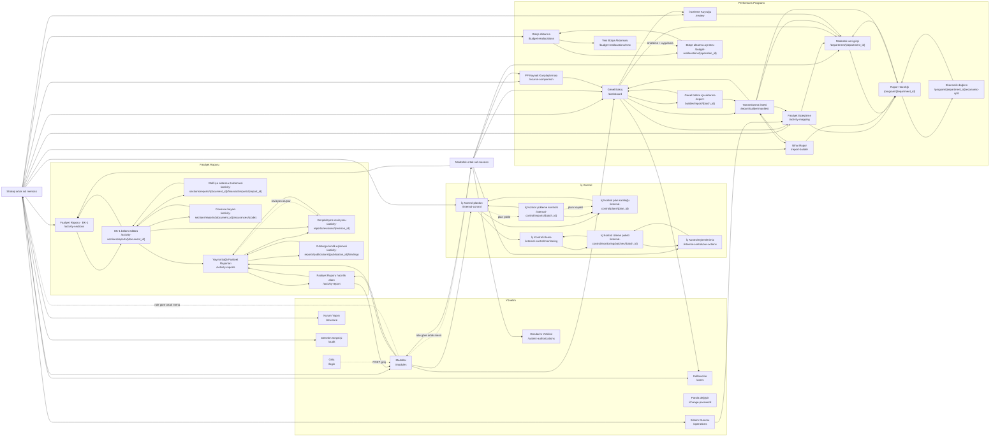

# Ekranlar arası gezinme

Düğümler URL kalıplarını temsil eder; rol, sekme, bölüm ve onay durumları INDEX içindeki ayrı görsellere ayrılmıştır. Düz oklar DOM bağlantılarıdır. Ortak sol menü her ekranda tekrar çizilmez: rol menüsü düğümünden erişilir. Kesik oklar aynı ekran içindeki pencere/sekme veya POST sonrası dönüşü gösterir; düğme ve form eylemlerinin tam URL’leri INDEX tablolarındadır. Dosya indirmeleri ekran değildir.

Ortak menülerde **Parolamı Değiştir** aynı ekranın penceresini açar; **Çıkış** POST `/logout` sonrası `/login` ekranına döner. Bildirimler GET `/api/notifications` ile aynı ekranda panel açar; okunmamış bir bildirime geçiş POST `/api/notifications/{id}/read` sonrasında bildirimin bağlantısını açar. Müdürlük veri girişinin Gösterge / Faaliyet sekmeleri aynı URL içinde kalır.
